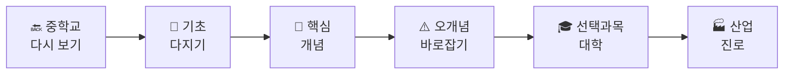

# 통합과학 — 개념에서 산업까지

**2022 개정 교육과정 고등학교 「통합과학1」·「통합과학2」 학습 교재**

> 중학교에서 배운 개념에서 출발해 고등학교 핵심 개념을 정확히 이해하고, 대학 전공과 실제 산업 현장까지 이어지는 길을 보여 주는 교재이다.

---

## 이 교재의 특징

| 특징 | 내용 |
|---|---|
| 🎯 **교육과정에 정확히 맞춤** | 교육부 고시 제2022-33호 성취기준 31개를 31개 단원에 1:1로 대응하고, 성취기준 해설의 범위를 지켰다 |
| 🔙 **중학교 연계로 빈틈 메우기** | 모든 단원이 중학교 성취기준 연계표와 사전 진단 문제로 시작한다 |
| 🧱 **기초 개념 디딤돌** | 핵심 개념에 들어가기 전, 필요한 기초 개념과 수학 도구를 먼저 다진다 |
| 🎓 **선택과목·대학 연계** | 고2·3 선택과목과 대학 전공 과목에서 개념이 어떻게 확장되는지 보여 준다(범위 밖 심화는 별도 표시) |
| 🏭 **산업·진로 연계** | 반도체, 자동차, 에너지, 바이오 등 실제 산업 사례와 관련 진로·학과를 소개한다 |
| ✅ **3단계 확인 문제** | 기본 → 응용 → 융합·서술형, 모든 문제에 정답과 해설 |

👉 교재 구성과 활용법은 **[교재 설계 안내](교재_설계_안내.md)** 를 먼저 읽어 보자.

---

## 모든 단원의 학습 흐름

---

## 목차

### 📗 통합과학1

#### 1단원. 과학의 기초

| 단원 | 제목 | 성취기준 |
|---|---|---|
| 1-1 | [시간과 공간](통합과학1/1단원_과학의_기초/1-1_시간과_공간.md) | 10통과1-01-01 |
| 1-2 | [기본량과 단위](통합과학1/1단원_과학의_기초/1-2_기본량과_단위.md) | 10통과1-01-02 |
| 1-3 | [측정과 어림, 측정 표준](통합과학1/1단원_과학의_기초/1-3_측정과_어림.md) | 10통과1-01-03 |
| 1-4 | [정보와 신호 — 아날로그에서 디지털로](통합과학1/1단원_과학의_기초/1-4_정보와_신호.md) | 10통과1-01-04 |

#### 2단원. 물질과 규칙성

| 단원 | 제목 | 성취기준 |
|---|---|---|
| 2-1 | [빛의 스펙트럼과 우주 초기 원소](통합과학1/2단원_물질과_규칙성/2-1_스펙트럼과_우주_초기_원소.md) | 10통과1-02-01 |
| 2-2 | [별의 진화와 원소의 생성](통합과학1/2단원_물질과_규칙성/2-2_별의_진화와_원소의_생성.md) | 10통과1-02-02 |
| 2-3 | [원소의 주기성과 화학 결합의 이유](통합과학1/2단원_물질과_규칙성/2-3_원소의_주기성과_화학_결합.md) | 10통과1-02-03 |
| 2-4 | [이온 결합과 공유 결합](통합과학1/2단원_물질과_규칙성/2-4_이온_결합과_공유_결합.md) | 10통과1-02-04 |
| 2-5 | [지각과 생명체 구성 물질의 규칙성](통합과학1/2단원_물질과_규칙성/2-5_지각과_생명체_구성_물질.md) | 10통과1-02-05 |
| 2-6 | [물질의 전기적 성질과 소재](통합과학1/2단원_물질과_규칙성/2-6_물질의_전기적_성질.md) | 10통과1-02-06 |

#### 3단원. 시스템과 상호작용

| 단원 | 제목 | 성취기준 |
|---|---|---|
| 3-1 | [지구시스템의 구성과 상호작용](통합과학1/3단원_시스템과_상호작용/3-1_지구시스템.md) | 10통과1-03-01 |
| 3-2 | [판구조론과 지권의 변화](통합과학1/3단원_시스템과_상호작용/3-2_판구조론과_지권의_변화.md) | 10통과1-03-02 |
| 3-3 | [중력과 운동](통합과학1/3단원_시스템과_상호작용/3-3_중력과_운동.md) | 10통과1-03-03 |
| 3-4 | [운동량과 충격량](통합과학1/3단원_시스템과_상호작용/3-4_운동량과_충격량.md) | 10통과1-03-04 |
| 3-5 | [생명 시스템과 물질대사](통합과학1/3단원_시스템과_상호작용/3-5_생명_시스템과_물질대사.md) | 10통과1-03-05 |
| 3-6 | [유전자와 단백질](통합과학1/3단원_시스템과_상호작용/3-6_유전자와_단백질.md) | 10통과1-03-06 |

### 📘 통합과학2

#### 4단원. 변화와 다양성

| 단원 | 제목 | 성취기준 |
|---|---|---|
| 4-1 | [지질시대의 환경 변화와 생물다양성](통합과학2/4단원_변화와_다양성/4-1_지질시대와_생물다양성.md) | 10통과2-01-01 |
| 4-2 | [진화와 생물다양성](통합과학2/4단원_변화와_다양성/4-2_진화와_생물다양성.md) | 10통과2-01-02 |
| 4-3 | [산화와 환원](통합과학2/4단원_변화와_다양성/4-3_산화와_환원.md) | 10통과2-01-03 |
| 4-4 | [산과 염기, 중화 반응](통합과학2/4단원_변화와_다양성/4-4_산과_염기_중화_반응.md) | 10통과2-01-04 |
| 4-5 | [물질 변화와 에너지 출입](통합과학2/4단원_변화와_다양성/4-5_물질_변화와_에너지_출입.md) | 10통과2-01-05 |

#### 5단원. 환경과 에너지

| 단원 | 제목 | 성취기준 |
|---|---|---|
| 5-1 | [생태계 구성 요소와 상호 관계](통합과학2/5단원_환경과_에너지/5-1_생태계_구성_요소.md) | 10통과2-02-01 |
| 5-2 | [생태계 평형](통합과학2/5단원_환경과_에너지/5-2_생태계_평형.md) | 10통과2-02-02 |
| 5-3 | [지구온난화와 기후변화](통합과학2/5단원_환경과_에너지/5-3_지구온난화와_기후변화.md) | 10통과2-02-03 |
| 5-4 | [태양 에너지와 에너지 전환](통합과학2/5단원_환경과_에너지/5-4_태양_에너지와_에너지_전환.md) | 10통과2-02-04 |
| 5-5 | [발전기와 전기 에너지](통합과학2/5단원_환경과_에너지/5-5_발전기와_전기_에너지.md) | 10통과2-02-05 |
| 5-6 | [에너지 효율과 신재생 에너지](통합과학2/5단원_환경과_에너지/5-6_에너지_효율과_신재생_에너지.md) | 10통과2-02-06 |

#### 6단원. 과학과 미래 사회

| 단원 | 제목 | 성취기준 |
|---|---|---|
| 6-1 | [감염병과 과학의 유용성](통합과학2/6단원_과학과_미래_사회/6-1_감염병과_과학의_유용성.md) | 10통과2-03-01 |
| 6-2 | [빅데이터와 과학기술사회](통합과학2/6단원_과학과_미래_사회/6-2_빅데이터와_과학기술사회.md) | 10통과2-03-02 |
| 6-3 | [인공지능 로봇과 사물인터넷](통합과학2/6단원_과학과_미래_사회/6-3_인공지능_로봇과_사물인터넷.md) | 10통과2-03-03 |
| 6-4 | [과학기술과 윤리](통합과학2/6단원_과학과_미래_사회/6-4_과학기술과_윤리.md) | 10통과2-03-04 |

### 📎 부록

- [부록 1. 교육과정 성취기준](부록/교육과정_성취기준.md) — 통합과학1·2 성취기준·해설·탐구 활동 원문
- [부록 2. 중학교–고등학교–대학–산업 연계 지도](부록/연계_지도.md) — 단원별 연계를 한 장의 표로
- [부록 3. 핵심 용어 사전](부록/핵심_용어_사전.md) — 가나다순 용어 정리

---

## 근거 자료

- 교육부 고시 제2022-33호 [별책 9] 「과학과 교육과정」 (저장소의 `[별책9] 과학과 교육과정.pdf`)
