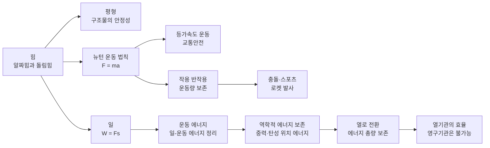
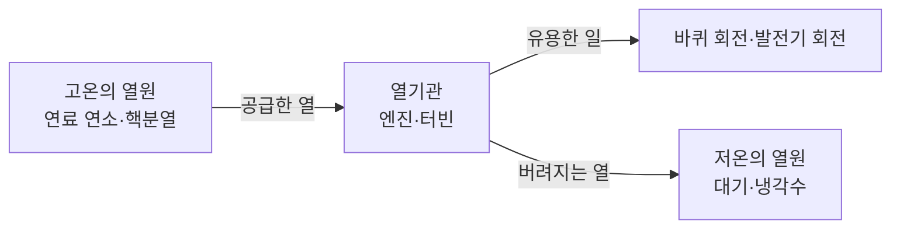

# 물리학 1. 힘과 에너지 — 멈춰 선 다리부터 날아오르는 로켓까지
<!-- prev: m1-05, m3-04, m1-03, 3-3, 3-4, 5-6 -->
<!-- next: mech-1, mech-2 -->

> [!NOTE]
> **성취기준**
> - **[12물리01-01]** 물체에 작용하는 알짜힘과 돌림힘이 0일 때 평형을 이룸을 알고, 다양한 구조물의 안정성을 분석할 수 있다.
> - **[12물리01-02]** 뉴턴 운동 법칙으로 등가속도 운동을 설명하고, 교통안전 사고 예방에 적용할 수 있다.
> - **[12물리01-03]** 작용과 반작용 관계와 운동량 보존 법칙을 알고, 스포츠, 교통수단, 발사체 등에 적용할 수 있다.
> - **[12물리01-04]** 일과 운동 에너지의 관계를 이해하고, 위치 에너지와 역학적 에너지 보존 법칙을 설명할 수 있다.
> - **[12물리01-05]** 역학적 에너지가 열의 형태로 전환될 때 에너지 총량이 변하지 않음을 설명할 수 있다.
> - **[12물리01-06]** 열이 역학적 에너지로 전환되는 과정의 효율을 정성적으로 이해하고, 영구기관이 불가능함을 사례를 통해 논증할 수 있다.

**학습 목표**

1. 알짜힘과 돌림힘이 모두 0일 때 물체가 평형을 이룬다는 것을 알고, 시소·크레인·다리 같은 구조물의 평형과 안정성을 분석할 수 있다.
2. 뉴턴 운동 법칙과 등가속도 운동의 식·그래프로 물체의 운동을 정량적으로 예측하고, 정지 거리를 이용해 교통안전 수칙의 근거를 설명할 수 있다.
3. 작용 반작용 법칙으로부터 운동량 보존 법칙을 이끌어 내고, 충돌·스포츠·교통수단·발사체에 적용할 수 있다.
4. 일–운동 에너지 정리를 이해하고, 중력·탄성력에 의한 위치 에너지를 포함한 역학적 에너지 보존 법칙으로 운동을 예측할 수 있다.
5. 역학적 에너지가 열로 바뀌어도 에너지 총량이 보존됨을 설명하고, 열기관의 효율이 1보다 작고 영구기관이 불가능한 이유를 사례로 논증할 수 있다.

**이 단원의 학습 사다리**

| 단계 | 무엇을 하나? |
|---|---|
| STEP 1. 이전 학습 다시 보기 | 중학교 「힘의 작용」·「운동과 에너지」·「열」, 통합과학 「중력과 운동」·「운동량과 충격량」을 다시 꺼낸다 |
| STEP 2. 기초 다지기 | 벡터와 부호, 그래프의 기울기와 넓이, 자유 물체 그림, 비례식을 디딤돌로 놓는다 |
| STEP 3. 핵심 개념 | 평형과 안정성 → 뉴턴 법칙과 등가속도 운동 → 운동량 보존 → 일과 에너지 → 열과 효율 |
| STEP 4. 오개념 바로잡기 | "작용과 반작용은 서로 상쇄된다?" 같은 착각을 바로잡는다 |
| STEP 5. 다음 단계로 | 진로 선택 「시공간과 운동」·「열과 에너지」, 대학 일반물리학으로 잇는다 |
| STEP 6. 생활·산업·진로 | 구조 공학, 교통안전, 발사체, 발전소와 회생 제동 |

---

## 🗺️ 단원 들어가기

한강을 가로지르는 다리는 수천 톤의 무게를 견디면서도 꿈쩍하지 않는다. 같은 날 도로 위의 자동차는 신호가 바뀌면 출발하고, 빨간불을 보면 멈춘다. 하늘로는 로켓이 불꽃을 뿜으며 솟아오른다. **멈춰 있는 것, 빨라지거나 느려지는 것, 밀어내며 날아가는 것** — 겉보기에 전혀 다른 이 장면들은 모두 '힘'이라는 한 가지 언어로 설명할 수 있다.

그런데 힘만으로는 부족할 때가 있다. 롤러코스터가 언덕을 오르내리는 동안 힘의 크기와 방향은 매 순간 바뀌어 일일이 계산하기 어렵다. 이때 물리학자는 **에너지**라는 두 번째 언어를 꺼낸다. 에너지는 형태를 바꿀 뿐 사라지지 않는다. 브레이크를 밟아 멈춘 자동차의 운동 에너지는 어디로 갔을까? 그 에너지를 다시 모아 차를 움직일 수는 없을까? "연료 없이 영원히 돌아가는 기계"는 왜 아무도 만들지 못했을까?

이 단원은 고등학교 물리학의 첫 단원이다. **물리학은 "자연이 어떤 규칙으로 움직이는가"를 가장 적은 수의 법칙으로 설명하려는 학문**이며, 이 단원에서 배우는 뉴턴 법칙과 에너지 보존은 다리·자동차·로켓·발전소를 설계하는 모든 공학의 출발점이다.

---

## STEP 1. 🔙 이전 학습 다시 보기

### 연계 개념표

| 이전 단원·성취기준 | 그때 배운 것 | 이 단원에서 확장되는 것 |
|---|---|---|
| 중1 「힘의 작용」 [9과05-01] | 힘을 화살표로 나타내고, 나란한 힘의 합력과 힘의 평형 조건을 찾았다 | 알짜힘 0에 더해 **돌림힘 0**까지 갖춰야 완전한 평형임을 안다 |
| 중1 「힘의 작용」 [9과05-02], [9과05-03] | 중력·탄성력·마찰력·부력의 특징, 알짜힘이 0이 아니면 운동 상태가 변한다 | 운동 상태의 변화를 $F = ma$로 **정량적으로** 계산한다 |
| 중3 「운동과 에너지」 [9과19-01], [9과19-02] | 등속 운동과 속력이 일정하게 변하는 운동의 그래프, 자유 낙하에서 1초마다 9.8 m/s씩 빨라진다 | 등가속도 운동의 세 식을 세우고 정지 거리를 예측한다 |
| 중3 「운동과 에너지」 [9과19-03], [9과19-04] | 일의 정의, 중력이 한 일과 위치·운동 에너지, 역학적 에너지 보존 | **일–운동 에너지 정리**, **탄성 위치 에너지**까지 포함한 역학적 에너지 보존 |
| 중1 「열」 [9과03-01], [9과03-02] | 온도와 열평형, 전도·대류·복사 | 역학적 에너지가 열로 바뀌는 과정과 에너지 총량 보존 |
| 통합과학1 「중력과 운동」 [10통과1-03-03] | 자유 낙하와 수평으로 던진 운동은 중력에 의한 가속도 운동이다 | 여러 힘이 함께 작용하는 상황에서 알짜힘과 가속도를 구한다 |
| 통합과학1 「운동량과 충격량」 [10통과1-03-04] | 관성, $p = mv$, 충격량 = 운동량의 변화량, 안전장치 | 작용 반작용에서 **운동량 보존**을 유도하고 충돌·발사체에 적용한다 |
| 통합과학2 「에너지 효율과 신재생 에너지」 [10통과2-02-06] | 에너지는 보존되며, 사용 과정에서 열이 발생해 효율이 낮아진다 | 열을 일로 바꾸는 효율이 1이 될 수 없고 **영구기관이 불가능**함을 논증한다 |

### 준비 운동 (사전 진단)

**Q1.** 줄다리기에서 두 팀이 같은 크기의 힘으로 반대 방향으로 당기면 줄은 움직이지 않는다. 이때 줄에 작용하는 알짜힘의 크기는?

**Q2.** 정지 상태에서 출발한 물체의 속력이 2초마다 6 m/s씩 일정하게 증가한다. 이 물체의 가속도는 몇 $\mathrm{m/s^2}$인가?

**Q3.** 질량 2 kg인 물체를 높이 5 m에서 가만히 놓았다. 바닥에 닿기 직전 운동 에너지는 몇 J인가? (중력 가속도 $10\ \mathrm{m/s^2}$, 공기 저항 무시)

**Q4.** 손바닥을 빠르게 비비면 손이 따뜻해진다. 이때 어떤 에너지가 어떤 에너지로 바뀌었을까?

정답 및 해설

**Q1. 0** — 크기가 같고 방향이 반대인 두 힘이 한 물체(줄)에 작용하므로 힘의 평형을 이룬다.

**Q2.** $3\ \mathrm{m/s^2}$ — 가속도 = 속도 변화량 ÷ 걸린 시간 = $6 \div 2 = 3\ \mathrm{m/s^2}$.

**Q3.** 100 J — 위치 에너지 $mgh = 2 \times 10 \times 5 = 100\ \mathrm{J}$가 모두 운동 에너지로 바뀐다(역학적 에너지 보존).

**Q4.** 손의 운동 에너지가 마찰을 통해 **열에너지**로 바뀌었다. 이 단원의 [12물리01-05]에서 이 과정을 자세히 다룬다.

---

## STEP 2. 🧱 기초 다지기

### ① 벡터와 스칼라 — 방향이 있는 양은 부호로

크기만 있는 양을 **스칼라(scalar)**, 크기와 방향을 함께 가진 양을 **벡터(vector)** 라고 한다.

| 스칼라 | 벡터 |
|---|---|
| 질량, 시간, 거리, 속력, 에너지, 일 | 힘, 변위, 속도, 가속도, 운동량 |

이 단원에서는 주로 **한 직선 위의 운동**을 다룬다. 이때는 한쪽 방향을 (+)로 정하고 반대 방향을 (−)로 나타내면 벡터를 부호가 붙은 수처럼 더하고 뺄 수 있다. 예를 들어 오른쪽을 (+)로 정하면 오른쪽으로 10 N, 왼쪽으로 4 N인 두 힘의 합력은 $(+10) + (-4) = +6\ \mathrm{N}$, 즉 오른쪽으로 6 N이다.

### ② 그래프의 기울기와 넓이

| 그래프 | 기울기의 의미 | 그래프 아래 넓이의 의미 |
|---|---|---|
| 위치–시간 | 속도 | (의미 없음) |
| 속도–시간 | 가속도 | 변위(이동 거리) |
| 힘–시간 | (의미 없음) | 충격량 = 운동량의 변화량 |
| 힘–이동 거리 | (의미 없음) | 일 |

통합과학 「운동량과 충격량」에서 힘–시간 그래프 아래 넓이가 충격량이었던 것처럼, 이 단원에서는 **힘–이동 거리 그래프 아래 넓이가 일**이라는 사실을 새로 사용한다.

### ③ 자유 물체 그림 — 한 물체만 떼어 놓고 그리기

여러 물체가 얽힌 상황에서는 **관심 있는 물체 하나만** 떼어 내어, 그 물체가 **받는** 힘만 화살표로 그린다. 이것을 **자유 물체 그림(free-body diagram)** 이라 한다.

1. 물체를 점이나 상자로 그린다.
2. 지구가 당기는 **중력**(아래)을 먼저 그린다.
3. 물체에 **닿아 있는 것**마다 힘을 하나씩 그린다(바닥 → 떠받치는 힘, 줄 → 장력, 거친 면 → 마찰력).
4. 닿아 있지 않은데 작용하는 힘은 중력(그리고 나중에 배울 전기력·자기력)뿐이다.

> [!IMPORTANT]
> 자유 물체 그림에는 **그 물체가 다른 물체에 주는 힘은 그리지 않는다.** 책이 책상을 누르는 힘은 '책상이 받는 힘'이다. 이 구분이 STEP 3의 작용 반작용을 이해하는 열쇠이다.

### ④ 비례 관계를 읽는 수학 도구

| 식 | 읽는 법 | 예 |
|---|---|---|
| $y = kx$ | $x$가 2배 → $y$도 2배 | $F = ma$: 같은 질량에서 힘 2배 → 가속도 2배 |
| $y = \dfrac{k}{x}$ | $x$가 2배 → $y$는 $\frac{1}{2}$배 | 같은 힘에서 질량 2배 → 가속도 $\frac{1}{2}$배 |
| $y = kx^2$ | $x$가 2배 → $y$는 4배 | 운동 에너지 $\frac{1}{2}mv^2$: 속력 2배 → 4배 |

특히 마지막 줄의 **제곱 비례**는 교통안전에서 아주 중요하다. 속력이 2배가 되면 제동 거리는 4배가 된다(STEP 3 ⑤).

> [!NOTE]
> 지표 근처의 중력 가속도는 약 $9.8\ \mathrm{m/s^2}$이며, 이 단원의 계산에서는 편의상 $g = 10\ \mathrm{m/s^2}$를 쓴다. 질량 $m$인 물체의 무게는 $mg$이다(50 kg인 학생의 무게는 약 500 N).

---

## STEP 3. 📘 핵심 개념

### ① 평형의 두 조건 — 알짜힘 0, 돌림힘 0

중학교에서는 "물체에 작용하는 힘의 합력이 0이면 힘의 평형"이라고 배웠다. 그런데 연필 양 끝을 손가락으로 같은 크기의 힘으로 **반대 방향으로 엇갈리게** 밀어 보자. 합력은 0인데 연필이 **빙글 돈다.** 알짜힘이 0이어도 회전은 일어날 수 있는 것이다.

물체를 회전시키는 능력을 **돌림힘(torque)** 이라고 한다. 회전축에서 힘이 작용하는 지점까지의 거리를 $r$, 그 거리에 수직인 힘의 크기를 $F$라 하면

$$
\tau = rF \qquad \text{(단위: } \mathrm{N\cdot m})
$$

- 같은 힘이라도 **회전축에서 멀리** 작용할수록 돌림힘이 크다. 문손잡이가 경첩 반대쪽 끝에 달린 이유이다.
- 힘의 방향이 회전축을 똑바로 향하면 돌리지 못한다(돌림힘 0).
- 회전 방향에 따라 부호를 붙인다(예: 시계 반대 방향 +, 시계 방향 −).

물체가 정지 상태를 유지하는 **평형(equilibrium)** 이 되려면 두 조건이 모두 필요하다.

$$
\boxed{\;\text{알짜힘} = 0 \;\;(\text{이동하지 않는다}), \qquad \text{알짜 돌림힘} = 0 \;\;(\text{회전하지 않는다})\;}
$$

| 상황 | 알짜힘 | 알짜 돌림힘 | 결과 |
|---|---|---|---|
| 책상 위에 놓인 책 | 0 | 0 | 평형 |
| 연필 양 끝을 엇갈리게 밀기 | 0 | 0 아님 | 제자리에서 회전 |
| 시소에 한 사람만 앉음 | 0 (받침점이 떠받침) | 0 아님 | 한쪽으로 기울어짐 |

> [!TIP]
> 💡 **비유** — 볼트를 푸는 렌치를 떠올리자. 자루 끝을 잡으면 쉽게 풀리고, 볼트 가까이를 잡으면 아무리 힘을 줘도 잘 안 풀린다. 돌림힘은 "힘 × 지렛대 팔의 길이"이다. 아르키메데스가 "충분히 긴 지렛대만 있으면 지구도 움직이겠다"고 한 것도 같은 뜻이다.

#### 예제 1 — 시소의 평형

질량 30 kg인 아이가 시소 받침점에서 1.5 m 떨어진 곳에 앉아 있다. 질량 45 kg인 아빠가 반대쪽에 앉아 시소가 수평으로 평형을 이루려면 받침점에서 몇 m 떨어져 앉아야 할까? (시소 판의 무게중심은 받침점에 있다.)

**풀이** 받침점을 회전축으로 잡으면 두 사람의 무게에 의한 돌림힘이 같아야 한다. $(30g)(1.5) = (45g)d$ → $d = 1.0\ \mathrm{m}$ ($g$는 약분된다). **무거운 사람이 받침점에 더 가까이** 앉아야 한다.

#### 예제 2 — 두 받침대 위의 널빤지

길이 4 m, 무게 200 N인 균일한 널빤지의 양 끝 A, B를 받침대가 받치고 있다. 무게 600 N인 사람이 A에서 1 m 떨어진 곳에 서 있을 때, 받침대 A와 B가 널빤지를 떠받치는 힘의 크기를 각각 구하시오.

**풀이** 균일한 널빤지의 무게는 한가운데(A에서 2 m)에 작용한다고 본다. **A를 회전축으로 잡으면** A가 받치는 힘은 회전축에 작용하므로 돌림힘이 0이 되어 식에서 빠진다.

- 돌림힘 평형(A 기준): $N_B \times 4 = 200 \times 2 + 600 \times 1 = 1000$ → $N_B = 250\ \mathrm{N}$
- 힘의 평형: $N_A + N_B = 200 + 600$ → $N_A = 550\ \mathrm{N}$

사람이 서 있는 A 쪽 받침대가 더 큰 힘을 받는다. 다리를 설계할 때 각 교각이 견뎌야 할 힘을 이렇게 계산한다.

> [!NOTE]
> 회전축은 아무 곳에나 잡을 수 있지만, **모르는 힘이 작용하는 지점**을 회전축으로 잡으면 그 힘이 식에서 사라져 계산이 쉬워진다. 이 단원에서는 회전축(기준점)을 **한 곳만** 잡는 상황을 다룬다.

### ② 구조물의 안정성 — 무게중심과 받침면

평형 상태에 있다고 모두 같은 평형은 아니다. 살짝 건드렸을 때 **원래대로 돌아오는가, 넘어지는가**가 안정성을 결정한다.

**무게중심(center of gravity)** 은 물체의 무게 전체가 한 점에 작용한다고 볼 수 있는 점이다. 물체를 받치는 바닥 부분을 **받침면**이라 하면 다음이 성립한다.

- 무게중심에서 내린 연직선이 **받침면 안**을 지나면 → 중력이 물체를 원래대로 되돌리는 돌림힘을 만든다 → 서 있다.
- 연직선이 **받침면 밖**으로 나가면 → 중력이 물체를 넘어뜨리는 돌림힘을 만든다 → 넘어진다.

따라서 **무게중심이 낮고 받침면이 넓을수록** 많이 기울어져도 넘어지지 않아 안정하다.

| 구조물·물체 | 안정성을 높이는 방법 |
|---|---|
| 오뚝이·트럭 | 무거운 추·엔진을 아래쪽에 두어 무게중심을 낮춘다. 트럭에 짐을 높이 쌓으면 회전할 때 전복되기 쉽다 |
| 타워 크레인 | 짐을 드는 팔 반대쪽에 무거운 **평형추**를 달아 돌림힘을 맞춘다. 짐의 무게와 위치를 센서로 감시해 한계 돌림힘을 넘으면 작동을 멈춘다 |
| 고층 건물 | 기초를 넓고 깊게 만들고, 바람에 의한 흔들림을 줄이는 장치를 둔다 |
| 사람·사다리 | 다리(사다리 발)를 벌려 받침면을 넓히고, 무릎을 굽혀 무게중심을 낮춘다 |

#### 예제 3 — 타워 크레인의 평형추

기둥(회전축)에서 30 m 떨어진 팔 끝에 2000 kg의 철골을 매달았다. 반대쪽 10 m 지점의 평형추로 돌림힘의 평형을 맞추려면 평형추의 질량은? (팔의 무게 무시) **풀이** $2000g \times 30 = Mg \times 10$ → $M = 6000\ \mathrm{kg}$. 짐이 한계 돌림힘을 넘으면 무게중심이 받침면 밖으로 나가 크레인이 넘어진다.

### ③ 뉴턴 운동 법칙 — 힘이 운동을 바꾸는 규칙

뉴턴은 1687년 『프린키피아』에서 운동의 세 법칙을 정리했다.

| 법칙 | 내용 | 한 줄 요약 |
|---|---|---|
| 제1법칙(관성 법칙) | 알짜힘이 0이면 정지한 물체는 계속 정지, 운동하는 물체는 등속 직선 운동 | 힘은 운동을 **유지**하는 데 필요 없다 |
| 제2법칙(가속도 법칙) | 가속도는 알짜힘에 비례하고 질량에 반비례하며, 방향은 알짜힘의 방향 | $F = ma$ |
| 제3법칙(작용 반작용 법칙) | A가 B에 힘을 주면 B도 A에 크기가 같고 방향이 반대인 힘을 준다 | 힘은 항상 **쌍**으로 생긴다 (STEP 3 ⑥) |

$$
F_{\text{알짜}} = ma \qquad (1\ \mathrm{N} = 1\ \mathrm{kg\cdot m/s^2})
$$

여기서 $F$는 **물체가 받는 모든 힘의 합(알짜힘)** 이다. 한 힘만 골라 $ma$에 넣으면 틀린다.

**문제 해결 순서** ① 자유 물체 그림을 그린다 → ② 운동 방향을 (+)로 정한다 → ③ 그 방향의 알짜힘을 구해 $F_{\text{알짜}} = ma$에 넣는다. 여러 물체가 함께 움직이면 **한 덩어리**로 보고 가속도를 먼저 구한 뒤, 하나씩 떼어 내어 서로 주고받는 힘을 구한다.

#### 예제 4 — 함께 밀리는 두 상자

마찰이 없는 바닥에 질량 2 kg인 상자 A와 3 kg인 상자 B가 붙어 있다. A를 10 N의 힘으로 수평으로 밀었다. (1) 두 상자의 가속도와 (2) A가 B를 미는 힘의 크기를 구하시오.

**풀이**
(1) 두 상자를 한 덩어리(5 kg)로 보면 $a = \dfrac{10}{2+3} = 2\ \mathrm{m/s^2}$
(2) B만 떼어 보면 B가 받는 수평 방향 힘은 A가 미는 힘뿐이다. $F_{AB} = m_B a = 3 \times 2 = 6\ \mathrm{N}$

A는 손에게 10 N을 받아 오른쪽으로, B에게 6 N을 받아 왼쪽으로 밀려 알짜힘 4 N이다. 실제로 $2 \times 2 = 4\ \mathrm{N}$으로 맞는다.

#### 예제 5 — 도르래에 연결된 두 물체

마찰이 없는 수평한 책상 위에 질량 3 kg인 수레 A가 있고, 책상 끝의 도르래를 지나는 실로 질량 2 kg인 추 B가 매달려 있다. 손을 놓으면 (1) 가속도의 크기와 (2) 실이 A를 당기는 힘(장력)의 크기는? ($g = 10\ \mathrm{m/s^2}$, 실과 도르래의 질량 무시)

**풀이**
(1) 두 물체를 실로 이어진 한 덩어리로 보면, 운동 방향으로 작용하는 알짜힘은 B의 무게 $2 \times 10 = 20\ \mathrm{N}$뿐이다. $a = \dfrac{20}{3+2} = 4\ \mathrm{m/s^2}$
(2) A만 보면 수평 방향 힘은 장력뿐이다. $T = 3 \times 4 = 12\ \mathrm{N}$

B의 무게(20 N)보다 장력(12 N)이 작다. B가 아래로 가속되고 있기 때문이다. B에 대해 확인하면 $20 - 12 = 2 \times 4$로 맞는다.

### ④ 등가속도 운동 — 세 개의 식과 그래프

알짜힘이 일정하면 가속도가 일정하다. 이런 운동을 **등가속도 운동(uniformly accelerated motion)** 이라 한다. 처음 속도를 $v_0$, 가속도를 $a$, 시간 $t$ 동안의 변위를 $s$라 하면 다음 세 식이 성립한다.

$$
v = v_0 + at
$$

$$
s = v_0 t + \frac{1}{2}at^2
$$

$$
v^2 - v_0^2 = 2as
$$

**식이 나오는 과정** 속도–시간 그래프는 기울기가 $a$인 직선이다(첫째 식). 그래프 아래 넓이는 사다리꼴로, 직사각형 $v_0 t$와 삼각형 $\frac{1}{2}(at)t$의 합이다(둘째 식). 두 식에서 $t$를 없애면 셋째 식이 된다. 셋째 식은 **시간을 모를 때** 특히 쓸모 있다.

| 그래프 | 등속 운동 | 등가속도 운동(속력 증가) |
|---|---|---|
| 가속도–시간 | 0인 수평선 | 0이 아닌 일정한 값의 수평선 |
| 속도–시간 | 수평선 | 기울어진 직선 (기울기 = $a$) |
| 위치–시간 | 기울어진 직선 | 위로 휘어지는 포물선 |

**생활 속 등가속도 운동** 공기 저항을 무시한 자유 낙하(가속도 $g$), 일정한 힘으로 브레이크를 밟는 자동차, 마찰이 작은 빗면을 내려가는 수레, 활주로를 달리는 비행기.

#### 예제 6 — 출발하는 자동차와 위로 던진 공

(1) 정지해 있던 자동차가 일정한 가속도로 5초 만에 20 m/s가 되었다. 가속도와 5초 동안의 이동 거리는? (2) 공을 연직 위로 20 m/s로 던졌을 때 최고 높이는? ($g = 10\ \mathrm{m/s^2}$)

**풀이** (1) $a = \dfrac{20}{5} = 4\ \mathrm{m/s^2}$, $s = \frac{1}{2}\times4\times5^2 = 50\ \mathrm{m}$ (속도–시간 그래프의 삼각형 넓이와 같다)
(2) 위쪽을 (+)로 하면 $a = -10\ \mathrm{m/s^2}$, 최고점에서 $v = 0$이므로 $0 - 20^2 = 2(-10)s$ → $s = 20\ \mathrm{m}$. 최고점에서 속도는 0이지만 **가속도는 여전히 아래쪽으로 $10\ \mathrm{m/s^2}$** 이다.

### ⑤ 교통안전 — 정지 거리는 속력의 제곱으로 늘어난다

운전자가 위험을 보고 차가 완전히 멈출 때까지 달린 거리를 **정지 거리**라고 한다.

$$
\text{정지 거리} = \underbrace{v \times t_{\text{반응}}}_{\text{공주 거리}} + \underbrace{\frac{v^2}{2a}}_{\text{제동 거리}}
$$

- **공주 거리**: 위험을 본 뒤 브레이크를 밟기까지(반응 시간) 차가 **등속으로** 달린 거리. 속력에 비례한다.
- **제동 거리**: 브레이크를 밟은 뒤 **등가속도로 감속**하여 멈출 때까지의 거리. $v^2 - v_0^2 = 2as$에서 $v = 0$을 넣으면 나온다. **속력의 제곱에 비례**한다.

#### 예제 7 — 속력이 2배이면 정지 거리는?

반응 시간이 1.0초인 운전자가 노면에서 $5\ \mathrm{m/s^2}$로 감속할 수 있는 자동차를 운전한다. 속력이 10 m/s(36 km/h)일 때와 20 m/s(72 km/h)일 때의 정지 거리를 구하시오.

**풀이**

| 속력 | 공주 거리 | 제동 거리 | 정지 거리 |
|---|---|---|---|
| 10 m/s | $10 \times 1.0 = 10\ \mathrm{m}$ | $\dfrac{10^2}{2\times5} = 10\ \mathrm{m}$ | 20 m |
| 20 m/s | $20 \times 1.0 = 20\ \mathrm{m}$ | $\dfrac{20^2}{2\times5} = 40\ \mathrm{m}$ | 60 m |

속력은 2배인데 정지 거리는 **3배**, 제동 거리만 보면 **4배**이다.

같은 20 m/s에서 운전자가 휴대전화를 보느라 반응 시간이 2.0초로 늘면 공주 거리가 40 m가 되어 정지 거리는 80 m가 된다.

| 교통안전 수칙 | 물리학적 근거 |
|---|---|
| 어린이 보호 구역 속도 제한(대부분 30 km/h) | 속력이 낮으면 제동 거리가 제곱으로 줄어 같은 거리에서 멈출 수 있다. 충돌하더라도 운동 에너지가 훨씬 작다 |
| 안전거리 확보 | 앞차가 급정거해도 내 정지 거리 안에 멈출 수 있어야 한다 |
| 빗길·눈길 감속 운행 | 마찰이 작아져 감속도 $a$가 작아지면 제동 거리 $\frac{v^2}{2a}$가 길어진다 |
| 졸음·음주·휴대전화 사용 금지 | 반응 시간이 길어져 공주 거리가 늘어난다 |
| 화물 과적 금지 | 질량이 커지면 같은 제동력으로 얻는 감속도가 작아진다($a = F/m$) |

> [!IMPORTANT]
> 제동 거리는 속력의 **제곱**에 비례한다. "조금만 더 빨리"가 정지 거리에서는 "훨씬 더 멀리"가 된다. 이것이 과속이 위험한 가장 직접적인 물리학적 이유이다.

### ⑥ 작용과 반작용 — 힘은 언제나 쌍으로

벽을 손으로 밀면 손바닥이 눌리는 느낌이 든다. 벽도 손을 밀고 있기 때문이다. **물체 A가 물체 B에 힘(작용)을 주면, B도 A에 크기가 같고 방향이 반대인 힘(반작용)을 동시에 준다.** 이것이 뉴턴 운동 제3법칙이다.

$$
F_{\text{A가 B에}} = -F_{\text{B가 A에}}
$$

| 상황 | 작용 | 반작용 |
|---|---|---|
| 걷기 | 발이 땅을 뒤로 민다 | 땅이 발을 앞으로 민다 → 사람이 앞으로 나아간다 |
| 로켓 | 로켓이 가스를 뒤로 밀어낸다 | 가스가 로켓을 앞으로 민다 |
| 사과가 떨어짐 | 지구가 사과를 당긴다 | 사과도 지구를 같은 크기로 당긴다 (지구는 질량이 커서 가속도가 거의 0) |

#### 작용 반작용과 힘의 평형은 다르다

| 구분 | 힘의 평형 | 작용 반작용 |
|---|---|---|
| 힘이 작용하는 물체 | **한 물체**에 두 힘 | **서로 다른 두 물체**에 각각 |
| 크기와 방향 | 같은 크기, 반대 방향 | 같은 크기, 반대 방향 |
| 합성 | 합하면 0 → 물체가 가속되지 않음 | 서로 다른 물체에 작용하므로 합성할 수 없다 |
| 예 (책상 위 책) | 지구가 책을 당기는 힘 ↔ 책상이 책을 떠받치는 힘 | 책상이 책을 떠받치는 힘 ↔ 책이 책상을 누르는 힘 |

> [!TIP]
> 💡 **요령** — 작용 반작용 쌍은 "A가 B에 ↔ B가 A에"처럼 **주어와 목적어를 맞바꾼** 문장으로 쓸 수 있다. "지구가 책을 당긴다"의 반작용은 "책이 지구를 당긴다"이지, "책상이 책을 떠받친다"가 아니다.

### ⑦ 운동량 보존 법칙 — 주고받으면 합은 그대로

질량 $m_1$, $m_2$인 두 물체가 서로 부딪치는 짧은 시간 $\Delta t$ 동안, 작용 반작용에 의해 서로에게 크기가 같고 방향이 반대인 힘 $F$와 $-F$를 준다. 통합과학 「운동량과 충격량」에서 배운 **충격량 = 운동량의 변화량**을 각 물체에 적용하면

$$
\Delta p_1 = F\Delta t, \qquad \Delta p_2 = -F\Delta t \;\;\Rightarrow\;\; \Delta p_1 + \Delta p_2 = 0
$$

한 물체가 얻은 운동량만큼 다른 물체가 잃으므로, 두 물체 운동량의 합은 변하지 않는다.

$$
\boxed{\;m_1 v_1 + m_2 v_2 = m_1 v_1' + m_2 v_2'\;}
$$

이것이 **운동량 보존 법칙(law of conservation of momentum)** 이다. 조건은 **외부에서 작용하는 알짜힘이 0**이라는 것이다. 충돌처럼 아주 짧은 시간에 큰 힘을 주고받는 경우에는 마찰 같은 외부 힘의 효과가 상대적으로 작아서, 충돌 직전과 직후 사이에는 운동량이 거의 보존된다.

| 충돌의 종류 | 운동량 | 운동 에너지 | 예 |
|---|---|---|---|
| 탄성 충돌 | 보존 | 보존 | 당구공끼리의 충돌(근사적), 뉴턴의 요람 |
| 비탄성 충돌 | 보존 | 일부가 열·소리·변형으로 | 대부분의 실제 충돌 |
| 완전 비탄성 충돌 | 보존 | 가장 많이 줄어듦 (두 물체가 붙어서 함께 운동) | 자동차 추돌 후 엉겨 붙음, 다트가 과녁에 박힘 |

> [!IMPORTANT]
> 충돌에서 **운동량은 언제나 보존**되지만(외력이 없으면), **운동 에너지는 보존되지 않을 수 있다.** 사라진 것처럼 보이는 운동 에너지는 열과 소리로 바뀐다. 이 연결은 STEP 3 ⑪에서 다시 만난다.

#### 예제 8 — 붙어서 함께 움직이는 수레

마찰이 없는 수평 레일 위에서 질량 2 kg인 수레 A가 3 m/s로 달려와 정지해 있던 질량 1 kg인 수레 B와 충돌한 뒤 둘이 붙어서 움직였다. (1) 충돌 후 속력과 (2) 충돌로 줄어든 운동 에너지를 구하시오.

**풀이**
(1) $2 \times 3 + 1 \times 0 = (2 + 1)v'$ → $v' = 2\ \mathrm{m/s}$
(2) 충돌 전 $\frac{1}{2}\times2\times3^2 = 9\ \mathrm{J}$, 충돌 후 $\frac{1}{2}\times3\times2^2 = 6\ \mathrm{J}$ → **3 J 감소**

줄어든 3 J은 수레를 붙인 찍찍이(벨크로)의 변형, 열, 소리로 바뀌었다.

#### 예제 9 — 서로 밀어내는 두 스케이터

빙판 위에 정지해 있던 질량 50 kg인 학생과 70 kg인 학생이 서로 손바닥을 밀었다. 50 kg인 학생이 왼쪽으로 1.4 m/s로 미끄러져 갔다면, 70 kg인 학생의 속도는?

**풀이** 처음 운동량의 합이 0이므로 나중 합도 0이다. 오른쪽을 (+)로 정하면 $0 = 50 \times (-1.4) + 70v$ → $v = +1.0\ \mathrm{m/s}$, 즉 오른쪽으로 1.0 m/s이다. 두 학생은 **같은 크기의 운동량**을 반대 방향으로 나눠 가졌고, 질량이 큰 쪽이 더 느리다.

### ⑧ 스포츠, 교통수단, 발사체에 적용하기

#### 스포츠

| 종목·장면 | 적용되는 원리 |
|---|---|
| 당구에서 정면으로 맞은 공이 멈추고 맞힌 공이 나아감 | 질량이 같은 두 공의 (거의) 탄성 충돌에서는 속도를 맞바꾼다 |
| 컬링 스톤이 다른 스톤을 쳐 냄 | 운동량 보존으로 쳐 낸 뒤 각 스톤의 속도를 예측한다 |
| 수영 출발과 턴 | 출발대나 벽을 발로 강하게 밀어 반작용으로 몸이 앞으로 나간다 |
| 육상 단거리 스타팅 블록 | 발이 블록을 뒤로 밀고, 블록이 발을 앞으로 민다 |

#### 교통수단

- **자동차·자전거**: 바퀴가 지면을 뒤로 밀고(마찰력), 지면이 바퀴를 앞으로 민다. 빙판에서 바퀴가 헛도는 것은 이 반작용(마찰력)을 충분히 얻지 못하기 때문이다.
- **배·제트기**: 스크루와 프로펠러는 물·공기를 뒤로 밀어내고, 제트 엔진은 공기를 빨아들여 연료와 함께 태운 뒤 고속으로 뒤로 내뿜는다.
- **교통사고 분석**: 사고 조사 전문가는 충돌 후 두 차가 미끄러진 거리와 방향으로 충돌 직후 속도를 추정하고, 운동량 보존을 이용해 충돌 직전 속도를 거꾸로 계산하기도 한다.

#### 발사체

로켓은 연료를 태운 고온의 가스를 아래(뒤)로 빠르게 분출한다. 처음 정지해 있던 로켓과 연료 전체의 운동량은 0이므로, 가스가 아래로 운동량을 가져가는 만큼 로켓은 위로 같은 크기의 운동량을 얻는다. **로켓은 공기를 밀어서 나아가는 것이 아니라 자신이 내뿜는 가스를 밀어서 나아간다.** 그래서 공기가 없는 우주에서도 가속할 수 있다.

#### 예제 10 — 스케이트보드 위에서 공 던지기

정지한 스케이트보드 위의 학생(학생과 보드의 질량 합 60 kg)이 2 kg인 메디신볼을 앞으로 6 m/s로 던지면? **풀이** $0 = 2\times6 + 60v$ → $v = -0.2\ \mathrm{m/s}$. 학생은 뒤로 0.2 m/s로 밀려난다. 로켓의 원리를 작게 체험한 것이다.

### ⑨ 일과 운동 에너지 — 일–운동 에너지 정리

물체에 힘을 작용하여 힘의 방향으로 이동시켰을 때 힘이 물체에 **일(work)** 을 했다고 한다.

$$
W = Fs \qquad (\text{단위: } 1\ \mathrm{J} = 1\ \mathrm{N\cdot m})
$$

힘과 이동 방향이 다를 때는 **힘 중에서 이동 방향 성분**만 일을 한다.

| 힘과 이동 방향의 관계 | 일 | 예 |
|---|---|---|
| 같은 방향 | $+Fs$ (양의 일) | 수레를 밀어 앞으로 이동 |
| 수직 | 0 | 가방을 들고 수평으로 걸을 때 손이 가방을 떠받치는 힘 |
| 반대 방향 | $-Fs$ (음의 일) | 미끄러지는 상자에 작용하는 마찰력 |

등가속도 운동의 식 $v^2 - v_0^2 = 2as$의 양변에 $\frac{1}{2}m$을 곱하고 $F = ma$를 쓰면

$$
F s = \frac{1}{2}mv^2 - \frac{1}{2}mv_0^2
$$

$\frac{1}{2}mv^2$을 **운동 에너지(kinetic energy)** $E_k$라 하면 다음 관계를 얻는다.

$$
\boxed{\;W_{\text{알짜}} = \Delta E_k \;\;(\text{알짜힘이 한 일} = \text{운동 에너지의 변화량})\;}
$$

이것을 **일–운동 에너지 정리(work–energy theorem)** 라 한다. 알짜힘이 양의 일을 하면 빨라지고, 음의 일을 하면 느려진다.

> [!TIP]
> 💡 **비유** — 운동 에너지를 '통장 잔고', 일을 '입금(+)·출금(−)'으로 보자. 밀어 주는 힘은 입금, 마찰력은 출금이다. 잔고의 변화(운동 에너지 변화)는 입출금의 합(알짜힘이 한 일)과 정확히 같다. 통합과학에서는 운동량을 같은 비유로 설명했다. **운동량 통장은 '힘×시간', 에너지 통장은 '힘×거리'로 입출금한다**는 점이 다르다.

#### 예제 11 — 제동 거리를 에너지로 다시 보기

질량 1000 kg인 자동차가 20 m/s로 달리다 브레이크를 밟았다. 바퀴와 도로 사이의 마찰력이 5000 N으로 일정할 때 제동 거리는?

**풀이** 마찰력이 한 (음의) 일이 운동 에너지를 0으로 만든다.

$$
-5000 \times s = 0 - \frac{1}{2}\times1000\times20^2 \;\Rightarrow\; s = 40\ \mathrm{m}
$$

STEP 3 ⑤의 예제 7($a = 5\ \mathrm{m/s^2}$, 20 m/s → 40 m)과 같은 답이다. 감속도가 $5000/1000 = 5\ \mathrm{m/s^2}$이기 때문이다. **힘과 운동 방정식으로 풀든 일과 에너지로 풀든 결과는 같다.** 에너지 방법은 시간을 몰라도 되어 편리하다.

### ⑩ 위치 에너지와 역학적 에너지 보존 법칙

어떤 힘은 물체가 이동한 **경로와 관계없이 처음과 나중 위치만으로** 한 일이 정해진다. 중력과 탄성력이 그렇다. 이런 힘에 대해서는 위치에 따라 정해지는 에너지, 곧 **위치 에너지(potential energy)** 를 정의할 수 있다.

| 위치 에너지 | 식 | 기준 | 생활 속 예 |
|---|---|---|---|
| 중력에 의한 위치 에너지(지표 근처) | $E_p = mgh$ | 기준면에서의 높이 $h$ | 댐에 가둔 물, 높이 올린 공사용 해머 |
| 탄성력에 의한 위치 에너지 | $E_p = \frac{1}{2}kx^2$ | 용수철이 늘어나거나 줄어든 길이 $x$ | 당긴 활시위, 눌린 트램펄린, 태엽 장난감 |

탄성 위치 에너지의 식은 이렇게 얻는다. 용수철을 $x$만큼 늘이는 데 필요한 힘은 $F = kx$로 늘어난 길이에 비례한다(**훅 법칙**, $k$: 용수철 상수). 힘–늘어난 길이 그래프는 원점을 지나는 직선이고, 그 아래 삼각형 넓이 $\frac{1}{2}\times x \times kx$가 용수철에 해 준 일, 곧 저장된 에너지이다.

운동 에너지와 위치 에너지의 합을 **역학적 에너지(mechanical energy)** 라 한다. 중력과 탄성력만 일을 하고 마찰·공기 저항이 없으면

$$
\boxed{\;E = E_k + E_p = \text{일정}\;}
$$

이것이 **역학적 에너지 보존 법칙**이다. 위치 에너지가 줄어든 만큼 운동 에너지가 늘고, 그 반대도 성립한다.

#### 예제 12 — 롤러코스터

마찰이 없는 롤러코스터가 높이 20 m인 꼭대기에서 거의 정지 상태로 출발한다. (1) 높이 0 m인 바닥과 (2) 높이 15 m인 둘째 언덕 꼭대기에서의 속력을 구하시오. ($g = 10\ \mathrm{m/s^2}$)

**풀이** 질량을 $m$이라 하면 $mg(20) = \frac{1}{2}mv^2 + mgh$에서 $m$이 약분된다.

(1) $v = \sqrt{2 \times 10 \times 20} = 20\ \mathrm{m/s}$
(2) $v = \sqrt{2 \times 10 \times (20 - 15)} = 10\ \mathrm{m/s}$

속력은 **질량과 관계없이 높이 차이로만** 정해진다. 그래서 둘째 언덕은 첫 언덕보다 반드시 낮게 설계한다.

#### 예제 13 — 용수철 장난감 총

용수철 상수가 200 N/m인 용수철을 0.1 m 압축한 뒤, 질량 0.02 kg인 공을 수평으로 발사했다. 공의 발사 속력은? (마찰 무시)

**풀이** 탄성 위치 에너지 $\frac{1}{2}\times200\times0.1^2 = 1\ \mathrm{J}$이 모두 공의 운동 에너지로 바뀐다.

$$
1 = \frac{1}{2}\times0.02\times v^2 \;\Rightarrow\; v = 10\ \mathrm{m/s}
$$

| 운동 | 에너지 전환 |
|---|---|
| 단진자 | 가장 높은 곳(위치 E 최대, 속력 0) ↔ 가장 낮은 곳(운동 E 최대) |
| 용수철에 매단 추의 진동 | 탄성 위치 E ↔ 운동 E (↔ 중력 위치 E) |
| 번지점프 | 중력 위치 E → 운동 E → 줄의 탄성 위치 E |
| 양수 발전 | 남는 전기로 물을 위로 올려 중력 위치 E로 저장 → 필요할 때 흘려 발전 |

### ⑪ 역학적 에너지가 열로 — 그래도 에너지 총량은 그대로

실제로 공을 떨어뜨리면 튀어 오를 때마다 높이가 낮아지고, 그네는 밀어 주지 않으면 결국 멈춘다. 역학적 에너지가 줄어든 것이다. 그러면 에너지 보존 법칙이 깨진 것일까?

그렇지 않다. 마찰력과 공기 저항이 일을 하면 역학적 에너지의 일부가 **열(열에너지)** 로 바뀐다. 중1 「열」에서 배운 것처럼 온도는 물질을 이루는 입자들의 운동이 얼마나 활발한지를 나타낸다. 마찰로 '물체 전체의 질서 있는 운동'이 '입자들의 무질서한 운동'으로 바뀐 것이 곧 열이다.

$$
\boxed{\;\text{처음 역학적 에너지} = \text{나중 역학적 에너지} + \text{열 등으로 전환된 에너지}\;}
$$

**에너지의 총량은 언제나 보존된다.** 이것이 역학적 에너지 보존보다 더 넓은 **에너지 보존 법칙**이다.

**역사 — 줄의 실험** 19세기 중반 영국의 줄(J. P. Joule)은 추가 떨어지면서 물속의 날개를 돌리게 하고, 그 마찰로 물의 온도가 올라가는 것을 정밀하게 측정했다. 그는 **일정한 양의 역학적 에너지는 언제나 일정한 양의 열을 만든다**는 것을 보였다. 오늘날의 단위로는 1 cal(물 1 g을 1 °C 올리는 열)가 약 4.2 J에 해당한다. 이 실험으로 열은 '열소'라는 물질이 아니라 **에너지의 한 형태**임이 확립되었고, 에너지 보존 법칙이 자리 잡았다.

#### 열의 형태로 전환되는 다양한 현상 (정성적으로)

| 현상 | 에너지 전환 | 연결되는 중학교 개념 |
|---|---|---|
| 브레이크를 밟은 자동차 | 운동 E → 브레이크 원판의 열 (원판이 뜨거워짐) | 열전달: 원판에서 공기로 대류·복사 |
| 낙하산을 펴고 일정한 속력으로 내려오는 사람 | 중력 위치 E → 공기의 열 (운동 E는 그대로) | 열평형 |
| 아이스링크에서 미끄러지는 스케이트 날 | 운동 E의 일부 → 마찰열 → 날 아래 얼음 표면이 일부 녹음 | 상태 변화와 열 출입 |
| 강한 바람이 부는 바다 | 바람의 운동 E → 물결 → 결국 바닷물의 열 | 대기와 해수의 순환 |

#### 예제 14 — 눈썰매장의 열

질량 60 kg인 학생이 높이 30 m에서 정지 상태로 출발하여 눈썰매를 타고 내려와 바닥에서 속력이 20 m/s가 되었다. 내려오는 동안 마찰과 공기 저항으로 열이 된 에너지는? ($g = 10\ \mathrm{m/s^2}$)

**풀이**
처음 역학적 에너지: $60\times10\times30 = 18\,000\ \mathrm{J}$
나중 역학적 에너지: $\frac{1}{2}\times60\times20^2 = 12\,000\ \mathrm{J}$
열로 전환: $18\,000 - 12\,000 = 6\,000\ \mathrm{J}$

역학적 에너지는 $\frac{1}{3}$이 줄었지만, 줄어든 만큼 썰매 날·눈·공기의 열이 되었으므로 **에너지 총량은 18 000 J로 그대로이다.**

> [!IMPORTANT]
> "에너지가 **사라졌다**"는 말은 물리학에서 틀린 말이다. 에너지는 **쓸모 있는 형태에서 쓸모 적은 형태(흩어진 열)로 바뀌었을 뿐**이다. 우리가 '에너지를 소비한다'고 말할 때도 실제로는 에너지를 열로 흩어지게 하는 것이다.

### ⑫ 열을 일로 — 효율은 1이 될 수 없고, 영구기관은 불가능하다

⑪에서는 역학적 에너지가 열로 바뀌었다. 이 과정은 아주 쉽게, 저절로 일어난다. 그런데 **반대로 열을 역학적 에너지(일)로 바꾸는 것**은 어떨까?

열을 일로 바꾸는 장치를 **열기관(heat engine)** 이라 한다. 자동차 엔진, 화력·원자력 발전소의 증기 터빈, 제트 엔진이 모두 열기관이다. 모든 열기관은 같은 구조를 가진다.

열기관의 **효율(efficiency)** 은 공급한 열 가운데 얼마만큼이 유용한 일로 바뀌었는지를 나타낸다.

$$
\text{열효율} = \frac{\text{열기관이 한 일}}{\text{공급한 열}}
$$

이 단원에서는 효율을 **정성적으로** 이해한다. 핵심은 다음 두 가지이다.

1. **에너지 보존**: 공급한 열 = 한 일 + 버려지는 열. 그러므로 한 일은 공급한 열보다 클 수 없다.
2. **방향성**: 열은 저절로 고온에서 저온으로만 흐르고, 흩어진 열을 남김없이 모아 일로 바꿀 수는 없다. 열기관은 반드시 일부 열을 저온의 열원(대기·냉각수)으로 **버려야만** 작동한다. 그러므로 열효율은 **항상 1(100 %)보다 작다.**

| 열기관 | 효율의 대략적 수준 | 버려지는 열은 어디로? |
|---|---|---|
| 자동차 가솔린 엔진 | 대략 30 % 안팎 | 배기가스, 냉각수(라디에이터) |
| 화력 발전소 | 대략 40 % 안팎 | 냉각수(바닷물·강물), 굴뚝 |
| 증기 기관(18세기 초기) | 몇 % 이하 | 대부분 주변으로 흩어짐 |

표의 수치는 기관의 종류와 운전 조건에 따라 크게 달라지는 대략적인 값이다. 중요한 것은 **어떤 열기관도 100 %에 도달하지 못한다**는 점이다.

**효율을 높이려는 노력** 버려지는 열을 다시 쓰는 것이 핵심이다. 화력 발전소의 배기열로 물을 데워 지역 난방에 쓰는 열병합 발전, 가스 터빈에서 나온 뜨거운 배기가스로 증기 터빈을 한 번 더 돌리는 복합 화력 발전, 전기 자동차의 회생 제동(운동 에너지를 열로 버리지 않고 전기로 되돌려 저장)이 그 예이다.

#### 영구기관은 왜 불가능한가

외부에서 에너지를 공급받지 않고 영원히 일을 하는 장치를 **영구기관(perpetual motion machine)** 이라 한다. 수백 년 동안 수많은 사람이 도전했지만 모두 실패했다. 영구기관은 두 종류로 나눌 수 있다.

| 종류 | 주장 | 왜 불가능한가 |
|---|---|---|
| 제1종 영구기관 | 에너지 공급 없이 일을 계속하거나, 넣은 것보다 많은 에너지를 내놓는다 | **에너지 보존 법칙**에 어긋난다. 무에서 에너지가 생기지 않는다 |
| 제2종 영구기관 | 한 열원(예: 바닷물)에서 열을 뽑아 **남김없이** 일로 바꾼다 | 에너지 보존은 지키지만, 열을 일로 바꿀 때 반드시 일부를 저온 쪽에 버려야 한다는 **열의 방향성**에 어긋난다 |

#### 사례로 논증하기

**사례 1. 불균형 바퀴** 바퀴 둘레에 추를 매달아, 한쪽에서는 추가 바깥으로 젖혀져 회전축에서 멀어지고 반대쪽에서는 안으로 접히도록 만든 장치이다. "바깥쪽 추의 돌림힘이 더 크니 영원히 돈다"는 주장이었다.
→ **반박** 실제로 그려 보면 바깥으로 젖혀진 쪽은 추의 **개수가 더 적고**, 안으로 접힌 쪽은 **개수가 더 많다.** 돌림힘의 합은 0이 되는 위치에서 바퀴는 멈춘다(STEP 3 ①의 돌림힘 평형). 에너지로 보아도, 추가 한 바퀴 돌아 제자리로 오면 중력 위치 에너지의 변화는 0이므로 중력이 한 알짜 일도 0이다. 마찰로 잃는 에너지를 보충할 곳이 없다.

**사례 2. 물레방아와 펌프의 순환** 위쪽 물통의 물을 떨어뜨려 물레방아를 돌리고, 물레방아로 펌프를 움직여 떨어진 물을 다시 위로 올리는 장치.
→ **반박** 물을 다시 올리려면 떨어질 때 얻은 위치 에너지와 **같은 크기**의 일이 필요하다. 그런데 물레방아와 펌프의 마찰로 반드시 일부가 열이 되므로, 얻은 일은 필요한 일보다 항상 **작다.** 물은 점점 덜 올라가다가 장치는 멈춘다.

**사례 3. 발전기를 단 전기 자동차** "바퀴에 발전기를 달아 달리면서 전기를 만들어 배터리를 계속 충전하면 충전소에 갈 필요가 없다."
→ **반박** 발전기가 전기를 만들면 그만큼 바퀴의 회전을 방해하는 힘이 생겨, 모터는 더 많은 전기 에너지를 써야 한다. 모터와 발전기 모두 열을 내므로 **만든 전기 < 추가로 쓴 전기**가 된다. (회생 제동이 이득인 이유는 **어차피 버려질 제동 에너지**를 일부 되돌리기 때문이지, 에너지를 새로 만들기 때문이 아니다.)

**사례 4. 바닷물의 열로 가는 배** "바닷물은 엄청난 양의 열을 가지고 있으니, 바닷물에서 열을 뽑아 엔진을 돌리고 차가워진 물은 버리면 연료 없이 항해할 수 있다."
→ **반박** 에너지 보존에는 어긋나지 않지만, 열기관은 **더 차가운 곳으로 열을 버려야만** 일을 할 수 있다. 바다보다 차가운 열원이 없으면 바닷물의 열은 일로 바뀌지 않는다. 이것이 제2종 영구기관이다.

> [!NOTE]
> 18세기 후반 프랑스 과학 아카데미는 영구기관에 관한 제안을 더는 심사하지 않기로 했다. 오늘날에도 특허 심사에서 영구기관은 자연법칙에 어긋나는 발명으로 보아 받아들이지 않는다. 과학 법칙은 "무엇이 가능한가"뿐 아니라 **"무엇이 불가능한가"** 도 알려 주어, 헛된 시도에 쏟을 자원을 아껴 준다.

---

## STEP 4. ⚠️ 오개념 바로잡기

| 흔한 오개념 | 올바른 개념 | 왜 그럴까? |
|---|---|---|
| 알짜힘이 0이면 물체는 반드시 정지해 있다 | 알짜힘이 0이면 **정지 또는 등속 직선 운동**을 한다. 또 회전하지 않으려면 **알짜 돌림힘도 0**이어야 한다 | 연필을 엇갈리게 밀면 합력 0이어도 회전한다. 등속으로 달리는 차도 알짜힘은 0이다 |
| 작용과 반작용은 크기가 같고 방향이 반대이므로 서로 상쇄되어 물체가 움직이지 않는다 | 작용과 반작용은 **서로 다른 물체**에 작용하므로 합성할 수 없다 | 말이 수레를 끄는 힘과 수레가 말을 당기는 힘은 각각 수레와 말에 작용한다. 말이 앞으로 가는 것은 땅이 말을 앞으로 미는 힘 때문이다 |
| 속력이 2배가 되면 제동 거리도 2배가 된다 | 제동 거리는 속력의 **제곱**에 비례하여 **4배**가 된다 | $s = \frac{v^2}{2a}$, 또는 운동 에너지 $\frac{1}{2}mv^2$을 마찰력의 일로 없애야 하기 때문이다 |
| 충돌에서 운동 에너지가 줄면 운동량도 준다 | 외력이 없으면 운동량은 **항상 보존**된다. 운동 에너지만 일부 열·소리로 바뀐다 | 운동량은 방향이 있어 서로 주고받으며 합이 유지되지만, 운동 에너지는 열로 흩어질 수 있다 |
| 마찰이 있으면 에너지 보존 법칙이 성립하지 않는다 | **역학적 에너지**는 줄지만 열을 포함한 **에너지 총량**은 보존된다 | 마찰열로 온도가 올라가는 것이 사라진 역학적 에너지의 행방이다 |
| 기술이 충분히 발전하면 효율 100 %인 열기관을 만들 수 있다 | 열기관은 반드시 저온 쪽에 열을 버려야 하므로 효율은 **원리적으로** 1보다 작다 | 마찰을 없애는 기술의 문제가 아니라 열의 방향성이라는 자연법칙의 문제이다 |

---

## STEP 5. 🎓 다음 단계로 한 걸음 더

> [!CAUTION]
> 이 절은 **물리학 교육과정 범위 밖의 심화 내용**으로 평가 대상이 아니다. 이 단원의 개념이 진로 선택 과목과 대학에서 어떻게 넓어지는지 맛보기로 보여 준다.

### 진로 선택 과목과의 연결

| 다음 단원 | 이어지는 내용 |
|---|---|
| 역학과 에너지 「시공간과 운동」 [12역학01-01]~[12역학01-06] | 2차원 평면에서 여러 힘의 합력(벡터 합성), 포물선 운동과 원운동, 케플러 법칙과 중력, 탈출 속도, 우주선 발사, 등가 원리와 블랙홀 |
| 역학과 에너지 「열과 에너지」 [12역학02-01]~[12역학02-05] | 이상 기체 법칙, 열역학 제1법칙, 열기관의 순환 과정과 열효율, 엔트로피와 비가역 현상 |
| 역학과 에너지 「탄성파와 소리」 [12역학03-01] | 용수철 진자의 단진동 — 이 단원의 탄성 위치 에너지가 진동 분석으로 이어진다 |
| 대학 일반물리학·동역학·열역학 | 미적분으로 쓰는 뉴턴 법칙, 강체의 회전 운동, 3차원 충돌, 열역학 법칙과 통계역학 |

### ① 2차원으로 넓히기 — 벡터의 분해

이 단원에서는 한 직선 위의 힘과 운동을 부호로 다루었다. 「시공간과 운동」에서는 힘을 서로 수직인 두 성분으로 나누어 다룬다. 빗면 위의 물체에 작용하는 중력 $mg$는 빗면 방향 성분 $mg\sin\theta$와 빗면에 수직인 성분 $mg\cos\theta$로 나뉜다. 비스듬히 던진 물체는 수평 방향으로는 등속 운동, 연직 방향으로는 등가속도 운동을 하므로, 이 단원의 등가속도 식을 **두 방향에 따로** 적용하면 포물선 운동이 완전히 풀린다.

### ② 열역학 제1법칙과 카르노 효율

「열과 에너지」에서는 STEP 3 ⑪~⑫의 정성적 내용을 식으로 쓴다. 기체에 가한 열 $Q$는 내부 에너지 변화 $\Delta U$와 기체가 외부에 한 일 $W$로 나뉜다.

$$
Q = \Delta U + W
$$

이것은 열을 포함한 에너지 보존 법칙의 다른 표현이다. 또 대학 열역학에서는 고온 열원의 절대 온도 $T_H$와 저온 열원의 절대 온도 $T_C$ 사이에서 작동하는 어떤 열기관도 다음 효율을 넘을 수 없음을 보인다(카르노 효율).

$$
e_{\text{최대}} = 1 - \frac{T_C}{T_H}
$$

$T_C$가 0 K가 아닌 한 $e_{\text{최대}} < 1$이다. STEP 3 ⑫에서 말로 설명한 "효율은 1이 될 수 없다"가 이렇게 정량적인 한계로 바뀐다. 제2종 영구기관이 불가능하다는 것은 **열역학 제2법칙**의 한 표현이며, 이 법칙은 **엔트로피**라는 양으로 정리된다.

### 지금 vs 다음 단계

| 구분 | 물리학(지금) | 역학과 에너지·대학 |
|---|---|---|
| 힘과 운동 | 1차원, 부호로 방향 표시 | 2차원·3차원 벡터, 포물선·원운동 |
| 평형 | 알짜힘 0, 돌림힘 0 (기준점 한 곳) | 강체의 회전 운동, 관성 모멘트, 각운동량 |
| 운동량 | 일차원 충돌의 운동량 보존 | 2차원 충돌, 질량 중심, 로켓 방정식 |
| 에너지 | 중력·탄성 위치 에너지, 역학적 에너지 보존 | 만유인력 위치 에너지, 탈출 속도, 적분으로 구하는 일 |
| 열 | 열로의 전환과 총량 보존, 효율을 정성적으로 | 열역학 제1·2법칙, 열기관 순환 과정, 엔트로피 |
| 관련 전공 | — | 물리학, 기계공학, 건축·토목공학, 항공우주공학, 에너지공학 |

---

## STEP 6. 🏭 생활·산업·진로 연결

### 사례 1. 구조 공학 — 다리와 건물이 서 있는 이유

- **원리** 다리·건물의 모든 부재(기둥, 보, 케이블)는 알짜힘과 알짜 돌림힘이 0이 되도록 설계된다. 사장교에서는 주탑 양쪽으로 비스듬히 뻗은 케이블이 상판을 당겨 올리는데, 주탑 양쪽의 돌림힘이 서로 맞도록 케이블을 대칭으로 배치한다.
- **안정성** 고층 건물은 바람과 지진에 흔들린다. 일부 초고층 건물은 꼭대기 근처에 거대한 추를 달아 건물과 반대로 흔들리게 하여 흔들림을 줄인다(동조 질량 감쇠기). 무게중심과 받침면, 돌림힘의 원리를 건물 규모로 적용한 것이다.

### 사례 2. 교통안전 공학 — 숫자로 정하는 제한 속도

- **원리** 제한 속도, 안전거리, 신호등의 황색 신호 시간은 정지 거리 계산을 바탕으로 정한다. 황색 신호가 너무 짧으면 교차로 앞에서 멈출 수도, 지나갈 수도 없는 구간이 생긴다.
- **어린이 보호 구역** 속도를 낮추면 제동 거리가 제곱으로 줄어든다. 충돌하더라도 운동 에너지가 작아 피해가 크게 줄어든다.
- **첨단 운전자 보조 장치** 자동 긴급 제동 장치는 레이더·카메라로 앞차와의 거리와 상대 속도를 측정하고, 현재 속력에서의 제동 거리를 계산하여 운전자보다 먼저 브레이크를 작동시킨다. 반응 시간을 사실상 줄여 공주 거리를 없애는 기술이다.

### 사례 3. 발사체 — 운동량 보존으로 우주에 가다

- **원리** 로켓은 가스를 뒤로 내뿜는 만큼 앞으로 운동량을 얻는다. 다 쓴 연료통을 떼어 내는 다단 로켓은 쓸모없어진 질량을 버려 남은 부분이 더 쉽게 가속되게 한다($a = F/m$).
- **우리나라** 한국항공우주연구원이 개발한 **누리호**는 3단으로 이루어진 발사체로, 우리 기술로 위성을 궤도에 올리는 데 성공했다.
- **재사용 발사체** 최근에는 1단 로켓이 엔진을 거꾸로 분사해 감속하며 착륙하는 기술이 쓰인다. 엔진 분사로 운동량을 줄이는 것, 착륙 다리의 완충 장치로 충돌 시간을 늘리는 것 모두 이 단원과 통합과학의 원리이다.

### 사례 4. 발전소와 회생 제동 — 열과 일 사이에서

- **발전소** 화력·원자력 발전소는 열로 물을 끓여 증기 터빈을 돌리는 열기관이다. 효율의 한계 때문에 공급한 열의 절반 이상이 냉각수와 대기로 버려진다. 발전소가 바닷가나 강가에 많은 이유 중 하나가 이 많은 열을 버릴 냉각수가 필요하기 때문이다.
- **회생 제동** 전기 자동차와 하이브리드 자동차는 감속할 때 모터를 발전기로 바꾸어, 브레이크 원판에서 열로 버려질 운동 에너지의 일부를 전기 에너지로 되돌려 배터리에 저장한다. 에너지를 새로 만드는 것이 아니라 **덜 버리는** 기술이다.

### 관련 진로와 학과

| 진로 | 하는 일 | 관련 학과 |
|---|---|---|
| 구조 엔지니어 | 다리·건물·크레인의 평형과 안정성 설계, 안전 진단 | 토목공학, 건축공학 |
| 교통 공학자 | 제한 속도·신호 체계·도로 설계, 사고 분석 | 교통공학, 도시공학 |
| 자동차 엔지니어 | 제동 장치, 운전자 보조 장치, 회생 제동 설계 | 기계공학, 자동차공학, 전자공학 |
| 발사체·항공우주 엔지니어 | 추진 기관, 다단 분리, 궤도 진입 설계 | 항공우주공학, 기계공학 |
| 에너지·발전 엔지니어 | 발전소 운영, 열효율 향상, 폐열 회수 | 기계공학, 에너지공학, 원자력공학 |

---

## 🔬 탐구 활동

### 활동 A. 동영상을 활용하여 물체의 등가속도 운동 분석하기

**목표** 빗면을 내려가는 수레의 동영상을 분석하여 등가속도 운동임을 확인하고, 가속도를 구한다.

**준비물** 역학 수레, 빗면(길이 1.5 m 이상), 줄자 또는 눈금 테이프, 스마트폰(초당 프레임 수를 아는 촬영 모드), 삼각대, 동영상 분석 앱 또는 프로그램

**과정**
1. 빗면 옆에 눈금 테이프를 붙이고, 스마트폰을 삼각대에 고정하여 빗면 전체가 화면에 들어오게 한다.
2. 수레를 빗면 위쪽에서 가만히 놓고 내려가는 장면을 촬영한다.
3. 동영상 분석 프로그램에서 일정한 시간 간격(예: 0.1초)마다 수레 앞 끝의 위치를 기록한다.
4. 각 구간의 평균 속도(= 구간 이동 거리 ÷ 시간 간격)를 그 구간의 가운데 시각에 대응시켜 속도–시간 그래프를 그리고, 기울기로 가속도를 구한다.
5. 빗면의 기울기를 바꾸어 같은 실험을 반복한다.

**결과 기록**

| 시각(s) | 위치(m) | 구간 이동 거리(m) | 구간 평균 속도(m/s) |
|---|---|---|---|
| 0.0 | | — | — |
| 0.1 | | | |
| 0.2 | | | |
| 0.3 | | | |

**생각해 보기**
1. 속도–시간 그래프가 직선에 가까운가? 직선이라면 무엇을 의미하는가?
2. 같은 시간 간격 동안의 이동 거리는 어떤 규칙으로 늘어나는가? (등가속도 운동에서는 연속한 같은 시간 간격의 이동 거리 차이가 일정하다.)
3. 빗면의 기울기가 커지면 가속도는 어떻게 변하는가? 예상 값과 실험값이 다르다면 그 이유(마찰, 위치 읽기 오차, 프레임 수 등)를 토의해 보자.

> [!WARNING]
> **안전 수칙** 수레가 빗면 끝에서 떨어지지 않도록 끝에 완충재나 멈춤 장치를 둔다. 빗면을 높이 들어 올릴 때는 받침이 단단히 고정되었는지 확인한다.

### 활동 B. 일차원 충돌 상황에서 운동량 보존 확인하기

**목표** 두 수레의 충돌 전후 속도를 측정하여 운동량의 합이 보존되는지 확인하고, 운동 에너지 변화와 비교한다.

**준비물** 마찰이 작은 수평 트랙, 역학 수레 2대(한쪽 끝에 찍찍이 또는 자석 범퍼), 추, 전자저울, 운동 센서 또는 스마트폰 동영상 촬영

**과정**
1. 두 수레의 질량을 전자저울로 잰다. 추를 올려 질량을 바꿀 수 있게 한다.
2. **완전 비탄성 충돌**: 찍찍이를 마주 보게 하고, 수레 A를 밀어 정지한 수레 B에 부딪쳐 붙게 한다.
3. **탄성에 가까운 충돌**: 자석 범퍼(같은 극)를 마주 보게 하여 같은 방법으로 충돌시킨다.
4. 충돌 직전과 직후 각 수레의 속도를 센서나 동영상으로 측정한다.
5. 수레 B의 질량을 바꾸어 반복한다.

**결과 기록**

| 실험 | $m_A$(kg) | $m_B$(kg) | 충돌 전 운동량 합 | 충돌 후 운동량 합 | 충돌 전 운동 E 합 | 충돌 후 운동 E 합 |
|---|---|---|---|---|---|---|
| 붙는 충돌 1 | | | | | | |
| 자석 충돌 1 | | | | | | |

**생각해 보기**
1. 두 종류의 충돌에서 운동량의 합은 각각 보존되었는가? 오차의 원인은 무엇일까?
2. 운동 에너지의 합은 어느 충돌에서 더 많이 줄었는가? 줄어든 에너지는 어디로 갔을까?
3. 이 결과를 이용해, 교통사고에서 엉겨 붙은 두 차량의 충돌 직전 속도를 추정하는 방법을 설명해 보자.

> [!WARNING]
> **안전 수칙** 수레를 너무 세게 밀지 않으며, 트랙 양 끝에 멈춤 장치를 둔다. 강한 자석은 전자 기기와 카드에서 멀리 둔다.

---

## ✅ 개념 확인 문제

### 기본

**1.** 길이가 같은 막대의 받침점에서 왼쪽으로 0.6 m 떨어진 곳에 무게 20 N인 추를 매달았다. 막대가 수평으로 평형을 이루려면 받침점에서 오른쪽으로 0.4 m 떨어진 곳에 무게가 몇 N인 추를 매달아야 하는가? (막대의 무게중심은 받침점에 있다.)

정답 및 해설

**정답** 30 N

받침점 기준 돌림힘 평형: $20 \times 0.6 = W \times 0.4$ → $W = 30\ \mathrm{N}$

**2.** 정지해 있던 물체가 일정한 가속도 $2\ \mathrm{m/s^2}$으로 직선 운동을 한다. (1) 3초 후의 속력과 (2) 3초 동안 이동한 거리를 구하시오.

정답 및 해설

**정답** (1) 6 m/s (2) 9 m

(1) $v = 0 + 2 \times 3 = 6\ \mathrm{m/s}$
(2) $s = \frac{1}{2} \times 2 \times 3^2 = 9\ \mathrm{m}$

**3.** 책상 위에 정지해 있는 책에 대한 설명으로 옳은 것을 **모두** 고르시오.
ㄱ. 지구가 책을 당기는 힘과 책상이 책을 떠받치는 힘은 힘의 평형 관계이다.
ㄴ. 지구가 책을 당기는 힘의 반작용은 책상이 책을 떠받치는 힘이다.
ㄷ. 책이 책상을 누르는 힘과 책상이 책을 떠받치는 힘은 작용 반작용 관계이다.

정답 및 해설

**정답 ㄱ, ㄷ**

ㄱ. 두 힘 모두 **책**에 작용하고 크기가 같으며 방향이 반대이므로 평형 관계이다.
ㄴ. 지구가 책을 당기는 힘의 반작용은 **책이 지구를 당기는 힘**이다. 틀렸다.
ㄷ. "책이 책상을 ↔ 책상이 책을"로 주어와 목적어가 바뀐 쌍이므로 작용 반작용이다.

**4.** 질량 0.5 kg인 공이 4 m/s로 움직이고 있다. 이 공의 (1) 운동량의 크기와 (2) 운동 에너지를 구하시오.

정답 및 해설

**정답** (1) $2\ \mathrm{kg\cdot m/s}$ (2) 4 J

(1) $p = 0.5 \times 4 = 2\ \mathrm{kg\cdot m/s}$
(2) $E_k = \frac{1}{2}\times0.5\times4^2 = 4\ \mathrm{J}$

**5.** 다음 중 제1종 영구기관에 해당하는 주장은?
① 바닷물의 열만 뽑아 남김없이 일로 바꾸는 배
② 한 번 밀어 주면 외부 에너지 공급 없이 영원히 돌면서 발전기까지 돌리는 바퀴
③ 연료를 태워 효율 30 %로 작동하는 엔진
④ 감속할 때 운동 에너지 일부를 전기로 저장하는 자동차

정답 및 해설

**정답 ②**

②는 에너지 공급 없이 계속 일을 하므로 에너지 보존 법칙에 어긋나는 제1종 영구기관이다. ①은 에너지 보존은 지키지만 열의 방향성에 어긋나는 제2종 영구기관이다. ③, ④는 실제로 가능한 장치이다.

### 응용

**6.** 반응 시간이 0.8초인 운전자가 25 m/s로 달리다 위험을 발견하고 브레이크를 밟았다. 자동차가 $5\ \mathrm{m/s^2}$으로 일정하게 감속한다면 (1) 공주 거리, (2) 제동 거리, (3) 정지 거리를 구하시오.

정답 및 해설

**정답** (1) 20 m (2) 62.5 m (3) 82.5 m

(1) $25 \times 0.8 = 20\ \mathrm{m}$
(2) $\dfrac{25^2}{2\times5} = \dfrac{625}{10} = 62.5\ \mathrm{m}$
(3) $20 + 62.5 = 82.5\ \mathrm{m}$

**7.** 마찰이 없는 수평면에서 질량 4 kg인 물체 A가 오른쪽으로 3 m/s로, 질량 2 kg인 물체 B가 왼쪽으로 3 m/s로 마주 보고 움직이다 충돌하여 한 덩어리가 되었다. 충돌 후 한 덩어리의 속도(방향 포함)와, 충돌로 열·소리 등으로 바뀐 에너지를 구하시오.

정답 및 해설

**정답** 오른쪽으로 1 m/s, 24 J

오른쪽을 (+)로 정하면 $4\times3 + 2\times(-3) = 6v'$ → $v' = 1\ \mathrm{m/s}$ (오른쪽)
충돌 전 운동 에너지: $\frac{1}{2}\times4\times9 + \frac{1}{2}\times2\times9 = 18 + 9 = 27\ \mathrm{J}$
충돌 후 운동 에너지: $\frac{1}{2}\times6\times1^2 = 3\ \mathrm{J}$
전환된 에너지: $27 - 3 = 24\ \mathrm{J}$

운동량은 보존되지만 운동 에너지는 크게 줄었다. 줄어든 에너지는 열·소리·변형으로 바뀌었고 에너지 총량은 보존된다.

**8.** 마찰이 없는 곡면의 높이 0.8 m인 곳에 질량 0.5 kg인 물체를 가만히 놓았다. 물체는 미끄러져 내려와 수평면에서 용수철 상수 200 N/m인 용수철을 압축한다. (1) 수평면에 도달했을 때 물체의 속력과 (2) 용수철이 최대로 압축된 길이를 구하시오. ($g = 10\ \mathrm{m/s^2}$)

정답 및 해설

**정답** (1) 4 m/s (2) 0.2 m

(1) $mgh = \frac{1}{2}mv^2$ → $v = \sqrt{2\times10\times0.8} = 4\ \mathrm{m/s}$
(2) 중력 위치 에너지 $0.5\times10\times0.8 = 4\ \mathrm{J}$이 최대 압축 순간(속력 0)에는 모두 탄성 위치 에너지가 된다.

$$
4 = \frac{1}{2}\times200\times x^2 \;\Rightarrow\; x^2 = 0.04 \;\Rightarrow\; x = 0.2\ \mathrm{m}
$$

### 융합·서술형

**9. [교통안전 연계]** 어떤 도시에서 생활도로의 제한 속도를 50 km/h에서 30 km/h로 낮추었다. 반대하는 시민은 "속도를 40 % 줄였으니 안전 효과도 40 % 정도일 것"이라고 주장한다. 정지 거리와 운동 에너지를 근거로 이 주장을 반박하는 글을 쓰시오.

정답 및 해설

**예시 답안**
제동 거리는 $\frac{v^2}{2a}$로 속력의 제곱에 비례한다. 속력이 $\frac{30}{50} = 0.6$배가 되면 제동 거리는 $0.6^2 = 0.36$배, 즉 **약 64 %가 줄어든다.** 공주 거리도 속력에 비례해 40 % 줄어든다. 따라서 같은 위치에서 위험을 발견했을 때 멈출 수 있을 가능성이 크게 높아진다. 또한 충돌하더라도 운동 에너지 $\frac{1}{2}mv^2$이 0.36배로 줄어 보행자에게 전달되는 에너지가 크게 작아진다. 그러므로 안전 효과는 속도 감소 비율(40 %)보다 훨씬 크다.

**채점 포인트** ① 제동 거리 또는 운동 에너지가 속력의 제곱에 비례함 ② 0.36배(약 64 % 감소) 계산 ③ 공주 거리와 충돌 피해까지 고려

**10. [에너지·윤리 연계]** 한 업체가 "자석의 힘으로 스스로 돌아가며 집 안 전기를 모두 공급하는 무한 동력 발전기"를 팔고 있다. 이 제품이 불가능한 이유를 에너지 보존 법칙과 열의 방향성으로 논증하고, 소비자가 이런 광고를 판단할 때 확인해야 할 점을 제안하시오.

정답 및 해설

**예시 답안**
발전기가 전기 에너지를 내보내려면 같은 양 이상의 에너지가 어딘가에서 들어와야 한다. 자석은 에너지를 계속 공급하는 연료가 아니다. 자석의 힘으로 회전자가 끌려가며 얻은 에너지는, 한 바퀴를 돌아 제자리로 오는 동안 같은 크기만큼 되돌려 주어야 하므로 한 바퀴 동안 자기력이 한 알짜 일은 0이다(불균형 바퀴와 같은 구조). 게다가 회전 마찰과 전기 저항으로 에너지 일부가 반드시 열로 흩어지고, 이 열을 남김없이 모아 다시 일로 바꿀 수도 없다. 따라서 이 장치는 외부 공급 없이 에너지를 만드는 **제1종 영구기관**으로 불가능하다. 소비자는 ① 에너지가 어디에서 들어오는지(입력)가 명시되어 있는지, ② 공인 기관의 시험 성적이 있는지, ③ 효율이 100 %를 넘는다고 주장하는지 확인해야 한다.

**채점 포인트** ① 에너지 보존(입력 없이 출력 불가) ② 마찰·저항으로 인한 열 손실과 방향성 ③ 합리적 판단 기준 제시

---

## 📝 한눈에 정리

### 핵심 요약

- **평형**: 알짜힘 0(이동하지 않음)과 알짜 돌림힘 0(회전하지 않음)이 모두 필요하다. 돌림힘 $\tau = rF$.
- **안정성**: 무게중심이 낮고 받침면이 넓을수록, 무게중심의 연직선이 받침면 안에 있을수록 안정하다.
- **뉴턴 운동 법칙**: 관성 법칙, $F = ma$(F는 알짜힘), 작용 반작용(서로 다른 두 물체에 작용).
- **등가속도 운동**: $v = v_0 + at$, $s = v_0t + \frac{1}{2}at^2$, $v^2 - v_0^2 = 2as$. 제동 거리는 속력의 제곱에 비례한다.
- **운동량 보존**: 외력이 없으면 $m_1v_1 + m_2v_2 = m_1v_1' + m_2v_2'$. 충돌에서 운동 에너지는 줄 수 있다.
- **일–운동 에너지 정리**: $W_{\text{알짜}} = \Delta E_k$.
- **역학적 에너지 보존**: 중력 $mgh$, 탄성 $\frac{1}{2}kx^2$을 포함해 $E_k + E_p$ = 일정(마찰이 없을 때).
- **에너지 총량 보존**: 마찰로 역학적 에너지가 줄면 그만큼 열이 생긴다.
- **열효율 < 1, 영구기관 불가능**: 열기관은 반드시 열의 일부를 버려야 하며, 에너지를 무에서 만들 수 없다.

### 핵심 용어

| 용어 | 뜻 |
|---|---|
| 돌림힘 | 물체를 회전시키는 능력. 회전축까지의 거리 × 수직인 힘 |
| 평형 | 알짜힘과 알짜 돌림힘이 모두 0인 상태 |
| 무게중심 | 물체의 무게 전체가 작용한다고 볼 수 있는 점 |
| 알짜힘 | 물체가 받는 모든 힘의 합 |
| 등가속도 운동 | 가속도가 일정한 운동 |
| 정지 거리 | 공주 거리 + 제동 거리 |
| 작용 반작용 | 두 물체가 서로 주고받는, 크기가 같고 방향이 반대인 힘의 쌍 |
| 운동량 보존 법칙 | 외력이 없으면 계 전체의 운동량이 변하지 않는다 |
| 일 | 힘 × 힘의 방향으로 이동한 거리 |
| 일–운동 에너지 정리 | 알짜힘이 한 일 = 운동 에너지의 변화량 |
| 역학적 에너지 | 운동 에너지 + 위치 에너지 |
| 열기관·열효율 | 열을 일로 바꾸는 장치, 공급한 열 중 일로 바뀐 비율 |

### 다음 단원으로

이 단원에서는 질량을 가진 물체가 중력·탄성력·마찰력을 주고받으며 운동하고, 에너지가 위치·운동·열 사이를 오가는 모습을 살펴보았다. 다음 단원 「전기와 자기」에서는 질량 대신 **전하**가 주인공이 된다. 높이에 따라 중력 위치 에너지가 정해졌던 것처럼, 전하는 **전위**에 따라 전기적 위치 에너지를 가진다. 이 단원에서 다진 힘·일·에너지의 언어가 전기 회로, 전동기, 무선 충전을 이해하는 바탕이 된다.
