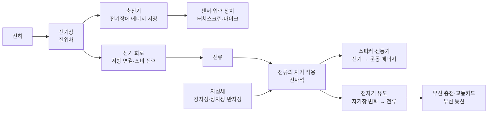

# 물리학 2. 전기와 자기 — 보이지 않는 장이 움직이는 세상
<!-- prev: m2-07, 2-6, 5-5, phy-1 -->
<!-- next: emq-1 -->

> [!NOTE]
> **성취기준**
> - **[12물리02-01]** 전하를 띤 입자들이 전기장과 전위차를 형성하여 서로 전기적으로 상호작용함을 설명할 수 있다.
> - **[12물리02-02]** 전기 회로에서 저항의 연결에 따라 소비 전력이 달라짐을 알고, 다양한 전기 기구에서 적용되는 사례를 찾을 수 있다.
> - **[12물리02-03]** 축전기에서 전기 에너지를 저장하는 원리가 각종 센서와 전기 신호 입력 장치 등 실생활 제품에서 활용됨을 설명할 수 있다.
> - **[12물리02-04]** 자성체의 종류를 알고 일상생활과 산업 기술에서 자성체가 활용되는 예를 찾을 수 있다.
> - **[12물리02-05]** 전류의 자기 작용을 이용하여 에너지를 전환하는 장치의 원리를 알고, 스피커와 전동기 등을 설계할 수 있다.
> - **[12물리02-06]** 전자기 유도 현상이 센서, 무선통신, 무선충전 등 에너지 전달 기술에 적용되어 현대 문명에 미친 영향을 인식할 수 있다.

**학습 목표**

1. 전하가 주위 공간에 전기장을 만들고, 전기장 속의 다른 전하가 힘을 받으며, 전위차가 전하 한 개당 전기적 위치 에너지의 차이임을 설명할 수 있다.
2. 저항의 직렬·병렬연결에서 합성 저항과 각 저항의 소비 전력을 구하고, 가정의 병렬 배선과 전기 안전 수칙을 설명할 수 있다.
3. 축전기가 두 도체판 사이의 전기장에 에너지를 저장하는 원리를 알고, 터치스크린·마이크·가속도 센서 등에 활용되는 방식을 설명할 수 있다.
4. 강자성체·상자성체·반자성체를 구별하고, 각각이 활용되는 예를 찾을 수 있다.
5. 전류의 자기 작용을 이용한 스피커와 전동기의 에너지 전환을 설명하고 직접 설계할 수 있다.
6. 전자기 유도가 무선 충전, 교통카드, 무선 통신 등 에너지·신호 전달 기술에 쓰이는 방식과 그 사회적 영향을 설명할 수 있다.

**이 단원의 학습 사다리**

| 단계 | 무엇을 하나? |
|---|---|
| STEP 1. 이전 학습 다시 보기 | 중2 「전기와 자기」, 통합과학 「물질의 전기적 성질과 소재」·「발전기와 전기 에너지」, 「힘과 에너지」를 다시 꺼낸다 |
| STEP 2. 기초 다지기 | 전하량·전류·전압의 단위, 옴의 법칙, '높이'와 '전위'의 비유, 자기장의 방향을 디딤돌로 놓는다 |
| STEP 3. 핵심 개념 | 전기장과 전위차 → 저항 연결과 소비 전력 → 축전기 → 자성체 → 전류의 자기 작용 → 전자기 유도 |
| STEP 4. 오개념 바로잡기 | "전기 제품을 많이 꽂으면 전압이 높아진다?" 같은 착각을 바로잡는다 |
| STEP 5. 다음 단계로 | 진로 선택 「전자기적 상호작용」, 대학 전자기학으로 잇는다 |
| STEP 6. 생활·산업·진로 | 가전과 전기 안전, 스마트폰 속 축전기, 전기차 모터, 무선 충전 |

---

## 🗺️ 단원 들어가기

스마트폰 하나를 들여다보자. 화면을 손가락으로 쓸면 반응하는 **터치스크린**, 목소리를 전기 신호로 바꾸는 **마이크**, 소리를 내는 **스피커**, 휴대폰을 기울이면 화면이 돌아가게 하는 **가속도 센서**, 진동을 만드는 **작은 모터**, 선 없이 충전되는 **무선 충전 코일**, 교통카드 기능을 하는 **NFC 안테나**. 손바닥만 한 기계 안에 이 단원의 성취기준 여섯 개가 모두 들어 있다.

이 모든 장치에는 공통점이 있다. **전하와 전류가 주위 공간에 '장(field)'을 만들고, 그 장이 떨어진 곳의 다른 전하·자석·코일에 힘을 주거나 에너지를 전달한다**는 것이다. 공기만 있는 빈 공간을 사이에 두고 에너지와 정보가 오간다. 이 단원에서는 눈에 보이지 않는 전기장과 자기장이 어떻게 우리 생활을 움직이는지, 그리고 그 원리를 이용해 직접 스피커를 설계해 본다.

---

## STEP 1. 🔙 이전 학습 다시 보기

### 연계 개념표

| 이전 단원·성취기준 | 그때 배운 것 | 이 단원에서 확장되는 것 |
|---|---|---|
| 중2 「전기와 자기」 [9과14-01] | 마찰 전기, 정전기 유도, 같은 전하끼리 밀고 다른 전하끼리 당긴다 | 전하가 **전기장**을 만들고 그 장이 다른 전하에 힘을 준다 |
| 중2 「전기와 자기」 [9과14-02] | 전류의 모형, 옴의 법칙 $V = IR$ | 전압을 **전위차**(전하당 에너지)로 다시 정의한다 |
| 중2 「전기와 자기」 [9과14-03] | 직렬·병렬연결의 특징을 정성적으로 비교, 소비 전력과 에너지 전환 | **합성 저항**을 계산하고 연결 방식에 따른 소비 전력을 정량적으로 비교한다 |
| 중2 「전기와 자기」 [9과14-04] | 자기장 속 전류가 흐르는 코일이 받는 힘, 전동기 | 전류의 자기 작용으로 **스피커와 전동기를 설계**한다 |
| 통합과학1 「물질의 전기적 성질과 소재」 [10통과1-02-06] | 도체·부도체·반도체, 자유 전자 | 도체 속 자유 전자가 축전기에 전하를 모으고, 물질의 자기적 성질로 **자성체**를 분류한다 |
| 통합과학2 「발전기와 전기 에너지」 [10통과2-02-05] | 코일 속 자기장이 변하면 유도 전류가 흐른다, 발전기 | 전자기 유도를 **센서·무선 통신·무선 충전**으로 넓힌다 |
| 물리학 「힘과 에너지」 [12물리01-04] | 일, 중력 위치 에너지 $mgh$ | 전하의 **전기적 위치 에너지**와 전위차 $W = qV$ |

### 준비 운동 (사전 진단)

**Q1.** 플라스틱 빨대를 털옷에 문질렀더니 빨대가 (−)전하를 띠었다. 이때 털옷은 어떤 전하를 띠며, 그 이유는?

**Q2.** 저항이 10 Ω인 전구에 3 V의 전압을 걸었다. 흐르는 전류는?

**Q3.** 집 안의 전등 하나가 꺼져도 다른 전기 제품은 계속 작동한다. 집 안의 전기 기구는 직렬과 병렬 중 어떻게 연결되어 있을까?

**Q4.** 코일 안에 자석을 넣고 가만히 두었을 때와, 자석을 넣었다 뺐다 할 때 중 검류계 바늘이 움직이는 경우는?

정답 및 해설

**Q1.** (+)전하 — 문지르는 동안 털옷의 전자가 빨대로 옮겨 갔다. 전자를 잃은 털옷은 (+)전하를 띤다. 전하는 새로 생기거나 사라지지 않고 **이동**할 뿐이다.

**Q2.** 0.3 A — $I = V/R = 3/10 = 0.3\ \mathrm{A}$

**Q3.** **병렬** — 병렬로 연결하면 한 기구의 회로가 끊겨도 다른 기구로 가는 길은 그대로이다.

**Q4.** 자석을 넣었다 뺐다 할 때 — 코일을 지나는 자기장이 **변할 때만** 유도 전류가 흐른다(통합과학 「발전기와 전기 에너지」).

---

## STEP 2. 🧱 기초 다지기

### ① 전기의 기본 단위

| 양 | 기호 | 단위 | 뜻 |
|---|---|---|---|
| 전하량 | $q$, $Q$ | C(쿨롬) | 전기를 띤 정도. 전자 한 개의 전하량 크기는 약 $1.6\times10^{-19}\ \mathrm{C}$ |
| 전류 | $I$ | A(암페어) = C/s | 1초 동안 도선의 한 단면을 지나는 전하량 |
| 전압(전위차) | $V$ | V(볼트) = J/C | 전하 1 C이 얻거나 잃는 전기 에너지 |
| 저항 | $R$ | Ω(옴) = V/A | 전류의 흐름을 방해하는 정도 |
| 전력 | $P$ | W(와트) = J/s | 1초 동안 전환되는 전기 에너지 |

**기본 전하량** $e \approx 1.6\times10^{-19}\ \mathrm{C}$이므로 1 C은 전자 약 $6.25\times10^{18}$개의 전하량이다. 전하는 이 값의 정수배로만 존재한다.

### ② 옴의 법칙 다시 보기

$$
V = IR
$$

같은 저항에서 전압이 2배이면 전류도 2배이다. 같은 전압에서 저항이 2배이면 전류는 $\frac{1}{2}$배이다.

### ③ '높이'와 '전위'의 비유

| 중력(「힘과 에너지」) | 전기(이 단원) |
|---|---|
| 질량 $m$ | 전하량 $q$ |
| 높이 $h$ | 전위 $V$ |
| 높이 차이 | 전위차(전압) |
| 중력 위치 에너지 $mgh$ | 전기적 위치 에너지 $qV$ |
| 물을 높은 곳으로 올리는 펌프 | 전하를 높은 전위로 올리는 전지 |
| 물이 흘러내리며 물레방아를 돌림 | 전하가 흐르며 전구·모터에서 에너지를 내놓음 |

> [!TIP]
> 💡 **비유** — 전지는 '전하용 엘리베이터', 회로의 저항은 '미끄럼틀'이다. 엘리베이터(전지)가 전하를 1.5 V 높이까지 올려 주면, 전하는 회로를 따라 미끄러져 내려오며 그 높이만큼의 에너지를 전구에 내놓는다.

### ④ 자기장의 방향과 오른손 규칙

자기장의 방향은 그 자리에 놓인 **나침반 N극이 가리키는 방향**이다. 막대자석 바깥에서는 N극에서 나와 S극으로 들어간다. 직선 도선에 전류가 흐를 때 **오른손 엄지를 전류 방향**으로 하고 도선을 감아쥐면, **나머지 네 손가락이 감기는 방향**이 자기장의 방향이다.

---

## STEP 3. 📘 핵심 개념

### ① 전하와 전기력 — 거리의 제곱에 반비례하는 힘

같은 종류의 전하끼리는 밀어내고(척력), 다른 종류의 전하끼리는 당긴다(인력). 이 힘을 **전기력(electric force)** 이라 한다. 프랑스의 쿨롱은 1785년 무렵 비틀림 저울로 전기력의 크기를 측정하여 다음 관계를 찾았다(**쿨롱 법칙**).

$$
F \propto \frac{q_1 q_2}{r^2}
$$

- 두 전하량의 곱에 **비례**한다.
- 거리의 **제곱에 반비례**한다. 거리가 2배가 되면 힘은 $\frac{1}{4}$배가 된다.

이 단원에서는 이 비례 관계로 전기력의 변화를 비교하는 데까지 다룬다. 비례 상수를 넣어 힘과 전기장의 크기를 직접 계산하는 것은 STEP 5에서 맛보기로 소개한다.

전기력은 중력보다 엄청나게 강하다. 수소 원자에서 양성자와 전자 사이의 전기력은 두 입자 사이의 중력보다 약 $10^{39}$배 크다. 그런데도 우리가 일상에서 전기력을 덜 느끼는 이유는 대부분의 물체가 (+)와 (−)를 같은 양만큼 가져 **전기적으로 중성**이기 때문이다.

| 현상 | 설명 |
|---|---|
| 마찰한 풍선에 머리카락이 끌려옴 | 풍선의 전하와 머리카락에 유도된 반대 전하 사이의 인력 |
| 겨울철 문손잡이에서 '찌릿' | 몸에 쌓인 전하가 손잡이로 한꺼번에 이동(방전) |
| 원자가 흩어지지 않음 | 원자핵(+)과 전자(−) 사이의 인력이 전자를 붙잡는다 |
| 물체가 서로 뚫고 지나가지 못함 | 두 물체 표면 원자의 전자들끼리 밀어내는 힘 |

#### 예제 1 — 거리와 전하량을 바꾸면

두 점전하 사이의 전기력의 크기가 $F$이다. (1) 거리만 3배로 하면? (2) 두 전하량을 각각 2배로 하고 거리도 2배로 하면?

**풀이** (1) $\dfrac{1}{3^2} = \dfrac{1}{9}$ → $\dfrac{F}{9}$ (2) $\dfrac{2\times2}{2^2} = 1$ → $F$ (변하지 않는다)

#### ✔ 바로 확인

1. 두 점전하 사이의 거리를 2배로 하면 전기력의 크기는 몇 배가 되는가?
2. (O/X) (−)전하를 띤 두 물체는 서로 당긴다.
3. 거리는 그대로 두고 한 전하의 전하량만 3배로 하면 전기력은 몇 배가 되는가?

정답

1. $\frac{1}{4}$배 — 거리의 제곱에 반비례한다.
2. X — 같은 종류의 전하끼리는 밀어낸다.
3. 3배 — 두 전하량의 곱에 비례한다.

### ② 전기장 — 전하가 공간에 만드는 '힘의 지도'

두 전하는 닿아 있지 않은데 어떻게 서로를 알아차리고 힘을 줄까? 패러데이는 다음과 같이 생각했다. **전하는 자기 주위 공간의 성질을 바꾸어 놓는다.** 이렇게 바뀐 공간을 **전기장(electric field)** 이라 하고, 그 자리에 다른 전하가 놓이면 그 자리의 전기장에 의해 힘을 받는다.

이 단원에서는 전기장을 **정성적으로** 다룬다.

| 성질 | 내용 |
|---|---|
| 방향 | 그 자리에 놓인 **(+)전하가 받는 힘의 방향**이다. (+)전하 주위에서는 바깥쪽, (−)전하 주위에서는 안쪽을 향한다 |
| 세기 | 전기장을 만드는 전하가 클수록, 그 전하에 가까울수록 세다 |
| 힘 | 같은 자리라도 놓인 전하의 전하량이 클수록 큰 힘을 받는다. (−)전하는 전기장과 **반대 방향**으로 힘을 받는다 |
| 균일한 전기장 | 서로 마주 보는 두 도체판에 (+), (−)전하를 고르게 띠게 하면, 판 사이의 가운데 부분에는 세기와 방향이 거의 일정한 전기장이 생긴다 |

> [!TIP]
> 💡 **비유** — 전기장은 '날씨 지도의 바람'과 같다. 바람은 눈에 보이지 않지만 지도에는 곳곳의 바람의 방향과 세기가 그려져 있다. 그 자리에 연(전하)을 띄우면 그 자리의 바람에 따라 연이 끌려간다. 같은 바람에서도 큰 연이 더 세게 끌린다.

<!-- sim:electric-field -->

#### 예제 2 — 전기장 속의 전자와 양성자

두 도체판 사이의 균일한 전기장이 왼쪽에서 오른쪽을 향한다. 판 사이에 양성자와 전자를 하나씩 놓으면 각각 어느 방향으로 힘을 받는가? 두 힘의 크기를 비교하시오.

**풀이** 양성자(+)는 전기장 방향인 **오른쪽**, 전자(−)는 반대인 **왼쪽**으로 힘을 받는다. 두 입자의 전하량 크기가 $e$로 같으므로 힘의 크기는 같다. 하지만 전자의 질량이 양성자의 약 $\frac{1}{1800}$이므로 전자의 가속도가 훨씬 크다($a = F/m$).

#### ✔ 바로 확인

1. 빈칸: 전기장의 방향은 그 자리에 놓인 (    )전하가 받는 힘의 방향이다.
2. (O/X) 전기장 속에 놓인 전자는 전기장과 같은 방향으로 힘을 받는다.
3. (+) 점전하 주위의 전기장은 어느 쪽을 향하며, 어디에서 더 센가?

정답

1. (+)
2. X — (−)전하는 전기장과 반대 방향으로 힘을 받는다.
3. 바깥쪽을 향하고, 전하에 가까울수록 세다.

### ③ 전위차 — 전하가 느끼는 '전기적 높이'

「힘과 에너지」에서 물체를 높은 곳으로 올리면 중력 위치 에너지가 커졌다. 마찬가지로 (+)전하를 전기장의 반대 방향으로 옮기려면 일을 해야 하고, 그 일은 **전기적 위치 에너지**로 저장된다. 전하 1 C당 전기적 위치 에너지를 **전위(electric potential)** 라 하고, 두 지점의 전위의 차이를 **전위차** 또는 **전압**이라 한다.

$$
V = \frac{W}{q} \qquad \Longleftrightarrow \qquad W = qV \qquad (1\ \mathrm{V} = 1\ \mathrm{J/C})
$$

- (+)전하는 전위가 **높은 곳에서 낮은 곳으로** 저절로 움직이며 에너지를 내놓는다. 물이 높은 곳에서 낮은 곳으로 흐르는 것과 같다.
- (−)전하인 전자는 반대로 전위가 **낮은 곳에서 높은 곳으로** 저절로 움직인다. 그래서 회로에서 전자는 전지의 (−)극에서 나와 (+)극으로 들어간다.
- 같은 전위인 두 점 사이에서는 전하가 이동해도 전기력이 하는 일이 없다.

**전자볼트** 전자 한 개가 1 V의 전위차를 지날 때 얻는 에너지를 **1 전자볼트(eV)** 라 한다. $1\ \mathrm{eV} = (1.6\times10^{-19}\ \mathrm{C})(1\ \mathrm{V}) = 1.6\times10^{-19}\ \mathrm{J}$이다. 원자·반도체처럼 아주 작은 세계의 에너지를 나타낼 때 쓰며, 「빛과 물질」 단원에서 다시 만난다.

#### 예제 3 — 전지가 하는 일

(1) 12 V 자동차 배터리가 전하 2 C을 (−)극에서 (+)극으로 옮길 때 한 일은? (2) 전자 한 개가 전위차 1000 V로 가속되면 얻는 운동 에너지를 eV와 J로 나타내시오.

**풀이** (1) $W = qV = 2\times12 = 24\ \mathrm{J}$
(2) $1000\ \mathrm{eV} = 1000\times1.6\times10^{-19} = 1.6\times10^{-16}\ \mathrm{J}$

| 상황 | 전위차로 설명하기 |
|---|---|
| 고압선 위의 새가 감전되지 않음 | 두 발이 같은 전선 위에 있어 두 발 사이의 전위차가 거의 0이다 |
| 번개 | 구름과 지면 사이에 매우 큰 전위차가 생겨 공기를 뚫고 전하가 한꺼번에 이동한다 |
| 공기 청정기·집진기 | 높은 전위차로 먼지에 전하를 띠게 한 뒤 반대 전하의 판에 붙잡는다 |
| 레이저 프린터·복사기 | 드럼 표면에 전하 무늬를 만들어 토너 가루를 전기력으로 붙인다 |

#### ✔ 바로 확인

1. 전하 4 C이 전위차 6 V인 두 점 사이를 이동할 때 전기력이 하는 일은?
2. 전자 한 개가 전위차 100 V로 가속될 때 얻는 에너지를 eV와 J로 쓰시오.
3. (O/X) 고압선 위에 앉은 새가 감전되지 않는 것은 두 발 사이의 전위차가 거의 0이기 때문이다.

정답

1. 24 J — $W = qV$.
2. 100 eV $= 1.6\times10^{-17}\ \mathrm{J}$
3. O — 전위차가 없으면 몸으로 전류가 흐르지 않는다.

### ④ 저항의 연결 — 직렬과 병렬

중학교에서는 직렬·병렬연결의 특징을 비교만 했다. 이제 전체 회로가 하나의 저항처럼 작용하는 **합성 저항(equivalent resistance)** 을 구해 보자.

| 구분 | 직렬연결 | 병렬연결 |
|---|---|---|
| 연결 모양 | 한 줄로 이어짐 | 갈래로 나뉘었다가 다시 만남 |
| 같은 것 | 각 저항에 흐르는 **전류** | 각 저항에 걸리는 **전압** |
| 나뉘는 것 | 전압: $V = V_1 + V_2$ | 전류: $I = I_1 + I_2$ |
| 합성 저항 | $R = R_1 + R_2$ (커진다) | $\dfrac{1}{R} = \dfrac{1}{R_1} + \dfrac{1}{R_2}$ (가장 작은 저항보다도 작아진다) |
| 하나가 끊어지면 | 전체 회로가 끊긴다 | 나머지는 계속 작동한다 |

**왜 그럴까?** 직렬연결은 '긴 좁은 길'을 이어 붙이는 것이라 지나가기 더 어렵다(저항 증가). 병렬연결은 '차선을 하나 더 내는 것'이라 같은 압력(전압)에서 더 많은 전하가 지나간다(저항 감소).

<!-- fig:phy-2-series-parallel -->

#### 예제 4 — 같은 두 저항, 다른 연결

2 Ω과 4 Ω의 저항을 12 V 전원에 (가) 직렬로, (나) 병렬로 연결했다. 각 경우 합성 저항, 전체 전류, 각 저항에 걸리는 전압과 흐르는 전류를 구하시오.

**풀이**

| | (가) 직렬 | (나) 병렬 |
|---|---|---|
| 합성 저항 | $2 + 4 = 6\ \Omega$ | $\dfrac{1}{R} = \dfrac{1}{2} + \dfrac{1}{4} = \dfrac{3}{4}$ → $R = \dfrac{4}{3}\ \Omega$ |
| 전체 전류 | $12/6 = 2\ \mathrm{A}$ | $12 \div \frac{4}{3} = 9\ \mathrm{A}$ |
| 2 Ω | 2 A, 4 V | 12 V, 6 A |
| 4 Ω | 2 A, 8 V | 12 V, 3 A |

직렬에서는 **큰 저항에 큰 전압**이 걸리고, 병렬에서는 **작은 저항에 큰 전류**가 흐른다.

#### ✔ 바로 확인

1. 3 Ω과 6 Ω을 (가) 직렬, (나) 병렬로 연결했을 때 합성 저항은?
2. (O/X) 병렬로 연결된 두 저항에는 같은 크기의 전압이 걸린다.
3. 직렬로 연결된 전구 두 개 중 하나의 필라멘트가 끊어지면 나머지 전구는 어떻게 되는가?

정답

1. (가) 9 Ω, (나) 2 Ω — 병렬 합성 저항은 가장 작은 저항보다도 작다.
2. O
3. 꺼진다 — 전류가 흐를 길이 하나뿐이다.

### ⑤ 소비 전력 — 연결 방식이 밝기를 바꾼다

저항에서 1초 동안 전기 에너지가 열·빛 등으로 전환되는 양을 **소비 전력(power)** 이라 한다. 전하 $q$가 전위차 $V$를 지나며 내놓는 에너지가 $qV$이고 1초 동안 지나는 전하량이 $I$이므로

$$
P = VI = I^2R = \frac{V^2}{R}
$$

세 식은 옴의 법칙으로 서로 바꿀 수 있다. **어느 식을 쓸지는 무엇이 같은지에 따라** 정한다.

| 연결 | 같은 양 | 쓰기 좋은 식 | 결론 |
|---|---|---|---|
| 직렬 | 전류 $I$ | $P = I^2R$ | **저항이 큰 쪽**이 전력을 더 많이 소비한다 |
| 병렬 | 전압 $V$ | $P = \dfrac{V^2}{R}$ | **저항이 작은 쪽**이 전력을 더 많이 소비한다 |

예제 4에서 각 저항의 소비 전력을 구하면 직렬일 때 2 Ω은 $2^2\times2 = 8\ \mathrm{W}$, 4 Ω은 $2^2\times4 = 16\ \mathrm{W}$이고, 병렬일 때 2 Ω은 $12^2/2 = 72\ \mathrm{W}$, 4 Ω은 $12^2/4 = 36\ \mathrm{W}$이다. **연결 방식에 따라 어느 쪽이 더 많이 소비하는지가 뒤바뀐다.**

#### 예제 5 — 정격 전력이 다른 두 전구

'220 V, 100 W' 전구 A와 '220 V, 60 W' 전구 B가 있다. (1) 두 전구를 220 V에 병렬로 연결하면 어느 쪽이 더 밝은가? (2) 직렬로 연결하면?

**풀이** 정격 값에서 저항을 구하면 $R = V^2/P$이므로 $R_A = 220^2/100 = 484\ \Omega$, $R_B = 220^2/60 \approx 807\ \Omega$이다.
(1) 병렬: 둘 다 220 V가 걸려 정격대로 켜진다 → **A(100 W)가 더 밝다.**
(2) 직렬: 전류가 같으므로 $P = I^2R$에서 저항이 큰 **B가 더 밝다.** (둘 다 정격보다 어둡다.)

#### 가정의 전기 — 왜 병렬이고, 무엇이 위험한가

우리나라 가정에는 220 V 교류가 공급되고, 모든 콘센트와 전기 기구는 **병렬로 연결**되어 있다. 그래서 각 기구에 항상 220 V가 걸려 정격대로 작동하고, 하나를 끄거나 고장 나도 나머지는 그대로 작동한다. 대신 기구를 하나 켤 때마다 **전체 전류가 그만큼 늘어난다.**

#### 예제 6 — 멀티탭 과부하

정격 전류가 16 A인 멀티탭 하나에 220 V용 전기 주전자(1760 W), 헤어드라이어(1320 W), 전기 히터(880 W)를 모두 꽂아 동시에 켰다. 안전한가?

**풀이** 각 기구의 전류 $I = P/V$: 주전자 8 A, 드라이어 6 A, 히터 4 A → 합계 **18 A > 16 A**

정격 전류를 넘는다. 전선과 접촉부에서 발생하는 열($P = I^2R$)은 전류의 **제곱**으로 늘어나므로 피복이 녹고 화재가 날 수 있다.

| 전기 안전 수칙 | 물리학적 근거 |
|---|---|
| 멀티탭 하나에 전력이 큰 기구를 여러 개 꽂지 않는다 | 병렬연결에서는 전류가 더해지고, 발열은 전류의 제곱에 비례한다 |
| 차단기(누전 차단기 포함)를 설치한다 | 정해진 전류보다 많이 흐르거나 전류가 새면 자동으로 회로를 끊는다 |
| 전기 제품의 접지 단자를 사용한다 | 누전된 전류가 사람 몸 대신 저항이 작은 접지선으로 흐르게 한다 |
| 젖은 손으로 플러그를 만지지 않는다 | 젖은 피부는 저항이 크게 작아져 같은 전압에서 큰 전류가 몸에 흐른다 |
| 전선을 묶거나 꺾어 쓰지 않는다 | 열이 잘 빠져나가지 못하고, 전선이 손상되어 저항이 큰 부분에서 국부적으로 발열한다 |

**전력량** 전기 요금은 사용한 에너지 = 전력 × 시간으로 매긴다. 1 kW의 기구를 1시간 쓰면 1 kWh이고, $1\ \mathrm{kWh} = 1000\ \mathrm{W}\times3600\ \mathrm{s} = 3.6\times10^{6}\ \mathrm{J}$이다.

#### ✔ 바로 확인

1. 10 Ω 저항에 2 A의 전류가 흐른다. 소비 전력은?
2. '220 V, 1100 W' 전기 기구를 220 V에 연결했을 때 흐르는 전류는?
3. 빈칸: 직렬연결에서는 저항이 (    ) 쪽이, 병렬연결에서는 저항이 (    ) 쪽이 전력을 더 많이 소비한다.

정답

1. 40 W — $P = I^2R = 2^2\times10$.
2. 5 A — $I = P/V$.
3. 큰, 작은 — 직렬은 전류가 같아 $I^2R$, 병렬은 전압이 같아 $V^2/R$로 비교한다.

### ⑥ 축전기 — 전기장에 에너지를 저장한다

**축전기(capacitor)** 는 두 도체판을 절연체(공기, 얇은 필름 등)를 사이에 두고 마주 보게 놓은 장치이다. 두 판을 전지에 연결하면 어떤 일이 일어날까?

1. 전지는 한쪽 판의 전자를 끌어와 회로를 통해 다른 쪽 판으로 보낸다. 판 사이는 절연체이므로 전자는 건너가지 못한다.
2. 전자를 잃은 판은 (+)전하, 전자를 받은 판은 (−)전하를 띤다. 두 판은 **같은 크기, 반대 부호**의 전하를 띤다.
3. 두 판 사이에 **전기장**이 생기고, 두 판 사이의 전위차가 점점 커진다.
4. 두 판 사이의 전위차가 전지의 전압과 같아지면 더 이상 전류가 흐르지 않는다(충전 완료).

<!-- fig:phy-2-capacitor-charging -->

이 과정에서 전지는 서로 당기는 (+)와 (−)를 떼어 놓느라 일을 했다. 그 일이 **두 판 사이의 전기장에 전기 에너지로 저장**된다. 「힘과 에너지」에서 용수철을 늘이는 데 한 일이 탄성 위치 에너지로 저장된 것과 같다.

| 과정 | 일어나는 일 | 에너지 |
|---|---|---|
| 충전 | 전류가 처음에는 크게 흐르다가 점점 줄어 0이 된다 | 전지의 에너지 → 전기장의 에너지 |
| 충전 후 전지 분리 | 두 판의 전하가 그대로 남는다 | 에너지가 저장된 채로 유지 |
| 방전(두 판을 도선·전구로 연결) | 전자가 (−)판에서 (+)판으로 이동하여 전하가 사라진다. 전류가 처음에 크고 점점 줄어든다 | 전기장의 에너지 → 빛·열·소리 등 |

- 두 판에 모인 전하가 많을수록, 두 판 사이의 전위차가 클수록 저장된 에너지가 크다.
- 두 판의 마주 보는 넓이가 넓을수록, 두 판 사이의 거리가 가까울수록 같은 전압에서 더 많은 전하가 모인다.

| 비교 | 화학 전지(배터리) | 축전기 |
|---|---|---|
| 에너지 저장 방식 | 화학 물질의 화학 에너지 | 두 판 사이 전기장의 에너지 |
| 저장량(같은 크기일 때) | 많다 | 적다 |
| 충전·방전 속도 | 느리다 | **매우 빠르다** |
| 수명(충·방전 횟수) | 상대적으로 짧다 | 매우 길다 |

> [!TIP]
> 💡 **비유** — 전지는 '큰 물탱크', 축전기는 '물 양동이'이다. 물탱크는 물을 많이 담지만 가는 수도꼭지로 천천히 나온다. 양동이는 조금 담지만 **한 번에 확 쏟을 수** 있다. 카메라 플래시는 배터리(물탱크)로 축전기(양동이)를 몇 초 동안 채웠다가 순식간에 쏟아 강한 빛을 낸다.

#### 예제 7 — 플래시의 순간 전력

카메라 플래시의 축전기에 저장된 에너지 4 J이 0.001 s 동안 방출된다고 하자. 평균 전력은? 같은 에너지를 0.5 W로 방출하면 몇 초가 걸리는가? (값은 설명을 위해 가정했다.)

**풀이** $P = \dfrac{E}{t} = \dfrac{4}{0.001} = 4000\ \mathrm{W}$, $t = \dfrac{4}{0.5} = 8\ \mathrm{s}$

축전기는 에너지의 양보다 **에너지를 한꺼번에 내놓는 능력**이 뛰어나다.

#### ✔ 바로 확인

1. (O/X) 축전기의 충전이 끝난 뒤에도 회로에는 같은 크기의 전류가 계속 흐른다.
2. 빈칸: 충전된 축전기의 에너지는 두 판 사이의 (    )에 저장된다.
3. 카메라 플래시처럼 짧은 순간에 큰 에너지를 내놓아야 할 때 화학 전지와 축전기 중 무엇이 유리한가?

정답

1. X — 두 판의 전위차가 전지 전압과 같아지면 전류가 0이 된다.
2. 전기장
3. 축전기 — 충전·방전이 매우 빠르다.

### ⑦ 축전기를 이용한 센서와 입력 장치

축전기 원리가 센서로 쓰이는 핵심은 이것이다. **두 도체판 사이의 거리나 마주 보는 넓이, 또는 판 사이·주위의 물질이 바뀌면, 같은 전압에서 판에 모이는 전하의 양이 달라진다.** 전하의 양이 바뀌면 그만큼 전하가 이동하므로 회로에 전류가 흐르고, 이 전기 신호를 측정하면 '무엇이 바뀌었는지'를 알 수 있다.

| 제품 | 무엇이 바뀌나 | 작동 방식 |
|---|---|---|
| 스마트폰 터치스크린 | 손가락이 다가옴 | 투명한 전극들이 축전기를 이룬다. 전도성이 있는 손가락이 닿으면 그 자리의 전하 분포가 바뀌고, 칩이 어느 전극에서 변화가 생겼는지 계산해 위치를 찾는다 |
| 컴퓨터 키보드(정전 용량식) | 판 사이 거리 | 키를 누르면 두 전극의 거리가 가까워져 모이는 전하가 늘어난다 |
| 콘덴서 마이크 | 판 사이 거리 | 소리에 따라 얇은 진동판(한쪽 판)이 떨리면 판 사이 거리가 바뀌어 소리와 같은 모양의 전기 신호가 나온다 |
| 스마트폰 가속도 센서 | 판 사이 거리 | 칩 속의 아주 작은 빗살 모양 전극이 기울기·흔들림에 따라 움직이면 전하가 변한다 |
| 지문 센서(정전 용량식) | 피부와 전극 사이 거리 | 지문의 솟은 부분(융선)과 파인 부분(골)에서 전하가 달라 무늬를 읽는다 |
| 습도 센서 | 판 사이 물질 | 판 사이 물질이 수분을 흡수하면 모이는 전하가 달라진다 |
| 수위 센서 | 판 주위 물질 | 물이 차오르면 전극 주위의 물질이 공기에서 물로 바뀌어 신호가 달라진다 |

축전기는 센서 외에도 **에너지를 짧은 시간에 공급**하거나 **전압을 고르게** 하는 데 쓰인다.

| 활용 | 축전기의 역할 |
|---|---|
| 심장 제세동기 | 충전한 에너지를 짧은 순간 심장에 전달한다 |
| 전원 어댑터 | 충전·방전을 반복하며 출렁이는 전압을 고르게 펴 준다 |
| 메모리 반도체(DRAM) | 아주 작은 축전기에 전하가 있으면 1, 없으면 0으로 정보를 저장한다 |
| 슈퍼커패시터 | 빠른 충·방전이 필요한 버스·엘리베이터의 회생 에너지 저장, 비상 전원 |

#### 예제 8 — 콘덴서 마이크

콘덴서 마이크의 진동판이 소리에 밀려 고정판 쪽으로 가까워졌다가 멀어지기를 반복한다. 전압이 일정할 때 회로에 흐르는 전류는 어떻게 되는지 설명하시오.

**풀이** 판이 가까워지면 같은 전압에서 더 많은 전하가 모이므로 전원에서 판으로 전하가 들어가는 방향의 전류가 흐른다. 판이 멀어지면 모일 수 있는 전하가 줄어 반대 방향으로 전류가 흐른다. 따라서 **소리의 떨림과 같은 모양으로 방향이 바뀌는 전류**, 즉 음성 신호가 만들어진다.

#### ✔ 바로 확인

1. 정전 용량식 키보드의 키를 누르면 두 전극 사이 거리는 어떻게 되고, 모이는 전하는 어떻게 되는가?
2. 짝짓기: (가) 터치스크린, (나) 습도 센서 — ㄱ. 판 사이 물질이 바뀜, ㄴ. 전도성 있는 손가락이 다가옴
3. (O/X) 메모리 반도체(DRAM)는 아주 작은 축전기에 전하가 있는지 없는지로 0과 1을 저장한다.

정답

1. 가까워지고, 모이는 전하가 늘어난다.
2. (가)–ㄴ, (나)–ㄱ
3. O

### ⑧ 자성체의 종류 — 원자 자석의 정렬

물질이 자석에 끌리거나 밀리는 성질을 **자성(magnetism)** 이라 하고, 자기장 안에서 자기적 성질을 띠는 물질을 **자성체**라 한다. 자성의 근원은 원자 속 **전자**이다. 전자는 원자핵 주위를 운동하고 스스로도 자석 같은 성질(스핀)을 가지므로, 원자 하나하나가 아주 작은 자석처럼 행동할 수 있다. 이 '원자 자석'들이 어떻게 배열되느냐에 따라 자성체의 종류가 갈린다.

| 종류 | 외부 자기장이 걸리면 | 외부 자기장을 없애면 | 자석과의 상호작용 | 예 |
|---|---|---|---|---|
| **강자성체** | 원자 자석들이 같은 방향으로 강하게 정렬한다 | 정렬이 상당 부분 **남는다**(자석이 된다) | 강하게 끌린다 | 철, 니켈, 코발트, 네오디뮴 자석 |
| **상자성체** | 원자 자석들이 자기장 방향으로 약하게 정렬한다 | 정렬이 바로 흐트러진다 | 아주 약하게 끌린다 | 알루미늄, 마그네슘, 산소 |
| **반자성체** | 자기장과 **반대 방향**으로 약하게 자기화된다 | 자성이 바로 사라진다 | 아주 약하게 밀려난다 | 구리, 금, 물, 유리, 비스무트, 초전도체 |

**자기 구역** 강자성체 내부는 원자 자석들이 한 방향으로 정렬된 작은 구역(**자기 구역**)으로 나뉘어 있다. 보통은 구역마다 방향이 제각각이라 전체로는 자성이 거의 없다. 외부 자기장을 걸면 자기장 방향의 구역이 커지면서 전체가 강한 자석이 된다. 강자성체를 아주 높은 온도(철은 약 770 °C)로 가열하면 정렬이 무너져 강자성을 잃는다.

> [!TIP]
> 💡 **비유** — 강자성체의 자기 구역은 '운동장에 반별로 모인 학생들'이다. 반마다 한 방향을 보지만 반끼리는 제각각이다. "모두 앞으로!"(외부 자기장)라고 외치면 전체가 한 방향을 본다. 강자성체는 구호가 끝나도 대부분 그 방향을 유지하고(자석이 됨), 상자성체는 구호가 끝나자마자 흩어진다.

<!-- fig:phy-2-magnetic-domains -->

#### 예제 9 — 자성체 구별하기

물질 A, B, C를 강한 자석에 가까이 가져갔다. A는 강하게 끌려가 자석을 치운 뒤에도 클립을 끌어당겼다. B는 아주 약하게 끌렸고 자석을 치우자 아무 성질도 남지 않았다. C는 아주 약하게 밀려났다. 각각 어떤 자성체인가?

**풀이** A: 강자성체, B: 상자성체, C: 반자성체

#### ✔ 바로 확인

1. 자석에 강하게 끌리고, 자석을 치운 뒤에도 자성이 남는 물질의 종류는?
2. (O/X) 구리는 강한 자석에 아주 약하게 끌린다.
3. 빈칸: 강자성체 속에서 원자 자석들이 한 방향으로 정렬된 작은 구역을 (    )이라 한다.

정답

1. 강자성체
2. X — 구리는 반자성체여서 아주 약하게 밀려난다.
3. 자기 구역

### ⑨ 자성체의 활용 — 일상에서 산업까지

| 분야 | 사례 | 이용하는 성질 |
|---|---|---|
| 정보 저장 | 하드디스크, 신용카드의 마그네틱 띠 | 강자성체 표면의 작은 영역을 N·S 방향으로 자기화하여 0과 1을 기록한다. 외부 자기장이 사라져도 기록이 남는다 |
| 전기 기기 | 변압기·전동기·발전기의 철심 | 자기화가 쉽고 잘 사라지는 강자성체(연철, 규소 강판)로 자기장을 강하게 모은다 |
| 영구 자석 | 스피커, 전기차 모터, 이어폰, 냉장고 자석 | 한 번 자기화되면 잘 사라지지 않는 강자성체(네오디뮴 자석 등) |
| 의료 | 자기 공명 영상(MRI) 장치 | 초전도 전자석으로 매우 강한 자기장을 만들어 몸속을 영상으로 본다 |
| 재활용·식품 | 쓰레기 분리 선별, 곡물 속 쇳조각 제거 | 강자성체만 자석에 강하게 끌린다 |
| 첨단 소재 | 자성 유체(액체 속 미세 자성 입자) | 자석으로 액체의 모양과 위치를 조절한다. 회전축의 밀봉, 스피커 냉각 등 |
| 자기 부상 | 초전도체 위에 떠 있는 자석 | 초전도체는 내부로 들어오는 자기장을 밀어내는 완전한 반자성을 보인다 |

> [!NOTE]
> 물도 반자성체이다. 매우 강한 자기장을 이용하면 물이 대부분인 작은 생물을 공중에 띄울 수도 있다. 평소에는 상자성·반자성이 너무 약해 느끼지 못할 뿐, **모든 물질은 자기장에 반응한다.**

#### ✔ 바로 확인

1. 하드디스크에 기록한 정보가 전원을 꺼도 남아 있는 까닭은?
2. 변압기·전동기의 철심에는 어떤 성질의 강자성체를 쓰는가?
3. (O/X) 초전도체 위에 자석이 떠 있는 것은 초전도체가 내부로 들어오는 자기장을 밀어내는 반자성을 보이기 때문이다.

정답

1. 강자성체 표면의 자기화가 외부 자기장이 없어도 남기 때문이다.
2. 자기화가 쉽고 잘 사라지는 강자성체(연철, 규소 강판).
3. O

### ⑩ 전류의 자기 작용 — 전류가 자석이 된다

1820년 외르스테드는 전류가 흐르는 도선 옆의 나침반 바늘이 돌아가는 것을 발견했다. **전류는 주위에 자기장을 만든다.** 전기와 자기가 하나로 이어지는 순간이었다.

| 도선 모양 | 자기장의 모양 | 세기 | 방향 찾기 |
|---|---|---|---|
| 직선 도선 | 도선을 중심으로 하는 동심원 | 전류가 셀수록, 도선에 가까울수록 세다 | 오른손 엄지 = 전류, 감아쥔 손가락 = 자기장 |
| 원형 도선 | 고리 중심에서 고리 면을 수직으로 꿰뚫는 방향 | 전류가 셀수록 세다 | 감아쥔 손가락 = 전류, 엄지 = 중심의 자기장 |
| 솔레노이드(코일) | 내부는 균일, 외부는 막대자석과 비슷 | 전류가 셀수록, 단위 길이당 감은 수가 많을수록 세다. 철심을 넣으면 훨씬 세진다 | 감아쥔 손가락 = 전류, 엄지 = N극 쪽 |

**전자석** 솔레노이드 안에 강자성체(철심)를 넣으면 철심의 자기 구역이 정렬되어 자기장이 크게 강해진다. 전류를 끄면 자성이 사라지고, 전류의 세기와 방향으로 자석의 세기와 극을 조절할 수 있다. 고철을 들어 올리는 크레인, 전자식 도어록, 전자기 계전기(릴레이), MRI가 전자석을 쓴다.

<!-- sim:current-magnetic-field -->

#### 자기장 속의 전류는 힘을 받는다

거꾸로 자석의 자기장 속에 있는 도선에 전류가 흐르면, 도선은 자기장으로부터 **힘**을 받는다. 도선이 자기장에 수직일 때 **자기장이 셀수록, 전류가 셀수록, 자기장 속에 놓인 도선이 길수록** 힘이 크다. 이 단원에서는 힘의 크기를 이렇게 정성적으로 비교하고, 힘을 식으로 계산하는 것은 STEP 5에서 소개한다.

힘의 방향은 **전류와 자기장 모두에 수직**이다. 오른손을 펴서 엄지를 전류 방향, 나머지 네 손가락을 자기장 방향으로 하면 손바닥이 미는 방향이 힘의 방향이다. 전류의 방향이나 자석의 극을 바꾸면 힘의 방향도 반대가 된다.

<!-- fig:phy-2-wire-force -->

#### 예제 10 — 자기장 속 도선이 받는 힘

말굽자석의 N극을 위, S극을 아래에 두어 그 사이에 위에서 아래로 향하는 자기장을 만들고, 그 속에 수평 도선을 놓아 왼쪽에서 오른쪽으로 전류를 흘렸다. (1) 이 상황에서 도선이 받는 힘을 크게 하는 방법 두 가지는? (2) 전류의 방향만 반대로 바꾸면 힘의 방향은 어떻게 되는가?

**풀이** (1) 전류를 세게 흘리거나, 더 센 자석을 써서 자기장을 세게 하거나, 자기장 속에 놓인 도선의 길이를 길게 한다(이 가운데 두 가지). (2) 힘의 방향이 반대가 된다. 자석의 극을 바꾸어도 반대가 되고, 전류와 극을 **둘 다** 바꾸면 원래 방향으로 돌아온다.

#### ✔ 바로 확인

1. 직선 도선에 전류가 흐를 때 주위에 생기는 자기장의 모양은?
2. (O/X) 솔레노이드 안에 철심을 넣으면 자기장이 약해진다.
3. 자기장 속 도선에서 전류의 방향과 자석의 극을 동시에 반대로 바꾸면 힘의 방향은?

정답

1. 도선을 중심으로 하는 동심원
2. X — 철심의 자기 구역이 정렬되어 자기장이 크게 강해진다(전자석).
3. 처음과 같다 — 한 번 바꿀 때마다 반대가 되므로 두 번 바꾸면 원래대로이다.

### ⑪ 스피커와 전동기 — 전기 에너지를 운동 에너지로

#### 스피커

| 부품 | 역할 |
|---|---|
| 영구 자석 | 일정한 자기장을 만든다 |
| 보이스 코일 | 자석의 자기장 속에 놓인 코일. 음성 신호 전류가 흐른다 |
| 진동판(콘) | 코일과 붙어 있어 코일과 함께 앞뒤로 움직이며 공기를 밀고 당긴다 |
| 서스펜션 | 진동판이 제자리로 돌아오게 붙잡는다 |

**작동 과정** 음성 신호는 소리의 떨림과 같은 모양으로 방향과 세기가 빠르게 바뀌는 전류이다. 이 전류가 보이스 코일에 흐르면, 코일은 자석의 자기장 속에서 전류의 방향에 따라 앞 또는 뒤로 힘을 받는다. 코일과 진동판이 신호와 같은 모양으로 떨리고, 진동판이 공기를 밀고 당겨 소리(음파)를 만든다.

$$
\text{전기 에너지} \;\rightarrow\; \text{진동판의 운동 에너지} \;\rightarrow\; \text{소리 에너지} \;(+\;\text{열})
$$

<!-- fig:phy-2-speaker-structure -->

**설계 변수** 스피커를 설계할 때 바꿀 수 있는 것과 그 효과를 정리하면 다음과 같다.

| 설계 변수 | 바꾸면 | 이유 |
|---|---|---|
| 자석의 세기 | 더 큰 소리 | 자기장이 셀수록 코일이 받는 힘이 커진다 |
| 코일을 감은 수 | 더 큰 소리 | 자기장 속 도선의 길이 $L$이 길어진다(대신 코일의 저항과 질량도 커진다) |
| 진동판의 크기·재질 | 음색과 음역이 달라짐 | 큰 진동판은 공기를 많이 밀어 낮은 소리에, 작고 가벼운 진동판은 빠르게 떨려 높은 소리에 유리하다 |
| 울림통(인클로저) | 낮은 소리가 풍부해짐 | 진동판 뒤쪽에서 나오는 소리가 앞쪽 소리와 상쇄되는 것을 막는다 |

#### 전동기(모터)

자석 사이에 놓인 사각형 코일에 전류를 흘리면, 코일의 마주 보는 두 변에 흐르는 전류의 방향이 반대이므로 두 변이 **반대 방향의 힘**을 받는다. 이 두 힘이 코일을 회전시키는 **돌림힘**을 만든다(「힘과 에너지」의 돌림힘). 그런데 코일이 반 바퀴를 돌면 힘의 방향이 반대가 되어 코일이 되돌아가려 한다. 그래서 직류 전동기에는 반 바퀴마다 코일의 전류 방향을 바꿔 주는 **정류자**와 **브러시**가 있어 코일이 계속 한 방향으로 돈다.

<!-- sim:motor-3d -->

| 비교 | 스피커 | 전동기 |
|---|---|---|
| 공통 원리 | 자기장 속 전류가 받는 힘 | 자기장 속 전류가 받는 힘 |
| 운동 | 앞뒤 진동 | 회전 |
| 전류 | 음성 신호(방향·세기가 빠르게 변함) | 직류(정류자로 방향 전환) 또는 교류 |
| 에너지 전환 | 전기 → 운동 → 소리 | 전기 → 회전 운동 |
| 쓰임 | 이어폰, 스마트폰, 공연장 음향 | 선풍기, 세탁기, 엘리베이터, 전기차, 스마트폰 진동 |

#### 예제 11 — 스피커 소리를 키우려면

학생이 만든 종이컵 스피커의 소리가 너무 작다. (1) 소리를 키울 수 있는 방법 두 가지와 (2) 그 근거를 쓰시오.

**풀이** (1) 더 센 자석(예: 네오디뮴 자석)을 쓴다. 코일을 더 많이 감는다. (2) 코일이 받는 힘은 자석의 자기장이 셀수록, 자기장 속 도선의 길이가 길수록 커지므로 같은 신호 전류에서 힘이 커져 진동판이 크게 떨린다. 단, 코일을 너무 많이 감으면 코일의 저항이 커져 전류가 줄고 코일이 무거워지므로 적당한 값을 실험으로 찾아야 한다.

#### ✔ 바로 확인

1. 빈칸: 스피커의 에너지 전환 — 전기 에너지 → 진동판의 (    ) 에너지 → 소리 에너지
2. 직류 전동기에서 정류자와 브러시가 하는 일은?
3. (O/X) 스피커의 보이스 코일에 세기가 일정한 직류를 흘려 두면 소리가 계속 난다.

정답

1. 운동
2. 반 바퀴마다 코일의 전류 방향을 바꾸어 코일이 한 방향으로 계속 돌게 한다.
3. X — 코일이 한쪽으로 밀린 채 멈추어 진동하지 않는다. 방향과 세기가 바뀌는 전류가 필요하다.

### ⑫ 전자기 유도 — 선 없이 에너지와 신호를 보낸다

통합과학 「발전기와 전기 에너지」에서 **코일을 지나는 자기장이 변하면 코일에 유도 전류가 흐른다**는 것을 배웠다. 이것이 **전자기 유도(electromagnetic induction)** 이다. 자석을 빠르게 움직일수록, 코일을 많이 감을수록 유도 전류가 세다. 유도 전류는 **자기장의 변화를 방해하는 방향**으로 흐른다.

⑩에서는 '전류 → 자기장', ⑫에서는 '자기장의 변화 → 전류'이다. 두 현상을 이으면 **코일 A에 변하는 전류를 흘려 변하는 자기장을 만들고, 떨어진 코일 B에 전류를 유도**할 수 있다. 전선으로 잇지 않고도 에너지와 신호를 보낼 수 있는 것이다. 이 단원에서는 법칙 자체보다 **이 원리가 쓰이는 기술**에 초점을 맞춘다.

| 기술 | 작동 방식 | 전달하는 것 |
|---|---|---|
| **발전기** | 터빈이 코일(또는 자석)을 회전시켜 자기장을 계속 변화시킨다 | 운동 에너지 → 전기 에너지 |
| **변압기** | 1차 코일의 교류가 철심 속 자기장을 변화시켜 2차 코일에 다른 크기의 전압을 유도한다 | 전기 에너지(전압을 바꿔 먼 곳까지 송전) |
| **무선 충전** | 충전 패드의 송신 코일에 교류를 흘리면, 위에 놓인 스마트폰의 수신 코일에 전류가 유도되어 배터리를 충전한다 | 전기 에너지 |
| **교통카드·출입 카드(RFID, NFC)** | 단말기의 코일이 만드는 변하는 자기장이 카드 속 코일에 전류를 유도해 배터리 없는 칩을 작동시키고, 그 칩이 신호를 돌려보낸다 | 에너지 + 정보 |
| **인덕션 레인지** | 코일의 교류가 만드는 변하는 자기장이 냄비 바닥에 소용돌이 모양의 유도 전류를 일으켜 냄비 자체가 뜨거워진다 | 전기 에너지 → 열 |
| **금속 탐지기** | 탐지기 코일의 변하는 자기장이 금속에 유도 전류를 만들고, 그 전류가 만든 자기장을 다시 감지한다 | 신호(센서) |
| **차량 감지 센서** | 도로 밑에 묻은 코일 위로 금속 차체가 지나가면 신호가 변해 신호등·주차 관제에 쓴다 | 신호(센서) |
| **다이내믹 마이크·전자 기타 픽업** | 소리로 떨리는 코일(또는 떨리는 쇠줄 근처의 코일)에 소리 모양의 전류가 유도된다 | 소리 → 전기 신호 |
| **무선 통신 안테나** | 송신 안테나에서 빠르게 진동하는 전류가 전기장과 자기장이 서로를 만들어 내며 퍼져 나가는 **전자기파**를 만들고, 멀리 떨어진 수신 안테나에 전류를 유도한다 | 정보(라디오, 휴대 전화, 와이파이) |

<!-- fig:phy-2-wireless-charging -->

> [!IMPORTANT]
> 다이내믹 마이크는 스피커와 구조가 거의 같다. **스피커는 전류 → 힘 → 진동(⑪), 다이내믹 마이크는 진동 → 자기장 변화 → 유도 전류(⑫)** 로, 같은 장치가 에너지 전환의 방향만 반대이다.

#### 예제 12 — 무선 충전 패드

무선 충전 패드에 스마트폰을 올려놓았을 때 (1) 송신 코일에 직류가 아닌 교류를 흘리는 이유와 (2) 스마트폰을 패드에서 멀리 떼면 충전이 잘 안 되는 이유를 설명하시오.

**풀이** (1) 전자기 유도는 자기장이 **변할 때만** 일어난다. 직류는 일정한 자기장을 만들어 수신 코일에 전류를 유도하지 못한다. (2) 송신 코일이 만드는 자기장은 코일에서 멀어질수록 약해지고 넓게 퍼져, 수신 코일을 지나는 자기장의 변화가 작아진다. 그래서 유도 전류가 줄고 전달되지 못한 에너지가 많아진다.

#### 현대 문명에 미친 영향

| 시기 | 전자기 유도가 바꾼 것 |
|---|---|
| 19세기 후반 | 발전기와 변압기로 전기를 대량 생산하고 멀리 보내는 **전력망**이 생겼다. 밤에도 밝은 도시, 공장의 전동기가 산업을 바꿨다 |
| 20세기 | 라디오·텔레비전·이동 통신으로 정보가 전자기파를 타고 전 세계로 퍼졌다 |
| 21세기 | 무선 충전, 비접촉 결제·교통카드, 사물 인터넷 센서, 전기차 충전 기술 등 **선 없는 에너지·정보 전달**이 일상이 되었다 |

> [!WARNING]
> 무선 충전 패드 위에 동전·열쇠 같은 금속을 함께 두면 금속에 유도 전류가 흘러 뜨거워질 수 있다. 인덕션 레인지 위에 금속 수저를 올려 두지 않는 것도 같은 이유이다.

#### ✔ 바로 확인

1. (O/X) 무선 충전 패드의 송신 코일에 세기가 일정한 직류를 흘려도 스마트폰은 충전된다.
2. 짝짓기: (가) 교통카드, (나) 인덕션 레인지 — ㄱ. 유도 전류로 냄비를 데움(열), ㄴ. 유도 전류로 칩을 작동시키고 신호를 주고받음(에너지 + 정보)
3. 빈칸: 유도 전류는 자기장의 변화를 (    )하는 방향으로 흐른다.

정답

1. X — 자기장이 변하지 않으면 유도 전류가 생기지 않는다.
2. (가)–ㄴ, (나)–ㄱ
3. 방해

---

## STEP 4. ⚠️ 오개념 바로잡기

| 흔한 오개념 | 올바른 개념 | 왜 그럴까? |
|---|---|---|
| 전기장은 전하가 있을 때만, 그 전하가 있는 곳에만 생긴다 | 전기장은 전기장을 **만드는 전하 주위의 공간 전체**에 생긴다. 다른 전하를 놓으면 그 자리에서 힘을 받을 뿐이다 | 장은 '힘을 받는 쪽'이 아니라 '만드는 쪽'의 성질이다 |
| 전기 기구를 많이 켜면 각 기구에 걸리는 전압이 낮아져 기구가 안전해진다 | 가정의 병렬연결에서 각 기구의 전압은 그대로이고 **전체 전류가 늘어난다** | 병렬에서는 전류가 더해지므로 전선과 멀티탭의 발열이 커져 위험해진다 |
| 저항이 큰 전구가 항상 더 밝다 (또는 항상 더 어둡다) | **직렬**에서는 저항이 큰 쪽, **병렬**에서는 저항이 작은 쪽이 더 많은 전력을 소비한다 | 직렬은 전류가 같아 $P = I^2R$, 병렬은 전압이 같아 $P = V^2/R$로 비교해야 한다 |
| 축전기는 판 사이로 전류가 흘러서 에너지를 저장한다 | 판 사이는 절연체라 전하가 건너가지 못한다. 두 판에 반대 전하가 쌓이며 **판 사이 전기장**에 에너지가 저장된다 | 충전 중 회로에 흐르는 전류는 한 판에서 전원을 거쳐 다른 판으로 가는 전자의 이동이다 |
| 자석에 붙지 않는 물질은 자성이 전혀 없다 | 상자성체·반자성체도 자기장에 반응하지만 그 힘이 **매우 약할** 뿐이다 | 강한 자석으로는 물·구리가 밀려나는 것도 확인할 수 있다 |
| 무선 충전은 자석의 힘으로 충전하는 것이라 직류 자석만 있으면 된다 | 수신 코일에 전류를 유도하려면 자기장이 **계속 변해야** 한다 | 그래서 송신 코일에 교류를 흘린다 |

---

## STEP 5. 🎓 다음 단계로 한 걸음 더

> [!CAUTION]
> 이 절은 **물리학 교육과정 범위 밖의 심화 내용**으로 평가 대상이 아니다. 쿨롱 법칙의 상수를 이용한 전기력·전기장의 정량적 계산, 자기장 속 도선이 받는 힘의 식, 축전기의 전기 용량·연결·유전체, 전자기 유도 법칙의 식은 진로 선택 「전자기적 상호작용」에서 다룬다.

### 진로 선택 과목과의 연결

| 다음 단원 | 이어지는 내용 |
|---|---|
| 전자기와 양자 「전자기적 상호작용」 [12전자01-01], [12전자01-02] | 점전하 주위 전기장의 정량적 계산, 전기력선과 등전위면, 정전기 유도와 유전 분극 |
| 「전자기적 상호작용」 [12전자01-03], [12전자01-04] | 자기력선으로 보는 도선 주위의 자기장, 움직이는 전하가 받는 로런츠 힘(입자 가속기, 토카막, 밴앨런대) |
| 「전자기적 상호작용」 [12전자01-05]~[12전자01-07] | 자기 선속과 전자기 유도, 변압기와 인덕터, 저항·축전기·인덕터 회로, 다이오드·트랜지스터 회로 |
| 대학 전자기학·회로이론 | 맥스웰 방정식, 전자기파의 속력, 교류 회로, 전자 회로 설계 |

### ① 전기장을 식으로 — 점전하의 전기장

쿨롱 법칙에 비례 상수 $k$를 넣으면 전기력의 크기를 직접 계산할 수 있다.

$$
F = k\frac{q_1 q_2}{r^2} \qquad (k \approx 9.0\times10^{9}\ \mathrm{N\cdot m^2/C^2})
$$

진로 선택에서는 전기장을 "그 자리에 놓인 +1 C이 받는 힘"으로 정의하고, 점전하 $Q$에서 거리 $r$인 곳의 전기장 세기를 $E = k\dfrac{Q}{r^2}$로 계산한다. 쿨롱 법칙을 '만드는 쪽'과 '받는 쪽'으로 나눈 것이다. 전기력선과 등전위면을 그린 그림에서 전기장의 세기와 방향을 읽어 내는 방법도 배운다.

### ② 축전기의 전기 용량

이 단원에서 "판이 넓고 가까울수록 같은 전압에서 더 많은 전하가 모인다"고 말로 설명한 것을 **전기 용량** $C = \dfrac{Q}{V}$로 나타낸다. 저장된 에너지는 $\frac{1}{2}QV$이며, 판 사이에 절연체를 넣으면 **유전 분극** 때문에 전기 용량이 커진다. 터치스크린과 콘덴서 마이크는 모두 이 $C$의 변화를 측정하는 센서이다.

### ③ 자기장 속 도선이 받는 힘을 식으로

STEP 3 ⑩에서 "자기장이 셀수록, 전류가 셀수록, 도선이 길수록 힘이 크다"고 말로 설명한 것은, 도선이 자기장에 수직일 때 다음 식으로 나타난다($B$의 단위: T(테슬라)).

$$
F = BIL
$$

예를 들어 0.5 T인 균일한 자기장에 수직으로 놓인 0.1 m 도선에 2 A가 흐르면 $F = 0.5\times2\times0.1 = 0.1\ \mathrm{N}$이다. 「전자기적 상호작용」에서는 이 힘을 도선 속에서 움직이는 전하 하나하나가 받는 **로런츠 힘** $F = qvB$로 다시 이해한다.

### ④ 패러데이 법칙과 변압기

유도 기전력은 코일을 지나는 자기 선속 $\Phi$의 시간 변화율과 감은 수 $N$에 비례한다: $\varepsilon = -N\dfrac{\Delta\Phi}{\Delta t}$. 음의 부호는 '변화를 방해하는 방향'(렌츠 법칙)을 뜻한다. 이상적인 변압기에서는 전압의 비가 감은 수의 비와 같다: $\dfrac{V_1}{V_2} = \dfrac{N_1}{N_2}$.

### ⑤ 맥스웰 방정식과 빛

대학 전자기학에서는 전기장과 자기장에 관한 모든 법칙이 네 개의 **맥스웰 방정식**으로 정리된다. 맥스웰은 이 방정식으로부터 "변하는 전기장과 자기장이 서로를 만들며 진공을 일정한 속력으로 퍼져 나가는 파동"을 예측했고, 그 속력이 빛의 속력과 같다는 것을 알아냈다. **빛은 전자기파이다.** 이 결론이 다음 단원 「빛과 물질」로 이어진다.

### 지금 vs 다음 단계

| 구분 | 물리학(지금) | 전자기와 양자·대학 |
|---|---|---|
| 전기장 | 전하가 만든다는 것을 정성적으로 | $E = kQ/r^2$, 전기력선·등전위면 해석 |
| 전위차 | $W = qV$, 전자볼트 | 등전위면, 전위의 계산 |
| 축전기 | 에너지 저장 원리와 활용 | 전기 용량, 연결, 유전체, 회로 |
| 자기 | 자성체의 종류, 자기장 속 전류가 받는 힘(정성적) | 도선이 받는 힘 $F = BIL$, 로런츠 힘 $F = qvB$, 자기력선 |
| 전자기 유도 | 활용 기술 중심 | 패러데이 법칙, 렌츠 법칙, 인덕터, 맥스웰 방정식 |
| 관련 전공 | — | 전기공학, 전자공학, 반도체공학, 통신공학, 물리학 |

---

## STEP 6. 🏭 생활·산업·진로 연결

### 사례 1. 스마트폰 — 축전기와 코일의 집합체

- **원리** 터치스크린, 지문 센서, 가속도 센서는 모두 축전기에 모이는 전하의 변화를 읽는다. 스마트폰 기판에는 전압을 고르게 하는 아주 작은 칩 축전기가 수백 개 이상 들어간다.
- **어디에 쓰이나** 화면 터치, 화면 자동 회전, 걸음 수 측정, 지문 잠금 해제. 같은 원리가 자동차의 터치식 버튼, 엘리베이터의 비접촉 버튼으로 퍼지고 있다.

### 사례 2. 전기 자동차 — 모터와 자성 소재

- **원리** 전기 자동차의 구동 모터는 전류의 자기 작용으로 회전한다. 강한 영구 자석(희토류 자석)을 쓰는 모터가 많아, 자성 소재의 안정적 확보가 산업의 중요한 과제가 되었다.
- **회생 제동** 감속할 때는 같은 모터가 발전기로 작동하여(전자기 유도) 운동 에너지를 전기 에너지로 되돌린다.
- **무선 충전 연구** 주차면이나 도로 밑에 코일을 묻어 전기 버스·자동차를 선 없이 충전하는 기술도 연구·시범 운영되고 있다.

### 사례 3. 가정의 전기 안전 — 숫자로 읽는 안전

- **원리** 가정 배선은 병렬이므로 기구를 켤수록 전류가 늘어난다. 분전함의 차단기는 정해진 전류를 넘으면 회로를 끊고, 누전 차단기는 들어간 전류와 나온 전류가 다르면(전류가 샐 때) 아주 짧은 시간에 회로를 끊는다.
- **생활 실천** 전기 제품의 정격 전력 표시를 읽고, 멀티탭의 정격 전류를 넘지 않게 사용한다. 전기 화재 예방을 위한 이런 습관은 이 단원의 $P = VI$와 병렬연결로 설명된다.

### 사례 4. 비접촉 기술 — 교통카드에서 사물 인터넷까지

- **원리** 교통카드는 배터리가 없다. 단말기 코일이 만드는 변하는 자기장이 카드 코일에 전류를 유도해 칩을 깨우고, 칩은 정보를 신호로 돌려보낸다.
- **어디에 쓰이나** 대중교통 요금 결제, 출입 관리, 물류 창고의 상품 추적(RFID 태그), 도서관 도서 관리, 반려동물 등록 칩.

### 관련 진로와 학과

| 진로 | 하는 일 | 관련 학과 |
|---|---|---|
| 전기 안전·전력 엔지니어 | 배선 설계, 차단기·접지 설비, 전력망 운영 | 전기공학 |
| 센서·디스플레이 엔지니어 | 터치 패널, 정전 용량 센서, 초소형 센서 칩 개발 | 전자공학, 반도체공학, 기계공학 |
| 모터·전동화 엔지니어 | 전기차 구동 모터, 산업용 로봇 모터 설계 | 전기공학, 기계공학, 자동차공학 |
| 음향 엔지니어 | 스피커·마이크·이어폰 설계 | 전자공학, 음향공학 |
| 자성 소재 연구원 | 영구 자석, 변압기 철심, 자기 저장 매체 개발 | 신소재공학, 재료공학, 물리학 |
| 무선 통신·무선 전력 엔지니어 | 안테나, 무선 충전, NFC·RFID 시스템 | 전자공학, 전파공학, 통신공학 |

---

## 🔬 탐구 활동

### 활동 A. 저항의 직렬연결과 병렬연결에서 전류와 전압 측정하여 비교하기

**목표** 저항의 연결 방식에 따른 전류·전압·소비 전력의 차이를 측정으로 확인하고, 가정 배선이 병렬인 이유를 설명한다.

**준비물** 직류 전원 장치(또는 건전지 묶음), 저항 2개(예: 100 Ω, 200 Ω), 꼬마전구 2개, 디지털 멀티미터 2개(또는 전류계·전압계), 집게 전선, 브레드보드

**과정**
1. 두 저항을 직렬로 연결하고 6 V를 건다. 전체 전류와 각 저항에 걸리는 전압을 측정한다.
2. 두 저항을 병렬로 연결하고 6 V를 건다. 전체 전류, 각 갈래의 전류, 각 저항의 전압을 측정한다.
3. 측정값으로 각 저항의 소비 전력 $P = VI$를 계산한다.
4. 저항 대신 꼬마전구 2개로 바꾸어 직렬·병렬일 때의 밝기를 비교하고, 하나를 빼면 어떻게 되는지 관찰한다.

**결과 기록**

| 연결 | 전체 전류(A) | $R_1$ 전압(V) | $R_1$ 전류(A) | $R_2$ 전압(V) | $R_2$ 전류(A) | $R_1$ 전력(W) | $R_2$ 전력(W) |
|---|---|---|---|---|---|---|---|
| 직렬 | | | | | | | |
| 병렬 | | | | | | | |

**생각해 보기**
1. 측정한 전체 전류로 구한 합성 저항($V/I$)은 계산값과 일치하는가? 차이가 난다면 이유는?
2. 직렬과 병렬에서 전력을 더 많이 소비한 저항은 각각 어느 쪽인가? 그 이유를 식으로 설명해 보자.
3. 가정에서 멀티탭에 기구를 많이 꽂으면 어떤 값이 커지는지 이 실험 결과로 설명해 보자.

> [!WARNING]
> **안전 수칙** 전원은 회로를 다 연결한 뒤 켜고, 연결을 바꿀 때는 반드시 끈다. 전류계를 저항과 병렬로 연결하면 큰 전류가 흘러 계기가 손상될 수 있다. 저항이 뜨거워질 수 있으니 실험 직후 맨손으로 만지지 않는다. 가정용 220 V 전원은 절대 사용하지 않는다.

### 활동 B. 스피커를 설계·제작하여 음성 정보의 전기적 재생 과정 탐색하기

**목표** 전류의 자기 작용을 이용해 스피커를 직접 설계·제작하고, 설계 변수에 따른 소리 크기 변화를 비교한다.

**준비물** 에나멜선(굵기 약 0.2~0.3 mm), 네오디뮴 자석·페라이트 자석, 종이컵·플라스틱 컵·종이 접시, 사포, 셀로판테이프, 3.5 mm 오디오 단자가 달린 케이블(또는 소형 앰프), 스마트폰, 소리 측정 앱

**과정**
1. **설계** 모둠별로 바꿀 변수(자석의 종류, 코일 감은 수, 진동판 재질) 하나를 정하고 나머지는 같게 한다.
2. **제작** 에나멜선을 펜에 50회 감아 코일을 만들고, 양 끝 1 cm의 피막을 사포로 벗긴다. 코일을 컵 바닥에 붙이고, 자석을 코일 가운데 가까이 고정한다.
3. 코일의 두 끝을 오디오 케이블에 연결하고, 스마트폰으로 일정한 크기의 음악(또는 1000 Hz 음)을 재생한다.
4. 컵에서 20 cm 떨어진 곳에서 소리 측정 앱으로 소리 크기를 잰다.
5. 정한 변수를 바꾸어(예: 감은 수 50회 → 100회 → 150회) 반복한다.

**결과 기록**

| 바꾼 변수 | 조건 1 | 조건 2 | 조건 3 |
|---|---|---|---|
| 변수의 값 | | | |
| 소리 크기(dB) | | | |
| 음색 관찰 | | | |

**생각해 보기**
1. 소리 크기는 변수에 따라 어떻게 달라졌는가? 자기장의 세기, 전류, 자기장 속 도선의 길이와 코일이 받는 힘의 관계로 설명해 보자.
2. 코일을 계속 많이 감으면 소리가 계속 커지는가? 그렇지 않다면 그 이유는?
3. 스피커의 에너지 전환 과정을 순서대로 쓰고, 버려지는 에너지는 어디로 가는지 생각해 보자.

> [!WARNING]
> **안전 수칙** 네오디뮴 자석은 힘이 매우 강해 손가락이 끼일 수 있고, 서로 부딪치면 깨져 파편이 튈 수 있다. 전자 기기·카드에서 떨어뜨려 보관한다. 볼륨을 처음부터 크게 하지 않는다.

### 활동 C (확장). 전자기 유도로 무선 충전 구현하기

코일 두 개를 마주 놓고 한쪽 코일에는 교류 신호(함수 발생기 또는 간이 발진 회로)를, 다른 쪽 코일에는 LED를 연결한다. 두 코일 사이의 거리와 감은 수, 코일 사이에 철판·알루미늄판·플라스틱판을 끼웠을 때 LED 밝기를 비교하고, 그 결과를 전자기 유도와 자성체의 성질로 설명해 보자.

---

## ✅ 개념 확인 문제

### 기본

**1.** 두 점전하 사이의 거리를 $\frac{1}{2}$로 줄이면 전기력의 크기는 처음의 몇 배가 되는가?

정답 및 해설

**정답** 4배

전기력은 거리의 제곱에 반비례하므로 $\dfrac{1}{(1/2)^2} = 4$배이다.

**2.** 전하량이 3 C인 전하를 전위차가 9 V인 두 점 사이에서 전위가 낮은 곳에서 높은 곳으로 옮기는 데 필요한 일은?

정답 및 해설

**정답** 27 J

$W = qV = 3\times9 = 27\ \mathrm{J}$

**3.** 3 Ω과 6 Ω의 저항을 병렬로 연결했을 때 합성 저항을 구하시오.

정답 및 해설

**정답** 2 Ω

$\dfrac{1}{R} = \dfrac{1}{3} + \dfrac{1}{6} = \dfrac{1}{2}$ → $R = 2\ \Omega$. 가장 작은 저항(3 Ω)보다도 작다.

**4.** 축전기에 대한 설명으로 옳은 것을 **모두** 고르시오.
ㄱ. 충전하면 두 판은 같은 크기의 반대 부호 전하를 띤다.
ㄴ. 충전된 축전기의 에너지는 두 판 사이의 전기장에 저장된다.
ㄷ. 충전 중에는 전하가 두 판 사이의 절연체를 지나 이동한다.

정답 및 해설

**정답 ㄱ, ㄴ**

ㄷ. 판 사이는 절연체이므로 전하가 건너가지 못한다. 전자는 외부 회로를 따라 한 판에서 다른 판으로 옮겨진다.

**5.** 다음 물질을 강자성체, 상자성체, 반자성체로 분류하시오.
철, 구리, 알루미늄, 물, 니켈

정답 및 해설

**정답** 강자성체: 철, 니켈 / 상자성체: 알루미늄 / 반자성체: 구리, 물

### 응용

**6.** 저항값이 각각 $R$, $2R$인 두 니크롬선 A, B가 있다. (1) A, B를 직렬로 연결하여 전원에 연결했을 때 소비 전력의 비 $P_A : P_B$와 (2) 병렬로 연결했을 때 소비 전력의 비 $P_A : P_B$를 구하시오.

정답 및 해설

**정답** (1) 1 : 2 (2) 2 : 1

(1) 직렬은 전류가 같으므로 $P = I^2R$ → $P_A : P_B = R : 2R = 1 : 2$
(2) 병렬은 전압이 같으므로 $P = V^2/R$ → $P_A : P_B = \dfrac{1}{R} : \dfrac{1}{2R} = 2 : 1$

**7.** 220 V 가정에서 정격 전류 10 A인 콘센트 회로에 '220 V, 1100 W' 전기 다리미와 '220 V, 1540 W' 전기 주전자를 동시에 사용하려 한다. (1) 두 기구에 흐르는 전체 전류를 구하고, (2) 안전한지 판단하시오.

정답 및 해설

**정답** (1) 12 A (2) 안전하지 않다.

(1) 다리미 $1100/220 = 5\ \mathrm{A}$, 주전자 $1540/220 = 7\ \mathrm{A}$, 병렬이므로 합계 12 A
(2) 정격 전류 10 A를 넘으므로 차단기가 작동하거나 배선이 과열될 수 있다. 두 기구를 다른 회로에 나누어 쓰거나 동시에 사용하지 않는다.

**8.** 다음은 같은 원리 또는 반대 원리로 작동하는 장치들이다. (가) 스피커, (나) 다이내믹 마이크, (다) 전동기, (라) 발전기를 '전류가 자기장 속에서 힘을 받는 원리'와 '자기장의 변화로 전류가 유도되는 원리'로 분류하고, 각각의 에너지 전환을 쓰시오.

정답 및 해설

**정답**
- 자기장 속 전류가 받는 힘: (가) 스피커(전기 → 진동·소리), (다) 전동기(전기 → 회전 운동)
- 전자기 유도: (나) 다이내믹 마이크(소리·진동 → 전기 신호), (라) 발전기(회전 운동 → 전기)

두 쌍은 구조가 비슷하고 에너지 전환의 방향만 반대이다. 실제로 스피커에 대고 말하면 작은 전기 신호가 나오고, 전동기를 손으로 돌리면 발전기처럼 전류가 나온다.

### 융합·서술형

**9. [제품 설계 연계]** 장갑을 낀 손으로 스마트폰 화면을 누르면 반응하지 않는 경우가 많다. 그런데 손가락 끝에 전도성 실을 넣은 '터치 장갑'은 화면이 반응한다. 그 이유를 축전기에 모이는 전하의 변화로 설명하고, 이 원리를 이용한 다른 제품 아이디어를 하나 제안하시오.

정답 및 해설

**예시 답안**
정전 용량식 터치스크린은 화면 속 투명 전극들이 축전기를 이루고, 전도성이 있는 손가락이 다가오면 그 자리의 전하 분포가 바뀌는 것을 감지한다. 일반 장갑은 절연체라 손가락과 전극 사이를 막아 전하 분포를 거의 바꾸지 못하므로 반응하지 않는다. 전도성 실은 손가락과 화면을 전기적으로 이어 주어 손가락이 직접 닿은 것과 비슷한 변화를 만든다. 제품 아이디어로는 손을 대지 않고 가까이만 가져가도 켜지는 비접촉 엘리베이터 버튼, 물이 차오르면 알려 주는 화분 수위 센서 등을 들 수 있다.

**채점 포인트** ① 터치스크린이 축전기의 전하 변화를 감지함 ② 절연체·도체의 차이 ③ 원리에 맞는 응용 제안

**10. [사회 연계]** "전자기 유도가 없었다면 오늘날의 생활은 어떻게 달라졌을까?"라는 주제로, 에너지 전달과 정보 전달 측면에서 각각 두 가지 이상의 예를 들어 글을 쓰시오.

정답 및 해설

**예시 답안**
에너지 측면에서, 전자기 유도가 없다면 발전기로 전기를 대량 생산할 수 없고 변압기로 전압을 높여 먼 곳까지 보낼 수도 없다. 대부분의 전기는 화학 전지에 의존해야 해서 전등·냉장고·지하철 같은 전기 문명이 지금처럼 퍼지지 못했을 것이다. 무선 충전과 인덕션 레인지도 없다. 정보 측면에서, 안테나가 전자기파로 신호를 주고받는 무선 통신이 불가능해 휴대 전화·와이파이·방송이 없고, 배터리 없이 작동하는 교통카드와 RFID 태그도 쓸 수 없다. 즉, 전자기 유도는 전기 에너지를 **만들고 보내는** 기술과 정보를 **선 없이 주고받는** 기술의 공통 기반이다.

**채점 포인트** ① 에너지 전달 예 2가지 이상(발전기, 변압기, 무선 충전 등) ② 정보 전달 예 2가지 이상(무선 통신, 교통카드, 센서 등) ③ 사회적 영향에 대한 종합

### 실력 다지기

**11.** 12 V 전원에 2 Ω 저항 A를 연결하고, 그 뒤에 3 Ω 저항 B와 6 Ω 저항 C를 병렬로 묶은 부분을 직렬로 연결했다. (1) 전체 합성 저항과 전체 전류, (2) B와 C에 흐르는 전류, (3) A, B, C의 소비 전력을 각각 구하고, 세 전력의 합이 전원이 공급하는 전력과 같은지 확인하시오.

정답 및 해설

**정답** (1) 4 Ω, 3 A (2) B 2 A, C 1 A (3) A 18 W, B 12 W, C 6 W (합 36 W = 12 V × 3 A)

(1) B와 C의 병렬 부분: $\dfrac{1}{R} = \dfrac{1}{3} + \dfrac{1}{6}$ → $2\ \Omega$. 전체 $2 + 2 = 4\ \Omega$, $I = 12/4 = 3\ \mathrm{A}$
(2) A에 걸리는 전압 $3\times2 = 6\ \mathrm{V}$, 병렬 부분에 $12 - 6 = 6\ \mathrm{V}$ → B: $6/3 = 2\ \mathrm{A}$, C: $6/6 = 1\ \mathrm{A}$ (합 3 A)
(3) A: $3^2\times2 = 18$, B: $6^2/3 = 12$, C: $6^2/6 = 6\ \mathrm{W}$ → 합 36 W. 전원 $P = VI = 12\times3 = 36\ \mathrm{W}$로 같다(에너지 보존).

**12.** 저항이 같은 전구 A, B, C가 있다. B와 C를 병렬로 묶고, 이것을 A와 직렬로 연결하여 일정한 전압의 전원에 연결했다. (전구의 저항은 일정하다고 가정한다.)
(1) 가장 밝은 전구는 무엇이며, A와 B의 소비 전력의 비는?
(2) C의 필라멘트가 끊어지면 A와 B의 밝기는 각각 어떻게 변하는가? 까닭과 함께 쓰시오.

정답 및 해설

**정답** (1) A, $P_A : P_B = 4 : 1$ (2) A는 어두워지고 B는 밝아진다.

전구 하나의 저항을 $R$, 전원 전압을 $V$라 하자.
(1) 병렬 부분의 저항은 $R/2$, 전체 $\frac{3}{2}R$ → A에 흐르는 전류 $I = \dfrac{2V}{3R}$, B와 C에는 각각 $\dfrac{I}{2}$. $P = I^2R$이므로 $P_A : P_B = I^2 : (I/2)^2 = 4 : 1$
(2) C가 끊어지면 A와 B만 직렬, 전체 저항 $2R$ → 전류 $\dfrac{V}{2R}$.
A의 전류: $\dfrac{2V}{3R} \to \dfrac{V}{2R}$ (줄어듦) → 어두워진다.
B의 전류: $\dfrac{V}{3R} \to \dfrac{V}{2R}$ (늘어남) → 밝아진다.

**채점 포인트** ① 합성 저항으로 전체 전류 계산 ② $P = I^2R$로 밝기 비교 ③ C가 끊어진 뒤 전체 저항이 커져 전체 전류는 줄지만 B로 가는 전류는 늘어남을 설명

**13.** '220 V, 1.5 kW' 에어컨을 하루 4시간씩 30일 동안 사용했다. (1) 사용한 전력량을 kWh와 J로 나타내시오. (2) 정격이 '220 V, 1500 W'인 전기 히터를 110 V 전원에 연결하면 소비 전력은 몇 W가 되는가? (히터의 저항은 일정하다고 가정한다.)

정답 및 해설

**정답** (1) 180 kWh, $6.48\times10^{8}\ \mathrm{J}$ (2) 375 W

(1) $1.5\ \mathrm{kW}\times4\ \mathrm{h}\times30 = 180\ \mathrm{kWh}$, $180\times3.6\times10^6 = 6.48\times10^8\ \mathrm{J}$
(2) 저항이 일정하므로 $P = V^2/R$에서 전압이 $\frac{1}{2}$배이면 전력은 $\frac{1}{4}$배 → $1500/4 = 375\ \mathrm{W}$. (저항 $R = 220^2/1500 \approx 32\ \Omega$로 계산해도 같다.)

정격 전력은 **정격 전압에서만** 나오는 값이다. 전압이 바뀌면 소비 전력은 전압의 제곱에 비례해 변한다.

**14.** 감은 수가 다른 두 코일과 막대자석, 검류계로 실험을 하여 결과를 표로 정리했다. 실험 (가)에서 검류계 바늘은 오른쪽으로 2칸 움직였다.

| 실험 | 코일 감은 수 | 자석의 움직임 | 검류계 바늘 |
|---|---|---|---|
| (가) | 100회 | N극을 천천히 넣는다 | 오른쪽 2칸 |
| (나) | 100회 | N극을 빠르게 넣는다 | ㉠ |
| (다) | 100회 | N극을 코일 안에 넣은 채 가만히 둔다 | ㉡ |
| (라) | 100회 | N극을 천천히 빼낸다 | ㉢ |
| (마) | 200회 | N극을 천천히 넣는다 | ㉣ |

㉠~㉣을 예측하고, 이 결과를 이용해 무선 충전 패드의 송신 코일에 교류를 흘려야 하는 까닭을 설명하시오.

정답 및 해설

**정답** ㉠ 오른쪽으로 2칸보다 크게 ㉡ 움직이지 않음(0) ㉢ 왼쪽으로 움직임 ㉣ 오른쪽으로 2칸보다 크게

- 자기장이 빠르게 변할수록, 코일을 많이 감을수록 유도 전류가 세다(㉠, ㉣).
- 자석이 멈추면 코일을 지나는 자기장이 변하지 않아 유도 전류가 없다(㉡).
- 넣을 때와 뺄 때는 자기장의 변화가 반대이므로 유도 전류의 방향도 반대이다(㉢).
- 무선 충전에서도 수신 코일을 지나는 자기장이 **계속 변해야** 전류가 유도된다. 직류는 일정한 자기장을 만들어 ㉡처럼 유도 전류가 생기지 않으므로, 방향과 세기가 계속 바뀌는 교류를 흘린다.

**채점 포인트** ① ㉠~㉣ 예측 ② 변화의 빠르기·감은 수·변화의 방향과 유도 전류의 관계 ③ ㉡과 직류의 공통점으로 교류의 필요성 설명

### 도전

**15.** 220 V 가정의 한 콘센트 회로에 정격 전류 20 A인 차단기가 달려 있다. 이 회로에 냉장고(220 W)가 늘 켜져 있고, 아래 기구를 추가로 쓰려 한다. 합계 전류가 정격 전류 **미만**이어야 안전하다고 하자.

| 기구 | 전자레인지 | 전기밥솥 | 에어프라이어 | 전기 주전자 |
|---|---|---|---|---|
| 소비 전력(W) | 1100 | 880 | 1540 | 1760 |

(1) 다섯 기구를 모두 동시에 쓰면 전체 전류는 얼마이며, 무슨 일이 일어나는가?
(2) 냉장고와 함께 세 기구를 동시에 쓸 수 있는 조합을 모두 찾으시오.
(3) 어떤 학생이 이 기구들을 가늘고 긴 멀티탭 전선 하나에 모두 연결했다. 멀티탭 전선 전체의 저항이 0.1 Ω이고 15 A가 흐를 때 전선에서 1초 동안 발생하는 열을 구하고, 전류가 2배가 되면 발열이 어떻게 되는지와 그에 따른 안전 수칙을 쓰시오.

정답 및 해설

**정답** (1) 25 A, 차단기가 회로를 끊는다 (2) 전자레인지+전기밥솥+에어프라이어, 전자레인지+전기밥솥+전기 주전자 (3) 22.5 J, 4배

각 기구의 전류 $I = P/V$: 냉장고 1 A, 전자레인지 5 A, 밥솥 4 A, 에어프라이어 7 A, 주전자 8 A. 가정 배선은 병렬이므로 전류가 더해진다.
(1) $1 + 5 + 4 + 7 + 8 = 25\ \mathrm{A} > 20\ \mathrm{A}$ → 차단기가 작동해 회로가 끊긴다(차단기가 없다면 배선이 과열된다).
(2) 냉장고를 빼면 세 기구의 전류 합이 19 A 미만이어야 한다. 5+4+7 = 16 ✔, 5+4+8 = 17 ✔, 5+7+8 = 20 ✘, 4+7+8 = 19 ✘(합계 20 A로 정격과 같아 안전 여유가 없다).
(3) $P = I^2R = 15^2\times0.1 = 22.5\ \mathrm{W}$ → 1초에 22.5 J. 전류가 2배이면 발열은 $2^2 = 4$배(90 J). 따라서 전력이 큰 기구는 한 멀티탭에 몰아 꽂지 않고, 정격 전류가 충분한 굵은 전선을 쓰며, 전선을 감거나 묶어 두지 않는다.

**채점 포인트** ① $I = P/V$와 병렬에서 전류의 합 ② 조합 판단(경계 조건 포함) ③ $I^2R$로 발열 계산과 제곱 비례 ④ 근거 있는 안전 수칙

**16.** 콘덴서 마이크는 얇은 진동판과 고정판이 축전기를 이루고, 두 판에 일정한 전압이 걸려 있다. 다이내믹 마이크는 자석 근처에서 진동판에 붙은 코일이 떨리는 구조이다.
(1) 두 마이크 중 별도의 전압(전원) 없이도 신호를 만들 수 있는 것은 어느 것인가? 그 까닭을 쓰시오.
(2) 콘덴서 마이크 앞에서 440 Hz(1초에 440번 진동)의 소리를 냈다. 진동판이 소리를 따라 떨릴 때 회로의 전류 방향은 1초에 몇 번 바뀌는가? 판이 가까워질 때와 멀어질 때 일어나는 일을 근거로 쓰시오.
(3) 같은 높이의 소리를 더 크게 내면 콘덴서 마이크의 신호 전류는 어떻게 달라지는가? 또 판 사이 거리가 바뀌어도 전압이 0이면 신호가 나오지 않는 까닭을 설명하시오.

정답 및 해설

**정답** (1) 다이내믹 마이크 (2) 880번 (3) 전류의 세기가 커진다, 해설 참고

(1) 다이내믹 마이크는 떨리는 코일을 지나는 자기장이 변하여 **전자기 유도**로 전류가 스스로 생긴다. 콘덴서 마이크는 판 사이 거리가 바뀔 때 '모이는 전하의 양'이 바뀌는 것을 이용하므로, 처음부터 두 판에 전압을 걸어 전하를 모아 두어야 한다.
(2) 판이 가까워지면 같은 전압에서 더 많은 전하가 모이므로 전하가 판으로 들어가는 방향으로, 멀어지면 전하가 빠져나가는 반대 방향으로 전류가 흐른다. 한 번 진동(가까워짐 → 멀어짐)할 때 방향이 두 번 바뀌므로 1초에 $440\times2 = 880$번 바뀐다.
(3) 소리가 크면 진동판이 더 크게 떨려 판 사이 거리 변화가 크고, 그만큼 드나드는 전하량이 많아져 신호 전류가 세진다(높이(진동수)는 그대로). 전압이 0이면 판에 전하가 모이지 않으므로 거리가 바뀌어도 드나드는 전하가 없어 전류가 흐르지 않는다.

**채점 포인트** ① 전자기 유도와 축전기 원리 구분 ② 가까워짐·멀어짐에 따른 전하 이동 방향과 880번 ③ 진폭과 전류 세기의 관계 ④ 전압이 있어야 전하가 모인다는 점

---

## 📝 한눈에 정리

### 핵심 요약

- 전하는 주위에 **전기장**을 만들고, 그 자리의 다른 전하가 힘을 받는다. 전기력은 거리의 제곱에 반비례한다.
- **전위차**는 전하 1 C당 전기적 위치 에너지의 차이: $W = qV$. 1 eV = $1.6\times10^{-19}$ J.
- 직렬: $R = R_1 + R_2$, 전류가 같아 저항이 큰 쪽이 전력을 더 소비. 병렬: $\frac{1}{R} = \frac{1}{R_1} + \frac{1}{R_2}$, 전압이 같아 저항이 작은 쪽이 더 소비.
- 소비 전력 $P = VI = I^2R = V^2/R$. 가정 배선은 병렬이며, 기구를 켤수록 전체 전류가 늘어난다.
- **축전기**는 두 판에 반대 전하를 모아 **판 사이 전기장에 에너지**를 저장한다. 빠른 충·방전이 장점이며, 전하 변화를 읽어 센서로 쓴다.
- **자성체**: 강자성체(강하게 끌리고 자성이 남음), 상자성체(약하게 끌림), 반자성체(약하게 밀림).
- **전류의 자기 작용**: 전류는 자기장을 만들고, 자기장 속 전류는 힘을 받는다(자기장·전류·도선 길이가 클수록 큰 힘) → 스피커, 전동기.
- **전자기 유도**: 변하는 자기장이 전류를 만든다 → 발전기, 변압기, 무선 충전, 교통카드, 무선 통신.

### 핵심 용어

| 용어 | 뜻 |
|---|---|
| 전기장 | 전하가 주위 공간에 만드는, 다른 전하에 전기력을 주는 장 |
| 전위차(전압) | 두 지점 사이에서 전하 1 C당 전기적 위치 에너지의 차이 |
| 전자볼트(eV) | 전자 한 개가 1 V의 전위차를 지날 때 얻는 에너지 |
| 합성 저항 | 여러 저항을 하나로 바꾸어 생각한 저항 |
| 소비 전력 | 1초 동안 전환되는 전기 에너지 |
| 축전기 | 두 도체판에 반대 전하를 모아 전기 에너지를 저장하는 장치 |
| 강자성체 | 자기장에 강하게 자기화되고 자성이 남는 물질 |
| 반자성체 | 자기장과 반대 방향으로 약하게 자기화되어 밀려나는 물질 |
| 자기 구역 | 강자성체 안에서 원자 자석들이 한 방향으로 정렬된 영역 |
| 전자석 | 코일 속에 철심을 넣어 전류가 흐를 때만 자석이 되게 한 장치 |
| 전자기 유도 | 코일을 지나는 자기장이 변할 때 전류가 유도되는 현상 |
| 무선 충전 | 송신 코일의 변하는 자기장으로 수신 코일에 전류를 유도해 충전하는 기술 |

### 다음 단원으로

이 단원의 마지막에서 변하는 전기장과 자기장이 서로를 만들며 퍼져 나가는 **전자기파**를 만났다. 빛도 전자기파이다. 다음 단원 「빛과 물질」에서는 빛이 파동처럼 간섭하고 굴절하는 모습과, 동시에 입자처럼 행동하는 기묘한 모습을 살펴본다. 이 단원에서 배운 **전자볼트**는 원자 속 전자의 에너지 준위와 반도체의 에너지띠를 나타내는 단위로 다시 쓰인다.
