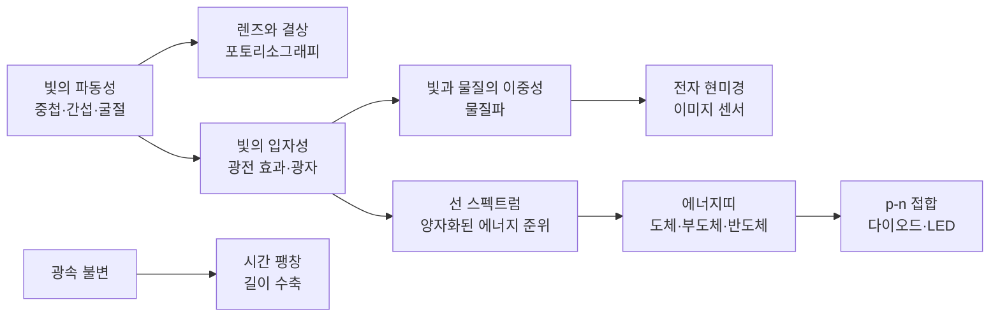
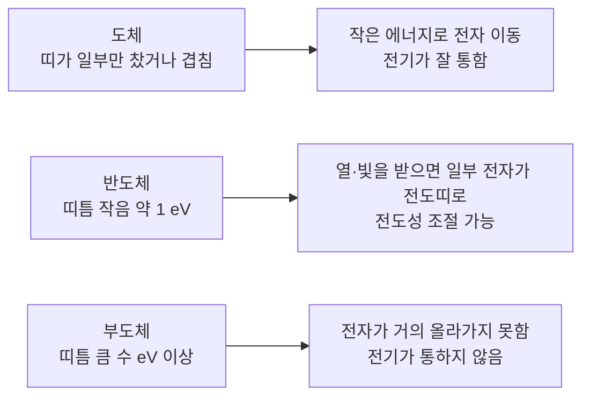

# 물리학 3. 빛과 물질 — 파동이면서 입자인 세계, 반도체와 상대성까지
<!-- prev: m2-03, 2-1, 2-6, phy-2 -->
<!-- next: emq-1, emq-2, emq-3, mech-1 -->

> [!NOTE]
> **성취기준**
> - **[12물리03-01]** 빛의 중첩과 간섭을 통해 빛의 파동성을 알고, 이를 이용한 기술과 현상을 예를 들어 설명할 수 있다.
> - **[12물리03-02]** 빛의 굴절을 이용하여 볼록렌즈에서 상이 맺히는 과정을 설명하고, 반도체와 디스플레이 제작 공정에서 중요하게 활용됨을 인식할 수 있다.
> - **[12물리03-03]** 빛과 물질의 이중성이 전자 현미경과 영상 정보 저장 등 다양한 분야에 활용됨을 설명할 수 있다.
> - **[12물리03-04]** 원자 내의 전자는 양자화된 에너지 준위를 가지고 있음을 스펙트럼 관찰 증거를 바탕으로 논증할 수 있다.
> - **[12물리03-05]** 고체의 에너지띠 구조로부터 도체와 부도체의 차이를 알고, 반도체 소자의 원리를 설명할 수 있다.
> - **[12물리03-06]** 모든 관성계에서 빛의 속력이 동일하다는 원리로부터 시간 팽창, 길이 수축 현상이 나타남을 알고, 이러한 지식이 사회에 미친 영향을 조사할 수 있다.

**학습 목표**

1. 파동의 중첩 원리와 보강·상쇄 간섭을 이해하고, 이중 슬릿 실험으로 빛의 파동성을 설명하며 간섭을 이용한 기술을 예로 들 수 있다.
2. 굴절률과 굴절 법칙을 이해하고, 광선 추적으로 볼록렌즈에 맺히는 상을 작도하며, 포토리소그래피에서 광학 기술의 역할을 설명할 수 있다.
3. 광전 효과와 물질파로 빛과 물질의 이중성을 설명하고, 전자 현미경과 이미지 센서의 원리에 적용할 수 있다.
4. 수소의 선 스펙트럼을 근거로 원자 속 전자의 에너지 준위가 양자화되어 있음을 논증하고, 보어 모형과 그 한계를 설명할 수 있다.
5. 에너지띠 구조로 도체·부도체·반도체를 구별하고, p-n 접합 다이오드와 LED의 원리를 설명할 수 있다.
6. 광속 불변 원리로부터 시간 팽창과 길이 수축이 나타남을 정성적으로 설명하고, 상대성 이론이 사회에 미친 영향을 조사할 수 있다.

**이 단원의 학습 사다리**

| 단계 | 무엇을 하나? |
|---|---|
| STEP 1. 이전 학습 다시 보기 | 중2 「빛과 파동」, 통합과학 「빛의 스펙트럼과 우주 초기 원소」·「물질의 전기적 성질과 소재」, 「전기와 자기」를 다시 꺼낸다 |
| STEP 2. 기초 다지기 | 파동의 기본 요소, 빛의 속력과 파장, 지수 표기, 광선과 법선을 디딤돌로 놓는다 |
| STEP 3. 핵심 개념 | 간섭(파동성) → 굴절과 렌즈 → 광전 효과·물질파(이중성) → 에너지 준위 → 에너지띠와 반도체 → 특수 상대성 |
| STEP 4. 오개념 바로잡기 | "빛은 파동이거나 입자이거나 둘 중 하나다?" 같은 착각을 바로잡는다 |
| STEP 5. 다음 단계로 | 진로 선택 「빛과 정보 통신」·「양자와 미시세계」·「전자기적 상호작용」·「시공간과 운동」으로 잇는다 |
| STEP 6. 생활·산업·진로 | 반도체 노광, 디스플레이, 전자 현미경, 카메라, GPS |

---

## 🗺️ 단원 들어가기

비눗방울 표면에 무지갯빛 무늬가 일렁인다. 비눗물에는 색소가 없는데 색은 어디서 왔을까? 스마트폰 카메라는 빛을 어떻게 사진 파일로 바꿀까? 바이러스는 빛을 이용한 현미경으로는 잘 보이지 않는데 전자 현미경으로는 또렷하게 보인다. 전자가 어떻게 '빛'처럼 상을 만들까?

20세기 초 물리학자들은 놀라운 사실을 알아냈다. **빛은 파동처럼 간섭하지만, 물질과 에너지를 주고받을 때는 알갱이처럼 행동한다.** 전자 같은 입자도 파동처럼 간섭한다. 원자 속 전자는 아무 에너지나 가질 수 없고 정해진 '계단'에만 설 수 있다. 이 '미시 세계의 규칙'이 반도체를 낳았고, 반도체가 스마트폰과 인공지능 시대를 열었다. 같은 시기에 아인슈타인은 "빛의 속력은 누가 보아도 같다"는 원리 하나로 시간과 공간의 개념을 바꾸었다.

이 단원은 물리학의 스토리라인에서 **눈에 보이는 거시 세계에서 보이지 않는 미시 세계로 넘어가는 다리**이다.

---

## STEP 1. 🔙 이전 학습 다시 보기

### 연계 개념표

| 이전 단원·성취기준 | 그때 배운 것 | 이 단원에서 확장되는 것 |
|---|---|---|
| 중2 「빛과 파동」 [9과10-01] | 빛의 반사와 굴절(정성적), 물체를 보는 과정 | 굴절률과 **굴절 법칙**을 정량적으로 다룬다 |
| 중2 「빛과 파동」 [9과10-02] | 거울과 렌즈의 종류, 상의 정성적 특징 | **광선 추적**으로 볼록렌즈의 상을 작도하고 실상·허상을 구분한다 |
| 중2 「빛과 파동」 [9과10-04] | 파동의 발생과 전달, 진폭·진동수·파장 | 두 파동이 만나는 **중첩과 간섭** |
| 통합과학1 「빛의 스펙트럼과 우주 초기 원소」 [10통과1-02-01] | 연속·선·흡수 스펙트럼, 원소마다 고유한 선 스펙트럼 | 선 스펙트럼을 **양자화된 에너지 준위**의 증거로 해석한다 |
| 통합과학1 「물질의 전기적 성질과 소재」 [10통과1-02-06] | 도체·부도체·반도체, 불순물로 전기적 성질 조절 | **에너지띠**로 차이를 설명하고 **p-n 접합**의 원리를 다룬다 |
| 물리학 「전기와 자기」 [12물리02-01], [12물리02-06] | 전위차와 전자볼트(eV), 전자기파 | eV로 광자·에너지 준위·띠틈을 나타내고, 빛을 전자기파로 본다 |

### 준비 운동 (사전 진단)

**Q1.** 진동수가 클수록 파장은 어떻게 되는가? (빛의 속력은 일정하다.)

**Q2.** 물이 담긴 컵에 꽂은 빨대가 수면에서 꺾여 보이는 현상의 이름은?

**Q3.** 네온사인이나 수소 기체 방전관의 빛을 분광기로 보면 어떤 스펙트럼이 보이는가?

**Q4.** 순수한 규소에 불순물을 조금 넣으면 전기 전도성은 어떻게 변하는가?

정답 및 해설

**Q1.** 짧아진다 — 파동의 속력 = 진동수 × 파장이므로, 속력이 일정하면 진동수와 파장은 반비례한다.

**Q2.** 빛의 **굴절** — 빛이 물에서 공기로 나올 때 속력이 바뀌며 진행 방향이 꺾인다.

**Q3.** **선 스펙트럼** — 원소마다 특정한 파장의 밝은 선만 나타난다. 이 단원에서 그 이유를 밝힌다.

**Q4.** 크게 좋아진다 — 통합과학에서 "불순물을 추가하면 전기적 성질을 제어하기 쉽다"고 배웠다. 이 단원에서 그 원리를 에너지띠로 설명한다.

---

## STEP 2. 🧱 기초 다지기

### ① 파동의 기본 요소

| 요소 | 기호 | 뜻 | 단위 |
|---|---|---|---|
| 파장 | $\lambda$ | 이웃한 마루와 마루 사이의 거리 | m, nm |
| 진동수 | $f$ | 1초 동안 진동하는 횟수 | Hz |
| 진폭 | $A$ | 진동 중심에서 마루까지의 높이 | m |
| 속력 | $v$ | 파동이 퍼져 나가는 빠르기 | m/s |

$$
v = f\lambda
$$

**위상(phase)** 은 파동이 한 주기 중 어느 단계에 있는지를 나타낸다. 마루와 마루가 만나면 '위상이 같다', 마루와 골이 만나면 '위상이 반대이다'라고 한다.

### ② 빛의 속력과 파장

진공에서 빛의 속력 $c$는 정확히 299 792 458 m/s이며, 계산에서는 $c \approx 3.0\times10^8\ \mathrm{m/s}$를 쓴다. 이 값은 1983년부터 미터의 정의에 쓰이고 있다(통합과학 「시간과 공간」).

| 빛 | 파장 범위(대략) |
|---|---|
| 자외선 | 약 400 nm보다 짧다 |
| 보라 ~ 파랑 | 약 400~490 nm |
| 초록 ~ 노랑 | 약 490~590 nm |
| 주황 ~ 빨강 | 약 590~700 nm |
| 적외선 | 약 700 nm보다 길다 |

### ③ 지수 표기와 작은 단위

| 접두어 | 값 | 예 |
|---|---|---|
| 마이크로(μ) | $10^{-6}$ | 머리카락 굵기 약 수십 μm |
| 나노(n) | $10^{-9}$ | 가시광선 파장 수백 nm, 최신 반도체 회로 수십 nm 이하 |

### ④ 광선, 법선, 입사각

빛의 진행 방향을 화살표 직선으로 나타낸 것을 **광선**이라 한다. 두 물질의 경계면에 수직으로 세운 선을 **법선**이라 하고, 입사 광선과 법선 사이의 각을 **입사각**, 굴절 광선과 법선 사이의 각을 **굴절각**이라 한다.

> [!TIP]
> 💡 **비유** — 이 단원에서 빛은 상황에 따라 세 가지 얼굴로 나타난다. 렌즈를 다룰 때는 **직진하는 화살표(광선)**, 간섭을 다룰 때는 **물결(파동)**, 물질과 에너지를 주고받을 때는 **알갱이(광자)**. 셋 다 같은 빛을 다른 각도에서 본 모습이다.

---

## STEP 3. 📘 핵심 개념

### ① 파동의 중첩 — 만나도 부서지지 않는다

두 파동이 만나면 그 지점의 변위는 **각 파동의 변위를 더한 것**이 된다. 이것을 **중첩 원리(superposition principle)** 라 한다. 만난 뒤 두 파동은 서로 아무 일 없었다는 듯이 원래 모양 그대로 제 갈 길을 간다. 두 물체가 충돌하면 튕겨 나가는 것과 다르다.

| 만나는 방식 | 결과 | 이름 |
|---|---|---|
| 마루 + 마루 (위상이 같음) | 진폭이 커진다 | **보강 간섭** |
| 마루 + 골 (위상이 반대) | 진폭이 작아지거나 0이 된다 | **상쇄 간섭** |

<!-- fig:phy-3-superposition -->

두 파원에서 나온 파동이 일정한 위상 관계를 유지하며 겹치면 보강 간섭과 상쇄 간섭이 일어나는 자리가 고정되어 **간섭무늬**가 생긴다. 이것을 **간섭(interference)** 이라 한다.

**경로차로 판단하기** 위상이 같은 두 파원에서 어떤 점까지의 거리 차이(**경로차**)를 $\Delta$라 하면

$$
\Delta = m\lambda \;\;(\text{보강}), \qquad \Delta = \left(m + \tfrac{1}{2}\right)\lambda \;\;(\text{상쇄}) \qquad (m = 0, 1, 2, \cdots)
$$

#### 예제 1 — 두 스피커 사이에서

같은 음을 같은 위상으로 내는 두 스피커가 있다. 음파의 파장이 0.68 m이다. 그림과 같이 한 스피커에서 3.40 m, 다른 스피커에서 3.74 m 떨어진 점 P에서는 소리가 커지는가, 작아지는가?

<!-- fig:phy-3-q-two-speakers -->

**풀이** 경로차 $= 3.74 - 3.40 = 0.34\ \mathrm{m} = \frac{1}{2}\times0.68$ → 반 파장이므로 **상쇄 간섭**, 소리가 작아진다.

> [!TIP]
> 💡 **비유** — 두 친구가 줄넘기 줄 양 끝에서 동시에 물결을 보낸다. 가운데서 위로 솟은 물결끼리 만나면 두 배로 솟고, 위로 솟은 것과 아래로 꺼진 것이 만나면 순간 평평해진다. 그래도 지나간 뒤 두 물결은 원래대로 계속 나아간다.

#### ✔ 바로 확인

1. (O/X) 두 파동이 만나 중첩된 뒤에는 각 파동의 모양이 바뀌어 진행한다.
2. 빈칸: 마루와 골이 만나 진폭이 작아지는 간섭을 (    ) 간섭이라 한다.
3. 위상이 같은 두 파원에서 나온 파장 4 cm인 물결파가 경로차 8 cm인 점에서 만난다. 보강 간섭과 상쇄 간섭 중 무엇이 일어나는가?

정답

1. X — 만난 뒤 두 파동은 원래 모양 그대로 진행한다.
2. 상쇄
3. 보강 간섭 — 경로차가 $2\lambda$(파장의 정수배)이다.

### ② 빛의 간섭 — 이중 슬릿 실험

17세기 이후 빛이 입자인지 파동인지 오랜 논쟁이 있었다. 1800년대 초 영국의 영(T. Young)은 **이중 슬릿 실험**으로 이 논쟁에 중요한 증거를 내놓았다.

**실험** 한 빛을 아주 가까이 붙은 두 개의 좁은 틈(슬릿)에 비추고, 뒤쪽 스크린을 본다.

| 빛이 입자라면 예상되는 결과 | 실제 결과 |
|---|---|
| 두 슬릿 뒤에 밝은 줄 두 개만 생긴다 | **밝은 무늬와 어두운 무늬가 일정한 간격으로 여러 개** 번갈아 나타난다 |

두 슬릿에서 나온 빛이 스크린의 각 점에서 경로차에 따라 보강(밝은 무늬)·상쇄(어두운 무늬) 간섭을 한 것이다. **빛이 더해서 어두워지는 것**은 파동만이 할 수 있다. 이중 슬릿 실험은 빛의 파동성의 결정적 증거가 되었다.

**무늬 간격** 슬릿 간격 $d$, 슬릿과 스크린 사이 거리 $L$, 빛의 파장 $\lambda$일 때 이웃한 밝은 무늬 사이의 간격 $\Delta x$는 ($L$이 $d$보다 매우 클 때)

$$
\Delta x = \frac{L\lambda}{d}
$$

| 바꾸는 것 | 무늬 간격 |
|---|---|
| 파장이 긴 빛(빨강)으로 | 넓어진다 |
| 슬릿 간격 $d$를 좁게 | 넓어진다 |
| 스크린을 멀리($L$ 증가) | 넓어진다 |
| 흰빛을 비추면 | 가운데는 흰색, 바깥으로 갈수록 색깔별로 위치가 달라 무지갯빛이 된다 |

<!-- sim:wave-interference -->

#### 예제 2 — 레이저 포인터로 보는 간섭무늬

파장 650 nm인 빨간 레이저를 슬릿 간격 0.25 mm인 이중 슬릿에 비추었다. 2.0 m 떨어진 스크린에 생기는 밝은 무늬 사이의 간격은? 파장 520 nm인 초록 레이저로 바꾸면?

**풀이** $\Delta x = \dfrac{2.0\times650\times10^{-9}}{0.25\times10^{-3}} = 5.2\times10^{-3}\ \mathrm{m} = 5.2\ \mathrm{mm}$
초록: $\Delta x = \dfrac{2.0\times520\times10^{-9}}{0.25\times10^{-3}} \approx 4.2\ \mathrm{mm}$ — 파장이 짧을수록 무늬 간격이 좁다.

#### ✔ 바로 확인

1. 이중 슬릿의 슬릿 간격 $d$를 좁히면 밝은 무늬 사이의 간격은 어떻게 되는가?
2. (O/X) 이중 슬릿 실험에서 빛이 더해져 어두운 무늬가 생기는 것은 빛의 파동성의 증거이다.
3. 같은 레이저와 슬릿에서 스크린까지의 거리를 2배로 하면 무늬 간격은 몇 배가 되는가?

정답

1. 넓어진다 — $\Delta x = \dfrac{L\lambda}{d}$.
2. O — 상쇄 간섭은 파동만이 할 수 있다.
3. 2배 — 무늬 간격은 $L$에 비례한다.

### ③ 간섭을 이용한 현상과 기술

| 현상·기술 | 간섭이 일어나는 방식 |
|---|---|
| 비눗방울·기름 막의 무지갯빛 | 얇은 막의 윗면과 아랫면에서 반사한 두 빛이 간섭한다. 막의 두께와 보는 각도에 따라 보강되는 색이 달라진다 |
| 공작 깃털·나비 날개·전복 껍데기의 광택 | 색소가 아니라 미세한 층 구조에서 반사한 빛의 간섭으로 생기는 **구조색** |
| 안경·카메라 렌즈의 반사 방지 코팅 | 렌즈 표면에 얇은 막을 입혀 막의 두 면에서 반사한 빛이 **상쇄 간섭**하게 한다. 반사가 줄고 투과가 늘어 상이 밝고 또렷해진다 |
| CD·DVD 표면의 무지개 | 촘촘한 홈에서 반사한 빛이 간섭하여 색깔별로 다른 방향으로 보강된다 |
| 소음 제거 헤드폰 | 마이크로 주변 소음을 받아 반대 위상의 소리를 만들어 **상쇄 간섭**시킨다(음파의 간섭) |
| 간섭계로 정밀 측정 | 레이저를 두 길로 나눴다가 다시 합치면, 한쪽 길이가 파장보다 훨씬 작게 변해도 간섭무늬가 바뀐다. 반도체 장비의 위치 측정, 렌즈 표면 검사에 쓴다 |
| 중력파 검출 | 수 km 길이의 거대한 레이저 간섭계로 원자핵보다 작은 길이 변화를 측정하여, 2015년 처음으로 중력파를 직접 검출했다 |
| 홀로그램 | 물체에서 온 빛과 기준 빛의 간섭무늬를 기록해 입체 영상을 재현한다. 지폐·신용카드의 위조 방지에 쓰인다 |

#### 예제 3 — 반사 방지 코팅

그림과 같이 카메라 렌즈의 반사 방지 코팅은 막의 윗면(①)과 아랫면(②)에서 반사한 빛을 상쇄 간섭시킨다. (1) 반사가 줄어든 빛의 에너지는 어디로 가는가? (2) 코팅된 렌즈가 비스듬히 보면 보랏빛이나 초록빛을 띠는 이유는?

<!-- fig:phy-3-q-coating -->

**풀이** (1) 에너지는 사라지지 않는다. 반사되는 빛이 줄어든 만큼 **렌즈를 투과하는 빛이 늘어난다.** (2) 코팅 두께는 특정 파장(주로 초록 부근)이 가장 잘 상쇄되도록 맞추어져 있어, 다른 파장의 빛은 일부 반사되어 색을 띤다. 보는 각도가 달라지면 경로차가 달라져 색이 바뀐다.

#### ✔ 바로 확인

1. 비눗방울이 무지갯빛을 띠는 까닭은?
2. 빈칸: 렌즈의 반사 방지 코팅은 막의 두 면에서 반사한 빛이 (    ) 간섭하게 만든다.
3. (O/X) 소음 제거 헤드폰은 주변 소음과 같은 위상의 소리를 더해 소음을 줄인다.

정답

1. 얇은 막의 윗면과 아랫면에서 반사한 두 빛이 간섭하기 때문이다.
2. 상쇄
3. X — 반대 위상의 소리를 만들어 상쇄 간섭시킨다.

### ④ 빛의 굴절 — 속력이 바뀌면 방향이 꺾인다

빛은 물질 속에서 진공에서보다 느리게 진행한다. 진공에서의 빛의 속력 $c$와 물질 속에서의 속력 $v$의 비를 그 물질의 **굴절률(refractive index)** 이라 한다.

$$
n = \frac{c}{v}
$$

| 물질 | 굴절률(대략) | 빛의 속력 |
|---|---|---|
| 공기 | 약 1.00 | 거의 $c$ |
| 물 | 약 1.33 | 약 $2.3\times10^8\ \mathrm{m/s}$ |
| 유리 | 약 1.5 | 약 $2.0\times10^8\ \mathrm{m/s}$ |
| 다이아몬드 | 약 2.42 | 약 $1.2\times10^8\ \mathrm{m/s}$ |

빛이 비스듬히 다른 물질로 들어가면 경계면에서 진행 방향이 꺾인다. 이것이 **굴절(refraction)** 이다. 굴절률이 큰 물질(빛이 느린 쪽)로 들어갈 때는 **법선 쪽으로** 꺾이고, 작은 물질로 나올 때는 **법선에서 멀어지는 쪽으로** 꺾인다. 입사각 $\theta_1$, 굴절각 $\theta_2$ 사이에는 **굴절 법칙(스넬 법칙)** 이 성립한다.

$$
n_1 \sin\theta_1 = n_2 \sin\theta_2
$$

> [!TIP]
> 💡 **비유** — 포장도로에서 모래밭으로 비스듬히 들어가는 수레를 떠올리자. 먼저 모래에 닿은 바퀴가 먼저 느려져 수레가 모래밭 쪽(법선 쪽)으로 방향을 튼다. 빛도 경계면에 먼저 닿은 쪽이 먼저 느려지며 꺾인다.

**전반사** 빛이 굴절률이 큰 물질에서 작은 물질로 나갈 때 입사각이 어느 각(**임계각**)보다 크면, 빛이 경계면을 빠져나가지 못하고 **모두 반사**된다. 유리의 임계각은 약 42°이다. 광섬유는 굴절률이 큰 중심부(코어)를 굴절률이 작은 물질로 감싸, 빛이 전반사를 되풀이하며 멀리까지 손실 적게 전달되게 한 것이다. 인터넷의 해저 통신망이 광섬유로 연결되어 있다.

<!-- fig:phy-3-refraction -->

**분산** 굴절률은 빛의 색(파장)에 따라 조금씩 다르다. 보라색 빛이 빨간색 빛보다 더 크게 꺾인다. 그래서 프리즘을 지난 흰빛이 무지갯빛으로 펼쳐지고, 빗방울이 무지개를 만든다.

#### 예제 4 — 물속으로 들어가는 빛

공기에서 입사각 30°로 물(굴절률 1.33)에 들어간 빛의 굴절각은? ($\sin30° = 0.5$)

**풀이** $1.00\times0.5 = 1.33\times\sin\theta_2$ → $\sin\theta_2 \approx 0.376$ → $\theta_2 \approx 22°$
법선 쪽으로 꺾였다. 물속 물체가 실제보다 얕아 보이는 것도 이 때문이다.

#### ✔ 바로 확인

1. 굴절률이 1.5인 유리 속에서 빛의 속력은? ($c = 3.0\times10^8\ \mathrm{m/s}$)
2. 빛이 공기에서 물로 비스듬히 들어가면 법선 쪽과 법선에서 멀어지는 쪽 중 어느 쪽으로 꺾이는가?
3. (O/X) 빛이 공기에서 유리로 들어갈 때도 입사각이 충분히 크면 전반사가 일어난다.

정답

1. $2.0\times10^8\ \mathrm{m/s}$ — $v = c/n$.
2. 법선 쪽 — 빛이 느려지는 쪽(굴절률이 큰 쪽)으로 들어간다.
3. X — 전반사는 굴절률이 큰 물질에서 작은 물질로 나갈 때만 일어난다.

### ⑤ 볼록렌즈에서 상이 맺히는 과정 — 광선 추적

볼록렌즈는 가운데가 두껍다. 렌즈의 두 면에서 빛이 굴절하므로, 광축에 나란하게 들어온 빛은 렌즈를 지나 한 점에 모인다. 이 점이 **초점(F)** 이고, 렌즈 중심에서 초점까지의 거리가 **초점 거리** $f$이다. 볼록렌즈는 양쪽에 초점이 하나씩 있다.

물체의 한 점에서 나온 수많은 광선 중 **진행 경로를 쉽게 알 수 있는 세 광선**만 그리면 상의 위치를 찾을 수 있다. 이 방법을 **광선 추적법**이라 한다.

| 광선 | 렌즈에 들어갈 때 | 렌즈를 지난 뒤 |
|---|---|---|
| ① 평행 광선 | 광축에 나란하게 | 반대쪽 초점을 지난다 |
| ② 중심 광선 | 렌즈 중심을 향해 | 꺾이지 않고 곧게 나아간다 |
| ③ 초점 광선 | 앞쪽 초점을 지나서 | 광축에 나란하게 나아간다 |

두 광선 이상이 실제로 **모이는 점**에 생기는 상을 **실상**이라 한다. 실상은 스크린에 비출 수 있고 거꾸로 선다. 굴절한 광선들이 실제로는 퍼져 나가지만 **연장선이 모이는 점**에 보이는 상을 **허상**이라 한다. 허상은 스크린에 맺히지 않고 렌즈를 통해 들여다볼 때만 보인다.

| 물체의 위치 | 상의 위치 | 상의 종류 | 쓰임 |
|---|---|---|---|
| 초점 거리의 2배보다 먼 곳 | 반대쪽, $f$와 $2f$ 사이 | 실상, 거꾸로, **축소** | 카메라, 눈의 수정체 |
| 초점 거리의 2배인 곳 | 반대쪽, $2f$ | 실상, 거꾸로, 같은 크기 | 복사기의 등배 복사 |
| $f$와 $2f$ 사이 | 반대쪽, $2f$보다 먼 곳 | 실상, 거꾸로, **확대** | 빔 프로젝터, 영사기 |
| 초점 | 상이 생기지 않음(평행하게 나감) | — | 탐조등, 등대(광원을 초점에 둠) |
| 초점 안쪽 | 물체와 같은 쪽 | **허상**, 바로 선, 확대 | 돋보기 |

<!-- fig:phy-3-convex-lens-rays -->

<!-- fig:phy-3-lens-cases -->

#### 예제 5 — 광선 추적으로 상 찾기

초점 거리 10 cm인 볼록렌즈 앞 30 cm에 화살표 모양 물체를 세웠다. (1) 광선 ①, ②를 이용해 상을 찾는 과정을 설명하고, (2) 상의 종류와 특징을 쓰시오.

**풀이** (1) 화살표 끝에서 광축에 나란하게 나간 광선 ①은 렌즈를 지나 반대쪽 초점(렌즈 뒤 10 cm)을 지난다. 화살표 끝에서 렌즈 중심으로 간 광선 ②는 곧게 나아간다. 두 광선은 렌즈 뒤 10 cm(초점)와 20 cm($2f$) 사이에서 만나고, 그 점이 화살표 끝의 상이다. (2) 물체가 $2f$(20 cm)보다 멀리 있으므로 **거꾸로 선, 축소된 실상**이 맺힌다. 카메라가 먼 풍경을 작은 이미지 센서에 담는 원리이다.

> [!NOTE]
> 이 단원에서는 상의 위치와 크기를 **광선 추적으로 작도**하여 찾는다. 물체 거리·상 거리·초점 거리 사이의 식(렌즈 공식)과 여러 렌즈를 겹친 경우는 다루지 않는다.

#### ✔ 바로 확인

1. 빈칸: 광축에 나란하게 볼록렌즈에 들어간 광선은 렌즈를 지난 뒤 반대쪽 (    )을 지난다.
2. 물체가 초점 거리의 2배보다 먼 곳에 있을 때 생기는 상의 특징 세 가지는?
3. (O/X) 돋보기로 본 확대된 상은 스크린에 비출 수 있다.

정답

1. 초점
2. 실상, 거꾸로 섬, 축소 — 카메라의 원리이다.
3. X — 허상은 광선이 실제로 모이지 않아 스크린에 맺히지 않는다.

### ⑥ 반도체·디스플레이 공정의 핵심 — 포토리소그래피

스마트폰의 처리 칩에는 손톱만 한 면적에 수십억 개 이상의 트랜지스터가 들어 있다. 이렇게 작은 회로를 어떻게 그릴까? 답은 **빛으로 사진을 찍듯이 회로를 인쇄하는 것**, 곧 **포토리소그래피(photolithography)** 이다.

| 단계 | 하는 일 |
|---|---|
| ① 감광액 도포 | 실리콘 웨이퍼 위에 빛을 받으면 성질이 바뀌는 감광액을 얇게 바른다 |
| ② 노광 | 회로 무늬가 그려진 **마스크**에 빛을 비추고, **렌즈(투영 광학계)** 로 그 무늬를 **축소한 실상**을 웨이퍼 위에 맺는다 |
| ③ 현상 | 빛을 받은(또는 받지 않은) 부분의 감광액을 녹여 낸다 → 감광액에 회로 무늬가 남는다 |
| ④ 식각·증착 | 감광액이 없는 부분을 깎아 내거나 물질을 쌓는다 |
| ⑤ 반복 | 층마다 다른 마스크로 수십 번 되풀이하여 입체적인 회로를 쌓는다 |

②가 바로 ⑤에서 배운 '먼 물체의 축소된 실상'이다. 큰 마스크 무늬를 렌즈로 줄여 웨이퍼에 또렷한 실상으로 맺는다.

<!-- fig:phy-3-photolithography -->

**더 가는 선을 그리려면?** 빛은 파동이라 아무리 좋은 렌즈를 써도 상이 한 점에 완벽히 모이지 않고 조금 퍼진다(파동성). 그 퍼짐은 대략 **파장 정도**이므로, 더 가는 회로를 그리려면 **파장이 짧은 빛**이 필요하다.

| 노광 광원 | 파장 | 특징 |
|---|---|---|
| 수은등(i선) | 365 nm | 초기 반도체 공정 |
| 불화크립톤(KrF) 레이저 | 248 nm | 심자외선 |
| 불화아르곤(ArF) 레이저 | 193 nm | 렌즈와 웨이퍼 사이에 물을 채워(액침 노광) 굴절을 이용해 해상도를 더 높이기도 한다 |
| 극자외선(EUV) | 13.5 nm | 렌즈 재료가 이 빛을 흡수하므로 렌즈 대신 특수 **거울**로 상을 맺는다 |

**디스플레이 공정** 스마트폰·TV의 화면 뒤에는 화소 하나하나를 켜고 끄는 얇은 트랜지스터 회로가 깔려 있다. 이 회로도 넓은 유리 기판 위에 포토리소그래피로 만든다. 반도체보다 선폭은 굵지만 **아주 넓은 면적을 고르게** 노광하는 것이 핵심 기술이다.

#### 예제 6 — 파장과 해상도

노광 장비의 광원을 248 nm에서 193 nm로 바꾸었다. 같은 광학계라면 새길 수 있는 최소 선폭은 대략 몇 배가 되는가?

**풀이** 최소 선폭은 대략 파장에 비례하므로 $\dfrac{193}{248} \approx 0.78$배, 즉 약 22 % 더 가는 선을 그릴 수 있다.

#### ✔ 바로 확인

1. 포토리소그래피의 단계를 순서대로 쓰시오: 현상, 감광액 도포, 식각, 노광
2. (O/X) 노광 장비는 마스크 무늬의 확대된 실상을 웨이퍼에 맺는다.
3. 더 가는 회로 선을 새기려면 노광 빛의 파장을 길게 해야 하는가, 짧게 해야 하는가?

정답

1. 감광액 도포 → 노광 → 현상 → 식각
2. X — 큰 마스크 무늬를 줄인 축소된 실상을 맺는다.
3. 짧게 — 빛은 파장 정도로 퍼지므로 파장이 짧을수록 가는 선을 그릴 수 있다.

### ⑦ 빛의 입자성 — 광전 효과와 광자

금속에 빛을 비추면 금속 표면에서 전자가 튀어나오는 현상을 **광전 효과(photoelectric effect)** 라 하고, 튀어나온 전자를 **광전자**라 한다. 실험 결과는 빛을 파동으로만 보아서는 설명할 수 없었다.

| 실험 사실 | 빛이 파동이라면 예상 | 실제 |
|---|---|---|
| 진동수가 어떤 값(**문턱 진동수**)보다 작은 빛 | 아주 밝게 오래 비추면 에너지가 쌓여 결국 전자가 나올 것 | **아무리 밝게 비춰도 전자가 나오지 않는다** |
| 문턱 진동수보다 큰 빛 | 어두운 빛은 에너지가 쌓일 때까지 시간이 걸릴 것 | **아무리 어두워도 즉시** 전자가 나온다 |
| 빛을 더 밝게 하면 | 전자의 에너지가 커질 것 | 전자의 **개수**만 늘고, 전자 하나의 최대 운동 에너지는 그대로 |
| 진동수를 더 크게 하면 | — | 튀어나온 전자의 최대 운동 에너지가 커진다 |

1905년 아인슈타인은 **빛이 에너지 알갱이(광자, photon)의 흐름**이라고 제안하여 이 결과를 설명했다. 진동수 $f$인 빛의 광자 하나의 에너지는

$$
E = hf = \frac{hc}{\lambda} \qquad (h \approx 6.63\times10^{-34}\ \mathrm{J\cdot s},\ \text{플랑크 상수})
$$

- 전자는 광자 **한 개**와 에너지를 주고받는다. 광자 한 개의 에너지가 전자를 떼어 내기에 부족하면, 광자가 아무리 많아도(밝아도) 전자는 나오지 않는다.
- 빛의 밝기는 **광자의 개수**, 빛의 색(진동수)은 **광자 하나의 에너지**를 결정한다.

> [!TIP]
> 💡 **비유** — 높은 담장 너머로 공을 넘겨야 한다. 탁구공(진동수 작은 광자)은 백만 개를 던져도 하나도 못 넘는다. 야구공을 힘껏 던지면(진동수 큰 광자) 단 한 개라도 넘는다. 공을 많이 던지면(밝기) 넘어가는 공의 **개수**가 늘 뿐이다.

**계산 요령** $hc \approx 1240\ \mathrm{eV\cdot nm}$이므로, 파장을 nm로 넣으면 광자 에너지를 바로 eV로 얻는다: $E(\mathrm{eV}) \approx \dfrac{1240}{\lambda(\mathrm{nm})}$

<!-- sim:photoelectric -->

#### 예제 7 — 빨간 광자와 파란 광자

파장 620 nm인 빨간빛과 413 nm인 보랏빛의 광자 에너지를 eV로 구하시오. 어떤 금속에서 전자를 떼어 내는 데 최소 2.5 eV가 필요하다면, 각각의 빛으로 광전 효과가 일어나는가?

**풀이** 빨강 $1240/620 = 2.0\ \mathrm{eV}$, 보라 $1240/413 \approx 3.0\ \mathrm{eV}$
빨간빛은 광자 하나의 에너지가 2.5 eV보다 작아 아무리 밝아도 광전 효과가 **일어나지 않고**, 보랏빛은 어두워도 **일어난다.**

#### ✔ 바로 확인

1. 파장 500 nm인 빛의 광자 하나의 에너지는 약 몇 eV인가?
2. (O/X) 광전 효과에서 빛을 더 밝게 하면 튀어나오는 광전자 하나의 최대 운동 에너지가 커진다.
3. 짝짓기: (가) 빛의 밝기, (나) 빛의 진동수 — ㄱ. 광자 하나의 에너지, ㄴ. 광자의 개수

정답

1. 약 2.48 eV — $1240/500$.
2. X — 광전자의 개수만 늘어난다.
3. (가)–ㄴ, (나)–ㄱ

### ⑧ 물질의 파동성 — 전자도 간섭한다

빛이 파동이면서 입자라면, 반대로 입자인 전자도 파동성을 가질까? 1924년 드브로이는 운동량 $p$인 모든 입자가 다음 파장을 가진 파동처럼 행동한다고 제안했다. 이 파동을 **물질파(드브로이 파)** 라 한다.

$$
\lambda = \frac{h}{p} = \frac{h}{mv}
$$

1927년 무렵 전자를 결정에 쏘았을 때 X선처럼 회절·간섭무늬가 나타나는 것이 확인되어 이 제안이 증명되었다. 오늘날에는 전자를 이중 슬릿에 통과시켜도 빛과 같은 간섭무늬가 생긴다는 것이 알려져 있다.

#### 예제 8 — 전자와 야구공의 파장

(1) 속력 $1.0\times10^6\ \mathrm{m/s}$인 전자(질량 $9.1\times10^{-31}\ \mathrm{kg}$)와 (2) 속력 40 m/s인 야구공(질량 0.15 kg)의 물질파 파장을 구하시오.

**풀이**
(1) $\lambda = \dfrac{6.63\times10^{-34}}{9.1\times10^{-31}\times1.0\times10^6} \approx 7.3\times10^{-10}\ \mathrm{m} = 0.73\ \mathrm{nm}$ — 원자 크기 정도로, 결정에서 회절·간섭이 관찰된다.
(2) $\lambda = \dfrac{6.63\times10^{-34}}{0.15\times40} \approx 1.1\times10^{-34}\ \mathrm{m}$ — 원자핵보다도 엄청나게 작아 파동성을 관찰할 방법이 없다.

**빛과 물질의 이중성** 빛과 전자는 모두 **진행할 때는 파동처럼 간섭하고, 검출될 때는 한 점에 알갱이로 도착한다.** 상황에 따라 파동성과 입자성 중 한쪽이 두드러질 뿐 둘 다 같은 대상의 성질이다.

| | 파동성의 증거 | 입자성의 증거 |
|---|---|---|
| 빛 | 이중 슬릿 간섭, 얇은 막의 간섭 | 광전 효과, 이미지 센서의 광자 계수 |
| 전자 | 결정에 의한 회절, 이중 슬릿 간섭 | 형광판에 한 점씩 찍힘, 전하·질량을 가짐 |

#### ✔ 바로 확인

1. 어떤 전자의 운동량을 2배로 하면 물질파 파장은 몇 배가 되는가?
2. (O/X) 야구공은 입자이므로 물질파 파장이 없다.
3. 전자가 파동성을 가진다는 실험 증거를 하나 쓰시오.

정답

1. $\frac{1}{2}$배 — $\lambda = h/p$.
2. X — 파장은 있지만 너무 짧아 파동성을 관찰할 수 없다.
3. 결정에 쏜 전자의 회절·간섭무늬(또는 전자의 이중 슬릿 간섭무늬).

### ⑨ 이중성의 활용 — 전자 현미경과 영상 정보 저장

#### 전자 현미경 — 전자의 파동성

현미경으로 구별할 수 있는 가장 작은 거리(**분해능**)는 사용하는 파동의 파장에 따라 정해진다. 파장보다 작은 구조는 파동이 퍼져서 흐려지기 때문이다. 가시광선을 쓰는 광학 현미경으로는 약 200 nm보다 작은 것을 구별하기 어렵다. 바이러스(대략 수십~수백 nm)나 반도체 회로가 잘 보이지 않는 이유이다.

전자를 수천~수만 V의 전위차로 가속하면(「전기와 자기」의 $W = qV$) 물질파 파장이 가시광선보다 **수만 배 이상 짧아진다.** 그래서 전자 현미경은 광학 현미경보다 훨씬 작은 구조를 볼 수 있다.

| 구분 | 광학 현미경 | 전자 현미경 |
|---|---|---|
| 사용하는 파동 | 가시광선 | 전자의 물질파 |
| 렌즈 | 유리 렌즈(굴절) | **자기 렌즈**(코일이 만드는 자기장이 전자의 경로를 휘게 한다) |
| 내부 환경 | 공기 중 | 진공(전자가 공기 분자와 충돌하지 않도록) |
| 시료 | 살아 있는 세포도 관찰 가능 | 대부분 처리한 시료 |
| 볼 수 있는 대상 | 세포, 큰 세균 | 바이러스, 단백질 구조, 반도체 회로, 원자 배열 |

- **투과 전자 현미경(TEM)**: 얇은 시료를 투과한 전자로 내부 구조를 본다.
- **주사 전자 현미경(SEM)**: 전자빔으로 시료 표면을 훑으며 튀어나오는 전자를 모아 입체적인 표면 영상을 얻는다.

#### 예제 9 — 가속 전압과 파장

전자 현미경에서 가속 전압을 높이면 분해능이 좋아지는 이유를 설명하시오.

**풀이** 가속 전압이 높을수록 전자가 얻는 운동 에너지 $eV$가 커져 속력과 운동량이 커진다. 물질파 파장 $\lambda = h/p$는 운동량에 반비례하므로 짧아진다. 파장이 짧을수록 더 작은 구조까지 구별할 수 있다. (예: 100 V로 가속한 전자의 파장은 약 0.12 nm이다.)

#### 영상 정보 저장 — 빛의 입자성

스마트폰 카메라의 **이미지 센서(CMOS, CCD)** 는 수천만 개의 작은 **광다이오드(화소)** 가 바둑판처럼 늘어선 반도체 칩이다.

1. 렌즈가 풍경의 축소된 실상을 센서 위에 맺는다(⑤).
2. 각 화소에 광자가 들어오면, 광자 하나가 반도체 속 전자 하나를 움직일 수 있는 상태로 만든다(광전 효과와 같은 원리). 이렇게 생긴 전자가 화소에 모인다.
3. 밝은 곳일수록 광자가 많이 들어와 전자가 많이 모인다. 화소마다 모인 전하량을 측정한다.
4. 화소 위의 빨강·초록·파랑 필터로 색 정보를 얻는다.
5. 전하량을 숫자로 바꾸어(디지털 신호) 메모리에 파일로 저장한다.

즉 디지털 사진은 **화소마다 도착한 광자의 개수를 센 기록**이다. 빛의 입자성이 없었다면 이런 방식은 불가능하다. 같은 원리가 의료용 X선 디지털 영상, 천체 망원경의 관측 카메라, 자동차의 블랙박스·자율 주행 카메라에 쓰인다.

#### ✔ 바로 확인

1. 전자 현미경이 광학 현미경보다 더 작은 구조를 구별할 수 있는 까닭은?
2. 빈칸: 전자 현미경은 유리 렌즈 대신 코일이 만드는 자기장으로 전자의 경로를 휘게 하는 (    )를 쓴다.
3. (O/X) 이미지 센서의 화소에는 밝은 곳일수록 더 많은 전자가 모인다.

정답

1. 가속한 전자의 물질파 파장이 가시광선보다 훨씬 짧기 때문이다.
2. 자기 렌즈
3. O — 들어오는 광자가 많기 때문이다(빛의 입자성).

### ⑩ 선 스펙트럼과 보어의 원자 모형 — 에너지 준위는 계단이다

통합과학 「빛의 스펙트럼과 우주 초기 원소」에서 수소 기체가 내는 빛을 분광기로 보면 **특정한 파장의 밝은 선**만 나타나는 선 스펙트럼을 관찰했다. 가시광선 영역의 수소 선은 약 656 nm(빨강), 486 nm(청록), 434 nm(파랑), 410 nm(보라)의 네 줄이다. **왜 연속적인 무지개가 아니라 띄엄띄엄한 선일까?**

**논증의 흐름**

1. ⑦에서 빛은 광자로 방출되며, 파장이 정해지면 광자의 에너지 $E = hc/\lambda$가 정해진다.
2. 수소 원자가 내는 빛의 파장이 몇 개로 정해져 있다 → 수소 원자가 내놓는 광자의 에너지도 **몇 가지 값으로만** 정해져 있다.
3. 원자가 광자를 낼 때 원자 속 전자의 에너지가 그만큼 줄어든다(에너지 보존).
4. 따라서 원자 속 전자는 **아무 에너지나 가질 수 없고 띄엄띄엄한 특정 에너지만** 가질 수 있다. 이것을 **에너지 준위가 양자화되어 있다**고 한다.

> [!IMPORTANT]
> **선 스펙트럼은 에너지 준위가 양자화되어 있다는 증거이다.** 만약 전자가 아무 에너지나 가질 수 있다면 원자는 모든 파장의 빛을 내어 연속 스펙트럼이 보여야 한다.

**보어의 수소 원자 모형(1913)** 보어는 이 결과를 다음 가정으로 설명했다.

| 가정 | 내용 |
|---|---|
| 양자 조건 | 전자는 원자핵 주위의 **특정한 궤도**에서만 원운동을 하며, 각 궤도마다 정해진 에너지를 가진다. 궤도에 안쪽부터 양자수 $n = 1, 2, 3, \cdots$을 붙인다 |
| 안정 상태 | 허용된 궤도에 있는 동안에는 빛을 내지 않는다 |
| 전이 조건 | 전자가 에너지가 높은 궤도에서 낮은 궤도로 옮겨 갈 때(전이) 두 준위의 에너지 차이만큼의 광자를 방출한다. 반대로 그만큼의 광자를 흡수하면 위 준위로 올라간다 |

$$
hf = E_{\text{처음}} - E_{\text{나중}}, \qquad E_n = -\frac{13.6}{n^2}\ \mathrm{eV}
$$

에너지가 (−)인 것은 전자가 원자핵에 붙잡혀 있다는 뜻이다. $n = 1$인 가장 낮은 상태를 **바닥상태**, 그보다 높은 상태를 **들뜬상태**라 한다. 바닥상태의 전자를 원자에서 떼어 내는 데는 13.6 eV가 필요하다.

| 계열 | 전자가 떨어지는 준위 | 빛의 영역 |
|---|---|---|
| 라이먼 계열 | $n = 1$ | 자외선 |
| 발머 계열 | $n = 2$ | **가시광선**(일부 자외선) |
| 파셴 계열 | $n = 3$ | 적외선 |

<!-- fig:phy-3-hydrogen-levels -->

#### 예제 10 — 수소의 빨간 선은 어디서 왔나

수소 원자의 전자가 $n = 3$에서 $n = 2$로 전이할 때 방출하는 광자의 에너지와 파장을 구하시오.

**풀이**
$E_3 = -\dfrac{13.6}{9} \approx -1.51\ \mathrm{eV}$, $E_2 = -\dfrac{13.6}{4} = -3.40\ \mathrm{eV}$
광자 에너지 $= -1.51 - (-3.40) = 1.89\ \mathrm{eV}$
파장 $\lambda \approx \dfrac{1240}{1.89} \approx 656\ \mathrm{nm}$ — 관찰된 수소의 **빨간 선**과 일치한다.

같은 방법으로 $n = 4 \to 2$는 2.55 eV(약 486 nm), $n = 5 \to 2$는 2.86 eV(약 434 nm)로 나머지 선도 맞는다.

**보어 모형의 한계** 보어 모형은 수소의 스펙트럼을 훌륭하게 설명했지만 다음과 같은 한계가 있었다.

- 전자가 여러 개인 원자(헬륨 이상)의 스펙트럼을 정확히 설명하지 못한다.
- 선마다 밝기가 다른 이유, 강한 자기장 속에서 선이 여러 개로 갈라지는 현상 등을 설명하지 못한다.
- 왜 특정 궤도만 허용되는지 근본 이유를 설명하지 못하고 가정으로 받아들였다.
- 전자가 정해진 궤도를 도는 '작은 행성'이라는 그림 자체가 이후 **확률로 전자의 위치를 나타내는 현대 원자 모형**으로 바뀌었다.

#### ✔ 바로 확인

1. 수소 원자의 전자가 $n = 3$에서 $n = 1$로 전이할 때 방출하는 광자의 에너지는 약 몇 eV인가?
2. (O/X) 수소의 선 스펙트럼은 원자 속 전자가 아무 에너지나 가질 수 있다는 증거이다.
3. 가시광선 영역의 수소 선은 전자가 어느 준위로 떨어질 때 나오는가? 계열의 이름도 쓰시오.

정답

1. 약 12.1 eV — $-1.51 - (-13.6)$. 자외선(라이먼 계열)이다.
2. X — 띄엄띄엄한 선은 에너지 준위가 양자화되어 있다는 증거이다.
3. $n = 2$, 발머 계열

### ⑪ 에너지띠 — 도체와 부도체는 왜 다른가

원자 하나에서는 전자의 에너지 준위가 띄엄띄엄한 선이었다. 그런데 고체에서는 수많은 원자가 아주 가까이 모여 있어 이웃 원자들이 서로 영향을 준다. 그 결과 원자 하나의 준위가 아주 촘촘한 많은 준위로 갈라져, 사실상 연속적인 **띠**를 이룬다. 이것을 **에너지띠(energy band)** 라 한다.

| 용어 | 뜻 |
|---|---|
| **원자가 띠** | 전자가 채워져 있는 띠 중 에너지가 가장 높은 띠. 원자에 묶인 전자들 |
| **전도띠** | 원자가 띠 위의 비어 있는(또는 일부만 찬) 띠. 이 띠의 전자는 고체 속을 자유롭게 움직여 전류를 만든다 |
| **띠틈(띠 간격)** | 원자가 띠와 전도띠 사이에 전자가 가질 수 없는 에너지 구간. 그 크기를 $E_g$로 나타낸다 |

| 구분 | 에너지띠 구조 | 예 | 온도가 올라가면 |
|---|---|---|---|
| 도체 | 띠가 일부만 채워져 있거나 원자가 띠와 전도띠가 겹친다 | 구리, 은, 알루미늄 | 원자의 진동이 심해져 전자의 흐름을 방해하므로 저항이 **커진다** |
| 반도체 | 띠틈이 작다(규소 약 1.1 eV, 저마늄 약 0.7 eV) | 규소, 저마늄, 갈륨 비소 | 전도띠로 올라가는 전자가 늘어 저항이 **작아진다** |
| 부도체 | 띠틈이 크다(다이아몬드 약 5.5 eV) | 다이아몬드, 유리, 고무 | 여전히 전기가 거의 통하지 않는다 |

<!-- fig:phy-3-energy-bands -->

반도체에서 원자가 띠의 전자가 전도띠로 올라가면, 원자가 띠에는 전자가 빠진 빈자리가 생긴다. 이 빈자리를 **양공(hole)** 이라 한다. 이웃 전자가 빈자리를 채우면 빈자리가 옮겨 가므로, 양공은 (+)전하를 띤 입자처럼 움직이며 전류를 만든다. 반도체에서는 **전도띠의 전자와 원자가 띠의 양공이 모두** 전류를 나른다.

> [!TIP]
> 💡 **비유** — 극장의 1층(원자가 띠)이 만석이고 2층(전도띠)은 텅 비어 있다. 1층은 꽉 차서 아무도 자리를 옮길 수 없다. 누군가 계단(띠틈)을 올라 2층으로 가면, 2층의 그 사람은 자유롭게 돌아다니고 1층에도 빈자리가 생겨 사람들이 한 칸씩 옮겨 앉을 수 있다. 계단이 낮으면(반도체) 가끔 올라가고, 아주 높으면(부도체) 거의 아무도 못 올라간다. 도체는 처음부터 2층에 사람들이 있는 극장이다.

#### 예제 11 — 빛과 띠틈

띠틈이 1.1 eV인 규소에 파장 1500 nm인 적외선과 파장 600 nm인 주황빛을 비추었다. 어느 빛이 원자가 띠의 전자를 전도띠로 올릴 수 있는가?

**풀이** 광자 에너지: 1500 nm → $1240/1500 \approx 0.83\ \mathrm{eV}$, 600 nm → $1240/600 \approx 2.1\ \mathrm{eV}$
띠틈 1.1 eV보다 큰 **주황빛**만 전자를 올릴 수 있다. 규소 태양 전지와 이미지 센서가 가시광선은 흡수하지만 파장이 아주 긴 적외선에는 반응하지 않는 이유이다.

#### ✔ 바로 확인

1. 빈칸: 원자가 띠와 전도띠 사이에 전자가 가질 수 없는 에너지 구간을 (    )이라 한다.
2. 온도가 올라가면 반도체의 전기 저항은 어떻게 되는가?
3. 다이아몬드, 규소, 저마늄을 띠틈이 큰 순서대로 쓰시오.

정답

1. 띠틈(띠 간격)
2. 작아진다 — 전도띠로 올라가는 전자와 양공이 늘어난다.
3. 다이아몬드(약 5.5 eV) > 규소(약 1.1 eV) > 저마늄(약 0.7 eV)

### ⑫ 반도체 소자 — p-n 접합과 다이오드

순수한 반도체에 불순물을 아주 조금 넣어(**도핑**) 전기적 성질을 조절한다.

| 구분 | 넣는 원소(규소의 경우) | 늘어나는 운반자 | 원리 |
|---|---|---|---|
| **n형 반도체** | 15족 원소(인, 비소 등) | 전자 | 원자가 전자가 규소보다 1개 많아, 결합하고 남은 전자가 전도띠로 쉽게 올라간다 |
| **p형 반도체** | 13족 원소(붕소, 갈륨 등) | 양공 | 원자가 전자가 1개 적어 결합에 빈자리(양공)가 생긴다 |

**p-n 접합** p형과 n형 반도체를 붙이면 접합면 근처에서 n형의 전자가 p형으로, p형의 양공이 n형으로 확산하여 서로 만나 사라진다(재결합). 그 결과 접합면 근처에는 움직일 운반자가 거의 없는 얇은 층(**공핍층**)이 생기고, 이 층에는 전자와 양공이 더 넘어가지 못하게 막는 전기적 장벽이 생긴다.

| 연결 | 방법 | 일어나는 일 | 전류 |
|---|---|---|---|
| **순방향 연결** | p형을 전원의 (+)극, n형을 (−)극에 | 장벽이 낮아지고 공핍층이 얇아져 전자와 양공이 접합면을 넘어 이동한다 | **잘 흐른다** |
| **역방향 연결** | p형을 (−)극, n형을 (+)극에 | 전자와 양공이 접합면에서 멀어져 공핍층이 두꺼워진다 | **거의 흐르지 않는다** |

<!-- fig:phy-3-pn-junction -->

이처럼 **한 방향으로만 전류를 흐르게 하는 p-n 접합 소자**가 **다이오드(diode)** 이다.

| 다이오드의 종류 | 원리 | 쓰임 |
|---|---|---|
| 정류 다이오드 | 교류의 한쪽 방향만 통과시켜 직류로 바꾼다(**정류**) | 휴대 전화 충전기, 전원 어댑터 |
| **발광 다이오드(LED)** | 순방향으로 넘어간 전도띠의 전자가 원자가 띠의 양공과 재결합하며 띠틈만큼의 에너지를 **광자**로 낸다 | 조명, 디스플레이 화소, 신호등 |
| 광다이오드·태양 전지 | LED의 반대: 광자가 접합부에서 전자–양공 쌍을 만들면 공핍층의 전기적 장벽이 둘을 갈라 전류가 흐른다 | 이미지 센서(⑨), 태양광 발전, 리모컨 수신부 |

#### 예제 12 — LED의 색

띠틈이 2.0 eV인 반도체로 만든 LED와 2.7 eV인 LED가 있다. 각각 대략 어떤 색의 빛을 내는가?

**풀이** $\lambda \approx 1240/E_g$: 2.0 eV → 약 620 nm(**주황~빨강**), 2.7 eV → 약 460 nm(**파랑**)
**띠틈이 클수록 짧은 파장(파란색 쪽)의 빛**을 낸다. 효율 좋은 파란색 LED는 띠틈이 큰 질화갈륨 계열 반도체로 만들어졌고, 이 덕분에 흰색 LED 조명이 가능해졌다.

> [!NOTE]
> 전류를 증폭하거나 켜고 끄는 **트랜지스터**도 p형과 n형 반도체의 접합으로 만든다. 트랜지스터를 이용한 증폭·논리 회로는 진로 선택 「전자기적 상호작용」에서 다룬다.

#### ✔ 바로 확인

1. 규소에 인(15족)을 조금 넣으면 n형과 p형 중 어떤 반도체가 되는가?
2. 다이오드에 전류가 잘 흐르게 하려면 p형을 전원의 어느 극에 연결해야 하는가?
3. 띠틈이 3.1 eV인 반도체로 만든 LED가 내는 빛의 파장은 약 몇 nm인가?

정답

1. n형 — 결합하고 남은 전자가 운반자가 된다.
2. (+)극 — 순방향 연결
3. 약 400 nm(보라) — $1240/3.1$.

### ⑬ 광속 불변 원리 — 누가 보아도 빛의 속력은 같다

달리는 기차 안에서 기차 진행 방향으로 공을 던지면, 땅에 서 있는 사람에게 공의 속력은 '기차 속력 + 던진 속력'이다. 그렇다면 빛도 그럴까?

19세기 맥스웰의 전자기 이론은 빛의 속력이 $c$라는 **하나의 값**이라고 예측했다(「전기와 자기」 STEP 5). 많은 과학자는 빛을 전달하는 매질(에테르)을 기준으로 한 속력일 것이라 생각하고, 지구가 에테르 속을 달리는 효과를 찾으려 했다. 1887년 마이컬슨과 몰리는 ③의 **간섭계**로 서로 수직인 두 방향의 빛의 속력을 비교했지만, 아무 차이도 찾지 못했다.

1905년 아인슈타인은 두 가지 원리에서 출발하는 **특수 상대성 이론**을 발표했다.

| 원리 | 내용 |
|---|---|
| 상대성 원리 | 서로 등속도로 움직이는 모든 관성계에서 물리 법칙은 똑같이 성립한다. 어느 관성계가 '진짜로 정지해 있다'고 할 수 없다 |
| **광속 불변 원리** | 모든 관성계에서 진공 속 빛의 속력은 광원이나 관찰자의 운동과 관계없이 **항상 $c$로 같다** |

**관성계**란 관성 법칙이 성립하는 기준틀, 즉 정지해 있거나 등속 직선 운동을 하는 관찰자의 기준틀이다.

> [!IMPORTANT]
> 광속 불변은 상식과 어긋나지만 수많은 실험으로 확인된 사실이다. **속력 = 거리 ÷ 시간**인데 속력 $c$가 누구에게나 같으려면, 관찰자에 따라 **시간과 거리가 달라져야 한다.** 이것이 시간 팽창과 길이 수축이다.

#### ✔ 바로 확인

1. (O/X) 광원을 향해 빠르게 달려가는 관찰자가 측정한 빛의 속력은 $c$보다 크다.
2. 빈칸: 정지해 있거나 등속 직선 운동을 하여 관성 법칙이 성립하는 기준틀을 (    )라 한다.
3. 마이컬슨과 몰리가 간섭계로 서로 수직인 두 방향의 빛의 속력을 비교한 결과는?

정답

1. X — 광속 불변 원리에 따라 누구에게나 $c$이다.
2. 관성계
3. 차이를 찾지 못했다.

### ⑭ 시간 팽창과 길이 수축, 그리고 사회에 미친 영향

#### 시간 팽창 — 움직이는 시계는 느리게 간다

**빛 시계**를 생각하자. 위아래로 마주 보는 두 거울 사이를 빛이 왕복하며, 한 번 왕복할 때마다 '똑딱' 한 번이다.

| 관찰자 | 빛이 지나는 경로 | 똑딱 한 번의 시간 |
|---|---|---|
| 시계와 함께 우주선에 탄 사람 | 위아래로 곧게 왕복(짧은 경로) | 기준 시간 |
| 우주선이 빠르게 지나가는 것을 밖에서 보는 사람 | 우주선이 앞으로 가는 동안 빛이 **비스듬한 지그재그**로 왕복(더 긴 경로) | 더 길다 |

밖에서 보는 사람에게도 빛의 속력은 $c$로 같으므로(광속 불변), 더 긴 경로를 가려면 **더 긴 시간**이 걸린다. 그래서 밖의 관찰자에게는 **움직이는 우주선의 시계가 느리게 간다.** 이를 **시간 팽창(time dilation)** 이라 한다. 시계의 고장이 아니라 우주선 안의 모든 과정(심장 박동, 화학 반응)이 똑같이 느리게 보인다. 우주선 안의 사람은 아무것도 이상하게 느끼지 않는다. 이 효과는 속력이 빛의 속력에 가까울수록 커지며, 일상의 속력에서는 측정하기 어려울 만큼 작다.

<!-- fig:phy-3-light-clock -->

#### 길이 수축 — 움직이는 물체는 짧아진다

정지한 관찰자가 측정하면, 빠르게 움직이는 물체의 길이는 **운동 방향으로 짧아진다.** 이를 **길이 수축(length contraction)** 이라 한다. 운동 방향에 수직인 길이는 변하지 않는다.

#### 예제 13 — 대기에서 지표까지 오는 뮤온

우주에서 온 입자(우주선)가 지상 수 km 이상 높이의 대기와 충돌하면 **뮤온**이라는 입자가 만들어진다. 뮤온은 매우 짧은 시간 안에 붕괴하므로, 빛의 속력에 가깝게 달려도 그 시간 동안 갈 수 있는 거리는 수백 m 정도에 불과하다. 그런데 실제로 많은 뮤온이 지표에서 검출된다. (1) 지상의 관찰자와 (2) 뮤온의 입장에서 각각 설명하시오.

**풀이**
(1) **지상의 관찰자**: 빠르게 움직이는 뮤온의 시간이 느리게 간다(**시간 팽창**). 뮤온의 수명이 지상에서 볼 때 길어져 지표까지 올 수 있다.
(2) **뮤온의 입장**: 뮤온에게 자기 수명은 그대로이다. 대신 뮤온에게는 다가오는 대기층과 지구가 빠르게 움직이므로, 대기의 두께가 운동 방향으로 짧아진다(**길이 수축**). 짧아진 거리를 수명 안에 지날 수 있다.
두 설명은 같은 현상을 서로 다른 관성계에서 본 것이며, 둘 다 광속 불변의 결과이다.

#### 상대성 이론이 사회에 미친 영향

| 분야 | 영향 |
|---|---|
| 위성 항법(GPS) | 위성은 빠르게 움직여 특수 상대성 효과로 시계가 느려지고, 지구 중력이 약한 높은 곳에 있어 일반 상대성 효과로 시계가 빨라진다. 두 효과를 합쳐 위성 시계는 하루에 약 38 마이크로초 빨라지며, 이를 보정하지 않으면 위치 오차가 하루에 수 km 이상 쌓인다 |
| 입자 가속기 | 빛의 속력에 가깝게 가속된 입자는 상대성 이론으로 설계·분석한다. 수명이 짧은 입자도 시간 팽창 덕분에 검출기까지 날아가 연구할 수 있다 |
| 에너지 | 특수 상대성 이론에서 나온 질량–에너지 관계 $E = mc^2$은 핵분열·핵융합 에너지의 원리이다. 원자력 발전과 태양 에너지(통합과학 「태양 에너지와 에너지 전환」)를 이해하는 바탕이 되었다 |
| 의료 | 양전자 단층 촬영(PET)은 물질과 반물질이 만나 질량이 에너지로 바뀌는 현상을 이용한다 |
| 생각과 문화 | "시간과 공간은 절대적이다"라는 오랜 믿음이 바뀌었다. 과학자들은 상식보다 **실험 증거와 원리**를 따르는 태도를 배웠고, 시간 여행·우주여행을 다룬 문학과 영화에도 영향을 주었다 |

> [!NOTE]
> 이 단원에서는 시간 팽창과 길이 수축을 **현상 중심으로** 다룬다. 시간이 얼마나 늘어나는지 계산하는 식과, 한 관성계에서 동시인 사건이 다른 관성계에서는 동시가 아닐 수 있다는 '동시성의 상대성'은 다루지 않는다.

#### ✔ 바로 확인

1. (O/X) 빠르게 움직이는 우주선 안의 우주인은 자기 심장 박동이 느려진 것을 느낀다.
2. 길이 수축은 물체의 어느 방향 길이에서 일어나는가?
3. GPS 위성 시계의 상대론적 효과를 보정하지 않으면 어떻게 되는가?

정답

1. X — 우주선 안의 사람에게는 아무것도 이상하지 않다. 느리게 보이는 것은 밖의 관찰자이다.
2. 운동 방향 — 운동 방향에 수직인 길이는 변하지 않는다.
3. 위치 오차가 하루에 수 km 이상 쌓인다.

---

## STEP 4. ⚠️ 오개념 바로잡기

| 흔한 오개념 | 올바른 개념 | 왜 그럴까? |
|---|---|---|
| 상쇄 간섭이 일어난 곳에서는 빛 에너지가 사라진다 | 에너지는 사라지지 않고 **보강 간섭이 일어나는 곳으로 재분배**된다 | 반사 방지 코팅에서 반사가 줄어든 만큼 투과가 늘어나는 것이 그 예이다 |
| 볼록렌즈로는 항상 확대된 상이 보인다 | 물체가 $2f$보다 멀면 **축소된 실상**, 초점 안쪽에 있을 때만 확대된 허상이 보인다 | 카메라는 볼록렌즈로 풍경을 축소한 실상을 만든다 |
| 빛을 밝게 하면 광전자의 에너지가 커진다 | 밝기는 광자의 **개수**를 늘릴 뿐이고, 광전자의 최대 에너지는 **진동수**로 정해진다 | 전자는 광자 한 개와 에너지를 주고받기 때문이다 |
| 빛은 파동이거나 입자이거나 둘 중 하나이다 | 빛과 전자는 **파동성과 입자성을 모두** 가진다. 실험에 따라 한쪽이 두드러질 뿐이다 | 진행할 때는 간섭하고, 검출될 때는 한 점에 알갱이로 도착한다 |
| 보어 모형에서 전자는 궤도 사이를 천천히 이동하며 연속적으로 빛을 낸다 | 전자는 두 준위 사이를 **한 번에 전이**하며 에너지 차이에 해당하는 광자 **하나**를 낸다 | 그래서 스펙트럼이 연속이 아닌 선으로 나타난다 |
| 반도체에 불순물을 넣으면 불순물이 전기를 나른다 | 불순물은 전도띠의 **전자** 또는 원자가 띠의 **양공**을 늘려 줄 뿐, 전류는 이 운반자들이 나른다 | 아주 적은 양의 불순물로도 운반자 수가 크게 늘어 전도성이 크게 달라진다 |
| 시간 팽창은 빠르게 움직이는 시계가 고장 나서 생긴다 | 시계뿐 아니라 그 관성계의 **모든 과정**이 느리게 관찰된다. 시간 자체의 성질이다 | 광속 불변을 지키려면 관찰자마다 시간 간격이 달라져야 한다 |

---

## STEP 5. 🎓 다음 단계로 한 걸음 더

> [!CAUTION]
> 이 절은 **물리학 교육과정 범위 밖의 심화 내용**으로 평가 대상이 아니다. 렌즈 공식, 광전 효과의 에너지 식, 상대성 이론의 정량 계산 등은 진로 선택 과목과 대학에서 다룬다.

### 진로 선택 과목과의 연결

| 다음 단원 | 이어지는 내용 |
|---|---|
| 전자기와 양자 「빛과 정보 통신」 [12전자02-01]~[12전자02-05] | 반사에 의한 위상 변화를 포함한 간섭, 회절과 분해능, 렌즈·거울을 이용한 광학 기기와 수차, 편광, 광전 효과와 광센서·태양 전지, 레이저와 광통신 |
| 전자기와 양자 「양자와 미시세계」 [12전자03-01]~[12전자03-05] | 단일 광자·전자의 이중 슬릿 실험과 확률 파동, 중첩과 측정, 터널 효과, 불확정성 원리와 현대 원자 모형, 별의 핵융합과 스펙트럼 |
| 전자기와 양자 「전자기적 상호작용」 [12전자01-07] | 다이오드·트랜지스터를 활용한 정류·증폭·논리 회로 |
| 역학과 에너지 「시공간과 운동」 [12역학01-06] | 등가 원리와 시공간의 휘어짐, 블랙홀과 중력 시간 지연(GPS 시간 보정) |
| 대학 광학·현대물리학·양자역학·고체물리학 | 파동 광학, 슈뢰딩거 방정식, 반도체 물리, 특수·일반 상대성 이론 |

### ① 렌즈 공식과 광학 기기

이 단원에서 광선 추적으로 찾던 상의 위치는, 물체까지의 거리 $a$, 상까지의 거리 $b$, 초점 거리 $f$ 사이의 **렌즈 공식** $\dfrac{1}{a} + \dfrac{1}{b} = \dfrac{1}{f}$로 계산할 수 있다. 예제 5에 넣으면 $\dfrac{1}{30} + \dfrac{1}{b} = \dfrac{1}{10}$ → $b = 15\ \mathrm{cm}$로, 광선 추적의 결과($f$와 $2f$ 사이)와 맞는다. 현미경·망원경처럼 렌즈를 여러 개 쓰는 기기와 렌즈의 수차는 「빛과 정보 통신」에서 다룬다.

### ② 광전 효과의 에너지 식

금속에서 전자를 떼어 내는 데 필요한 최소 에너지를 **일함수** $W$라 하면, 튀어나온 광전자의 최대 운동 에너지는 $E_{k,\text{최대}} = hf - W$이다. 문턱 진동수는 $f_0 = W/h$이다. 이 식으로 광센서와 태양 전지의 원리를 정량적으로 분석한다.

### ③ 보어 모형에서 확률 구름으로

드브로이의 물질파로 보면, 보어의 허용된 궤도는 **전자의 물질파가 궤도 둘레에 정확히 정수 개의 파장으로 들어맞는 궤도**이다(정상파). 더 나아가 현대 양자역학은 전자의 궤도 대신 전자가 발견될 **확률 분포**로 원자를 나타낸다. 불확정성 원리 때문에 전자의 위치와 운동량을 동시에 정확히 알 수 없기 때문이다.

### ④ 상대성 이론의 정량화

대학 현대물리학에서는 시간 팽창과 길이 수축의 정도를 로런츠 인자 $\gamma = \dfrac{1}{\sqrt{1 - v^2/c^2}}$로 계산한다. 움직이는 시계의 시간 간격은 $\gamma$배로 늘어나고, 길이는 $\dfrac{1}{\gamma}$배로 줄어든다. 또 일반 상대성 이론은 중력이 강한 곳에서 시간이 느리게 간다는 것을 보이며, 이는 「시공간과 운동」의 블랙홀과 GPS 보정으로 이어진다.

### 지금 vs 다음 단계

| 구분 | 물리학(지금) | 진로 선택·대학 |
|---|---|---|
| 간섭 | 중첩, 경로차, 이중 슬릿 | 반사 위상 변화, 박막 간섭의 정량 분석, 회절 격자, 홀로그램 |
| 렌즈 | 광선 추적, 볼록렌즈 한 개 | 렌즈 공식, 광학 기기, 수차 |
| 이중성 | 광전 효과의 해석, $E = hf$, $\lambda = h/p$ | 일함수와 광전 효과 식, 확률 파동, 불확정성 원리 |
| 원자 | 보어 모형과 에너지 준위 | 현대 원자 모형, 슈뢰딩거 방정식 |
| 반도체 | 에너지띠, p-n 접합, 다이오드 | 트랜지스터 회로, 고체물리학(띠 이론) |
| 상대성 | 광속 불변, 시간 팽창·길이 수축(정성적) | 로런츠 변환, $E = mc^2$의 유도, 일반 상대성 |
| 관련 전공 | — | 물리학, 광학공학, 반도체공학, 전자공학, 신소재공학, 천문학 |

---

## STEP 6. 🏭 생활·산업·진로 연결

### 사례 1. 반도체 노광 공정 — 빛으로 회로를 인쇄한다

- **원리** 마스크의 회로 무늬를 렌즈(또는 거울)로 축소한 실상을 감광액 위에 맺는다(⑤, ⑥). 빛의 파동성 때문에 선폭은 파장에 의해 제한되므로, 광원은 365 nm → 248 nm → 193 nm → 13.5 nm로 짧아져 왔다.
- **어디에 쓰이나** 메모리 반도체, 스마트폰·컴퓨터의 처리 장치, 인공지능용 칩. 노광 장비의 렌즈는 극도로 정밀하게 연마되며, 웨이퍼의 위치는 레이저 간섭계(③)로 나노미터 수준까지 측정한다.

### 사례 2. 디스플레이 — LED와 박막 트랜지스터

- **원리** 화소의 빨강·초록·파랑 빛은 띠틈이 다른 발광 물질에서 나온다(⑫). 화소를 켜고 끄는 박막 트랜지스터 회로는 넓은 유리 기판 위에 포토리소그래피로 만든다(⑥).
- **어디에 쓰이나** 스마트폰, TV, 자동차 계기판, 접히는 화면. 화면 표면의 반사 방지 코팅은 간섭(③)을 이용한다.

### 사례 3. 전자 현미경 — 보이지 않는 것을 보다

- **원리** 가속한 전자의 짧은 물질파 파장과 자기 렌즈로 원자 수준의 상을 얻는다(⑨).
- **어디에 쓰이나** 바이러스의 구조 연구와 백신 개발, 반도체 회로의 불량 검사, 신소재의 원자 배열 분석. 시료를 얼려 단백질 구조를 원자 수준으로 보는 극저온 전자 현미경 기술은 2017년 노벨 화학상의 주제가 되었다.

### 사례 4. 카메라와 GPS — 광자를 세고, 시간을 보정한다

- **카메라** 이미지 센서의 화소마다 광자가 만든 전자를 세어 사진을 저장한다(⑨). 같은 원리로 의료용 디지털 X선, 천체 관측 카메라, 자율 주행차의 카메라가 작동한다.
- **GPS** 위성 시계의 상대론적 시간 차이를 보정해야 위치를 정확히 계산할 수 있다(⑭). 내비게이션, 스마트폰 지도, 드론, 정밀 농업이 모두 이 보정 위에서 작동한다.

### 관련 진로와 학과

| 진로 | 하는 일 | 관련 학과 |
|---|---|---|
| 반도체 공정 엔지니어 | 노광·식각·증착 공정 개발과 수율 관리 | 반도체공학, 전자공학, 신소재공학, 물리학 |
| 광학 엔지니어 | 렌즈·광학계 설계, 간섭계 측정 장비 개발 | 광학공학, 물리학, 기계공학 |
| 디스플레이·LED 연구원 | 발광 소재와 화소 구조 개발 | 신소재공학, 화학공학, 전자공학 |
| 전자 현미경 분석 전문가 | 바이러스·소재·반도체 시료의 원자 수준 분석 | 물리학, 재료공학, 생명과학 |
| 이미지 센서 설계자 | 화소 구조와 신호 처리 회로 설계 | 전자공학, 반도체공학 |
| 위성 항법·우주 과학자 | 위성 시계 보정, 항법 신호 처리, 천체 관측 | 천문우주학, 항공우주공학, 물리학 |

---

## 🔬 탐구 활동

### 활동 A. 이중 슬릿에 의한 빛의 간섭 관찰하기

**목표** 레이저와 이중 슬릿으로 간섭무늬를 관찰하고, 무늬 간격이 파장·슬릿 간격·스크린 거리에 따라 어떻게 달라지는지 확인한다.

**준비물** 빨간색·초록색 레이저 포인터(저출력, 교육용), 슬릿 간격이 다른 이중 슬릿 2종, 스탠드, 흰 종이 스크린, 줄자, 자

**과정**
1. 레이저와 이중 슬릿을 스탠드에 고정하고, 스크린을 슬릿에서 1.0 m 떨어뜨린다.
2. 스크린에 생긴 무늬를 관찰하고, 밝은 무늬 여러 개(예: 5칸)의 전체 길이를 재어 칸 수로 나눠 무늬 간격을 구한다.
3. 스크린 거리를 1.5 m, 2.0 m로 바꾸어 반복한다.
4. 슬릿 간격이 다른 이중 슬릿, 다른 색의 레이저로 바꾸어 반복한다.
5. 측정한 무늬 간격으로 레이저의 파장을 $\lambda = \dfrac{d\,\Delta x}{L}$로 계산해 표시된 파장과 비교한다.

**결과 기록**

| 레이저 색 | 슬릿 간격 $d$(mm) | 스크린 거리 $L$(m) | 무늬 간격 $\Delta x$(mm) | 계산한 파장(nm) |
|---|---|---|---|---|
| 빨강 | | 1.0 | | |
| 빨강 | | 2.0 | | |
| 초록 | | 2.0 | | |

**생각해 보기**
1. 빛이 입자라면 스크린에 어떤 무늬가 생겼을까? 실제 결과와 비교해 보자.
2. 어두운 무늬 자리에 도착하지 못한 빛의 에너지는 어디로 갔을까?
3. 계산한 파장과 표시된 파장이 다르다면 그 원인(무늬 간격 측정, 슬릿 간격 오차 등)은 무엇일까?

> [!WARNING]
> **안전 수칙** 레이저 빛을 직접 보거나 다른 사람의 눈에 비추지 않는다. 반짝이는 금속·거울 쪽으로 레이저를 향하지 않는다(반사광도 위험하다). 교사가 지정한 저출력 교육용 레이저만 사용한다.

### 활동 B. 볼록렌즈에 의한 실상을 관찰하여 상의 위치와 초점거리 찾기

**목표** 볼록렌즈로 실상을 스크린에 맺고, 물체 위치에 따른 상의 위치·크기·방향 변화를 광선 추적과 비교하며 초점 거리를 찾는다.

**준비물** 볼록렌즈(초점 거리 약 10 cm), 렌즈 받침대, 광학대(또는 긴 자), 촛불 대신 쓸 LED 화살표 광원, 흰 스크린

**과정**
1. **초점 거리 어림** 창밖의 먼 풍경(또는 먼 전등)의 상을 스크린에 맺어, 상이 가장 또렷할 때 렌즈와 스크린 사이 거리를 잰다. 먼 물체의 상은 거의 초점에 맺히므로 이 거리가 초점 거리이다.
2. LED 광원을 렌즈에서 먼 곳(약 40 cm)에 두고, 스크린을 움직여 상이 가장 또렷한 위치를 찾는다. 상의 위치·크기·방향을 기록한다.
3. 광원을 30 cm, 20 cm, 15 cm, 8 cm 위치로 옮기며 반복한다.
4. 상이 물체와 같은 크기로 맺히는 위치를 찾는다. 이때 물체와 상은 모두 렌즈에서 $2f$ 거리에 있다.
5. 각 경우를 모눈종이에 광선 추적으로 작도하여 측정 결과와 비교한다.

**결과 기록**

| 물체 위치(cm) | 상의 위치(cm) | 상의 크기(확대/같음/축소) | 상의 방향 | 실상/허상 |
|---|---|---|---|---|
| 40 | | | | |
| 30 | | | | |
| 20 | | | | |
| 15 | | | | |
| 8 | | | | |

**생각해 보기**
1. 물체가 렌즈에 가까워질수록 상의 위치와 크기는 어떻게 변하는가?
2. 물체를 8 cm에 두었을 때 스크린에 상이 맺히지 않는 이유는? 렌즈를 들여다보면 어떤 상이 보이는가?
3. 이 결과를 카메라, 빔 프로젝터, 노광 장비 중 하나와 연결하여 설명해 보자.

> [!WARNING]
> **안전 수칙** 볼록렌즈로 햇빛을 직접 보지 않으며, 햇빛을 모아 종이나 피부에 비추지 않는다(화상·화재 위험). 렌즈는 떨어뜨리면 깨질 수 있으니 받침대에 고정한다.

---

## ✅ 개념 확인 문제

### 기본

**1.** 위상이 같은 두 파원에서 나온 파장 2 cm인 물결파가 있다. 두 파원까지의 거리가 각각 10 cm, 13 cm인 점에서는 보강 간섭과 상쇄 간섭 중 어느 것이 일어나는가?

정답 및 해설

**정답** 상쇄 간섭

경로차 $= 13 - 10 = 3\ \mathrm{cm} = 1.5\lambda = \left(1 + \tfrac{1}{2}\right)\lambda$이므로 상쇄 간섭이다.

**2.** 빛의 속력이 진공에서 $3.0\times10^8\ \mathrm{m/s}$이고 어떤 유리 속에서 $2.0\times10^8\ \mathrm{m/s}$이다. 이 유리의 굴절률은?

정답 및 해설

**정답** 1.5

$n = c/v = 3.0\times10^8 / 2.0\times10^8 = 1.5$

**3.** 볼록렌즈 앞 초점 안쪽에 물체를 두었을 때 생기는 상의 종류와 특징을 쓰고, 이를 이용한 도구를 하나 쓰시오.

정답 및 해설

**정답** 바로 선 확대된 허상, 돋보기

굴절한 광선이 퍼져 나가 실제로는 모이지 않고, 연장선이 물체와 같은 쪽에서 모여 확대된 허상이 보인다.

**4.** 수소 원자의 전자가 $n = 2$에서 $n = 1$로 전이할 때 방출하는 광자의 에너지는 몇 eV인가? ($E_n = -13.6/n^2\ \mathrm{eV}$)

정답 및 해설

**정답** 10.2 eV

$E_2 - E_1 = -3.4 - (-13.6) = 10.2\ \mathrm{eV}$. 파장은 약 $1240/10.2 \approx 122\ \mathrm{nm}$로 자외선(라이먼 계열)이다.

**5.** 다음 중 p-n 접합 다이오드에 대한 설명으로 옳은 것을 **모두** 고르시오.
ㄱ. p형을 전원의 (+)극에 연결하면 전류가 잘 흐른다.
ㄴ. 역방향으로 연결하면 공핍층이 두꺼워진다.
ㄷ. LED는 전자와 양공이 재결합할 때 띠틈 정도의 에너지를 빛으로 낸다.

정답 및 해설

**정답 ㄱ, ㄴ, ㄷ**

ㄱ은 순방향 연결이다. ㄴ. 역방향에서는 전자와 양공이 접합면에서 멀어져 공핍층이 두꺼워지고 전류가 거의 흐르지 않는다. ㄷ. LED에서 방출되는 광자의 에너지는 대략 띠틈과 같다.

### 응용

**6.** 광전 효과 실험에서 금속판에 초록빛을 비추었더니 광전자가 튀어나왔다. 다음 변화를 주었을 때 결과를 예측하시오.
(1) 초록빛을 더 밝게 한다. (2) 같은 밝기의 보랏빛으로 바꾼다. (3) 아주 밝은 빨간빛으로 바꾸었더니 광전자가 나오지 않았다. 그 이유는?

정답 및 해설

**정답**
(1) 광전자의 **개수**가 늘어나고, 광전자의 최대 운동 에너지는 변하지 않는다.
(2) 보랏빛은 진동수가 커서 광자 하나의 에너지가 크므로 광전자의 **최대 운동 에너지가 커진다.**
(3) 빨간빛은 진동수가 문턱 진동수보다 작아 **광자 하나의 에너지**가 전자를 떼어 내기에 부족하다. 밝기를 높이면 광자 수만 늘 뿐, 전자는 광자 하나와 에너지를 주고받으므로 여전히 나오지 않는다.

**7.** 같은 속력으로 움직이는 전자와 양성자 중 물질파 파장이 더 긴 것은? 전자 현미경에서 전자의 속력을 2배로 하면 물질파 파장은 몇 배가 되는가?

정답 및 해설

**정답** 전자, $\frac{1}{2}$배

$\lambda = \dfrac{h}{mv}$에서 속력이 같으면 질량이 작은 전자의 파장이 더 길다. 속력이 2배가 되면 운동량이 2배가 되어 파장은 $\frac{1}{2}$배로 짧아지고, 분해능이 좋아진다.

**8.** 그림은 물질 A, B, C의 에너지띠와 띠틈을 나타낸 것이다. 띠틈은 A가 약 0 eV(원자가 띠와 전도띠가 겹침), B는 1.1 eV, C는 5.5 eV이다. (1) 도체·반도체·부도체를 고르고, (2) 온도가 올라갈 때 B의 전기 저항이 어떻게 변하는지 이유와 함께 쓰시오.

<!-- fig:phy-3-q-band-abc -->

정답 및 해설

**정답** (1) A: 도체, B: 반도체, C: 부도체 (2) 작아진다.

(2) 온도가 올라가면 열에너지를 받아 원자가 띠에서 전도띠로 올라가는 전자가 늘고, 같은 수의 양공도 생긴다. 전류를 나르는 운반자가 많아지므로 저항이 작아진다. 이는 온도가 올라갈 때 저항이 커지는 도체와 반대이다.

### 융합·서술형

**9. [반도체 산업 연계]** 반도체 회사가 노광 장비의 광원을 193 nm 불화아르곤 레이저에서 13.5 nm 극자외선으로 바꾸었다. (1) 파장을 줄이는 이유를 빛의 파동성으로 설명하고, (2) 극자외선 장비가 렌즈 대신 거울을 쓰는 이유를 추론하시오. (3) 이 기술 변화가 우리 생활에 줄 수 있는 영향을 한 가지 쓰시오.

정답 및 해설

**예시 답안**
(1) 빛은 파동이므로 렌즈로 모아도 상이 파장 정도로 퍼진다. 더 가는 회로 무늬를 또렷하게 새기려면 퍼짐이 작은, 즉 파장이 짧은 빛이 필요하다.
(2) 렌즈는 빛이 물질을 **투과하며 굴절**해야 작동한다. 극자외선은 렌즈 재료를 포함한 대부분의 물질에 흡수되어 투과하지 못하므로, 반사를 이용하는 거울로 상을 맺어야 한다.
(3) 같은 면적에 더 많은 트랜지스터를 넣을 수 있어 스마트폰·컴퓨터의 성능이 높아지고 전력 소모가 줄어든다. 인공지능 서비스처럼 많은 계산이 필요한 기술이 더 널리 쓰일 수 있다.

**채점 포인트** ① 파동성과 선폭(해상도)의 관계 ② 투과·흡수와 굴절의 관계로 거울 사용 추론 ③ 생활·산업 영향

**10. [과학사·사회 연계]** "빛의 속력은 누가 보아도 같다"는 원리가 처음 나왔을 때 많은 사람이 받아들이기 어려워했다. (1) 광속 불변이 왜 시간 팽창으로 이어지는지 빛 시계를 이용해 설명하고, (2) 이 이론이 오늘날 실생활에 쓰이는 사례를 들어 '상식과 어긋나는 과학 이론'의 가치를 논하시오.

정답 및 해설

**예시 답안**
(1) 두 거울 사이를 빛이 왕복하는 빛 시계를 우주선에 실으면, 우주선 안의 사람에게 빛은 위아래로 곧게 왕복한다. 그러나 밖에서 보는 사람에게는 우주선이 움직이는 동안 빛이 비스듬히 더 긴 경로를 지난다. 광속 불변에 따라 두 사람에게 빛의 속력은 같으므로, 경로가 긴 쪽(밖의 관찰자)에게 한 번 왕복하는 시간이 더 길다. 즉 움직이는 시계가 느리게 가는 것으로 관찰된다.
(2) GPS 위성의 시계는 상대론적 효과로 지상 시계와 하루에 약 38 마이크로초 차이가 나며, 이를 보정하지 않으면 위치 오차가 하루에 수 km 이상 쌓인다. 내비게이션이 정확한 것은 상식과 어긋나는 이론을 실험 증거에 따라 받아들이고 기술에 적용했기 때문이다. 과학 이론의 가치는 상식에 맞느냐가 아니라 **증거와 맞느냐, 그리고 새로운 예측을 하느냐**에 있다.

**채점 포인트** ① 광속 불변과 경로 차이로 시간 팽창 설명 ② GPS 등 실제 사례 ③ 증거 기반 판단의 가치 서술

### 실력 다지기

**11.** 빨간 레이저로 그림과 같이 이중 슬릿 실험을 하여 다음 결과를 얻었다.

| 슬릿 간격 $d$ | 스크린 거리 $L$ | 밝은 무늬 6개(5칸)의 전체 길이 |
|---|---|---|
| 0.20 mm | 1.5 m | 24 mm |

(1) 무늬 간격과 레이저의 파장을 구하시오. (2) 슬릿 간격을 0.40 mm로 바꾸고도 무늬 간격을 그대로 두려면 스크린을 몇 m 떨어뜨려야 하는가?

<!-- fig:phy-3-q-fringe-count -->

정답 및 해설

**정답** (1) 4.8 mm, 640 nm (2) 3.0 m

(1) 무늬 6개 사이에는 간격이 5칸이므로 $\Delta x = 24/5 = 4.8\ \mathrm{mm}$.
$\lambda = \dfrac{d\,\Delta x}{L} = \dfrac{(0.20\times10^{-3})(4.8\times10^{-3})}{1.5} = 6.4\times10^{-7}\ \mathrm{m} = 640\ \mathrm{nm}$
(2) $\Delta x = \dfrac{L\lambda}{d}$가 같으려면 $d$가 2배일 때 $L$도 2배 → 3.0 m

무늬 6개를 6으로 나누면(4.0 mm) 틀린다. 칸 수를 세는 것이 측정의 핵심이다.

**12.** 그림과 같이 유리(굴절률 1.5) 속에서 진행하던 빛이 물(굴절률 1.33)과의 경계면에 도달했다. 입사각이 (가) 60°, (나) 70°일 때 각각 빛이 물로 굴절해 나가는지, 전반사하는지 판단하고, 굴절해 나간다면 굴절각이 입사각보다 큰지 작은지 쓰시오. ($\sin60° \approx 0.87$, $\sin70° \approx 0.94$)

<!-- fig:phy-3-q-glass-water -->

정답 및 해설

**정답** (가) 굴절해 나가며 굴절각이 입사각보다 크다(약 79°) (나) 전반사

굴절 법칙 $n_1\sin\theta_1 = n_2\sin\theta_2$에서 $\sin\theta_2 = \dfrac{1.5\sin\theta_1}{1.33}$
(가) $\sin\theta_2 = \dfrac{1.5\times0.87}{1.33} \approx 0.98 < 1$ → 굴절각이 존재한다. 굴절률이 작은 쪽으로 나가므로 법선에서 멀어져 입사각보다 크다.
(나) $\sin\theta_2 = \dfrac{1.5\times0.94}{1.33} \approx 1.06 > 1$ → 이런 굴절각은 없으므로 빛은 모두 반사된다(전반사).

입사각 60°와 70° 사이에 임계각이 있다. 유리와 공기 사이(약 42°)보다 임계각이 크다는 점도 확인할 수 있다.

**13.** 수소 기체의 가시광선 선 스펙트럼(656, 486, 434, 410 nm)을 내는 방전관의 빛을, 전자를 떼어 내는 데 최소 2.3 eV가 필요한 금속판에 비추었다. (1) 각 선의 광자 에너지를 구하고, 광전자를 튀어나오게 할 수 있는 선을 모두 고르시오. (2) 한 학생이 "656 nm 빛만 걸러 내어 아주 밝게 비추면 광전자가 나올 것"이라고 했다. 이 주장을 평가하시오.

정답 및 해설

**정답** (1) 1.89, 2.55, 2.86, 3.02 eV → 486, 434, 410 nm 선 (2) 옳지 않다.

(1) $E(\mathrm{eV}) \approx 1240/\lambda(\mathrm{nm})$: $1240/656 \approx 1.89$, $1240/486 \approx 2.55$, $1240/434 \approx 2.86$, $1240/410 \approx 3.02$. 2.3 eV보다 큰 세 선이 광전자를 낸다.
(2) 전자는 광자 **한 개**와 에너지를 주고받는다. 656 nm 광자 하나의 에너지(1.89 eV)가 2.3 eV보다 작으므로, 밝기를 높여 광자 수를 늘려도 광전자는 나오지 않는다.

이 문제에서 수소의 선(⑩)은 원자의 에너지 준위 차이로 정해진 광자이고, 광전 효과(⑦)는 그 광자 하나의 에너지로 판단한다. 두 개념이 **광자 에너지**로 이어진다.

**14.** 표는 세 LED에 쓰인 반도체의 띠틈이다.

| LED | A | B | C |
|---|---|---|---|
| 띠틈(eV) | 1.9 | 2.3 | 2.7 |

(1) 각 LED가 내는 빛의 파장을 구하고 색을 쓰시오. (2) 띠틈이 2.0 eV인 반도체로 만든 광다이오드로 세 LED의 빛을 감지하려 한다. 감지할 수 있는 LED를 모두 고르고, 그 까닭을 에너지띠로 설명하시오.

정답 및 해설

**정답** (1) A 약 653 nm(빨강), B 약 539 nm(초록), C 약 459 nm(파랑) (2) B, C

(1) $\lambda \approx 1240/E_g$: $1240/1.9 \approx 653$, $1240/2.3 \approx 539$, $1240/2.7 \approx 459\ \mathrm{nm}$
(2) 광다이오드는 광자가 원자가 띠의 전자를 전도띠로 올려 전자–양공 쌍을 만들어야 전류가 흐른다. 광자 에너지가 띠틈(2.0 eV)보다 커야 하므로 2.3 eV(B), 2.7 eV(C) 광자만 감지된다. A의 광자(1.9 eV)는 띠틈을 넘지 못한다.

**채점 포인트** ① 파장 계산과 색 ② 광자 에너지와 띠틈 비교 ③ 전자가 전도띠로 올라가야 전류가 흐른다는 설명

### 도전

**15.** 탐구 활동 B에서 한 모둠이 초점 거리를 모르는 볼록렌즈로 다음 결과를 얻었다.

| 물체 위치(cm) | 40 | 30 | 20 | 15 | 8 |
|---|---|---|---|---|---|
| 상의 위치(cm) | 13.3 | 15 | 20 | 30 | 스크린에 상이 맺히지 않음 |

(1) 모둠원 갑은 "물체와 상이 모두 20 cm일 때가 있으니 초점 거리는 20 cm"라고 결론 내렸다. 이 결론의 오류를 지적하고 올바른 초점 거리를 쓰시오.
(2) 을은 "8 cm에서는 상이 생기지 않는다"고 기록했다. 이 기록을 바르게 고치시오.
(3) 물체가 30 cm에 있을 때 렌즈의 위쪽 절반을 검은 종이로 가리면 스크린의 상은 어떻게 되는지 광선 추적의 원리로 예측하시오.

정답 및 해설

**정답** (1) 물체와 상의 크기·거리가 같아지는 곳은 $2f$이므로 $f = 10\ \mathrm{cm}$ (2) 렌즈를 들여다보면 바로 선 확대된 허상이 보인다 (3) 상 전체가 그대로 맺히고 어두워진다

(1) 물체를 $2f$에 두면 반대쪽 $2f$에 같은 크기의 실상이 생긴다. 따라서 $2f = 20\ \mathrm{cm}$, $f = 10\ \mathrm{cm}$. 확인: 물체가 $2f$보다 먼 40 cm, 30 cm일 때 상이 $f$(10 cm)와 $2f$(20 cm) 사이(13.3 cm, 15 cm)에, 물체가 $f$와 $2f$ 사이인 15 cm일 때 상이 $2f$보다 먼 30 cm에 생겨 표와 맞는다.
(2) 8 cm는 초점(10 cm) 안쪽이다. 굴절한 광선이 퍼져 나가 스크린에 실상이 맺히지 않을 뿐, 렌즈를 들여다보면 연장선이 모이는 물체 쪽에 **바로 선 확대된 허상**이 보인다.
(3) 물체의 한 점에서 나온 수많은 광선은 렌즈의 모든 부분을 지나 상의 한 점에 모인다. 아래쪽 절반을 지나는 광선만으로도 각 점의 상이 같은 자리에 생기므로 상의 모양·위치·크기는 그대로이고, 상에 도달하는 빛의 양이 줄어 **어두워진다.** (상의 절반이 사라진다고 답하면 틀린다.)

<!-- fig:phy-3-q-half-lens -->

**채점 포인트** ① $2f$에서 같은 크기의 상이 생김을 근거로 $f = 10\ \mathrm{cm}$ ② 자료로 결론 검증 ③ 허상의 존재 ④ 렌즈의 일부만으로도 상 전체가 맺힘

**16.** 지구에 대해 빛의 속력에 가까운 일정한 속력으로 움직이는 우주선이 있다. 우주선 안에는 위아래로 놓인 빛 시계가 있다.
(1) 지구의 관찰자가 볼 때 우주선의 시계와 우주선의 길이(운동 방향), 높이(운동 방향에 수직)는 각각 어떻게 보이는가?
(2) 우주선 안의 우주인이 볼 때 자기 시계와 지구의 시계는 각각 어떻게 가는가?
(3) 친구가 "(1)에서는 우주선 시계가 느리고 (2)에서는 지구 시계가 느리다니 모순이다"라고 했다. 상대성 원리와 광속 불변 원리를 근거로 이 주장에 답하시오.
(4) 우주선의 속력이 빛의 속력의 1000분의 1 정도라면 이 효과들은 어떻게 되는가?

정답 및 해설

**정답** (1) 시계는 느리게, 길이는 짧게, 높이는 그대로 (2) 자기 시계는 정상, 지구 시계가 느리게 간다 (3)·(4) 해설 참고

(1) 지구에서 보면 빛 시계의 빛이 비스듬한 긴 길을 가므로 우주선 시계가 느리게 간다(시간 팽창). 운동 방향의 길이는 짧아지고(길이 수축), 수직인 높이는 변하지 않는다.
(2) 우주인에게 자기 시계의 빛은 위아래로 곧게 왕복하므로 정상으로 간다. 우주인에게는 지구가 반대 방향으로 빠르게 움직이므로, 같은 논리로 지구의 시계가 느리게 간다.
(3) 상대성 원리에 따르면 서로 등속도로 움직이는 두 관성계 중 어느 쪽도 '진짜 정지'가 아니다. 각자 자기 기준에서 상대가 움직이고, 각자에게 빛의 속력이 $c$로 같으므로 **각자 상대의 시계가 느리다고 측정하는 것은 대칭적인 결과**이다. 서로 다른 관성계의 측정을 비교한 것이므로 모순이 아니다.
(4) 시간 팽창과 길이 수축은 속력이 빛의 속력에 가까울수록 크고, 일상에 가까운 속력에서는 측정하기 어려울 만큼 작아진다.

**채점 포인트** ① 시간 팽창·길이 수축(운동 방향만) ② 우주인 관점의 대칭적 설명 ③ 상대성 원리와 광속 불변을 근거로 모순이 아님을 논증 ④ 속력에 따른 효과의 크기

---

## 📝 한눈에 정리

### 핵심 요약

- **중첩과 간섭**: 경로차가 $m\lambda$이면 보강, $(m+\frac{1}{2})\lambda$이면 상쇄. 이중 슬릿 간섭무늬는 빛의 파동성의 증거이며, 간섭은 반사 방지 코팅·간섭계·소음 제거에 쓰인다.
- **굴절**: $n = c/v$, $n_1\sin\theta_1 = n_2\sin\theta_2$. 볼록렌즈의 상은 평행·중심·초점 광선으로 작도한다. 포토리소그래피는 마스크의 축소된 실상을 웨이퍼에 맺으며, 파장이 짧을수록 가는 회로를 새긴다.
- **빛의 입자성**: 광전 효과 → 광자 $E = hf$. 밝기는 광자 수, 진동수는 광자 하나의 에너지.
- **물질의 파동성**: $\lambda = h/mv$. 전자 현미경은 전자의 짧은 물질파를, 이미지 센서는 광자가 만든 전자를 이용한다.
- **에너지 준위의 양자화**: 선 스펙트럼이 증거. 보어 모형 $E_n = -13.6/n^2\ \mathrm{eV}$, $hf = E_{\text{처음}} - E_{\text{나중}}$. 다전자 원자를 설명하지 못하는 한계가 있다.
- **에너지띠**: 도체(띠가 일부 참·겹침), 반도체(띠틈 약 1 eV), 부도체(띠틈 큼). 도핑으로 n형·p형을 만들고, p-n 접합 다이오드는 한 방향으로만 전류를 흐르게 한다. LED는 띠틈만큼의 광자를 낸다.
- **특수 상대성**: 광속 불변 → 움직이는 시계는 느리게 가고(시간 팽창), 움직이는 물체는 운동 방향으로 짧아진다(길이 수축). GPS 보정, 입자 가속기, $E = mc^2$에 영향을 주었다.

### 핵심 용어

| 용어 | 뜻 |
|---|---|
| 중첩 원리 | 두 파동이 만나면 변위가 서로 더해진다 |
| 간섭 | 두 파동이 겹쳐 보강·상쇄되는 자리가 고정되어 무늬가 생기는 현상 |
| 굴절률 | 진공에서의 빛의 속력 ÷ 물질 속 빛의 속력 |
| 실상·허상 | 광선이 실제로 모여 생긴 상 / 광선의 연장선이 모여 보이는 상 |
| 포토리소그래피 | 빛으로 마스크의 무늬를 감광액에 옮겨 회로를 만드는 공정 |
| 광자 | 빛 에너지의 알갱이. 에너지 $hf$ |
| 물질파 | 입자가 가지는 파동. 파장 $h/p$ |
| 에너지 준위 | 원자 속 전자가 가질 수 있는 띄엄띄엄한 에너지 값 |
| 에너지띠·띠틈 | 고체 속 전자의 에너지 준위가 이룬 띠 / 띠 사이에 전자가 가질 수 없는 구간 |
| 양공 | 원자가 띠에서 전자가 빠진 빈자리. (+)전하처럼 행동한다 |
| p-n 접합 다이오드 | p형과 n형 반도체를 접합해 한 방향으로만 전류가 흐르게 한 소자 |
| 광속 불변 원리 | 모든 관성계에서 진공 속 빛의 속력은 같다 |

### 다음 단원으로

물리학의 세 영역을 지나며 우리는 물체의 운동(힘과 에너지)에서 출발해 보이지 않는 장(전기와 자기)을 거쳐 미시 세계(빛과 물질)에 이르렀다. 진로 선택 「빛과 정보 통신」에서는 편광·레이저·광통신으로 빛의 기술을 넓히고, 「양자와 미시세계」에서는 단일 광자의 이중 슬릿 실험과 확률 파동, 터널 효과로 이 단원의 '이중성'이 얼마나 기묘한지 더 깊이 들여다본다. 「전자기적 상호작용」에서는 다이오드와 트랜지스터로 실제 전자 회로를 분석하고, 「시공간과 운동」에서는 중력이 시간을 느리게 하는 일반 상대성의 세계를 만난다.
