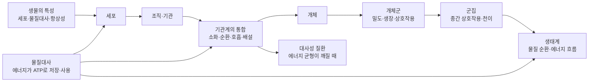
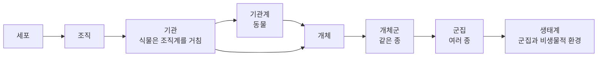
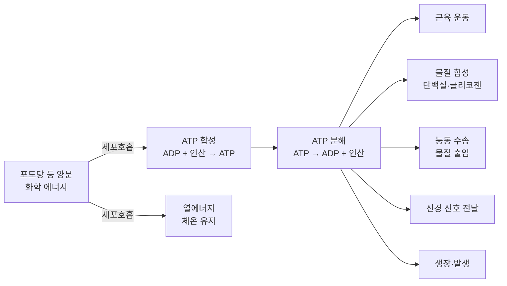
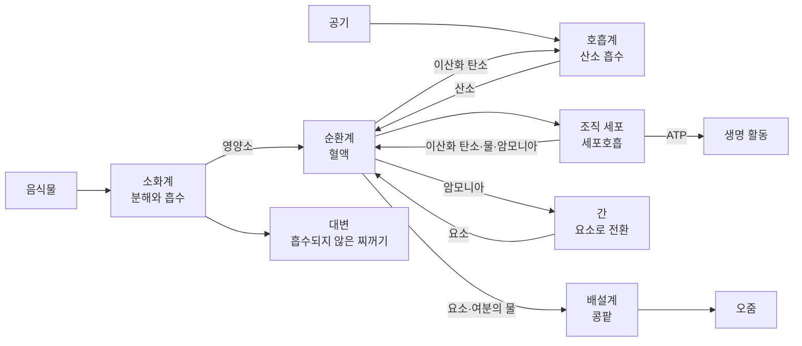
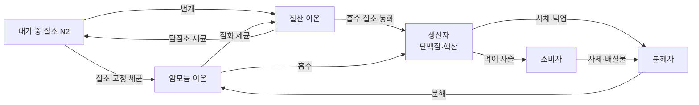

# 생명과학 1. 생명 시스템의 구성 — 세포에서 생태계까지, 에너지로 잇는 생명
<!-- prev: m1-02, m2-06, 3-5, 5-1, 5-2 -->
<!-- next: cell-1, cell-2, cell-3, bio-2 -->

> [!NOTE]
> **성취기준**
> - **[12생과01-01]** 생물 및 생명과학의 특성을 이해하고 생명과학의 성과를 협력적으로 소통할 수 있다.
> - **[12생과01-02]** 세포에서부터 생태계까지 생명 시스템의 구성 단계의 특징을 바탕으로 체계적인 설명 자료를 만들 수 있다.
> - **[12생과01-03]** 물질대사 과정에서의 에너지 전환 과정을 바탕으로 다양한 생명 활동에서의 에너지 사용을 추론할 수 있다.
> - **[12생과01-04]** 소화, 순환, 호흡, 배설 과정이 기관계의 통합적 작용으로 나타남을 신체의 생리적 변화와 연관지어 추론할 수 있다.
> - **[12생과01-05]** 물질대사 관련 질병 조사를 위한 방법을 고안하여 수행하고 대사성 질환을 예방하기 위한 올바른 생활 습관에 대해 토의하며 협력적으로 소통할 수 있다.
> - **[12생과01-06]** 생태계의 구조를 이해하고 물질의 순환과 에너지의 흐름을 추론하여 생태계 구성 요소들의 중요성을 설명할 수 있다.
> - **[12생과01-07]** 개체군과 군집의 특성을 이해하고 이들의 상호작용의 예를 조사하여 발표할 수 있다.

**학습 목표**

1. 생물과 비생물(바이러스, 휴머노이드 로봇 등)의 특성을 비교하고, 현대 생명과학의 성과가 여러 학문의 결합으로 나타남을 설명할 수 있다.
2. 세포에서 생태계까지 생명 시스템의 구성 단계를 동물·식물·생태계의 예로 체계화하여 설명 자료로 만들 수 있다.
3. 물질대사에서 에너지가 ATP로 저장되고 사용되는 흐름을 바탕으로 근육 운동, 체온 유지, 물질 합성 등에 쓰이는 에너지를 추론할 수 있다.
4. 운동·식사 같은 실제 상황에서 나타나는 심박수·호흡수·오줌양 변화를 소화계·순환계·호흡계·배설계의 통합적 작용으로 설명할 수 있다.
5. 대사성 질환을 조사하는 방법을 설계하고, 에너지 섭취와 소비의 균형으로 예방 습관을 토의할 수 있다.
6. 생태계에서 물질은 순환하고 에너지는 흐른다는 것을 추론하고, 개체군과 군집 내 상호작용의 예를 들어 설명할 수 있다.

**이 단원의 학습 사다리**

| 단계 | 무엇을 하나? |
|---|---|
| STEP 1. 이전 학습 다시 보기 | 중1 세포와 구성 단계, 중2 동물의 기관계, 통합과학 물질대사·생태계를 다시 꺼낸다 |
| STEP 2. 기초 다지기 | 시스템·계층 구조, 에너지 전환, 비율·단위 환산, 그래프 읽기를 준비한다 |
| STEP 3. 핵심 개념 | 생물의 특성 → 구성 단계 → 물질대사와 ATP → 기관계 통합 → 대사성 질환 → 생태계 → 개체군·군집 |
| STEP 4. 오개념 바로잡기 | "바이러스는 세균의 한 종류?", "에너지도 생태계를 순환한다?" 같은 착각을 바로잡는다 |
| STEP 5. 진로 선택·대학 | 「세포와 물질대사」의 세포 소기관, 효소, 세포호흡의 단계로 이어진다 |
| STEP 6. 생활·산업·진로 | 연속 혈당 측정기, 대사 연구, 생태 복원, 바이오 융합 분야 |

---

## 🗺️ 단원 들어가기

2020년 무렵 전 세계를 멈춰 세운 코로나바이러스감염증-19의 원인 바이러스는 크기가 약 100 nm 정도에 불과하다. 스스로는 물질대사를 하지 못하고, 사람의 세포 안에 들어가야만 수를 늘린다. 그렇다면 바이러스는 **살아 있는 것**일까, **살아 있지 않은 것**일까?

반대로, 최신 휴머노이드 로봇은 걷고, 말하고, 배터리가 떨어지면 스스로 충전기로 찾아간다. 자극에 반응하고 에너지를 쓰는 이 로봇은 왜 '생물'이 아닐까?

이 단원에서는 "생명이란 무엇인가"라는 질문에서 출발해, 생명이 **세포 → 조직 → 기관 → 기관계 → 개체 → 개체군 → 군집 → 생태계**라는 층층의 시스템으로 이루어져 있고, 각 층이 **물질과 에너지**를 주고받으며 유지된다는 큰 그림을 그려 본다.

---

## STEP 1. 🔙 이전 학습 다시 보기

### 연계 개념표

| 이전 단원·성취기준 | 그때 배운 것 | 이 단원에서 확장되는 것 |
|---|---|---|
| 중1 「생물의 구성과 다양성」 [9과02-01] | 세포는 생명 활동의 기본 단위, 세포 소기관의 구조와 기능 | 세포가 생물의 첫째 특성임을 비생물(바이러스·로봇)과 비교하여 확인한다 |
| 중1 「생물의 구성과 다양성」 [9과02-02] | 세포 → 조직 → 기관 → 기관계 → 개체, 동물과 식물 비교 | 개체를 넘어 **개체군 → 군집 → 생태계**까지 구성 단계를 확장한다 |
| 중2 「동물과 에너지」 [9과13-01]~[9과13-05] | 소화계·순환계·호흡계·배설계의 구조와 기능, 세포호흡으로 에너지를 얻음 | 운동·식사 때의 **생리적 변화**를 네 기관계의 통합으로 추론하고, 그 실패로 생기는 대사성 질환을 다룬다 |
| 중2 「식물과 에너지」 [9과12-02] | 광합성과 호흡에서 출입하는 에너지 | 동화 작용과 이화 작용, 에너지가 **ATP**로 저장·사용되는 흐름 |
| 통합과학1 「생명 시스템과 물질대사」 [10통과1-03-05] | 세포막을 통한 물질 출입, 물질대사, 효소 | 물질대사를 에너지 전환의 관점에서 정리하고 생명 활동별 에너지 사용을 추론한다 |
| 통합과학2 「생태계 구성 요소와 상호 관계」 [10통과2-02-01] | 생물적·비생물적 요인, 작용·반작용 | 생태계의 구조를 생산자·소비자·분해자와 비생물적 환경으로 정리한다 |
| 통합과학2 「생태계 평형」 [10통과2-02-02] | 먹이 그물, 생태 피라미드, 에너지 흐름, 탄소 순환 | 물질 생산(총생산량·순생산량), 질소 순환, 개체군·군집의 특성과 상호작용 |

### 준비 운동 (사전 진단)

**Q1.** 다음 중 '세포'로 이루어져 있지 **않은** 것을 모두 고르시오.
ㄱ. 대장균 ㄴ. 효모 ㄷ. 독감 바이러스 ㄹ. 짚신벌레

**Q2.** 식물에는 있지만 동물에는 없는 구성 단계와, 동물에는 있지만 식물에는 없는 구성 단계를 각각 쓰시오.

**Q3.** 세포호흡의 반응물과 생성물을 쓰고, 이 과정에서 에너지가 흡수되는지 방출되는지 쓰시오.

**Q4.** 생태계에서 물질은 ( 순환 / 흐름 )하고 에너지는 ( 순환 / 흐름 )한다. 알맞은 말을 고르시오.

정답 및 해설

**Q1. ㄷ** — 대장균(세균), 효모(균류), 짚신벌레(원생생물)는 모두 세포로 이루어진 생물이다. 바이러스는 단백질 껍질과 핵산으로만 이루어져 세포 구조가 없다.

**Q2.** 식물에만: **조직계**(표피 조직계, 관다발 조직계, 기본 조직계). 동물에만: **기관계**(소화계, 순환계 등).

**Q3.** 반응물: 포도당, 산소 / 생성물: 이산화 탄소, 물. 에너지가 **방출**된다.

**Q4.** 물질은 **순환**하고 에너지는 **흐른다**(한 방향으로 이동하여 결국 열로 빠져나간다).

---

## STEP 2. 🧱 기초 다지기

### ① 시스템과 계층 구조

**시스템(system)** 은 여러 구성 요소가 상호작용하며 하나의 기능을 하는 집합이다. 생명은 작은 시스템이 모여 더 큰 시스템을 이루는 **계층 구조(hierarchy)** 를 가진다. 학교로 비유하면 학생(세포) → 모둠(조직) → 반(기관) → 학년(기관계) → 학교(개체)이고, 여러 학교가 모인 지역 교육 공동체가 개체군·군집, 그 지역의 환경까지 합친 것이 생태계이다.

계층이 올라갈 때마다 아래 단계에는 없던 성질이 새로 나타난다. 세포 하나는 '생각'하지 못하지만, 신경 세포 수백억 개가 연결된 뇌는 생각한다. 이를 **창발성(emergent property)** 이라고 한다.

> [!TIP]
> 💡 **비유** — 레고 블록 하나에는 '바퀴가 굴러가는' 기능이 없지만, 블록을 특정 방식으로 맞추면 굴러가는 자동차가 된다. 부분의 **배열과 상호작용**이 전체의 기능을 만든다.

### ② 에너지 전환과 에너지 보존

에너지는 형태가 바뀔 뿐 새로 생기거나 사라지지 않는다(에너지 보존). 생명체 안에서는 빛에너지 → 화학 에너지(광합성), 화학 에너지 → ATP의 화학 에너지(세포호흡), ATP → 운동·열·전기·빛에너지(근육 수축, 체온 유지, 신경 신호, 반딧불이의 발광) 같은 전환이 일어난다. 전환이 일어날 때마다 일부는 반드시 **열**로 빠져나가며, 이 열은 생명체가 다시 일을 하는 데 쓰기 어렵다.

### ③ 단위와 비율 다루기

이 단원에서는 다음 단위를 자주 쓴다.

- 에너지: $1\ \mathrm{kcal} \approx 4.2\ \mathrm{kJ}$ (식품 영양 표시는 주로 kcal)
- 부피: $1\ \mathrm{L} = 1000\ \mathrm{mL}$, 농도: $\mathrm{g/100\,mL}$, $\mathrm{mg/dL}$ ($1\ \mathrm{dL} = 100\ \mathrm{mL}$)
- 백분율: $\dfrac{\text{부분}}{\text{전체}}\times 100$
- 농축률: $\dfrac{\text{오줌 속 농도}}{\text{혈장 속 농도}}$ — 몇 배로 진해졌는가

---

## STEP 3. 📘 핵심 개념

### ① 생물의 특성 — 무엇이 '살아 있음'을 만드는가 [12생과01-01]

생물은 다음과 같은 공통된 특성을 가진다. 어느 하나만으로는 생물이라고 단정할 수 없고, **여러 특성을 함께** 가질 때 생물이라고 한다.

| 생물의 특성 | 뜻 | 예 |
|---|---|---|
| **세포로 구성** | 모든 생물은 하나 이상의 세포로 이루어져 있다 | 아메바(단세포), 사람(다세포, 약 수십조 개의 세포) |
| **물질대사** | 생명체 안에서 일어나는 모든 화학 반응. 효소가 관여하며 에너지 출입이 따른다 | 광합성, 세포호흡, 단백질 합성 |
| **자극에 대한 반응과 항상성** | 환경 변화를 감지해 반응하고, 몸 안의 상태를 일정하게 유지한다 | 빛 쪽으로 굽는 식물 줄기, 더우면 땀 흘리기 |
| **발생과 생장** | 수정란이 세포 분열과 분화를 거쳐 개체가 되고 자란다 | 개구리 알 → 올챙이 → 개구리 |
| **생식과 유전** | 자신과 닮은 자손을 만들고 유전 물질을 물려준다 | 짚신벌레의 분열, 사람의 유성 생식 |
| **적응과 진화** | 환경에 알맞은 형질을 갖게 되고, 오랜 세대에 걸쳐 집단의 유전적 구성이 변한다 | 선인장의 가시 잎, 항생제 내성 세균 |

#### 바이러스 — 생물과 비생물의 경계

**바이러스(virus)** 는 단백질 껍질(캡시드)과 그 안의 유전 물질(DNA 또는 RNA)로 이루어진다. 일부는 바깥에 막 성분의 외피를 가진다.

| 비교 항목 | 생물적 특성 | 비생물적 특성 |
|---|---|---|
| 유전 물질 | 핵산(DNA 또는 RNA)을 가진다 | — |
| 증식 | 숙주 세포 안에서 수를 늘린다 | 숙주 세포 밖에서는 증식하지 못한다 |
| 변이·진화 | 돌연변이가 생기고 환경에 맞게 진화한다(변이 바이러스) | — |
| 세포 구조 | — | 세포막, 세포질, 리보솜이 없다 |
| 물질대사 | — | 스스로 효소를 만들어 물질대사를 하지 못한다 |

바이러스는 **숙주 세포 안에서만** 생물적 특성을 나타낸다. 그래서 생물과 비생물의 중간 경계에 있다고 본다. 아래 사진은 숙주 세포에서 늘어난 바이러스가 빠져나오는 모습이다.

<!-- photo:bio-1-hiv-sem -->

#### 휴머노이드 로봇과 비교하기

| 특성 | 사람 | 휴머노이드 로봇 | 바이러스 |
|---|---|---|---|
| 세포로 구성 | ○ | × (금속·플라스틱·반도체 부품) | × |
| 스스로 물질대사 | ○ | × (배터리의 화학 반응은 효소가 촉매하는 물질대사가 아님) | × |
| 자극에 반응 | ○ | △ (센서와 프로그램에 따른 반응) | × |
| 생장·발생 | ○ | × | × |
| 스스로 번식·유전 | ○ | × | △ (숙주 세포 안에서만) |
| 진화 | ○ | × (사람이 설계를 바꿀 뿐 스스로 진화하지 않음) | ○ |

> [!IMPORTANT]
> 로봇은 겉으로 '자극에 반응'하고 '에너지를 쓰지만', 세포가 없고 스스로 물질대사·생식·진화를 하지 못하므로 생물이 아니다. 바이러스는 세포가 없지만 유전 물질을 가지고 숙주 안에서 증식·진화한다. **생물의 특성은 하나하나가 아니라 묶음으로 판단한다.**

#### 생명과학은 어떤 학문인가

**생명과학(life science)** 은 생명 현상을 연구하는 학문이다. 연구 대상이 분자에서 생태계까지 넓고, 다른 학문과 결합하여 새로운 분야를 만들어 왔다.

| 결합한 학문 | 대표 성과·분야 | 무엇이 가능해졌나 |
|---|---|---|
| 화학 | 생화학, DNA 이중 나선 구조 규명 | 유전 정보를 분자 수준에서 이해 |
| 물리학 | X선 결정학, 전자 현미경, MRI | 단백질의 3차원 구조, 뇌 활동 관찰 |
| 정보·컴퓨터 과학 | 생물정보학, 인간 유전체 해독 | 수십억 개 염기 서열의 분석, 단백질 구조 예측 |
| 공학 | 생명공학, 의공학 | 유전자 재조합 의약품, 인공 장기, 웨어러블 센서 |
| 인공지능 | 단백질 구조 예측 AI, 의료 영상 판독 | 신약 후보 물질 탐색 시간 단축 |
| 지구과학·환경학 | 생태학, 기후변화 생물학 | 생물다양성 감시, 생태계 복원 |

이처럼 현대 생명과학의 성과는 **여러 학문 분야의 협력과 결합**으로 나타난다. 연구 결과를 정확한 근거와 함께 공유하는 **협력적 소통**이 중요한 이유이다.

#### ✔ 바로 확인

1. (O/X) 자극에 반응하기만 하면 생물이라고 판단할 수 있다.
2. 빈칸: 바이러스는 단백질 껍질과 그 안의 (    )(으)로 이루어져 있다.
3. 바이러스가 증식하고 진화하는 생물적 특성을 나타내는 곳은 숙주 세포의 (안 / 밖)이다.
4. 휴머노이드 로봇이 생물이 아닌 까닭으로 옳지 **않은** 것은? ㄱ. 세포로 이루어져 있지 않다. ㄴ. 스스로 물질대사를 하지 못한다. ㄷ. 에너지를 전혀 쓰지 않는다.

정답

1. X — 센서 달린 로봇도 반응한다. 생물의 특성은 여러 가지를 묶음으로 판단한다.
2. 유전 물질(핵산: DNA 또는 RNA)
3. 안 — 숙주 세포 밖에서는 증식하지 못한다.
4. ㄷ — 로봇도 배터리의 에너지를 쓴다. 다만 효소가 관여하는 물질대사로 얻는 것이 아니다.

### ② 생명 시스템의 구성 단계 — 세포에서 생태계까지 [12생과01-02]

#### (1) 개체를 이루는 단계

| 구성 단계 | 뜻 | 동물(사람)의 예 | 식물(사과나무)의 예 |
|---|---|---|---|
| 세포 | 구조적·기능적 기본 단위 | 근육 세포, 신경 세포, 적혈구 | 표피 세포, 공변세포, 체관 세포 |
| 조직 | 모양과 기능이 비슷한 세포의 모임 | 상피 조직, 결합 조직, 근육 조직, 신경 조직 | 분열 조직, 영구 조직(표피·울타리·해면·물관·체관 조직 등) |
| 조직계 | 여러 조직이 모여 일정한 기능을 하는 단위(식물) | — | 표피 조직계, 관다발 조직계, 기본 조직계 |
| 기관 | 여러 조직이 모여 고유한 형태와 기능을 가진 단위 | 위, 심장, 폐, 콩팥, 뇌 | 뿌리·줄기·잎(영양 기관), 꽃·열매(생식 기관) |
| 기관계 | 관련된 기능을 하는 기관의 모임(동물) | 소화계, 순환계, 호흡계, 배설계, 신경계, 내분비계, 생식계, 운동계 | — |
| 개체 | 독립적으로 생명 활동을 하는 하나의 생물 | 사람 한 명 | 사과나무 한 그루 |

사람의 방광을 예로 들어 세포에서 개체까지의 단계를 그림으로 나타내면 아래와 같다.

<!-- photo:bio-1-levels-of-organization -->

#### (2) 개체를 넘어서 — 개체군, 군집, 생태계

| 구성 단계 | 뜻 | 예(어느 연못) |
|---|---|---|
| **개체군(population)** | 일정한 지역에 사는 **같은 종** 개체들의 집단 | 연못의 붕어 전체 |
| **군집(community)** | 일정한 지역에 사는 **여러 개체군**의 모임 | 붕어, 개구리, 수련, 플랑크톤, 세균 전체 |
| **생태계(ecosystem)** | 군집과 그것을 둘러싼 **비생물적 환경**이 상호작용하는 시스템 | 연못의 생물 + 물, 빛, 온도, 산소, 바닥 흙 |

#### (3) 각 단계는 그 자체로 하나의 생명 시스템이다

| 단계 | 시스템으로서의 기능 | 경계(안과 밖을 나누는 것) | 주고받는 것 |
|---|---|---|---|
| 세포 | 물질대사, 유전 정보 발현 | 세포막 | 양분, 산소, 노폐물 |
| 기관계 | 소화, 순환, 호흡, 배설 등 고유 기능 | 기관의 막과 벽 | 영양소, 혈액, 기체 |
| 개체 | 항상성 유지, 생식 | 피부 | 먹이, 열, 기체 |
| 개체군 | 개체 수의 증감, 사회 구조 | 서식 지역 | 개체의 출생·사망·이입·이출 |
| 생태계 | 물질 순환, 에너지 흐름 | (지역의 범위) | 빛에너지 유입, 열 방출, 물질의 이동 |

#### 예제 1 — 구성 단계 분류하기

다음을 생명 시스템의 구성 단계에 따라 분류하고, 낮은 단계부터 순서대로 나열하시오.
(가) 지리산의 반달가슴곰 전체 (나) 반달가슴곰의 심장 (다) 지리산의 모든 생물과 흙·물·공기 (라) 반달가슴곰의 심장 근육 세포 (마) 지리산에 사는 모든 생물 (바) 반달가슴곰의 심장 근육 조직

**풀이**
(라) 세포 → (바) 조직 → (나) 기관 → (가) 개체군 → (마) 군집 → (다) 생태계.
(가)는 같은 종의 집단이므로 개체군, (마)는 여러 종이 섞여 있으므로 군집, (다)는 비생물적 환경까지 포함하므로 생태계이다.

> [!TIP]
> 💡 **체계적인 설명 자료 만들기 요령** — 구성 단계를 '확대 렌즈'처럼 표현해 보자. 숲 사진(생태계) → 나무 한 종류의 무리(개체군) → 나무 한 그루(개체) → 잎(기관) → 잎의 단면(조직·조직계) → 공변세포(세포) 순으로 확대하는 카드 뉴스나 슬라이드를 만들고, 각 장에 '이 단계에서 새로 생기는 기능'을 한 줄씩 적는다.

#### ✔ 바로 확인

1. 짝짓기: (가) 연못의 붕어 전체 (나) 연못에 사는 모든 생물 (다) 연못의 모든 생물과 물·빛·흙 — 개체군, 군집, 생태계
2. (O/X) 조직계는 동물에만 있는 구성 단계이다.
3. 빈칸: 사람의 위는 (    ) 단계이고, 위·소장·간 등이 모인 소화계는 (    ) 단계이다.

정답

1. (가) 개체군 (나) 군집 (다) 생태계 — 같은 종의 집단, 여러 종의 집단, 군집 + 비생물적 환경 순이다.
2. X — 조직계는 **식물**에만 있고, 기관계는 동물에만 있다.
3. 기관, 기관계

### ③ 물질대사와 에너지 — ATP로 저장하고 ATP로 쓴다 [12생과01-03]

#### (1) 물질대사의 두 방향

**물질대사(metabolism)** 는 생명체에서 일어나는 모든 화학 반응이다. 방향에 따라 둘로 나눈다.

| 구분 | **동화 작용(anabolism)** | **이화 작용(catabolism)** |
|---|---|---|
| 물질 변화 | 작은 분자 → 큰 분자 (합성) | 큰 분자 → 작은 분자 (분해) |
| 에너지 출입 | 에너지 **흡수**(흡열 반응) | 에너지 **방출**(발열 반응) |
| 반응 전후 에너지 | 생성물의 에너지 > 반응물의 에너지 | 반응물의 에너지 > 생성물의 에너지 |
| 예 | 광합성, 단백질 합성, 글리코젠 합성 | 세포호흡, 소화, 글리코젠 분해 |

두 방향 모두 **효소**가 촉매로 작용하므로 체온 정도의 낮은 온도에서도 단계적으로 일어난다. 연료를 태우는 연소는 에너지가 한꺼번에 빛과 열로 방출되지만, 세포호흡은 여러 단계에 걸쳐 조금씩 방출되어 그 일부가 ATP에 저장된다.

#### (2) 세포호흡 — 양분의 화학 에너지를 ATP로 옮긴다

세포호흡은 주로 **미토콘드리아**에서 일어나며, 포도당을 산소로 분해하여 에너지를 얻는다.

$$
\mathrm{C_6H_{12}O_6} + 6\mathrm{O_2} + 6\mathrm{H_2O} \longrightarrow 6\mathrm{CO_2} + 12\mathrm{H_2O} + \text{에너지}
$$

(양쪽의 물을 정리하면 $\mathrm{C_6H_{12}O_6} + 6\mathrm{O_2} \to 6\mathrm{CO_2} + 6\mathrm{H_2O}$이다.)

방출된 에너지의 일부는 **ATP**에 화학 에너지로 저장되고, 나머지는 **열**로 방출되어 체온 유지에 쓰인다. 세포호흡이 일어나는 미토콘드리아를 전자 현미경으로 보면 아래 사진과 같다.

<!-- photo:bio-1-mitochondrion-tem -->

#### (3) ATP — 세포의 에너지 화폐

**ATP(adenosine triphosphate, 아데노신 삼인산)** 는 모든 살아 있는 세포가 공통으로 쓰는 에너지 저장·공급 물질이다. ATP가 ADP와 인산으로 분해될 때 에너지가 방출되고, 세포호흡에서 얻은 에너지로 ADP와 인산이 다시 ATP로 합성된다.

$$
\mathrm{ATP} \;\rightleftharpoons\; \mathrm{ADP} + \text{인산} + \text{에너지}
$$

> [!TIP]
> 💡 **비유** — 포도당은 '큰 액수의 수표', ATP는 '바로 쓸 수 있는 동전'이다. 수표를 들고 자판기에서 음료를 살 수는 없다. 세포는 포도당이라는 수표를 세포호흡이라는 은행에서 ATP라는 동전으로 바꾸어, 근육 수축·물질 합성 같은 '자판기'마다 필요한 만큼 넣는다.

> [!NOTE]
> 이 과목에서는 ATP의 분자 구조를 자세히 다루지 않는다. **"모든 살아 있는 세포는 물질대사 과정에서 에너지를 ATP로 저장하고, ATP를 분해하여 생명 활동에 사용한다"** 는 수준으로 이해하면 충분하다. 구조와 생성 단계는 STEP 5에서 맛보기로 소개한다.

#### (4) 생명 활동별 에너지 사용 추론하기

| 생명 활동 | ATP 에너지가 바뀌는 형태 | 생활 속 장면 |
|---|---|---|
| 근육 수축 | 운동 에너지 | 달리기, 심장 박동, 숨쉬기 운동 |
| 체온 유지 | 열에너지 | 추울 때 몸이 떨리면 근육 운동으로 열 발생 |
| 물질 합성 | 화학 에너지(새 분자의 결합) | 성장기에 근육 단백질 합성, 간에서 글리코젠 합성 |
| 능동 수송 | 농도 차를 거스르는 물질 이동 | 콩팥에서 포도당 재흡수, 신경 세포의 이온 농도 유지 |
| 신경 신호 전달 | 전기 에너지 | 생각하기, 감각 정보 전달 |
| 발성·발광·발전 | 소리·빛·전기 에너지 | 매미 울음, 반딧불이, 전기뱀장어 |

#### 예제 2 — 세포호흡의 에너지 효율 어림하기

포도당 1몰이 완전히 분해될 때 방출되는 에너지는 약 $2870\ \mathrm{kJ}$이다. 이때 ATP가 약 32몰 만들어지고, ATP 1몰에 약 $30.5\ \mathrm{kJ}$의 에너지가 저장된다고 하자. (1) ATP에 저장된 에너지는 몇 kJ인가? (2) 에너지 효율은 약 몇 %인가? (3) 나머지 에너지는 어떻게 되는가?

**풀이**
(1) $32 \times 30.5 = 976\ \mathrm{kJ}$
(2) $\dfrac{976}{2870}\times 100 \approx 34\%$
(3) 나머지 약 $66\%$($2870 - 976 = 1894\ \mathrm{kJ}$)는 **열**로 방출된다. 이 열은 사람 같은 정온 동물의 체온 유지에 쓰인다.

(생성되는 ATP 수는 세포의 조건에 따라 달라서 교재마다 30~38몰로 다르게 쓰며, 효율도 약 30~40%로 소개된다.)

#### 예제 3 — 하루 에너지 사용 추론하기

어떤 학생의 기초 대사량이 하루 $1500\ \mathrm{kcal}$이고, 하루 동안의 활동으로 기초 대사량의 1.5배에 해당하는 에너지를 쓴다고 하자. 이 학생이 하루에 음식으로 $2400\ \mathrm{kcal}$를 섭취한다면 에너지 균형은 어떠한가?

**풀이** 하루 에너지 소비량 $= 1500 \times 1.5 = 2250\ \mathrm{kcal}$. 섭취량과의 차이는 $2400 - 2250 = 150\ \mathrm{kcal}$로, 하루 $150\ \mathrm{kcal}$의 에너지가 남는다. 남는 에너지는 동화 작용을 통해 주로 **지방**으로 바뀌어 저장된다. 이런 상태가 오래 이어지면 체중이 늘어난다(③ 대사성 질환과 연결).

> [!NOTE]
> **기초 대사량**은 체온 유지, 심장 박동, 호흡 등 생명을 유지하는 데 필요한 최소한의 에너지양이다. **활동 대사량**은 걷기, 공부, 운동처럼 활동에 추가로 쓰는 에너지양이다. 하루 에너지 소비량은 대략 '기초 대사량 + 활동 대사량 + 음식물 소화·흡수에 드는 에너지'로 본다.

#### ✔ 바로 확인

1. (O/X) 동화 작용에서는 에너지가 방출된다.
2. 다음 중 이화 작용은? ㄱ. 광합성 ㄴ. 단백질 합성 ㄷ. 세포호흡
3. 빈칸: ATP가 ADP와 (    )(으)로 분해될 때 방출되는 에너지가 생명 활동에 쓰인다.
4. 포도당이 분해될 때 방출된 에너지의 약 34%가 ATP에 저장된다면, 나머지 약 몇 %는 어떤 형태로 방출되는가?

정답

1. X — 동화 작용은 작은 분자로 큰 분자를 합성하며 에너지를 **흡수**한다.
2. ㄷ — 큰 분자(포도당)를 작은 분자(CO₂, H₂O)로 분해하며 에너지를 방출한다.
3. 인산
4. 약 66%, 열에너지 — 정온 동물은 이 열을 체온 유지에 쓴다.

### ④ 기관계의 통합적 작용 — 소화·순환·호흡·배설 [12생과01-04]

#### (1) 네 기관계가 하는 일

| 기관계 | 주요 기관 | 하는 일 | 세포호흡과의 관계 |
|---|---|---|---|
| **소화계** | 입, 위, 소장, 대장, 간, 이자 | 녹말 → 포도당, 단백질 → 아미노산, 지방 → 지방산·모노글리세리드로 분해·흡수 | 세포호흡의 원료(영양소) 공급 |
| **호흡계** | 코, 기관, 기관지, 폐(폐포) | 산소 흡수, 이산화 탄소 방출 | 세포호흡에 필요한 $\mathrm{O_2}$ 공급, 생긴 $\mathrm{CO_2}$ 배출 |
| **순환계** | 심장, 혈관, 혈액 | 영양소·산소를 조직 세포로, 노폐물을 배설 기관으로 운반 | 모든 기관계를 잇는 '운송망' |
| **배설계** | 콩팥, 오줌관, 방광, 요도 | 질소성 노폐물(요소)과 여분의 물·무기염류를 오줌으로 배출 | 세포호흡과 단백질 분해에서 생긴 노폐물 처리 |

<!-- fig:bio-1-organ-systems -->

#### (2) 영양소별 노폐물과 배설 경로

| 영양소 | 세포호흡으로 생기는 노폐물 | 배출 경로 |
|---|---|---|
| 탄수화물, 지방 | 이산화 탄소, 물 | $\mathrm{CO_2}$: 폐(날숨) / 물: 폐(날숨), 콩팥(오줌), 피부(땀) |
| 단백질 | 이산화 탄소, 물, **암모니아** | 암모니아는 독성이 강해 **간에서 요소로 바뀐 뒤** 콩팥에서 오줌으로 배출 |

#### (3) 콩팥 — 걸러 내고, 되찾고, 농축한다

콩팥의 기본 단위는 **네프론(nephron)** 이다. 네프론은 사구체·보먼주머니(합쳐서 콩팥 소체)와 세뇨관으로 이루어지며, 세뇨관은 집합관으로 이어진다.

1. **여과**: 혈압에 의해 사구체의 혈액 중 크기가 작은 물질(물, 포도당, 아미노산, 요소, 무기염류)이 보먼주머니로 빠져나간다. 혈구와 단백질은 크기가 커서 여과되지 않는다. 이렇게 걸러진 액체를 **원뇨**라고 한다.
2. **재흡수**: 세뇨관을 지나면서 포도당·아미노산은 거의 전부, 물과 무기염류는 대부분 모세혈관으로 다시 흡수된다. 포도당은 주로 **능동 수송**(ATP 사용)으로 재흡수된다.
3. **분비**: 모세혈관에 남은 일부 노폐물이 세뇨관으로 더 분비된다.

실제 네프론은 아래 그림처럼 모세혈관이 세뇨관을 촘촘하게 감싸고 있다.

<!-- photo:bio-1-nephron-blood-vessels -->

아래 모식도는 네프론에서 일어나는 여과·재흡수·분비를 단순하게 나타낸 것이다.

<!-- fig:bio-1-nephron -->

#### 예제 4 — 콩팥은 얼마나 농축하는가

건강한 사람의 혈장, 원뇨, 오줌 속 성분의 농도를 나타낸 예시 자료이다. (값은 설명을 위한 대표값이다.)

| 성분 | 혈장 ($\mathrm{g/100\,mL}$) | 원뇨 ($\mathrm{g/100\,mL}$) | 오줌 ($\mathrm{g/100\,mL}$) |
|---|---|---|---|
| 단백질 | 7.0 | 0 | 0 |
| 포도당 | 0.1 | 0.1 | 0 |
| 요소 | 0.03 | 0.03 | 1.8 |

(1) 요소의 농축률을 구하시오. (2) 하루에 만들어지는 원뇨가 약 180 L, 오줌이 약 1.5 L라면 원뇨의 물 중 약 몇 %가 재흡수되는가? (원뇨와 오줌의 부피를 물의 부피로 본다.) (3) 단백질과 포도당의 농도 변화로 알 수 있는 사실은?

**풀이**
(1) 농축률 $= \dfrac{1.8}{0.03} = 60$배
(2) 재흡수율 $= \dfrac{180 - 1.5}{180}\times 100 \approx 99.2\%$ — 걸러진 물의 99% 이상이 몸으로 되돌아온다.
(3) 단백질은 원뇨에 없으므로 **여과되지 않는다.** 포도당은 원뇨에는 있지만 오줌에는 없으므로 **여과된 뒤 모두 재흡수된다.** 오줌에서 포도당이 검출되면 혈당이 지나치게 높아 재흡수가 따라가지 못하는 경우(당뇨병)를 의심할 수 있다.

#### (4) 생리적 변화로 보는 통합 — 운동할 때 몸에서 일어나는 일

운동을 시작하면 근육 세포의 세포호흡이 크게 늘어나 ATP 소비가 증가한다. 그러면 네 기관계가 **함께** 반응한다.

| 측정 지표 | 휴식 시 → 격렬한 운동 시 | 해석(어느 기관계의 작용인가?) |
|---|---|---|
| 호흡수·호흡 깊이 | 증가 | 호흡계: $\mathrm{O_2}$를 더 흡수하고 늘어난 $\mathrm{CO_2}$를 더 배출 |
| 심박수 | 증가 | 순환계: 근육으로 가는 혈액의 양을 늘림 |
| 근육으로 가는 혈류 | 크게 증가 | 순환계: 근육의 혈관이 확장됨 |
| 소화관으로 가는 혈류 | 감소 | 소화계: 운동 중에는 소화 활동이 줄어듦 |
| 체온·땀 | 증가 | 세포호흡의 열 방출 증가 → 땀으로 열 방출(배설계와 함께 물 손실) |
| 오줌양 | 감소 | 배설계: 땀으로 잃은 물을 보충하기 위해 물 재흡수 증가 |
| 혈중 포도당 소비 | 증가 | 소화계(간)에 저장된 글리코젠을 분해하여 포도당 공급 |

#### 예제 5 — 심장이 내보내는 혈액의 양

심장이 1분 동안 내보내는 혈액량(심박출량)은 '심박수 × 1회 박출량'이다. 어떤 학생의 휴식 시 심박수가 분당 70회, 1회 박출량이 70 mL이고, 격렬한 운동 시 심박수가 분당 150회, 1회 박출량이 110 mL이다. 휴식 시와 운동 시의 심박출량을 각각 구하고, 몇 배 증가했는지 쓰시오.

**풀이**
- 휴식 시: $70 \times 70 = 4900\ \mathrm{mL/min} = 4.9\ \mathrm{L/min}$
- 운동 시: $150 \times 110 = 16\,500\ \mathrm{mL/min} = 16.5\ \mathrm{L/min}$
- $\dfrac{16.5}{4.9} \approx 3.4$배

순환계가 혈액을 약 3.4배 더 빨리 돌려 근육 세포에 산소와 포도당을 공급한다. 이때 호흡계는 그 혈액에 산소를 채워 주어야 하므로 호흡수도 함께 늘어난다. 이처럼 **하나의 생리적 변화에는 여러 기관계가 동시에 관여한다.**

> [!TIP]
> 💡 **역할놀이로 표현하기** — 모둠원이 각각 '소화계(양분 배달원)', '호흡계(산소 공급원)', '순환계(택배 트럭)', '배설계(쓰레기 처리장)', '근육 세포(공장)' 역을 맡는다. "100 m 달리기 시작!" 신호가 나오면 공장의 주문이 늘어나고, 각 역할이 무엇을 더 빨리 해야 하는지 말과 몸짓으로 연결해 보자.

#### ✔ 바로 확인

1. 짝짓기(그림 생명과학 1-1 참고): 폐, 소장, 심장, 콩팥 — 소화계, 순환계, 호흡계, 배설계
2. 빈칸: 단백질이 분해될 때 생긴 독성이 강한 암모니아는 (    )에서 요소로 바뀐 뒤 (    )에서 오줌으로 배출된다.
3. (O/X) 대변을 내보내는 것도 배설이다.
4. 땀을 많이 흘리며 운동하면 오줌양은 (증가 / 감소)한다.

정답

1. 폐 — 호흡계, 소장 — 소화계, 심장 — 순환계, 콩팥 — 배설계
2. 간, 콩팥
3. X — 대변은 흡수되지 않은 찌꺼기이고, 배설은 물질대사로 생긴 노폐물을 내보내는 것이다.
4. 감소 — 땀으로 잃은 물을 보충하려고 콩팥에서 물의 재흡수가 늘어난다.

### ⑤ 대사성 질환 — 에너지 균형이 깨질 때 [12생과01-05]

#### (1) 대사성 질환이란

**대사성 질환(metabolic disease)** 은 물질대사에 이상이 생겨 나타나는 질환이다. 많은 경우 **에너지 섭취량이 소비량보다 많은 상태**가 오래 이어지고, 운동 부족, 식습관, 유전적 요인, 스트레스 등이 함께 작용한다.

| 질환 | 특징 | 관련 지표 |
|---|---|---|
| **비만** | 에너지 과잉으로 체지방이 지나치게 쌓인 상태. 여러 대사성 질환의 위험을 높인다 | 체질량 지수(BMI), 허리둘레 |
| **당뇨병** | 인슐린 분비 부족이나 인슐린에 대한 반응 저하로 혈당이 높게 유지된다. 오줌에 포도당이 섞여 나올 수 있다 | 공복 혈당, 당화혈색소 |
| **고혈압** | 혈압이 정상보다 높게 유지된다. 심장과 혈관에 부담을 준다 | 수축기·이완기 혈압 |
| **이상지질혈증(고지혈증)** | 혈액 속 콜레스테롤이나 중성 지방이 비정상적으로 많다. 동맥 경화의 원인이 된다 | 혈중 콜레스테롤, 중성 지방 |

비만, 높은 혈당, 높은 혈압, 혈중 지질 이상 등이 한 사람에게 함께 나타나는 상태를 **대사 증후군**이라 부르며, 심혈관 질환의 위험이 커진다.

#### (2) 체질량 지수(BMI)

$$
\mathrm{BMI} = \frac{\text{몸무게}\ (\mathrm{kg})}{\left(\text{키}\ (\mathrm{m})\right)^2}
$$

우리나라에서는 성인의 경우 BMI 25 이상을 비만으로 본다. (청소년은 성별·나이별 성장 도표의 백분위로 판정하므로, 아래 예제는 성인을 가정한다.)

#### 예제 6 — BMI 계산하기

키 1.75 m, 몸무게 70 kg인 성인 A와 키 1.70 m, 몸무게 80 kg인 성인 B의 BMI를 소수 첫째 자리까지 구하고, 성인 기준 비만 여부를 판단하시오.

**풀이**
- A: $\dfrac{70}{1.75^2} = \dfrac{70}{3.0625} \approx 22.9$ → 비만 아님
- B: $\dfrac{80}{1.70^2} = \dfrac{80}{2.89} \approx 27.7$ → 25 이상이므로 비만

> [!WARNING]
> BMI는 근육과 지방을 구분하지 못한다. 근육이 많은 운동선수는 BMI가 높아도 체지방은 적을 수 있다. 그래서 허리둘레, 체지방률 같은 다른 지표와 함께 판단해야 한다.

#### (3) 대사성 질환 조사 방법 고안하기

성취기준은 질병 조사 **방법을 스스로 고안하여 수행**하는 것을 요구한다. 다음 틀로 계획을 세워 보자.

| 단계 | 내용 | 예시 |
|---|---|---|
| 1. 탐구 질문 | 무엇을 알고 싶은가? | "청소년의 단 음료 섭취 빈도와 BMI는 관계가 있을까?" |
| 2. 조사 방법 선택 | 설문, 공공 통계, 문헌, 직접 측정 | 국가 통계 포털·질병관리청의 국민건강영양조사 공개 자료, 학급 설문 |
| 3. 변인 정하기 | 비교할 요인과 결과 지표 | 요인: 음료 섭취 빈도 / 결과: BMI 백분위 |
| 4. 윤리 점검 | 개인정보 보호, 동의 | 이름 없이 익명 설문, 자료는 통계 처리 |
| 5. 자료 분석 | 표·그래프, 경향 찾기 | 빈도별 평균 BMI 막대그래프 |
| 6. 결론과 한계 | 상관관계와 인과관계 구분 | "관계가 보이지만, 운동량 등 다른 요인도 영향을 줄 수 있다" |

> [!IMPORTANT]
> 조사 결과에서 두 요인이 함께 변한다고(상관관계) 해서 하나가 다른 하나의 원인(인과관계)이라고 바로 결론 내릴 수 없다. 운동량, 수면, 유전 같은 **다른 요인**을 함께 고려해야 한다.

#### (4) 예방을 위한 생활 습관 — 토의 주제

| 생활 습관 | 물질대사와의 관계 |
|---|---|
| 균형 잡힌 식사, 단 음료·가공식품 줄이기 | 에너지 섭취량 조절, 혈당의 급격한 상승 방지 |
| 규칙적인 유산소·근력 운동 | 에너지 소비 증가, 근육량 증가로 기초 대사량 증가 |
| 충분한 수면 | 수면 부족은 식욕과 혈당 조절에 나쁜 영향을 줄 수 있다 |
| 금연, 절주 | 혈관 손상과 간의 지질 대사 이상을 줄인다 |
| 정기 건강 검진 | 혈압·혈당·혈중 지질을 조기에 확인 |

#### ✔ 바로 확인

1. 빈칸: 대사성 질환은 에너지 (    )량이 (    )량보다 많은 상태가 오래 이어질 때 생기기 쉽다.
2. 키 1.60 m, 몸무게 64 kg인 성인의 BMI를 구하고, 성인 기준으로 비만인지 판단하시오.
3. (O/X) 조사에서 두 요인이 함께 변하면 하나가 다른 하나의 원인이라고 결론 내릴 수 있다.

정답

1. 섭취, 소비
2. $64 \div 1.60^2 = 64 \div 2.56 = 25.0$ → 25 이상이므로 비만으로 본다.
3. X — 상관관계일 뿐 인과관계라고 바로 말할 수 없다. 운동량·수면 같은 다른 요인도 따져야 한다.

### ⑥ 생태계의 구조와 기능 — 물질은 돌고 에너지는 흐른다 [12생과01-06]

#### (1) 생태계의 구조

| 구성 요소 | 역할 | 예 |
|---|---|---|
| **생산자** | 빛에너지를 이용해 무기물에서 유기물을 합성 | 식물, 식물성 플랑크톤, 남세균 |
| **소비자** | 다른 생물을 먹어 유기물을 얻음 | 초식 동물(1차), 육식 동물(2차, 3차) |
| **분해자** | 사체·배설물의 유기물을 무기물로 분해 | 세균, 곰팡이, 버섯 |
| **비생물적 환경** | 생물의 생활에 영향을 주는 환경 | 빛, 온도, 물, 공기, 토양 |

비생물적 환경이 생물에 영향을 주는 것을 **작용**, 생물이 비생물적 환경을 바꾸는 것을 **반작용**, 생물끼리 영향을 주고받는 것을 **상호작용**이라고 한다. (통합과학2 「생태계 구성 요소와 상호 관계」에서 배운 내용이다.)

#### (2) 물질 생산과 소비 — 총생산량과 순생산량

생산자가 광합성으로 만든 유기물의 총량을 **총생산량**이라 한다. 그중 생산자 자신의 호흡에 쓰인 양(호흡량)을 뺀 나머지가 **순생산량**이다.

$$
\text{총생산량} = \text{순생산량} + \text{호흡량}
$$

$$
\text{순생산량} = \text{생장량} + \text{피식량} + \text{고사량·낙엽량}
$$

- **피식량**: 1차 소비자에게 먹힌 양 (1차 소비자의 섭식량이 된다)
- **고사량·낙엽량**: 말라 죽거나 떨어진 잎 등으로 분해자에게 넘어간 양
- **생장량**: 생산자의 몸에 남아 쌓인 양

<!-- fig:bio-1-production -->

#### 예제 7 — 숲의 물질 생산

어떤 숲에서 1년 동안 생산자의 총생산량이 $1000$(상대값), 호흡량이 $600$, 피식량이 $50$, 고사량·낙엽량이 $150$이었다. (1) 순생산량과 (2) 생장량을 구하시오. (3) 숲이 오래되어 극상에 이르면 생장량은 어떻게 될지 추론하시오.

**풀이**
(1) 순생산량 $= 1000 - 600 = 400$
(2) 생장량 $= 400 - 50 - 150 = 200$
(3) 오래된 숲은 생물량이 많아 호흡량이 커지므로 순생산량이 줄어들고, 생장량은 0에 가까워진다. 젊은 숲일수록 생장량이 크다.

#### (3) 에너지의 흐름 — 한 방향

태양의 빛에너지가 생산자에게 화학 에너지로 저장된 뒤 먹이 사슬을 따라 이동하며, 각 단계에서 호흡으로 열에너지가 되어 생태계 밖으로 빠져나간다. 열에너지는 생산자가 다시 쓸 수 없으므로 **에너지는 순환하지 않고 흐른다.** 한 영양 단계에서 다음 영양 단계로 전달되는 에너지의 비율을 **에너지 효율**이라 하며, 대개 상위 영양 단계로 갈수록 대략 10% 안팎이다(통합과학2 「생태계 평형」).

$$
\text{에너지 효율}(\%) = \frac{\text{현 영양 단계의 에너지양}}{\text{전 영양 단계의 에너지양}} \times 100
$$

#### (4) 물질의 순환 — 탄소와 질소

| 순환 | 생물로 들어가는 길 | 생물 사이 이동 | 환경으로 돌아가는 길 |
|---|---|---|---|
| **탄소** | 생산자가 광합성으로 대기·물의 $\mathrm{CO_2}$를 유기물로 고정 | 먹이 사슬을 따라 유기물로 이동 | 호흡, 분해자의 분해, 화석 연료 연소로 $\mathrm{CO_2}$ 방출 |
| **질소** | 대기의 $\mathrm{N_2}$를 **질소 고정 세균**(뿌리혹박테리아 등)이 $\mathrm{NH_4^+}$로 고정, 번개에 의해서도 일부가 질산 이온($\mathrm{NO_3^-}$) 형태로 고정. **질화 세균**이 $\mathrm{NH_4^+}$를 $\mathrm{NO_3^-}$로 바꾸면 식물이 흡수하여 단백질·핵산 합성(질소 동화) | 먹이 사슬을 따라 단백질 등 유기 질소 화합물로 이동 | 분해자가 사체·배설물을 $\mathrm{NH_4^+}$로 분해, **탈질소 세균**이 $\mathrm{NO_3^-}$를 $\mathrm{N_2}$로 바꾸어 대기로 되돌림 |

> [!IMPORTANT]
> 물질 순환과 에너지 흐름은 **함께** 일어난다. 탄소는 유기물에 실려 이동하고, 그 유기물의 화학 결합 속에 에너지가 들어 있다. 물질이라는 '수레'는 되돌아오지만, 수레에 실린 에너지라는 '짐'은 단계마다 내려져 열로 흩어진다.

<!-- fig:bio-1-energy-matter -->

#### (5) 생태계는 하나의 살아 있는 유기체처럼 움직인다

사람의 몸이 체온과 혈당을 일정하게 유지하듯, 생태계도 먹이 관계와 물질 순환을 통해 개체 수와 물질의 양을 일정 범위로 유지하는 **생태계 평형**을 이룬다. 그러나 외부 환경이 크게 변하면 평형이 깨질 수 있다.

| 외부 변화 | 생태계에서 일어나는 일 |
|---|---|
| 서식지 파괴(개발, 산불) | 생산자 감소 → 먹이 그물 전체 축소 |
| 외래종 유입 | 천적 없는 외래종이 토착종을 밀어냄 |
| 비료가 하천에 다량 유입 | 조류가 폭발적으로 늘어 녹조 발생 → 분해 과정에서 산소 고갈 → 물고기 폐사 |
| 기후변화 | 개화 시기와 곤충 출현 시기가 어긋나 상호작용이 깨짐 |
| 분해자가 사라진다면(사고 실험) | 사체가 쌓이고 무기물이 순환하지 않아 생산자가 결국 양분 부족에 빠짐 |

생태계 구성 요소 하나하나가 순환의 고리이므로, **어느 요소도 불필요하지 않다.** 이것이 생태전환교육에서 강조하는 생태계 보전의 과학적 근거이다.

#### ✔ 바로 확인

1. 빈칸: 총생산량 = 순생산량 + (    )
2. (O/X) 에너지도 물질처럼 생태계 안에서 순환한다.
3. 짝짓기: 질소 고정 세균, 질화 세균, 탈질소 세균 — (ㄱ) $\mathrm{NO_3^-} \to \mathrm{N_2}$ (ㄴ) $\mathrm{N_2} \to \mathrm{NH_4^+}$ (ㄷ) $\mathrm{NH_4^+} \to \mathrm{NO_3^-}$
4. 그림 생명과학 1-4 (가)처럼 생산자의 에너지가 1000이고 각 단계의 에너지 효율이 10%라면, 2차 소비자가 얻는 에너지는?

정답

1. 호흡량
2. X — 에너지는 각 단계에서 열로 빠져나가 한 방향으로 흐른다. 순환하는 것은 물질이다.
3. 질소 고정 세균 — (ㄴ), 질화 세균 — (ㄷ), 탈질소 세균 — (ㄱ)
4. 10 — $1000 \times 0.1 \times 0.1 = 10$

### ⑦ 개체군과 군집 — 함께 사는 방식 [12생과01-07]

#### (1) 개체군의 특성

**개체군 밀도**는 일정한 공간에 사는 개체 수이다.

$$
\text{개체군 밀도} = \frac{\text{개체군을 구성하는 개체 수}}{\text{개체군이 서식하는 공간의 면적(또는 부피)}}
$$

밀도는 출생과 이입으로 늘고, 사망과 이출로 줄어든다.

**개체군의 생장 곡선**

| 곡선 | 조건 | 모양 |
|---|---|---|
| 이론적 생장 곡선(J자형) | 먹이·공간이 무한하고 천적·질병이 없는 이상적 조건 | 개체 수가 기하급수적으로 증가 |
| 실제 생장 곡선(S자형) | 먹이 부족, 공간 부족, 노폐물 증가, 질병 등 **환경 저항**이 있음 | 처음엔 빠르게 늘다가 **환경 수용력**(그 환경이 지탱할 수 있는 최대 개체 수) 근처에서 일정해짐 |

**생존 곡선**: 같은 시기에 태어난 개체들이 나이에 따라 얼마나 살아남는지를 나타낸다.

| 유형 | 특징 | 예 |
|---|---|---|
| Ⅰ형 | 어릴 때 사망률이 낮고 대부분 수명을 다한 뒤 죽는다. 적은 수의 자손을 낳아 잘 돌본다 | 사람, 코끼리 등 대형 포유류 |
| Ⅱ형 | 나이에 관계없이 사망률이 비교적 일정하다 | 일부 조류, 히드라 |
| Ⅲ형 | 어릴 때 사망률이 매우 높다. 많은 수의 자손을 낳는다 | 굴, 많은 어류 |

<!-- fig:bio-1-population-curves -->

**연령 피라미드**: 연령별 개체 수를 쌓은 그래프로, 아래가 넓으면(발전형) 개체군이 커지고, 위아래가 비슷하면(안정형) 유지되며, 아래가 좁으면(쇠퇴형) 줄어들 것으로 예측한다.

<!-- fig:bio-1-age-pyramid -->

**개체군의 주기적 변동**: 계절에 따라 돌말 같은 식물성 플랑크톤의 수가 빛·수온·영양염류에 따라 늘고 줄며, 눈신토끼와 스라소니처럼 포식자와 피식자의 개체 수가 시간차를 두고 오르내리기도 한다.

#### (2) 개체군 내의 상호작용

| 상호작용 | 뜻 | 예 |
|---|---|---|
| **텃세** | 일정한 생활 공간(텃세권)을 차지하고 다른 개체의 침입을 막는다 | 은어, 까치, 호랑이의 영역 표시 |
| **순위제** | 힘의 서열에 따라 먹이나 짝을 얻는 순위가 정해진다 | 닭의 모이 쪼는 순서, 큰뿔양 |
| **리더제** | 경험이 많은 한 개체가 무리를 이끈다(순위제와 달리 리더 외 개체 간 서열은 뚜렷하지 않을 수 있음) | 기러기 떼의 이동, 양 떼, 코끼리 무리의 우두머리 암컷 |
| **사회생활** | 일을 나누어 맡는 분업 체계를 이룬다 | 꿀벌(여왕벌·일벌·수벌), 개미 |
| **가족생활** | 혈연관계의 개체들이 모여 함께 생활한다 | 사자, 침팬지 |

이런 상호작용은 개체 사이의 불필요한 싸움을 줄이고, 개체군의 밀도와 질서를 유지하는 데 도움이 된다.

#### (3) 군집의 특성 — 방형구법으로 군집 조사하기

**방형구법**은 일정한 크기의 사각 틀(방형구)을 여러 곳에 놓고 그 안의 식물을 조사하여 군집의 구조를 알아내는 방법이다.

| 지표 | 식 |
|---|---|
| 밀도 | $\dfrac{\text{특정 종의 개체 수}}{\text{전체 방형구 면적}}$ |
| 빈도 | $\dfrac{\text{특정 종이 출현한 방형구 수}}{\text{전체 방형구 수}}$ |
| 피도 | $\dfrac{\text{특정 종이 덮고 있는 면적}}{\text{전체 방형구 면적}}$ |
| 상대 밀도(%) | $\dfrac{\text{특정 종의 밀도}}{\text{모든 종의 밀도 합}}\times 100$ (상대 빈도, 상대 피도도 같은 방식) |
| 중요치 | 상대 밀도 + 상대 빈도 + 상대 피도 |

중요치가 가장 큰 종이 그 군집의 **우점종**이다.

<!-- sim:quadrat-survey -->

#### 예제 8 — 우점종 찾기

면적 $1\ \mathrm{m^2}$인 방형구 10개를 설치하여 식물 A, B, C를 조사한 결과이다. (가상의 자료)

| 종 | 개체 수 | 출현한 방형구 수 | 덮고 있는 면적 ($\mathrm{m^2}$) |
|---|---|---|---|
| A | 20 | 5 | 3.0 |
| B | 30 | 3 | 1.0 |
| C | 50 | 2 | 1.0 |

각 종의 중요치를 구하고 우점종을 쓰시오.

**풀이**
- 상대 밀도: 전체 개체 수가 100이므로 A $20\%$, B $30\%$, C $50\%$
- 상대 빈도: 빈도는 A 0.5, B 0.3, C 0.2 (합 1.0) → A $50\%$, B $30\%$, C $20\%$
- 상대 피도: 덮은 면적의 합이 $5.0\ \mathrm{m^2}$ → A $60\%$, B $20\%$, C $20\%$
- 중요치: A $= 20+50+60 = 130$, B $= 30+30+20 = 80$, C $= 50+20+20 = 90$

우점종은 **A**이다. C는 개체 수가 가장 많지만 좁은 곳에 몰려 있고 덮는 면적도 작다. **개체 수가 많다고 우점종인 것은 아니다.**

**군집의 여러 종**

| 용어 | 뜻 |
|---|---|
| 우점종 | 중요치가 가장 커서 군집을 대표하는 종 |
| 희소종 | 개체 수가 매우 적은 종 |
| 지표종 | 특정 환경에서만 살아 그 지역의 환경 상태를 알려 주는 종(예: 깨끗한 계곡의 열목어) |
| 핵심종 | 수는 적어도 군집 구조 유지에 결정적인 역할을 하는 종(예: 해달, 불가사리) |

**군집의 천이**: 군집의 구성과 특성이 시간에 따라 변해 가는 과정이다. 용암 대지처럼 토양이 없는 곳에서 시작하는 **1차 천이**는 지의류 → 이끼 → 초원 → 관목림 → 양수림 → 혼합림 → 음수림 순으로 진행되는 경우가 많다. 산불이 난 자리처럼 토양이 남아 있는 곳에서 시작하는 **2차 천이**는 초원부터 시작하여 더 빠르게 진행된다. 더 이상 큰 변화가 없는 안정된 상태를 **극상**이라 한다. 아래 사진은 1차 천이가 막 시작된 용암 대지의 모습이고, 그 뒤의 모식도는 천이의 전체 과정을 나타낸 것이다.

<!-- photo:bio-1-lava-pioneer-plants -->

<!-- fig:bio-1-succession -->

#### (4) 군집 내 상호작용(종간 상호작용)

| 상호작용 | 두 종에 미치는 영향 | 예 |
|---|---|---|
| **종간 경쟁** | 먹이·공간 등 같은 자원을 두고 두 종 모두 손해(−, −). 한 종이 사라지는 **경쟁 배타**가 일어날 수 있다 | 같은 배양액의 애기짚신벌레와 짚신벌레 |
| **분서** | 경쟁을 피해 먹이·서식 공간·활동 시간 등을 나누어 함께 산다 | 한 나무의 높이별로 먹이를 나눠 먹는 솔새 무리, 계곡 상류와 하류를 나눠 사는 곤들매기와 산천어 |
| **상리 공생** | 두 종 모두 이익(+, +) | 콩과식물과 뿌리혹박테리아, 꽃과 벌, 흰동가리와 말미잘 |
| **편리 공생** | 한쪽은 이익, 다른 쪽은 영향 없음(+, 0) | 상어와 빨판상어, 고래 피부의 따개비 |
| **기생** | 기생자는 이익, 숙주는 손해(+, −) | 사람과 회충, 겨우살이와 참나무 |
| **포식과 피식** | 포식자는 이익, 피식자는 손해(+, −). 두 개체군의 수가 주기적으로 변동하기도 한다 | 스라소니와 눈신토끼, 사자와 얼룩말 |

<!-- fig:bio-1-competition -->

> [!TIP]
> 💡 **비유** — 분서는 한 교실에서 쉬는 시간에 매점을 쓰는 학생과 운동장을 쓰는 학생이 나뉘어 붐빔을 피하는 것과 같다. 같은 자원을 두고 다투는 대신 '나누어' 쓰면 둘 다 살아남는다.

#### ✔ 바로 확인

1. (O/X) 개체 수가 가장 많은 종이 그 군집의 우점종이다.
2. 짝짓기: 닭이 모이를 쪼는 순서, 기러기 떼의 이동, 꿀벌의 분업 — 리더제, 순위제, 사회생활
3. 빈칸: 2차 천이는 (    )이 남아 있는 곳에서 시작하므로 1차 천이보다 빠르게 진행된다.
4. 한쪽은 이익, 다른 쪽은 손해(+, −)인 종간 상호작용을 모두 고르시오. ㄱ. 상리 공생 ㄴ. 편리 공생 ㄷ. 기생 ㄹ. 포식과 피식

정답

1. X — 우점종은 상대 밀도·상대 빈도·상대 피도를 합한 **중요치**가 가장 큰 종이다.
2. 닭 — 순위제, 기러기 떼 — 리더제, 꿀벌 — 사회생활
3. 토양
4. ㄷ, ㄹ

---

## STEP 4. ⚠️ 오개념 바로잡기

| 흔한 오개념 | 올바른 개념 | 왜 그럴까? |
|---|---|---|
| 바이러스는 아주 작은 세균이다 | 바이러스는 **세포 구조가 없는** 단백질과 핵산의 입자이고, 세균은 세포로 된 생물이다 | 둘 다 병을 일으키고 눈에 보이지 않아 같은 부류로 착각하기 쉽다. 항생제가 바이러스에 듣지 않는 이유이기도 하다 |
| 자극에 반응하면 생물이다 | 생물의 특성은 **여러 특성을 함께** 가질 때 판단한다 | 센서 달린 로봇도 반응한다. 세포, 물질대사, 생식, 진화 등을 함께 따져야 한다 |
| 세포호흡은 숨을 쉬는 것이다 | 세포호흡은 **세포 안에서 양분을 분해해 ATP를 얻는 화학 반응**이고, 숨쉬기(호흡 운동)는 기체를 교환하는 몸의 운동이다 | 둘 다 '호흡'이라는 말을 쓰지만, 호흡 운동은 세포호흡에 필요한 산소를 공급하는 과정이다 |
| 세포호흡의 에너지는 전부 ATP에 저장된다 | 일부(약 30~40%)만 ATP에 저장되고 **나머지는 열**로 방출된다 | 에너지 전환에는 항상 열 손실이 따른다. 이 열이 체온 유지에 쓰인다 |
| 대변을 내보내는 것도 배설이다 | 배설은 **물질대사로 생긴 노폐물**을 내보내는 것이다. 대변은 흡수되지 않은 찌꺼기의 배출이다 | '몸 밖으로 내보낸다'는 겉모습만 같다 |
| 에너지도 물질처럼 생태계를 순환한다 | 에너지는 **한 방향으로 흐르고** 결국 열로 빠져나간다 | 열에너지는 생산자가 광합성에 다시 쓸 수 없기 때문이다 |
| 개체 수가 가장 많은 종이 우점종이다 | 우점종은 **중요치**(상대 밀도 + 상대 빈도 + 상대 피도)가 가장 큰 종이다 | 개체 수가 많아도 좁은 곳에 몰려 있거나 크기가 작으면 군집에 미치는 영향이 작다 |

---

## STEP 5. 🎓 다음 단계로 한 걸음 더

> [!CAUTION]
> 이 절은 **일반 선택 「생명과학」 교육과정 범위 밖의 심화 내용**으로 평가 대상이 아니다. 이 단원의 개념이 진로 선택 「세포와 물질대사」와 대학에서 어떻게 이어지는지 맛보기로 보여 준다.

### 진로 선택·대학과의 연결

| 다음 단계 | 이어지는 내용 |
|---|---|
| 「세포」 (세포와 물질대사) | 탄수화물·지질·단백질·핵산의 구조, 세포 소기관의 유기적 관계, 원핵세포와 진핵세포, 세포막을 통한 물질 수송 |
| 「물질대사와 에너지」 (세포와 물질대사) | 물질대사의 에너지 출입, 광합성·세포호흡과 ATP의 역할, 효소의 작용 기작과 활성 요인 |
| 「세포호흡과 광합성」 (세포와 물질대사) | 미토콘드리아와 엽록체의 구조, 세포호흡의 단계, 기질 수준 인산화와 산화적 인산화, 발효 |
| 대학 | 생화학, 세포생물학, 생리학, 생태학, 영양학 |

### ① ATP의 구조 — 왜 '고에너지' 분자인가

ATP는 아데닌(염기)과 리보스(당)가 결합한 **아데노신**에 인산 3개가 차례로 붙은 분자이다. 음전하를 띤 인산기끼리 서로 밀어내기 때문에 끝의 인산이 떨어져 나가면 더 안정한 상태가 되며 에너지가 방출된다. 세포 안에서 ATP 1분자는 하루에도 여러 번 분해되고 다시 만들어지며 재활용된다.

### ② 세포호흡은 세 단계로 나뉜다

「세포호흡과 광합성」에서는 세포호흡을 **해당 과정**(세포질) → **TCA 회로**(미토콘드리아 기질) → **산화적 인산화**(미토콘드리아 내막의 전자 전달계)로 나누어 배운다. 이 단원 예제 2의 '약 32 ATP'는 각 단계에서 생기는 ATP와 전자 운반체가 전자 전달계에서 만드는 ATP를 합한 값이다. 산소가 없으면 해당 과정만 진행하는 **발효**로 소량의 ATP를 얻는다.

### 지금 vs 다음 단계

| 주제 | 지금(생명과학) | 다음 단계(세포와 물질대사·대학) |
|---|---|---|
| ATP | 에너지를 저장·공급하는 물질 | 구조, 인산 결합의 에너지, 인산화 방식 |
| 세포호흡 | 포도당 → $\mathrm{CO_2}$ + $\mathrm{H_2O}$ + 에너지, 일부가 ATP | 해당 과정·TCA 회로·전자 전달계의 단계별 반응 |
| 효소 | 물질대사를 촉매함 | 작용 기작, 활성 요인 실험, 반응 속도론 |
| 기관계 | 네 기관계의 통합적 작용 | 세포·분자 수준의 생리학(호르몬 수용체, 이온 수송체) |
| 개체군 | J자형·S자형 곡선 | 로지스틱 방정식, 개체군 생태학 모형 |

---

## STEP 6. 🏭 생활·산업·진로 연결

### 사례 1. 연속 혈당 측정기 — 몸 안의 물질대사를 실시간으로

- **원리** 피부 아래에 가는 센서를 붙이면, 세포 사이 액체의 포도당이 센서의 효소와 반응하면서 생기는 전기 신호로 혈당 변화를 계속 측정한다. 효소의 기질 특이성(통합과학 「생명 시스템과 물질대사」)과 전기 신호 측정이 결합한 기술이다.
- **어디에 쓰이나** 당뇨병 환자의 혈당 관리, 식사·운동에 따른 혈당 변화 연구. 스마트폰 앱으로 자료를 확인한다.

### 사례 2. 스포츠 과학 — 운동 중 기관계를 측정한다

- **원리** 운동 부하 검사에서 산소 섭취량, 심박수, 호흡수, 젖산 농도를 함께 측정하면 근육·순환계·호흡계가 얼마나 협력하는지 알 수 있다.
- **어디에 쓰이나** 선수의 훈련 강도 설계, 심장 재활 운동 처방, 웨어러블 기기의 운동 강도 추정.

### 사례 3. 생태 복원과 생태계 서비스

- **원리** 하천 복원에서는 생산자(수생 식물), 분해자(미생물), 소비자(어류·곤충)가 다시 자리 잡을 수 있게 물길과 바닥 환경을 되살린다. 습지 식물과 미생물은 질소·인 같은 영양염류를 흡수·분해하여 수질을 개선한다.
- **어디에 쓰이나** 도시 하천 복원, 인공 습지 하수 처리, 방형구 조사를 이용한 식생 모니터링.

### 관련 진로와 학과

| 진로 | 하는 일 | 관련 학과 |
|---|---|---|
| 임상 영양사 | 대사성 질환 환자의 식단 설계, 영양 상담 | 식품영양학 |
| 운동 생리학자·스포츠 과학자 | 운동 중 생리 지표 분석, 운동 처방 | 체육학, 스포츠과학, 운동생리학 |
| 의료 기기 개발자 | 혈당 센서, 웨어러블 건강 기기 설계 | 의공학, 전자공학, 바이오메디컬공학 |
| 생태학자·환경 컨설턴트 | 식생 조사, 생태계 복원, 환경 영향 평가 | 생명과학, 생태학, 환경공학 |
| 생물정보학자 | 유전체·단백질 자료 분석, AI 모델 개발 | 생명과학, 생물정보학, 컴퓨터공학 |

---

## 🔬 탐구 활동

### 활동 A. 소화제와 소화 효소를 이용한 영양소 분해 실험하기

**목표** 소화제(소화 효소 제제)와 침 속 아밀레이스가 녹말을 분해하는지 확인하고, 온도에 따른 차이를 비교한다.

**준비물** 1% 녹말 용액, 소화제(녹말 분해 효소가 든 제품) 수용액, 증류수, 아이오딘–아이오딘화 칼륨 용액, 베네딕트 용액, 시험관 6개, 비커, 온도계, 물중탕 장치(약 37 °C, 약 80 °C 이상), 스포이트, 보안경, 실험용 장갑

**과정**
1. 시험관 A~C에 녹말 용액을 5 mL씩 넣는다.
2. A에는 증류수 2 mL, B에는 소화제 수용액 2 mL, C에는 미리 끓여 식힌 소화제 수용액 2 mL를 넣는다.
3. 세 시험관을 약 37 °C 물에 15분 동안 둔다.
4. 각 시험관의 용액을 둘로 나누어, 한쪽에는 아이오딘–아이오딘화 칼륨 용액을, 다른 쪽에는 베네딕트 용액을 넣고 가열하여 색 변화를 관찰한다.

**결과 기록**

| 시험관 | 넣은 것 | 아이오딘 반응(청람색?) | 베네딕트 반응(황적색?) | 해석 |
|---|---|---|---|---|
| A | 증류수 | | | |
| B | 소화제 | | | |
| C | 끓인 소화제 | | | |

**생각해 보기**
1. A는 어떤 역할을 하는 시험관인가? (대조군)
2. B와 C의 결과 차이를 효소의 성질로 설명해 보자.
3. 소화된 영양소가 세포호흡에 쓰이기까지 어떤 기관계를 거치는지 순서대로 써 보자.

> [!WARNING]
> **안전 수칙** 베네딕트 반응을 위해 가열할 때는 시험관 입구를 사람 쪽으로 향하지 않고 시험관 집게를 쓴다. 아이오딘 용액은 피부와 옷에 묻지 않게 하고, 보안경과 장갑을 착용한다. 실험에 쓴 소화제나 용액은 맛보지 않는다.

### 활동 B. 방형구법으로 식물 군집 분석하기

**목표** 학교 화단이나 운동장 가장자리의 식물 군집을 방형구법으로 조사하여 우점종을 결정한다.

**준비물** 끈과 막대로 만든 $1\ \mathrm{m}\times 1\ \mathrm{m}$ 방형구, 줄자, 기록지, 스마트폰(식물 이름 찾기 앱, 사진 촬영)

**과정**
1. 조사 지역에 방형구를 무작위로 5~10곳 놓는다.
2. 방형구마다 종별 개체 수와 덮은 면적(대략의 비율)을 기록하고 사진을 찍는다.
3. 종별 밀도, 빈도, 피도와 상대값을 계산하고 중요치를 구한다.

**결과 기록**

| 종 | 개체 수 합 | 출현한 방형구 수 | 덮은 면적 합 | 상대 밀도 | 상대 빈도 | 상대 피도 | 중요치 |
|---|---|---|---|---|---|---|---|
| | | | | | | | |
| | | | | | | | |

**생각해 보기**
1. 방형구를 한 곳에만 놓으면 어떤 문제가 생길까?
2. 사람이 많이 밟는 곳과 덜 밟는 곳의 우점종이 다르다면 그 이유를 비생물적 요인과 연결해 설명해 보자.

> [!WARNING]
> **안전 수칙** 벌, 쐐기풀, 옻나무 등에 주의하고 긴팔 옷을 입는다. 식물을 뽑지 말고 관찰만 하며, 조사 후 손을 씻는다.

---

## ✅ 개념 확인 문제

### 기본

**1.** 다음 중 바이러스가 가진 **생물적 특성**으로 옳은 것을 모두 고르시오.
ㄱ. 세포막으로 둘러싸여 있다. ㄴ. 유전 물질을 가진다. ㄷ. 숙주 세포 밖에서 스스로 물질대사를 한다. ㄹ. 돌연변이가 일어나 진화한다.

정답 및 해설

**정답 ㄴ, ㄹ**

바이러스는 핵산(DNA 또는 RNA)을 가지며, 숙주 세포 안에서 증식하는 동안 돌연변이가 생겨 진화한다. 세포 구조가 없고(ㄱ 틀림), 스스로 물질대사를 하지 못한다(ㄷ 틀림).

**2.** 다음은 생명 시스템의 구성 단계이다. (가)~(다)에 알맞은 말을 쓰시오.
세포 → 조직 → 기관 → 기관계 → 개체 → (가) → (나) → (다)
단, (가)는 같은 종의 집단, (나)는 여러 종의 집단, (다)는 (나)와 비생물적 환경을 합친 것이다.

정답 및 해설

**정답** (가) 개체군, (나) 군집, (다) 생태계

**3.** 동화 작용과 이화 작용에 대한 설명으로 옳지 **않은** 것은?
① 광합성은 동화 작용이다.
② 이화 작용에서는 에너지가 방출된다.
③ 간에서 포도당으로 글리코젠을 합성하는 것은 이화 작용이다.
④ 두 작용 모두 효소가 관여한다.

정답 및 해설

**정답 ③**

작은 분자(포도당)로 큰 분자(글리코젠)를 합성하는 것은 에너지를 흡수하는 **동화 작용**이다.

**4.** 다음 상호작용을 개체군 내 상호작용과 군집 내 상호작용으로 구분하시오.
ㄱ. 닭이 모이를 쪼는 순서가 정해져 있다. ㄴ. 콩과식물과 뿌리혹박테리아가 서로 이익을 얻는다. ㄷ. 꿀벌이 여왕벌·일벌·수벌로 일을 나눈다. ㄹ. 솔새 여러 종이 한 나무에서 높이를 나누어 먹이를 먹는다.

정답 및 해설

**정답** 개체군 내: ㄱ(순위제), ㄷ(사회생활) / 군집 내: ㄴ(상리 공생), ㄹ(분서)

같은 종끼리의 관계인지, 다른 종 사이의 관계인지로 구분한다.

### 응용

**5.** 다음은 어떤 학생이 5분 동안 달리기를 한 직후 측정한 값의 변화이다. ㉠~㉢에 '증가' 또는 '감소'를 쓰고, ㉢의 까닭을 설명하시오.

| 지표 | 휴식 시 → 달리기 직후 |
|---|---|
| 호흡수 | ㉠ |
| 심박수 | ㉡ |
| 소화관으로 가는 혈류량 | ㉢ |

정답 및 해설

**정답** ㉠ 증가, ㉡ 증가, ㉢ 감소

근육 세포의 세포호흡이 늘어 산소와 포도당이 많이 필요하므로, 순환계는 혈액을 근육 쪽으로 더 많이 보내고 소화관으로 가는 혈액은 줄인다. 그 결과 운동 중에는 소화 활동이 줄어든다.

**6.** 어떤 초원에서 생산자의 총생산량이 $800$, 호흡량이 $500$, 피식량이 $60$, 생장량이 $140$(모두 상대값)이었다. (1) 순생산량과 (2) 고사량·낙엽량을 구하시오. (3) 1차 소비자가 얻은 에너지가 피식량과 같다고 할 때, 총생산량에 대한 1차 소비자의 에너지 효율을 구하시오.

정답 및 해설

**정답** (1) 300 (2) 100 (3) $7.5\%$

(1) 순생산량 $= 800 - 500 = 300$
(2) 고사량·낙엽량 $= 300 - 60 - 140 = 100$
(3) $\dfrac{60}{800}\times 100 = 7.5\%$

**7.** 면적 $1\ \mathrm{m^2}$인 방형구 4개를 조사한 결과이다. (가상의 자료) 각 종의 중요치를 구하고 우점종을 쓰시오.

| 종 | 개체 수 | 출현한 방형구 수 | 덮은 면적 ($\mathrm{m^2}$) |
|---|---|---|---|
| 민들레 | 12 | 4 | 0.4 |
| 질경이 | 24 | 2 | 0.4 |
| 토끼풀 | 4 | 2 | 1.2 |

정답 및 해설

**정답** 민들레 100, 질경이 105, 토끼풀 95 → 우점종은 **질경이**

- 상대 밀도(개체 수 합 40): 민들레 $30\%$, 질경이 $60\%$, 토끼풀 $10\%$
- 상대 빈도(빈도 1.0, 0.5, 0.5, 합 2.0): 민들레 $50\%$, 질경이 $25\%$, 토끼풀 $25\%$
- 상대 피도(면적 합 $2.0\ \mathrm{m^2}$): 민들레 $20\%$, 질경이 $20\%$, 토끼풀 $60\%$
- 중요치: 민들레 $30 + 50 + 20 = 100$, 질경이 $60 + 25 + 20 = 105$, 토끼풀 $10 + 25 + 60 = 95$

세 종의 중요치 차이가 크지 않다. 빈도가 가장 높은 민들레나 피도가 가장 높은 토끼풀이 아니라, 세 지표를 **합한 값**이 가장 큰 질경이가 우점종이다.

### 융합·서술형

**8. [기술 연계]** 어떤 회사가 "우리 로봇은 배터리 에너지로 움직이고, 카메라로 사람을 알아보고 반응하며, 스스로 충전기로 가므로 생물입니다."라고 광고했다. 이 주장이 옳지 않은 이유를 생물의 특성 두 가지 이상을 들어 서술하고, 바이러스와 비교하시오.

정답 및 해설

**예시 답안**
로봇은 세포로 이루어져 있지 않고, 효소가 관여하는 물질대사로 스스로 에너지를 얻지 않는다. 또 스스로 생장·생식하여 유전 물질을 물려주거나 세대를 거쳐 진화하지 못한다. 자극에 반응하는 것은 생물의 특성 중 하나일 뿐이며, 생물은 여러 특성을 함께 가질 때 판단한다. 반면 바이러스는 세포 구조와 독립적인 물질대사는 없지만, 유전 물질을 가지고 숙주 세포 안에서 증식하며 진화하므로 생물과 비생물의 경계에 있다.

**채점 포인트** ① 세포 구성·물질대사·생식·진화 중 두 가지 이상 언급 ② 특성은 묶음으로 판단함 ③ 바이러스의 생물적·비생물적 특성 비교

**9. [생태·환경 연계]** 어느 호수 주변 농경지에서 질소 비료가 빗물에 씻겨 호수로 많이 흘러들었다. 이후 녹조가 생기고 물고기가 대량으로 죽었다. 이 과정을 물질 순환, 생산자·분해자의 역할, 생태계 평형의 관점에서 단계적으로 서술하시오.

정답 및 해설

**예시 답안**
① 질산 이온 같은 영양염류가 호수에 많이 들어와 생산자인 조류(식물성 플랑크톤)가 폭발적으로 늘어난다(녹조). ② 조류가 수면을 덮어 물속으로 들어가는 빛이 줄고, 많은 조류가 죽는다. ③ 죽은 조류를 분해자가 분해하면서 물속 산소를 많이 소비한다. ④ 산소가 부족해진 호수에서 물고기 같은 소비자가 죽는다. 외부에서 물질이 지나치게 들어오면 물질 순환의 균형이 깨져 생태계 평형이 무너질 수 있음을 보여 준다.

**채점 포인트** ① 영양염류 유입과 생산자 증가 ② 분해 과정의 산소 소비 ③ 외부 변화에 의한 평형 붕괴

### 실력 다지기

**10.** 어느 호수 생태계에서 각 영양 단계가 가진 에너지양(상대값)을 조사한 자료이다.

| 영양 단계 | 생산자 | 1차 소비자 | 2차 소비자 | 3차 소비자 |
|---|---|---|---|---|
| 에너지양 | 10000 | 1000 | 150 | 30 |

(1) 1차, 2차, 3차 소비자의 에너지 효율을 각각 구하시오. (2) 3차 소비자의 에너지양은 생산자의 몇 %인가? (3) 먹이 사슬이 보통 4~5단계를 넘기 어려운 까닭을 에너지 흐름으로 설명하시오.

정답 및 해설

**정답** (1) 1차 $10\%$, 2차 $15\%$, 3차 $20\%$ (2) $0.3\%$ (3) 해설 참고

(1) 에너지 효율 $= \dfrac{\text{현 영양 단계}}{\text{전 영양 단계}}\times 100$이므로 $\dfrac{1000}{10000}\times100 = 10\%$, $\dfrac{150}{1000}\times100 = 15\%$, $\dfrac{30}{150}\times100 = 20\%$이다. 이 자료처럼 상위 단계의 효율이 더 높게 나타나기도 하지만, 에너지양 자체는 단계마다 크게 줄어든다.
(2) $\dfrac{30}{10000}\times 100 = 0.3\%$
(3) 각 영양 단계에서 에너지의 대부분이 호흡으로 열이 되어 빠져나가고 일부만 다음 단계로 전달된다. 단계가 올라갈수록 남는 에너지가 너무 적어져, 그 에너지로 유지될 수 있는 상위 소비자의 수가 매우 적어지기 때문이다.

**채점 포인트** ① 효율 식을 '전 단계' 기준으로 적용 ② 단계마다 열로 빠져나가는 에너지 언급

**11.** 한 사람이 몇 주 동안 단백질 섭취를 크게 늘렸더니, 하루 오줌 속 요소의 양이 이전보다 많아졌다. (1) 섭취한 단백질이 오줌 속 요소가 되기까지 거치는 기관계와 기관을 순서대로 쓰시오. (2) 간 기능이 크게 떨어진 사람에게 같은 식단을 주면 혈액 속에서 어떤 물질의 농도가 높아질 위험이 있는지 쓰고, 까닭을 설명하시오.

정답 및 해설

**정답**
(1) 소화계(소장에서 아미노산으로 분해·흡수) → 순환계(혈액으로 조직 세포에 운반) → 조직 세포(세포호흡·분해로 암모니아 생성) → 순환계 → 간(암모니아를 요소로 전환) → 순환계 → 배설계(콩팥에서 걸러져 오줌으로 배출)
(2) **암모니아** — 단백질 분해로 생긴 암모니아는 독성이 강해 간에서 요소로 바뀌어야 하는데, 간이 제 기능을 못 하면 요소로 바뀌지 못한 암모니아가 혈액에 쌓일 수 있다.

**채점 포인트** ① 소화계 → 순환계 → 조직 세포 → 간 → 콩팥의 순서 ② 간의 역할(암모니아 → 요소)

**12.** 일정한 양의 배양액에 효모를 넣고 개체 수(상대값)를 측정한 결과를 표와 그림으로 나타낸 것이다.

| 시간 (h) | 0 | 10 | 20 | 30 | 40 | 50 | 60 | 70 |
|---|---|---|---|---|---|---|---|---|
| 개체 수 | 10 | 40 | 160 | 420 | 560 | 595 | 600 | 600 |

(1) 이 배양 조건의 환경 수용력은 얼마인가? (2) 0~20시간 동안의 증가 속도가 그대로 이어진다면(이론적 생장 곡선) 30시간에 개체 수는 얼마가 되었겠는가? 실제 값과의 차이는 무엇 때문인가? (3) 배양액을 2배로 늘리고 노폐물을 계속 제거해 주면 개체 수 변화 곡선은 어떻게 달라질지 예측하시오.

<!-- fig:bio-1-q-yeast-growth -->

정답 및 해설

**정답** (1) 약 600 (2) 640, 환경 저항 (3) 해설 참고

(1) 50시간 이후 개체 수가 약 600에서 더 늘지 않으므로 환경 수용력은 약 600이다.
(2) 0~20시간에 10 → 40 → 160으로 10시간마다 4배가 되었다. 이 속도라면 30시간에는 20시간 값의 4배인 $160 \times 4 = 640$이 되어야 한다. 실제로는 420에 그쳤다. 먹이 감소, 공간 부족, 노폐물 축적 같은 **환경 저항**이 커져 증가 속도가 줄었기 때문이다.
(3) 먹이와 공간이 늘고 노폐물이 줄어 환경 저항이 작아지므로, 개체 수가 더 오래 빠르게 늘고 **환경 수용력이 600보다 커진다.** 곡선은 여전히 S자형이지만 더 높은 값에서 일정해진다.

**채점 포인트** ① 개체 수가 일정해진 값으로 환경 수용력 판단 ② 이론값 계산과 환경 저항 ③ 조건 변화에 따른 환경 수용력 증가

**13.** 키 1.70 m, 몸무게 62 kg인 성인이 매일 에너지 섭취량이 소비량보다 150 kcal 많은 생활을 한다. 남는 에너지는 모두 체지방으로 저장되고, 체지방 1 kg에는 약 7700 kcal가 저장된다고 가정한다(설명을 위한 단순 모형). (1) 체지방 1 kg이 늘어나는 데 약 며칠이 걸리는가? (2) 이 생활을 1년(365일) 계속하면 몸무게와 BMI는 각각 약 얼마가 되는가? (소수 첫째 자리까지)

정답 및 해설

**정답** (1) 약 51일 (2) 약 69.1 kg, BMI 약 21.5 → 약 23.9

(1) $7700 \div 150 \approx 51.3$이므로 약 51일
(2) 1년 동안 남는 에너지 $= 150 \times 365 = 54\,750\ \mathrm{kcal}$ → 체지방 $54\,750 \div 7700 \approx 7.1\ \mathrm{kg}$ 증가
몸무게 $\approx 62 + 7.1 = 69.1\ \mathrm{kg}$
BMI: 처음 $\dfrac{62}{1.70^2} = \dfrac{62}{2.89} \approx 21.5$ → 나중 $\dfrac{69.1}{2.89} \approx 23.9$
하루 150 kcal(단 음료 한 캔 정도)의 작은 차이도 오래 쌓이면 몸무게가 크게 달라진다. 실제로는 몸무게가 늘면 기초 대사량도 늘어나므로 이보다 덜 늘어난다.

### 도전

**14.** 학생 A는 "토양 속 분해자가 낙엽을 분해한다."라는 가설을 검증하려고 다음 표와 그림과 같이 실험하였다.

| 용기 | 넣은 것 | 뚜껑 | 4주 뒤 낙엽 질량 감소 |
|---|---|---|---|
| (가) | 숲의 흙 200 g + 낙엽 10 g + 물 20 mL | 닫음(공기 구멍 있음) | 40% |
| (나) | 가열해서 살균한 흙 200 g + 낙엽 10 g + 물 60 mL | 열어 둠 | 5% |

(1) 이 실험 설계의 문제점을 두 가지 찾고, 올바르게 고쳐 쓰시오. (2) 설계를 고친 뒤에도 (가)의 낙엽만 크게 줄었다면, (가)에서 줄어든 낙엽의 탄소는 주로 어떤 물질이 되어 어디로 갔는지 쓰시오. (3) (가) 용기를 공기가 통하지 않게 완전히 밀폐하고 이산화 탄소 센서를 넣었다면, 4주 동안 센서 값은 어떻게 변하겠는지 예측하고 까닭을 쓰시오.

<!-- fig:bio-1-q-decomposer-setup -->

정답 및 해설

**예시 답안**
(1) ① 조작 변인(분해자의 유무 = 흙의 살균 여부) 외에 **물의 양**(20 mL와 60 mL)과 **뚜껑 조건**(닫음과 열어 둠)이 다르다. 물의 양과 뚜껑 조건을 두 용기에서 같게 해야 한다. ② (나)는 뚜껑을 열어 두어 공기 중의 미생물이 다시 들어갈 수 있으므로 살균 효과가 유지되지 않는다. 두 용기 모두 같은 방식으로 닫아 두어야 한다. (용기를 하나씩만 두지 말고 여러 개씩 반복하면 더 믿을 만하다.)
(2) 분해자가 낙엽의 유기물을 분해(호흡)하여 **이산화 탄소**가 되어 공기 중으로 나갔다(일부는 분해자의 몸을 이루는 물질이 되었다).
(3) **증가한다.** 분해자가 낙엽의 유기물을 분해하면서 $\mathrm{CO_2}$를 방출하는데, 용기 안에 이를 흡수할 생산자가 없기 때문이다. (산소가 줄어들면 분해가 느려져 증가 속도는 점점 줄어들 수 있다.)

**채점 포인트** ① 조작 변인 외의 변인(물의 양·뚜껑)을 같게 통제 ② 살균 상태 유지 ③ 유기물 → $\mathrm{CO_2}$의 탄소 순환 ④ 밀폐 용기의 $\mathrm{CO_2}$ 증가 예측과 까닭

**15.** 질소가 거의 없는 흙과 질소 비료를 충분히 준 흙에 콩을 심고, 뿌리혹박테리아를 넣거나(접종) 넣지 않은 뒤 4주 동안 기른 결과이다.

| 화분 | 흙의 질소 | 뿌리혹박테리아 | 뿌리혹 | 4주 뒤 콩의 건조 질량 (g) |
|---|---|---|---|---|
| A | 거의 없음 | 접종함 | 많음 | 12 |
| B | 거의 없음 | 접종 안 함 | 없음 | 3 |
| C | 충분함 | 접종 안 함 | 없음 | 13 |
| D | 충분함 | 접종함 | 적음 | 13 |

(1) A와 B를 비교하여 알 수 있는 사실을 질소 순환과 관련지어 쓰시오. (2) C와 D의 건조 질량에 거의 차이가 없는 까닭을 추론하시오. (3) 콩과식물을 기른 뒤 그 줄기와 뿌리를 흙에 갈아엎으면 다음에 심는 작물이 잘 자라는 경우가 많다. 이 까닭을 분해자의 역할과 함께 설명하시오.

정답 및 해설

**예시 답안**
(1) 흙에 질소가 거의 없어도 뿌리혹박테리아가 있으면 콩이 잘 자란다. 뿌리혹박테리아가 대기의 $\mathrm{N_2}$를 $\mathrm{NH_4^+}$로 **고정**해 주어, 콩이 이를 흡수해 단백질·핵산을 합성(질소 동화)할 수 있기 때문이다. 콩과 뿌리혹박테리아는 서로 이익을 얻는 **상리 공생** 관계이다.
(2) 흙에 질소 비료($\mathrm{NH_4^+}$, $\mathrm{NO_3^-}$ 등)가 충분하면 콩이 흙에서 직접 질소를 흡수할 수 있으므로, 질소 고정이 생장을 제한하는 요인이 되지 않는다. 그래서 뿌리혹박테리아의 유무가 생장에 거의 영향을 주지 않는다.
(3) 콩의 몸에는 질소 고정으로 얻은 질소가 단백질 등 유기 질소 화합물로 들어 있다. 갈아엎은 콩의 사체를 분해자가 분해하면 $\mathrm{NH_4^+}$가 생기고, 일부는 질화 세균에 의해 $\mathrm{NO_3^-}$가 되어 다음 작물이 흡수할 수 있는 질소가 흙에 늘어난다.

**채점 포인트** ① 질소 고정과 질소 동화 ② 흙의 질소가 충분하면 고정의 효과가 작다는 추론 ③ 분해자에 의한 암모늄 이온 생성과 질소 순환

**16.** 어느 섬에서 사슴을 보호하려고 천적인 늑대를 모두 없앴다. 그 뒤 사슴 개체 수(마리)는 다음 표와 그림과 같이 변하였고, 섬의 풀과 어린나무는 15년째 무렵 크게 줄어 있었다. (가상의 자료)

| 늑대 제거 후 경과 연수 | 0 | 5 | 10 | 15 | 20 | 25 |
|---|---|---|---|---|---|---|
| 사슴 수 | 4000 | 9000 | 18000 | 7000 | 4500 | 4200 |

(1) 0~10년 사이 사슴 수가 늘어난 까닭과 10~15년 사이 급감한 까닭을 생산자·환경 수용력과 관련지어 설명하시오. (2) 25년째 사슴 수가 늑대를 없애기 전과 비슷한데도 생태계가 원래 상태로 회복되었다고 보기 어려운 까닭을 쓰시오. (3) 이 사례를 근거로 "생태계 구성 요소 중 불필요한 것은 없다."라는 주장을 뒷받침하는 글을 두세 문장으로 쓰시오.

<!-- fig:bio-1-q-deer-population -->

정답 및 해설

**예시 답안**
(1) 포식자(늑대)가 사라져 사슴의 사망 요인이 줄었으므로 개체 수가 빠르게 늘었다. 그러나 사슴 수가 섬의 풀과 어린나무(생산자)가 지탱할 수 있는 수준, 즉 **환경 수용력**을 넘어서자 생산자가 지나치게 뜯어 먹혀 줄어들었다. 먹이가 부족해지자 굶주림과 질병으로 사슴이 대량으로 죽어 개체 수가 급감하였다.
(2) 생산자가 크게 줄어든 상태여서 섬의 환경 수용력 자체가 낮아졌을 수 있고, 풀과 나무가 줄어 그것에 의존하던 다른 생물(곤충, 새 등)과 토양에도 변화가 생겼을 것이다. 또 사슴 수를 조절하던 포식자가 여전히 없어 다시 급증과 급감을 되풀이할 수 있으므로, 개체 수 하나만으로 평형이 회복되었다고 볼 수 없다.
(3) 늑대는 사슴의 수를 조절하여 사슴이 생산자를 지나치게 먹어 치우지 않게 하는 역할을 하였다. 늑대 하나를 없앴을 뿐인데 사슴, 생산자, 그리고 생산자에 의존하는 다른 생물까지 연쇄적으로 영향을 받았다. 이처럼 먹이 관계로 이어진 구성 요소는 서로의 수를 조절하며 생태계 평형을 유지하므로 어느 하나도 불필요하지 않다.

**채점 포인트** ① 포식자 제거 → 개체 수 증가 ② 환경 수용력 초과 → 생산자 감소 → 급감 ③ 생산자 감소로 생태계 전체가 변했다는 판단 ④ 먹이 관계에 의한 평형 유지로 주장 뒷받침

---

## 📝 한눈에 정리

### 핵심 요약

- 생물은 세포로 구성, 물질대사, 자극 반응과 항상성, 발생과 생장, 생식과 유전, 적응과 진화의 특성을 **함께** 가진다. 바이러스는 숙주 세포 안에서만 생물적 특성을 나타낸다.
- 현대 생명과학의 성과는 화학·물리학·정보과학·공학 등 **여러 학문의 결합**으로 나타난다.
- 생명 시스템은 세포 → 조직 → (조직계) → 기관 → (기관계) → 개체 → 개체군 → 군집 → 생태계로 구성되며, 각 단계가 하나의 시스템으로 기능한다.
- 물질대사는 동화 작용(에너지 흡수)과 이화 작용(에너지 방출)으로 나뉘며, 모든 세포는 에너지를 **ATP로 저장하고 ATP를 분해하여** 생명 활동에 쓴다.
- 소화계·호흡계·순환계·배설계는 세포호흡에 필요한 물질을 공급하고 노폐물을 제거하도록 **통합적으로** 작용한다. 운동 시 심박수·호흡수 증가가 그 예이다.
- 에너지 섭취와 소비의 불균형이 지속되면 비만, 당뇨병, 고혈압, 이상지질혈증 같은 **대사성 질환**의 위험이 커진다.
- 생태계에서 **물질은 순환하고 에너지는 흐른다.** 총생산량 = 순생산량 + 호흡량이다.
- 개체군은 밀도, 생장 곡선, 생존 곡선, 연령 피라미드로 특징지어지고, 텃세·순위제·리더제·사회생활·가족생활 같은 상호작용을 한다.
- 군집의 우점종은 중요치로 정하며, 종간 경쟁·분서·공생·기생·포식과 피식 같은 상호작용이 일어난다.

### 핵심 용어

| 용어 | 뜻 |
|---|---|
| 물질대사 | 생명체 안에서 일어나는 모든 화학 반응. 동화 작용과 이화 작용이 있다 |
| 동화 작용 | 작은 분자로 큰 분자를 합성하며 에너지를 흡수하는 반응 |
| 이화 작용 | 큰 분자를 작은 분자로 분해하며 에너지를 방출하는 반응 |
| ATP | 세포가 생명 활동에 직접 쓰는 에너지 저장·공급 물질 |
| 네프론 | 콩팥에서 오줌을 만드는 기본 단위(콩팥 소체 + 세뇨관) |
| 대사성 질환 | 물질대사 이상으로 생기는 질환. 비만, 당뇨병, 고혈압 등 |
| 순생산량 | 총생산량에서 생산자의 호흡량을 뺀 유기물의 양 |
| 질소 고정 | 대기 중 질소를 생물이 이용할 수 있는 암모늄 이온으로 바꾸는 과정 |
| 개체군 | 일정 지역에 사는 같은 종 개체들의 집단 |
| 군집 | 일정 지역에 사는 여러 개체군의 모임 |
| 중요치 | 상대 밀도 + 상대 빈도 + 상대 피도. 우점종 판정 기준 |
| 분서 | 경쟁을 피해 먹이·공간·시간 등을 나누어 함께 사는 것 |

### 다음 단원으로

이 단원에서 본 운동 후 심박수 증가, 식사 후 혈당 상승은 시간이 지나면 다시 원래대로 돌아온다. 누가, 어떻게 몸의 상태를 '원래대로' 되돌릴까? 다음 단원 「항상성과 몸의 조절」에서는 신경계와 내분비계가 몸의 상태를 감지하고 조절하는 원리, 그리고 병원체로부터 몸을 지키는 면역 체계를 탐구한다.
