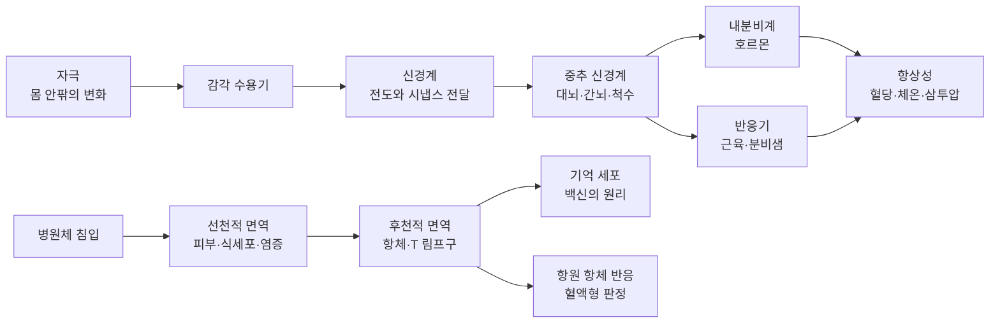
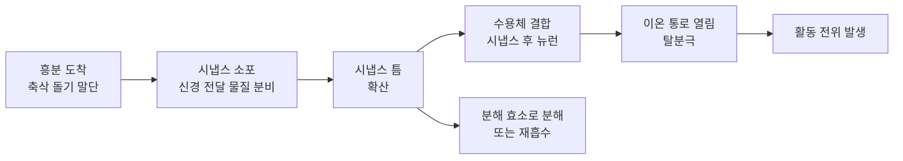
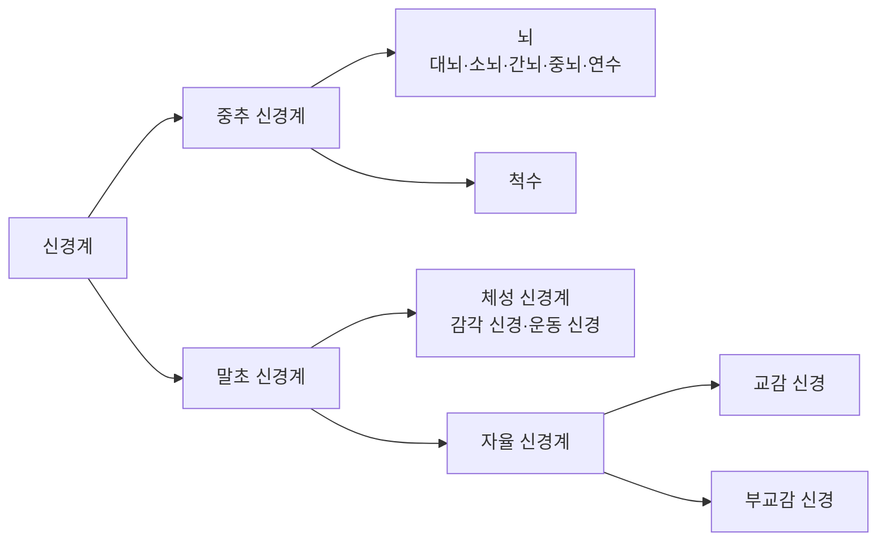
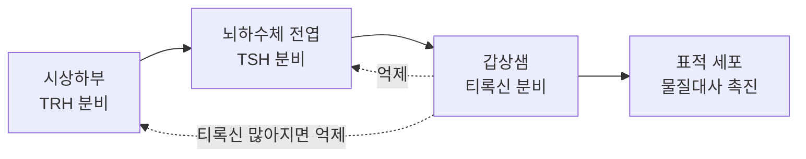
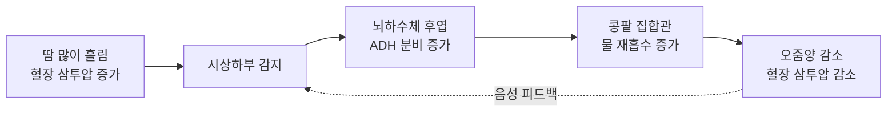
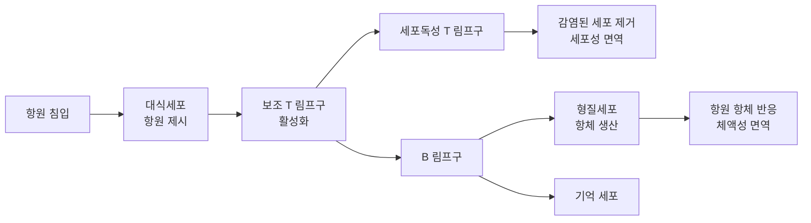

# 생명과학 2. 항상성과 몸의 조절 — 신호를 보내고, 균형을 지키고, 몸을 방어한다
<!-- prev: m3-05, 3-5, 6-1, bio-1 -->
<!-- next: cell-1, gene-3 -->

> [!NOTE]
> **성취기준**
> - **[12생과02-01]** 신경 세포의 구조와 기능을 이해하고, 신경 세포에서의 전도 과정을 모식도로 표현할 수 있다.
> - **[12생과02-02]** 시냅스를 통한 신경 신호의 전달 과정을 이해하고, 약물이 시냅스 전달에 영향을 미치는 사례를 조사하여 발표할 수 있다.
> - **[12생과02-03]** 사람 신경계의 구조와 기능을 이해하고 중추 신경계와 말초 신경계의 특징을 설명할 수 있다.
> - **[12생과02-04]** 내분비계와 신경계 작용 원리와 상호작용의 이해를 바탕으로 우리 몸의 항상성이 유지되는 과정을 추론할 수 있다.
> - **[12생과02-05]** 병원체의 종류와 특징을 이해하고 우리 몸의 방어 작용을 선천적 면역과 후천적 면역으로 구분하여 설명할 수 있다.
> - **[12생과02-06]** 항원 항체 반응의 특이성을 이해하고, 혈액의 응집 반응 원리를 이용하여 혈액형을 판정할 수 있다.
> - **[12생과02-07]** 백신의 종류와 작용 원리를 조사하고 질병의 예방 측면에서 백신의 필요성을 인식하여 협력적으로 소통할 수 있다.

**학습 목표**

1. 뉴런의 구조를 알고, 휴지 전위와 활동 전위가 생기는 원리와 흥분의 전도 과정을 모식도와 그래프로 표현할 수 있다.
2. 시냅스에서 신경 전달 물질에 의해 신호가 한 방향으로 전달됨을 설명하고, 약물이 시냅스 전달에 영향을 주는 사례를 조사·발표할 수 있다.
3. 대뇌를 중심으로 중추 신경계의 구조와 기능을 설명하고, 말초 신경계(체성·자율 신경계)의 특징을 비교할 수 있다.
4. 신경계와 내분비계의 상호작용과 음성 피드백으로 혈당·체온·삼투압이 조절되는 과정을 추론할 수 있다.
5. 병원체의 종류를 구분하고, 선천적 면역과 후천적 면역(체액성·세포성)의 과정을 설명할 수 있다.
6. 항원 항체 반응의 특이성으로 ABO식·Rh식 혈액형을 판정하고, 백신의 종류와 작용 원리를 바탕으로 예방 접종의 필요성을 소통할 수 있다.

**이 단원의 학습 사다리**

| 단계 | 무엇을 하나? |
|---|---|
| STEP 1. 이전 학습 다시 보기 | 중3 「자극과 반응」의 뉴런·호르몬, 통합과학 세포막과 감염병을 다시 본다 |
| STEP 2. 기초 다지기 | 이온과 전하, 농도 차와 확산, 되먹임, 속력 계산을 준비한다 |
| STEP 3. 핵심 개념 | 뉴런과 전도 → 시냅스 → 신경계 → 항상성 → 면역 → 혈액형 → 백신 |
| STEP 4. 오개념 바로잡기 | "활동 전위는 자극이 셀수록 커진다?", "항생제로 독감을 고친다?" |
| STEP 5. 진로 선택·대학 | 이온 통로와 막 수송, 단일클론항체, 면역학·신경과학으로 이어진다 |
| STEP 6. 생활·산업·진로 | 스마트 헬스케어, 뇌–컴퓨터 인터페이스, 백신 개발, 수혈 의학 |

---

## 🗺️ 단원 들어가기

뜨거운 냄비에 손이 닿으면 "뜨겁다!"라고 느끼기도 전에 손이 먼저 움츠러든다. 한겨울 바깥에서도, 한여름 운동장에서도 우리 체온은 약 37 °C 근처를 유지한다. 그리고 어릴 때 홍역 예방 주사를 맞은 사람은 홍역 바이러스가 몸에 들어와도 대개 앓지 않는다.

세 장면은 서로 달라 보이지만 하나의 질문으로 묶인다. **"몸은 바깥과 안의 변화를 어떻게 알아차리고, 어떻게 원래 상태로 되돌리는가?"** 이 단원에서는 전기 신호로 빠르게 일하는 **신경계**, 혈액 속 화학 신호로 꾸준히 일하는 **내분비계**, 그리고 침입자를 기억하는 **면역계**가 함께 몸의 균형(항상성)을 지키는 모습을 살펴본다.

---

## STEP 1. 🔙 이전 학습 다시 보기

### 연계 개념표

| 이전 단원·성취기준 | 그때 배운 것 | 이 단원에서 확장되는 것 |
|---|---|---|
| 중3 「자극과 반응」 [9과20-01] | 감각 기관이 자극을 받아 뇌로 전달 | 감각 뉴런에서 **활동 전위**가 생기고 전도되는 원리 |
| 중3 「자극과 반응」 [9과20-02] | 뉴런의 종류(감각·연합·운동), 중추·말초 신경계, 무조건 반사 | 막전위와 이온의 이동, 시냅스 전달, 대뇌 피질의 기능 영역, 자율 신경의 길항 작용 |
| 중3 「자극과 반응」 [9과20-03] | 성장 호르몬, 인슐린, 글루카곤, 티록신 | 신경계와 호르몬의 **상호작용**, **음성 피드백**에 의한 항상성 유지 |
| 통합과학1 「생명 시스템과 물질대사」 [10통과1-03-05] | 세포막의 선택적 투과성, 확산·능동 수송 | 이온 통로와 나트륨–칼륨 펌프가 만드는 **막전위** |
| 통합과학2 「감염병과 과학의 유용성」 [10통과2-03-01] | 병원체 진단(PCR·항원 검사), 백신의 기본 아이디어 | 면역 세포의 종류와 작용, 1차·2차 면역 반응, 백신의 종류 |
| 「생명 시스템의 구성」 [12생과01-04] | 기관계의 통합, 운동·식사 후의 생리적 변화 | 그 변화를 되돌리는 **조절 원리** |

### 준비 운동 (사전 진단)

**Q1.** 뉴런 중 감각 기관에서 받아들인 자극을 중추 신경계로 전달하는 뉴런의 이름은?

**Q2.** 혈당이 높아졌을 때 이자에서 분비되어 혈당을 낮추는 호르몬은?

**Q3.** 세포막을 통해 물질이 농도가 낮은 쪽에서 높은 쪽으로 에너지를 써서 이동하는 방식을 무엇이라 하는가?

**Q4.** 항생제는 세균성 질병과 바이러스성 질병 중 어느 쪽 치료에 쓰이는가?

정답 및 해설

**Q1.** 감각 뉴런(구심성 뉴런)

**Q2.** 인슐린

**Q3.** 능동 수송 — 이 단원의 나트륨–칼륨 펌프가 대표적인 예이다.

**Q4.** 세균성 질병. 항생제는 세균의 세포벽 합성 같은 세균 고유의 구조·과정을 방해한다. 바이러스는 세포 구조가 없으므로 항생제가 듣지 않는다.

---

## STEP 2. 🧱 기초 다지기

### ① 이온과 전하 — 전기 신호의 재료

신경 신호는 전선 속 전자의 흐름이 아니라 **이온이 세포막을 드나들며** 생기는 전기 변화이다.

| 이온 | 전하 | 세포 안팎 농도 |
|---|---|---|
| $\mathrm{Na^+}$ (나트륨 이온) | + | 세포 **밖**에 많다 |
| $\mathrm{K^+}$ (칼륨 이온) | + | 세포 **안**에 많다 |
| $\mathrm{Cl^-}$ (염화 이온) | − | 세포 밖에 많다 |

막을 사이에 둔 안과 밖의 전위 차이를 **막전위(membrane potential)** 라 하며, 세포 밖을 기준(0)으로 하여 세포 안의 전위를 mV(밀리볼트)로 나타낸다.

### ② 농도 차와 확산, 그리고 통로

물질은 농도가 높은 곳에서 낮은 곳으로 **확산**한다. 이온은 전하를 띠어 인지질 이중층을 직접 통과하기 어려우므로 **이온 통로**(막단백질)를 통해 이동한다. 통로가 열리면 이온은 농도 차를 따라 빠르게 이동한다(에너지 불필요). 반대로 농도 차를 거슬러 이온을 퍼 올리는 것은 **펌프**(능동 수송, ATP 필요)이다.

> [!TIP]
> 💡 **비유** — 댐(펌프)이 물을 높은 곳으로 퍼 올려 두었다가 수문(이온 통로)을 열면 물이 한꺼번에 쏟아진다. 신경 세포는 평소에 $\mathrm{Na^+}$를 밖에 '퍼 올려' 두었다가, 자극이 오면 수문을 열어 $\mathrm{Na^+}$가 안으로 쏟아지게 한다.

### ③ 되먹임(피드백)

결과가 다시 원인에 영향을 주는 것을 **되먹임(feedback)** 이라 한다.

- **음성 피드백**: 결과가 원인을 **억제**한다. 실내 온도가 높아지면 보일러가 꺼지는 온도 조절기. 항상성의 기본 원리이다.
- **양성 피드백**: 결과가 원인을 **강화**한다. 출산 때 자궁 수축이 점점 강해지는 과정 등 일부에서만 나타난다.

### ④ 속력 = 거리 ÷ 시간, 그리고 단위 환산

흥분의 전도 속력은 $v = \dfrac{\Delta x}{\Delta t}$로 구한다. 신경에서는 ms(밀리초)와 cm를 자주 쓰므로 단위를 바꾸는 연습을 해 두자.

$$
1\ \mathrm{cm/ms} = \frac{0.01\ \mathrm{m}}{0.001\ \mathrm{s}} = 10\ \mathrm{m/s}
$$

---

## STEP 3. 📘 핵심 개념

### ① 뉴런의 구조와 흥분의 전도 [12생과02-01]

#### (1) 뉴런의 구조

**뉴런(neuron, 신경 세포)** 은 신경계를 이루는 기본 단위이다.

| 부분 | 구조 | 기능 |
|---|---|---|
| **신경 세포체** | 핵과 대부분의 세포 소기관이 있다 | 뉴런의 생명 활동 유지 |
| **가지 돌기** | 세포체에서 뻗은 짧고 여러 갈래인 돌기 | 다른 뉴런이나 감각 기관에서 신호를 받아들임 |
| **축삭 돌기** | 세포체에서 길게 뻗은 돌기, 끝이 여러 갈래(축삭 돌기 말단) | 신호를 다른 뉴런이나 반응기로 전달 |
| **말이집** | 슈반 세포 등이 축삭 돌기를 여러 겹 감싼 구조(절연체) | 흥분을 빠르게 전도(도약 전도) |
| **랑비에 결절** | 말이집과 말이집 사이에 축삭이 드러난 부분 | 활동 전위가 여기서만 발생 |

말이집이 있는 뉴런을 **말이집 신경**, 없는 뉴런을 **민말이집 신경**이라 한다.

**기능에 따른 뉴런의 종류**

| 종류 | 하는 일 | 위치 |
|---|---|---|
| 감각 뉴런(구심성) | 감각 기관의 자극을 중추로 전달 | 말초 신경계 |
| 연합 뉴런 | 정보를 종합·판단하여 명령을 내림 | 중추 신경계(뇌, 척수) |
| 운동 뉴런(원심성) | 중추의 명령을 근육·분비샘으로 전달 | 말초 신경계 |

#### (2) 휴지 전위 — 쉬고 있는 뉴런도 '충전'되어 있다

자극을 받지 않은 뉴런의 막전위는 약 $-70\ \mathrm{mV}$이다. 이를 **휴지 전위(resting potential)** 라고 하며, 이때 막은 **분극** 상태(안쪽이 음, 바깥쪽이 양)이다.

- **나트륨–칼륨 펌프**: ATP를 써서 $\mathrm{Na^+}$ 3개를 밖으로, $\mathrm{K^+}$ 2개를 안으로 능동 수송한다. 그 결과 $\mathrm{Na^+}$는 밖에, $\mathrm{K^+}$는 안에 많아진다.
- 휴지 상태에서는 일부 $\mathrm{K^+}$ 통로가 열려 있어 $\mathrm{K^+}$가 밖으로 조금씩 확산된다. 양이온이 빠져나가므로 세포 안이 음(−)을 띤다.
- 세포 안에는 음전하를 띤 단백질 등이 많아 안쪽이 음전하를 유지하는 데 기여한다.

#### (3) 활동 전위 — 막전위가 순간적으로 뒤집힌다

뉴런이 **역치** 이상의 자극을 받으면 막전위가 약 1~2 ms 사이에 급격히 변했다가 돌아온다. 이 변화를 **활동 전위(action potential)** 라 한다.

| 단계 | 막전위 변화 | 일어나는 일 |
|---|---|---|
| ① 분극(휴지) | 약 $-70\ \mathrm{mV}$ | 펌프와 열린 $\mathrm{K^+}$ 통로가 휴지 전위 유지 |
| ② 탈분극 | 약 $-70 \to$ 약 $+30\ \mathrm{mV}$ | 역치(약 $-55\ \mathrm{mV}$ 안팎)에 이르면 전압 개폐 $\mathrm{Na^+}$ 통로가 열려 $\mathrm{Na^+}$가 세포 **안으로** 확산 |
| ③ 재분극 | 약 $+30 \to -70\ \mathrm{mV}$ | $\mathrm{Na^+}$ 통로가 닫히고 $\mathrm{K^+}$ 통로가 열려 $\mathrm{K^+}$가 세포 **밖으로** 확산 |
| ④ 과분극 | 잠시 $-70\ \mathrm{mV}$보다 낮아짐 | $\mathrm{K^+}$ 통로가 늦게 닫혀 $\mathrm{K^+}$가 더 빠져나감 |
| ⑤ 회복 | $-70\ \mathrm{mV}$ | 나트륨–칼륨 펌프가 이온 분포를 원래대로 |

(최고 전위는 뉴런에 따라 약 $+30 \sim +40\ \mathrm{mV}$로 다르게 측정된다.)

> [!IMPORTANT]
> **실무율(all-or-none law)** — 역치 미만의 자극에서는 활동 전위가 생기지 않고, 역치 이상이면 자극의 세기와 관계없이 **같은 크기**의 활동 전위가 생긴다. 그렇다면 강한 자극과 약한 자극은 어떻게 구분할까? 강한 자극일수록 **활동 전위가 더 자주** 생기고, **더 많은 뉴런**이 흥분한다.

#### (4) 흥분의 전도 — 도미노처럼 이웃으로 번진다

한 지점에서 활동 전위가 생기면, 안으로 들어온 $\mathrm{Na^+}$가 옆으로 퍼져 이웃 부위를 역치까지 탈분극시킨다. 이웃 부위에서 다시 활동 전위가 생기는 과정이 반복되며 흥분이 축삭 돌기를 따라 이동한다. 이것이 **흥분의 전도(conduction)** 이다. 막 지나간 부위는 잠시 다시 흥분하지 못하므로(불응기) 흥분은 되돌아가지 않고 **앞으로** 나아간다.

| 비교 | 민말이집 신경 | 말이집 신경 |
|---|---|---|
| 활동 전위 발생 위치 | 축삭 돌기 전체를 따라 연속적으로 | **랑비에 결절에서만** |
| 전도 방식 | 연속 전도 | **도약 전도** |
| 전도 속도 | 느리다(대략 수 m/s 이하) | 빠르다(수십 m/s 이상) |

축삭 돌기의 **지름이 클수록** 전도 속도가 빠르다. 말이집이 없는 오징어는 매우 굵은 축삭(거대 축삭)으로 빠른 전도를 얻는다.

> [!TIP]
> 💡 **비유** — 민말이집 신경은 한 칸씩 걸어가는 것, 말이집 신경은 징검다리(랑비에 결절)를 건너뛰며 가는 것이다. 디딜 곳이 적을수록 빨리 건넌다.

#### 예제 1 — 전도 속도 구하기

말이집 신경의 한 지점을 자극하였더니, 자극 지점에서 2 cm 떨어진 지점 P에서는 0.5 ms 후, 8 cm 떨어진 지점 Q에서는 1.5 ms 후에 활동 전위가 처음 기록되었다. 이 신경의 전도 속도를 m/s 단위로 구하시오.

**풀이** P와 Q 사이 거리 $= 8 - 2 = 6\ \mathrm{cm}$, 걸린 시간 $= 1.5 - 0.5 = 1.0\ \mathrm{ms}$

$$
v = \frac{6\ \mathrm{cm}}{1.0\ \mathrm{ms}} = 6\ \mathrm{cm/ms} = 60\ \mathrm{m/s}
$$

두 측정 지점의 차이를 쓰면 자극 지점에서 처음 흥분이 생기기까지 걸리는 시간을 몰라도 속도를 구할 수 있다.

#### 예제 2 — 어느 순간의 막전위 추론하기

어떤 뉴런의 한 지점에서 활동 전위가 시작된 뒤 그 지점의 막전위는 다음과 같이 변한다.

| 활동 전위 시작 후 시간 (ms) | 0 | 1 | 2 | 3 |
|---|---|---|---|---|
| 막전위 (mV) | −70 | +30 | −80 | −70 |

이 뉴런의 한 끝 지점 X를 자극하였고, 흥분은 $2\ \mathrm{cm/ms}$로 전도된다. X에서는 자극 즉시 활동 전위가 시작된다고 할 때, 자극 후 4 ms 시점에 X에서 2 cm, 4 cm, 6 cm 떨어진 지점의 막전위를 각각 구하시오.

**풀이** 흥분이 도착하는 시각: 2 cm → 1 ms, 4 cm → 2 ms, 6 cm → 3 ms
4 ms 시점에 각 지점에서 활동 전위가 시작된 뒤 지난 시간: 3 ms, 2 ms, 1 ms

| 지점 | 2 cm | 4 cm | 6 cm |
|---|---|---|---|
| 지난 시간 | 3 ms | 2 ms | 1 ms |
| 막전위 | −70 mV (회복) | −80 mV (과분극) | +30 mV (탈분극 최고점) |

먼 지점일수록 흥분이 늦게 도착하므로, 같은 순간에 지점마다 활동 전위의 **서로 다른 단계**에 있다.

### ② 시냅스 전달과 약물 [12생과02-02]

#### (1) 시냅스에서 일어나는 일

한 뉴런의 축삭 돌기 말단과 다음 뉴런(또는 근육 세포)의 가지 돌기·세포체가 약 20~40 nm 정도의 좁은 틈을 두고 만나는 곳을 **시냅스(synapse)** 라고 하며, 이 틈을 **시냅스 틈**이라 한다.

1. 흥분이 축삭 돌기 말단에 도착한다.
2. 말단의 **시냅스 소포**가 세포막과 융합하여 **신경 전달 물질**을 시냅스 틈으로 분비한다(세포 밖 배출).
3. 신경 전달 물질이 시냅스 틈을 **확산**하여 시냅스 후 뉴런 막의 **수용체**에 결합한다.
4. 수용체와 연결된 이온 통로가 열려 시냅스 후 뉴런이 탈분극되고, 역치에 이르면 활동 전위가 생긴다.
5. 남은 신경 전달 물질은 **분해 효소**에 의해 분해되거나 시냅스 전 뉴런으로 **재흡수**되어 신호가 끝난다.

| 비교 | 전도 | 전달 |
|---|---|---|
| 일어나는 곳 | 한 뉴런 안 | 뉴런과 뉴런 사이(시냅스) |
| 신호의 형태 | 전기 신호(활동 전위) | 화학 신호(신경 전달 물질) |
| 방향 | 자극 지점에서 양쪽으로 퍼질 수 있음 | **한 방향**(시냅스 전 → 시냅스 후) |
| 속도 | 빠름 | 상대적으로 느림(확산 시간 필요) |

시냅스 소포는 축삭 돌기 말단에만 있고 수용체는 시냅스 후 뉴런에만 있으므로, 흥분은 **축삭 돌기 말단 → 다음 뉴런의 가지 돌기(세포체)** 방향으로만 전달된다.

**대표적인 신경 전달 물질**: 아세틸콜린(운동 뉴런 → 골격근, 부교감 신경), 노르에피네프린(교감 신경), 도파민(운동 조절·보상 관련), 세로토닌(기분·수면 관련), GABA(억제성 신호) 등이 있다.

#### (2) 약물은 시냅스의 어느 단계를 바꾸는가

| 약물·물질 | 작용하는 단계 | 결과 |
|---|---|---|
| 니코틴 | 아세틸콜린 수용체 일부에 결합하여 아세틸콜린처럼 작용 | 각성, 의존성 형성 |
| 카페인 | 졸음을 유발하는 아데노신의 수용체를 막음 | 졸음이 줄고 각성 |
| 코카인, 일부 각성제 | 도파민 등의 **재흡수를 방해** | 시냅스 틈에 도파민이 오래 머묾 → 강한 쾌감, 심한 중독 |
| 일부 항우울제(선택적 세로토닌 재흡수 억제제) | 세로토닌의 재흡수를 억제 | 세로토닌 신호를 오래 유지하여 우울 증상 완화 |
| 보툴리눔 독소 | 아세틸콜린 **분비를 억제** | 근육 마비. 아주 적은 양을 의료·미용 목적으로 근육 경련 치료 등에 사용 |
| 쿠라레 | 골격근의 아세틸콜린 수용체를 막음 | 근육 이완(마비) |
| 일부 유기인계 살충제 | 아세틸콜린 **분해 효소를 억제** | 아세틸콜린이 계속 작용하여 근육 경련 등 중독 증상 |
| 아편계 진통제(모르핀 등) | 통증 신호를 억제하는 수용체에 결합 | 진통. 남용하면 의존성·호흡 억제 위험 |

> [!WARNING]
> 시냅스에 작용하는 약물은 의사의 처방에 따라 정해진 양만 써야 한다. 마약류는 재흡수·수용체 같은 시냅스의 정상 조절을 망가뜨려 **내성**(같은 효과를 내려면 더 많은 양이 필요)과 **의존성**을 만든다. 처방받은 진통제나 수면제도 임의로 늘려 먹으면 위험하다.

#### 예제 3 — 약물의 작용 추론하기

어떤 물질 X를 시냅스에 처리했더니, 시냅스 전 뉴런을 자극했을 때 신경 전달 물질의 분비량은 변하지 않았지만 시냅스 후 뉴런의 탈분극이 정상보다 훨씬 오래 지속되었다. X의 작용으로 가능한 것을 두 가지 쓰시오.

**풀이** 분비량은 그대로인데 신호가 오래간다면, 시냅스 틈에서 신경 전달 물질이 **늦게 제거**되는 것이다. ① 신경 전달 물질의 **분해 효소를 억제**하거나 ② 시냅스 전 뉴런으로의 **재흡수를 억제**하는 경우가 가능하다.

### ③ 사람의 신경계 — 대뇌를 중심으로 [12생과02-03]

#### (1) 신경계의 구성

#### (2) 대뇌 — 생각하고 판단하는 중추

**대뇌**는 좌우 두 개의 반구로 나뉘며, 두 반구는 신경 섬유 다발인 **뇌량**으로 연결된다.

- **대뇌 겉질(피질)**: 바깥쪽, 신경 세포체가 모여 회색을 띤 **회색질**. 주름이 많아 표면적이 넓다.
- **대뇌 속질(수질)**: 안쪽, 축삭 돌기가 모여 흰색을 띤 **백질**. 겉질의 여러 부위와 몸의 다른 부위를 잇는다.

**대뇌 겉질의 엽과 기능 영역**

| 엽 | 주요 기능 |
|---|---|
| 전두엽(이마엽) | 수의 운동 명령(운동 영역), 계획·판단·추리 등 고등 정신 활동, 말하기(언어 중추의 일부) |
| 두정엽(마루엽) | 피부 감각 등 몸감각 정보 처리(감각 영역), 공간 인식 |
| 측두엽(관자엽) | 청각 정보 처리, 언어 이해, 기억 관련 |
| 후두엽(뒤통수엽) | 시각 정보 처리 |

기능에 따라 겉질은 **감각 영역**(감각 정보 받아들임), **연합 영역**(정보를 종합·판단, 기억·사고), **운동 영역**(수의 운동 명령)으로 나뉜다. 대부분의 신경은 좌우가 엇갈려 연결되므로 **좌반구는 몸의 오른쪽**, 우반구는 몸의 왼쪽 감각과 운동을 주로 담당한다.

> [!NOTE]
> 감각 영역과 운동 영역에서 몸의 각 부위를 담당하는 넓이는 몸의 크기에 비례하지 않는다. 손과 입술처럼 정밀한 감각·운동이 필요한 부위를 담당하는 영역이 넓다. 손가락 끝이 등보다 훨씬 예민한 이유이다.

#### (3) 대뇌 외의 뇌 (간략히)

| 부위 | 주요 기능 |
|---|---|
| **간뇌** | 시상: 감각 정보를 대뇌로 중계 / 시상하부: 체온·혈당·삼투압 조절 등 **항상성의 중추**, 뇌하수체 조절 |
| **중뇌** | 안구 운동, 동공 크기 조절(동공 반사)의 중추 |
| **소뇌** | 몸의 평형 유지, 수의 운동을 정교하게 조절 |
| **연수** | 심장 박동, 호흡 운동, 소화 운동의 조절 중추. 기침·재채기·하품·침 분비 반사의 중추. 대뇌와 척수를 잇는 신경이 좌우로 교차 |

중뇌·뇌교·연수를 묶어 **뇌줄기(뇌간)** 라고 하며 생명 유지에 직결된 기능을 맡는다.

#### (4) 척수와 반사

**척수**는 뇌와 말초 신경을 잇는 통로이며, 반사의 중추이다. 척수는 대뇌와 반대로 겉질이 **백질**, 속질이 **회색질**이다.

| 반사 | 중추 | 경로의 예 |
|---|---|---|
| 무릎 반사, 회피 반사(뜨거운 것에 손 떼기) | 척수 | 감각 뉴런 → (연합 뉴런) → 운동 뉴런 |
| 배변·배뇨 반사 | 척수 | |
| 동공 반사 | 중뇌 | |
| 기침, 재채기, 침 분비 | 연수 | |

반사는 대뇌를 거치지 않으므로 의식적 반응보다 빠르다. 뜨거운 것에 손을 뗀 **뒤에야** "뜨겁다"고 느끼는 것은, 척수에서 반사가 먼저 일어나고 감각 정보가 대뇌에는 나중에 도착하기 때문이다.

#### (5) 말초 신경계 — 체성 신경계와 자율 신경계

| 구분 | 체성 신경계 | 자율 신경계 |
|---|---|---|
| 조절 대상 | 골격근 | 내장 기관의 근육(심장근, 내장근), 분비샘 |
| 의지와의 관계 | 의지대로 조절(수의적) | 의지와 관계없이 조절(불수의적) |
| 중추 | 대뇌 등 | 주로 간뇌(시상하부), 중뇌, 연수, 척수 |
| 뉴런 연결 | 중추에서 반응기까지 운동 뉴런 하나 | 신경절에서 두 개의 뉴런(신경절 이전·이후 뉴런)이 연결 |

**교감 신경과 부교감 신경의 길항 작용**

| 기관 | 교감 신경(위기·긴장 상황) | 부교감 신경(휴식 상황) |
|---|---|---|
| 동공 | 확대 | 축소 |
| 심장 박동 | 촉진 | 억제 |
| 기관지 | 확장 | 수축 |
| 소화 운동·소화액 분비 | 억제 | 촉진 |
| 방광 | 이완(배뇨 억제) | 수축(배뇨 촉진) |
| 신경절 이후 뉴런 말단의 전달 물질 | 주로 노르에피네프린 | 아세틸콜린 |

> [!TIP]
> 💡 **비유** — 교감 신경은 '가속 페달', 부교감 신경은 '브레이크'이다. 시험 직전 심장이 두근거리고 입이 마르는 것은 가속 페달을 밟은 상태, 점심을 먹고 나른하며 소화가 잘되는 것은 브레이크를 밟은 상태이다. 두 신경이 같은 기관에 반대로 작용하여(길항 작용) 기관의 활동을 알맞게 조절한다.

### ④ 항상성 — 신경계와 내분비계의 합동 작전 [12생과02-04]

#### (1) 호르몬과 내분비계의 특성

**호르몬(hormone)** 은 내분비샘에서 만들어져 **혈액**으로 분비되고, 혈액을 따라 이동하다가 **수용체를 가진 표적 세포**에만 작용하는 화학 신호이다.

| 비교 | 신경계 | 내분비계 |
|---|---|---|
| 신호 | 활동 전위(전기) + 신경 전달 물질(화학) | 호르몬(화학) |
| 전달 경로 | 뉴런 | 혈액 |
| 전달 속도 | 빠르다 | 느리다 |
| 효과의 지속 | 짧다 | 길다 |
| 작용 범위 | 뉴런이 연결된 곳(좁고 정확) | 표적 세포가 있는 곳 어디나(넓다) |
| 예 | 회피 반사, 동공 반사 | 혈당 조절, 생장 |

#### (2) 음성 피드백 — 티록신 분비 조절

혈중 티록신 농도가 높아지면 시상하부와 뇌하수체의 분비가 억제되어 티록신 분비가 줄어든다. 반대로 티록신이 부족하면 억제가 풀려 분비가 늘어난다. 이렇게 **결과가 원인을 억제**하는 음성 피드백으로 호르몬 농도가 일정 범위에서 유지된다.

#### (3) 혈당 조절 — 이자와 간, 그리고 신경

| 상황 | 감지 | 조절 | 결과 |
|---|---|---|---|
| 식사 후 혈당 증가 | 이자와 시상하부가 감지 | 이자의 β세포가 **인슐린** 분비 ↑ (부교감 신경도 촉진) | 간에서 포도당 → 글리코젠 합성, 조직 세포의 포도당 흡수 촉진 → 혈당 감소 |
| 공복·운동 시 혈당 감소 | 이자와 시상하부가 감지 | 이자의 α세포가 **글루카곤** 분비 ↑, 교감 신경 → 부신 속질의 **에피네프린** 분비 ↑ | 간에서 글리코젠 → 포도당 분해 → 혈당 증가 |

인슐린과 글루카곤처럼 같은 대상에 반대로 작용하는 호르몬 관계를 **길항 작용**이라 한다. 공복 혈당은 대략 $70 \sim 100\ \mathrm{mg/dL}$ 범위로 유지된다.

> [!IMPORTANT]
> **당뇨병과 항상성** — 1형 당뇨병은 주로 면역계가 이자의 β세포를 파괴하여 **인슐린이 분비되지 않는** 경우이고, 2형 당뇨병은 인슐린은 분비되지만 **표적 세포가 인슐린에 잘 반응하지 않는**(인슐린 저항성) 경우가 많다. 앞 단원 「생명 시스템의 구성」의 대사성 질환이 항상성 조절의 실패로 이어지는 예이다.

#### 예제 4 — 혈당 그래프 해석

건강한 사람 A와 당뇨병 환자 B가 같은 양의 포도당 용액을 마신 뒤 혈당과 혈중 인슐린 농도를 측정했다. A는 혈당이 올랐다가 2시간 안에 원래대로 돌아왔고 인슐린 농도가 혈당을 따라 크게 증가했다. B는 혈당이 높게 오래 유지되었고 인슐린 농도가 거의 증가하지 않았다. B는 1형과 2형 중 어느 유형에 가까운가? 근거와 함께 쓰시오.

**풀이** B는 혈당이 높은데도 인슐린 분비가 거의 늘지 않았으므로 **인슐린 분비 자체가 부족한 1형**에 가깝다. (만약 인슐린 농도가 A보다 높게 증가했는데도 혈당이 높게 유지되었다면, 표적 세포가 반응하지 않는 2형에 가깝다고 추론할 수 있다.)

#### (4) 체온 조절 — 시상하부의 온도 조절기

| 상황 | 신경계의 작용 | 내분비계의 작용 | 결과 |
|---|---|---|---|
| 추울 때 | 교감 신경 → 피부 혈관 **수축**(열 방출 ↓), 털세움근 수축 / 체성 신경(운동 신경) → 골격근 떨림(열 발생 ↑) | 티록신·에피네프린 분비 ↑ → 물질대사 촉진(열 발생 ↑) | 체온 유지 |
| 더울 때 | 피부 혈관 **확장**(열 방출 ↑), 땀 분비 ↑ | 물질대사가 상대적으로 억제 | 체온 유지 |

같은 목적을 위해 신경계는 빠르게, 내분비계는 오래 작용하며 **함께** 일한다.

#### (5) 삼투압 조절 — 물을 얼마나 되찾을 것인가

땀을 많이 흘려 혈장 삼투압이 높아지면, 시상하부가 이를 감지하여 **뇌하수체 후엽**에서 **항이뇨 호르몬(ADH)** 분비를 늘린다. ADH는 콩팥의 **집합관**에서 물의 재흡수를 촉진한다. 그 결과 오줌양은 줄고 오줌은 진해지며, 혈장 삼투압은 정상으로 내려간다. 물을 많이 마시면 반대로 ADH 분비가 줄어 묽은 오줌이 많이 나온다.

#### 예제 5 — 스마트워치 자료로 항상성 추론하기

한 학생이 스마트워치를 차고 30분 동안 달리기를 했다. 달리는 동안 심박수는 분당 약 70회에서 약 160회로 올랐고, 달리기를 멈춘 지 10분 뒤에는 분당 약 90회로 떨어졌다. 달리기 후 1시간 동안의 오줌양은 평소보다 적었다. 이 자료를 자율 신경과 ADH의 작용으로 설명하시오.

**풀이** 달리기 중에는 교감 신경이 심장 박동을 촉진하여 근육에 산소와 포도당을 빠르게 공급했다. 운동이 끝나자 부교감 신경의 작용이 커지면서 심박수가 서서히 원래대로 돌아왔다(길항 작용). 또 땀으로 물을 잃어 혈장 삼투압이 높아지자 ADH 분비가 늘어 집합관의 물 재흡수가 증가했고, 그래서 오줌양이 줄었다.

### ⑤ 병원체와 우리 몸의 방어 작용 [12생과02-05]

#### (1) 병원체의 종류와 특징

| 병원체 | 특징 | 질병의 예 | 치료·예방 |
|---|---|---|---|
| **세균** | 핵막이 없는 원핵세포, 스스로 물질대사와 분열 | 결핵, 콜레라, 파상풍, 세균성 식중독 | 항생제, 백신 |
| **바이러스** | 세포 구조 없음, 숙주 세포 안에서만 증식, 돌연변이가 잦음 | 독감, 홍역, 코로나바이러스감염증-19, 후천성 면역 결핍증(AIDS) | 항바이러스제, 백신 |
| **원생생물** | 진핵 단세포 생물 | 말라리아(모기가 매개), 아메바성 이질 | 항원충제, 모기 방제 |
| **균류(곰팡이)** | 진핵생물, 포자로 번식 | 무좀, 칸디다증 | 항진균제 |
| **변형 프라이온** | 단백질로만 이루어진 감염성 입자. 정상 프라이온 단백질을 비정상 구조로 바꿈 | 크로이츠펠트·야코프병, 소해면상뇌병증 | 특별한 치료법 없음. 감염원 차단 |

병원체에 감염되어 생기는 질병을 **감염성 질병**, 병원체 없이 유전·생활 습관 등으로 생기는 질병(고혈압, 당뇨병 등)을 **비감염성 질병**이라 한다.

#### (2) 선천적 면역 — 누구에게나, 처음부터, 가리지 않고

**선천적 면역(비특이적 면역)** 은 태어날 때부터 가지고 있으며, 병원체의 종류를 가리지 않고 빠르게 작용한다.

| 방어선 | 방법 |
|---|---|
| 물리적·화학적 장벽 | **피부**의 각질층, 호흡기·소화기 **점막**의 점액과 섬모, 눈물·침의 **라이소자임**(세균 세포벽 분해), 위액의 강한 산 |
| 식세포 작용 | 대식세포, 호중구 같은 백혈구가 병원체를 세포 안으로 삼켜 분해 |
| 염증 반응 | 상처 부위의 비만세포가 **히스타민** 분비 → 모세 혈관 확장·투과성 증가 → 백혈구가 모여들어 식세포 작용. 열, 붉어짐, 부어오름, 통증이 나타남 |
| 자연살해세포 | 바이러스에 감염된 세포나 암세포를 찾아 파괴 |

#### (3) 후천적 면역 — 특정 항원을 기억한다

**후천적 면역(특이적 면역)** 은 특정 **항원**(면역 반응을 일으키는 물질)을 인식하여 작용하며, 한 번 만난 항원을 **기억**한다. 림프구가 주인공이다. 림프구는 골수에서 만들어지며, **B 림프구**는 골수에서, **T 림프구**는 가슴샘에서 성숙한다.

| 구분 | **세포성 면역** | **체액성 면역** |
|---|---|---|
| 주역 | 세포독성 T 림프구 | B 림프구 → 형질세포 |
| 방법 | 병원체에 감염된 세포를 직접 공격하여 제거 | **항체**를 만들어 체액 속 항원과 결합(항원 항체 반응) |
| 주요 대상 | 바이러스에 감염된 세포, 암세포 | 체액 속의 세균, 바이러스, 독소 |

보조 T 림프구는 두 면역을 모두 활성화하는 '지휘관'이다. HIV는 바로 이 보조 T 림프구를 감염시켜 파괴하므로, 후천성 면역 결핍증 환자는 다른 병원체에 대한 면역력까지 크게 떨어진다.

#### (4) 1차 면역 반응과 2차 면역 반응

| 비교 | 1차 면역 반응 | 2차 면역 반응 |
|---|---|---|
| 언제 | 항원이 **처음** 침입했을 때 | **같은 항원**이 다시 침입했을 때 |
| 항체 생성 시작 | 느리다(며칠~1주 이상 걸림) | 빠르다 |
| 항체 생성량 | 적다 | 매우 많다 |
| 주역 | B 림프구가 형질세포와 기억 세포로 분화 | **기억 세포**가 빠르게 형질세포로 분화 |

> [!TIP]
> 💡 **비유** — 1차 면역은 처음 보는 범인의 몽타주를 그리고 수사팀을 꾸리는 데 시간이 걸리는 것이고, 2차 면역은 이미 수배 전단(기억 세포)이 붙어 있어 범인이 나타나자마자 붙잡는 것이다. 백신은 진짜 범인이 오기 전에 수배 전단을 미리 붙여 두는 일이다.

### ⑥ 항원 항체 반응과 혈액형 [12생과02-06]

#### (1) 항원 항체 반응의 특이성

**항체(antibody)** 는 Y자 모양의 단백질로, 끝부분이 특정 항원과만 꼭 맞게 결합한다(자물쇠와 열쇠). 이를 **항원 항체 반응의 특이성**이라 한다. 항체가 항원에 결합하면 항원이 서로 엉겨 붙어(응집) 식세포가 쉽게 처리하거나 독소가 작용하지 못한다.

#### (2) ABO식 혈액형

적혈구 막 표면의 **응집원**(항원)과 혈장 속의 **응집소**(항체)로 결정된다. 응집원 A는 응집소 α와, 응집원 B는 응집소 β와 만나면 응집한다.

| 혈액형 | 적혈구의 응집원 | 혈장의 응집소 | 항 A 혈청(응집소 α)과 | 항 B 혈청(응집소 β)과 |
|---|---|---|---|---|
| A형 | A | β | 응집 ○ | 응집 × |
| B형 | B | α | 응집 × | 응집 ○ |
| AB형 | A, B | 없음 | 응집 ○ | 응집 ○ |
| O형 | 없음 | α, β | 응집 × | 응집 × |

#### (3) Rh식 혈액형

적혈구 막에 **Rh 응집원**이 있으면 Rh⁺형, 없으면 Rh⁻형이다. Rh⁻형인 사람은 원래 Rh 응집소가 없지만, Rh⁺형 혈액이 들어오면 Rh 응집소가 만들어진다. 항 Rh 혈청에 응집하면 Rh⁺형이다.

> [!WARNING]
> 수혈은 원칙적으로 **같은 혈액형끼리** 한다. 다른 혈액형을 수혈하면 받는 사람의 응집소가 들어온 적혈구를 응집시켜 생명이 위험할 수 있다. 실제 의료 현장에서는 혈액형뿐 아니라 교차 시험까지 확인한다.

#### 예제 6 — 집단의 혈액형 판정

어느 학급 학생 100명의 혈액을 항 A 혈청, 항 B 혈청과 각각 반응시켰더니, 항 A 혈청에 응집한 학생이 45명, 항 B 혈청에 응집한 학생이 30명, 두 혈청 모두에 응집한 학생이 10명이었다. A형, B형, AB형, O형 학생 수를 각각 구하시오.

**풀이**
- 두 혈청 모두에 응집 = 응집원 A와 B를 모두 가짐 → **AB형 10명**
- 항 A 혈청에만 응집 → A형 $= 45 - 10 = 35$명
- 항 B 혈청에만 응집 → B형 $= 30 - 10 = 20$명
- 어느 쪽에도 응집하지 않음 → O형 $= 100 - (35 + 20 + 10) = 35$명

### ⑦ 백신의 종류와 작용 원리 [12생과02-07]

#### (1) 백신의 원리

**백신(vaccine)** 은 병원체 또는 그 일부를 병을 일으키지 않게 처리하여 몸에 넣는 것이다. 백신을 접종하면 1차 면역 반응이 일어나 **기억 세포**가 만들어진다. 나중에 진짜 병원체가 들어오면 2차 면역 반응이 빠르고 강하게 일어나 병을 막거나 가볍게 앓고 지나간다.

1796년 영국의 제너는 소의 질병인 우두에 걸렸던 사람이 천연두에 잘 걸리지 않는다는 관찰을 바탕으로 우두 접종법을 개발하였다. 이후 파스퇴르가 병원체를 약하게 만들어 예방에 쓰는 방법을 발전시켰다. 천연두는 전 세계적인 접종 사업으로 1980년 세계보건기구(WHO)가 근절을 선언하였다.

#### (2) 제조 방법에 따른 백신의 종류

| 종류 | 만드는 방법 | 특징 | 예 |
|---|---|---|---|
| **약독화 생백신** | 살아 있는 병원체의 독성을 약하게 함 | 면역 효과가 강하고 오래감. 면역력이 매우 약한 사람은 접종을 피하기도 함 | 홍역·볼거리·풍진(MMR), 수두, 결핵(BCG) |
| **불활성화 백신(사백신)** | 병원체를 열·화학 물질로 죽임 | 안전성이 높지만 여러 번 접종(추가 접종)이 필요한 경우가 많음 | 주사용 인플루엔자 백신, A형 간염, 일본뇌염 사백신 |
| **톡소이드 백신** | 세균이 만드는 독소를 무독화 | 독소에 대한 면역 형성 | 파상풍, 디프테리아 |
| **단백질(아단위) 백신** | 병원체의 일부 단백질만 사용(유전자 재조합 기술로 생산하기도 함) | 병원체 전체가 없어 안전성 높음 | B형 간염, 사람유두종바이러스(HPV) |
| **바이러스 벡터 백신** | 해가 없는 다른 바이러스에 항원 유전자를 넣어 전달 | 세포가 항원 단백질을 직접 만들어 면역 유도 | 일부 코로나바이러스감염증-19 백신 |
| **mRNA 백신** | 항원 단백질의 설계도인 mRNA를 지질 입자에 싸서 전달 | 빠르게 설계·생산 가능. 저온 보관 필요 | 일부 코로나바이러스감염증-19 백신 |

바이러스 벡터 백신과 mRNA 백신은 통합과학1 「유전자와 단백질」에서 배운 **중심 원리**(DNA → RNA → 단백질)를 이용한 기술이다. 우리 세포의 리보솜이 백신의 mRNA를 번역하여 항원 단백질을 만들고, 이 단백질이 면역 반응을 일으킨다. mRNA는 세포 안에서 곧 분해되며 핵 속 DNA로 들어가 유전자를 바꾸지 않는다.

#### (3) 왜 많은 사람이 함께 접종해야 할까 — 집단 면역

인구의 상당수가 면역을 가지면 병원체가 다음 사람에게 옮겨 갈 기회가 줄어, 접종할 수 없는 영아·면역 저하자까지 간접적으로 보호된다. 이를 **집단 면역**이라 한다. 그래서 백신은 개인의 선택인 동시에 **공동체의 건강**과 연결된다.

#### 예제 7 — 백신 접종 기록 해석

어떤 사람이 특정 백신을 1차 접종하고 4주 뒤 2차(추가) 접종을 하였다. 혈중 항체 농도(상대값)는 1차 접종 후 2주 무렵 최고 10까지 올랐다가 점점 감소하였고, 2차 접종 후에는 1주 만에 최고 100까지 올랐다. 2차 접종 후 항체가 더 빠르고 많이 생긴 까닭을 쓰시오.

**풀이** 1차 접종으로 그 항원에 대한 **기억 세포**가 만들어졌기 때문이다. 2차 접종 때는 기억 세포가 빠르게 형질세포로 분화하여 많은 항체를 만드는 2차 면역 반응이 일어났다. 이 자료에서 최고 항체 농도는 $100 \div 10 = 10$배로 높아졌다. 추가 접종의 근거가 바로 이것이다.

> [!TIP]
> 💡 **협력적 소통 요령** — 백신에 대해 토의할 때는 ① 믿을 수 있는 출처(질병관리청, 세계보건기구, 학술 자료)를 확인하고 ② 효과와 이상 반응을 **함께** 수치로 비교하며 ③ 개인의 선택과 공동체 보호를 함께 고려한다. 근거 없는 소문은 출처를 되물어 확인한다.

---

## STEP 4. ⚠️ 오개념 바로잡기

| 흔한 오개념 | 올바른 개념 | 왜 그럴까? |
|---|---|---|
| 자극이 강할수록 활동 전위의 크기가 커진다 | 역치 이상이면 활동 전위의 크기는 **같다**(실무율). 강한 자극은 활동 전위의 **빈도**를 높인다 | 감각의 세기는 '크기'가 아니라 '얼마나 자주, 얼마나 많은 뉴런이'로 전달된다 |
| 탈분극 때 $\mathrm{Na^+}$는 펌프로 들어온다 | 탈분극 때 $\mathrm{Na^+}$는 열린 **통로를 통해 확산**하여 들어온다 | 펌프(능동 수송)는 오히려 $\mathrm{Na^+}$를 밖으로 내보내 농도 차를 만든다 |
| 신경 신호는 시냅스에서도 전기로 건너간다 | 대부분의 시냅스에서는 **신경 전달 물질(화학 신호)** 이 확산하여 전달된다 | 시냅스 틈이라는 간격이 있어 전기 신호가 직접 넘어가지 못한다 |
| 반사는 대뇌가 빠르게 판단한 결과이다 | 무릎 반사·회피 반사는 **척수**가 중추이며 대뇌를 거치지 않는다 | 그래서 반응이 일어난 뒤에야 감각을 느낀다 |
| 호르몬은 온몸의 모든 세포에 작용한다 | 호르몬은 혈액으로 온몸에 퍼지지만 **수용체가 있는 표적 세포**에만 작용한다 | 열쇠(호르몬)는 맞는 자물쇠(수용체)에만 들어간다 |
| 감기·독감도 항생제로 고친다 | 항생제는 **세균**에 작용한다. 바이러스에는 효과가 없다 | 바이러스에는 항생제가 공격하는 세포벽 같은 구조가 없다. 항생제 남용은 내성 세균을 늘린다 |
| O형은 누구에게나 수혈할 수 있다 | 원칙적으로 **같은 혈액형**끼리 수혈한다 | O형 혈장의 응집소 α, β가 받는 사람의 적혈구를 응집시킬 수 있다 |

---

## STEP 5. 🎓 다음 단계로 한 걸음 더

> [!CAUTION]
> 이 절은 **일반 선택 「생명과학」 교육과정 범위 밖의 심화 내용**으로 평가 대상이 아니다. 이 단원의 개념이 진로 선택 과목과 대학에서 어떻게 확장되는지 맛보기로 보여 준다.

### 진로 선택·대학과의 연결

| 다음 단계 | 이어지는 내용 |
|---|---|
| 「세포」 (세포와 물질대사) | 세포막의 구조와 물질 수송 — 이온 통로, 운반체, 나트륨–칼륨 펌프, 세포 내 섭취·세포 밖 배출(시냅스 소포의 분비) |
| 「생명공학기술」 (생물의 유전) | **단일클론항체**를 이용한 진단·치료, 유전자 재조합 백신, 항체 의약품 |
| 대학 | 신경과학, 생리학, 면역학, 약리학, 역학(감염병 확산 모형) |

### ① 막전위를 수식으로 — 네른스트 식

대학 생리학에서는 한 이온의 농도 차가 만드는 평형 전위를 **네른스트 식**으로 계산한다.

$$
E_{\text{이온}} = \frac{RT}{zF}\ln\frac{[\text{이온}]_{\text{밖}}}{[\text{이온}]_{\text{안}}}
$$

$\mathrm{K^+}$의 평형 전위는 약 $-90\ \mathrm{mV}$, $\mathrm{Na^+}$는 약 $+60\ \mathrm{mV}$ 정도로 계산된다. 휴지 전위(약 $-70\ \mathrm{mV}$)가 $\mathrm{K^+}$의 평형 전위에 가까운 것은 휴지 상태의 막이 $\mathrm{K^+}$를 가장 잘 통과시키기 때문이다.

### ② 단일클론항체 — 한 가지 항원만 겨냥하는 '유도탄'

하나의 B 림프구에서 유래한 세포가 만드는 항체는 한 종류의 항원 부위만 인식한다. 이 원리를 이용해 대량으로 만든 **단일클론항체**는 임신 진단 키트, 신속항원검사, 특정 암세포만 공격하는 항체 치료제 등에 쓰인다. 「생명공학기술」에서 난치병 치료 사례로 자세히 다룬다.

### ③ 집단 면역의 문턱 — 감염병 확산 모형

감염자 한 명이 면역이 없는 집단에서 평균 몇 명을 감염시키는지를 **기초 감염 재생산 수** $R_0$라 한다. 간단한 모형에서 집단 면역에 필요한 면역 인구 비율은

$$
p = 1 - \frac{1}{R_0}
$$

이다. $R_0 = 4$이면 $p = 0.75$, 즉 인구의 75% 이상이 면역을 가져야 한다. 전파력이 매우 강한 홍역은 $R_0$가 10을 훌쩍 넘는 것으로 알려져 있어 90%를 넘는 높은 접종률이 필요하다.

### 지금 vs 다음 단계

| 주제 | 지금(생명과학) | 다음 단계(진로 선택·대학) |
|---|---|---|
| 막전위 | 이온의 이동으로 정성적 설명 | 네른스트·골드만 식으로 정량 계산 |
| 시냅스 | 신경 전달 물질과 약물의 작용 단계 | 수용체 단백질 구조, 신약 설계(약리학) |
| 항체 | 특이성, 혈액형 판정 | 항체 구조, 단일클론항체 생산과 치료 |
| 백신 | 종류와 작용 원리 | 면역학적 기억의 분자 기전, 백신 플랫폼 설계 |
| 감염병 | 집단 면역 개념 | SIR 같은 역학 수리 모형 |

---

## STEP 6. 🏭 생활·산업·진로 연결

### 사례 1. 스마트 헬스케어 — 몸의 항상성을 데이터로 본다

- **원리** 스마트워치의 광센서는 혈관의 혈류 변화를 빛으로 감지하여 심박수를 추정하고, 연속 혈당 측정기는 효소 반응의 전기 신호로 혈당을 측정한다. 자율 신경과 호르몬이 만드는 생리 변화가 실시간 그래프로 나타난다.
- **어디에 쓰이나** 운동 강도 관리, 수면 분석, 당뇨병 환자의 혈당 관리, 원격 진료.

### 사례 2. 뇌–컴퓨터 인터페이스와 뇌 영상

- **원리** 대뇌 운동 영역 뉴런의 전기 활동을 전극으로 기록하여, 움직이려는 의도를 컴퓨터 신호로 바꾼다. 기능적 자기 공명 영상(fMRI)은 뇌 부위별 혈류 변화로 활동 영역을 보여 준다.
- **어디에 쓰이나** 마비 환자의 로봇 팔·커서 조작 연구, 뇌 질환 진단, 가상·증강 현실을 이용한 뇌 구조 교육.

### 사례 3. 백신·항체 산업

- **원리** 항원 항체 반응의 특이성과 기억 세포의 원리를 이용한다. 유전자 재조합 단백질, mRNA, 바이러스 벡터 같은 다양한 플랫폼으로 백신을 만든다.
- **어디에 쓰이나** 감염병 예방 접종, 신속 진단 키트, 항체 치료제 생산.

### 사례 4. 수혈 의학과 혈액 관리

- **원리** ABO식·Rh식 혈액형 판정과 교차 시험으로 응집 반응을 막는다. 헌혈된 혈액은 적혈구, 혈소판, 혈장 등 성분별로 분리·보관된다.
- **어디에 쓰이나** 수술·응급 환자 수혈, 혈액 제제 생산, 장기 이식 전 조직 적합성 검사.

### 관련 진로와 학과

| 진로 | 하는 일 | 관련 학과 |
|---|---|---|
| 신경과학 연구원 | 뇌 회로와 신경 질환 연구 | 생명과학, 뇌인지과학, 의학 |
| 약사·약리학자 | 시냅스·수용체에 작용하는 약물 연구, 복약 지도 | 약학 |
| 면역학자·백신 연구원 | 면역 반응 연구, 백신 설계와 임상 시험 | 생명과학, 미생물학, 의학 |
| 임상병리사 | 혈액형 판정, 혈액·면역 검사 | 임상병리학 |
| 헬스케어 기기 개발자 | 웨어러블 센서, 건강 데이터 분석 | 의공학, 전자공학, 데이터과학 |

---

## 🔬 탐구 활동

### 활동 A. 스마트 헬스케어를 활용한 항상성 유지 작용 탐구하기

**목표** 웨어러블 기기나 스마트폰 센서로 운동 전후의 생리 지표를 측정하고, 자율 신경계에 의한 항상성 유지 과정을 해석한다.

**준비물** 심박수를 측정할 수 있는 스마트워치(또는 맥박 측정 앱, 손목 맥박을 직접 세는 방법), 초시계, 기록지, 30 cm 자

**과정**
1. 의자에 3분 동안 앉아 쉰 뒤 심박수(분당)를 측정한다.
2. 제자리 뛰기를 2분 동안 한 직후의 심박수를 측정한다.
3. 다시 앉아 1분, 3분, 5분 뒤 심박수를 측정한다.
4. (선택) 친구가 떨어뜨리는 30 cm 자를 잡는 거리 $d$를 재어 반응 시간 $t = \sqrt{2d/g}$를 계산하고, 휴식 시와 운동 직후를 비교한다. 예를 들어 $d = 0.20\ \mathrm{m}$이면 $t \approx 0.20\ \mathrm{s}$이다.

**결과 기록**

| 시점 | 휴식 | 운동 직후 | 1분 후 | 3분 후 | 5분 후 |
|---|---|---|---|---|---|
| 심박수 (회/분) | | | | | |

**생각해 보기**
1. 운동 직후 심박수가 높아진 까닭을 교감 신경의 작용과 세포호흡으로 설명해 보자.
2. 심박수가 원래대로 돌아오는 데 걸린 시간을 모둠별로 비교하고, 차이를 만든 요인을 가설로 세워 보자.
3. 이 실험을 더 정확하게 하려면 어떤 변인을 통제해야 할까?

> [!WARNING]
> **안전 수칙** 심장·호흡기 질환이 있거나 몸 상태가 좋지 않은 학생은 운동 단계에 참여하지 않는다. 어지럽거나 가슴이 아프면 즉시 멈춘다. 건강 자료는 개인정보이므로 이름 없이 기록한다.

### 활동 B. 혈액형 검사를 통해 혈액형 판별하기 (모의 혈액 사용)

**목표** 항원 항체 반응의 특이성을 이용하여 혈액형을 판정한다.

**준비물** 교육용 모의 혈액 키트(모의 혈액 4종, 모의 항 A·항 B·항 Rh 혈청), 혈액형 판정판, 이쑤시개, 장갑, 보안경

**과정**
1. 판정판의 세 칸에 같은 모의 혈액을 한 방울씩 떨어뜨린다.
2. 각 칸에 항 A, 항 B, 항 Rh 혈청을 한 방울씩 떨어뜨리고 칸마다 새 이쑤시개로 섞는다.
3. 1~2분 뒤 응집 여부를 관찰하여 혈액형을 판정한다.

**결과 기록**

| 모의 혈액 | 항 A 혈청 | 항 B 혈청 | 항 Rh 혈청 | 판정 |
|---|---|---|---|---|
| 1 | | | | |
| 2 | | | | |
| 3 | | | | |
| 4 | | | | |

**생각해 보기**
1. 칸마다 새 이쑤시개를 써야 하는 까닭은?
2. 혈청 두 개(항 A, 항 B)만으로 네 가지 ABO식 혈액형을 모두 구별할 수 있는 까닭을 응집원으로 설명해 보자.

> [!WARNING]
> **안전 수칙** 학교 실험에서는 실제 혈액을 채취하지 않고 **모의 혈액 키트**를 사용한다. 실제 혈액은 감염 위험이 있으므로 다루지 않는다. 사용한 재료는 교사의 지시에 따라 처리한다.

---

## ✅ 개념 확인 문제

### 기본

**1.** 휴지 상태의 뉴런에 대한 설명으로 옳은 것을 모두 고르시오.
ㄱ. $\mathrm{Na^+}$ 농도는 세포 밖이 안보다 높다. ㄴ. 막전위는 약 $-70\ \mathrm{mV}$이다. ㄷ. 나트륨–칼륨 펌프는 ATP 없이 작동한다.

정답 및 해설

**정답 ㄱ, ㄴ**

나트륨–칼륨 펌프는 농도 차를 거슬러 이온을 운반하는 **능동 수송**이므로 ATP가 필요하다.

**2.** 시냅스에서 흥분이 한 방향으로만 전달되는 까닭을 '시냅스 소포'와 '수용체'라는 말을 넣어 설명하시오.

정답 및 해설

**정답** 신경 전달 물질이 든 **시냅스 소포**는 시냅스 전 뉴런의 축삭 돌기 말단에만 있고, 신경 전달 물질과 결합하는 **수용체**는 시냅스 후 뉴런의 막에만 있기 때문이다.

**3.** 다음 기능의 중추를 [보기]에서 고르시오.
(1) 체온과 혈당 조절 (2) 몸의 평형 유지 (3) 심장 박동과 호흡 운동 조절 (4) 동공 반사
[보기] 대뇌, 소뇌, 간뇌, 중뇌, 연수

정답 및 해설

**정답** (1) 간뇌(시상하부) (2) 소뇌 (3) 연수 (4) 중뇌

**4.** 선천적 면역에 해당하는 것을 모두 고르시오.
ㄱ. 대식세포의 식세포 작용 ㄴ. 형질세포의 항체 생산 ㄷ. 눈물 속 라이소자임의 작용 ㄹ. 기억 세포에 의한 2차 면역 반응

정답 및 해설

**정답 ㄱ, ㄷ**

항체 생산과 기억 세포는 특정 항원을 인식하는 **후천적 면역**이다.

### 응용

**5.** 말이집 신경의 한 지점을 자극하였더니, 자극 지점에서 3 cm 떨어진 지점에서는 1 ms 후, 12 cm 떨어진 지점에서는 2.5 ms 후에 활동 전위가 처음 측정되었다. 이 신경의 전도 속도를 m/s 단위로 구하시오.

정답 및 해설

**정답** $60\ \mathrm{m/s}$

두 지점 사이 거리 $12 - 3 = 9\ \mathrm{cm}$, 시간 차 $2.5 - 1 = 1.5\ \mathrm{ms}$
$v = 9 / 1.5 = 6\ \mathrm{cm/ms} = 60\ \mathrm{m/s}$

**6.** 물을 1 L 마신 뒤와 땀을 많이 흘린 뒤의 (1) 혈장 삼투압 변화, (2) ADH 분비량 변화, (3) 오줌양 변화를 각각 비교하여 쓰시오.

정답 및 해설

**정답**

| 상황 | 혈장 삼투압 | ADH 분비 | 오줌양 |
|---|---|---|---|
| 물 1 L 섭취 후 | 감소 | 감소 | 증가(묽은 오줌) |
| 땀을 많이 흘린 뒤 | 증가 | 증가 | 감소(진한 오줌) |

ADH는 콩팥 집합관의 물 재흡수를 촉진하므로, 분비가 늘면 오줌양이 줄어든다.

**7.** 학생 200명의 혈액을 조사하였더니, 항 A 혈청에 응집한 학생이 90명, 항 B 혈청에 응집한 학생이 70명, 두 혈청 중 어느 것에도 응집하지 않은 학생이 60명이었다. AB형 학생은 몇 명인가?

정답 및 해설

**정답** 20명

어느 혈청에든 응집한 학생은 $200 - 60 = 140$명이다. 항 A 응집(90명)과 항 B 응집(70명)을 더하면 두 혈청 모두에 응집한 AB형이 두 번 세어지므로, AB형 $= 90 + 70 - 140 = 20$명이다. (A형 70명, B형 50명, O형 60명)

**8.** 어떤 물질 Y를 처리하였더니 시냅스 전 뉴런을 자극해도 시냅스 후 뉴런에서 활동 전위가 생기지 않았다. 시냅스 틈의 신경 전달 물질 농도는 정상일 때와 같았다. Y의 작용으로 가장 적절한 것은?
① 신경 전달 물질의 분비 억제 ② 신경 전달 물질의 재흡수 억제 ③ 시냅스 후 뉴런의 수용체 차단 ④ 신경 전달 물질의 분해 효소 억제

정답 및 해설

**정답 ③**

신경 전달 물질은 정상적으로 분비되었는데(①이 아님) 시냅스 후 뉴런이 반응하지 않았으므로, 수용체에 결합하지 못한 것이다. ②와 ④는 오히려 신호를 길게 만든다.

### 융합·서술형

**9. [사회 연계]** 한 친구가 "백신을 맞아도 병에 걸리는 사람이 있으니 백신은 소용없다."라고 말했다. 2차 면역 반응과 집단 면역 개념을 이용하여 이 주장에 대한 의견을 근거와 함께 서술하시오.

정답 및 해설

**예시 답안**
백신은 기억 세포를 미리 만들어, 병원체가 침입했을 때 2차 면역 반응으로 항체가 빠르고 많이 생기게 한다. 사람마다 면역 반응의 정도가 달라 일부는 감염될 수 있지만, 접종자는 대체로 증상이 가볍고 중증으로 진행할 위험이 낮다. 또 많은 사람이 면역을 가지면 병원체가 퍼질 기회가 줄어 접종할 수 없는 사람까지 보호하는 집단 면역이 생긴다. 따라서 '완벽하지 않다'는 것이 '소용없다'는 뜻은 아니며, 효과와 이상 반응을 믿을 수 있는 자료로 비교해 판단해야 한다.

**채점 포인트** ① 기억 세포와 2차 면역 반응 ② 감염 예방과 중증 예방의 구분 ③ 집단 면역 ④ 근거에 기반한 판단

**10. [의학·약학 연계]** 국소 마취제는 주사 부위 뉴런의 전압 개폐 $\mathrm{Na^+}$ 통로를 막는다. (1) 이때 통증 신호가 대뇌에 전달되지 않는 까닭을 활동 전위의 발생과 전도로 설명하고, (2) 시냅스 전달을 방해하는 약물(예: 쿠라레)과 작용 단계를 비교하시오.

정답 및 해설

**예시 답안**
(1) $\mathrm{Na^+}$ 통로가 막히면 자극을 받아도 $\mathrm{Na^+}$가 세포 안으로 들어오지 못해 탈분극이 일어나지 않으므로 활동 전위가 생기지 않는다. 활동 전위가 생기지 않으면 이웃 부위로 흥분이 **전도**되지 않아, 통증 신호가 감각 뉴런을 따라 중추(대뇌)에 도달하지 못한다.
(2) 국소 마취제는 한 뉴런 안의 **전도** 단계를 막고, 쿠라레는 뉴런과 근육 사이 시냅스에서 수용체를 막아 **전달** 단계를 차단한다.

**채점 포인트** ① $\mathrm{Na^+}$ 유입 차단 → 활동 전위 없음 ② 전도 차단 ③ 전도와 전달 단계의 구분

---

## 📝 한눈에 정리

### 핵심 요약

- 뉴런은 신경 세포체·가지 돌기·축삭 돌기로 이루어지며, 휴지 전위(약 $-70\ \mathrm{mV}$)는 나트륨–칼륨 펌프와 $\mathrm{K^+}$의 확산으로 유지된다.
- 역치 이상의 자극에서 $\mathrm{Na^+}$ 유입(탈분극) → $\mathrm{K^+}$ 유출(재분극)로 활동 전위가 생기고, 이웃 부위로 **전도**된다. 말이집 신경은 도약 전도로 빠르다.
- 시냅스에서는 신경 전달 물질이 확산하여 수용체에 결합하는 화학적 **전달**이 한 방향으로 일어나며, 많은 약물이 분비·수용체·분해·재흡수 단계에 작용한다.
- 중추 신경계의 핵심인 대뇌는 겉질의 엽마다 기능이 나뉘고, 간뇌(항상성), 중뇌, 소뇌, 연수, 척수가 각각의 조절과 반사를 담당한다. 자율 신경의 교감·부교감 신경은 길항 작용을 한다.
- 항상성은 신경계(빠름)와 내분비계(지속)의 상호작용, 그리고 **음성 피드백**으로 유지된다(혈당·체온·삼투압 조절).
- 병원체에는 세균, 바이러스, 원생생물, 균류, 변형 프라이온이 있다. 선천적 면역은 비특이적·즉각적이고, 후천적 면역은 특정 항원을 인식·기억한다(세포성·체액성 면역).
- 항원 항체 반응의 특이성으로 ABO식·Rh식 혈액형을 판정한다.
- 백신은 기억 세포를 미리 만들어 2차 면역 반응을 유도하며, 집단 면역으로 공동체를 보호한다.

### 핵심 용어

| 용어 | 뜻 |
|---|---|
| 휴지 전위 | 자극을 받지 않은 뉴런의 막전위(약 −70 mV) |
| 활동 전위 | 역치 이상의 자극으로 막전위가 순간적으로 역전되었다가 회복되는 변화 |
| 도약 전도 | 말이집 신경에서 랑비에 결절을 건너뛰며 흥분이 전도되는 방식 |
| 시냅스 | 뉴런과 뉴런(또는 반응기)이 신경 전달 물질로 신호를 주고받는 연결 부위 |
| 자율 신경계 | 의지와 관계없이 내장 기관을 조절하는 교감·부교감 신경 |
| 음성 피드백 | 결과가 원인을 억제하여 상태를 일정하게 유지하는 조절 원리 |
| 길항 작용 | 두 요인이 같은 대상에 서로 반대로 작용하는 것 |
| 항원 | 몸에서 면역 반응을 일으키는 물질 |
| 항체 | 형질세포가 만들어 특정 항원과 특이적으로 결합하는 단백질 |
| 기억 세포 | 항원을 기억하여 2차 면역 반응을 빠르게 일으키는 림프구 |
| 응집원·응집소 | 혈액형을 결정하는 적혈구 표면의 항원과 혈장 속의 항체 |
| 백신 | 병원체나 그 일부를 무해하게 처리해 면역을 미리 형성시키는 물질 |

### 다음 단원으로

면역계가 '나'와 '남'을 구별할 수 있는 것은 우리 몸의 모든 세포가 같은 유전 정보를 가지고 있기 때문이다. 이 유전 정보는 어디에 어떻게 담겨 있고, 부모에서 자식으로 어떻게 이어지며, 오랜 세월 동안 어떻게 생물의 다양성을 만들어 왔을까? 다음 단원 「생명의 연속성과 다양성」에서는 염색체와 유전자, 생식세포 형성, 진화와 생물 분류를 탐구한다.
