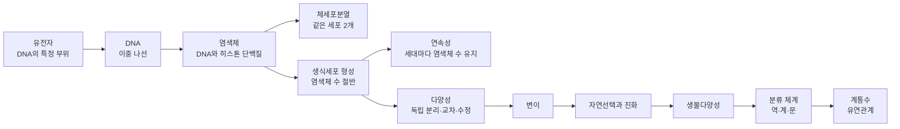
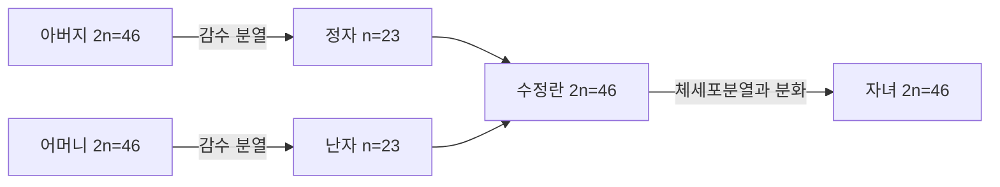
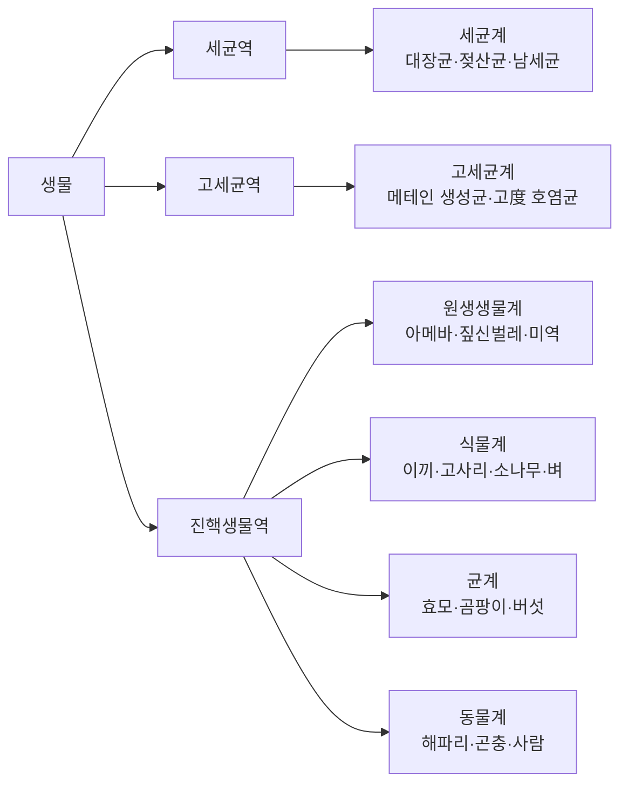
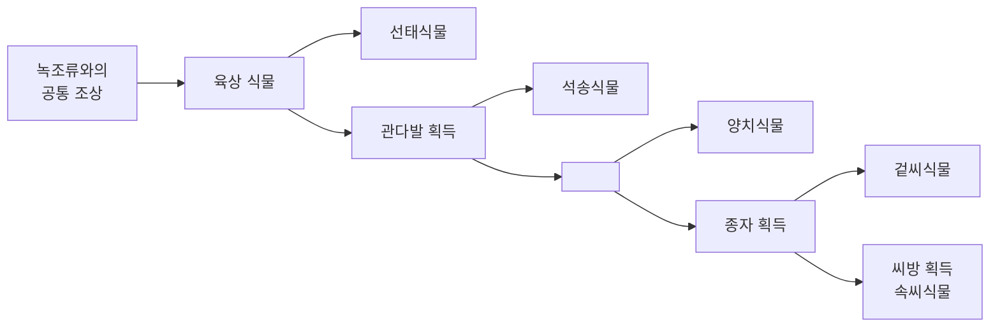
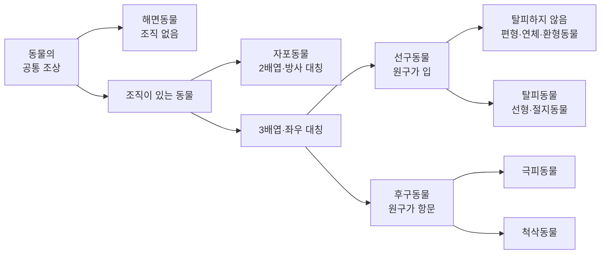
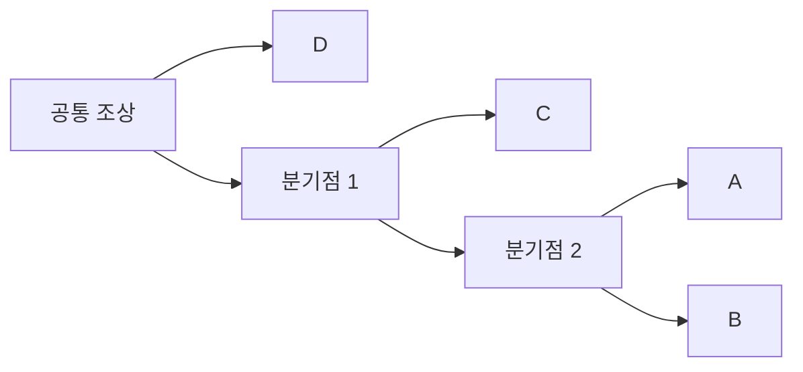

# 생명과학 3. 생명의 연속성과 다양성 — 염색체에서 생명의 나무까지
<!-- prev: m1-02, m3-06, 2-5, 3-6, 4-2 -->
<!-- next: gene-1, cell-1, gene-2 -->

> [!NOTE]
> **성취기준**
> - **[12생과03-01]** 염색체의 구조를 이해하고, DNA, 유전자의 관계를 설명할 수 있다.
> - **[12생과03-02]** 생식세포 형성과정을 체세포분열 과정과 비교하고, 생식세포 형성의 중요성을 생명의 연속성 및 다양성과 관련지어 추론할 수 있다.
> - **[12생과03-03]** 생물 진화의 원리를 이해하고, 생물 진화 연구의 다양한 사례를 조사하여 협력적으로 소통할 수 있다.
> - **[12생과03-04]** 생물의 분류 체계를 바탕으로 각 분류군의 차이를 이해하고 생물군을 분류 체계에 따라 설명할 수 있다.
> - **[12생과03-05]** 동물과 식물 분류군의 특징을 문 수준에서 이해하고, 생물의 유연관계를 계통수로 나타낼 수 있다.

**학습 목표**

1. 염색체가 DNA와 히스톤 단백질로 이루어진 구조임을 알고, 염색체–DNA–유전자–유전체의 관계를 단계적으로 설명할 수 있다.
2. 체세포분열과 생식세포 형성 과정(감수 분열)을 염색체 수와 DNA양의 변화로 비교할 수 있다.
3. 생식세포 형성이 염색체 수를 세대마다 일정하게 유지하고(연속성), 유전적으로 다양한 자손을 만든다는 것(다양성)을 추론할 수 있다.
4. 변이와 자연선택으로 진화가 일어나는 원리를 알고, 진화의 증거와 연구 사례를 조사하여 소통할 수 있다.
5. 3역 6계의 분류 체계에 따라 생물군을 설명하고, 식물과 동물의 주요 문의 특징을 비교할 수 있다.
6. 자료를 바탕으로 생물의 유연관계를 계통수로 나타내고 해석할 수 있다.

**이 단원의 학습 사다리**

| 단계 | 무엇을 하나? |
|---|---|
| STEP 1. 이전 학습 다시 보기 | 중1 분류, 중3 세포분열과 유전, 통합과학 DNA 구조·유전자·진화를 다시 본다 |
| STEP 2. 기초 다지기 | 경우의 수(2의 거듭제곱), 상대량 그래프, 비율 변화, 나무 그림 읽기를 준비한다 |
| STEP 3. 핵심 개념 | 염색체–DNA–유전자 → 체세포분열과 생식세포 형성 → 진화의 원리 → 분류 체계 → 문 수준의 특징과 계통수 |
| STEP 4. 오개념 바로잡기 | "개체가 환경에 맞게 스스로 변한다?", "사람은 침팬지에서 진화했다?" |
| STEP 5. 진로 선택·대학 | 「유전자와 유전물질」의 유전 양상, 염색체 이상, DNA 복제와 분자 계통학으로 |
| STEP 6. 생활·산업·진로 | 핵형 분석과 산전 검사, 항생제 내성 감시, 디지털 생물 분류 |

---

## 🗺️ 단원 들어가기

사람의 체세포 하나에 들어 있는 DNA를 모두 이어 붙이면 길이가 약 2 m나 된다. 그런데 이 DNA가 지름이 수 μm에 불과한 핵 속에 엉키지 않고 들어가 있으며, 세포가 분열할 때마다 정확히 둘로 나뉜다. 어떻게 가능할까?

또 같은 부모에게서 태어난 형제자매는 서로 닮았지만, 일란성 쌍둥이가 아니라면 똑같지는 않다. 부모의 유전 정보가 '그대로 이어지면서도' 자식마다 '조금씩 다른' 비결은 무엇일까? 그리고 그 작은 차이가 수억 년 동안 쌓이면 어떻게 될까?

이 단원은 세포 속 **염색체**라는 작은 구조에서 출발하여, 생식세포를 통해 이어지는 **생명의 연속성**, 변이와 자연선택이 만드는 **진화**, 그리고 그 결과로 나타난 **생물다양성을 분류하고 계통수로 그리는 일**까지 하나의 흐름으로 잇는다.

---

## STEP 1. 🔙 이전 학습 다시 보기

### 연계 개념표

| 이전 단원·성취기준 | 그때 배운 것 | 이 단원에서 확장되는 것 |
|---|---|---|
| 중1 「생물의 구성과 다양성」 [9과02-03], [9과02-04] | 변이와 생물다양성, 종의 개념, 계 수준의 분류 | 분류 단계와 **3역 6계**, 문 수준의 특징, 계통수 |
| 중3 「생식과 유전」 [9과21-02] | 염색체와 유전자, 체세포분열과 생식세포 형성 과정의 염색체 행동 | 염색체의 미세 구조(뉴클레오솜), 핵형, **DNA양 변화**, 다양성이 생기는 원리 |
| 통합과학1 「지각과 생명체 구성 물질의 규칙성」 [10통과1-02-05] | 뉴클레오타이드가 결합한 DNA 이중 나선 | DNA가 단백질과 함께 응축되어 염색체를 이루는 과정 |
| 통합과학1 「유전자와 단백질」 [10통과1-03-06] | DNA, 유전자, 염색체의 관계, 중심 원리 | 유전자–DNA–염색체–유전체의 **단계적** 관계 |
| 통합과학2 「진화와 생물다양성」 [10통과2-01-02] | 변이, 다윈의 자연선택설, 생물다양성 | 변이의 원인(생식세포 형성과 연결), 진화의 증거, 진화 연구 사례, 분류와 계통 |

### 준비 운동 (사전 진단)

**Q1.** 사람의 체세포에 들어 있는 염색체 수와 생식세포에 들어 있는 염색체 수를 쓰시오.

**Q2.** 체세포분열과 생식세포 형성 과정 중 분열 결과 염색체 수가 절반으로 줄어드는 것은?

**Q3.** 다윈의 자연선택설에서 "환경에 유리한 변이를 가진 개체가 더 많이 살아남아 자손을 남긴다"는 과정의 이름은?

**Q4.** 중학교에서 배운 생물의 5계를 쓰시오.

정답 및 해설

**Q1.** 체세포 46개(23쌍), 생식세포 23개

**Q2.** 생식세포 형성 과정(감수 분열)

**Q3.** 자연선택

**Q4.** 원핵생물계, 원생생물계, 균계, 식물계, 동물계 — 이 단원에서는 원핵생물을 세균과 고세균으로 나누어 **3역 6계**로 확장한다.

---

## STEP 2. 🧱 기초 다지기

### ① 2의 거듭제곱 — 경우의 수가 폭발한다

선택지가 2가지인 결정을 $n$번 독립적으로 하면 가능한 경우는 $2^n$가지이다. 동전 3개를 던지면 $2^3 = 8$가지, 10개를 던지면 $2^{10} = 1024$가지이다. 생식세포를 만들 때 상동 염색체 쌍마다 어느 쪽이 들어갈지 '동전 던지기'가 일어나므로, 이 계산이 유전적 다양성의 크기를 알려 준다.

### ② 상대량 그래프 읽기

세포 1개당 DNA양을 '상대량'으로 나타내면, 분열 전 복제로 2배가 되고 분열할 때마다 절반으로 줄어든다. 그래프에서는 **계단이 올라가는 곳(복제)** 과 **내려가는 곳(분열)** 을 찾는 것이 핵심이다.

### ③ 비율의 변화로 진화 읽기

진화는 집단 안에서 어떤 형질을 가진 개체의 **비율이 세대를 거치며 변하는 것**이다. 개체 수 자체보다 '전체 중 몇 %인가'를 계산하는 습관을 들이자.

$$
\text{비율}(\%) = \frac{\text{그 형질을 가진 개체 수}}{\text{집단 전체 개체 수}} \times 100
$$

### ④ 나무 그림(계통수) 읽기

계통수에서 가지가 갈라지는 점(분기점)은 **공통 조상**을 뜻한다. 두 생물이 **최근의 공통 조상을 공유할수록**(분기점이 가까울수록) 유연관계가 가깝다. 가지 끝의 좌우 배치는 바꿔도 의미가 같다. 모빌의 가지를 돌려도 연결 구조는 그대로인 것과 같다.

---

## STEP 3. 📘 핵심 개념

### ① 염색체, DNA, 유전자 — 단계적으로 이해하기 [12생과03-01]

#### (1) 염색체의 구조

**DNA(deoxyribonucleic acid)** 는 뉴클레오타이드가 길게 연결된 두 가닥이 꼬인 이중 나선 분자이다. 이 긴 DNA가 핵 속에 들어가기 위해 단백질과 함께 단계적으로 감기고 접힌다.

| 단계 | 구조 | 비유 |
|---|---|---|
| ① DNA 이중 나선 | 두 가닥의 폴리뉴클레오타이드 | 긴 실 |
| ② **뉴클레오솜** | DNA가 **히스톤** 단백질 덩어리를 감은 구조. 실에 꿴 구슬처럼 이어진다 | 실을 감은 실패 |
| ③ **염색사** | 뉴클레오솜이 이어진 실 모양 구조. 분열하지 않는 세포의 핵 속에 풀어진 상태로 있다 | 실패가 이어진 줄 |
| ④ **염색체** | 세포가 분열할 때 염색사가 여러 번 꼬이고 응축되어 굵고 짧아진 구조. 광학 현미경으로 보인다 | 줄을 촘촘히 감아 묶은 꾸러미 |

분열 중인 세포에서 관찰되는 염색체는 X자 모양이다. 이것은 복제된 두 DNA가 각각 응축된 **염색 분체** 2개가 **동원체**에서 붙어 있는 것이다. 두 염색 분체는 복제로 만들어졌으므로 유전 정보가 같다.

> [!TIP]
> 💡 **비유** — 이어폰 줄을 그냥 주머니에 넣으면 엉키지만, 실패에 감아 두면 엉키지 않고 옮기기도 쉽다. 세포는 평소에는 DNA를 풀어 두고(염색사) 필요한 유전자를 읽다가, 분열할 때는 단단히 감아(염색체) 두 딸세포에 정확히 나누어 준다.

#### (2) 유전자와 유전체

| 개념 | 뜻 | 사람의 예 |
|---|---|---|
| **유전자(gene)** | DNA 중 특정 형질에 대한 유전 정보(주로 단백질 정보)를 담은 특정 부위 | 혈액형을 결정하는 유전자, 헤모글로빈 유전자 |
| **DNA** | 유전 정보를 저장하는 물질. 한 분자에 많은 유전자가 들어 있다 | 염색체 하나(염색 분체 하나)에 DNA 한 분자 |
| **염색체** | DNA와 히스톤 단백질로 이루어진 구조 | 체세포에 46개 |
| **유전체(genome)** | 한 생물이 가진 유전 정보 전체(생식세포 1개 분량의 염색체 한 세트에 담긴 정보를 기준으로 함) | 약 30억 염기쌍, 단백질을 지정하는 유전자 약 2만 개 |

정리하면 **유전자 ⊂ DNA ⊂ 염색체**이고, 한 세트의 염색체에 담긴 모든 정보가 **유전체**이다. DNA에는 유전자가 아닌 부분도 많아서, 사람 DNA 중 단백질 정보를 직접 담은 부분은 매우 적은 비율에 불과하다.

#### (3) 상동 염색체와 핵형

- **상동 염색체**: 체세포에서 크기와 모양이 같은 한 쌍의 염색체. 하나는 아버지, 하나는 어머니에게서 물려받는다. 상동 염색체의 같은 위치에는 같은 형질을 결정하는 유전자(**대립유전자**)가 있다. 대립유전자는 같을 수도(예: A와 A), 다를 수도(예: A와 a) 있다.
- **핵형**: 한 생물이 가진 염색체의 수, 모양, 크기 등의 특징. 같은 종이면 핵형이 같다.
- **상염색체와 성염색체**: 사람의 체세포는 남녀에게 공통인 **상염색체** 22쌍(44개)과 성별을 결정하는 **성염색체** 1쌍(여자 XX, 남자 XY)으로 이루어진다.

| 표기 | 뜻 | 사람 |
|---|---|---|
| $2n$ | 상동 염색체가 쌍으로 있는 **2배체** 세포의 염색체 수 | 체세포 $2n = 46$ |
| $n$ | 상동 염색체 중 하나씩만 있는 **단상(반수체)** 세포의 염색체 수 | 생식세포 $n = 23$ |
| 핵형 표기 | 염색체 수, 성염색체 | 여자 $44 + \mathrm{XX}$, 남자 $44 + \mathrm{XY}$ |

**여러 생물의 체세포 염색체 수**

| 생물 | 초파리 | 완두 | 벼 | 사람 | 침팬지 | 감자 | 개 |
|---|---|---|---|---|---|---|---|
| $2n$ | 8 | 14 | 24 | 46 | 48 | 48 | 78 |

침팬지와 감자처럼 염색체 수가 같아도 핵형(모양·크기)과 유전자는 전혀 다르다. **염색체 수만으로는 생물의 복잡성이나 유연관계를 판단할 수 없다.**

#### 예제 1 — 핵형 분석 자료 해석

어떤 사람의 체세포 핵형을 분석했더니, 크기와 모양이 같은 염색체 쌍이 22쌍 있었고, 나머지 두 염색체는 크기가 서로 크게 달랐다. (1) 이 사람의 성별은? (2) 이 사람의 생식세포가 가질 수 있는 성염색체를 모두 쓰시오. (3) 이 사람의 생식세포 1개에 들어 있는 상염색체 수는?

**풀이**
(1) 성염색체 두 개의 크기가 다르므로 X와 Y이다 → **남자**
(2) 생식세포 형성 과정에서 상동 염색체(X와 Y)가 나뉘므로 **X 또는 Y**를 가진다.
(3) 상염색체 22쌍 중 하나씩 들어가므로 **22개**(전체 염색체는 $22 + 1 = 23$개)

### ② 체세포분열과 생식세포 형성 [12생과03-02]

#### (1) 세포 주기와 체세포분열

세포가 분열을 마친 뒤 다음 분열을 마칠 때까지의 과정을 **세포 주기**라 한다. 세포 주기는 **간기**(G₁기 → S기 → G₂기)와 **분열기**(M기)로 나뉜다.

| 시기 | 일어나는 일 |
|---|---|
| G₁기 | 세포가 생장하고 단백질 등을 합성한다 |
| S기 | **DNA가 복제**되어 DNA양이 2배가 된다 |
| G₂기 | 분열을 준비한다 |
| M기 | 핵분열(전기 → 중기 → 후기 → 말기)과 세포질 분열 |

**체세포분열의 핵분열 단계**

| 단계 | 염색체의 행동 |
|---|---|
| 전기 | 염색사가 응축되어 염색체가 나타나고, 핵막이 사라지며, 방추사가 만들어진다 |
| 중기 | 염색체가 세포 중앙(적도면)에 배열된다. 염색체를 관찰하기 가장 좋은 시기 |
| 후기 | 방추사에 끌려 **염색 분체가 분리**되어 양 끝으로 이동한다 |
| 말기 | 핵막이 다시 생기고 염색체가 염색사로 풀어진다. 세포질 분열이 일어난다 |

결과: 모세포와 **염색체 수와 유전 정보가 같은 딸세포 2개**가 생긴다($2n \to 2n$). 생장, 상처 회복, 단세포 생물의 번식에 쓰인다.

#### (2) 생식세포 형성 과정 — 감수 분열

**감수 분열(meiosis)** 은 생식 기관에서 생식세포를 만들 때 일어나며, DNA 복제 1회 뒤 **연속 2회 분열**한다.

| 단계 | 감수 1분열 | 감수 2분열 |
|---|---|---|
| 전기 | **상동 염색체끼리 붙어 2가 염색체** 형성. 이때 상동 염색체의 염색 분체 일부가 서로 바뀌는 **교차**가 일어날 수 있다 | 염색체가 다시 응축(DNA 복제 없음) |
| 중기 | 2가 염색체가 적도면에 배열 | 염색체가 적도면에 배열 |
| 후기 | **상동 염색체가 분리**되어 양 끝으로 이동 | **염색 분체가 분리**되어 양 끝으로 이동 |
| 결과 | 염색체 수 절반($2n \to n$), 세포 2개 | 염색체 수 변화 없음($n \to n$), 세포 4개 |

#### (3) 체세포분열과 생식세포 형성 비교

| 비교 항목 | 체세포분열 | 생식세포 형성(감수 분열) |
|---|---|---|
| 일어나는 곳 | 몸의 체세포(생장점, 형성층, 피부 등) | 생식 기관(정소, 난소, 꽃밥, 밑씨) |
| 분열 횟수 | 1회 | 연속 2회 |
| 2가 염색체·교차 | 없음 | 감수 1분열 전기에 있음 |
| 분리되는 것 | 염색 분체 | 1분열: 상동 염색체 / 2분열: 염색 분체 |
| 딸세포 수 | 2개 | 4개 |
| 염색체 수 변화 | $2n \to 2n$ (유지) | $2n \to n$ (절반) |
| 딸세포의 유전 정보 | 모세포와 같다 | 모세포와 다르고, 딸세포끼리도 다양하다 |
| 의의 | 생장, 재생, 무성 생식 | 유성 생식, 연속성과 다양성 |

#### 예제 2 — 염색체 수와 DNA양 추적하기

$2n = 4$인 동물 세포가 생식세포를 만드는 과정이다. 표의 빈칸을 채우시오. (DNA양은 G₁기 세포를 2로 한 상대량)

| 시기 | 세포 1개의 염색체 수 | 세포 1개의 염색 분체 수 | 세포 1개의 DNA 상대량 |
|---|---|---|---|
| G₁기 | 4 | (가) | 2 |
| 감수 1분열 중기 | 4 | 8 | (나) |
| 감수 1분열이 끝난 직후 | (다) | 4 | 2 |
| 감수 2분열이 끝난 직후(생식세포) | 2 | (라) | (마) |

**풀이**
- (가) G₁기에는 아직 복제 전이므로 염색체 1개 = DNA 1분자. 염색 분체로 나뉘어 있지 않으므로 '염색체 1개 = 염색 분체 1개'로 세어 **4**
- (나) S기에 복제되어 **4**
- (다) 상동 염색체가 분리되어 염색체 수가 절반 → **2**
- (라) 염색 분체가 분리되어 각 염색체가 염색 분체 1개로 → **2**
- (마) DNA양은 다시 절반 → **1**

DNA 상대량은 $2 \xrightarrow{\text{복제}} 4 \xrightarrow{\text{1분열}} 2 \xrightarrow{\text{2분열}} 1$로 변한다. 체세포분열은 $2 \to 4 \to 2$로 한 번만 줄어든다.

#### (4) 생식세포 형성의 의미 ① — 연속성

생식세포의 염색체 수가 $n$이므로, 수정으로 만들어진 수정란은 다시 $n + n = 2n$이 된다. 감수 분열이 없다면 세대마다 염색체 수가 2배씩 늘어날 것이다($46 \to 92 \to 184 \ldots$). 감수 분열 덕분에 **세대가 바뀌어도 종의 염색체 수가 일정하게 유지**된다.

#### (5) 생식세포 형성의 의미 ② — 다양성

| 다양성의 원인 | 원리 | 크기 |
|---|---|---|
| **상동 염색체의 독립적 분리** | 감수 1분열 중기에 상동 염색체 쌍들이 서로 독립적으로 배열되어, 쌍마다 아버지·어머니 쪽 중 어느 것이 들어갈지 무작위로 정해진다 | 사람($n = 23$): $2^{23} =$ 약 839만 가지 |
| **교차** | 2가 염색체에서 상동 염색체의 일부가 교환되어 새로운 유전자 조합의 염색체가 생긴다 | 경우의 수를 훨씬 더 늘린다 |
| **무작위 수정** | 다양한 정자와 다양한 난자가 무작위로 만난다 | 교차 없이도 $2^{23}\times 2^{23}$ = 약 70조 가지 |

#### 예제 3 — 생식세포 조합의 수

(1) $2n = 6$인 생물에서 교차가 일어나지 않는다면, 한 개체가 만들 수 있는 생식세포의 염색체 조합은 몇 가지인가? (2) 사람의 경우는 몇 가지인가? (3) 두 사람 사이에서 교차 없이 생길 수 있는 수정란의 염색체 조합은 대략 몇 가지인가?

**풀이**
(1) 상동 염색체가 3쌍이므로 $2^3 = 8$가지
(2) $2^{23} = 8\,388\,608$, 약 839만 가지
(3) $2^{23}\times 2^{23} = 2^{46} \approx 7.0\times 10^{13}$, 약 70조 가지 — 지구 인구(약 80억 명)보다 훨씬 많다. 그래서 일란성 쌍둥이가 아닌 형제자매는 유전적으로 같을 가능성이 사실상 없다.

> [!IMPORTANT]
> 생식세포 형성은 **같음(연속성)** 과 **다름(다양성)** 을 동시에 만든다. 염색체 수는 정확히 유지되지만, 유전자 조합은 매번 새로워진다. 이 다양성은 다음 소절에서 다룰 **자연선택의 재료(변이)** 가 된다.

### ③ 생물 진화의 원리 [12생과03-03]

#### (1) 변이 — 진화의 재료

같은 종의 개체 사이에 나타나는 형질의 차이를 **변이**라 한다.

| 변이의 종류 | 원인 | 유전되는가? | 예 |
|---|---|---|---|
| 유전적 변이 | DNA의 돌연변이, 생식세포 형성 과정의 독립적 분리·교차, 무작위 수정 | 유전된다 → **진화의 재료** | 무당벌레 등 무늬의 다양성, 혈액형 |
| 환경적 변이(비유전적) | 먹이, 햇빛, 운동 등 환경 차이 | 유전되지 않는다 | 운동으로 커진 근육, 햇볕에 탄 피부 |

#### (2) 다윈의 자연선택설

다윈은 갈라파고스 제도 등을 탐사하며 관찰한 내용과 맬서스의 인구론 등에서 영향을 받아 『종의 기원』(1859)에서 자연선택설을 발표하였다.

> [!WARNING]
> 자연선택은 **개체**에 작용하지만, 진화는 **집단**에서 일어난다. 한 개체가 살아 있는 동안 형질을 바꾸는 것이 아니라, 유리한 형질을 가진 개체가 자손을 **더 많이** 남겨서 집단 속 그 형질의 비율이 세대를 거치며 높아지는 것이다. 다윈 시대에는 유전의 원리를 몰랐으나, 오늘날에는 유전자와 생식세포 형성 과정으로 변이의 원인을 설명한다.

#### 예제 4 — 세대에 따른 형질 비율의 변화

어떤 나방 집단에서 밝은 색 나방이 900마리, 어두운 색 나방이 100마리였다. 공장 매연으로 나무껍질이 검게 변한 뒤, 새에게 잡아먹히지 않고 번식하는 비율이 한 세대마다 밝은 색은 50%, 어두운 색은 80%가 되었다. 살아남은 개체가 같은 형질의 자손을 같은 수만큼 남긴다고 가정할 때(설명을 위한 단순 모형), 1세대 뒤와 3세대 뒤 어두운 색 나방의 비율을 구하시오.

**풀이**
- 1세대 뒤: 밝은 색 $900\times0.5 = 450$, 어두운 색 $100\times0.8 = 80$ → $\dfrac{80}{530}\times100 \approx 15.1\%$
- 2세대 뒤: $450\times0.5 = 225$, $80\times0.8 = 64$ → $\dfrac{64}{289}\times100 \approx 22.1\%$
- 3세대 뒤: $225\times0.5 = 112.5$, $64\times0.8 = 51.2$ → $\dfrac{51.2}{163.7}\times100 \approx 31.3\%$

10%였던 어두운 색 나방의 비율이 3세대 만에 약 31%로 높아졌다. 개체 수가 아니라 **비율의 변화**가 진화이다. (실제로 영국에서는 산업 혁명 이후 어두운 색 회색가지나방의 비율이 높아졌다가, 대기 오염이 줄어들자 다시 낮아졌다.)

#### (3) 진화의 증거

| 증거 | 내용 | 예 |
|---|---|---|
| 화석 | 지층의 순서에 따라 생물이 단순한 것에서 복잡한 것으로, 중간 형태를 거쳐 변해 온 기록 | 시조새(파충류와 조류의 특징), 틱타알릭(어류와 네발동물의 중간 형태), 말의 화석 |
| 비교해부학 | **상동 기관**: 기원은 같지만 기능이 달라진 기관(공통 조상의 증거) / **상사 기관**: 기원은 다르지만 기능이 비슷한 기관(비슷한 환경에 적응) / **흔적 기관**: 기능이 없거나 약해진 기관 | 상동: 사람의 팔·고래의 가슴지느러미·박쥐의 날개 / 상사: 새의 날개와 곤충의 날개 / 흔적: 사람의 꼬리뼈, 고래의 뒷다리뼈 흔적 |
| 진화발생학 | 서로 다른 척추동물도 발생 초기의 배아는 아가미 틈, 꼬리 등 비슷한 구조를 가진다 | 어류·조류·포유류의 초기 배아 비교 |
| 분자진화학 | 공통 조상에서 갈라진 지 오래될수록 DNA 염기 서열과 단백질 아미노산 서열의 차이가 크다 | 사람과 침팬지는 DNA 서열이 매우 비슷하다 |
| 생물지리학 | 지리적으로 격리된 지역에는 그곳에만 사는 고유종이 진화한다 | 갈라파고스 핀치, 오스트레일리아의 유대류 |

#### (4) 진화 연구의 다양한 사례

| 사례 | 무엇을 관찰했나 | 진화 원리로 해석하기 |
|---|---|---|
| 갈라파고스 핀치의 부리 | 1970년대 대프니메이저섬에 가뭄이 들어 작은 씨가 줄어들자, 이후 세대에서 평균 부리 크기가 커졌다(그랜트 부부의 장기 연구) | 크고 단단한 씨를 깰 수 있는 큰 부리 개체가 더 많이 살아남아 번식 |
| 항생제 내성 세균 | 항생제를 자주 쓰는 환경에서 내성 세균의 비율이 높아졌다 | 원래 있던 내성 변이 세균이 항생제 속에서 선택됨 |
| 살충제 내성 해충 | 같은 살충제를 반복해서 쓰면 효과가 떨어진다 | 내성 변이를 가진 해충이 살아남아 번식 |
| 낫 모양 적혈구 형질 | 말라리아가 흔한 지역에서 이 유전자를 하나만 가진 사람의 비율이 비교적 높다 | 해당 유전자를 하나 가진 사람이 말라리아에 더 잘 견뎌 선택됨 |
| 실험실 대장균 장기 진화 실험 | 수만 세대 동안 배양한 대장균 집단에서 새로운 대사 능력이 나타난 사례가 보고되었다 | 돌연변이와 선택이 실시간으로 관찰됨 |

자연선택이 오래 이어지고, 집단이 산맥·바다 등으로 **지리적으로 격리**되어 서로 교배하지 못하게 되면, 각 집단은 다른 방향으로 진화하여 결국 새로운 종이 생길 수 있다(**종분화**). 이렇게 생긴 종들이 쌓여 오늘날의 생물다양성이 되었다.

> [!TIP]
> 💡 **협력적 소통 요령** — 진화 사례를 조사·발표할 때는 ① 어떤 **변이**가 있었나 ② 어떤 **환경 요인**이 선택했나 ③ 세대가 지나며 **어떤 비율**이 어떻게 변했나 ④ 그 근거가 된 **자료**(관찰, 측정, 화석, DNA)는 무엇인가를 표로 정리해 공유하면 모둠마다 다른 사례를 같은 틀로 비교할 수 있다.

### ④ 생물의 분류 체계 — 역과 계 [12생과03-04]

#### (1) 종과 분류 단계

**종(species)** 은 생물 분류의 기본 단위로, 자연 상태에서 서로 교배하여 **생식 능력이 있는 자손**을 낳을 수 있는 개체들의 무리이다. 말과 당나귀 사이에서 태어난 노새는 생식 능력이 없으므로 말과 당나귀는 다른 종이다.

분류 단계는 **종 < 속 < 과 < 목 < 강 < 문 < 계 < 역** 순으로 커진다.

| 분류 단계 | 사람 | 호랑이 |
|---|---|---|
| 역 | 진핵생물역 | 진핵생물역 |
| 계 | 동물계 | 동물계 |
| 문 | 척삭동물문 | 척삭동물문 |
| 강 | 포유강 | 포유강 |
| 목 | 영장목 | 식육목 |
| 과 | 사람과 | 고양이과 |
| 속 | 사람속(*Homo*) | 표범속(*Panthera*) |
| 종 | 사람(*Homo sapiens*) | 호랑이(*Panthera tigris*) |

종의 학명은 린네가 체계화한 **이명법**에 따라 **속명 + 종소명**으로 쓰며, 라틴어로 기울여 쓴다. 나라마다 다른 이름 대신 학명을 쓰면 전 세계 과학자가 같은 생물을 정확히 가리킬 수 있다. 사람과 호랑이는 '강'까지 같으므로 유연관계가 어느 정도 가깝지만, '목'에서 갈라진다.

#### (2) 3역 6계 분류 체계

현재 널리 쓰이는 분류 체계는 생물을 크게 세 개의 **역(domain)** 으로 나누고, 그 아래에 여섯 개의 **계(kingdom)** 를 둔다.

| 역 | 계 | 핵막 | 세포 수 | 영양 방식 | 예 |
|---|---|---|---|---|---|
| 세균역 | 세균계 | 없음(원핵세포) | 단세포 | 독립 영양 또는 종속 영양 | 대장균, 젖산균, 남세균, 결핵균 |
| 고세균역 | 고세균계 | 없음(원핵세포) | 단세포 | 독립 영양 또는 종속 영양 | 메테인 생성균, 극한 호염균, 극한 호열균 |
| 진핵생물역 | 원생생물계 | 있음 | 단세포 또는 다세포(기관 분화가 거의 없음) | 독립 영양 또는 종속 영양 | 아메바, 짚신벌레, 유글레나, 미역, 김 |
| 진핵생물역 | 식물계 | 있음 | 다세포 | 광합성(독립 영양) | 우산이끼, 고사리, 소나무, 벼 |
| 진핵생물역 | 균계 | 있음 | 대부분 다세포(효모는 단세포) | 흡수(종속 영양) | 효모, 푸른곰팡이, 버섯 |
| 진핵생물역 | 동물계 | 있음 | 다세포 | 섭취(종속 영양) | 해파리, 지렁이, 곤충, 사람 |

- **세균**과 **고세균**은 모두 핵막이 없는 원핵생물이지만, 유전자를 비교해 보면 서로 매우 다르며, 고세균은 일부 특징이 오히려 진핵생물과 더 비슷하다. 그래서 원핵생물을 하나의 계로 묶지 않고 두 역으로 나눈다.
- 고세균 중에는 온천, 염전, 심해 열수구처럼 **극한 환경**에 사는 것이 많다.

> [!NOTE]
> 이 과목에서는 분류 체계를 **역과 계 수준**에서 다루며, 역과 계를 나누는 세부적인 분류 기준(세포벽 성분, 막 지질의 구조 등)은 다루지 않는다.

#### 예제 5 — 분류 체계에 따라 설명하기

다음 생물 (가)~(라)가 속한 역과 계를 쓰시오.
(가) 핵막이 없는 단세포 생물로, 요구르트를 만들 때 쓰인다.
(나) 핵막이 있고 엽록체를 가진 다세포 생물이지만 뿌리·줄기·잎의 구분이 없다. 바다에 산다.
(다) 핵막이 있는 다세포 생물로, 광합성을 하지 못하고 몸 밖에서 양분을 분해하여 흡수한다. 포자로 번식한다.
(라) 핵막이 없는 단세포 생물로, 소금 농도가 매우 높은 염전에서 산다.

**풀이**
(가) 젖산균 → 세균역 세균계
(나) 미역·다시마 같은 갈조류 → 진핵생물역 원생생물계
(다) 버섯·곰팡이 → 진핵생물역 균계
(라) 극한 호염균 → 고세균역 고세균계

### ⑤ 동물과 식물의 분류군 — 문 수준과 계통수 [12생과03-05]

#### (1) 계통수란

**계통수(phylogenetic tree)** 는 생물의 진화 경로와 유연관계를 나뭇가지 모양으로 나타낸 그림이다. 공통 조상에서 갈라져 나온 순서를 보여 주며, 형태적 특징, 발생 과정, DNA·단백질 서열 등을 근거로 그린다.

#### (2) 식물의 주요 분류군

식물은 물속에 살던 **녹조류**(차축조류)와 공통 조상을 가진 것으로 여겨지며, 육상 생활에 적응하면서 **관다발 → 종자 → 씨방(꽃과 열매)** 을 차례로 갖게 되었다.

| 분류군(문) | 관다발 | 번식 | 특징 | 예 |
|---|---|---|---|---|
| **선태식물** | 없음 | 포자 | 뿌리·줄기·잎의 구분이 뚜렷하지 않고 헛뿌리로 몸을 고정. 몸 표면으로 물을 흡수하여 습한 곳에 산다 | 솔이끼, 우산이끼, 뿔이끼 |
| **석송식물** | 있음 | 포자 | 관다발이 있는 비종자식물. 잎이 작고 단순하다 | 석송, 부처손 |
| **양치식물** | 있음 | 포자 | 관다발이 발달하여 크게 자랄 수 있다. 잎 뒷면에 포자낭이 모여 있다 | 고사리, 고비, 쇠뜨기 |
| **겉씨식물** | 있음 | 종자 | 씨방이 없어 **밑씨가 겉으로 드러나 있다**. 대부분 바람으로 꽃가루받이 | 소나무, 은행나무, 소철 |
| **속씨식물** | 있음 | 종자 | **씨방이 밑씨를 감싸고** 있으며, 꽃이 피고 씨방이 자라 열매가 된다 | 벼, 옥수수(외떡잎), 장미, 콩(쌍떡잎) |

> [!TIP]
> 💡 **요령** — 식물 계통수는 "물을 나르는 관(관다발) → 건조에 견디는 씨(종자) → 씨를 감싸는 방(씨방)"처럼 **육지 생활에 필요한 장치를 하나씩 얻은 순서**로 기억하면 쉽다. 새 장치가 생긴 분기점 뒤쪽의 모든 분류군은 그 장치를 공유한다.

#### (3) 동물의 주요 분류군

동물 분류군은 **배엽의 수**, **몸의 대칭성**, **원구가 입이 되는가 항문이 되는가**(선구·후구), 그리고 **탈피 여부** 같은 발생·구조적 특징으로 계통을 나눈다.

| 분류군(문) | 배엽 | 대칭 | 특징 | 예 |
|---|---|---|---|---|
| **해면동물** | 없음(조직 없음) | 없음 | 몸에 구멍이 많고 물을 통과시켜 먹이를 걸러 먹는다 | 해면 |
| **자포동물** | 2배엽 | 방사 대칭 | 촉수에 독침이 든 자포가 있다. 입과 항문이 구분되지 않는다 | 해파리, 말미잘, 히드라, 산호 |
| **편형동물** | 3배엽 | 좌우 대칭 | 몸이 납작하다. 항문이 없다 | 플라나리아, 촌충 |
| **연체동물** | 3배엽 | 좌우 대칭 | 몸이 부드럽고 외투막이 있다. 대부분 패각(껍데기)을 가진다 | 달팽이, 조개, 오징어, 문어 |
| **환형동물** | 3배엽 | 좌우 대칭 | 몸이 여러 개의 고리 모양 마디로 되어 있다 | 지렁이, 거머리, 갯지렁이 |
| **선형동물** | 3배엽 | 좌우 대칭 | 몸이 가늘고 길며 마디가 없다. 큐티클을 벗는 **탈피**를 한다 | 회충, 예쁜꼬마선충 |
| **절지동물** | 3배엽 | 좌우 대칭 | 몸과 다리에 마디가 있고 키틴질 외골격을 가진다. 탈피하며 자란다. 동물 중 종 수가 가장 많다 | 곤충, 거미, 가재, 지네 |
| **극피동물** | 3배엽 | 성체는 방사 대칭(유생은 좌우 대칭) | 피부에 석회질 가시나 골편이 있다. 수관계로 움직인다 | 불가사리, 성게, 해삼 |
| **척삭동물** | 3배엽 | 좌우 대칭 | 발생 과정 중 **척삭**이 나타난다. 척추동물은 척삭이 척추로 대체된다 | 멍게, 창고기, 어류, 양서류, 파충류, 조류, 포유류 |

> [!IMPORTANT]
> 불가사리(극피동물)는 겉모습이 해파리(자포동물)처럼 방사 대칭이지만, 계통수에서는 해파리보다 **사람(척삭동물)과 더 가깝다.** 둘 다 원구가 항문이 되는 후구동물이고, 극피동물의 유생은 좌우 대칭이다. 겉모습보다 **발생 과정과 유전 정보**가 유연관계를 더 잘 보여 준다.

#### 예제 6 — 아미노산 서열로 계통수 그리기

어떤 단백질의 아미노산 서열을 생물 A~D에서 비교하여 서로 다른 아미노산의 수를 나타낸 가상의 자료이다.

| | A | B | C | D |
|---|---|---|---|---|
| A | — | 2 | 8 | 15 |
| B | 2 | — | 8 | 15 |
| C | 8 | 8 | — | 15 |
| D | 15 | 15 | 15 | — |

(1) 유연관계가 가장 가까운 두 생물은? (2) A~D의 계통수를 가지 구조로 나타내시오. (3) 가장 먼저 다른 생물들과 갈라진 생물은?

**풀이**
(1) 차이가 2로 가장 작은 **A와 B**
(2) A와 B가 가장 최근에 갈라졌고, 그다음 C가, 가장 먼저 D가 갈라졌다. 괄호로 쓰면 $(((A, B), C), D)$이다.

(3) **D** — 다른 세 생물과의 차이가 모두 15로 가장 크다. 공통 조상에서 갈라진 지 오래될수록 서열 차이가 많이 쌓인다.

---

## STEP 4. ⚠️ 오개념 바로잡기

| 흔한 오개념 | 올바른 개념 | 왜 그럴까? |
|---|---|---|
| 유전자와 DNA와 염색체는 같은 말이다 | **유전자 ⊂ DNA ⊂ 염색체**의 포함 관계이다 | 염색체는 DNA + 단백질이고, DNA 한 분자에는 많은 유전자와 유전자가 아닌 부분이 함께 있다 |
| X자 모양 염색체 1개는 상동 염색체 한 쌍이다 | X자 모양은 복제된 **염색 분체 2개**가 동원체로 붙은 **염색체 1개**이다 | 상동 염색체는 부모에게서 하나씩 받은 별개의 두 염색체이다 |
| 생식세포는 모두 똑같은 유전 정보를 가진다 | 독립적 분리와 교차로 생식세포마다 **유전자 조합이 다르다** | 사람은 교차 없이도 약 839만 가지 조합의 생식세포를 만들 수 있다 |
| 기린은 높은 잎을 먹으려고 목을 늘여 긴 목을 갖게 되었다 | 원래 목 길이에 **변이**가 있었고, 목이 긴 개체가 더 많이 살아남아 자손을 남겼다 | 살아 있는 동안 얻은 형질(용불용)은 유전되지 않는다. 진화는 집단의 비율 변화이다 |
| 사람은 침팬지에서 진화했다 | 사람과 침팬지는 **공통 조상**에서 갈라져 각자 진화했다 | 계통수의 분기점은 공통 조상을 뜻한다. 현재의 침팬지도 그 뒤로 계속 진화해 왔다 |
| 고세균은 세균의 한 종류이다 | 고세균은 세균과 **다른 역**에 속한다 | 둘 다 핵막이 없지만 유전자 비교에서 서로 매우 다르고, 고세균은 일부 특징이 진핵생물과 비슷하다 |
| 겉모습이 비슷하면 유연관계가 가깝다 | 유연관계는 **공통 조상을 공유한 정도**로 판단한다 | 새와 곤충의 날개처럼 상사 기관은 비슷한 환경에 적응한 결과일 뿐이다. 불가사리는 해파리보다 사람과 더 가깝다 |

---

## STEP 5. 🎓 다음 단계로 한 걸음 더

> [!CAUTION]
> 이 절은 **일반 선택 「생명과학」 교육과정 범위 밖의 심화 내용**으로 평가 대상이 아니다. 이 단원의 개념이 진로 선택 「생물의 유전」, 「세포와 물질대사」와 대학에서 어떻게 이어지는지 맛보기로 보여 준다.

### 진로 선택·대학과의 연결

| 다음 단계 | 이어지는 내용 |
|---|---|
| 「유전자와 유전물질」 (생물의 유전) | 상염색체 유전과 성염색체 유전, 가계도 분석, 다유전자유전, **염색체·유전자 이상**, DNA 구조 규명의 역사, 원핵·진핵 유전체 비교, **반보존적 DNA 복제** |
| 「유전자의 발현」 (생물의 유전) | 세포 분화가 유전자 발현 조절로 일어나는 원리 — 같은 DNA를 가진 체세포가 서로 다른 세포가 되는 이유 |
| 「세포」 (세포와 물질대사) | 원핵세포와 진핵세포의 공통점과 차이점 — 세균·고세균·진핵생물을 세포 구조로 비교 |
| 대학 | 유전학, 세포생물학, 진화생물학, 계통분류학, 생물정보학 |

### ① 감수 분열이 잘못되면 — 염색체 비분리

감수 분열에서 상동 염색체나 염색 분체가 제대로 분리되지 않으면(**비분리**), 염색체가 하나 더 많거나 적은 생식세포가 생긴다. 21번 염색체가 3개인 다운 증후군이 대표적인 예이다. 「유전자와 유전물질」에서는 핵형 분석으로 염색체 이상을 찾고, 비분리가 1분열과 2분열 중 언제 일어났는지 추론한다.

### ② DNA는 어떻게 정확히 복제될까 — 반보존적 복제

S기의 DNA 복제에서 이중 나선의 두 가닥이 풀리고, 각 가닥을 주형으로 상보적인 새 가닥이 만들어진다. 새 DNA는 **헌 가닥 하나와 새 가닥 하나**로 이루어지는데, 이를 반보존적 복제라 한다. 메셀슨과 스탈은 질소 동위 원소를 이용한 실험으로 이를 증명하였다.

### ③ 자연선택만이 진화를 일으키는가

진화생물학에서는 자연선택 외에도 작은 집단에서 우연히 대립유전자 비율이 바뀌는 **유전적 부동**, 집단 사이의 개체 이동에 의한 **유전자 흐름**, **돌연변이** 등이 진화를 일으킨다고 본다. 대학에서는 집단의 대립유전자 빈도를 수식으로 다루는 **집단유전학**을 배운다.

### ④ 분자 계통학과 원생생물계의 재검토

DNA 서열을 대량으로 비교하는 분자 계통학이 발달하면서, '원생생물계'는 공통 조상과 그 모든 자손을 묶은 하나의 무리가 아니라 여러 계통이 섞인 편의상의 묶음이라는 사실이 밝혀졌다. 분류 체계는 새로운 증거에 따라 계속 다듬어지는 **잠정적인** 지식이다.

### 지금 vs 다음 단계

| 주제 | 지금(생명과학) | 다음 단계(생물의 유전·대학) |
|---|---|---|
| 염색체 | 구조, 핵형, 상동 염색체 | 염색체 이상, 성염색체 유전, 유전체 구성 비교 |
| DNA | 유전 정보 저장, 복제로 2배 | 반보존적 복제의 분자 과정 |
| 생식세포 형성 | 연속성과 다양성의 원리 | 유전 양상 분석, 비분리, 연관과 교차 |
| 진화 | 변이와 자연선택 | 집단유전학, 유전적 부동, 분자 진화 |
| 분류 | 3역 6계, 문 수준 특징, 계통수 해석 | 분자 계통학, 계통수 작성 알고리즘 |

---

## STEP 6. 🏭 생활·산업·진로 연결

### 사례 1. 핵형 분석과 유전 상담

- **원리** 분열 중기의 세포에서 염색체를 염색하여 크기·모양·띠무늬로 배열하면 염색체 수와 구조의 이상을 찾을 수 있다.
- **어디에 쓰이나** 산전 검사, 불임 원인 검사, 일부 혈액암 진단. 결과를 해석하고 가족에게 설명하는 **유전 상담**이 함께 이루어진다.

### 사례 2. 항생제 내성 감시

- **원리** 항생제를 쓰면 내성 변이를 가진 세균이 선택되어 늘어난다(자연선택).
- **어디에 쓰이나** 병원과 보건 당국은 내성균의 비율 변화를 지속적으로 감시하고, 항생제를 꼭 필요할 때만 정해진 기간 동안 쓰도록 권고한다. 처방받은 항생제를 임의로 중단하지 않는 것도 내성균 선택을 줄이는 방법이다.

### 사례 3. 디지털 생물 분류와 시민 과학

- **원리** 사진 인식 앱이 식물·곤충의 형태를 비교해 후보 종을 제시하고, DNA 바코딩은 특정 유전자 부위의 서열로 종을 판별한다.
- **어디에 쓰이나** 온라인 식물도감, 생물다양성 조사, 외래종 감시, 수입 식품의 원산지·종 확인.

### 사례 4. 품종 개량과 종자 산업

- **원리** 교배와 생식세포 형성에서 생기는 유전적 다양성 가운데 사람에게 유리한 형질을 골라 남기는 **인위 선택**이다. 자연선택과 원리가 같다.
- **어디에 쓰이나** 병에 강한 벼, 수확량이 많은 작물, 종자 은행의 유전자원 보존.

### 관련 진로와 학과

| 진로 | 하는 일 | 관련 학과 |
|---|---|---|
| 세포유전학자·유전 상담가 | 핵형 분석, 유전 검사 결과 해석과 상담 | 생명과학, 유전학, 의학 |
| 진화생물학자 | 화석·DNA로 진화 과정 연구 | 생명과학, 진화생물학, 지질학 |
| 분류학자·생물다양성 연구원 | 신종 발견, 생물 목록 작성, 계통 분석 | 생명과학, 식물학, 동물학 |
| 생물정보학자 | 유전체 서열 비교, 계통수 작성 프로그램 개발 | 생물정보학, 컴퓨터공학 |
| 육종가 | 작물·가축 품종 개량 | 원예학, 식물자원학, 축산학 |

---

## 🔬 탐구 활동

### 활동 A. 염색체 모형을 이용한 핵형 분석하기

**목표** 사람 염색체 사진(또는 인쇄된 염색체 모형)을 크기와 모양에 따라 배열하여 핵형을 분석하고, 성별과 염색체 이상 여부를 판단한다.

**준비물** 사람 체세포 분열 중기 염색체 인쇄물(46개 내외, 교사가 준비한 정상·이상 자료 각 1종), 가위, 풀, 핵형 배열 기록지(1~22번, X, Y 칸)

**과정**
1. 인쇄물의 염색체를 하나씩 오려 낸다.
2. 크기, 동원체의 위치, 띠무늬가 같은 것끼리 짝을 지어 상동 염색체 쌍을 찾는다.
3. 큰 것부터 1~22번 칸에 붙이고, 남은 염색체를 성염색체 칸에 붙인다.
4. 염색체 수, 성염색체 구성, 수가 다른 염색체 쌍이 있는지 기록한다.

**결과 기록**

| 자료 | 총 염색체 수 | 상염색체 수 | 성염색체 | 이상이 있는 번호 | 핵형 표기 |
|---|---|---|---|---|---|
| 자료 1 | | | | | |
| 자료 2 | | | | | |

**생각해 보기**
1. 상동 염색체를 찾을 때 가장 도움이 된 특징은 무엇이었나?
2. 핵형 분석에 분열 중기의 세포를 쓰는 까닭은?
3. 염색체 수가 정상과 다른 생식세포는 감수 분열의 어느 단계에서 잘못되어 생길 수 있을지 가설을 세워 보자.

> [!WARNING]
> **안전 수칙** 가위를 사용할 때 주의한다. 실제 사람의 핵형 자료는 개인의 민감한 의료 정보이므로, 수업에서는 교육용으로 공개된 자료나 교사가 만든 모형 자료만 사용한다.

### 활동 B. 생식세포 형성 과정을 창의적인 모델로 제작하기

**목표** $2n = 4$인 세포가 생식세포를 만드는 과정을 모델로 표현하고, 독립적 분리와 교차가 다양성을 만드는 원리를 설명한다.

**준비물** 두 가지 색의 모루(또는 클레이·빨대), 자석 단추(동원체), A3 종이, 스마트폰(정지 화면 촬영 앱 또는 간단한 애니메이션 앱)

**과정**
1. 아버지 쪽은 파란색, 어머니 쪽은 빨간색으로 크기가 다른 상동 염색체 2쌍을 만든다.
2. 복제(염색 분체 2개) → 2가 염색체 형성 → 교차(색 일부 교환) → 감수 1분열 → 감수 2분열을 단계마다 배치하고 사진을 찍는다.
3. 감수 1분열 중기의 배열을 바꾸어 다시 진행하고, 생식세포의 색 조합이 어떻게 달라지는지 비교한다.
4. 사진을 이어 짧은 애니메이션으로 만들고 단계마다 설명 자막을 넣는다.

**결과 기록**

| 조건 | 만들어진 생식세포의 색 조합 | 조합의 가짓수 |
|---|---|---|
| 교차 없음, 배열 1 | | |
| 교차 없음, 배열 2 | | |
| 교차 있음 | | |

**생각해 보기**
1. 교차 없이 만들 수 있는 생식세포 조합은 몇 가지였나? $2^n$과 비교해 보자.
2. 같은 모델로 체세포분열을 표현하려면 어떤 단계를 빼야 할까?

> [!WARNING]
> **안전 수칙** 모루의 철사 끝이 날카로울 수 있으므로 끝을 접어서 사용한다.

---

## ✅ 개념 확인 문제

### 기본

**1.** 다음을 크기가 작은 것부터 순서대로 나열하시오.
ㄱ. 염색체 ㄴ. 유전자 ㄷ. 뉴클레오솜 ㄹ. 뉴클레오타이드

정답 및 해설

**정답** ㄹ → ㄴ → ㄷ → ㄱ

뉴클레오타이드가 연결되어 DNA를 이루고, 그 DNA의 특정 부위가 유전자이다. 유전자 하나는 보통 수백~수천 개 이상의 염기쌍으로 이루어져 뉴클레오솜 하나에 감긴 DNA보다 길다. DNA가 히스톤을 감아 뉴클레오솜을 이루고, 뉴클레오솜이 응축되어 염색체가 된다. (유전자와 뉴클레오솜은 기준에 따라 비교가 애매할 수 있으나, 일반적인 유전자의 길이가 뉴클레오솜 하나에 감긴 DNA보다 훨씬 길다.)

**2.** 사람 남자의 체세포 핵형을 '상염색체 수 + 성염색체' 형식으로 쓰고, 이 사람의 정자가 가지는 염색체 수를 쓰시오.

정답 및 해설

**정답** $44 + \mathrm{XY}$, 정자의 염색체 수는 23개($22 + \mathrm{X}$ 또는 $22 + \mathrm{Y}$)

**3.** 체세포분열과 비교한 생식세포 형성 과정의 특징으로 옳은 것을 모두 고르시오.
ㄱ. 2가 염색체가 형성된다. ㄴ. 분열 결과 딸세포의 염색체 수가 모세포와 같다. ㄷ. 연속 2회 분열한다. ㄹ. 감수 1분열 후기에 상동 염색체가 분리된다.

정답 및 해설

**정답 ㄱ, ㄷ, ㄹ**

생식세포 형성 과정의 결과 염색체 수는 모세포의 절반이 된다(ㄴ 틀림).

**4.** 생물 분류의 기본 단위인 '종'의 정의를 쓰고, 다음 생물을 3역 중 어느 역에 속하는지 쓰시오. (1) 대장균 (2) 효모 (3) 메테인 생성균

정답 및 해설

**정답** 종: 자연 상태에서 교배하여 생식 능력이 있는 자손을 낳을 수 있는 개체들의 무리
(1) 세균역 (2) 진핵생물역(균계) (3) 고세균역

### 응용

**5.** $2n = 8$인 동물의 G₁기 세포 1개의 DNA양을 2라고 할 때, (1) 감수 1분열 중기 세포, (2) 감수 2분열 중기 세포, (3) 생식세포 1개의 염색체 수와 DNA 상대량을 각각 쓰시오.

정답 및 해설

**정답**

| 시기 | 염색체 수 | DNA 상대량 |
|---|---|---|
| (1) 감수 1분열 중기 | 8 | 4 |
| (2) 감수 2분열 중기 | 4 | 2 |
| (3) 생식세포 | 4 | 1 |

S기에 DNA가 복제되어 4가 되고, 감수 1분열에서 상동 염색체가 분리되어 염색체 수와 DNA양이 절반이 되며, 감수 2분열에서 염색 분체가 분리되어 DNA양이 다시 절반이 된다. 감수 2분열 중기 세포의 염색체는 아직 염색 분체 2개로 이루어져 있다.

**6.** $2n = 10$인 생물이 교차 없이 만들 수 있는 생식세포의 염색체 조합은 몇 가지인가? 또 이 생물의 두 개체가 교배할 때 교차 없이 생길 수 있는 수정란의 염색체 조합은 몇 가지인가?

정답 및 해설

**정답** 생식세포 32가지, 수정란 1024가지

상동 염색체가 5쌍이므로 $2^5 = 32$가지. 수정란은 $32 \times 32 = 1024$가지이다.

**7.** 어떤 섬의 딱정벌레 집단에서 녹색 개체가 800마리, 갈색 개체가 200마리였다. 갈색 흙이 드러난 환경에서 한 세대 동안 새에게 잡아먹히지 않고 번식에 성공한 비율이 녹색은 25%, 갈색은 75%였다. 살아남은 개체가 같은 형질의 자손을 같은 수만큼 남긴다고 할 때, 다음 세대의 갈색 개체 비율을 구하고, 이 변화를 자연선택으로 설명하시오.

정답 및 해설

**정답** $42.9\%$

녹색 $800\times0.25 = 200$, 갈색 $200\times0.75 = 150$ → $\dfrac{150}{350}\times100 \approx 42.9\%$

갈색 흙에서는 갈색 개체가 눈에 덜 띄어 더 많이 살아남아 번식하였다. 유리한 형질을 가진 개체가 더 많은 자손을 남겨 집단 속 갈색 개체의 비율이 20%에서 약 42.9%로 높아졌다.

**8.** 다음 중 동물 분류군과 특징이 바르게 짝 지어진 것을 모두 고르시오.
ㄱ. 자포동물 — 2배엽성이며 방사 대칭이다.
ㄴ. 절지동물 — 몸과 다리에 마디가 있고 탈피한다.
ㄷ. 극피동물 — 원구가 입이 되는 선구동물이다.
ㄹ. 겉씨식물 — 씨방이 밑씨를 감싸고 있다.

정답 및 해설

**정답 ㄱ, ㄴ**

ㄷ. 극피동물은 원구가 항문이 되는 **후구동물**이다. ㄹ. 겉씨식물은 씨방이 없어 밑씨가 **드러나 있다**. 씨방이 밑씨를 감싸는 것은 속씨식물이다(또 겉씨식물은 동물 분류군이 아니다).

### 융합·서술형

**9. [의학 연계]** 결핵 치료에는 여러 달 동안 항생제를 꾸준히 먹어야 한다. 한 환자가 증상이 좋아지자 의사와 상의 없이 약을 중간에 끊었고, 몇 달 뒤 같은 항생제가 잘 듣지 않는 결핵이 재발하였다. 이 현상을 변이와 자연선택의 원리로 서술하고, 사회적으로 어떤 노력이 필요한지 제안하시오.

정답 및 해설

**예시 답안**
환자 몸속의 결핵균 집단에는 원래 항생제에 대한 감수성이 서로 다른 변이가 있었다. 항생제를 먹는 동안 약한 균은 먼저 죽고, 상대적으로 잘 견디는 균이 남는다. 치료를 중간에 끊으면 살아남은 내성 쪽 균이 다시 증식하여, 집단 속 내성균의 비율이 높아진 상태로 재발한다. 즉 항생제라는 환경 요인이 내성 변이를 가진 균을 선택한 것이다. 이를 막으려면 처방대로 끝까지 복용하고, 불필요한 항생제 사용을 줄이며, 보건 당국이 내성균 비율을 감시하고, 새로운 치료제를 개발하는 노력이 필요하다.

**채점 포인트** ① 원래 있던 변이 ② 항생제에 의한 선택과 내성균 비율 증가 ③ 개인·사회적 대책

**10. [정보 연계]** 다음은 생물 P~S의 특징을 나타낸 것이다. 이 자료로 계통수를 그리는 규칙을 세우고, 계통수를 괄호 표기로 나타낸 뒤 그 근거를 설명하시오.

| 특징 | P (고사리) | Q (소나무) | R (솔이끼) | S (장미) |
|---|---|---|---|---|
| 관다발 | 있음 | 있음 | 없음 | 있음 |
| 종자 | 없음 | 있음 | 없음 | 있음 |
| 씨방 | 없음 | 없음 | 없음 | 있음 |

정답 및 해설

**예시 답안**
규칙: 새로운 특징(관다발 → 종자 → 씨방)을 얻은 순서대로 가지를 나누고, 같은 특징을 공유하는 생물을 같은 가지로 묶는다.
계통수: $(R, (P, (Q, S)))$
근거: 관다발이 없는 R(솔이끼)이 가장 먼저 갈라진다. 관다발이 있는 P, Q, S 중 종자가 없는 P(고사리)가 그다음 갈라지고, 종자를 가진 Q(소나무)와 S(장미)가 가장 가깝다. S는 씨방까지 가진 속씨식물이다. 이 규칙은 컴퓨터 프로그램으로도 '특징 표 → 묶기 → 나무 출력' 순서로 구현할 수 있다.

**채점 포인트** ① 공유 특징에 따른 묶기 규칙 ② 올바른 분기 순서 ③ 근거 설명

---

## 📝 한눈에 정리

### 핵심 요약

- 염색체는 DNA가 히스톤 단백질을 감은 **뉴클레오솜**이 응축된 구조이며, **유전자 ⊂ DNA ⊂ 염색체**의 관계이다. 한 세트의 염색체에 담긴 유전 정보 전체가 **유전체**이다.
- 사람의 체세포는 상동 염색체 23쌍($2n = 46$, 상염색체 44 + 성염색체 2), 생식세포는 $n = 23$이다.
- 체세포분열은 염색 분체가 분리되어 유전 정보가 같은 딸세포 2개를 만들고($2n \to 2n$), 생식세포 형성 과정은 상동 염색체와 염색 분체가 차례로 분리되어 딸세포 4개를 만든다($2n \to n$).
- 생식세포 형성은 세대마다 염색체 수를 일정하게 유지하고(**연속성**), 독립적 분리·교차·무작위 수정으로 유전적 **다양성**을 만든다.
- 진화는 유전적 변이가 있는 집단에서 **자연선택**으로 유리한 형질의 비율이 세대를 거쳐 높아지는 과정이다. 화석, 비교해부학, 진화발생학, 분자진화학, 생물지리학이 증거이다.
- 생물은 **3역(세균역, 고세균역, 진핵생물역) 6계**로 분류하며, 종의 학명은 이명법으로 쓴다.
- 식물은 관다발 → 종자 → 씨방을 차례로 얻으며 선태·석송·양치·겉씨·속씨식물로, 동물은 배엽·대칭·선구와 후구·탈피 여부에 따라 여러 문으로 나뉜다.
- 계통수의 분기점은 공통 조상이며, 최근의 공통 조상을 공유할수록 유연관계가 가깝다.

### 핵심 용어

| 용어 | 뜻 |
|---|---|
| 뉴클레오솜 | DNA가 히스톤 단백질을 감고 있는 구조 |
| 염색 분체 | 복제된 DNA가 각각 응축된 것. 동원체에서 붙어 염색체 하나를 이룬다 |
| 상동 염색체 | 크기와 모양이 같고 부모에게서 하나씩 받은 한 쌍의 염색체 |
| 핵형 | 한 생물이 가진 염색체의 수, 모양, 크기 등의 특징 |
| 유전체 | 한 생물이 가진 유전 정보 전체 |
| 감수 분열 | 생식세포를 만들 때 연속 2회 분열하여 염색체 수가 절반이 되는 분열 |
| 2가 염색체 | 감수 1분열 전기에 상동 염색체끼리 붙은 구조 |
| 교차 | 2가 염색체에서 상동 염색체의 일부가 서로 교환되는 현상 |
| 자연선택 | 환경에 유리한 변이를 가진 개체가 더 많이 살아남아 자손을 남기는 것 |
| 상동 기관 | 기원은 같지만 기능과 형태가 달라진 기관 |
| 역 | 계보다 상위의 분류 단계. 세균역, 고세균역, 진핵생물역 |
| 계통수 | 생물의 진화 경로와 유연관계를 나뭇가지 모양으로 나타낸 그림 |

### 다음 단원으로

이 단원에서 염색체 위의 유전자가 생식세포를 통해 다음 세대로 이어지는 큰 틀을 세웠다. 진로 선택 「생물의 유전」의 「유전자와 유전물질」에서는 그 유전자가 가계를 따라 어떤 규칙으로 나타나는지, 염색체나 유전자에 이상이 생기면 어떤 일이 일어나는지, 그리고 DNA가 어떻게 정확히 복제되는지를 분자 수준에서 탐구한다. 「세포와 물질대사」의 「세포」에서는 이 단원의 세균·고세균·진핵생물을 세포 구조로 다시 비교해 본다.
