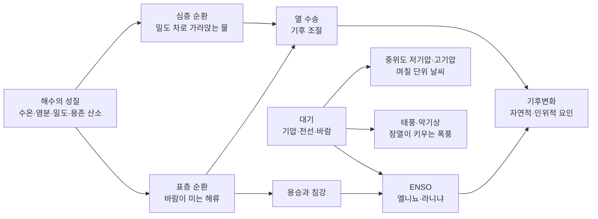
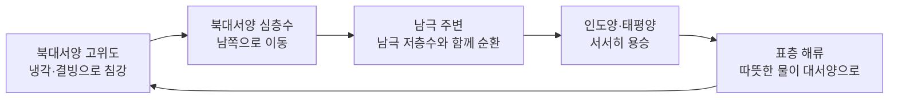

# 지구과학 1. 대기와 해양의 상호작용 — 바다와 하늘이 함께 만드는 날씨와 기후
<!-- prev: m3-02, m3-03, 3-1, 5-3 -->
<!-- next: esys-2, esys-3 -->

> [!NOTE]
> **성취기준**
> - **[12지구01-01]** 해수의 물리적, 화학적 성질을 이해하고, 실측 자료를 활용하여 해수의 온도, 염분, 밀도, 용존 산소량 등의 분포를 분석⋅해석할 수 있다.
> - **[12지구01-02]** 심층 순환의 발생 원리와 분포를 알고, 표층 순환 및 기후변화의 관련성을 추론할 수 있다.
> - **[12지구01-03]** 중위도 저기압과 고기압이 통과할 때 날씨의 변화를 일기도, 위상 영상, 레이더 영상을 종합하여 예측할 수 있다.
> - **[12지구01-04]** 태풍의 발생, 이동, 소멸 과정 및 태풍 영향권에서 날씨를 예측하고, 뇌우, 집중호우, 폭설, 강풍, 황사 등 주요 악기상의 생성 메커니즘과 대처 방안을 제시할 수 있다.
> - **[12지구01-05]** 대기와 해양의 상호작용의 사례로서 해수의 용승과 침강, 엘니뇨-남방진동(ENSO)의 현상의 진행 과정 및 관련 현상을 설명할 수 있다.
> - **[12지구01-06]** 기후변화의 원인을 자연적 요인과 인위적 요인으로 구분하여 설명하고, 인간 활동에 의한 기후변화 문제를 과학적으로 해결하는 방법을 탐색할 수 있다.

**학습 목표**

1. 해수의 수온·염분·밀도·용존 산소량의 연직·수평 분포를 실측 자료와 T-S도로 해석할 수 있다.
2. 심층 순환이 수온과 염분에 따른 밀도 차이로 일어남을 알고, 표층 순환과 함께 지구의 열을 나르는 역할과 기후변화의 관계를 추론할 수 있다.
3. 일기도·위성 영상·레이더 영상을 종합하여 중위도 저기압과 이동성 고기압이 지나갈 때의 날씨 변화를 예측할 수 있다.
4. 태풍의 일생과 태풍 영향권의 날씨를 설명하고, 뇌우·집중호우·폭설·강풍·황사의 생성 과정과 대처 방안을 제시할 수 있다.
5. 용승과 침강, 엘니뇨와 라니냐의 진행 과정을 대기와 해양의 상호작용으로 설명할 수 있다.
6. 기후변화의 원인을 자연적·인위적 요인으로 구분하고, 인간 활동에 의한 기후변화를 해결하는 과학적 방법을 탐색할 수 있다.

**이 단원의 학습 사다리**

| 단계 | 무엇을 하나? |
|---|---|
| STEP 1. 이전 학습 다시 보기 | 중학교의 해수·날씨 단원과 통합과학의 지구시스템·기후변화 단원을 다시 꺼낸다 |
| STEP 2. 기초 다지기 | 밀도와 뜨고 가라앉기, 단열 변화와 잠열, 기압과 바람, 편차(평년과의 차이) 읽기 |
| STEP 3. 핵심 개념 | 해수의 성질 → 심층 순환 → 중위도 저기압 → 태풍과 악기상 → 용승·ENSO → 기후변화 |
| STEP 4. 오개념 바로잡기 | "엘니뇨는 바다가 뜨거워지는 해마다 생긴다?" 같은 착각을 바로잡는다 |
| STEP 5. 다음 단계로 | 지구시스템과학의 에크만 수송·지형류·지균풍, 대학 대기과학·해양학 |
| STEP 6. 생활·산업·진로 | 수치 예보, 해양 관측 로봇, 수산업과 ENSO, 기후 기술 |

---

## 🗺️ 단원 들어가기

2022년 9월 초, 태풍 '힌남노'가 다가오자 기상청은 며칠 전부터 진로와 강풍 반경을 발표했고, 학교는 등교를 조정했으며 항구의 배들은 피항했다. 사람들은 **며칠 뒤 날씨를 어떻게 알 수 있었을까?** 또 남아메리카 페루 앞바다의 수온이 평소보다 몇 도 오르면, 수천 km 떨어진 인도네시아에는 가뭄이, 페루에는 홍수가 찾아온다. **바다의 온도 변화가 어떻게 지구 반대편의 비까지 바꿀까?**

답은 하나로 모인다. 대기와 해양은 따로 움직이지 않는다. 바람은 바닷물을 밀고, 바다는 대기에 열과 수증기를 준다. 이 단원에서는 바다의 성질에서 출발해, 바다 속 거대한 컨베이어 벨트(심층 순환), 매일의 날씨(저기압·고기압), 사나운 날씨(태풍과 악기상), 몇 년 주기의 변동(ENSO), 그리고 수만 년과 수십 년 규모의 기후변화까지 **시간과 공간의 규모를 넓혀 가며** 대기–해양 상호작용을 따라간다.

---

## STEP 1. 🔙 이전 학습 다시 보기

### 연계 개념표

| 이전 단원·성취기준 | 그때 배운 것 | 이 단원에서 확장되는 것 |
|---|---|---|
| 중3 「수권과 해수의 순환」 [9과18-02] | 우리나라 주변 바다의 계절별 수온·염분, 혼합층·수온 약층·심해층 | 전 지구 수온·염분·밀도·용존 산소 분포, T-S도, ARGO 실측 자료 |
| 중3 「수권과 해수의 순환」 [9과18-03] | 대기 대순환과 북태평양 아열대 순환, 해류의 열 수송 | 심층 순환과 표층 순환이 이어진 전 지구 순환, 기후변화와의 관계 |
| 중3 「날씨와 기후변화」 [9과17-03] | 상대습도, 단열 팽창과 응결, 구름과 강수 | 저기압의 상승 기류, 태풍과 뇌우의 에너지원(잠열) |
| 중3 「날씨와 기후변화」 [9과17-04] | 기압, 기단, 전선, 일기도의 저기압·고기압 | 중위도 저기압의 일생, 전선 통과 시 날씨 예측, 위성·레이더 영상 종합 |
| 중3 「날씨와 기후변화」 [9과17-01] | 복사 평형, 온실효과와 지구온난화 | 기후변화의 자연적 요인(천문·화산·태양)과 인위적 요인 구분 |
| 통합과학1 「지구시스템의 구성과 상호작용」 | 권역 사이의 에너지 흐름과 물질 순환 | 기권–수권 상호작용의 구체적 사례(용승, ENSO, 태풍) |
| 통합과학2 「지구온난화와 기후변화」 | 지구 열수지, 엘니뇨와 라니냐, 사막화, 탄소중립 | 남방진동과 워커 순환, 엘니뇨 감시 지수, 기후변화 해결 방법 탐색 |

### 준비 운동 (사전 진단)

**Q1.** 우리나라 주변 바다에서 혼합층이 가장 두꺼운 계절은 여름과 겨울 중 언제일까? 그 이유는?

**Q2.** 공기 덩어리가 상승하면 기온이 낮아지는 까닭을 '단열 팽창'으로 설명해 보자.

**Q3.** 일기도에서 저기압 중심 부근의 날씨가 흐린 까닭은 무엇일까?

**Q4.** 엘니뇨가 일어나면 적도 동태평양(페루 앞바다)의 표층 수온은 평상시보다 (높아진다 / 낮아진다).

정답 및 해설

**Q1. 겨울** — 겨울에는 바람이 강해 표층 해수를 깊이까지 섞고, 표면이 차가워져 무거워진 물이 가라앉으며 섞이기도 한다. 그래서 혼합층이 두껍다.

**Q2.** 상승한 공기는 주변 기압이 낮아 부피가 커진다(팽창). 열을 주고받지 않은 채 팽창하면 공기가 일을 하면서 내부 에너지가 줄어 기온이 낮아진다.

**Q3.** 저기압 중심으로 바람이 모여들어 상승 기류가 생기고, 상승한 공기가 단열 팽창하여 냉각되면 수증기가 응결해 구름이 만들어지기 때문이다.

**Q4. 높아진다** — 무역풍이 약해져 서쪽에 쌓여 있던 따뜻한 물이 동쪽으로 퍼지고, 찬물의 용승이 약해지기 때문이다. STEP 3의 ⑤에서 자세히 다룬다.

---

## STEP 2. 🧱 기초 다지기

### ① 밀도: 무거운 물은 가라앉는다

**밀도(density)** 는 단위 부피당 질량이다($\rho = m/V$). 바닷물의 밀도는 대략 $1.020\sim1.030\ \mathrm{g/cm^3}$으로 순수한 물($1.000\ \mathrm{g/cm^3}$)보다 조금 크다. 바다에서 밀도를 바꾸는 요인은 두 가지뿐이라고 생각해도 좋다.

| 요인 | 변화 | 밀도 |
|---|---|---|
| 수온 | 낮아질수록 | 커진다 |
| 염분 | 높아질수록 | 커진다 |

밀도가 큰 물은 밀도가 작은 물 아래로 가라앉아 층을 이룬다. 위가 가볍고 아래가 무거운 상태를 **안정하다**고 한다.

> [!TIP]
> 💡 **비유** — 차가운 소금물에 식용 색소를 타서 따뜻한 맹물이 든 수조에 살며시 부으면, 색깔 물이 바닥으로 미끄러져 내려가 바닥에 깔린다. 극지방 바다에서 일어나는 일의 축소판이다.

### ② 단열 변화와 잠열: 폭풍의 연료

- 공기가 상승하면 **단열 팽창**하여 기온이 내려가고, 하강하면 **단열 압축**되어 기온이 올라간다.
- 수증기가 응결하여 물방울이 될 때는 증발할 때 흡수했던 열을 다시 내놓는다. 이 열을 **숨은열(잠열, latent heat)** 이라고 한다.
- 잠열을 받은 공기는 주변보다 따뜻하고 가벼워져 더 높이 상승한다. **태풍과 뇌우는 이 잠열로 성장한다.**

### ③ 기압과 바람

- 바람은 기압이 높은 곳에서 낮은 곳으로 분다. 등압선 간격이 좁을수록 바람이 강하다.
- 북반구 지상에서는 지구 자전의 영향과 마찰 때문에 바람이 **저기압 중심으로 시계 반대 방향으로 불어 들어가고, 고기압 중심에서 시계 방향으로 불어 나간다.** (이 단원에서는 결과만 쓰고, 힘의 원리는 「강수 과정과 대기의 운동」에서 다룬다.)
- 저기압 → 수렴·상승 기류 → 구름·비 / 고기압 → 발산·하강 기류 → 맑음

### ④ '편차'로 읽기: 평년과 얼마나 다른가

기후 자료는 값 자체보다 **편차(anomaly)** 로 자주 나타낸다.

$$
\text{편차} = \text{관측값} - \text{평년값(보통 30년 평균)}
$$

예를 들어 어느 해 8월 해수면 온도가 $29.0\ ^\circ\mathrm{C}$이고 평년값이 $27.5\ ^\circ\mathrm{C}$이면 편차는 $+1.5\ ^\circ\mathrm{C}$이다. 엘니뇨 감시, 지구 평균 기온 상승 그래프는 모두 편차 그래프이다.

### ⑤ 규모(scale)로 현상 나누기

| 현상 | 공간 규모 | 시간 규모 |
|---|---|---|
| 뇌우, 소나기 | 수 km ~ 수십 km | 수십 분 ~ 수 시간 |
| 중위도 저기압, 이동성 고기압 | 약 1000 km 이상 | 수 일 ~ 1주 |
| 태풍 | 수백 ~ 약 1000 km 이상 | 수 일 ~ 2주 |
| 엘니뇨·라니냐 | 태평양 전체 | 수 개월 ~ 1년 이상, 2~7년에 한 번꼴 |
| 심층 순환 | 전 지구 바다 | 수백 ~ 1000년 이상 |
| 빙하기–간빙기 | 전 지구 | 수만 ~ 10만 년 |

---

## STEP 3. 📘 핵심 개념

### ① 해수의 성질과 분포 읽기 [12지구01-01]

#### (1) 해수의 화학적 성질 — 염분과 염분비 일정 법칙

**염분(salinity)** 은 해수 1 kg에 녹아 있는 염류의 총량을 g 단위로 나타낸 값이다. 단위는 psu(실용 염분 단위) 또는 ‰(천분율)을 쓴다. 전 세계 해수의 평균 염분은 약 35 psu이다.

| 염류 | 염류 전체에서 차지하는 비율(약) |
|---|---|
| 염화 이온 $\mathrm{Cl^-}$ | 55 % |
| 나트륨 이온 $\mathrm{Na^+}$ | 31 % |
| 황산 이온 $\mathrm{SO_4^{2-}}$ | 8 % |
| 마그네슘 이온 $\mathrm{Mg^{2+}}$ | 4 % |
| 기타(칼슘, 칼륨 이온 등) | 2 % |

바다마다 염분은 다르지만 **염류 사이의 비율은 거의 일정하다.** 이를 **염분비 일정 법칙**이라 한다. 해수가 오랜 시간 섞여 왔기 때문이다. 그래서 한 가지 성분(예: 염화 이온)만 재도 전체 염분을 알 수 있다.

**염분을 바꾸는 요인**

| 염분을 높이는 요인 | 염분을 낮추는 요인 |
|---|---|
| 증발량 증가 | 강수량 증가 |
| 해수가 얼 때(해빙 생성, 염류는 얼음에서 빠져나옴) | 빙하·해빙이 녹을 때 |
| — | 강물 유입 |

표층 염분은 **(증발량 − 강수량)** 이 큰 곳에서 높다. 위도 약 $20^\circ\sim30^\circ$ 부근은 고압대여서 맑은 날이 많고 증발이 활발하므로 염분이 가장 높고, 비가 많은 적도 부근은 그보다 낮으며, 고위도는 증발이 적고 빙하가 녹은 물이 더해져 낮다.

#### 예제 1 — 염분 계산

염분이 35 psu인 해수 2 kg에서 물만 200 g 증발하였다. (1) 처음 녹아 있던 염류의 양과 (2) 증발 후의 염분을 구하시오. (3) 이 해수에 염화 이온은 몇 g 들어 있는가? (염화 이온은 염류의 55 %로 한다.)

**풀이**
(1) $35\ \mathrm{g/kg} \times 2\ \mathrm{kg} = 70\ \mathrm{g}$
(2) 남은 해수의 질량은 $2000 - 200 = 1800\ \mathrm{g}$, 염분 $= \dfrac{70}{1.8} \approx 38.9\ \mathrm{psu}$
(3) $70 \times 0.55 = 38.5\ \mathrm{g}$ (증발해도 염류의 양은 변하지 않는다)

#### (2) 해수의 물리적 성질 — 수온의 연직 분포

바다는 깊이에 따라 세 층으로 나뉜다.

| 층 | 특징 | 생기는 까닭 |
|---|---|---|
| 혼합층 | 수온이 깊이에 관계없이 거의 일정 | 바람이 표층을 섞는다. 바람이 강할수록 두껍다 |
| 수온 약층 | 깊어질수록 수온이 급격히 낮아짐, 매우 안정 | 위는 따뜻하고 가볍고 아래는 차고 무거워 섞이지 않는다 |
| 심해층 | 수온이 낮고(약 $0\sim4\ ^\circ\mathrm{C}$) 거의 일정 | 태양 에너지가 닿지 않고 고위도에서 가라앉은 찬물이 채운다 |

위도별로 보면 **저위도**는 표층이 매우 따뜻해 수온 약층이 뚜렷하고, **중위도**는 바람이 강해 혼합층이 두꺼우며, **고위도**는 표층도 차가워 층 구조가 거의 나타나지 않는다. 수온 약층은 위아래 물질과 열의 교환을 막는 '뚜껑' 역할을 한다.

#### (3) 밀도와 T-S도

밀도는 수온과 염분으로 결정되므로, 가로축을 염분, 세로축을 수온으로 한 그래프에 **같은 밀도를 잇는 선(등밀도선)** 을 그린 것을 **T-S도(수온-염분도)** 라 한다.

- 오른쪽 아래(염분 높고 수온 낮음)로 갈수록 밀도가 크다.
- 등밀도선은 직선이 아니라 **약간 휘어진 곡선**이다. 수온이 낮을 때는 수온 변화에 따른 밀도 변화가 작아지기 때문이다.
- 어떤 바다에서 깊이별로 측정한 (염분, 수온)을 점으로 찍고 이으면 그 바다의 **수괴(water mass)**, 즉 성질이 비슷한 물 덩어리를 구분할 수 있다.

다음 표는 수압을 고려하지 않은 해수의 밀도(단위 $\mathrm{kg/m^3}$, 약값)이다. 표 자체가 T-S도를 숫자로 나타낸 것이다.

| 수온 \ 염분 | 33 psu | 34 psu | 35 psu | 36 psu | 37 psu |
|---|---|---|---|---|---|
| $25\ ^\circ\mathrm{C}$ | 1021.8 | 1022.6 | 1023.3 | 1024.1 | 1024.9 |
| $20\ ^\circ\mathrm{C}$ | 1023.2 | 1024.0 | 1024.8 | 1025.5 | 1026.3 |
| $10\ ^\circ\mathrm{C}$ | 1025.4 | 1026.2 | 1027.0 | 1027.7 | 1028.5 |
| $5\ ^\circ\mathrm{C}$ | 1026.1 | 1026.9 | 1027.7 | 1028.5 | 1029.3 |
| $0\ ^\circ\mathrm{C}$ | 1026.5 | 1027.3 | 1028.1 | 1028.9 | 1029.7 |

#### 예제 2 — T-S도 읽기

수괴 A(수온 $20\ ^\circ\mathrm{C}$, 염분 36 psu)와 수괴 B(수온 $5\ ^\circ\mathrm{C}$, 염분 34 psu)가 만나면 어느 쪽이 아래로 가는가? 또 수온을 $5\ ^\circ\mathrm{C}$ 낮추는 것과 염분을 1 psu 높이는 것 중, $20\ ^\circ\mathrm{C}$·35 psu 해수의 밀도를 더 크게 늘리는 것은?

**풀이** 표에서 A는 약 $1025.5$, B는 약 $1026.9\ \mathrm{kg/m^3}$이므로 **B가 아래**로 간다. 염분이 2 psu나 낮아도 수온이 훨씬 낮기 때문이다.
$20\ ^\circ\mathrm{C}$·35 psu($1024.8$)에서 수온을 $15\ ^\circ\mathrm{C}$로 낮추면 약 $1026.0$(+1.2), 염분을 36 psu로 높이면 약 $1025.5$(+0.7)가 된다. 이 범위에서는 **수온 $5\ ^\circ\mathrm{C}$ 하강의 효과가 더 크다.**

#### (4) 용존 산소량

해수에 녹아 있는 산소의 양을 **용존 산소량**이라 한다.

- **표층**: 대기에서 산소가 녹아 들어오고 식물 플랑크톤이 광합성을 하므로 많다. 기체는 **찬물에 더 잘 녹으므로** 고위도 표층일수록 많다.
- **수백 m ~ 약 1000 m**: 광합성은 없고 생물의 호흡과 유기물 분해로 산소가 소비되어 **가장 적은 층(산소 최소층)** 이 나타난다.
- **더 깊은 곳**: 고위도 표층에서 산소를 듬뿍 품고 가라앉은 찬물이 흘러 들어오므로 다시 조금 많아진다.

> [!IMPORTANT]
> 깊은 바다의 용존 산소는 **"이 물이 언젠가 표층에 있었다"는 꼬리표**이다. 심해에 산소가 있다는 사실 자체가 심층 순환이 존재한다는 증거가 된다.

#### (5) 실측 자료 — 인공위성과 ARGO

| 관측 수단 | 무엇을 재나 | 장점 | 한계 |
|---|---|---|---|
| 인공위성 | 해수면 온도(적외선), 해수면 염분(마이크로파), 해수면 높이, 엽록소 농도(색) | 전 지구를 짧은 시간에 넓게 관측 | 표면만 볼 수 있다 |
| ARGO 플로트 | 깊이별 수온·염분(일부는 용존 산소) | 바다 속 연직 분포를 직접 측정 | 지점 자료, 대략 2000 m까지 |
| 선박·부이 | 수온, 염분, 용존 산소, 해류 | 정밀하고 다양한 항목 | 비용이 크고 범위가 좁다 |

**ARGO**는 전 세계 바다에 약 4000개가 떠 있는 자동 관측 장치이다. 약 10일을 주기로 약 2000 m 깊이까지 가라앉았다가 떠오르며 수온과 염분을 재고, 수면에서 위성으로 자료를 보낸다. 누구나 인터넷에서 이 자료를 내려받아 해석할 수 있다.

---

### ② 표층 순환과 심층 순환, 그리고 기후 [12지구01-02]

#### (1) 표층 순환 다시 보기

표층 해류는 주로 **바람**이 만든다. 무역풍과 편서풍이 대양을 가로질러 불기 때문에 북반구 대양에는 시계 방향, 남반구 대양에는 시계 반대 방향의 커다란 **아열대 순환**이 생긴다.

| 북태평양 아열대 순환 | 방향 | 성질 |
|---|---|---|
| 북적도 해류 | 동 → 서 (무역풍) | 따뜻함 |
| 쿠로시오 해류 | 남 → 북 (서쪽 가장자리) | 난류, 폭이 좁고 빠름 |
| 북태평양 해류 | 서 → 동 (편서풍) | — |
| 캘리포니아 해류 | 북 → 남 (동쪽 가장자리) | 한류 |

저위도에서 고위도로 가는 **난류**는 열을 극 쪽으로 나르고, 고위도에서 저위도로 가는 **한류**는 찬물을 돌려보낸다. 우리나라 주변에서는 쿠로시오에서 갈라진 **동한 난류·황해 난류**와 북쪽에서 내려오는 **북한 한류**가 동해에서 만나 **조경 수역**을 이루고, 영양염과 플랑크톤이 풍부한 좋은 어장이 된다.

#### (2) 심층 순환은 왜 생기나 — 열염 순환

수심 약 1000 m보다 깊은 곳의 해수는 바람의 영향을 거의 받지 않는다. 이곳의 물은 **수온과 염분 변화로 생긴 밀도 차**로 천천히 움직인다. 그래서 심층 순환을 **열염 순환(thermohaline circulation)** 이라고도 한다(thermo = 열, haline = 염분).

**발생 과정(고위도 바다에서)**
1. 겨울철 차가운 공기가 표층 해수의 열을 빼앗는다 → 수온 하강 → 밀도 증가
2. 바닷물이 얼어 해빙이 생기면 염류는 얼음에 거의 들어가지 않고 남은 물에 쌓인다 → 염분 증가 → 밀도 증가
3. 무거워진 표층 해수가 수천 m 아래로 **침강**한다.
4. 가라앉은 물은 해저를 따라 저위도로 천천히 퍼지고, 넓은 바다에서 서서히 올라와(용승) 표층 해류에 합류한다.

#### (3) 심층 순환의 분포 — 대서양 단면으로 보기

교과서에서는 실제 해저 지형을 빼고 **남북으로 자른 단순한 대서양 단면**으로 수괴를 나타낸다. 단면을 글로 그려 보면 다음과 같다.

| 깊이(단면의 위치) | 수괴 | 만들어지는 곳 | 흐름 방향 |
|---|---|---|---|
| 약 1000 m 안팎(중층) | **남극 중층수** | 남위 약 $50^\circ\sim60^\circ$ 바다 | 남 → 북, 적도 부근까지 |
| 약 1500~4000 m(심층) | **북대서양 심층수** | 그린란드 남쪽·노르웨이 바다 | 북 → 남, 남극 부근까지 |
| 해저 바닥(저층) | **남극 저층수** | 남극 대륙 주변(웨델해 등) | 남 → 북, 바닥을 따라 북반구까지 |

- 밀도는 **남극 저층수 > 북대서양 심층수 > 남극 중층수** 순이다. 그래서 남극 저층수가 가장 아래에 깔린다.
- 심층 해수는 매우 느리게 움직여(대개 하루에 수 km 이하), 한 바퀴 도는 데 **수백 년에서 1000년 이상**이 걸린다고 추정된다.

<!-- fig:earth-1-atlantic-section -->

#### (4) 표층 순환과 심층 순환은 하나로 이어져 있다

북대서양에서 가라앉은 물은 대서양을 남하해 남극 주변을 돌고 인도양과 태평양으로 퍼진 뒤 서서히 떠오른다. 떠오른 물은 표층 해류를 타고 다시 대서양 북쪽으로 돌아온다. 이 전체 흐름을 **해양 컨베이어 벨트**라고 부른다.

| 구분 | 표층 순환 | 심층 순환 |
|---|---|---|
| 주된 원인 | 바람 | 수온·염분에 따른 밀도 차 |
| 범위 | 수심 수백 m 이내 | 수심 약 1000 m 이하 |
| 속도 | 빠르다(초속 수십 cm ~ 1 m 이상) | 매우 느리다 |
| 역할 | 열 수송, 기후 조절 | 열 수송, 표층 산소·이산화 탄소를 심해로 운반 |

#### (5) 심층 순환과 기후변화

- 북대서양 해류가 열을 북쪽으로 실어 나르기 때문에 서유럽은 같은 위도의 다른 지역보다 겨울이 온화하다.
- 지구온난화로 그린란드 빙하가 녹아 담수가 흘러들고 표층 수온이 오르면 → 표층 해수의 밀도가 작아져 → **침강이 약해지고** → 컨베이어 벨트가 느려질 수 있다 → 북쪽으로 가는 열이 줄어 북대서양 주변은 오히려 추워지는 등 기후가 바뀔 수 있다.
- 실제로 마지막 빙하기가 끝나 가던 약 1만 2천~1만 3천 년 전에 북반구 고위도가 갑자기 다시 추워진 시기가 있었는데, 녹은 빙하수가 북대서양에 유입되어 심층 순환이 약해진 것이 원인이라는 가설이 유력하게 제시되어 있다.

> [!WARNING]
> 영화처럼 "심층 순환이 며칠 만에 멈추고 갑자기 빙하기가 온다"는 것은 과장이다. 심층 순환의 변화는 수십 년 이상의 시간 규모로 일어나며, 얼마나 약해질지는 지금도 관측과 연구가 진행 중이다.

---

### ③ 중위도 저기압과 이동성 고기압의 통과 [12지구01-03]

#### (1) 기단과 전선 다시 보기

우리나라 날씨에 영향을 주는 기단은 시베리아 기단(한랭 건조, 겨울), 오호츠크해 기단(한랭 다습, 초여름), 북태평양 기단(고온 다습, 여름), 양쯔강 기단(온난 건조, 봄·가을) 등이다. 성질이 다른 두 기단이 만나는 경계면을 **전선면**, 전선면이 지면과 만나는 선을 **전선**이라 한다.

| 전선 | 만들어지는 방식 | 구름·강수 | 통과 후 |
|---|---|---|---|
| 한랭 전선 | 찬 공기가 따뜻한 공기 밑으로 파고든다. 전선면 기울기가 급하다 | 적운형 구름, 좁은 지역에 소나기·뇌우 | 기온 하강, 기압 상승, 북서풍 |
| 온난 전선 | 따뜻한 공기가 찬 공기 위로 완만하게 올라탄다 | 층운형 구름, 넓은 지역에 지속적인 비 | 기온 상승, 남서풍 |
| 폐색 전선 | 빠른 한랭 전선이 온난 전선을 따라잡아 겹친다 | 두 전선의 날씨가 섞임 | 저기압이 약해지기 시작 |
| 정체 전선 | 두 기단의 세력이 비슷해 오래 머문다 | 긴 비(장마) | — |

#### (2) 저기압은 규모에 따라 나뉜다

교육과정에서는 흔히 쓰던 '온대 저기압'을 **중위도 저기압(mid-latitude Low)** 이라 부른다. 저기압은 규모에 따라 둘로 나눌 수 있다.

| 구분 | 중위도 종관 규모 저기압 | 중규모 저기압 |
|---|---|---|
| 크기 | 약 1000 km 이상 | 수 km ~ 수백 km |
| 수명 | 수 일 ~ 1주 | 수 시간 |
| 특징 | 온난 전선과 한랭 전선을 동반, 일기도에 뚜렷 | 전선이 없을 수 있음, 소나기(스콜)·뇌우를 만든다 |
| 예 | 봄·가을 우리나라를 지나는 저기압 | 여름철 국지적 소나기, 강한 비구름 덩어리 |

#### (3) 중위도 저기압의 일생

중위도 저기압은 찬 공기와 따뜻한 공기가 만나는 **한대 전선대**에서 생긴다.

1. **발생**: 정체된 전선의 일부가 물결처럼 꺾이며 파동이 생긴다.
2. **발달**: 꺾인 곳에 저기압 중심이 생기고, 중심의 동쪽에 온난 전선, 서쪽(남서쪽)에 한랭 전선이 뻗는다. 두 전선 사이 남쪽은 따뜻한 공기가 들어온 **온난 구역**이다.
3. **폐색**: 한랭 전선이 더 빨리 움직여 온난 전선을 따라잡으면 폐색 전선이 된다.
4. **소멸**: 따뜻한 공기가 모두 위로 밀려 올라가면 기온 차가 사라지고 저기압은 약해진다.

중위도 저기압은 **편서풍**을 타고 대체로 **서쪽에서 동쪽으로** 이동한다. 그래서 우리나라 날씨는 대체로 서쪽에서부터 바뀐다.

#### (4) 저기압이 통과할 때 날씨 예측하기

저기압 중심의 **남쪽**을 지나는 관측소(우리나라에서 흔한 경우)에서 시간에 따른 날씨 변화는 다음과 같다.

| 시기 | 관측소 위치 | 구름·강수 | 기온 | 풍향 | 기압 |
|---|---|---|---|---|---|
| 온난 전선 접근 | 온난 전선 앞(동쪽) | 권운 → 권층운 → 고층운 → 난층운, 넓은 지역에 이슬비·지속적인 비 | 낮음 | 남동풍 | 점점 낮아짐 |
| 온난 전선 통과 후 | 온난 구역 | 대체로 맑거나 구름 조금 | 높음 | 남서풍 | 낮음 |
| 한랭 전선 통과 | 한랭 전선 부근 | 적란운, 소나기·천둥·번개·돌풍 | 급하강 | 남서풍 → 북서풍 | 가장 낮았다가 상승 |
| 한랭 전선 통과 후 | 찬 공기 속 | 점차 맑아짐 | 낮음 | 북서풍 | 상승 |

> [!TIP]
> 💡 **요령** — 저기압 중심의 남쪽에 있는 관측소에서 풍향은 **남동 → 남서 → 북서**로 **시계 방향**으로 바뀐다. 중심의 북쪽을 지나는 관측소라면 풍향이 **시계 반대 방향**(동 → 북동 → 북)으로 바뀐다.

<!-- sim:cyclone-fronts -->

#### (5) 이동성 고기압

봄과 가을에는 중국 대륙(양쯔강 유역 부근)에서 떨어져 나온 고기압이 편서풍을 타고 저기압과 번갈아 지나간다. 이를 **이동성 고기압**이라 한다.

- 하강 기류 → 구름이 적고 맑다.
- 맑은 밤에는 지표의 복사 냉각이 커서 **일교차가 크고**, 새벽에 서리나 안개가 생기기 쉽다.
- 공기가 건조해 산불 위험이 높아진다.
- 고기압이 정체하면 대기가 안정해져 미세 먼지가 쌓이기 쉽다.

#### (6) 위성 영상과 레이더 영상 종합하기

| 자료 | 원리 | 밝게(진하게) 보이는 것 | 쓰임 |
|---|---|---|---|
| 가시 영상 | 구름·지표가 반사한 햇빛 | 두꺼운 구름(반사율이 큼) | 구름의 두께. 밤에는 쓸 수 없다 |
| 적외 영상 | 구름·지표가 내보내는 적외선 → 온도 | 온도가 낮은 것 = **높이 솟은 구름 꼭대기** | 구름의 높이. 밤낮 모두 가능 |
| 수증기 영상 | 수증기가 흡수·방출하는 파장 | 대기 중·상층의 수증기가 많은 곳 | 상층 공기의 흐름, 건조 구역 |
| 레이더 영상 | 전파를 쏘아 빗방울·눈송이에서 되돌아오는 신호 | 강한 반사 = 강한 강수 | 지금 비가 내리는 곳과 강도, 이동 방향 |

- 가시 영상과 적외 영상에서 **모두 밝은 구름** → 두껍고 높이 솟은 **적란운** → 소나기·뇌우 가능성이 크다.
- 가시 영상에서 밝지만 적외 영상에서 어두운 구름 → 낮고 두꺼운 층운·안개.
- 가시 영상에서 어둡지만 적외 영상에서 밝은 구름 → 높고 얇은 권운.

#### 예제 3 — 날씨 예측

오늘 오전 9시 일기도에서 중위도 저기압 중심이 서울의 서쪽 약 600 km에 있고, 한랭 전선은 중심에서 남서쪽으로 뻗어 있다. 저기압은 시속 약 40 km로 동쪽으로 이동한다. 서울은 저기압 중심의 남쪽 경로에 놓여 있다.
(1) 저기압 중심이 서울의 경도에 도달하는 데 걸리는 시간은? (2) 이 저기압이 완전히 지나가는 동안 서울의 풍향은 어떻게 바뀌겠는가? (3) 한랭 전선이 통과하는 순간 레이더 영상에서는 어떤 모습이 보이겠는가?

**풀이**
(1) $600\ \mathrm{km} \div 40\ \mathrm{km/h} = 15$시간 → 오늘 밤 12시 무렵
(2) 온난 전선 앞에서 남동풍 → 온난 구역에서 남서풍 → 한랭 전선 통과 후 북서풍(시계 방향 변화)
(3) 전선을 따라 좁고 긴 띠 모양으로 강한 반사 신호(강한 소나기)가 나타나고, 그 띠가 동쪽으로 이동한다.

---

### ④ 태풍과 주요 악기상 [12지구01-04]

#### (1) 태풍의 발생 — 따뜻한 바다가 연료

**태풍(typhoon)** 은 북태평양 서쪽에서 발생하는 **열대 저기압** 가운데 중심 부근 최대 풍속이 약 17 m/s 이상인 것을 말한다. (같은 종류의 열대 저기압을 대서양·북동태평양에서는 허리케인, 인도양에서는 사이클론이라 부른다.)

| 발생 조건 | 이유 |
|---|---|
| 해수면 온도 약 $26\sim27\ ^\circ\mathrm{C}$ 이상 | 많은 수증기 공급(잠열의 원천) |
| 위도 약 $5^\circ\sim25^\circ$ 바다 | 적도 바로 위에서는 지구 자전의 효과가 거의 없어 소용돌이가 잘 생기지 않는다 |
| 상층과 하층의 바람 차이가 작을 것 | 구름 기둥이 기울어지지 않아야 계속 발달한다 |

**에너지원**: 따뜻한 바다에서 증발한 수증기가 상승하며 응결할 때 내놓는 **숨은열(잠열)** 이다. 잠열이 공기를 데워 상승 기류가 더 강해지고, 중심 기압이 더 낮아지며, 바람이 강해져 증발이 더 활발해진다. 바다와 대기가 서로를 키우는 **양의 되먹임**이다.

#### (2) 태풍의 구조

| 구조 | 특징 |
|---|---|
| 태풍의 눈 | 중심의 지름 수십 km 영역. 약한 하강 기류 → 바람이 약하고 맑다 |
| 눈벽 | 눈 바로 바깥. 가장 강한 상승 기류, 가장 강한 바람과 비 |
| 나선형 구름 띠 | 바깥쪽으로 감겨 나가는 비구름 띠 |
| 기압 | 중심으로 갈수록 낮아지고 중심에서 가장 낮다 |
| 등압선 | 원형에 가깝고 전선이 없다 |

#### (3) 태풍의 이동과 소멸

- 발생 초기에는 **무역풍**과 북태평양 고기압의 가장자리를 따라 **북서쪽**으로 이동한다.
- 위도 약 $25^\circ\sim30^\circ$ 부근에서 **편서풍**의 영향을 받으며 **북동쪽**으로 방향을 바꾼다(포물선 경로). 방향이 바뀌는 지점을 **전향점**이라 한다. 전향 후에는 이동 속도가 빨라지는 경우가 많다.
- **소멸**: 육지에 상륙하면 수증기 공급이 끊기고 지표 마찰이 커져 약해진다. 차가운 바다로 올라가도 약해지며, 중위도에서 찬 공기와 만나 전선을 가진 중위도 저기압으로 바뀌기도 한다.

#### (4) 위험 반원과 안전 반원

북반구 태풍에서 바람은 중심을 향해 시계 반대 방향으로 분다. 태풍의 진행 방향을 기준으로

- **오른쪽 반원**: 태풍의 회전 바람 방향과 태풍의 이동 방향이 같아 바람이 **더 강하다** → **위험 반원**
- **왼쪽 반원**: 두 방향이 반대라 상대적으로 약하다 → **안전 반원(가항 반원)**. 그러나 '안전'은 상대적일 뿐 피해는 충분히 크다.

| 관측소 위치 | 태풍 통과 때 풍향 변화 | 예 |
|---|---|---|
| 태풍 진로의 오른쪽(위험 반원) | **시계 방향**(동 → 남동 → 남 → 남서) | 태풍이 관측소의 서쪽을 지나갈 때 |
| 태풍 진로의 왼쪽(안전 반원) | **시계 반대 방향**(동 → 북동 → 북 → 북서) | 태풍이 관측소의 동쪽을 지나갈 때 |

<!-- fig:earth-1-typhoon-semicircle -->

#### (5) 최근 사례 — 대기·해양·육지의 상호작용

2022년 태풍 '힌남노'는 우리나라에 다가오는 동안 평년보다 따뜻한 바다 위를 지나며 강한 세력을 유지했고, 9월 6일 경남 남해안에 상륙한 뒤 동해로 빠져나갔다. 경북 포항에서는 짧은 시간에 매우 많은 비가 내려 하천이 범람하고, 아파트 지하 주차장이 침수되는 인명 피해가 있었다.

- **대기–해양 상호작용**: 따뜻한 바다 → 증발·잠열 공급 → 세력 유지
- **대기–육지 상호작용**: 산지에 부딪혀 강제 상승 → 지형성 강수 증가, 하천으로 빗물이 빠르게 모임
- **해양 쪽 피해**: 강한 바람과 낮은 기압이 바닷물을 끌어올려 **폭풍 해일**이 생기고, 만조와 겹치면 해안이 침수된다.

#### 예제 4 — 태풍 영향권 날씨 예측

태풍이 제주도 서쪽 바다를 지나 북상하여 서해안을 따라 올라갈 예정이다. 부산의 (1) 위치는 위험 반원과 안전 반원 중 어느 쪽인가? (2) 태풍이 지나가는 동안 부산의 풍향은 어떻게 바뀌겠는가? (3) 기압 변화는?

**풀이** (1) 태풍 진로(북쪽)의 오른쪽(동쪽)에 있으므로 **위험 반원**이다. (2) 동풍 계열 → 남동풍 → 남풍 → 남서풍으로 **시계 방향**으로 바뀐다. (3) 태풍 중심이 가장 가까워질 때까지 낮아지다가, 멀어지면 다시 높아진다.

#### (6) 주요 악기상의 생성 메커니즘과 대처

**뇌우(thunderstorm)** — 천둥과 번개를 동반한 폭풍우. 강한 상승 기류로 적란운이 발달할 때 생긴다.

| 단계 | 공기의 움직임 | 날씨 |
|---|---|---|
| 적운 단계 | 상승 기류만 존재, 구름이 위로 자란다 | 아직 비가 거의 없음 |
| 성숙 단계 | 상승 기류와 하강 기류가 함께 존재 | 강한 비, 천둥·번개, 우박, 돌풍 — 가장 격렬 |
| 소멸 단계 | 하강 기류가 우세 | 약한 비, 구름이 흩어짐 |

여름철 강한 햇빛으로 지면이 가열될 때, 한랭 전선이 지날 때 잘 생긴다. **우박**은 성숙 단계의 적란운 속에서 얼음 알갱이가 상승·하강을 되풀이하며 커진 것이다.

**집중호우** — 좁은 지역에 짧은 시간 동안 많은 비가 내리는 현상(흔히 한 시간에 30 mm 이상, 또는 하루에 80 mm 이상을 기준으로 삼는다). 적란운이 한 지역에서 계속 새로 만들어지거나, 여러 적란운이 줄지어 같은 곳을 지나가면 생긴다. 장마 전선, 태풍, 대기 하층으로 들어오는 덥고 습한 공기(남서풍)가 중요한 원인이다.

**폭설** — 짧은 시간에 많은 눈이 내리는 현상.
- **서해안형**: 겨울에 시베리아 고기압이 확장하면 차고 건조한 북서풍이 상대적으로 따뜻한 황해를 지나며 열과 수증기를 얻어 눈구름을 만든다. 바다와 대기의 온도 차가 클수록 눈구름이 잘 발달한다.
- **영동형**: 북동 기류가 동해에서 수증기를 얻은 뒤 태백산맥에 부딪혀 강제로 상승하면서 많은 눈을 내린다.

**강풍** — 태풍, 발달한 저기압, 겨울철 강한 북서 계절풍, 봄철 영동 지방에 부는 고온 건조한 서풍(산을 넘어 내려오며 단열 압축되어 건조해짐) 등이 원인이다. 영동 지방의 봄철 강풍은 대형 산불을 키우기도 한다.

**황사** — 중국 북부와 몽골의 건조 지역, 황토 고원에서 강한 바람과 상승 기류로 떠오른 흙먼지가 **편서풍**을 타고 날아와 내려앉는 현상. 땅이 건조하고 눈이 녹은 **봄철**에 많고, 발원지의 저기압 통과가 계기가 된다. 사막화가 진행되면 발생이 늘 수 있다.

| 악기상 | 주요 원인(상호작용) | 대처 방안 |
|---|---|---|
| 뇌우·우박 | 지면 가열, 대기 불안정 | 낙뢰 시 실내·차 안으로 대피, 큰 나무·전봇대 아래 피하기, 농작물 보호망 |
| 집중호우 | 수증기 유입 + 강한 상승 기류 | 하천·계곡·지하 공간 출입 금지, 배수로 점검, 저지대 대피 |
| 폭설 | 찬 공기 + 따뜻한 바다(수증기) | 비닐하우스·지붕 눈 치우기, 월동 장비, 대중교통 이용 |
| 강풍 | 큰 기압 차, 지형 | 간판·창문 고정, 해안·공사장 접근 금지, 산불 예방 |
| 황사 | 건조한 발원지 + 편서풍 | 외출 자제, 보건용 마스크, 귀가 후 씻기, 발원지 조림 협력 |

> [!WARNING]
> 낙뢰는 비가 그친 뒤에도 이어질 수 있다. 천둥 소리가 들리면 이미 낙뢰 위험 범위 안에 있다고 보고 즉시 건물이나 자동차 안으로 대피해야 한다.

---

### ⑤ 용승과 침강, 엘니뇨-남방진동(ENSO) [12지구01-05]

#### (1) 용승과 침강

- **용승(upwelling)**: 깊은 곳의 찬 해수가 표층으로 올라오는 현상. 찬물에는 **영양염**이 많아 플랑크톤이 번성하고 **좋은 어장**이 된다. 수온이 낮아 안개가 끼기 쉽다.
- **침강(downwelling)**: 표층 해수가 아래로 내려가는 현상. 표층의 산소를 깊은 곳으로 공급한다.

바람이 오래 불면 표층 해수 전체는 지구 자전의 영향으로 **북반구에서 바람 방향의 오른쪽(남반구에서는 왼쪽)** 으로 이동한다. (이 이동의 원리는 「해수의 운동」에서 '에크만 수송'으로 다룬다.) 표층 해수가 빠져나간 자리를 깊은 물이 채우면 용승, 표층 해수가 모여들면 침강이 일어난다.

| 종류 | 상황 | 결과 |
|---|---|---|
| 연안 용승 | 북반구 대륙의 서해안에서 북풍(해안과 나란한 바람)이 불 때 → 표층 해수가 바다 쪽으로 이동 (남반구 대륙의 서해안에서는 남풍이 불 때) | 연안에 찬물 용승 (캘리포니아 연안, 남반구의 페루 연안 등) |
| 우리나라 동해안 여름 | 남풍 계열 바람이 오래 불 때 → 표층 해수가 동쪽(먼바다)으로 이동 | 동해안 냉수대, 해무, 양식장 피해 |
| 적도 용승 | 무역풍(동풍)이 불 때 → 적도 북쪽은 북쪽으로, 남쪽은 남쪽으로 표층 해수가 이동 | 적도를 따라 찬물 용승 |
| 저기압 중심 | 바람이 시계 반대 방향으로 돌면 표층 해수가 바깥으로 발산 | 중심부 용승 (태풍이 지나간 자리의 수온 하강) |
| 고기압 중심 | 바람이 시계 방향으로 돌면 표층 해수가 중심으로 수렴 | 중심부 침강 |

#### (2) 평상시의 적도 태평양 — 워커 순환

- 적도 부근에는 **무역풍(동풍)** 이 분다 → 따뜻한 표층 해수가 **서쪽(인도네시아·오스트레일리아 쪽)** 으로 밀려 쌓인다.
- **서태평양**: 따뜻한 물이 두껍게 쌓여 수온 약층이 깊다 → 상승 기류, **저기압**, 비가 많다.
- **동태평양(페루 연안)**: 용승으로 찬물이 올라와 수온 약층이 얕다 → 하강 기류, **고기압**, 건조하다. 영양염이 풍부해 멸치(안초비) 어장이 크다.
- 적도 상공에서는 서쪽에서 상승한 공기가 동쪽에서 하강하는 커다란 동서 방향 순환이 생긴다. 이것을 **워커 순환**이라 한다.

#### (3) 엘니뇨와 라니냐

| 구분 | 엘니뇨(El Niño) | 평상시 | 라니냐(La Niña) |
|---|---|---|---|
| 무역풍 | 약해진다 | 보통 | 강해진다 |
| 동태평양 용승 | 약해진다 | 보통 | 강해진다 |
| 동태평양 표층 수온 | **높아진다** | 보통 | **낮아진다** |
| 동태평양 수온 약층 깊이 | 깊어진다 | 얕다 | 더 얕아진다 |
| 서태평양 수온 약층 깊이 | 얕아진다 | 깊다 | 더 깊어진다 |
| 따뜻한 물이 모인 곳 | 중앙·동쪽으로 이동 | 서쪽 | 더 서쪽으로 치우침 |
| 동태평양 날씨 | 비 증가, 홍수 | 건조 | 더 건조 |
| 서태평양 날씨 | 강수 감소, 가뭄·산불 | 비가 많음 | 더 많은 비, 홍수 |
| 동태평양 어획량 | 감소 | 많음 | 많음 |

**진행 과정(엘니뇨)**: 무역풍 약화 → 서쪽에 쌓였던 따뜻한 물이 동쪽으로 퍼짐 → 동쪽 용승 약화, 수온 상승 → 상승 기류가 생기는 곳이 동쪽으로 이동 → 동쪽과 서쪽의 기압 차가 줄어 무역풍이 더 약해짐. 이렇게 바다와 대기가 서로를 강화한다. 몇 달 ~ 1년 남짓 지속된 뒤 되돌아오며, 2~7년 정도의 불규칙한 간격으로 반복된다.

#### (4) 남방진동 — 대기 쪽 얼굴

적도 태평양의 동쪽(타히티)과 서쪽(오스트레일리아 다윈)의 해면 기압은 **시소처럼 반대로** 오르내린다. 이를 **남방진동(Southern Oscillation)** 이라 한다.

| 시기 | 타히티(동쪽) 기압 | 다윈(서쪽) 기압 | 남방진동 지수(타히티 − 다윈 편차) |
|---|---|---|---|
| 엘니뇨 | 평소보다 낮아짐 | 평소보다 높아짐 | **음(−)** |
| 라니냐 | 평소보다 높아짐 | 평소보다 낮아짐 | **양(+)** |

엘니뇨(바다의 변화)와 남방진동(대기의 변화)은 같은 현상의 두 얼굴이므로 합쳐서 **엘니뇨-남방진동(ENSO)** 이라 한다. 기상 기관은 적도 중·동태평양의 정해진 해역(흔히 '니뇨3.4 해역')의 해수면 온도 편차를 감시해, 편차가 대략 $+0.5\ ^\circ\mathrm{C}$ 이상인 상태가 몇 달 이상 이어지면 엘니뇨, $-0.5\ ^\circ\mathrm{C}$ 이하가 이어지면 라니냐로 판단한다. (기관마다 기준은 조금씩 다르다.)

#### 예제 5 — 자료 해석

다음은 어느 해 적도 동태평양의 해수면 온도 편차와 남방진동 지수이다.

| 달 | 1월 | 4월 | 7월 | 10월 |
|---|---|---|---|---|
| 해수면 온도 편차($^\circ\mathrm{C}$) | +0.2 | +0.8 | +1.4 | +2.0 |
| 남방진동 지수 | −0.1 | −0.9 | −1.5 | −2.1 |

(1) 이 해에 일어난 현상은? (2) 10월에 인도네시아 지역의 강수량은 평년보다 어떠하겠는가? (3) 두 지표가 반대 부호로 함께 커지는 까닭은?

**풀이** (1) 수온 편차가 양(+)으로 커지고 남방진동 지수가 음(−)이므로 **엘니뇨**이다. (2) 상승 기류가 동쪽으로 옮겨 가므로 인도네시아는 **강수량이 줄어** 가뭄 가능성이 크다. (3) 동태평양 수온이 오르면 그곳 기압이 낮아지고(타히티 기압 하강) 서쪽 기압이 높아져 지수가 음이 된다. 바다와 대기가 연결된 하나의 현상이기 때문이다.

> [!TIP]
> 💡 **비유** — 욕조에 물을 받고 한쪽 끝에서 선풍기로 계속 바람을 불면 물이 반대편에 조금 높게 쌓인다(평상시). 선풍기를 약하게 하면 쌓인 물이 되돌아 퍼진다(엘니뇨). 선풍기를 세게 틀면 더 쌓인다(라니냐).

#### (5) ENSO와 우리 생활

- 엘니뇨 해에는 세계 곳곳의 강수·기온 패턴이 바뀌어 곡물 생산, 원자재 가격, 어획량이 영향을 받는다.
- 엘니뇨가 일어난 해에는 전 지구 평균 기온이 일시적으로 더 높아지는 경향이 있다. 바다가 대기에 열을 더 많이 내놓기 때문이다.
- 우리나라에 미치는 영향은 계절과 해마다 달라 일정하지 않지만, 엘니뇨가 발달한 해의 겨울에는 평년보다 따뜻하고 강수가 많은 경향이 있다는 분석이 있다. 원격으로 연결된 영향(원격 상관)이므로 확률적으로 해석해야 한다.

---

### ⑥ 기후변화의 원인과 해결 [12지구01-06]

#### (1) 기후변화의 원인 분류

| 구분 | 요인 | 시간 규모 | 작용 |
|---|---|---|---|
| 자연적·외적 요인 | 지구 공전 궤도 이심률 변화 | 약 10만 년 | 태양–지구 거리의 연중 변화 크기 |
| | 자전축 경사각 변화(약 $21.5^\circ\sim24.5^\circ$) | 약 4만 1천 년 | 계절 차이의 크기 |
| | 자전축 세차 운동 | 약 2만 6천 년 | 근일점에서 맞는 계절이 바뀜 |
| | 태양 활동 변화 | 약 11년 주기 등 | 지구에 들어오는 태양 에너지의 미세한 변화 |
| | 화산 활동 | 1~수 년 | 성층권의 황산염 에어로졸이 햇빛 반사 → 냉각 |
| | 대륙 분포 변화(판의 운동) | 수백만 년 이상 | 해류 경로·빙하 형성 조건 변화 |
| 자연적·내적 요인 | 대기–해양 상호작용(ENSO 등), 빙하·눈의 반사율 되먹임 | 수 년 ~ 수천 년 | 열의 재분배, 변화 증폭 |
| 인위적 요인 | 화석 연료 연소에 의한 온실 기체 증가 | 수십 ~ 수백 년 | 온실효과 강화 → 온난화 |
| | 에어로졸(대기 오염 물질) 배출 | 수 일 ~ 수 년 | 햇빛 반사·구름 변화 → 대체로 냉각 |
| | 삼림 파괴, 도시화 등 토지 이용 변화 | 수십 년 | 반사율 변화, 탄소 흡수원 감소 |

천문학적 요인(이심률·경사각·세차) 세 가지에 따른 일사량 변화로 빙하기와 간빙기를 설명하는 이론을 **밀란코비치 이론**이라 한다.

#### (2) 천문학적 요인 따라가기

| 변화 | 북반구 여름 | 북반구 겨울 | 연교차(북반구) |
|---|---|---|---|
| 자전축 경사각 증가 | 더 더워짐 | 더 추워짐 | 커짐(남반구도 커짐) |
| 자전축 경사각 감소 | 덜 더움 | 덜 추움 | 작아짐 |
| 세차 운동으로 북반구 겨울이 원일점에 오게 됨(약 1만 3천 년 뒤) | 근일점이라 더 더움 | 원일점이라 더 추움 | 커짐 |

현재 지구는 1월 초에 근일점(약 1억 4710만 km), 7월 초에 원일점(약 1억 5210만 km)을 지난다. 그래서 지금 북반구는 '가까울 때 겨울, 멀 때 여름'이어서 연교차가 상대적으로 작다.

#### 예제 6 — 근일점과 원일점의 에너지 차이

태양 복사 에너지는 거리의 제곱에 반비례한다. 근일점과 원일점에서 지구가 받는 태양 복사 에너지의 비를 구하시오.

**풀이**

$$
\frac{E_{\text{근일점}}}{E_{\text{원일점}}} = \left(\frac{1.521}{1.471}\right)^2 \approx 1.07
$$

근일점에서 약 7 % 더 받는다. 이심률이 더 커지면 이 차이가 커진다.

> [!IMPORTANT]
> 밀란코비치 주기는 수만 년 규모의 변화이다. **최근 100여 년의 빠른 온난화는 천문학적 요인으로 설명되지 않는다.** 태양 활동도 같은 기간에 뚜렷하게 증가하지 않았다. 관측된 온난화의 대부분은 인간이 배출한 온실 기체로 설명된다는 것이 기후 과학계의 결론이다.

#### (3) 인위적 요인 — 증거 읽기

- 하와이 마우나로아 관측소에서 1958년부터 잰 대기 중 이산화 탄소 농도는 해마다 증가하며, 산업 혁명 전 약 280 ppm에서 최근 약 420 ppm 이상으로 늘었다. 곡선은 식물의 계절별 광합성 때문에 해마다 오르내리면서 전체적으로 올라간다.
- 기후변화에 관한 정부 간 협의체(IPCC)는 2021년 보고서에서 최근(2011~2020년) 지구 평균 지표 기온이 산업화 이전(1850~1900년)보다 약 $1.1\ ^\circ\mathrm{C}$ 높아졌으며, 인간의 영향이 대기·해양·육지를 온난화시켰다는 것은 명백하다고 평가하였다.
- 화석 연료의 탄소는 오래전 식물에서 온 것이어서 특정 탄소 동위 원소 비율이 대기와 다르다. 대기 중 이산화 탄소의 동위 원소 비율 변화는 증가한 탄소가 화석 연료에서 왔음을 보여 주는 증거의 하나이다.

#### 예제 7 — 증가율 계산

대기 중 이산화 탄소 농도가 280 ppm에서 420 ppm이 되었다. (1) 증가율은 몇 %인가? (2) 최근처럼 1년에 약 2.5 ppm씩 증가한다면 420 ppm에서 산업화 이전의 2배(560 ppm)가 되기까지 몇 년이 걸리겠는가?

**풀이** (1) $\dfrac{420-280}{280}\times100 = 50\ \%$ (2) $\dfrac{560-420}{2.5} = 56$년

#### (4) 인간 활동에 의한 기후변화를 과학적으로 해결하기

| 전략 | 방법 | 과학 원리 |
|---|---|---|
| 완화 — 배출 줄이기 | 재생 에너지(태양광·풍력), 에너지 효율 향상, 전기화, 수송 체계 전환 | 화석 연료 연소량 감소 → 온실 기체 배출 감소 |
| 완화 — 흡수 늘리기 | 조림·습지·갯벌 보전(자연 기반 해법), 탄소 포집·저장(CCS) | 광합성과 퇴적으로 탄소를 저장, 배출원에서 이산화 탄소 분리·저장 |
| 적응 | 폭염 대비 도시 설계, 하천 정비, 내열·내건성 작물, 해안 방재 | 이미 일어나는 변화에 따른 피해 줄이기 |
| 감시·예측 | 위성·ARGO·기후 모델로 감시하고 시나리오 예측 | 원인–결과의 정량적 이해 |

우리나라를 포함한 여러 나라가 **2050 탄소중립**(배출량과 흡수량을 같게 하여 순배출 0)을 목표로 내세웠다. 지구 평균 기온 상승을 산업화 이전 대비 $2\ ^\circ\mathrm{C}$보다 훨씬 아래로, 가능하면 $1.5\ ^\circ\mathrm{C}$ 이내로 억제하자는 것이 2015년 파리 협정의 목표이다.

> [!TIP]
> 💡 **비유** — 욕조에 물이 넘치려 할 때 할 일은 두 가지이다. 수도꼭지를 잠그는 것(배출 감소)과 배수구를 넓히는 것(흡수 증가). 바닥에 수건을 까는 것(적응)도 필요하지만 그것만으로는 물이 계속 넘친다.

---

## STEP 4. ⚠️ 오개념 바로잡기

| 흔한 오개념 | 올바른 개념 | 왜 그럴까? |
|---|---|---|
| 깊은 바다로 갈수록 산소가 계속 줄어든다 | 수백~약 1000 m에서 가장 적고 더 깊은 곳에서는 **다시 늘어난다** | 고위도에서 산소를 품고 가라앉은 찬물이 심해로 흘러들기 때문이다 |
| 심층 순환도 바람이 일으킨다 | 심층 순환은 **수온·염분에 따른 밀도 차**로 일어난다 | 바람의 영향은 수심 수백 m 이내에 그친다 |
| 태풍의 눈에서 가장 강한 비바람이 분다 | 눈은 **바람이 약하고 맑으며**, 가장 강한 비바람은 **눈벽**에서 나타난다 | 눈에서는 약한 하강 기류, 눈벽에서는 가장 강한 상승 기류가 생긴다 |
| 안전 반원에서는 피해가 없다 | 안전 반원도 강풍과 호우가 있으며 **상대적으로** 덜할 뿐이다 | 이동 방향과 회전 바람 방향이 반대여서 약간 상쇄될 뿐이다 |
| 엘니뇨는 바다가 뜨거워지는 현상일 뿐이다 | 엘니뇨는 **무역풍 약화(대기)와 수온 상승(해양)이 함께 진행**되는 현상이다 | 그래서 대기의 남방진동과 합쳐 ENSO라 부른다 |
| 적외 영상에서 하얀 구름은 두꺼운 구름이다 | 적외 영상에서 하얀 구름은 **높은(온도가 낮은)** 구름이다 | 적외 영상은 반사율이 아니라 온도를 나타낸다. 두께는 가시 영상으로 본다 |
| 최근 온난화는 지구 궤도 변화 때문이다 | 궤도 변화는 **수만 년 규모**이며 최근 100여 년의 급격한 온난화는 **주로 인위적 온실 기체** 때문이다 | 시간 규모가 전혀 다르고, 태양 활동도 뚜렷이 증가하지 않았다 |

---

## STEP 5. 🎓 다음 단계로 한 걸음 더

> [!CAUTION]
> 이 절은 **지구과학 교육과정 범위 밖의 심화 내용**으로 평가 대상이 아니다. 해수와 대기의 운동을 '힘'으로 설명하는 원리, 실제 해저 지형의 영향 등은 진로 선택 과목과 대학에서 배운다.

### 진로 선택 과목과의 연결

| 과목·단원 | 이어지는 내용 |
|---|---|
| 지구시스템과학 「해수의 운동」 | 전향력, 에크만 수송과 연안 용승의 원리, 지형류, 해파·해일·조석 |
| 지구시스템과학 「강수 과정과 대기의 운동」 | 대기의 안정도, 정역학 평형, 지균풍·경도풍·지상풍, 편서풍 파동과 지상 저기압의 발달 |
| 지구시스템과학 「지구 탄생과 생동하는 지구」 | 물·탄소·산소 순환으로 본 기후의 긴 역사 |
| 융합 선택 「기후변화와 환경생태」 | 기후 위기와 생태계, 대응 정책 |

### ① 에크만 수송 — "바람의 오른쪽"의 정체

이 단원에서 "표층 해수는 북반구에서 바람 방향의 오른쪽으로 이동한다"고만 했다. 「해수의 운동」에서는 그 원리를 배운다. 지구가 자전하므로 움직이는 물체에는 북반구에서 진행 방향의 오른쪽으로 **전향력**이 작용하는 것처럼 보인다. 바람에 끌린 표층의 물은 오른쪽으로 휘고, 그 아래층은 위층에 끌리며 더 오른쪽으로 휜다. 깊이에 따라 나선 모양으로 돌아가는 흐름(에크만 나선)을 모두 더하면, **표층 해수 전체의 순 이동은 바람의 직각 오른쪽**이 된다. 이것이 **에크만 수송**이다. 대양 가운데로 물이 모여 해수면이 볼록해지면, 수압 차와 전향력이 균형을 이루어 흐르는 **지형류**가 생긴다.

### ② 지균풍 — 바람은 왜 등압선과 나란히 불까

상층 대기에서는 기압 차로 생기는 힘(기압 경도력)과 전향력이 균형을 이루어 바람이 **등압선과 나란히** 분다. 이를 **지균풍**이라 한다. 지상에서는 마찰력까지 더해져 바람이 등압선을 비스듬히 가로질러 저기압 쪽으로 불어 들어간다. 이 단원에서 결과만 썼던 "저기압으로 시계 반대 방향으로 불어 들어간다"의 원리이다.

### ③ 섞이면 더 무거워진다 — 캐벌링

T-S도의 등밀도선이 휘어 있기 때문에, 두 해수가 섞이면 **섞인 물의 밀도가 두 물 밀도의 평균보다 커진다.** 그래서 밀도가 같은 두 해수가 섞이면 섞인 물이 원래보다 무거워져 가라앉을 수 있다. 예를 들어 (수온 $2\ ^\circ\mathrm{C}$, 34 psu)와 (수온 $20\ ^\circ\mathrm{C}$, 36 psu)를 같은 양 섞으면 섞인 물(약 $11\ ^\circ\mathrm{C}$, 35 psu)의 밀도는 약 $1026.8\ \mathrm{kg/m^3}$으로, 두 물 밀도의 평균(약 $1026.3$)보다 크다. 대학 해양학에서는 이런 효과를 해수 상태 방정식으로 계산한다.

### 지금 vs 다음 단계

| 구분 | 고등학교 지구과학 | 지구시스템과학 | 대학 대기과학·해양학 |
|---|---|---|---|
| 해수의 운동 | 바람·밀도 차로 정성적 설명 | 전향력, 에크만 수송, 지형류 | 유체 역학 방정식, 수치 해양 모델 |
| 대기의 운동 | 일기도·영상으로 날씨 예측 | 지균풍·경도풍, 편서풍 파동 | 대기 역학, 수치 예보 |
| 해수의 밀도 | T-S도 읽기 | 수괴 분석 | 해수 상태 방정식, 열역학 |
| ENSO | 진행 과정과 영향 | 대기–해양 결합의 원리 | 결합 모델, 계절 예측 |
| 관련 전공 | — | — | 대기과학, 해양학, 지구환경과학, 환경공학 |

---

## STEP 6. 🏭 생활·산업·진로 연결

### 사례 1. 수치 예보 — 내일 날씨를 계산하다

- **원리**: 지상·고층·위성·레이더 관측으로 지금의 대기 상태를 파악하고, 슈퍼컴퓨터로 대기 운동 방정식을 풀어 미래를 계산한다. 이 단원에서 배운 일기도와 영상 해석은 예보관이 계산 결과를 검토하고 판단하는 기본 능력이다.
- **어디에 쓰이나**: 기상 특보, 항공기·선박 운항, 전력 수요 예측, 농업, 행사 계획 등.

### 사례 2. 해양 관측 로봇과 바다 빅데이터

- **원리**: ARGO 플로트, 무인 수중 글라이더, 해양 관측 부이와 위성이 수온·염분·용존 산소를 자동으로 측정한다.
- **어디에 쓰이나**: 해양 열 함량으로 지구온난화 감시, 태풍 강도 예측(바다 속 열의 양), 어장 예보, 적조·고수온 경보.

### 사례 3. 수산업과 ENSO·용승

- **원리**: 용승 해역은 영양염이 풍부하여 어획량이 많다. 엘니뇨가 오면 페루 연안의 용승이 약해져 어획량이 줄고, 사료 원료 가격이 오른다.
- **어디에 쓰이나**: 수산 자원 관리, 양식장 고수온·냉수대 대비, 곡물·원자재 가격 예측.

### 관련 진로와 학과

| 진로 | 하는 일 | 관련 학과 |
|---|---|---|
| 기상 예보관 | 일기도·영상·수치 예보 자료 분석, 특보 발표 | 대기과학, 지구환경과학 |
| 해양 연구원 | 해양 관측, 해류·수괴 분석, 해양 기후 연구 | 해양학, 해양과학, 지구시스템과학 |
| 기후 모델러·데이터 과학자 | 기후 모델 개발, 기후 빅데이터 분석 | 대기과학, 컴퓨터공학, 통계학 |
| 방재 전문가 | 태풍·호우·폭설 대비 계획과 시설 설계 | 토목공학, 방재공학, 도시공학 |

---

## 🔬 탐구 활동

### 활동 A. 인공위성 및 ARGO 자료로 해수의 성질 비교하기

**목표** 실측 자료를 이용하여 위도에 따른 해수의 수온·염분·용존 산소 연직 분포를 비교하고 T-S도로 수괴를 구분한다.

**준비물** 컴퓨터 또는 태블릿, 공개 해양 자료(ARGO 자료 서비스, 위성 해수면 온도·염분 지도), 스프레드시트 프로그램, 모눈종이

**과정**
1. 위성 해수면 온도·염분 지도에서 적도, 위도 약 $25^\circ$, 위도 약 $55^\circ$ 바다의 표층 값을 읽는다.
2. 같은 해역 부근에서 ARGO 플로트 하나씩을 골라 깊이별 수온·염분 자료를 내려받는다.
3. 깊이–수온, 깊이–염분 그래프를 그리고 혼합층과 수온 약층의 깊이를 표시한다.
4. 같은 자료를 가로축 염분, 세로축 수온인 T-S도에 점으로 찍어 잇는다.
5. (가능하면) 용존 산소 센서가 달린 플로트 자료로 산소 최소층의 깊이를 찾는다.

**결과 기록**

| 해역 | 표층 수온($^\circ\mathrm{C}$) | 표층 염분(psu) | 혼합층 두께(m) | 수온 약층 깊이(m) | T-S도에서 보이는 특징 |
|---|---|---|---|---|---|
| 적도 | | | | | |
| 위도 약 $25^\circ$ | | | | | |
| 위도 약 $55^\circ$ | | | | | |

**생각해 보기**
1. 표층 염분이 가장 높은 해역은 어디이며, (증발량 − 강수량)과 어떤 관계가 있는가?
2. 고위도 해역에서 수온 약층이 뚜렷하지 않은 까닭은?
3. 위성 자료와 ARGO 자료 중 어느 하나만 있으면 무엇을 알 수 없는가?

### 활동 B. 일기도와 위성 및 레이더 영상 등을 이용하여 기압계와 연관된 과거 날씨 분석하기

**목표** 중위도 저기압이 통과한 날의 일기도·위성·레이더 영상과 관측소 자료를 비교하여 전선 통과에 따른 날씨 변화를 확인한다.

**준비물** 기상청 날씨누리 등 공개 기상 자료(과거 일기도, 위성·레이더 영상, 관측소 시간별 자료)

**과정**
1. 봄 또는 가을에 우리나라를 지난 중위도 저기압 사례 하나를 고르고, 12시간 간격 일기도 4~5장을 준비한다.
2. 저기압 중심과 전선의 위치를 시간 순서로 한 장의 지도에 옮겨 그려 이동 방향과 속력을 구한다.
3. 같은 시각의 가시·적외 영상과 레이더 영상을 비교하여 전선대 구름의 모양과 강수 구역을 찾는다.
4. 관측소 한 곳의 시간별 기온·기압·풍향·강수량 그래프를 그리고 전선이 통과한 시각을 찾는다.

**결과 기록**

| 시각 | 저기압 중심 위치 | 관측소 기압(hPa) | 기온($^\circ\mathrm{C}$) | 풍향 | 강수량(mm) | 영상에서 보이는 것 |
|---|---|---|---|---|---|---|
| | | | | | | |
| | | | | | | |

**생각해 보기**
1. 한랭 전선이 통과한 시각을 기온·기압·풍향 자료 중 어느 것으로 가장 잘 알 수 있었는가?
2. 저기압의 이동 속력을 이용하여 다음 12시간의 날씨를 예측해 보고, 실제와 비교해 보자.

> [!WARNING]
> **안전 수칙** 장시간 화면을 볼 때는 50분마다 휴식한다. 실제 날씨를 관측하러 야외에 나갈 때 천둥·번개가 치면 즉시 실내로 들어온다.

---

## ✅ 개념 확인 문제

### 기본

**1.** 염분이 32 psu인 해수 500 g에 녹아 있는 염류의 양은?

정답 및 해설

**정답** 16 g

염분 32 psu는 해수 1 kg에 염류 32 g이 녹아 있다는 뜻이다. $32 \times 0.5 = 16\ \mathrm{g}$

**2.** 다음 중 표층 해수의 염분을 **높이는** 요인을 모두 고르시오.
ㄱ. 증발 ㄴ. 해빙(바다 얼음)의 생성 ㄷ. 강물의 유입 ㄹ. 빙하의 융해

정답 및 해설

**정답 ㄱ, ㄴ**

증발하면 물만 빠져나가고, 바닷물이 얼면 염류가 얼음에서 빠져나와 남은 물에 남는다. 강물 유입과 빙하 융해는 담수를 더해 염분을 낮춘다.

**3.** 대서양의 심층 순환을 이루는 수괴 세 가지를 밀도가 큰 것부터 순서대로 쓰시오.

정답 및 해설

**정답** 남극 저층수 > 북대서양 심층수 > 남극 중층수

밀도가 가장 큰 남극 저층수가 해저 바닥에, 북대서양 심층수가 그 위에, 남극 중층수가 약 1000 m 안팎의 중층에 분포한다.

**4.** 가시 영상과 적외 영상에서 모두 매우 밝게 보이는 구름은 어떤 구름이며, 어떤 날씨가 예상되는가?

정답 및 해설

**정답** 두껍고 높이 솟은 적란운. 소나기·천둥·번개·돌풍 등이 예상된다.

가시 영상에서 밝다 → 반사율이 커 두껍다. 적외 영상에서 밝다 → 꼭대기 온도가 낮아 높다.

**5.** 태풍의 주된 에너지원은 무엇인가?

정답 및 해설

**정답** 수증기가 응결할 때 방출하는 숨은열(잠열)

따뜻한 바다에서 증발한 수증기가 상승하여 응결하면서 잠열을 내놓아 상승 기류를 강화한다. 그래서 상륙하면 수증기 공급이 끊겨 약해진다.

### 응용

**6.** 어느 관측소의 시간별 기상 자료이다. 이 관측소를 통과한 전선의 종류와 통과 시각을 쓰고, 그 근거를 두 가지 이상 제시하시오.

| 시각 | 03시 | 06시 | 09시 | 12시 |
|---|---|---|---|---|
| 기온($^\circ\mathrm{C}$) | 17 | 18 | 11 | 9 |
| 기압(hPa) | 1004 | 1002 | 1006 | 1009 |
| 풍향 | 남서 | 남서 | 북서 | 북서 |
| 날씨 | 흐림 | 흐림 | 소나기 | 갬 |

정답 및 해설

**정답** 한랭 전선, 06시와 09시 사이

근거: ① 기온이 18 °C에서 11 °C로 급격히 내려갔다. ② 기압이 가장 낮았다가 다시 올라갔다. ③ 풍향이 남서풍에서 북서풍으로 바뀌었다(시계 방향). ④ 통과 무렵 소나기가 내렸다.

**7.** 태풍이 우리나라 동해안을 따라 북상하였다. 이때 서울에서의 풍향 변화와, 서울이 위험 반원과 안전 반원 중 어디에 속하는지 쓰시오.

정답 및 해설

**정답** 안전 반원, 풍향은 시계 반대 방향(북동풍 → 북풍 → 북서풍)으로 바뀐다.

태풍 진로(북쪽)의 왼쪽(서쪽)에 서울이 있으므로 안전 반원이다. 태풍이 관측소의 동쪽을 지나가면 풍향은 시계 반대 방향으로 변한다.

**8.** 적도 태평양의 해수면 온도 편차가 동쪽에서 $-1.2\ ^\circ\mathrm{C}$, 서쪽에서 $+0.6\ ^\circ\mathrm{C}$이다. (1) 이 시기는 엘니뇨와 라니냐 중 어느 시기인가? (2) 이 시기 무역풍의 세기와 동태평양의 용승은 평상시와 비교하여 어떠한가? (3) 남방진동 지수의 부호는?

정답 및 해설

**정답** (1) 라니냐 (2) 무역풍이 강하고 용승이 강하다. (3) 양(+)

동쪽이 평소보다 차갑고 서쪽이 평소보다 따뜻하므로 따뜻한 물이 서쪽으로 더 치우친 라니냐이다. 이때 동쪽(타히티) 기압은 높고 서쪽(다윈) 기압은 낮아 남방진동 지수(타히티 − 다윈)는 양이 된다.

**9.** 여름철 남풍 계열의 바람이 며칠 동안 강하게 불자 우리나라 동해안의 수온이 갑자기 $5\ ^\circ\mathrm{C}$ 이상 낮아지고 해무가 자주 끼었다. 이 현상의 이름과 과정을 설명하시오.

정답 및 해설

**정답** 연안 용승(냉수대 발생)

남풍이 불면 표층 해수 전체가 북반구에서 바람 방향의 오른쪽인 동쪽(먼바다)으로 이동한다. 연안의 표층 해수가 빠져나간 자리를 깊은 곳의 찬물이 올라와 채우므로 수온이 낮아지고, 그 위를 지나는 따뜻하고 습한 공기가 냉각되어 해무가 생긴다.

### 융합·서술형

**10. [기후·해양 연계]** "지구온난화가 계속되면 북대서양 주변 일부 지역은 오히려 추워질 수 있다"는 주장을 심층 순환과 열 수송을 이용하여 단계적으로 논증하시오.

정답 및 해설

**예시 답안**
온난화로 그린란드 빙하가 녹아 담수가 북대서양 고위도 바다에 유입되고 표층 수온도 오른다. 그러면 표층 해수의 염분이 낮아지고 수온이 높아져 밀도가 작아지므로 침강이 약해진다. 북대서양 심층수의 형성이 줄면 심층 순환과 이어진 표층의 북대서양 해류도 약해져 저위도에서 고위도로 운반되는 열이 줄어든다. 따라서 지구 전체는 따뜻해지더라도 북대서양 주변 일부 지역은 받는 열이 줄어 기온이 낮아질 수 있다.

**채점 포인트** ① 담수 유입·수온 상승 → 밀도 감소 ② 침강 약화 → 심층 순환 약화 ③ 열 수송 감소 → 지역적 냉각

**11. [산업·사회 연계]** 어느 수산 회사가 "올해는 엘니뇨가 강하게 발달할 것"이라는 예보를 들었다. (1) 페루 연안 어장과 (2) 인도네시아·오스트레일리아 지역에 각각 어떤 변화가 예상되는지 대기와 해양의 상호작용으로 설명하고, (3) 이 회사가 세울 수 있는 대응 방안을 한 가지 제시하시오.

정답 및 해설

**예시 답안**
(1) 무역풍이 약해져 페루 연안의 용승이 약해진다. 영양염이 풍부한 찬물이 덜 올라오므로 플랑크톤이 줄고 어획량이 감소한다. 수온이 올라 상승 기류가 생기므로 비가 많아져 홍수 위험이 커진다.
(2) 따뜻한 물과 상승 기류의 중심이 동쪽으로 옮겨 가므로 서태평양 지역은 강수량이 줄어 가뭄과 산불 위험이 커진다.
(3) 어획량 감소에 대비해 원료 조달처를 다른 해역으로 분산하거나 재고를 미리 확보한다. 해수면 온도 편차 자료를 계속 감시해 계획을 조정한다.

**채점 포인트** ① 무역풍 약화와 용승 약화의 연결 ② 동–서 강수 변화 ③ 과학적 근거에 기반한 대응

---

## 📝 한눈에 정리

### 핵심 요약

- 염분은 해수 1 kg 속 염류의 g 수이며 (증발량 − 강수량)이 큰 중위도에서 높다. 염류의 비율은 어디서나 거의 일정하다(**염분비 일정 법칙**).
- 해수의 밀도는 **수온이 낮을수록, 염분이 높을수록** 크며, **T-S도**로 수괴를 구분한다. 용존 산소는 표층에 많고 수백~약 1000 m에서 가장 적다.
- **심층 순환**은 고위도의 냉각·결빙으로 무거워진 해수가 가라앉아 생기며, 표층 순환과 이어져 지구의 열을 나른다. 침강이 약해지면 기후가 변할 수 있다.
- **중위도 저기압**은 편서풍을 타고 서→동으로 이동하며, 남쪽 관측소에서는 온난 전선(층운형·지속성 비) → 온난 구역(맑음) → 한랭 전선(적운형·소나기, 기온 급하강) 순으로 날씨가 바뀐다.
- 가시 영상은 구름의 두께, 적외 영상은 구름의 높이, 레이더 영상은 강수의 위치와 세기를 알려 준다.
- **태풍**은 따뜻한 바다의 수증기가 내놓는 **잠열**로 발달하고, 북서진 후 전향하여 북동진하며, 진행 방향의 오른쪽이 **위험 반원**이다.
- 뇌우·집중호우·폭설·강풍·황사는 대기–해양–육지의 상호작용으로 생기며, 원리에 맞는 대처가 필요하다.
- **엘니뇨**는 무역풍 약화로 동태평양 용승이 약해지고 수온이 오르는 현상, **라니냐**는 그 반대이며, 대기의 **남방진동**과 함께 **ENSO**라 한다.
- 기후변화의 원인은 **자연적 요인**(궤도·자전축 변화, 태양 활동, 화산, 대륙 분포, 내부 변동)과 **인위적 요인**(온실 기체, 에어로졸, 토지 이용)으로 나뉘며, 최근의 온난화는 주로 인위적 요인 때문이다.

### 핵심 용어

| 용어 | 뜻 |
|---|---|
| 염분 | 해수 1 kg에 녹아 있는 염류의 총량(g), 단위 psu |
| 수온 약층 | 깊이에 따라 수온이 급격히 낮아지는 매우 안정한 층 |
| T-S도 | 수온과 염분을 축으로 등밀도선을 그린 그래프, 수괴 구분에 쓴다 |
| 심층 순환(열염 순환) | 수온·염분에 따른 밀도 차로 일어나는 깊은 바다의 순환 |
| 중위도 저기압 | 중위도 한대 전선대에서 생겨 온난·한랭 전선을 동반하는 저기압 |
| 이동성 고기압 | 봄·가을에 편서풍을 타고 이동하며 맑은 날씨를 가져오는 고기압 |
| 태풍 | 북태평양 서쪽에서 발생하여 최대 풍속이 약 17 m/s 이상인 열대 저기압 |
| 위험 반원 | 태풍 진행 방향의 오른쪽 반원, 바람이 더 강하다 |
| 용승 | 깊은 곳의 찬 해수가 표층으로 올라오는 현상 |
| 엘니뇨 | 무역풍 약화로 적도 동태평양 수온이 평상시보다 높아지는 현상 |
| 남방진동 | 적도 태평양 동쪽과 서쪽의 해면 기압이 시소처럼 반대로 변하는 현상 |
| 밀란코비치 이론 | 지구 궤도 이심률·자전축 경사·세차 운동에 따른 일사량 변화로 빙하기를 설명하는 이론 |

### 다음 단원으로

지금까지 대기와 해양, 즉 '움직이는 유체 지구'가 열과 물질을 주고받는 모습을 보았다. 다음 단원 「지구의 역사와 한반도의 암석」에서는 '단단한 고체 지구'로 시선을 옮겨, 지층과 암석 속에 기록된 수십억 년의 역사와 그 속에 남은 옛 기후의 흔적을 읽어 본다.
