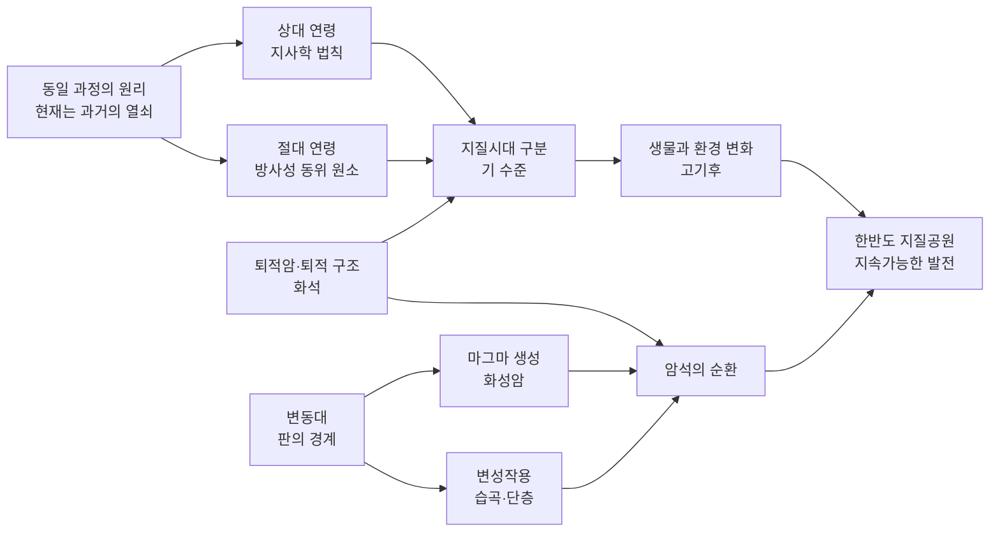
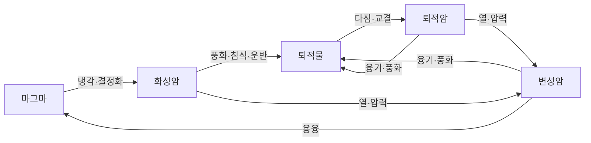

# 지구과학 2. 지구의 역사와 한반도의 암석 — 돌이 들려주는 46억 년의 이야기
<!-- prev: m2-02, 2-5, 3-2, 4-1 -->
<!-- next: esys-1 -->

> [!NOTE]
> **성취기준**
> - **[12지구02-01]** 지층 형성의 선후 관계를 결정짓는 법칙들을 활용하여 상대 연령을 비교하고, 방사성 동위 원소를 이용한 광물의 절대 연령 자료로 암석의 절대 연령을 구할 수 있다.
> - **[12지구02-02]** 지질시대를 기(紀) 수준에서 구분하고, 지층과 화석을 통해 지질시대의 생물과 환경 변화를 해석할 수 있다.
> - **[12지구02-03]** 변동대에서 마그마가 생성되고, 그 조성에 따라 다양한 화성암이 생성됨을 설명할 수 있다.
> - **[12지구02-04]** 변성작용의 종류와 지각 변동에 따른 구조를 변동대와 관련지어 설명하고, 지구시스템에서 암석이 순환함을 추론할 수 있다.
> - **[12지구02-05]** 우리나라의 대표적인 지질공원의 지질학적 형성 과정을 추론하고, 지역사회와 함께하는 지질공원의 지속가능한 발전방안을 제안할 수 있다.

**학습 목표**

1. 동일 과정의 원리를 바탕으로 지사학 법칙을 적용하여 지층과 암석의 선후 관계(상대 연령)를 결정하고, 층서를 대비할 수 있다.
2. 방사성 동위 원소의 반감기를 이용하여 암석의 절대 연령을 계산하고, 퇴적층의 연령 범위를 추론할 수 있다.
3. 퇴적 구조와 화석으로 퇴적 환경을 해석하고, 지질시대를 기 수준에서 구분하여 생물과 기후의 변화를 설명할 수 있다.
4. 변동대에서 마그마가 생기는 과정과 마그마 조성에 따른 화성암의 차이를 한반도의 지형과 관련지어 설명할 수 있다.
5. 변성작용과 습곡·단층·절리 등의 지질 구조를 변동대와 관련짓고, 지구시스템 속 암석의 순환을 추론할 수 있다.
6. 지질공원에서 관찰할 수 있는 암석과 지질 구조로 형성 과정을 추론하고, 지속가능한 발전 방안을 제안할 수 있다.

**이 단원의 학습 사다리**

| 단계 | 무엇을 하나? |
|---|---|
| STEP 1. 이전 학습 다시 보기 | 중학교의 암석·광물·판 경계와 통합과학의 판구조론·지질시대를 다시 꺼낸다 |
| STEP 2. 기초 다지기 | 동일 과정의 원리, 반감기와 지수적 감소, 규산염 광물, 온도·압력과 녹는점 |
| STEP 3. 핵심 개념 | 상대 연령 → 절대 연령 → 퇴적암과 퇴적 환경 → 지질시대 → 화성암 → 변성암과 지질 구조 → 지질공원 |
| STEP 4. 오개념 바로잡기 | "아래에 있는 암석은 항상 더 오래되었다?" 같은 착각을 바로잡는다 |
| STEP 5. 다음 단계로 | 지구시스템과학의 지구 탄생·플룸·화산암, 대학 지질학·지구화학 |
| STEP 6. 생활·산업·진로 | 자원 탐사, 지질 재해 대비, 문화재·건축 석재, 지오투어리즘 |

---

## 🗺️ 단원 들어가기

강원도 영월이나 태백의 석회암 절벽을 쪼개면 삼엽충 화석이 나온다. 삼엽충은 바다에 살던 동물이다. 지금 해발 수백 m 산골짜기에 **어떻게 바다 생물의 흔적이 있을까?** 경남 고성 해안의 평평한 바위에는 공룡 발자국이 줄지어 찍혀 있고, 제주도 해안에는 연필을 세워 묶은 듯한 육각형 돌기둥이 늘어서 있다.

이 모든 바위는 **자기가 언제, 어디서, 어떻게 만들어졌는지**를 몸에 기록하고 있다. 지질학자는 그 기록을 읽는 방법을 찾아냈다. 지층이 쌓인 순서를 따지는 법칙, 원자핵이 일정한 속도로 붕괴하는 성질을 이용한 '돌 속의 시계', 퇴적 구조와 화석이라는 '환경 일기장'이 그것이다. 이 단원에서는 이 방법들로 지구와 한반도의 역사를 읽고, 그 역사가 남긴 풍경을 지질공원에서 직접 확인해 본다.

---

## STEP 1. 🔙 이전 학습 다시 보기

### 연계 개념표

| 이전 단원·성취기준 | 그때 배운 것 | 이 단원에서 확장되는 것 |
|---|---|---|
| 중2 「지권의 변화」 [9과09-02] | 조암 광물의 색, 조흔색, 굳기, 염산 반응, 자성 | 화성암을 이루는 광물 조합(어두운 광물 ↔ 밝은 광물)과 마그마 조성 |
| 중2 「지권의 변화」 [9과09-03] | 화성암·퇴적암·변성암의 생성 과정과 대표 암석, 암석의 순환 | 변동대에서의 마그마 생성, 변성작용의 종류, 지구시스템 속 암석의 순환 |
| 중2 「지권의 변화」 [9과09-05] | 화산대·지진대와 판의 경계가 일치함 | 판의 경계(변동대)별 마그마·변성암·지질 구조의 차이 |
| 통합과학1 「지각과 생명체 구성 물질의 규칙성」 | 규산염 광물의 Si–O 사면체 골격 | 마그마의 $\mathrm{SiO_2}$ 함량에 따른 성질과 화성암 분류 |
| 통합과학1 「판구조론과 지권의 변화」 | 판의 경계, 맨틀 대류, 한반도의 지진·화산 | 발산형·수렴형·보존형 경계의 마그마와 단층·습곡 |
| 통합과학2 「지질시대의 환경 변화와 생물다양성」 | 화석과 지층, 표준 화석·시상 화석, 지질시대의 대 구분, 대멸종 | 기 수준의 구분, 절대 연령 계산, 퇴적 구조로 본 환경, 고기후 연구 방법 |

### 준비 운동 (사전 진단)

**Q1.** 화강암과 현무암 중 결정의 크기가 큰 것은 무엇이며, 그 이유는?

**Q2.** 셰일(이암)이 높은 온도와 압력을 받으면 어떤 암석으로 변하는가?

**Q3.** 다음 중 표준 화석으로 알맞은 조건을 고르시오.
ㄱ. 생존 기간이 길다 ㄴ. 넓은 지역에 분포했다 ㄷ. 개체 수가 많았다

**Q4.** 지질시대의 '대'를 오래된 것부터 순서대로 쓰시오.

정답 및 해설

**Q1. 화강암** — 마그마가 지하 깊은 곳에서 천천히 식어 결정이 자랄 시간이 충분했기 때문이다. 현무암은 지표 부근에서 빨리 식어 결정이 작다.

**Q2.** 편암·편마암(변성 정도에 따라 점판암·천매암을 거친다). 중학교에서는 편암과 편마암을 대표로 배웠다.

**Q3. ㄴ, ㄷ** — 표준 화석은 생존 기간이 **짧고**, 넓은 지역에 많이 살았던 생물이어야 특정 시대를 정확히 가리킬 수 있다.

**Q4.** 선캄브리아 시대 → 고생대 → 중생대 → 신생대

---

## STEP 2. 🧱 기초 다지기

### ① 동일 과정의 원리 — 현재는 과거를 여는 열쇠

18세기 스코틀랜드의 허턴은 오늘날 강과 바다에서 진흙이 쌓이고 굳는 느린 과정이 과거에도 같은 방식으로 일어났다고 생각했다. 이를 **동일 과정의 원리(uniformitarianism)** 라 한다. 오늘날 해변 모래 위에 생기는 물결 자국과 똑같은 무늬가 바위에 있다면, 그 바위도 옛날 얕은 물가에서 만들어졌다고 추론할 수 있다. **지사학의 모든 법칙은 이 원리 위에 서 있다.**

> [!TIP]
> 💡 **비유** — 눈 위의 발자국을 보고 "누군가 이쪽으로 걸어갔다"고 추리하는 것과 같다. 발자국이 생기는 과정을 오늘 직접 관찰할 수 있기 때문에 과거의 발자국을 해석할 수 있다.

단, 소행성 충돌이나 대규모 화산 분출처럼 드물지만 큰 사건도 지구 역사에 영향을 주었다. 과정의 '원리'는 같되 '속도와 규모'는 달랐을 수 있다.

### ② 반감기와 '절반씩 줄어드는' 셈

**방사성 동위 원소**는 불안정한 원자핵이 스스로 붕괴하여 다른 원소로 바뀐다. 붕괴하는 원소를 **모원소**, 새로 생긴 원소를 **자원소**라 한다. 모원소의 양이 처음의 절반이 되는 데 걸리는 시간을 **반감기(half-life)** 라 하며, 온도나 압력에 관계없이 원소마다 일정하다.

| 지난 반감기 횟수 $n$ | 0 | 1 | 2 | 3 | 4 |
|---|---|---|---|---|---|
| 남은 모원소 비율 | 100 % | 50 % | 25 % | 12.5 % | 6.25 % |
| 모원소 : 자원소 | 1 : 0 | 1 : 1 | 1 : 3 | 1 : 7 | 1 : 15 |

$$
\frac{N}{N_0} = \left(\frac{1}{2}\right)^{n}, \qquad t = n \times T \quad (T: \text{반감기})
$$

> [!TIP]
> 💡 **비유** — 큰 피자를 1시간마다 절반씩 먹는다고 하자. 남은 조각의 크기를 보면 몇 시간이 지났는지 알 수 있다. 남은 피자(모원소)와 먹은 피자(자원소)를 비교하는 것이 절대 연령 측정이다.

### ③ 규산염 광물과 $\mathrm{SiO_2}$

통합과학에서 배웠듯이 지각의 대부분은 Si–O 사면체가 기본 골격인 **규산염 광물**이다. 마그마나 암석에서 $\mathrm{SiO_2}$의 비율이 높을수록

- 사면체끼리 더 많이 연결되어 마그마의 **점성(끈끈함)** 이 커지고,
- 밝은색 광물(석영, 장석)이 많아져 암석의 **색이 밝고 밀도가 작다.**

$\mathrm{SiO_2}$가 적고 철·마그네슘이 많으면 어두운색 광물(감람석, 휘석, 각섬석)이 많아져 **색이 어둡고 밀도가 크다.**

### ④ 녹는점은 압력과 물에 따라 달라진다

- 대부분의 암석은 **압력이 낮아지면 녹는점이 낮아진다.** 깊은 곳의 뜨거운 맨틀 물질이 빠르게 올라오면 온도는 거의 그대로인데 녹는점이 낮아져 녹기 시작한다.
- 암석에 **물이 섞이면 녹는점이 크게 낮아진다.** 얼음에 소금을 뿌리면 더 낮은 온도에서 녹는 것과 비슷하다.
- 지하로 갈수록 온도가 높아지는데, 깊이에 따른 온도 분포를 **지하 온도 분포(지온 분포)** 라 한다. 지온이 암석의 녹는점보다 높아지는 곳에서 마그마가 생긴다.

---

## STEP 3. 📘 핵심 개념

### ① 지사학 법칙과 상대 연령 [12지구02-01]

**상대 연령**은 "어느 것이 먼저이고 어느 것이 나중인가"를 나타내는 순서이다. 다음 법칙들로 결정한다.

| 법칙 | 내용 | 활용 |
|---|---|---|
| 수평 퇴적의 법칙 | 퇴적물은 물 밑에서 중력 때문에 수평으로 쌓인다 | 기울어지거나 휜 지층은 퇴적 **후에** 지각 변동을 받았다 |
| 지층 누중의 법칙 | 지층이 뒤집히지 않았다면 아래층이 먼저, 위층이 나중에 쌓였다 | 기본 순서 결정 |
| 동물군 천이의 법칙 | 오래된 지층일수록 원시적인 생물 화석이, 새로운 지층일수록 진화한 생물 화석이 나온다. 같은 화석이 나오면 같은 시대 | 멀리 떨어진 지층의 대비, 역전 여부 판단 |
| 관입의 법칙 | 관입한 화성암은 관입당한 암석보다 나중에 생겼다 | 관입암 주변의 변성(구운 흔적), 관입암 속 **포획암**은 관입암보다 오래됨 |
| 부정합의 법칙 | 부정합면 위아래 지층 사이에는 긴 시간 간격(퇴적 중단·침식)이 있다 | 융기 → 침식 → 침강 → 퇴적의 역사 복원 |

**부정합의 종류**

| 종류 | 모습 | 의미 |
|---|---|---|
| 평행 부정합 | 위아래 지층이 나란하고 그 사이에 침식면 | 지층이 기울지 않은 채 융기·침식·침강 |
| 경사 부정합 | 아래 지층은 기울어(또는 습곡되어) 있고 위 지층은 수평 | 아래 지층이 횡압력으로 변형된 뒤 침식 |
| 난정합 | 아래가 화성암·변성암, 위가 퇴적층 | 깊은 곳에서 생긴 암석이 융기하여 깎인 뒤 그 위에 퇴적 |

부정합면 바로 위에는 침식으로 생긴 자갈이 쌓인 **기저 역암**이 흔히 나타난다.

<!-- fig:earth-2-unconformities -->

또 **단층이나 관입은 그것이 자른 지층보다 나중**이다. 지질 단면도를 해석할 때 가장 많이 쓰는 원리이다.

<!-- fig:earth-2-cross-section -->

#### 예제 1 — 지질 단면도 해석

어느 지역의 단면을 글로 나타내면 다음과 같다.
- 아래부터 셰일 A, 사암 B, 석회암 C가 쌓여 있고, 세 층은 함께 동쪽으로 기울어져 있다.
- A, B, C를 단층 F가 자른다. F의 단층면은 지층과 함께 기울어지지 않았으므로 지층이 기울어진 뒤에 생겼다.
- 기울어진 C의 윗면과 F가 깎인 평평한 면 위에 수평한 역암 D가 쌓여 있고, 그 위에 사암 E가 있다.
- 화강암 G가 A부터 E까지 모두 뚫고 관입해 있으며, G 주변 D와 E에는 구워진 흔적이 있다.

생성 순서를 쓰시오.

**풀이** A → B → C (누중) → 지층이 기울어짐 → 단층 F → 융기·침식(부정합면 생성) → 침강 후 D(기저 역암) → E → 화강암 G 관입.
D 아래는 **경사 부정합**이다. G는 모든 층을 자르고 주변을 구웠으므로 가장 나중이다. 만약 G가 D 아래에서 끝나고 D 속에 G의 자갈이 들어 있다면, G는 D보다 먼저 생겼다고 해야 한다.

#### 층서 대비 — 떨어진 지층을 이어 붙이기

| 방법 | 근거 | 예 |
|---|---|---|
| 암상에 의한 대비 | 암석의 종류·색·구성, 특히 **열쇠층(건층)** | 짧은 시간 넓은 지역에 쌓인 응회암(화산재층), 석탄층 |
| 화석에 의한 대비 | 같은 **표준 화석**이 나오는 지층은 같은 시대 | 멀리 떨어진 대륙 사이의 대비도 가능 |

> [!IMPORTANT]
> 상대 연령은 "몇 년 전"인지는 알려 주지 않는다. 순서를 알려 줄 뿐이다. 실제 나이를 알려면 다음 소절의 **절대 연령**이 필요하다.

---

### ② 방사성 동위 원소와 절대 연령 [12지구02-01]

마그마가 식어 광물 결정이 만들어지는 순간, 결정 속에는 모원소만 갇히고 자원소는 거의 없다(시계가 0에 맞춰진다). 이후 모원소가 붕괴하며 자원소가 쌓이므로, **광물 속 모원소와 자원소의 비율**로 결정이 만들어진 뒤 흐른 시간을 구할 수 있다. 이것이 **절대 연령(방사 연령)** 이다.

| 모원소 → 자원소 | 반감기(약) | 주로 측정하는 대상 |
|---|---|---|
| 우라늄-238 → 납-206 | 45억 년 | 오래된 화성암·변성암(지르콘 광물) |
| 우라늄-235 → 납-207 | 7억 년 | 오래된 암석 |
| 칼륨-40 → 아르곤-40 | 12.5억 년 | 화산암, 운모·장석을 포함한 암석 |
| 루비듐-87 → 스트론튬-87 | 490억 년 | 매우 오래된 암석 |
| 탄소-14 → 질소-14 | 5730년 | 수만 년 이내의 생물 유해(나무, 뼈, 숯) |

- 반감기가 **긴** 원소는 오래된 암석에, **짧은** 원소는 젊은 시료에 알맞다. 반감기가 너무 짧으면 오래된 시료에는 모원소가 거의 남지 않아 측정할 수 없다.
- **퇴적암은 직접 절대 연령을 구하기 어렵다.** 퇴적암의 입자는 더 오래된 암석이 부서진 것이어서, 입자의 나이는 '퇴적된 시기'가 아니라 '원래 암석이 만들어진 시기'를 가리키기 때문이다. 그래서 퇴적층 위아래의 **화성암(관입암, 화산재층)** 의 절대 연령으로 퇴적 시기의 범위를 정한다.

<!-- sim:radiometric-dating -->

#### 예제 2 — 절대 연령 계산

어느 화강암 속 광물에 들어 있는 방사성 원소 X와 그 자원소 Y의 비가 $X : Y = 1 : 3$이다. X의 반감기가 1.3억 년일 때 이 화강암의 절대 연령은? (처음에 Y는 없었다.)

**풀이** 모원소의 비율 $= \dfrac{1}{1+3} = \dfrac{1}{4} = \left(\dfrac{1}{2}\right)^2$ → 반감기 2회
절대 연령 $= 2 \times 1.3\text{억 년} = 2.6\text{억 년}$

#### 예제 3 — 퇴적층의 연령 범위

셰일층 S 아래에 화산재가 굳은 응회암층 T가 있고, S와 T를 화강암 G가 관입하였다. T 속 광물의 모원소는 처음 양의 25 %, G 속 광물의 모원소는 50 %가 남아 있다. 모원소의 반감기는 1억 년이다. S가 쌓인 시기는?

**풀이** T: 25 % → 반감기 2회 → 2억 년 전. G: 50 % → 1회 → 1억 년 전.
누중의 법칙으로 S는 T보다 나중, 관입의 법칙으로 G보다 먼저 생겼다. 따라서 S는 **2억 년 전 ~ 1억 년 전 사이**에 쌓였다.

> [!WARNING]
> 반감기 그래프는 직선이 아니라 점점 완만해지는 곡선이다. 반감기가 2억 년인 원소라면 "2억 년에 50 %가 줄었으니 4억 년이면 모두 사라진다"고 생각하기 쉽지만, 4억 년이 지나도 25 %가 남는다. 매번 **남은 양의** 절반이 줄기 때문이다.

---

### ③ 퇴적암과 퇴적 구조, 퇴적 환경 [12지구02-02]

#### (1) 퇴적암이 만들어지는 과정

풍화·침식으로 생긴 퇴적물이 쌓이면 위에 쌓인 무게로 **다져지고(다짐 작용)**, 입자 사이 물에 녹아 있던 물질이 입자를 붙여(**교결 작용**) 단단한 퇴적암이 된다. 이 전체 과정을 **속성 작용**이라 한다.

| 종류 | 만들어지는 방식 | 예 |
|---|---|---|
| 쇄설성 퇴적암 | 암석 조각이 쌓임(입자 크기로 구분) | 역암(자갈), 사암(모래), 셰일·이암(진흙) |
| 화학적 퇴적암 | 물에 녹은 물질이 가라앉거나 증발로 남음 | 암염, 석고, 일부 석회암 |
| 유기적 퇴적암 | 생물의 유해가 쌓임 | 석회암(산호·조개껍데기), 처트, 석탄(식물) |

#### (2) 퇴적 구조 — 쌓일 때의 흔적

| 퇴적 구조 | 모습 | 알 수 있는 것 |
|---|---|---|
| 층리 | 입자 크기·색이 다른 층이 나란히 쌓인 줄무늬 | 퇴적 조건의 변화 |
| 사층리(교차 층리) | 층리가 비스듬히 기울어 서로 엇갈림 | 물이나 바람이 흐른 **방향**, 지층의 위아래 |
| 점이 층리 | 한 층 안에서 아래는 굵은 입자, 위로 갈수록 가는 입자 | 깊은 바다에서 퇴적물이 한꺼번에 흘러내린 뒤 가라앉음(저탁류), 지층의 위아래 |
| 연흔 | 물결 모양의 무늬 | 얕은 물 밑이나 물가, 지층의 위아래 |
| 건열 | 진흙 표면이 갈라진 다각형 틈 | 퇴적물이 물 밖으로 드러나 마름(조간대·건조한 호숫가), 지층의 위아래 |

> [!TIP]
> 💡 **요령** — 사층리·점이 층리·연흔·건열은 모두 **위아래가 있는 구조**이다. 점이 층리에서 굵은 입자가 위쪽에 있다면 지층이 **뒤집혔다(역전)** 는 증거이다. 건열은 위로 벌어진 V자 모양이므로 V가 아래로 벌어져 있다면 역시 역전된 것이다.

<!-- fig:earth-2-sed-structures -->

#### (3) 퇴적 환경

| 환경 | 장소 | 대표 퇴적물·구조 |
|---|---|---|
| 육상 환경 | 하천, 호수, 선상지, 사막, 빙하 | 하천의 역암·사암, 사막의 대규모 사층리, 호수의 셰일, 빙하의 크기가 뒤섞인 퇴적물 |
| 연안 환경 | 삼각주, 해빈, 조간대(갯벌), 석호 | 연흔, 건열, 사층리 |
| 해양 환경 | 대륙붕, 대륙 사면, 심해저 | 대륙붕의 석회암, 대륙 사면 아래의 점이 층리, 심해저의 고운 진흙 |

#### 예제 4 — 퇴적 환경 추론

어떤 지층에서 아래부터 (가) 건열이 있는 붉은 이암, (나) 연흔이 있는 사암, (다) 삼엽충 화석이 든 석회암이 차례로 나타난다. 지층은 역전되지 않았다. 이 지역의 환경 변화를 추론하시오.

**풀이** (가) 물 밖으로 드러나 마르는 환경 → (나) 얕은 물가 → (다) 얕은 바다. 시간이 지나며 **해수면이 상승하였거나 땅이 침강**하여 바다가 점점 육지 쪽으로 들어왔다(해침).

---

### ④ 지질시대의 구분과 생물·환경의 변화 [12지구02-02]

#### (1) 지질시대를 나누는 기준

지질시대는 **생물계의 큰 변화(대멸종, 새로운 생물군의 출현)** 와 큰 지각 변동을 기준으로 나눈다. 큰 단위부터 **누대 → 대 → 기**이다. 생물 화석이 많이 나오기 시작하는 고생대 이후를 기 수준으로 나누면 다음과 같다.

| 대 | 기 | 시작(약) | 주요 생물과 사건 |
|---|---|---|---|
| 선캄브리아 시대 | — | 46억 년 전 | 남세균이 만든 **스트로마톨라이트**, 대기 중 산소 증가, 말기에 다세포 생물(에디아카라 동물군) |
| 고생대 | 캄브리아기 | 5.4억 년 전 | 단단한 껍데기를 가진 동물의 급격한 다양화, **삼엽충** 번성 |
| | 오르도비스기 | 4.9억 년 전 | 필석, 앵무조개류 번성, 원시 어류 출현. 말기 대멸종 |
| | 실루리아기 | 4.4억 년 전 | 최초의 육상 식물, 산호 번성 |
| | 데본기 | 4.2억 년 전 | '어류의 시대', 양서류 출현, 숲의 시작. 후기 대멸종 |
| | 석탄기 | 3.6억 년 전 | 거대 양치식물 숲(석탄의 근원), 거대 곤충, 파충류 출현 |
| | 페름기 | 3.0억 년 전 | 판게아 형성, 방추충 번성. 말기 **가장 큰 대멸종** |
| 중생대 | 트라이아스기 | 2.5억 년 전 | 공룡·포유류 출현, 겉씨식물 번성. 말기 대멸종 |
| | 쥐라기 | 2.0억 년 전 | 공룡 번성, 시조새, **암모나이트** 번성 |
| | 백악기 | 1.45억 년 전 | 속씨식물 출현, 말기 공룡·암모나이트 멸종 |
| 신생대 | 팔레오기 | 6600만 년 전 | 포유류의 다양화, **화폐석** 번성 |
| | 네오기 | 2300만 년 전 | 초원 확대, 인류의 조상 출현 |
| | 제4기 | 258만 년 전 | 빙기와 간빙기의 반복, 매머드, 현생 인류 |

- **표준 화석**: 삼엽충·필석(고생대), 암모나이트·공룡(중생대), 화폐석·매머드(신생대)
- **시상 화석**(환경을 알려 줌): 산호(따뜻하고 얕은 맑은 바다), 고사리(따뜻하고 습한 육지)

<!-- fig:earth-2-time-scale -->

#### 예제 5 — 지구 역사 달력

46억 년의 지구 역사를 1년(1월 1일 0시 ~ 12월 31일 24시)으로 줄이면, 고생대가 시작되는 약 5.4억 년 전은 며칠 무렵이고, 현생 인류가 나타난 약 30만 년 전은 12월 31일 몇 시 무렵인가?

**풀이** 고생대: $\dfrac{5.4}{46}\times365 \approx 42.8$일 전 → **11월 19일 무렵**. 현생 인류: $\dfrac{0.003}{46}\times365\times24\times60 \approx 34$분 전 → **12월 31일 밤 11시 26분 무렵**. 지구 역사의 약 88 %가 선캄브리아 시대이다.

#### (2) 지질시대의 기후와 환경

| 시대 | 기후·환경의 특징 |
|---|---|
| 선캄브리아 시대 | 여러 차례 큰 빙하기. 지구 전체가 얼었다는 '눈덩이 지구' 가설이 있다 |
| 고생대 | 대체로 온난했으나 오르도비스기 말, 석탄기 후기~페름기 초에 빙하기. 말기에 판게아 형성으로 내륙 건조 |
| 중생대 | 전반적으로 온난하여 극지방에도 큰 빙하가 거의 없었다. 판게아가 갈라지기 시작 |
| 신생대 | 점차 한랭해져 제4기에 빙기와 간빙기가 반복. 대륙 배치가 오늘날과 비슷해짐 |

#### (3) 고기후 연구 방법

지질시대의 기후는 직접 잴 수 없으므로 기후를 기록하고 있는 '대리 자료'를 이용한다. (이 과목에서는 방법을 소개하는 수준에서 다룬다.)

| 방법 | 무엇을 이용하나 | 알아낼 수 있는 시간 범위(대략) |
|---|---|---|
| 나무 나이테 | 나이테의 폭·밀도(따뜻하고 습한 해에 넓다) | 수천 년 |
| 빙하 코어 | 얼음의 산소 동위 원소 비율, 얼음 속 기포의 공기 | 수십만 년 |
| 해양 퇴적물 | 유공충 껍데기의 산소 동위 원소 비율, 생물 종류 | 수백만 년 이상 |
| 꽃가루 화석 | 그 시기에 살았던 식물의 종류 | 수만 년 이상 |
| 산호·석순 | 성장층의 화학 성분 | 수백 ~ 수십만 년 |
| 지층·화석 | 빙하 퇴적물, 증발암, 석탄층, 시상 화석 | 수억 년 |

> [!NOTE]
> 남극 빙하 코어의 기포를 분석하면 과거 수십만 년 동안 대기 중 이산화 탄소 농도와 기온이 함께 오르내렸음을 알 수 있다. 「대기와 해양의 상호작용」에서 배운 밀란코비치 주기의 증거이기도 하다.

#### (4) 한반도의 지질 역사 한눈에 보기

| 시대 | 한반도에 남은 기록 |
|---|---|
| 선캄브리아 시대 | 편마암·편암이 넓게 분포(한반도의 가장 오래된 기반암, 서울 주변 기반암 포함) |
| 고생대 전기 | 얕은 바다에서 쌓인 석회암층(조선 누층군): 강원 남부·충북 북부, 삼엽충 화석, 석회 동굴 |
| 고생대 중기 | 지층이 거의 없음 — 한반도가 육지였을 것으로 해석 |
| 고생대 후기 ~ 중생대 초 | 육지와 바다가 번갈아 쌓인 지층(평안 누층군), 석탄층 |
| 중생대 쥐라기 | 큰 지각 변동과 화강암 관입(서울 북한산·관악산 등의 화강암) |
| 중생대 백악기 | 경상도 일대의 큰 호수 분지에 쌓인 퇴적층(경상 누층군), **공룡 발자국·알 화석**, 활발한 화산 활동, 말기 화강암 관입 |
| 신생대 | 포항 등 동해안 일부의 해성층, 제주도·울릉도·독도·한탄강 일대의 화산 활동 |

---

### ⑤ 변동대의 마그마와 화성암 [12지구02-03]

#### (1) 마그마는 어디에서 생기나

마그마는 지구 아무 곳에서나 생기지 않는다. 판의 경계와 같은 **변동대**에서 특별한 조건이 갖추어져야 한다.

| 장소 | 마그마가 생기는 원리 | 마그마 종류 | 예 |
|---|---|---|---|
| 해령(발산형 경계) | 맨틀 물질이 상승 → **압력 감소**로 녹는점 하강 → 부분 용융 | 현무암질 | 대서양 중앙 해령, 아이슬란드 |
| 열점(판 내부) | 깊은 곳에서 뜨거운 물질 기둥이 상승 → 압력 감소 | 현무암질 | 하와이 |
| 섭입대(수렴형 경계) | 섭입하는 해양판에서 빠져나온 **물**이 위쪽 맨틀의 녹는점을 낮춤 | 현무암질 → 상승하며 지각 물질과 섞이고 분화 → 안산암질 | 일본 열도, 안데스산맥의 화산 |
| 섭입대의 대륙 지각 하부 | 올라온 고온의 마그마가 대륙 지각을 **가열**하여 녹임 | 유문암질(화강암질) | 큰 화강암체(저반) |

STEP 2의 ④에서 본 세 가지, 즉 **압력 감소, 물 공급, 온도 상승**이 마그마 생성의 세 가지 길이다.

<!-- fig:earth-2-magma-settings -->

#### (2) 마그마의 조성과 성질

| 성질 | 현무암질 마그마 | 안산암질 마그마 | 유문암질 마그마 |
|---|---|---|---|
| $\mathrm{SiO_2}$ 함량(약) | 52 % 이하 | 52 ~ 63 % | 63 % 이상 |
| 온도(약) | 높다(약 $1000\sim1200\ ^\circ\mathrm{C}$) | 중간 | 낮다(약 $800\ ^\circ\mathrm{C}$ 안팎) |
| 점성 | 작다(잘 흐른다) | 중간 | 크다(끈끈하다) |
| 화산 가스 탈출 | 쉽다 | 중간 | 어렵다 |
| 분출 모습 | 비교적 조용히 흘러나옴 | 폭발과 용암 분출 반복 | 폭발적 분출, 화산재·화쇄류 |
| 화산 모양 | 경사가 완만한 순상 화산, 용암 대지 | 성층 화산 | 경사가 급한 종상 화산 |

#### (3) 화성암의 분류

화성암은 **어디서 식었는가(조직)** 와 **무엇으로 되어 있는가(조성)** 로 분류한다.

| 구분 | 염기성암($\mathrm{SiO_2}$ 적음) | 중성암 | 산성암($\mathrm{SiO_2}$ 많음) |
|---|---|---|---|
| 화산암(지표 부근에서 빨리 식음, 세립질·유리질) | 현무암 | 안산암 | 유문암 |
| 심성암(지하 깊은 곳에서 천천히 식음, 조립질) | 반려암 | 섬록암 | 화강암 |
| 주요 광물 | 감람석, 휘석, 사장석 | 각섬석, 사장석 | 석영, 정장석, 흑운모 |
| 색 / 밀도 | 어둡다 / 크다 | 중간 | 밝다 / 작다 |

> [!TIP]
> 💡 **비유** — 녹인 설탕을 찬 쟁반에 부으면 결정 없는 사탕(유리질)이 되고, 설탕물을 오래 두면 큰 결정(조립질)이 자란다. 식는 속도가 결정 크기를 정한다. 큰 결정 사이에 작은 결정이 박힌 **반상 조직**은 깊은 곳에서 천천히 식다가 지표 부근으로 올라와 빨리 식은 '두 번의 냉각' 기록이다.

#### (4) 화성암이 만드는 한반도의 지형

교육과정은 화성암의 이름보다 **그 암석이 생긴 환경의 의미**를 강조한다. 한반도의 지형으로 확인해 보자.

| 지형 | 암석 | 생성 환경의 의미 |
|---|---|---|
| 제주도 해안·한탄강의 **주상 절리** | 현무암 | 점성이 작은 현무암질 용암이 넓게 흐른 뒤 식으며 수축하여 기둥 모양으로 갈라졌다 |
| 한탄강·임진강의 **용암 대지** | 현무암 | 신생대에 흘러나온 용암이 옛 골짜기를 메웠고, 그 뒤 강이 다시 깎아 협곡을 만들었다 |
| 북한산·설악산·월출산의 **돌산** | 화강암 | 지하 깊은 곳에서 굳은 뒤, 위의 암석이 오랜 시간 깎여 나가 드러났다. 압력이 줄며 생긴 양파 껍질 같은 **판상 절리** |
| 제주 성산일출봉·수월봉 | 응회암 | 마그마가 얕은 바닷물과 만나 격렬하게 폭발하며 화산재가 층층이 쌓였다(수성 화산 분출) |
| 무등산 서석대·입석대의 주상 절리 | 응회암 | 화산 폭발로 쌓인 뜨거운 화산재가 굳고 식으며 기둥 모양으로 갈라졌다 |

> [!IMPORTANT]
> 화강암이 지표에 드러나 있다는 것은 **그 위를 덮고 있던 수 km 두께의 암석이 침식되었다**는 뜻이다. 화강암 산은 '아주 오랜 시간'과 '깊은 곳에서 생긴 뒤의 융기'를 함께 말해 준다.

#### 예제 6 — 화성암 추론

어느 화성암은 밝은색이며 결정이 맨눈으로 보일 만큼 크고, $\mathrm{SiO_2}$ 함량이 약 70 %이다. (1) 암석 이름은? (2) 이 암석을 만든 마그마는 주로 어떤 변동대에서 생기는가? (3) 같은 마그마가 지표로 분출했다면 화산의 모양은?

**풀이** (1) 산성암이며 조립질인 심성암 → **화강암** (2) 섭입대에서 대륙 지각 하부가 가열되어 녹은 유문암질 마그마 (3) 점성이 커서 경사가 급한 종상 화산(또는 폭발적 분출)

---

### ⑥ 변성작용, 지질 구조, 그리고 암석의 순환 [12지구02-04]

#### (1) 변성작용의 종류

암석이 녹지 않은 **고체 상태**에서 높은 온도와 압력을 받아 광물과 조직이 바뀌는 것을 **변성작용**이라 한다.

| 구분 | 접촉 변성작용 | 광역 변성작용 |
|---|---|---|
| 주된 원인 | 마그마의 **열** | 넓은 지역의 높은 **온도와 압력** |
| 범위 | 관입암 주변 수 m ~ 수 km | 수십 ~ 수천 km |
| 일어나는 곳 | 마그마가 관입한 곳 | 수렴형 경계의 조산대(대륙 충돌대, 섭입대) |
| 조직 | 재결정되어 입자가 커지고 치밀해짐, **엽리 없음**(혼펠스 조직) | 광물이 한 방향으로 배열된 **엽리**(편리, 편마 구조) |
| 예 | 셰일 → 혼펠스, 사암 → 규암, 석회암 → 대리암 | 셰일 → 점판암 → 천매암 → 편암 → 편마암 |

광역 변성에서 압력은 광물을 **누르는 힘에 수직인 방향으로** 납작하게 배열시킨다. 변성 정도가 더 높아지면 일부가 녹아 변성암과 화성암이 섞인 듯한 암석(혼성암)이 생기기도 한다. 서울 주변의 기반암인 편마암은 아주 오래전 광역 변성작용을 받은 암석이다.

> [!TIP]
> 💡 **비유** — 밀가루 반죽(셰일)을 위에서 누르면 납작해지고(점판암의 쪼개짐), 오래 치대면 결이 생긴다(편암의 편리). 반죽을 오븐 옆에 두기만 하면 결 없이 단단하게 구워진다(접촉 변성의 혼펠스).

#### (2) 지각 변동이 만드는 구조와 변동대

| 구조 | 생기는 힘 | 모습 | 관련 변동대 |
|---|---|---|---|
| 습곡 | 양쪽에서 미는 힘(횡압력) | 지층이 물결처럼 휨. 위로 볼록 = 배사, 아래로 오목 = 향사 | 수렴형 경계(습곡 산맥) |
| 정단층 | 양쪽으로 당기는 힘(장력) | 단층면 위쪽 땅(상반)이 아래로 내려감 | 발산형 경계(해령, 열곡대) |
| 역단층 | 미는 힘(횡압력) | 상반이 위로 올라감. 기울기가 작으면 위로 밀려 덮음 | 수렴형 경계 |
| 주향 이동 단층 | 서로 엇갈려 미끄러지는 힘 | 수평 방향으로 어긋남 | 보존형 경계(변환 단층) |
| 절리 | 냉각 수축, 압력 감소 | 이동 없이 갈라진 틈(주상 절리, 판상 절리) | 다양 |
| 관입·포획 | 마그마의 상승 | 기존 암석을 뚫고 들어감, 주변 암석 조각을 품음 | 섭입대 등 |

**정리**: 발산형 경계 → 장력 → 정단층, 현무암질 마그마 / 수렴형 경계 → 횡압력 → 역단층·습곡·광역 변성작용, 안산암질·유문암질 마그마 / 보존형 경계 → 주향 이동 단층, 화산 활동은 거의 없음

#### 예제 7 — 단층 판별

어느 단층에서 단층면 위쪽 땅(상반)이 단층면을 따라 아래로 1.5 m 내려가 있다. (1) 이 단층의 종류와 작용한 힘은? (2) 이런 단층이 많이 나타나는 판의 경계는?

**풀이** (1) **정단층**, 장력(양쪽으로 당기는 힘) (2) 발산형 경계(해령, 대륙의 열곡대)

#### (3) 지구시스템에서 암석은 순환한다

| 과정 | 에너지원 | 관련 권역의 상호작용 |
|---|---|---|
| 풍화·침식·운반·퇴적 | **태양 에너지**(물의 순환, 바람), 중력 | 지권 ↔ 기권·수권, 생물의 풍화 작용(생물권) |
| 마그마 생성, 변성작용, 융기 | **지구 내부 에너지** | 판의 운동(지권 내부) |
| 석회암·석탄의 생성 | 생물 활동 | 생물권 → 지권 (탄소 저장) |
| 화산 가스 방출 | 지구 내부 에너지 | 지권 → 기권 (이산화 탄소, 수증기) |

암석의 순환은 판의 운동과 묶여 있다. 해령에서 생긴 현무암은 판을 따라 이동해 섭입대로 들어가 물을 내놓고 마그마 생성을 돕는다. 섭입대에서 생긴 화강암이 융기·침식되면 그 퇴적물이 다시 바다에 쌓인다. 이렇게 **암석의 순환은 탄소와 물의 순환과도 이어져** 지구시스템 전체의 물질 순환을 이룬다.

---

### ⑦ 우리나라의 지질공원 [12지구02-05]

#### (1) 지질공원이란

**지질공원(geopark)** 은 지질학적으로 중요하고 경관이 아름다운 지역을 보전하면서 교육과 관광에 활용하여 지역 경제를 살리는 곳이다. 우리나라에는 환경부가 인증하는 **국가지질공원**이 여러 곳 있고, 그중 제주도, 청송, 무등산권, 한탄강 등은 **유네스코 세계지질공원**으로도 인증받았다. 일반 자연공원과 달리 **사람의 출입을 막는 것보다 '보전하며 이용'** 하는 것이 핵심이다.

#### (2) 답사로 형성 과정 추론하기

모든 지질공원을 외우기보다, 가까운 지질공원을 방문했을 때 **무엇을 보고 어떻게 추론하는지**가 중요하다. 다음 '관찰 → 추론' 틀을 이용해 보자.

| 관찰하는 것 | 묻는 질문 | 추론의 근거(이 단원) |
|---|---|---|
| 암석의 종류(색, 결정 크기, 층리) | 화성암·퇴적암·변성암 중 무엇인가? | ③ 퇴적암, ⑤ 화성암, ⑥ 변성암 |
| 퇴적 구조, 화석 | 어떤 환경에서 쌓였나? 언제인가? | ③ 퇴적 구조, ④ 표준·시상 화석 |
| 지질 구조(절리, 습곡, 단층, 부정합) | 어떤 힘·사건을 겪었나? | ① 지사학 법칙, ⑥ 지질 구조 |
| 지층과 암석의 접촉 관계 | 어느 것이 먼저인가? | ① 상대 연령 |
| 안내판의 연령 자료 | 몇 년 전인가? | ② 절대 연령 |

**답사 예시 세 곳**

| 지질공원(예) | 관찰할 수 있는 것 | 추론할 수 있는 형성 과정 |
|---|---|---|
| 한탄강 | 현무암 협곡과 주상 절리, 현무암 아래 깔린 더 오래된 암석 | 신생대 현무암질 용암이 옛 강 골짜기를 따라 흘러 메움 → 냉각 수축으로 주상 절리 → 강이 다시 깎아 협곡 형성 |
| 강원고생대(태백·영월·정선·평창 일대) | 석회암, 삼엽충·완족류 화석, 석회 동굴, 하천이 뚫은 지형 | 고생대 초 따뜻하고 얕은 바다에서 석회암 퇴적 → 융기 → 지하수가 석회암을 녹여 동굴 형성 |
| 제주도 | 현무암, 응회암 층의 성산일출봉·수월봉, 해안 주상 절리, 용암 동굴 | 신생대 여러 차례의 화산 활동, 얕은 바다에서의 수성 화산 분출, 점성이 작은 용암이 흐르며 굳음 |

#### 예제 8 — 답사 보고서 추론

어느 해안 지질 명소의 안내판에 다음 관찰 사실이 있다. "붉은색 이암과 사암이 번갈아 쌓여 있고, 연흔과 건열, 공룡 발자국이 보인다. 지층은 거의 수평이다." 이 지층의 퇴적 환경과 시대를 추론하시오.

**풀이** 연흔과 건열 → 얕은 물이 고였다 말랐다 하는 호숫가·하천 주변(육상 환경). 공룡 발자국 → 중생대. 한반도라면 경상도 일대의 **중생대 백악기 호수 주변 퇴적층**일 가능성이 크다. 지층이 거의 수평이므로 이후 큰 습곡 작용은 받지 않았다.

#### (3) 지역사회와 함께하는 지속가능한 발전

| 방향 | 방안의 예 | 주의할 점 |
|---|---|---|
| 보전 | 화석·노두 훼손 방지 시설, 탐방로 정비, 주기적 모니터링 | 출입을 막기만 하면 지역 주민의 공감을 얻기 어렵다 |
| 교육 | 지질 해설사 양성, 학교 연계 현장 학습, 안내판·디지털 해설(증강 현실) | 과학적으로 정확한 내용 |
| 지역 경제 | 지질 관광(지오투어리즘), 지역 특산물·숙박과 연계한 '지오 브랜드' | 관광객 수를 관리해 환경 훼손을 막아야 한다 |
| 주민 참여 | 주민이 해설사·운영자로 참여, 수익의 지역 환원 | 지역 문화·역사와 함께 엮기 |
| 안전 | 낙석·파도 위험 구역 안내, 재해 교육 | 해안·절벽 탐방 시 안전 수칙 |

---

## STEP 4. ⚠️ 오개념 바로잡기

| 흔한 오개념 | 올바른 개념 | 왜 그럴까? |
|---|---|---|
| 아래에 있는 암석은 언제나 위의 암석보다 오래되었다 | 지층이 **역전**되었거나 화성암이 아래에서 **관입**했다면 아래가 더 젊을 수 있다 | 지층 누중의 법칙은 '역전되지 않은 퇴적층'에만 적용된다. 퇴적 구조로 위아래를 확인해야 한다 |
| 퇴적암 속 광물의 절대 연령이 그 퇴적암의 나이이다 | 퇴적암 입자의 나이는 **원래 암석의 나이**이다 | 퇴적물은 이미 있던 암석이 부서진 것이므로, 퇴적 시기는 위아래 화성암으로 범위를 정한다 |
| 반감기의 2배 시간이 지나면 모원소가 모두 사라진다 | 반감기마다 **남은 양의 절반**이 줄어 2회 후 25 %가 남는다 | 감소는 직선이 아니라 지수적이다 |
| 탄소-14로 공룡 뼈의 나이를 잰다 | 탄소-14는 반감기가 약 5730년이어서 **수만 년 이내**의 시료에만 쓴다 | 수천만 년 된 시료에는 탄소-14가 거의 남아 있지 않다 |
| 마그마는 지하 어디에나 있는 '녹은 층'에서 나온다 | 맨틀은 대부분 **고체**이고, 압력 감소·물 공급·온도 상승이 있는 **변동대에서만** 부분적으로 녹는다 | 지진파 연구로 맨틀이 고체임이 확인되었다 |
| 변성암은 암석이 녹았다가 다시 굳은 것이다 | 변성작용은 **고체 상태**에서 일어난다. 녹았다가 굳으면 화성암이다 | 열과 압력으로 광물이 재결정될 뿐 녹지 않는다 |
| 지질공원은 사람의 출입을 막아 보호하는 곳이다 | 지질공원은 **보전과 교육·관광을 함께** 추구하여 지역이 지속가능하게 발전하는 곳이다 | 지역 주민과 방문객이 가치를 알아야 오래 보전된다 |

---

## STEP 5. 🎓 다음 단계로 한 걸음 더

> [!CAUTION]
> 이 절은 **지구과학 교육과정 범위 밖의 심화 내용**으로 평가 대상이 아니다. 고기후 연구 방법의 자세한 원리, 방사성 붕괴의 수학적 표현 등은 진로 선택 과목과 대학에서 배운다.

### 진로 선택 과목과의 연결

| 과목·단원 | 이어지는 내용 |
|---|---|
| 지구시스템과학 「지구 탄생과 생동하는 지구」 | 지구 대기·원시 바다·생명체 탄생, 물·탄소·산소 순환으로 본 지구시스템의 진화, 맨틀 상부 운동과 플룸, 화산 활동으로 생기는 암석, 지진파로 본 지구 내부 |
| 융합 선택 「기후변화와 환경생태」 | 고기후 자료로 본 현재 기후변화의 의미 |

### ① 방사성 붕괴를 지수 함수로 쓰기

대학에서는 붕괴를 다음과 같이 쓴다.

$$
N = N_0 e^{-\lambda t}, \qquad \lambda = \frac{\ln 2}{T}, \qquad t = \frac{1}{\lambda}\ln\!\left(1 + \frac{D}{N}\right)
$$

($D$: 자원소의 양, $N$: 남은 모원소의 양). 반감기의 정수배가 아닌 경우도 계산할 수 있다. 실제 측정에서는 처음부터 있던 자원소를 보정하기 위해 여러 광물의 자료를 한 그래프에 찍어 기울기로 나이를 구하는 **등시선법**을 쓴다.

### ② 산소 동위 원소로 기온 읽기 — 원리

산소에는 가벼운 $^{16}\mathrm{O}$과 무거운 $^{18}\mathrm{O}$이 있다. 가벼운 $^{16}\mathrm{O}$이 든 물이 더 잘 증발하므로, 빙하기에는 $^{16}\mathrm{O}$이 많은 수증기가 눈이 되어 빙하에 갇힌다. 그 결과 바닷물에는 $^{18}\mathrm{O}$의 비율이 높아지고, 그 바닷물로 껍데기를 만든 유공충에도 $^{18}\mathrm{O}$이 많아진다. 반대로 빙하 얼음에는 추울수록 $^{18}\mathrm{O}$이 적다. 이 단원에서 '방법'으로만 소개한 빙하 코어와 해양 퇴적물 연구의 원리이다.

### ③ 마그마는 식으면서 성분이 변한다 — 결정 분화

현무암질 마그마가 식을 때 감람석·휘석처럼 녹는점이 높은 광물이 먼저 정출되어 가라앉으면, 남은 마그마는 $\mathrm{SiO_2}$가 점점 많아진다. 광물이 정출되는 순서를 정리한 것을 **보웬의 반응 계열**이라 한다. 섭입대의 마그마가 다양한 조성을 갖는 까닭의 하나이다.

### ④ 판의 경계와 변성 조건

대학 암석학에서는 온도–압력 그래프에 변성암이 생기는 조건을 나누어 표시한다(변성상). 예를 들어 섭입대의 해구 쪽은 차가운 판이 빠르게 들어가 '높은 압력·낮은 온도' 변성암이, 화산호 쪽은 '높은 온도' 변성암이 생긴다. 변성암 하나로 그 암석이 어느 판 경계, 몇 km 깊이에 있었는지 거꾸로 추적할 수 있다.

### 지금 vs 다음 단계

| 구분 | 고등학교 지구과학 | 지구시스템과학 | 대학 지질학·지구화학 |
|---|---|---|---|
| 연령 측정 | 반감기 횟수로 계산 | 지구 역사 속 물질 순환 | 지수 붕괴식, 등시선법, 질량 분석 |
| 고기후 | 연구 방법 소개 | 탄소·산소 순환과 기후 | 동위 원소 지구화학, 고해양학 |
| 화성암 | 마그마 생성 장소와 조성 | 화산 활동과 암석의 특성 | 결정 분화, 상평형도 |
| 변성암·구조 | 종류와 변동대 | 플룸·판 운동 | 변성상, 구조 지질학 |
| 관련 전공 | — | — | 지질학, 지구환경과학, 지구시스템과학, 자원공학 |

---

## STEP 6. 🏭 생활·산업·진로 연결

### 사례 1. 자원 탐사 — 지층을 읽어 자원을 찾다

- **원리**: 석탄은 석탄기 같은 늪지 환경의 지층에, 석유·가스는 유기물이 쌓인 퇴적층과 이를 가두는 배사 구조에, 금속 광상은 마그마 관입과 접촉 변성대 주변에 모인다. 층서 대비와 지질 구조 해석이 탐사의 출발점이다.
- **어디에 쓰이나**: 석회석(시멘트 원료) 광산, 희유 금속 광상 탐사, 지하수 탐사.

### 사례 2. 지질 재해 대비와 지하 공간 이용

- **원리**: 단층의 위치와 마지막 활동 시기(절대 연령)를 조사하면 활성 단층 여부를 판단할 수 있다. 절리가 발달한 암반은 무너지기 쉽다.
- **어디에 쓰이나**: 원자력 발전소·댐·터널의 입지 선정, 산사태·낙석 위험 지도, 방사성 폐기물 처분장 부지 조사.

### 사례 3. 건축 석재와 문화유산

- **원리**: 화강암은 단단하고 풍화에 강해 건축과 석탑에 쓰였다. 대리암은 아름답지만 산성비에 녹기 쉽다. 석조 문화재의 풍화를 진단하려면 암석의 광물 조성과 절리를 이해해야 한다.
- **어디에 쓰이나**: 석조 문화재 보존 과학, 건축 석재 품질 평가.

### 관련 진로와 학과

| 진로 | 하는 일 | 관련 학과 |
|---|---|---|
| 지질학자·지질 조사 연구원 | 지질도 작성, 지층·화석·암석 연구 | 지질학, 지구환경과학 |
| 자원 탐사 엔지니어 | 광물·에너지 자원 탐사와 개발 | 자원공학, 에너지자원공학 |
| 지반·터널 엔지니어 | 암반 조사, 구조물 기초 설계 | 토목공학, 지질공학 |
| 지질공원 해설사·지오투어리즘 기획자 | 탐방 프로그램 운영, 지역 연계 관광 기획 | 지구과학교육, 관광학 |
| 문화재 보존 과학자 | 석조 문화재 진단과 보존 처리 | 문화재보존학, 재료공학 |

---

## 🔬 탐구 활동

### 활동 A. 지질단면도에서 층서 대비하기

**목표** 지사학 법칙을 적용해 떨어진 두 지역의 지층을 대비하고 생성 순서를 정한다.

**준비물** 두 지역의 주상도(지층을 기둥 모양으로 그린 그림) 카드 또는 교사가 제시한 자료, 색연필, 자

**과정**
1. 지역 (가)와 (나)의 주상도를 나란히 놓는다. 예: (가) 아래부터 사암–응회암–셰일(삼엽충)–석회암, (나) 아래부터 역암–셰일(삼엽충)–석회암–사암.
2. 응회암, 특징적인 화석이 든 층처럼 **열쇠층**이 될 만한 층에 같은 색을 칠한다.
3. 같은 시대의 층끼리 선으로 잇는다.
4. 두 지역을 합친 전체 층서를 아래부터 위로 정리하고, 한 지역에 없는 층이 있다면 그 까닭(퇴적 중단, 침식)을 추론한다.

**결과 기록**

| 순서(아래부터) | 지역 (가) | 지역 (나) | 대비 근거 |
|---|---|---|---|
| 1 | | | |
| 2 | | | |
| 3 | | | |
| 4 | | | |
| 5 | | | |

**생각해 보기**
1. 응회암층이 열쇠층으로 좋은 까닭은?
2. 한 지역에만 있는 층은 무엇을 뜻할 수 있는가?

### 활동 B. 한반도 지질 명소(국가지질공원)에서 관찰 가능한 암석과 지질 구조 탐구하기

**목표** 우리 지역에서 가까운 지질공원 한 곳을 정해 관찰 가능한 암석과 지질 구조를 조사하고 형성 과정을 추론한다.

**준비물** 지질공원 누리집 자료, 지질도(공개 지질 정보 서비스), 돋보기, 묽은 염산(교사 관리), 사진기, 야장(관찰 기록장)

**과정**
1. 방문(또는 자료 조사)할 지질공원과 지질 명소 2~3곳을 정한다.
2. 각 명소에서 STEP 3의 ⑦ '관찰 → 추론' 틀에 따라 암석, 구조, 화석을 관찰하고 사진과 스케치로 기록한다.
3. 형성 과정을 시간 순서의 흐름도로 정리한다.
4. 그 지질공원의 지속가능한 발전 방안을 모둠별로 한 가지씩 제안하고 발표한다.

**결과 기록**

| 명소 | 암석 | 지질 구조·화석 | 추론한 형성 과정 | 발전 방안 |
|---|---|---|---|---|
| | | | | |
| | | | | |

> [!WARNING]
> **안전 수칙** 해안 명소는 물때(밀물·썰물 시각)를 반드시 확인하고, 절벽 아래 낙석 위험 구역에 들어가지 않는다. 지질공원의 암석과 화석을 망치로 깨거나 가져가지 않는다. 염산은 교사의 지도 아래 보안경을 쓰고 한두 방울만 사용한다.

---

## ✅ 개념 확인 문제

### 기본

**1.** 다음 설명에 해당하는 지사학 법칙을 쓰시오. "화강암 속에 주변 셰일의 조각이 들어 있으므로 셰일이 화강암보다 먼저 생겼다."

정답 및 해설

**정답** 관입의 법칙

관입한 화성암은 관입당한 암석보다 나중에 생기며, 관입암 속의 포획암은 관입암보다 먼저 생긴 암석의 조각이다.

**2.** 반감기가 5730년인 탄소-14가 처음 양의 12.5 % 남아 있는 숯의 나이는?

정답 및 해설

**정답** 약 17190년

$12.5\ \% = \left(\dfrac{1}{2}\right)^3$ → 반감기 3회. $3 \times 5730 = 17190$년

**3.** 고생대, 중생대, 신생대의 표준 화석을 각각 하나씩 쓰시오.

정답 및 해설

**정답** (예) 고생대: 삼엽충(또는 필석, 방추충), 중생대: 암모나이트(또는 공룡), 신생대: 화폐석(또는 매머드)

**4.** 현무암질 마그마와 유문암질 마그마 중 (1) 점성이 큰 것 (2) 온도가 높은 것 (3) 폭발적으로 분출하기 쉬운 것을 각각 쓰시오.

정답 및 해설

**정답** (1) 유문암질 (2) 현무암질 (3) 유문암질

$\mathrm{SiO_2}$가 많은 유문암질 마그마는 점성이 커서 가스가 빠져나가기 어렵기 때문에 폭발적으로 분출하기 쉽다.

**5.** 접촉 변성작용과 광역 변성작용 중 엽리가 나타나는 것은 무엇이며, 그 까닭은?

정답 및 해설

**정답** 광역 변성작용

광역 변성작용은 넓은 지역에서 높은 압력을 받으므로 광물이 압력에 수직인 방향으로 배열되어 엽리가 생긴다. 접촉 변성작용은 주로 열에 의해 일어나 엽리가 거의 없다.

### 응용

**6.** 어느 지역의 지층이 아래부터 셰일 P, 사암 Q, 석회암 R 순으로 놓여 있다. Q에는 한 층 안에서 위쪽이 굵고 아래쪽이 가는 입자로 된 구조가 반복된다. 이 지역 지층의 생성 순서를 추론하시오.

정답 및 해설

**정답** R → Q → P (지층이 역전됨)

점이 층리는 원래 아래가 굵고 위가 가늘다. 위쪽이 굵다는 것은 지층이 뒤집혔다는 뜻이므로, 현재 위에 있는 R이 가장 먼저 쌓였다.

**7.** 퇴적층 A를 화강암 B가 관입하였고, A는 아래의 현무암 C를 부정합으로 덮고 있다. 방사성 원소 X(반감기 2억 년)가 B에는 처음 양의 50 %, C에는 25 % 남아 있다. A가 퇴적된 시기를 구하시오.

정답 및 해설

**정답** 4억 년 전 ~ 2억 년 전 사이

C: 25 % → 반감기 2회 → 4억 년 전. B: 50 % → 1회 → 2억 년 전. A는 C보다 나중(부정합으로 덮음), B보다 먼저(B가 관입) 생겼다.

**8.** 다음 (가)~(다)에서 마그마가 생기는 주된 원리를 각각 쓰시오.
(가) 대서양 중앙 해령 (나) 일본 열도 아래 섭입하는 해양판 위쪽의 맨틀 (다) 섭입대 위 대륙 지각의 하부

정답 및 해설

**정답** (가) 압력 감소(맨틀 물질 상승에 따른 감압 용융) (나) 물 공급에 따른 녹는점 하강 (다) 올라온 고온 마그마에 의한 온도 상승(가열)

**9.** 다음 단층과 지질 구조를 그것이 주로 나타나는 판의 경계와 짝지으시오.
(가) 정단층 (나) 역단층과 습곡 (다) 주향 이동 단층
ㄱ. 보존형 경계 ㄴ. 발산형 경계 ㄷ. 수렴형 경계

정답 및 해설

**정답** (가)–ㄴ, (나)–ㄷ, (다)–ㄱ

발산형 경계에서는 장력, 수렴형 경계에서는 횡압력, 보존형 경계에서는 판이 엇갈려 미끄러지는 힘이 작용한다.

### 융합·서술형

**10. [지구시스템 연계]** 해령에서 만들어진 현무암 속의 한 원자가 수억 년 뒤 섭입대 위 화산에서 분출한 안산암 속에 들어가게 되는 과정을, 암석의 순환과 판의 운동, 지구시스템 권역의 상호작용을 포함하여 서술하시오.

정답 및 해설

**예시 답안**
해령에서 맨틀 물질이 상승하며 압력이 낮아져 생긴 현무암질 마그마가 식어 해양 지각의 현무암이 된다. 이 해양판은 수억 년 동안 이동하며 바닷물(수권)과 반응해 물을 품은 광물을 만들고, 위에는 퇴적물이 쌓인다. 해양판이 섭입대에서 맨틀로 들어가면 온도와 압력이 높아져 변성작용을 받고, 이때 빠져나온 물이 위쪽 맨틀의 녹는점을 낮추어 마그마가 생긴다. 이 마그마가 상승하며 지각 물질과 섞여 안산암질 마그마가 되고, 지표로 분출해 안산암이 된다. 분출 때 나온 화산 가스는 기권으로 들어간다.

**채점 포인트** ① 해령의 감압 용융 ② 판의 이동과 수권과의 반응 ③ 섭입대의 물 공급과 마그마 생성 ④ 조성 변화와 분출

**11. [지역사회 연계]** 우리 지역의 지질공원에 관광객이 크게 늘면서 화석 산지가 훼손되고, 주민들은 "관광 수익이 지역에 돌아오지 않는다"고 불만을 말한다. 지질공원의 목적을 바탕으로 보전·교육·지역 경제를 함께 살리는 방안을 두 가지 이상 제안하시오.

정답 및 해설

**예시 답안**
① 화석 산지에는 관찰 데크와 출입 제한선을 설치하고, 사전 예약제로 하루 탐방객 수를 조절한다. 대신 산지 옆에 복제 화석과 증강 현실 해설을 갖춘 체험관을 만들어 교육 효과를 높인다. ② 주민을 지질 해설사로 양성해 탐방 프로그램을 운영하게 하고, 지질 명소의 이야기를 담은 지역 특산품과 숙박을 연계하여 수익이 지역에 돌아가게 한다. ③ 학교와 연계한 현장 학습을 운영해 지역 학생이 지질 유산의 가치를 알고 보전에 참여하게 한다.

**채점 포인트** ① 보전과 이용의 균형 ② 주민 참여와 수익 환원 ③ 과학적 해설과 교육

---

## 📝 한눈에 정리

### 핵심 요약

- 지사학의 바탕은 **동일 과정의 원리**이다. 수평 퇴적·지층 누중·동물군 천이·관입·부정합의 법칙으로 **상대 연령**을 정하고, 열쇠층과 표준 화석으로 층서를 대비한다.
- **절대 연령**은 광물 속 모원소와 자원소의 비율과 **반감기**로 구한다. 반감기 $n$회 후 모원소는 $(1/2)^n$이 남는다. 퇴적층의 나이는 위아래 화성암의 연령으로 범위를 정한다.
- 사층리·점이 층리·연흔·건열 같은 **퇴적 구조**는 퇴적 환경과 지층의 위아래를 알려 준다.
- 지질시대는 생물계의 큰 변화를 기준으로 **대와 기**로 나누며, 고기후는 나이테·빙하 코어·해양 퇴적물·꽃가루 화석 등으로 연구한다.
- 마그마는 변동대에서 **압력 감소(해령·열점), 물 공급(섭입대), 온도 상승(대륙 지각 하부)** 으로 생긴다.
- $\mathrm{SiO_2}$가 많을수록 마그마의 점성이 크고 온도가 낮으며, 화성암은 밝고 가볍다. 식는 깊이에 따라 화산암과 심성암으로 나뉜다.
- 변성작용에는 열에 의한 **접촉 변성**과 넓은 지역의 열·압력에 의한 **광역 변성**(엽리)이 있다. 발산형 경계에는 정단층, 수렴형 경계에는 역단층·습곡, 보존형 경계에는 주향 이동 단층이 나타난다.
- 암석은 태양 에너지와 지구 내부 에너지로 **순환**하며, 이는 판의 운동, 물·탄소 순환과 이어져 있다.
- **지질공원**은 지질 유산을 보전하면서 교육·관광에 활용하여 지역과 함께 지속가능하게 발전하는 곳이다.

### 핵심 용어

| 용어 | 뜻 |
|---|---|
| 동일 과정의 원리 | 현재 일어나는 지질 과정이 과거에도 같은 방식으로 일어났다는 원리 |
| 상대 연령 | 지층과 암석이 생긴 선후 관계 |
| 부정합 | 퇴적 중단과 침식으로 긴 시간 간격이 있는 지층의 접촉 관계 |
| 절대 연령 | 방사성 동위 원소로 구한 암석의 실제 나이 |
| 반감기 | 방사성 동위 원소의 모원소가 처음 양의 절반이 되는 데 걸리는 시간 |
| 열쇠층 | 짧은 시간 넓은 지역에 쌓여 층서 대비의 기준이 되는 층(응회암 등) |
| 점이 층리 | 한 층 안에서 아래는 굵고 위로 갈수록 가는 입자가 쌓인 구조 |
| 표준 화석 | 생존 기간이 짧고 분포가 넓어 지층의 시대를 알려 주는 화석 |
| 변동대 | 판의 경계 등 지각 변동·화산·지진이 활발한 지역 |
| 감압 용융 | 압력이 낮아져 녹는점이 내려가 암석이 녹는 현상 |
| 광역 변성작용 | 넓은 지역에서 높은 온도와 압력으로 일어나 엽리를 만드는 변성작용 |
| 지질공원 | 지질 유산을 보전하며 교육·관광에 활용하는 지역 |

### 다음 단원으로

지금까지 발밑의 암석에 기록된 지구의 역사를 읽었다. 지구를 이루는 원소들은 어디에서 왔을까? 다음 단원 「태양계 천체와 별과 우주의 진화」에서는 시선을 하늘로 돌려, 태양계 천체의 운동에서 출발하여 별의 일생과 은하, 그리고 팽창하는 우주의 역사까지 추적한다.
