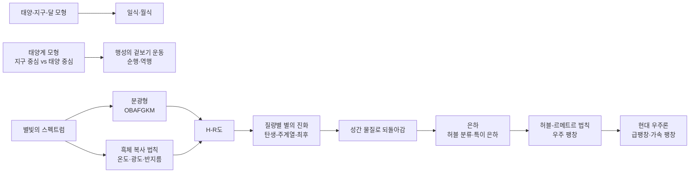
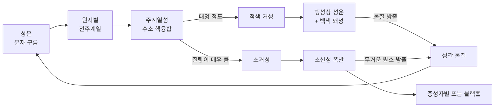

# 지구과학 3. 태양계 천체와 별과 우주의 진화 — 빛을 읽어 우주의 과거와 미래를 추적하다
<!-- prev: m1-07, m2-08, 2-1, 2-2 -->
<!-- next: astro-1, astro-2, astro-3 -->

> [!NOTE]
> **성취기준**
> - **[12지구03-01]** 태양-지구-달 시스템에서의 식 현상을 이해하고 모형을 이용하여 태양계 행성의 겉보기 운동을 설명할 수 있다.
> - **[12지구03-02]** 별의 분광형 결정 및 별의 분류 과정을 이해하고, 흑체복사 법칙을 이용하여 별의 물리량을 추론할 수 있다.
> - **[12지구03-03]** 다양한 질량을 가진 별의 진화 과정을 H-R도에 나타내고 해석할 수 있다.
> - **[12지구03-04]** 허블의 은하 분류 체계에 따른 은하의 특징을 비교하고 외부은하의 자료를 이용하여 특이 은하의 관측적 특징을 추론할 수 있다.
> - **[12지구03-05]** 허블-르메트르 법칙으로 우주의 팽창을 이해하고 우주의 진화에 대한 다양한 설명 체계의 의의를 현대 우주론의 관점에서 비교할 수 있다.

**학습 목표**

1. 달의 공전 궤도 특징으로 일식과 월식의 원리와 종류를 설명하고, 태양계 모형으로 행성의 순행·역행과 위치 관계를 설명할 수 있다.
2. 흡수선의 특징으로 별의 분광형을 정하는 과정을 이해하고, 빈 법칙과 슈테판–볼츠만 법칙으로 별의 표면 온도·광도·반지름을 추론할 수 있다.
3. H-R도에서 별의 무리를 구분하고, 질량이 다른 별의 탄생–주계열–최후 과정을 H-R도 위의 경로로 해석할 수 있다.
4. 허블의 은하 분류에 따라 은하의 형태, 성간 물질의 비율, 별의 나이를 비교하고, 여러 파장의 관측 자료로 특이 은하의 특징을 추론할 수 있다.
5. 허블–르메트르 법칙으로 우주 팽창을 설명하고, 정적 우주·팽창 우주·급팽창·가속 팽창 개념이 정립된 과정을 관측 증거로 비교할 수 있다.

**이 단원의 학습 사다리**

| 단계 | 무엇을 하나? |
|---|---|
| STEP 1. 이전 학습 다시 보기 | 중학교의 태양계·별과 우주, 통합과학의 스펙트럼·별의 진화를 다시 꺼낸다 |
| STEP 2. 기초 다지기 | 각크기, 거리와 밝기의 역제곱 관계, 등급, 흑체와 스펙트럼, 로그 눈금 읽기 |
| STEP 3. 핵심 개념 | 식 현상 → 행성의 겉보기 운동 → 분광형 → 별의 물리량 → H-R도와 별의 진화 → 은하 → 우주 팽창 |
| STEP 4. 오개념 바로잡기 | "빅뱅은 우주의 한 점에서 일어난 폭발이다?" 같은 착각을 바로잡는다 |
| STEP 5. 다음 단계로 | 행성우주과학의 케플러 법칙·별의 거리와 질량·은하의 암흑 물질, 대학 천체물리학 |
| STEP 6. 생활·산업·진로 | 우주 망원경, 천문 빅데이터와 인공지능, 우주 산업 |

---

## 🗺️ 단원 들어가기

해와 달은 크기가 약 400배나 차이 나는데, 일식 때 달은 해를 거의 꼭 맞게 가린다. **우연일까?** 밤하늘의 화성은 별자리 사이를 동쪽으로 가다가 몇 달 동안 서쪽으로 되돌아가기도 한다. **행성이 정말 뒤로 가는 걸까?** 별은 아무리 큰 망원경으로 보아도 점으로만 보이는데, 천문학자는 별의 온도와 크기, 나이, 심지어 그 별이 어떻게 죽을지까지 말한다. **점 하나에서 어떻게 그런 정보를 얻을까?**

이 단원의 무기는 두 가지이다. 하나는 **모형**이다. 태양–지구–달, 태양–지구–행성의 위치 관계를 머릿속에 3차원으로 그리면 식과 역행이 설명된다. 다른 하나는 **빛**이다. 별빛의 색과 스펙트럼, 은하 빛의 적색 편이에는 별과 우주의 물리량이 새겨져 있다. 이 두 무기로 태양계에서 출발해 별의 일생, 은하, 그리고 팽창하는 우주까지 차례로 나아가 보자.

---

## STEP 1. 🔙 이전 학습 다시 보기

### 연계 개념표

| 이전 단원·성취기준 | 그때 배운 것 | 이 단원에서 확장되는 것 |
|---|---|---|
| 중1 「태양계」 [9과07-01] | 태양계 구성 천체, 지구형·목성형 행성 | 태양계 모형(지구 중심설·태양 중심설)과 행성의 위치 관계 |
| 중1 「태양계」 [9과07-03] | 지구 자전·공전에 의한 천체의 겉보기 운동 | 지구와 행성의 공전으로 생기는 순행·역행·유 |
| 중1 「태양계」 [9과07-04] | 달의 위상 변화, 일식과 월식 | 달 공전 궤도의 기울기, 개기·금환·부분·혼성 일식, 반영식, 달 그림자의 이동 |
| 중2 「별과 우주」 [9과15-01] | 연주 시차, 겉보기 등급·절대 등급, 별의 색과 표면 온도 | 분광형, 빈 법칙·슈테판–볼츠만 법칙, 광도와 반지름 계산 |
| 중2 「별과 우주」 [9과15-02]·[9과15-03] | 우리은하의 구조, 성운·성단, 풍선 모형으로 본 우주 팽창 | 허블 분류, 특이 은하, 허블–르메트르 법칙, 현대 우주론 |
| 통합과학1 「빛의 스펙트럼과 우주 초기 원소」 | 연속·방출·흡수 스펙트럼, 빅뱅과 수소·헬륨 | 흡수선 세기로 정하는 분광형, 적색 편이, 우주 배경 복사 |
| 통합과학1 「별의 진화와 원소의 생성」 | 성운에서 주계열성, 핵융합과 원소 생성, 초신성 | 질량에 따른 진화 경로를 H-R도에 표시, 내부 구조의 차이 |

### 준비 운동 (사전 진단)

**Q1.** 겉보기 등급이 1등급인 별은 6등급인 별보다 약 몇 배 밝은가?

**Q2.** 일식은 달의 위상이 (삭 / 망)일 때, 월식은 (삭 / 망)일 때 일어난다.

**Q3.** 파란색 별과 붉은색 별 중 표면 온도가 높은 별은?

**Q4.** 풍선에 점을 찍고 부풀리면, 한 점에서 볼 때 멀리 있는 점과 가까운 점 중 어느 쪽이 더 빨리 멀어지는가?

정답 및 해설

**Q1. 약 100배** — 5등급 차이는 밝기 100배이다.

**Q2. 삭, 망** — 일식은 달이 태양과 지구 사이에 올 때(삭), 월식은 지구가 태양과 달 사이에 올 때(망) 일어난다.

**Q3. 파란색 별** — 표면 온도가 높을수록 별빛은 파란색에, 낮을수록 붉은색에 가깝다.

**Q4. 멀리 있는 점** — 같은 시간 동안 늘어나는 거리가 처음 거리에 비례하기 때문이다. 이것이 STEP 3의 허블–르메트르 법칙의 핵심이다.

---

## STEP 2. 🧱 기초 다지기

### ① 각크기 — 하늘에서 보이는 크기

멀리 있는 물체가 하늘에서 차지하는 각도를 **각크기(각지름)** 라 한다. 각이 작을 때는

$$
\text{각크기(라디안)} \approx \frac{\text{실제 지름}}{\text{거리}}, \qquad 1\ \text{라디안} \approx 57.3^\circ
$$

| 천체 | 지름 | 지구로부터의 평균 거리 | 각크기(약) |
|---|---|---|---|
| 달 | 약 3474 km | 약 38만 4천 km | $0.52^\circ$ |
| 태양 | 약 139만 km | 약 1억 5천만 km | $0.53^\circ$ |

태양이 달보다 약 400배 크지만 약 400배 멀리 있어서 둘의 각크기가 거의 같다. 그래서 개기 일식이 가능하다.

### ② 밝기와 거리 — 역제곱 관계

빛은 사방으로 퍼지므로 같은 별이라도 거리가 2배가 되면 밝기는 $\dfrac{1}{4}$이 된다(거리의 제곱에 반비례).

### ③ 등급 — 5등급 차이는 100배

중학교에서 배운 대로 등급이 1 작아지면 밝기는 약 2.5배($100^{1/5} \approx 2.512$) 밝아진다.

| 등급 차이 | 1 | 2 | 5 | 10 |
|---|---|---|---|---|
| 밝기 비(약) | 2.5배 | 6.3배 | 100배 | 10000배 |

- **겉보기 등급**: 지구에서 보이는 밝기
- **절대 등급**: 별을 10 pc(약 32.6광년) 거리에 두었을 때의 밝기 → 별이 실제로 내는 에너지(광도)를 비교한다.

### ④ 흑체와 스펙트럼

입사한 모든 빛을 흡수하고, 온도에 따라 정해진 빛을 내보내는 이상적인 물체를 **흑체(black body)** 라 한다. 별은 흑체에 가깝다. 통합과학에서 배운 대로, 뜨거운 별 내부에서는 연속 스펙트럼이 나오고, 별의 바깥 대기를 지나면서 특정 파장이 흡수되어 **흡수 스펙트럼**이 된다.

> [!TIP]
> 💡 **비유** — 대장간의 쇠를 달구면 처음에는 검붉다가 점점 주황색, 노란색, 흰색으로 바뀐다. 온도가 오를수록 가장 강하게 내는 빛의 색이 파란 쪽으로 옮겨 가기 때문이다. 별의 색이 곧 별의 '온도계'이다.

### ⑤ 로그 눈금 읽기

별의 광도는 태양의 $\dfrac{1}{10000}$배부터 $10^{6}$배까지 차이가 난다. 이렇게 범위가 큰 양은 **로그 눈금**(1, 10, 100, 1000, …이 같은 간격)으로 그린다. H-R도의 세로축이 그렇다. 눈금 한 칸이 10배임에 주의하자.

---

## STEP 3. 📘 핵심 개념

### ① 태양–지구–달 시스템과 식 현상 [12지구03-01]

#### (1) 왜 식은 매달 일어나지 않을까?

달은 약 한 달마다 삭과 망을 지나지만 식은 1년에 몇 번밖에 일어나지 않는다. 그 까닭은 **달의 공전 궤도면이 지구의 공전 궤도면에 대해 약 $5^\circ$ 기울어져 있기 때문**이다.

- 대부분의 삭과 망에서 달은 지구 공전 궤도면보다 조금 위나 아래를 지나 그림자가 비껴간다.
- 두 궤도면이 만나는 선 위의 두 점(**교점**) 근처에서 삭이나 망이 될 때만 태양–지구–달이 거의 일직선이 되어 식이 일어난다.
- 그래서 식은 1년에 두 번 정도 찾아오는 '식이 일어나기 좋은 시기'에 몰려 일어난다.

<!-- fig:earth-3-eclipse-nodes -->

#### (2) 그림자의 두 부분 — 본영과 반영

태양은 점이 아니라 크기가 있는 광원이므로 달과 지구의 그림자는 두 부분으로 나뉜다.

| 그림자 | 뜻 | 그 안에서 본 태양 |
|---|---|---|
| 본그림자(본영) | 태양 빛이 완전히 가려진 짙은 부분 | 전혀 보이지 않음 |
| 반그림자(반영) | 태양 빛이 일부만 가려진 옅은 부분 | 일부만 보임 |

#### (3) 일식의 종류

| 종류 | 조건 | 모습 |
|---|---|---|
| 개기 일식 | 달의 본그림자가 지표에 닿는 곳 | 태양이 완전히 가려지고 코로나가 보인다. 하늘이 어두워진다 |
| 금환 일식 | 달이 지구에서 먼 곳(원지점 부근)에 있어 달의 각크기가 태양보다 작을 때, 본그림자가 지표에 닿지 못하는 곳 | 태양 가장자리가 반지처럼 남는다 |
| 부분 일식 | 달의 반그림자 안 | 태양의 일부만 가려진다 |
| 혼성 일식 | 지구 표면이 둥글어 달까지의 거리가 지역마다 조금 다르므로, 같은 일식이 경로를 따라 개기와 금환으로 바뀜 | 한 일식에서 개기 일식과 금환 일식이 모두 나타난다 |

**달 그림자의 이동 궤적**: 달은 지구 둘레를 서쪽에서 동쪽으로 초속 약 1 km로 공전한다. 지표면은 자전으로 적도에서도 초속 약 0.47 km로 움직이므로 달이 더 빠르다. 그래서 달 그림자는 지표 위를 **서쪽에서 동쪽으로** 지나가며, 개기 일식이 보이는 곳은 폭이 대체로 수백 km 이하인 좁고 긴 띠(개기 일식 경로)가 된다. 한 지점에서 개기 일식이 지속되는 시간은 길어야 7분 남짓이다.

또 달이 태양 앞을 서→동으로 지나가므로, 북반구에서 남쪽 하늘을 바라보는 관측자에게 태양은 **오른쪽(서쪽) 가장자리부터** 가려진다.

#### (4) 월식의 종류

| 종류 | 조건 | 모습 |
|---|---|---|
| 개기 월식 | 달 전체가 지구의 본그림자 안에 들어감 | 달이 사라지지 않고 **붉은 구릿빛**으로 보인다 |
| 부분 월식 | 달의 일부만 본그림자에 들어감 | 달의 일부가 어둡게 가려진다 |
| 반영식 | 달이 지구의 반그림자만 지나감 | 달이 약간 어두워질 뿐 맨눈으로 구별하기 어렵다 |

- 개기 월식 때 달이 붉은 까닭: 지구 대기를 통과한 햇빛 가운데 파란빛은 산란되어 흩어지고, **붉은빛이 굴절되어** 본그림자 안으로 휘어 들어가 달을 비추기 때문이다.
- 지구의 그림자는 달보다 훨씬 크므로, 월식은 **달이 떠 있는 밤인 모든 지역**에서 동시에 볼 수 있고, 개기 상태가 1시간 넘게 이어지기도 한다. 일식보다 볼 기회가 훨씬 많다.
- 달은 서→동으로 움직여 지구 그림자에 들어가므로 월식은 달의 **왼쪽(동쪽) 가장자리부터** 시작된다.

<!-- fig:earth-3-eclipse -->

#### 예제 1 — 금환 일식의 조건

달의 지름을 3474 km라 하자. 달이 지구에 가장 가까울 때(약 36만 3천 km)와 가장 멀 때(약 40만 5천 km)의 각크기를 구하고, 태양의 각크기($0.53^\circ$)와 비교하여 각각 어떤 일식이 일어날 수 있는지 쓰시오.

**풀이**
- 가까울 때: $\dfrac{3474}{363000}\times57.3^\circ \approx 0.55^\circ$ → 태양보다 크다 → **개기 일식** 가능
- 멀 때: $\dfrac{3474}{405000}\times57.3^\circ \approx 0.49^\circ$ → 태양보다 작다 → **금환 일식**

> [!WARNING]
> 부분 일식이나 금환 일식 때 태양을 맨눈, 선글라스, 필름 조각, 일반 망원경으로 보면 망막이 손상될 수 있다. 반드시 국제 기준을 통과한 태양 관측 필터나 바늘구멍 사진기 같은 간접 관측 방법을 쓴다.

---

### ② 태양계 모형과 행성의 겉보기 운동 [12지구03-01]

#### (1) 행성의 겉보기 운동

행성은 별자리 사이를 대체로 **서쪽에서 동쪽으로** 이동한다. 이를 **순행**이라 한다. 그런데 일정 기간 **동쪽에서 서쪽으로** 거꾸로 움직이기도 하는데, 이를 **역행**, 순행과 역행이 바뀌는 순간 멈춘 듯 보이는 것을 **유**라고 한다.

#### (2) 두 가지 설명 체계 — 지구 중심 모형과 태양 중심 모형

| 구분 | 지구 중심 모형(프톨레마이오스) | 태양 중심 모형(코페르니쿠스) |
|---|---|---|
| 중심 | 지구가 정지해 있고 모든 천체가 지구 둘레를 돈다 | 태양이 중심, 지구는 다른 행성처럼 태양 둘레를 돈다 |
| 역행의 설명 | 행성이 큰 원(이심원)을 따라 도는 작은 원(**주전원**) 위를 돈다 | 안쪽 궤도의 빠른 행성이 바깥쪽 행성을 **추월할 때** 바깥 행성이 뒤로 가는 것처럼 보인다 |
| 수성·금성 | 주전원의 중심이 늘 지구–태양을 잇는 선 위에 있어 태양 근처에만 보인다 | 지구보다 안쪽 궤도를 돌기 때문에 태양 근처에만 보인다 |
| 금성의 위상 | 금성이 늘 태양보다 지구 쪽에 있어 **보름달 모양(망 모양)이 나타날 수 없다** | 금성이 태양 너머로도 가므로 **망 모양부터 초승달 모양까지** 모든 위상이 나타난다 |

17세기 초 갈릴레이는 망원경으로 금성이 보름달에 가까운 모양일 때 작게, 초승달 모양일 때 크게 보이는 것을 관측하였다. 이는 지구 중심 모형으로는 설명할 수 없고 태양 중심 모형으로 설명된다. 같은 관측 사실을 놓고 두 모형을 비교하여 더 잘 설명하는 모형을 고른 것이다. (티코 브라헤는 태양이 지구 둘레를, 행성이 태양 둘레를 도는 절충 모형을 제안하기도 했다.)

> [!TIP]
> 💡 **비유** — 고속도로에서 내 차가 옆 차로의 트럭을 추월하면, 트럭은 앞으로 가고 있는데도 창밖 먼 산을 배경으로 보면 뒤로 밀려나는 것처럼 보인다. 지구가 화성을 추월할 때 화성이 역행하는 것과 같다.

<!-- sim:retrograde -->

#### (3) 행성의 위치 관계

| 행성 | 위치 관계 | 뜻 | 관측 |
|---|---|---|---|
| 내행성(수성·금성) | 내합 | 태양–행성–지구가 일직선, 행성이 지구 쪽 | 보이지 않음, 이 무렵 **역행** |
| | 외합 | 행성이 태양 너머 | 보이지 않음, 망에 가까운 위상 |
| | 동방 최대 이각 | 행성이 태양의 동쪽으로 가장 멀리 떨어짐 | **초저녁 서쪽 하늘**, 반달 모양 |
| | 서방 최대 이각 | 행성이 태양의 서쪽으로 가장 멀리 떨어짐 | **새벽 동쪽 하늘**, 반달 모양 |
| 외행성(화성~해왕성) | 충 | 태양–지구–행성이 일직선, 지구가 가운데 | 밤새 보임, 가장 밝고 크게 보임, **역행** |
| | 합 | 행성이 태양 너머 | 보이지 않음 |
| | 동구 | 행성이 태양의 동쪽 $90^\circ$ | 초저녁 남쪽 하늘 |
| | 서구 | 행성이 태양의 서쪽 $90^\circ$ | 새벽 남쪽 하늘 |

- 금성의 최대 이각은 약 $46^\circ\sim47^\circ$, 수성은 약 $18^\circ\sim28^\circ$이다. 그래서 금성은 해가 진 뒤나 뜨기 전 몇 시간만 보이며, 한밤중에는 볼 수 없다.
- 지구와 화성이 가장 가까워지는 충 무렵에 화성은 가장 밝고 역행한다.

<!-- fig:earth-3-planet-configurations -->

#### 예제 2 — 위치 관계 추론

어느 날 저녁 해가 진 직후 서쪽 하늘에 금성이 밝게 보였고, 망원경으로 보니 반달 모양이었다. (1) 금성의 위치 관계는? (2) 이후 약 두 달 동안 금성의 모양과 크기는 어떻게 변하겠는가?

**풀이** (1) **동방 최대 이각** (2) 금성이 내합 쪽으로 지구에 다가오므로 점점 **초승달 모양으로 가늘어지고, 겉보기 크기는 커진다.** 내합 무렵에는 태양과 같은 방향이 되어 보이지 않는다.

---

### ③ 별의 분광형과 분류 [12지구03-02]

#### (1) 분광형 — 흡수선으로 별을 분류하다

19세기 말~20세기 초 미국 하버드 대학 천문대의 연구자들은 수십만 개 별의 스펙트럼을 사진으로 찍어 흡수선의 모양과 세기를 비교하였다. 처음에는 수소 흡수선의 세기 순서로 알파벳을 붙였다가, 캐넌(Annie Jump Cannon) 등이 **표면 온도 순서**로 다시 배열하여 오늘날의 **분광형(spectral type)** 이 정해졌다.

$$
\mathrm{O} \;-\; \mathrm{B} \;-\; \mathrm{A} \;-\; \mathrm{F} \;-\; \mathrm{G} \;-\; \mathrm{K} \;-\; \mathrm{M} \quad (\text{고온} \rightarrow \text{저온})
$$

각 분광형은 다시 0~9로 나눈다(예: 태양은 G2). 숫자가 작을수록 온도가 높다.

| 분광형 | 색 | 표면 온도(약, K) | 강하게 나타나는 흡수선 | 예 |
|---|---|---|---|---|
| O | 파란색 | 30000 이상 | 이온화된 헬륨 | 오리온자리의 일부 별 |
| B | 청백색 | 10000 ~ 30000 | 중성 헬륨, 수소 | 리겔, 스피카 |
| A | 흰색 | 7500 ~ 10000 | **수소가 가장 강함**(A0 부근) | 시리우스, 베가 |
| F | 황백색 | 6000 ~ 7500 | 수소 약해짐, 이온화된 칼슘 강해짐 | 프로키온 |
| G | 노란색 | 5200 ~ 6000 | 이온화된 칼슘, 중성 금속 | 태양 |
| K | 주황색 | 3700 ~ 5200 | 중성 금속 | 아크투루스 |
| M | 붉은색 | 3700 이하 | 분자(산화 타이타늄 등)의 흡수띠 | 베텔게우스, 안타레스 |

> [!IMPORTANT]
> 별마다 흡수선이 다른 주된 까닭은 **구성 원소가 달라서가 아니라 표면 온도가 달라서**이다. 대부분의 별은 수소와 헬륨이 주성분으로 비슷하다(통합과학 「빛의 스펙트럼과 우주 초기 원소」). 온도에 따라 원자가 이온화되거나 전자가 들뜬 정도가 달라져 같은 원소라도 흡수선이 강해지거나 약해진다. 예를 들어 수소 흡수선은 약 1만 K 부근에서 가장 강하고, 그보다 뜨거우면 수소가 이온화되어, 그보다 차가우면 흡수를 일으킬 상태의 원자가 적어져 약해진다.

#### (2) 광도 계급 — 같은 온도, 다른 크기

표면 온도가 같아도 크기(광도)가 다른 별이 있다. 반지름이 큰 별일수록 대기가 희박하여 흡수선의 폭이 **좁게** 나타난다. 이를 이용해 별을 **광도 계급**으로 나눈다.

| 광도 계급 | Ia, Ib | II | III | IV | V |
|---|---|---|---|---|---|
| 이름 | 초거성 | 밝은 거성 | 거성 | 준거성 | 주계열성(왜성) |

분광형과 광도 계급을 함께 쓰면 별을 2차원으로 분류할 수 있다. 태양은 **G2V**, 즉 'G2형 주계열성'이다.

---

### ④ 흑체 복사 법칙과 별의 물리량 [12지구03-02]

#### (1) 빈 법칙 — 색으로 온도를 잰다

흑체가 가장 강하게 내는 빛의 파장 $\lambda_{\max}$는 표면 온도 $T$에 반비례한다.

$$
\lambda_{\max} T = 2.898\times10^{-3}\ \mathrm{m\cdot K} \;\;(\approx 2.9\times10^{6}\ \mathrm{nm\cdot K})
$$

#### (2) 슈테판–볼츠만 법칙 — 뜨거우면 훨씬 많이 낸다

흑체의 단위 면적에서 1초 동안 방출하는 에너지 $E$는 표면 온도의 네제곱에 비례한다.

$$
E = \sigma T^4, \qquad \sigma = 5.67\times10^{-8}\ \mathrm{W/(m^2\cdot K^4)}
$$

#### (3) 광도와 반지름

별이 1초 동안 표면 전체에서 내보내는 에너지를 **광도(luminosity)** 라 한다. 반지름이 $R$인 별의 표면적은 $4\pi R^2$이므로

$$
L = 4\pi R^2 \sigma T^4 \qquad \Rightarrow \qquad \frac{L}{L_\odot} = \left(\frac{R}{R_\odot}\right)^2\left(\frac{T}{T_\odot}\right)^4
$$

태양($R_\odot \approx 7.0\times10^{8}\ \mathrm{m}$, $T_\odot \approx 5800\ \mathrm{K}$)에 적용하면 $L_\odot \approx 3.9\times10^{26}\ \mathrm{W}$가 된다. 광도는 절대 등급과 연결된다. 절대 등급이 5 작으면 광도는 100배이다. 태양의 절대 등급은 약 +4.8이다.

| 알고 싶은 것 | 관측하는 것 | 쓰는 관계 |
|---|---|---|
| 표면 온도 $T$ | 색, 분광형, $\lambda_{\max}$ | 빈 법칙 |
| 광도 $L$ | 절대 등급(겉보기 등급 + 거리) | 등급과 밝기의 관계 |
| 반지름 $R$ | $L$과 $T$ | $L = 4\pi R^2\sigma T^4$ |

#### 예제 3 — 빈 법칙

태양 빛의 세기가 가장 강한 파장은 약 500 nm이다. 별 A는 약 290 nm에서, 별 B는 약 970 nm에서 가장 강하다. 각 별의 표면 온도와 색을 추정하시오.

**풀이** $T = \dfrac{2.9\times10^{6}\ \mathrm{nm\cdot K}}{\lambda_{\max}}$
- 별 A: $\dfrac{2.9\times10^6}{290} = 10000\ \mathrm{K}$ → 흰색(A형 부근)
- 별 B: $\dfrac{2.9\times10^6}{970} \approx 3000\ \mathrm{K}$ → 붉은색(M형)

#### 예제 4 — 반지름 추론

어떤 별의 광도는 태양의 10000배이고 표면 온도는 태양의 절반이다. (1) 이 별의 반지름은 태양의 몇 배인가? (2) 이 별의 절대 등급은? (태양의 절대 등급은 +4.8)

**풀이**
(1) $\dfrac{R}{R_\odot} = \sqrt{\dfrac{L/L_\odot}{(T/T_\odot)^4}} = \sqrt{\dfrac{10000}{(1/2)^4}} = \sqrt{160000} = 400$배 → 차갑지만 매우 큰 **초거성**
(2) 광도 10000배 = 10등급 밝음 → $4.8 - 10 = -5.2$

#### 예제 5 — 백색 왜성의 광도

표면 온도가 태양의 2배이고 반지름이 태양의 $\dfrac{1}{100}$인 별의 광도는 태양의 몇 배인가?

**풀이** $\left(\dfrac{1}{100}\right)^2\times2^4 = 10^{-4}\times16 = 0.0016$배. 뜨겁지만 매우 작아 어둡다 → **백색 왜성**

---

### ⑤ H-R도와 질량에 따른 별의 진화 [12지구03-03]

#### (1) H-R도

20세기 초 헤르츠스프룽과 러셀은 가로축에 분광형(표면 온도), 세로축에 절대 등급(광도)을 놓고 별들을 점으로 찍었다. 이것이 **H-R도(헤르츠스프룽–러셀도)** 이다.

- **가로축**: 왼쪽이 고온(O형), 오른쪽이 저온(M형) — 보통 그래프와 반대 방향이다.
- **세로축**: 위쪽이 광도가 큼(절대 등급이 작음).
- $L = 4\pi R^2\sigma T^4$이므로 **오른쪽 위로 갈수록 반지름이 크고, 왼쪽 아래로 갈수록 작다.**

| 별의 무리 | H-R도의 위치 | 특징 |
|---|---|---|
| 주계열성 | 왼쪽 위 ~ 오른쪽 아래의 띠 | 별의 약 90 %. 중심핵에서 수소 핵융합. 질량이 클수록 왼쪽 위 |
| 거성 | 오른쪽 위 | 표면 온도는 낮지만 반지름이 크다(태양의 수십 배) |
| 초거성 | 맨 위 | 반지름이 태양의 수백 배 이상 |
| 백색 왜성 | 왼쪽 아래 | 표면 온도는 높지만 지구만 한 크기, 밀도가 매우 크다 |

#### (2) 주계열성 — 질량이 모든 것을 정한다

주계열성은 중심핵에서 수소가 헬륨으로 핵융합하며, 바깥으로 미는 **기체의 압력**과 안으로 당기는 **중력**이 균형(정역학 평형)을 이루어 크기가 안정하게 유지된다. 별은 일생의 약 90 %를 주계열 단계에서 보낸다.

| 처음 질량(태양 = 1) | 분광형(약) | 표면 온도(약, K) | 광도(약, 태양 = 1) | 주계열 수명(약) |
|---|---|---|---|---|
| 0.5 | M | 3800 | 0.05 | 수백억 년 이상 |
| 1 | G2 | 5800 | 1 | 100억 년 |
| 2 | A | 9000 | 10 ~ 20 | 10억 년 |
| 10 | B | 25000 | 5000 ~ 10000 | 2000만 ~ 3000만 년 |
| 20 이상 | O | 30000 이상 | 수만 이상 | 1000만 년 이하 |

질량이 큰 별은 연료(수소)가 많지만 중심이 훨씬 뜨거워 연료를 엄청나게 빨리 태우므로 **수명이 짧다.**

> [!TIP]
> 💡 **비유** — 큰 기름통을 단 대형 트럭이 경차보다 연료를 훨씬 빨리 쓰는 것과 같다. 연료통은 10배 크지만 연비가 수천 배 나쁘면 더 빨리 바닥난다.

**질량에 따른 내부 구조의 차이**

| 질량 | 중심핵 | 바깥층 | 에너지 생성 |
|---|---|---|---|
| 태양 정도 | 핵융합하는 중심핵 바깥에 **복사층** | 바깥쪽에 **대류층** | 주로 수소 원자핵끼리 차례로 결합하는 반응(양성자–양성자 연쇄 반응) |
| 태양의 약 2배 이상 | 중심핵이 **대류핵** | 바깥쪽이 **복사층** | 주로 탄소·질소·산소가 촉매처럼 돕는 반응(탄소–질소–산소 순환) |
| 태양의 절반보다 훨씬 작은 별 | 별 전체가 대류 | — | 양성자–양성자 연쇄 반응 |

#### (3) 별의 탄생 — 전주계열 단계

1. 성간 물질이 많은 **성운**(특히 차갑고 밀도가 큰 분자 구름)의 일부가 중력으로 수축한다.
2. 수축하며 중력 에너지가 열로 바뀌어 온도가 오르고, 빛을 내는 **원시별**이 된다. 아직 핵융합은 하지 않는다.
3. 계속 수축하여 중심 온도가 약 1000만 K에 이르면 수소 핵융합이 시작되고, 정역학 평형을 이루는 **주계열성**이 된다.

핵융합을 막 시작한 별들이 H-R도에서 이루는 선을 **영년 주계열(ZAMS)** 이라 한다. 영년 주계열에 도달하기 전 단계를 **전주계열**, 주계열을 벗어난 뒤를 **후주계열** 단계라 한다.

| 전주계열 단계(H-R도 경로) | 질량이 작은 별(태양 정도) | 질량이 큰 별 |
|---|---|---|
| 경로 모양 | 오른쪽 위에서 **거의 수직으로 내려온 뒤** 왼쪽으로 이동 | 오른쪽에서 **거의 수평으로 왼쪽** 이동 |
| 주계열 도달 시간 | 수천만 년 | 그보다 훨씬 짧다 |
| 도달 위치 | 영년 주계열의 아래쪽 | 영년 주계열의 위쪽 |

#### (4) 주계열 이후 — 질량에 따라 갈라지는 길

**태양 정도의 별(처음 질량이 태양의 약 8배 이하)**
1. 중심핵의 수소가 바닥나면 헬륨 중심핵이 수축하며 뜨거워지고, 그 바깥 껍질에서 수소 핵융합이 일어난다.
2. 바깥층이 크게 팽창하고 표면 온도는 낮아진다 → H-R도에서 **오른쪽 위로** 이동하여 **적색 거성**이 된다.
3. 중심핵이 더 뜨거워지면 헬륨이 탄소·산소로 바뀌는 핵융합을 한다.
4. 마지막에 바깥층이 우주로 퍼져 나가 **행성상 성운**이 되고, 남은 중심핵은 탄소·산소로 된 **백색 왜성**이 되어 H-R도 **왼쪽 아래**로 간다. 백색 왜성은 핵융합 없이 서서히 식는다.

**질량이 매우 큰 별(처음 질량이 태양의 약 8배 이상)**
1. 주계열을 벗어나 **초거성**이 된다(H-R도 맨 위를 오른쪽으로 가로지름).
2. 중심부에서 더 무거운 원소가 차례로 만들어져, 중심에서 바깥으로 철–규소–…–헬륨–수소처럼 **양파 껍질 같은 층 구조**가 생긴다.
3. 철로 된 중심핵은 더 이상 핵융합으로 에너지를 내지 못해 순식간에 붕괴하고, 바깥층이 튕겨 나가며 **초신성 폭발**이 일어난다.
4. 남은 중심핵은 매우 밀도가 큰 **중성자별**이 되거나, 더 무거우면 **블랙홀**이 된다.

#### (5) 별은 다시 성간 물질로 돌아간다

행성상 성운과 초신성 폭발은 별 속에서 만들어진 탄소·산소·철 등 무거운 원소를 우주 공간에 되돌려 준다. 이렇게 '오염된' 성간 물질에서 다음 세대 별과 행성이 태어난다. 약 46억 년 전 태양계도 이런 물질에서 태어났다. 질량이 태양의 절반보다 작은 별은 주계열 수명이 우주의 나이보다 길어서, **아직 주계열을 떠난 별이 하나도 없다.**

<!-- sim:hr-diagram -->

#### 예제 6 — H-R도 해석

H-R도 위의 별 (가)~(라)가 다음과 같다. (가) 왼쪽 위의 주계열성 (나) 오른쪽 아래의 주계열성 (다) 오른쪽 위의 거성 (라) 왼쪽 아래의 백색 왜성.
(1) 질량이 가장 큰 주계열성은? (2) 반지름이 가장 큰 별과 가장 작은 별은? (3) 태양이 앞으로 거칠 단계를 기호로 쓰시오.

**풀이** (1) (가) — 주계열에서는 왼쪽 위일수록 질량이 크다. (2) 가장 큰 별 (다), 가장 작은 별 (라) — H-R도의 오른쪽 위일수록 반지름이 크다. (3) 주계열 → (다) 적색 거성 → (라) 백색 왜성

---

### ⑥ 허블의 은하 분류와 특이 은하 [12지구03-04]

#### (1) 허블의 은하 분류 — 모양에 따른 분류

1920년대 허블은 외부 은하를 **눈에 보이는 모양**에 따라 분류하였다. 이를 **형태학적 분류**라 한다.

| 유형 | 모양 | 세부 분류 |
|---|---|---|
| 타원 은하(E) | 타원·구 모양, 나선팔 없음 | 납작한 정도에 따라 E0(구에 가까움) ~ E7(가장 납작함) |
| 렌즈형 은하(S0) | 원반과 팽대부는 있으나 나선팔 없음 | 타원 은하와 나선 은하의 중간 |
| 정상 나선 은하(S) | 중심 팽대부에서 나선팔이 뻗음 | Sa → Sb → Sc: 팽대부가 작아지고 나선팔이 느슨하게 풀린다 |
| 막대 나선 은하(SB) | 중심을 가로지르는 막대 끝에서 나선팔이 뻗음 | SBa → SBb → SBc |
| 불규칙 은하(Irr) | 일정한 모양이 없음 | 예: 대마젤란은하, 소마젤란은하 |

타원 은하의 납작한 정도는 긴지름 $a$와 짧은지름 $b$로 $10\left(1 - \dfrac{b}{a}\right)$를 계산해 E 뒤에 붙인다.

> [!WARNING]
> 허블 분류를 그림으로 그리면 Y자를 옆으로 눕힌 '소리굽쇠' 모양이 되어 왼쪽(E)에서 오른쪽(S)으로 은하가 진화하는 것처럼 보이지만, **진화 순서가 아니다.** 모양에 따른 분류일 뿐이다.

#### (2) 은하 유형별 특징 비교

| 특징 | 타원 은하 | 나선 은하 | 불규칙 은하 |
|---|---|---|---|
| 성간 물질(기체·티끌) | 매우 적다 | 원반·나선팔에 많다 | 매우 많다 |
| 새로운 별의 탄생 | 거의 없다 | 나선팔에서 활발 | 활발 |
| 주로 보이는 별 | 나이 많은 붉은 별 | 팽대부·헤일로: 나이 많은 별 / 나선팔: 젊고 파란 별 | 젊고 파란 별이 많다 |
| 전체 색 | 붉은색 | 중심은 붉고 나선팔은 파랗다 | 파란색 |

우리은하는 **막대 나선 은하**로 분류된다. 나선팔에는 성운과 젊은 산개 성단이, 헤일로에는 늙은 별로 이루어진 구상 성단이 많다(중학교 「별과 우주」).

#### 예제 7 — 타원 은하의 분류

사진에서 어느 타원 은하의 긴지름이 10 cm, 짧은지름이 6 cm로 측정되었다. 이 은하의 허블 분류 기호와, 이 은하에서 새로운 별이 많이 태어나는지 쓰시오.

**풀이** $10\left(1 - \dfrac{6}{10}\right) = 4$ → **E4**. 타원 은하는 성간 물질이 매우 적어 새로운 별의 탄생이 거의 없고, 늙은 붉은 별이 대부분이다.

#### (3) 특이 은하 — 다양한 파장으로 본 '이상한' 은하

일반 은하의 빛은 별빛이 모인 것이므로 스펙트럼에 **흡수선**이 보인다. 그런데 일부 은하는 중심부에서 별빛만으로는 설명할 수 없는 막대한 에너지를 내고 독특한 스펙트럼을 보인다. 이를 **특이 은하**라 한다.

| 특이 은하 | 관측적 특징 | 관측 파장 |
|---|---|---|
| 전파 은하 | 가시광선으로는 대개 거대한 타원 은하. 전파로 보면 중심핵에서 양쪽으로 **제트**가 뻗고 끝에 거대한 **로브**가 있다 | 전파 |
| 세이퍼트 은하 | 대부분 나선 은하. 중심핵이 매우 밝고 작다. 스펙트럼에 **폭이 넓은 방출선**이 나타난다 → 중심부 기체가 매우 빠르게 움직인다 | 가시광선, X선 |
| 퀘이사 | 가시광선 사진에서는 별처럼 점으로 보이지만, 스펙트럼의 **적색 편이가 매우 크다** → 매우 멀리 있다 → 그런데도 밝게 보이므로 보통 은하 수백~수천 개에 해당할 만큼 막대한 에너지를 낸다 | 가시광선, 전파, X선 |

퀘이사는 1960년대 초 전파원 '3C 273'의 스펙트럼을 분석하다가, 정체를 알 수 없던 방출선이 사실은 크게 적색 편이된 수소 방출선이라는 것이 밝혀지며 알려졌다. 오늘날에는 이 특이 은하들의 중심에 **매우 무거운 블랙홀**이 있고, 그 둘레로 빨려 드는 물질이 엄청난 에너지를 낸다는 해석이 받아들여지고 있다. 2019년에는 여러 나라의 전파 망원경을 연결한 관측으로 거대 타원 은하 M87 중심 블랙홀의 그림자 영상이 처음 공개되었다.

또 서로 가까이 지나가거나 충돌하는 **충돌 은하**는 중력에 의해 모양이 일그러지고 긴 꼬리가 생기며, 기체가 압축되어 별이 폭발적으로 탄생하기도 한다.

#### 예제 8 — 특이 은하 추론

어느 천체는 가시광선 사진에서 별처럼 보이지만, 스펙트럼에서 정지 상태 파장이 486 nm인 수소 방출선이 약 563 nm에서 관측되었다. (1) 이 천체의 적색 편이 $z = \dfrac{\lambda_{\text{관측}} - \lambda_{0}}{\lambda_0}$는? (2) 이 천체는 무엇이라고 추론할 수 있는가?

**풀이** (1) $z = \dfrac{563 - 486}{486} \approx 0.16$ (2) 별처럼 보이지만 우리은하의 별로서는 있을 수 없을 만큼 큰 적색 편이 → 매우 먼 거리에서도 밝게 보이는 **퀘이사**

---

### ⑦ 허블–르메트르 법칙과 우주론 [12지구03-05]

#### (1) 허블–르메트르 법칙

1920년대 외부 은하의 스펙트럼을 분석하자 대부분의 은하가 **적색 편이**를 보였다. 즉 우리에게서 멀어지고 있었다. 1929년 허블은 **멀리 있는 은하일수록 더 빨리 멀어진다**는 관계를 발표하였다. 이보다 앞선 1927년, 벨기에의 르메트르는 이론과 관측 자료로 같은 관계를 제시하였다. 그래서 2018년 국제천문연맹은 이를 **허블–르메트르 법칙**이라 부르기를 권고하였다.

$$
v = H_0\, d
$$

- $v$: 은하의 후퇴 속도(km/s). 적색 편이가 작을 때 $v \approx cz$ ($c = 3\times10^{5}\ \mathrm{km/s}$)
- $d$: 은하까지의 거리(Mpc, 1 Mpc ≈ 326만 광년)
- $H_0$: **허블 상수**, 약 $70\ \mathrm{km/(s\cdot Mpc)}$ (측정 방법에 따라 약 67~73으로 차이가 있어 연구가 진행 중)

#### (2) 팽창하는 우주에는 중심이 없다

은하들이 우리에게서 멀어진다고 우리가 우주의 중심인 것은 아니다. **공간 자체가 팽창**하면 어느 은하에서 보아도 다른 은하들이 멀어지고, 먼 은하일수록 빨리 멀어진다.

> [!TIP]
> 💡 **비유** — 건포도가 박힌 빵 반죽이 1시간 만에 2배로 부풀면, 어느 건포도에서 보아도 1 cm 떨어졌던 건포도는 2 cm로(1 cm/h), 3 cm 떨어졌던 건포도는 6 cm로(3 cm/h) 멀어진다. 거리에 비례하는 속도 — 바로 허블–르메트르 법칙이다. 건포도(은하) 자체는 부풀지 않는다는 점도 같다.

#### 예제 9 — 거리와 우주의 나이

정지 상태 파장이 500 nm인 흡수선이 어느 은하에서 507 nm로 관측되었다. $H_0 = 70\ \mathrm{km/(s\cdot Mpc)}$일 때 (1) 후퇴 속도 (2) 거리를 구하시오. (3) 팽창 속도가 일정했다고 가정하면 우주의 나이는 대략 얼마인가? ($1\ \mathrm{Mpc} \approx 3.09\times10^{19}\ \mathrm{km}$, 1년 $\approx 3.16\times10^{7}$초)

**풀이**
(1) $z = \dfrac{7}{500} = 0.014$, $v = cz = 3\times10^5\times0.014 = 4200\ \mathrm{km/s}$
(2) $d = \dfrac{v}{H_0} = \dfrac{4200}{70} = 60\ \mathrm{Mpc}$ (약 2억 광년)
(3) 모든 은하가 처음에 한곳에 모여 있었다면, 걸린 시간은 $t = \dfrac{d}{v} = \dfrac{1}{H_0}$이다.

$$
\frac{1}{H_0} = \frac{3.09\times10^{19}\ \mathrm{km}}{70\ \mathrm{km/s}} \approx 4.4\times10^{17}\ \mathrm{s} \approx 1.4\times10^{10}\ \text{년}
$$

약 140억 년. 다른 관측까지 종합하여 오늘날 추정하는 우주의 나이는 약 138억 년이다.

#### (3) 우주론은 어떻게 정립되었나 — 관측 증거로 비교하기

| 설명 체계 | 핵심 주장 | 근거와 운명 |
|---|---|---|
| 정적 우주 | 우주는 크기가 변하지 않고 영원하다. 아인슈타인도 처음에는 중력에 맞서 우주를 정지시키는 항(우주 상수)을 넣었다 | 은하의 적색 편이와 허블–르메트르 법칙이 발견되면서 받아들여지지 않게 되었다 |
| 팽창 우주 — 빅뱅 우주론 | 우주는 과거에 매우 뜨겁고 밀도가 큰 상태에서 팽창하며 식어 왔다. 질량은 일정하고 밀도는 줄어든다 | 허블–르메트르 법칙, 가벼운 원소(수소·헬륨)의 비율, **우주 배경 복사**의 발견(1965년)으로 지지 |
| 팽창 우주 — 정상 우주론 | 우주는 팽창하지만 빈 공간에 물질이 계속 생겨나 **밀도가 늘 일정**하다. 시작도 끝도 없다 | 우주 배경 복사, 먼 우주(과거)일수록 퀘이사가 많아 우주가 시간에 따라 변했다는 관측과 맞지 않아 지지를 잃었다 |
| 급팽창(인플레이션) 이론 | 탄생 직후 아주 짧은 순간에 우주가 빛보다 빠르게 엄청난 크기로 팽창했다 | 우주 배경 복사가 모든 방향에서 거의 같은 온도인 문제(지평선 문제), 우주가 매우 평탄한 문제를 설명 |
| 가속 팽창 | 우주의 팽창 속도가 점점 **빨라지고** 있다. 원인을 **암흑 에너지**라 부른다 | 1998년 먼 은하의 Ia형 초신성이 예상보다 어둡게(멀리) 관측되어 발견. 2011년 노벨 물리학상 |

**우주 배경 복사**는 우주가 약 38만 년 되었을 때 물질과 빛이 분리되면서 퍼져 나온 빛이 우주 팽창으로 파장이 길어져, 오늘날 온도 약 2.7 K의 흑체 복사로 하늘 모든 방향에서 관측되는 것이다. 빈 법칙으로 계산하면 가장 강한 파장은 약 1 mm로 **전파(마이크로파)** 영역이다. 빅뱅 우주론이 예측하고 정상 우주론으로는 자연스럽게 설명하기 어려운 증거였다.

> [!IMPORTANT]
> 우주론의 역사는 **관측 증거가 이론을 고르는 과정**이었다. 적색 편이(정적 우주 → 팽창 우주), 우주 배경 복사(정상 우주 → 빅뱅), 배경 복사의 균일성(→ 급팽창), 먼 초신성의 밝기(→ 가속 팽창). 이론은 새로운 관측에 따라 수정되고 보완된다.

#### (4) 관측 가능한 우주

빛의 속력은 유한하고 우주의 나이도 유한하므로, 우리가 볼 수 있는 것은 **우주가 시작된 뒤 빛이 우리에게 도달할 수 있었던 범위**뿐이다. 이를 **관측 가능한 우주**라 한다. 그 너머에도 우주는 있을 수 있지만 원리적으로 아직 볼 수 없다. 공간이 팽창해 왔기 때문에, 관측 가능한 우주의 반지름은 '138억 광년'이 아니라 그보다 훨씬 큰 약 460억 광년으로 계산된다.

> [!TIP]
> 💡 **비유** — 안개 낀 바다 위의 배에서 볼 수 있는 범위에는 한계가 있지만, 그 너머에 바다가 끝난 것은 아니다. 관측 가능한 우주는 '우주 전체'가 아니라 '우리가 볼 수 있는 우주'이다.

---

## STEP 4. ⚠️ 오개념 바로잡기

| 흔한 오개념 | 올바른 개념 | 왜 그럴까? |
|---|---|---|
| 일식과 월식은 매달 일어난다 | 달의 궤도면이 약 $5^\circ$ 기울어 **교점 부근**에서 삭·망이 될 때만 일어난다 | 대부분의 삭과 망에서는 그림자가 지구나 달을 비껴간다 |
| 역행할 때 행성은 실제로 거꾸로 돈다 | 행성은 늘 같은 방향으로 공전한다. 역행은 **지구가 추월하거나 추월당할 때의 겉보기 현상**이다 | 지구도 움직이는 관측대이기 때문이다 |
| 별의 흡수선이 다른 것은 성분이 달라서이다 | 흡수선의 차이는 주로 **표면 온도** 차이 때문이다 | 온도에 따라 원자의 이온화·들뜬 정도가 달라진다 |
| 붉은 별은 모두 작고 어둡다 | 붉은 별 중에는 반지름이 태양의 수백 배인 **초거성**도 있다 | 광도는 온도와 **반지름** 모두에 따라 정해진다($L \propto R^2T^4$) |
| 무거운 별은 연료가 많아 더 오래 산다 | 무거운 별은 연료를 훨씬 빨리 태워 **수명이 짧다** | 광도가 질량보다 훨씬 빠르게 커지기 때문이다 |
| 허블 분류는 은하의 진화 순서이다 | 허블 분류는 **모양에 따른 분류**이다 | 타원 은하가 나선 은하로 변한다는 증거는 없다 |
| 빅뱅은 우주의 한 점에서 일어난 폭발이고, 우리은하는 그 중심 근처에 있다 | 빅뱅은 **공간 전체**가 팽창하기 시작한 것이며 팽창의 중심은 없다 | 어느 은하에서 보아도 다른 은하들이 거리에 비례하여 멀어진다 |

---

## STEP 5. 🎓 다음 단계로 한 걸음 더

> [!CAUTION]
> 이 절은 **지구과학 교육과정 범위 밖의 심화 내용**으로 평가 대상이 아니다. 천구 좌표계, 주계열 이후의 구체적인 핵반응, 우주론의 표준 모형 등은 진로 선택 과목과 대학에서 배운다.

### 진로 선택 과목과의 연결

| 과목·단원 | 이어지는 내용 |
|---|---|
| 행성우주과학 「우주탐사와 행성계」 | 태양의 중력과 케플러의 세 법칙, 소천체, 외계 행성 탐사와 생명 가능성 |
| 행성우주과학 「태양과 별의 관측」 | 다양한 파장으로 본 태양, 시차·밝기로 구하는 거리, 공간 운동, 쌍성으로 구하는 별의 질량, 변광성과 초신성 |
| 행성우주과학 「은하와 우주」 | 성단의 C-M도로 구한 나이와 거리, 성간 소광, 은하 회전 곡선과 암흑 물질, 은하의 공간 분포와 거대 구조 |

### ① 회합 주기 — 역행은 얼마나 자주 올까

행성이 같은 위치 관계(예: 충)로 되돌아오는 주기를 **회합 주기** $S$라 한다. 지구의 공전 주기를 $E$(1년), 외행성의 공전 주기를 $P$라 하면

$$
\frac{1}{S} = \frac{1}{E} - \frac{1}{P}
$$

화성($P \approx 1.88$년)은 $S \approx 2.1$년마다 충이 되어 그때마다 역행한다. 행성우주과학에서는 케플러 법칙으로 행성 운동 전체를 정량적으로 다룬다.

### ② 거리 지수와 질량–광도 관계

겉보기 등급 $m$, 절대 등급 $M$, 거리 $d$(pc) 사이에는 $m - M = 5\log d - 5$가 성립한다. 또 쌍성의 궤도 운동으로 직접 질량을 잰 주계열성들로부터 대략 $L \propto M^{3\sim4}$의 **질량–광도 관계**를 얻는다. 이로부터 주계열 수명이 대략 $t \propto M/L \propto M^{-2.5}$임을 추정할 수 있다.

### ③ 별 속의 핵반응과 별의 최후

대학 천체물리학에서는 헬륨 원자핵 3개가 탄소가 되는 반응(삼중 알파 과정)처럼 주계열 이후의 핵반응을 구체적으로 다루고, 백색 왜성의 질량이 태양의 약 1.4배를 넘을 수 없다는 **찬드라세카르 한계**를 배운다. 백색 왜성이 짝별의 물질을 받아 이 한계에 이르면 Ia형 초신성으로 폭발하는데, 밝기가 거의 일정해 우주의 거리를 재는 '표준 촛불'로 쓰인다. 가속 팽창을 발견한 바로 그 도구이다.

### ④ 우주의 구성과 우주론의 표준 모형

오늘날 관측을 종합하면 우주 전체 에너지의 약 5 %만 우리가 아는 보통 물질이고, 약 27 %는 빛을 내지 않는 **암흑 물질**, 약 68 %는 **암흑 에너지**로 추정된다. 이를 바탕으로 한 우주론의 표준 모형(ΛCDM 모형)은 대학 우주론의 중심 주제이다. 적색 편이도 엄밀히는 은하의 운동에 의한 도플러 효과라기보다 **공간 팽창으로 빛의 파장이 늘어난 것**으로 이해한다.

### 지금 vs 다음 단계

| 구분 | 고등학교 지구과학 | 행성우주과학 | 대학 천문학·천체물리학 |
|---|---|---|---|
| 천체의 운동 | 모형으로 식과 역행 설명 | 케플러 법칙, 중력 | 천체 역학, 천구 좌표계 |
| 별의 물리량 | 빈·슈테판–볼츠만 법칙 | 거리·질량 측정, 변광성 | 복사 전달, 항성 대기 |
| 별의 진화 | H-R도의 경로, 내부 구조 비교 | 성단의 C-M도와 나이 | 항성 내부 구조 방정식, 핵물리 |
| 은하·우주 | 허블 분류, 허블–르메트르 법칙, 우주론의 역사 | 회전 곡선과 암흑 물질, 거대 구조 | 일반 상대성 이론과 우주론, 표준 모형 |
| 관련 전공 | — | — | 천문학, 천체물리학, 우주과학, 물리학 |

---

## STEP 6. 🏭 생활·산업·진로 연결

### 사례 1. 우주 망원경과 다파장 관측

- **원리**: 지구 대기는 자외선·X선·적외선 대부분을 막는다. 그래서 대기 밖의 우주 망원경으로 여러 파장을 관측하면 특이 은하의 제트, 별이 태어나는 성운 속, 먼 은하의 큰 적색 편이를 볼 수 있다.
- **어디에 쓰이나**: 허블 우주 망원경, 제임스 웹 우주 망원경(적외선), 우리나라가 참여한 우주 관측 사업. 이 과정에서 발전한 정밀 광학·검출기 기술은 의료 영상, 위성 카메라로 이어진다.

### 사례 2. 천문 빅데이터와 인공지능

- **원리**: 대형 탐사 관측은 수억 개 천체의 영상과 스펙트럼을 만든다. 사람이 일일이 분류할 수 없으므로 시민 과학자의 분류 결과로 인공지능을 학습시켜 은하의 형태를 자동으로 분류하고, 변광성·초신성 같은 변화하는 천체를 찾아낸다.
- **어디에 쓰이나**: 이미지 인식, 이상 탐지 기술은 의료 진단·제조 품질 검사에도 쓰인다.

### 사례 3. 우주 산업과 일식·궤도 계산

- **원리**: 식이 일어나는 시각과 경로를 정밀하게 예측하는 계산은 인공위성 궤도 계산과 같은 원리이다. 위성은 지구 그림자에 들어가는 '식' 동안 태양 전지로 전기를 만들 수 없으므로 배터리 설계에 반영한다.
- **어디에 쓰이나**: 위성 운용, 우주 탐사선 항법, 위성 항법 시스템.

### 관련 진로와 학과

| 진로 | 하는 일 | 관련 학과 |
|---|---|---|
| 천문학자·천체물리학자 | 별·은하·우주 관측과 이론 연구 | 천문학, 천체물리학, 물리학 |
| 우주 망원경·광학 엔지니어 | 망원경·검출기 설계 | 광학공학, 전자공학, 기계공학 |
| 천문 데이터 과학자 | 대용량 관측 자료 처리, 인공지능 분류 | 컴퓨터공학, 통계학, 천문학 |
| 위성·우주 탐사 엔지니어 | 궤도 설계, 위성 운용 | 항공우주공학, 전자공학 |
| 과학관·천문대 해설사, 과학 교사 | 천체 관측 교육, 과학 소통 | 지구과학교육, 천문학 |

---

## 🔬 탐구 활동

### 활동 A. 천체 관측 프로그램으로 행성의 운동과 식 현상 시뮬레이션하기

**목표** 천체 관측 프로그램으로 화성의 역행과 일식·월식을 재현하고, 태양 중심 모형으로 설명한다.

**준비물** 컴퓨터, 무료 천체 관측(플라네타륨) 프로그램, 기록지

**과정**
1. 프로그램에서 관측 장소를 우리 지역으로 정하고, 화성이 충이 되는 날짜 전후 약 6개월 동안 같은 시각의 화성 위치를 별자리 배경 위에 10일 간격으로 기록한다.
2. 기록한 점을 이어 화성의 이동 경로를 그리고 순행·유·역행 구간을 표시한다.
3. 프로그램의 '태양계 위에서 보기' 기능으로 같은 기간 지구와 화성의 공전 위치를 확인하여 역행 구간과 비교한다.
4. 다가오는 일식 하나를 골라 지구 위 달 그림자의 이동 경로를 확인하고, 개기·금환·부분 일식이 보이는 지역을 구분한다.

**결과 기록**

| 날짜 | 화성의 위치(배경 별자리) | 이동 방향(동/서) | 지구–태양–화성 배치 |
|---|---|---|---|
| | | | |
| | | | |
| | | | |

**생각해 보기**
1. 화성이 역행할 때 지구와 화성의 위치 관계는 어떠했는가?
2. 같은 일식이 어떤 지역에서는 개기 일식, 어떤 지역에서는 부분 일식으로 보이는 까닭은?

### 활동 B. 별의 분광형과 광도 자료를 분석하여 H-R도 작성하기

**목표** 밝은 별과 가까운 별의 자료로 H-R도를 그리고 별의 무리를 구분한다.

**준비물** 별 목록 자료(분광형, 절대 등급 또는 광도), 모눈종이 또는 스프레드시트

**과정**
1. 교사가 제공한 별 목록(예: 하늘에서 가장 밝은 별 20개와 태양 근처 가까운 별 20개)의 분광형과 절대 등급을 표로 정리한다.
2. 가로축에 분광형(왼쪽 O → 오른쪽 M), 세로축에 절대 등급(위쪽이 작은 값)을 놓고 점을 찍는다.
3. 주계열, 거성, 초거성, 백색 왜성 영역을 구분한다.
4. '밝은 별' 집단과 '가까운 별' 집단을 다른 색으로 표시하여 분포를 비교한다.

**결과 기록**

| 별 이름 | 분광형 | 절대 등급 | 무리(주계열·거성·초거성·백색 왜성) |
|---|---|---|---|
| | | | |
| | | | |

**생각해 보기**
1. '가까운 별'에는 어떤 무리가 많은가? 우리 주변의 '보통 별'은 어떤 별인가?
2. '밝은 별'에 거성과 초거성이 많이 섞여 있는 까닭은?

> [!WARNING]
> **안전 수칙** 실제 하늘에서 행성이나 일식을 관측할 때 망원경·쌍안경으로 절대 태양을 보지 않는다. 밤에 야외 관측을 할 때는 보호자나 교사와 함께하고, 안전한 장소를 고른다.

---

## ✅ 개념 확인 문제

### 기본

**1.** 개기 월식 때 달이 완전히 사라지지 않고 붉게 보이는 까닭을 쓰시오.

정답 및 해설

**정답** 지구 대기를 통과한 햇빛 중 붉은빛이 굴절되어 지구의 본그림자 안으로 들어가 달을 비추기 때문이다.

파란빛은 대기에서 산란되어 흩어지고, 산란이 덜 되는 붉은빛이 휘어 들어간다.

**2.** 다음 분광형을 표면 온도가 높은 것부터 순서대로 나열하시오. G2, B5, M1, A0, K3

정답 및 해설

**정답** B5 > A0 > G2 > K3 > M1

분광형은 O–B–A–F–G–K–M 순으로 온도가 낮아진다.

**3.** 표면 온도가 6000 K인 별이 가장 강하게 방출하는 빛의 파장은 약 몇 nm인가? ($\lambda_{\max}T \approx 2.9\times10^6\ \mathrm{nm\cdot K}$)

정답 및 해설

**정답** 약 483 nm

$\lambda_{\max} = \dfrac{2.9\times10^6}{6000} \approx 483\ \mathrm{nm}$ (청록색 부근)

**4.** 허블 분류에서 (1) 성간 물질이 가장 적은 은하의 유형과 (2) 나선팔이 가장 느슨하게 감기고 팽대부가 작은 정상 나선 은하의 기호를 쓰시오.

정답 및 해설

**정답** (1) 타원 은하(E) (2) Sc

**5.** 외부 은하의 후퇴 속도가 $14000\ \mathrm{km/s}$이다. $H_0 = 70\ \mathrm{km/(s\cdot Mpc)}$일 때 이 은하까지의 거리는?

정답 및 해설

**정답** 200 Mpc

$d = \dfrac{v}{H_0} = \dfrac{14000}{70} = 200\ \mathrm{Mpc}$

### 응용

**6.** 별 A와 B는 반지름이 같고, A의 표면 온도는 B의 3배이다. (1) A의 광도는 B의 몇 배인가? (2) 두 별의 절대 등급 차이는 약 몇 등급인가?

정답 및 해설

**정답** (1) 81배 (2) 약 4.8등급(A가 4.8등급 작다)

(1) $L \propto R^2T^4$이므로 $3^4 = 81$배
(2) 100배가 5등급이므로 81배는 $2.5\log_{10}81 \approx 2.5\times1.91 \approx 4.8$등급

**7.** 어느 날 새벽, 해 뜨기 전 동쪽 하늘에 금성이 반달 모양으로 보였다. (1) 금성의 위치 관계는? (2) 이 무렵부터 금성은 지구에서 멀어지는가, 가까워지는가? (3) 앞으로 금성의 위상은 어떻게 변하겠는가?

정답 및 해설

**정답** (1) 서방 최대 이각 (2) 멀어진다 (3) 점점 둥글어져(볼록한 모양) 외합에 가까워질수록 보름달 모양에 가까워지고, 겉보기 크기는 작아진다.

새벽 동쪽 하늘에 보이므로 금성은 태양의 서쪽에 있다. 서방 최대 이각 이후 금성은 외합 쪽으로 가며 지구에서 멀어진다.

**8.** 질량이 태양의 1배인 별 X와 15배인 별 Y가 같은 성운에서 동시에 태어났다. 다음 설명 중 옳은 것을 **모두** 고르시오.
ㄱ. Y가 X보다 먼저 영년 주계열에 도달한다.
ㄴ. 주계열 단계에서 Y는 H-R도에서 X보다 왼쪽 위에 있다.
ㄷ. Y는 최후에 백색 왜성이 되고, X는 초신성으로 폭발한다.
ㄹ. 주계열 단계에서 X의 중심부는 대류핵이다.

정답 및 해설

**정답 ㄱ, ㄴ**

ㄱ. 질량이 큰 별일수록 전주계열 단계가 짧다. ㄴ. 질량이 큰 주계열성은 온도와 광도가 높다. ㄷ. 반대이다. 태양 정도의 별이 백색 왜성, 매우 무거운 별이 초신성 폭발 후 중성자별이나 블랙홀이 된다. ㄹ. 태양 정도의 별은 중심핵 바깥이 복사층, 바깥쪽이 대류층이며, 대류핵은 질량이 큰 별의 특징이다.

**9.** 어느 은하는 가시광선 영상에서는 거대한 타원 은하로 보이는데, 전파 영상에서는 중심에서 양쪽으로 가늘고 긴 구조가 뻗고 그 끝에 은하보다 훨씬 큰 구름 모양 구조가 있다. 이 은하의 종류와, 관측된 두 구조의 이름을 쓰시오.

정답 및 해설

**정답** 전파 은하. 가늘고 긴 구조는 제트, 끝의 큰 구조는 로브이다.

### 융합·서술형

**10. [과학사 연계]** 정적 우주론, 정상 우주론, 빅뱅 우주론이 각각 (1) 은하의 적색 편이와 (2) 우주 배경 복사를 어떻게 설명하는지(또는 설명하지 못하는지) 비교하고, 과학 이론이 관측 증거에 의해 선택되는 과정을 서술하시오.

정답 및 해설

**예시 답안**
(1) 정적 우주론은 우주의 크기가 변하지 않는다고 보므로 먼 은하일수록 크게 나타나는 적색 편이를 설명하지 못한다. 정상 우주론과 빅뱅 우주론은 모두 우주가 팽창한다고 보므로 적색 편이와 허블–르메트르 법칙을 설명할 수 있다.
(2) 빅뱅 우주론은 과거의 뜨겁고 밀도가 큰 우주에서 나온 빛이 팽창으로 식어 온 우주에 고르게 남아 있어야 한다고 예측했고, 1965년 약 2.7 K의 우주 배경 복사가 발견되었다. 정상 우주론은 우주가 늘 같은 상태라고 보므로 이런 복사를 자연스럽게 설명하기 어렵다.
따라서 적색 편이가 정적 우주론을, 우주 배경 복사가 정상 우주론을 탈락시켰고, 빅뱅 우주론이 살아남았다. 이후에도 배경 복사의 균일성 문제는 급팽창 이론으로, 먼 초신성의 관측은 가속 팽창 개념으로 이론을 보완하였다. 이처럼 과학 이론은 새로운 관측 증거를 얼마나 잘 설명하고 예측하는지에 따라 선택되고 수정된다.

**채점 포인트** ① 세 이론의 적색 편이 설명 비교 ② 우주 배경 복사의 예측과 발견 ③ 증거에 따른 이론 선택·수정

**11. [인공지능·빅데이터 연계]** 대형 탐사 관측으로 얻은 1억 개의 은하 영상을 허블 분류 체계에 따라 인공지능으로 분류하려 한다. (1) 인공지능이 학습할 수 있는 은하의 형태적 특징을 세 가지 쓰고, (2) 영상(모양)만으로는 판단하기 어려워 다른 자료가 필요한 경우를 한 가지 들어 어떤 자료를 추가해야 하는지 쓰시오.

정답 및 해설

**예시 답안**
(1) 나선팔의 유무와 감긴 정도, 중심 팽대부의 상대적 크기, 막대 구조의 유무, 타원의 납작한 정도($b/a$), 색(붉은색·파란색 분포) 등
(2) 퀘이사처럼 영상에서는 별처럼 점으로 보이는 천체는 모양만으로는 별과 구별하기 어렵다. 스펙트럼을 얻어 적색 편이와 방출선을 확인해야 한다. 또 세이퍼트 은하는 겉모양이 보통 나선 은하와 비슷하므로 중심핵의 스펙트럼(폭이 넓은 방출선)이나 X선 자료가 필요하다.

**채점 포인트** ① 허블 분류 기준과 연결된 특징 ② 특이 은하 판별에 스펙트럼·다파장 자료가 필요함

---

## 📝 한눈에 정리

### 핵심 요약

- 달의 궤도면이 지구 궤도면에 약 $5^\circ$ 기울어 있어 **교점 부근**의 삭·망에서만 식이 일어난다. 일식에는 개기·금환·부분·혼성 일식이, 월식에는 개기·부분 월식과 반영식이 있으며, 달 그림자는 지표를 서→동으로 지나간다.
- 행성의 역행은 지구와 행성의 공전 속도 차이로 생기는 겉보기 현상이다. 금성의 위상 변화는 태양 중심 모형의 증거이다.
- **분광형** O–B–A–F–G–K–M은 흡수선의 특징으로 정한 표면 온도 순서이며, 광도 계급과 함께 별을 분류한다(태양 G2V).
- **빈 법칙** $\lambda_{\max}T$ = 일정으로 온도를, **슈테판–볼츠만 법칙**과 $L = 4\pi R^2\sigma T^4$로 광도와 반지름을 추론한다.
- **H-R도**에서 주계열성은 질량이 클수록 왼쪽 위에 있고 수명이 짧다. 오른쪽 위는 거성·초거성, 왼쪽 아래는 백색 왜성이다.
- 별은 성운 → 원시별(전주계열) → **영년 주계열** → 후주계열 단계를 거친다. 태양 정도의 별은 적색 거성 → 행성상 성운 + 백색 왜성, 매우 무거운 별은 초거성 → 초신성 → 중성자별·블랙홀이 되며, 물질을 성간 공간으로 되돌린다.
- 허블 분류는 **형태학적 분류**이다. 타원 은하는 성간 물질이 적고 늙은 별이 많으며, 나선·불규칙 은하는 성간 물질과 젊은 별이 많다. 전파 은하·세이퍼트 은하·퀘이사는 특이한 스펙트럼과 다파장 관측으로 구별한다.
- **허블–르메트르 법칙** $v = H_0 d$는 우주 팽창의 증거이며, $1/H_0$로 우주의 나이를 어림한다.
- 우주론은 정적 우주 → 팽창 우주(빅뱅, 우주 배경 복사) → 급팽창 → 가속 팽창으로 관측 증거와 함께 정립되었고, 우리가 볼 수 있는 범위는 **관측 가능한 우주**이다.

### 핵심 용어

| 용어 | 뜻 |
|---|---|
| 금환 일식 | 달의 각크기가 태양보다 작아 태양 가장자리가 고리처럼 남는 일식 |
| 반영식 | 달이 지구의 반그림자만 지나가는 월식 |
| 역행 | 행성이 배경 별에 대해 동→서로 움직이는 것처럼 보이는 현상 |
| 최대 이각 | 내행성이 태양으로부터 가장 멀리 떨어져 보이는 위치 |
| 분광형 | 흡수선의 특징으로 나눈 별의 분류(O, B, A, F, G, K, M) |
| 빈 법칙 | 흑체가 가장 강하게 내는 빛의 파장이 표면 온도에 반비례한다는 법칙 |
| 광도 | 별이 1초 동안 표면 전체에서 방출하는 에너지 |
| H-R도 | 별의 표면 온도(분광형)와 광도(절대 등급)의 관계를 나타낸 그림 |
| 영년 주계열 | 중심핵에서 수소 핵융합을 막 시작한 별들이 H-R도에서 이루는 선 |
| 특이 은하 | 중심부에서 막대한 에너지를 내며 보통 은하와 다른 스펙트럼을 보이는 은하 |
| 허블–르메트르 법칙 | 외부 은하의 후퇴 속도가 거리에 비례한다는 법칙 $v = H_0 d$ |
| 우주 배경 복사 | 초기 우주에서 나와 하늘 모든 방향에서 오는 약 2.7 K의 복사 |

### 다음 단원으로

이로써 「지구과학」에서 바다와 대기, 고체 지구, 그리고 별과 우주를 모두 살펴보았다. 진로 선택 과목 「지구시스템과학」에서는 해수와 대기의 운동을 힘으로 설명하고 지구 내부를 탐구하며, 「행성우주과학」의 「우주탐사와 행성계」, 「태양과 별의 관측」, 「은하와 우주」에서는 이 단원에서 모형과 빛으로 맛본 내용을 케플러 법칙, 별의 거리와 질량 측정, 암흑 물질과 우주의 거대 구조로 더 깊이 이어 간다.
