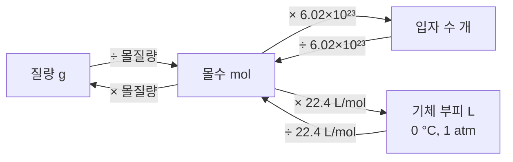

# 화학 1. 화학의 언어 — 원자를 세는 단위, 몰로 말하기
<!-- prev: m2-04, m3-01, 1-2, 2-4 -->
<!-- next: chem-4, matter-1, matter-2, rxn-1 -->

> [!NOTE]
> **성취기준**
> - **[12화학01-01]** 화학이 현대 과학⋅기술⋅사회의 발전에 기여한 사례를 조사⋅발표하며 화학에 흥미와 호기심을 가질 수 있다.
> - **[12화학01-02]** 다양한 단위를 몰로 환산할 수 있음을 이해하고, 물질의 양을 몰 단위로 표현할 수 있다.
> - **[12화학01-03]** 여러 가지 반응을 화학 반응식으로 나타내고, 화학 반응에서 물질의 양적 관계를 설명할 수 있다.

**학습 목표**

1. 화학이 식량·건강·소재·에너지·환경 문제 해결에 기여한 사례를 조사하고 그 속의 화학 원리를 발표할 수 있다.
2. 원자량·분자량·화학식량의 뜻을 알고, 몰과 몰질량의 관계를 설명할 수 있다.
3. 질량, 입자 수, 기체의 부피를 서로 몰로 환산하여 물질의 양을 몰 단위로 표현할 수 있다.
4. 여러 가지 반응을 계수와 물질의 상태까지 갖춘 화학 반응식으로 나타낼 수 있다.
5. 화학 반응식의 계수비가 몰수비임을 이용하여 반응물과 생성물의 질량·부피를 구하고, 모자라는 반응물(한계 반응물)을 찾을 수 있다.

**이 단원의 학습 사다리**

| 단계 | 무엇을 하나? |
|---|---|
| STEP 1. 이전 학습 다시 보기 | 원소·화합물·화학식, 질량 보존, 계수비 = 입자 수비, 기본량과 단위를 다시 꺼낸다 |
| STEP 2. 기초 다지기 | '묶음 단위'의 생각, 과학적 표기법, 원자의 상대 질량을 디딤돌로 놓는다 |
| STEP 3. 핵심 개념 | 화학의 유용성 → 몰과 몰질량 → 단위 환산 → 화학 반응식 → 양적 관계 → 한계 반응물 |
| STEP 4. 오개념 바로잡기 | "계수비는 질량비이다?" 같은 착각을 바로잡는다 |
| STEP 5. 다음 단계로 | 이상 기체 방정식, 용액의 농도, 수득률과 실험식, 대학 일반화학의 화학량론 |
| STEP 6. 생활·산업·진로 | 비료와 암모니아 합성, 제철, 에어백, 의약품 제조 |

---

## 🗺️ 단원 들어가기

빵집 주인은 밀가루를 "알갱이 몇 개"로 사지 않고 "몇 kg"으로 산다. 연필은 한 자루씩이 아니라 '다스(12자루)'로, 달걀은 '판(30개)'으로 산다. 너무 작거나 많은 것은 **묶음 단위**로 세는 편이 편하다.

그렇다면 물 한 모금(약 18 g) 속에는 물 분자가 몇 개 있을까? 놀랍게도 약 $6\times10^{23}$개, 즉 6000해 개나 된다. 화학자는 이렇게 어마어마한 수의 원자와 분자를 다루기 위해 **몰(mole)** 이라는 묶음 단위를 쓴다. 몰을 쓰면 "수소 2몰과 산소 1몰이 반응하여 물 2몰이 생긴다"처럼 원자·분자 수준의 이야기를 저울과 눈금실린더로 측정할 수 있는 양으로 바로 옮길 수 있다.

이 단원에서는 화학이 세상을 바꾼 이야기에서 출발하여, 화학자들이 공통으로 쓰는 '언어'인 몰과 화학 반응식을 익히고, 이를 이용해 반응에서 물질의 양이 어떻게 정해지는지 계산해 본다.

---

## STEP 1. 🔙 이전 학습 다시 보기

### 연계 개념표

| 이전 단원·성취기준 | 그때 배운 것 | 이 단원에서 확장되는 것 |
|---|---|---|
| 중2 「물질의 구성」 [9과11-01] | 원소와 화합물을 화학식으로 나타낸다 | 화학식으로 분자량·화학식량과 몰질량을 구한다 |
| 중2 「물질의 구성」 [9과11-04] | 물질은 원자, 분자, 이온으로 존재한다 | 어떤 입자든 $6.02\times10^{23}$개를 1몰로 센다 |
| 중3 「화학 반응의 규칙성」 [9과16-02] | 화학 반응식의 계수비 = 입자 수의 비 | 계수비 = **몰수비**로 확장하여 질량·부피를 계산한다 |
| 중3 「화학 반응의 규칙성」 [9과16-03]·[9과16-04] | 질량 보존 법칙, 일정 성분비 법칙 | 몰질량으로 반응 전후 질량 관계를 정량적으로 확인한다 |
| 중3 「화학 반응의 규칙성」 [9과16-05] | 기체 반응에서 기체 부피의 비가 일정하다 | 같은 온도·압력에서 기체 부피비 = 몰수비(아보가드로 법칙) |
| 통합과학1 「기본량과 단위」 [10통과1-01-02] | 국제단위계의 기본량, 몰은 물질의 양의 단위 | 몰을 이용해 질량·입자 수·부피를 서로 환산한다 |
| 통합과학1 「이온 결합과 공유 결합」 [10통과1-02-04] | 물, 산소, 소금이 만들어지는 결합 | 이온 결합 물질은 분자량 대신 화학식량을 쓴다 |

### 준비 운동 (사전 진단)

**Q1.** 다음 물질을 원소와 화합물로 구분하시오. 산소($\mathrm{O_2}$), 물($\mathrm{H_2O}$), 구리($\mathrm{Cu}$), 염화 나트륨($\mathrm{NaCl}$)

**Q2.** 반응식 $\mathrm{2H_2 + O_2 \rightarrow 2H_2O}$에서 수소 분자 100개가 모두 반응하면 물 분자는 몇 개 생길까?

**Q3.** 같은 온도와 압력에서 수소 기체 20 mL와 산소 기체 10 mL가 모두 반응하여 수증기가 생겼다. 생성된 수증기의 부피는 같은 조건에서 몇 mL일까?

**Q4.** 밀폐된 용기 안에서 철 가루를 산소와 반응시켰다. 반응 전후 용기 전체의 질량은 어떻게 될까?

정답 및 해설

**Q1.** 원소: 산소, 구리 / 화합물: 물, 염화 나트륨. 한 종류의 원소로만 이루어지면 원소(홑원소 물질), 두 종류 이상이 일정한 비율로 결합하면 화합물이다.

**Q2.** 100개 — 계수비가 $\mathrm{H_2 : H_2O} = 2 : 2 = 1 : 1$이므로 입자 수의 비도 1 : 1이다.

**Q3.** 20 mL — 기체 반응에서 부피비는 계수비 $2 : 1 : 2$와 같다.

**Q4.** 변하지 않는다 — 원자의 배열만 바뀌고 원자의 종류와 수는 그대로이므로 질량이 보존된다.

---

## STEP 2. 🧱 기초 다지기

### ① 너무 많은 것은 '묶음'으로 센다

| 묶음 단위 | 들어 있는 개수 | 주로 세는 것 |
|---|---|---|
| 켤레 | 2 | 양말, 신발 |
| 다스 | 12 | 연필 |
| 판 | 30 | 달걀 |
| 연(連) | 500 | 인쇄용 종이 |
| **몰(mol)** | $6.02\times10^{23}$ | 원자, 분자, 이온, 전자 |

묶음 단위를 쓰면 "달걀 3판 = 90개"처럼 **묶음 수 × 묶음 크기 = 낱개 수**로 바로 바꿀 수 있다. 몰도 똑같다.

> [!TIP]
> 💡 **비유** — 쌀 한 톨의 질량은 약 0.02 g이다. 쌀 $6\times10^{23}$톨을 모으면 질량이 약 $1\times10^{22}$ g, 즉 약 $1\times10^{16}$톤이다. 그런데 물 분자는 $6\times10^{23}$개를 모아도 고작 18 g, 숟가락 하나 분량이다. 원자와 분자가 얼마나 작은지 느껴진다.

### ② 큰 수와 작은 수를 쓰는 법 — 과학적 표기법

$$
a \times 10^{n} \qquad (1 \le a < 10,\; n \text{은 정수})
$$

- $602\,000\,000\,000\,000\,000\,000\,000 = 6.02\times10^{23}$
- 곱셈은 앞수끼리 곱하고 지수끼리 더한다: $(2\times10^{3})\times(3\times10^{4}) = 6\times10^{7}$
- 나눗셈은 앞수끼리 나누고 지수끼리 뺀다: $\dfrac{1.204\times10^{24}}{6.02\times10^{23}} = 0.2\times10^{1} = 2$

### ③ 원자의 질량은 '상대적'으로 비교한다

원자 하나의 질량은 약 $10^{-24}\sim10^{-22}$ g 정도로 너무 작아서 그대로 쓰기 불편하다. 그래서 **탄소 원자($^{12}\mathrm{C}$) 1개의 질량을 12로 정하고**, 이것과 비교한 상대적 질량을 **원자량(atomic weight)** 이라고 한다. 원자량은 비율이므로 단위가 없다.

| 원소 | H | C | N | O | Na | Mg | Al | S | Cl | Ca | Fe | Cu |
|---|---|---|---|---|---|---|---|---|---|---|---|---|
| 원자량(어림값) | 1 | 12 | 14 | 16 | 23 | 24 | 27 | 32 | 35.5 | 40 | 56 | 63.5 |

> [!NOTE]
> 이 단원의 계산에서는 위의 어림값을 쓴다. 염소의 원자량이 35.5처럼 정수가 아닌 까닭은 자연에 질량이 다른 염소 원자(동위 원소)가 섞여 있어 그 평균을 쓰기 때문이다. 정밀한 값은 주기율표를 참고한다.

### ④ 비례식과 단위 소거

양을 바꿀 때는 **단위가 약분되도록** 곱하면 실수가 줄어든다.

$$
36\ \mathrm{g} \times \frac{1\ \mathrm{mol}}{18\ \mathrm{g}} = 2\ \mathrm{mol}
$$

'g'이 위아래에서 약분되고 'mol'만 남았다. 이 방법을 **단위 환산(차원 분석)** 이라고 하며, 이 단원 계산의 기본 도구이다.

---

## STEP 3. 📘 핵심 개념

### ① 화학이 바꾼 세상 — 화학의 유용성 [12화학01-01]

화학은 물질의 구성과 변화를 연구하여 **새로운 물질을 만들고, 물질을 더 잘 쓰는 방법**을 찾는 학문이다. 지난 100여 년 동안 화학은 인류가 마주한 큰 문제들을 해결하는 데 기여해 왔다.

| 인류의 문제 | 화학의 기여 | 핵심 화학 원리 |
|---|---|---|
| 식량 부족 | 공기 중의 질소로 암모니아를 합성하여 질소 비료를 대량 생산(하버–보슈 공정, 20세기 초) | $\mathrm{N_2 + 3H_2 \rightarrow 2NH_3}$ — 반응물의 양적 관계와 평형 |
| 의복·생활용품 부족 | 석유에서 얻은 원료로 나일론 같은 합성 섬유와 플라스틱을 개발(1930년대 이후) | 작은 분자(단위체)를 길게 연결하는 중합 반응 |
| 질병 | 아스피린 같은 합성 의약품, 항생제의 대량 생산, 백신과 진단 시약 | 분자 구조와 생체 작용의 관계 |
| 깨끗한 물 | 정수장의 염소 소독, 응집제로 불순물 제거 | 산화·환원, 침전 반응 |
| 에너지·정보 | 고순도 규소로 만든 반도체, 휴대 전화·전기 자동차의 리튬 이온 전지 | 물질의 전기적 성질, 산화·환원 |
| 환경 | 오존층을 파괴하던 염화 플루오린화 탄소(CFC) 대체 물질 개발, 자동차 배기가스 정화 촉매 | 반응 경로와 촉매 |

> [!IMPORTANT]
> 화학의 성과에는 **양면**이 있다. 질소 비료는 식량 생산을 크게 늘렸지만, 지나치게 쓰면 하천과 바다의 부영양화를 일으킨다. 플라스틱은 가볍고 값싼 소재이지만 잘 분해되지 않아 미세 플라스틱 문제를 낳았다. 그래서 오늘날 화학은 **원료·에너지 낭비와 유해 물질을 줄이는 녹색 화학(green chemistry)** 과 재활용·생분해성 소재 개발로 나아가고 있다.

#### 사례로 보는 화학의 유용성 — 공기로 빵을 만들다

20세기 초까지 질소 비료의 원료는 주로 남아메리카의 초석(질산 나트륨 광물)이나 새 배설물이 쌓인 구아노였다. 인구가 늘면서 이 자원이 곧 바닥날 것이라는 걱정이 커졌다. 공기의 약 78 %가 질소($\mathrm{N_2}$)이지만, 질소 분자는 두 원자가 삼중 결합으로 단단히 묶여 있어 식물이 직접 쓰지 못한다.

독일의 화학자 하버는 높은 압력과 촉매를 이용하여 질소와 수소로 암모니아를 합성하는 데 성공했고, 보슈는 이를 공장 규모의 공정으로 만들었다. 오늘날 세계 인구 상당수의 식량이 이 공정으로 만든 비료에 기대고 있다고 평가된다. 이 반응이 '왜 높은 압력에서 유리한지'는 「화학 평형」 단원에서 다시 만난다.

#### 조사·발표는 이렇게

| 단계 | 할 일 | 예시(리튬 이온 전지) |
|---|---|---|
| 1. 주제 고르기 | 관심 분야에서 화학이 해결한 문제를 고른다 | 휴대용 전자 기기를 오래 쓸 수 있는 전원 |
| 2. 문제 상황 | 그 기술 이전에는 무엇이 문제였나 | 무겁고 충전이 어려운 전지 |
| 3. 화학 원리 | 어떤 물질과 반응을 이용했나 | 리튬 이온이 두 전극 사이를 오가며 산화·환원 |
| 4. 영향 | 과학·기술·사회에 준 변화 | 스마트폰, 전기 자동차, 에너지 저장 장치 |
| 5. 남은 과제 | 새로 생긴 문제와 해결 노력 | 자원 채굴, 화재 안전, 재활용 |

> [!TIP]
> 💡 **발표 요령** — "무엇을 발명했다"에서 멈추지 말고 **"어떤 문제를, 어떤 물질과 반응으로, 얼마나(양) 해결했는가"** 를 함께 말하자. 이 단원에서 배우는 몰과 화학 반응식은 바로 이 '얼마나'를 말하는 언어이다.

#### ✔ 바로 확인

1. (O/X) 질소 비료는 식량 생산을 늘렸을 뿐, 환경 문제와는 관계가 없다.
2. 빈칸: 공기 중의 질소와 수소로 암모니아를 대량 합성하는 공정을 (    ) 공정이라고 한다.
3. 짝짓기: (가) 반도체 (나) 합성 섬유 (다) 정수장 소독 — ㄱ. 염소 ㄴ. 고순도 규소 ㄷ. 나일론

정답

1. X — 지나치게 쓰면 하천과 바다의 부영양화를 일으킨다(화학의 양면성).
2. 하버–보슈
3. (가)–ㄴ, (나)–ㄷ, (다)–ㄱ

### ② 몰 — 화학자의 묶음 단위 [12화학01-02]

**몰(mole, 기호 mol)** 은 물질의 양을 나타내는 국제단위계(SI)의 기본 단위이다. 1몰은 정확히 $6.022\,140\,76\times10^{23}$개의 입자(원자, 분자, 이온, 전자 등)를 포함한다. 이 수를 **아보가드로수(Avogadro's number)** 라 하고, 이 책에서는 보통 $6.02\times10^{23}$으로 어림한다.

$$
\text{입자 수} = \text{몰수} \times 6.02\times10^{23}
\qquad
\text{몰수} = \frac{\text{입자 수}}{6.02\times10^{23}}
$$

| 물질 1 mol | 무엇을 셌나? | 입자 수 |
|---|---|---|
| 탄소(C) 1 mol | 탄소 원자 | $6.02\times10^{23}$개 |
| 물($\mathrm{H_2O}$) 1 mol | 물 분자 | 분자 $6.02\times10^{23}$개 = H 원자 $2\times6.02\times10^{23}$개 + O 원자 $6.02\times10^{23}$개 |
| 염화 나트륨(NaCl) 1 mol | NaCl 단위(이온 쌍) | $\mathrm{Na^+}$ $6.02\times10^{23}$개 + $\mathrm{Cl^-}$ $6.02\times10^{23}$개 |

> [!WARNING]
> "산소 1몰"은 무엇을 센 것인지 분명히 해야 한다. 산소 **분자**($\mathrm{O_2}$) 1몰에는 산소 **원자**가 2몰 들어 있다. 화학식을 함께 쓰는 습관을 들이자.

#### ✔ 바로 확인

1. (O/X) 산소 분자($\mathrm{O_2}$) 1 mol에는 산소 원자가 $6.02\times10^{23}$개 들어 있다.
2. 탄소 원자 $1.204\times10^{24}$개는 몇 mol인가?
3. 빈칸: 염화 나트륨 1 mol에 들어 있는 $\mathrm{Cl^-}$ 이온은 (    )개이다.

정답

1. X — 분자 1개에 원자가 2개이므로 원자는 $2\times6.02\times10^{23}$개이다.
2. 2 mol — $1.204\times10^{24} \div 6.02\times10^{23} = 2$
3. $6.02\times10^{23}$ — NaCl 1 mol 속에 $\mathrm{Na^+}$과 $\mathrm{Cl^-}$이 1 mol씩 있다.

### ③ 몰질량 — 1몰의 질량 [12화학01-02]

#### (1) 분자량과 화학식량

- **분자량(molecular weight)**: 분자를 이루는 원자들의 원자량을 모두 더한 값. 예) $\mathrm{H_2O} = 2\times1 + 16 = 18$
- **화학식량(formula weight)**: 이온 결합 물질처럼 분자가 따로 없는 물질은 화학식에 들어 있는 원자들의 원자량을 더한다. 예) $\mathrm{NaCl} = 23 + 35.5 = 58.5$

#### (2) 몰질량

원자량의 기준을 '$^{12}\mathrm{C}$ 원자 1몰의 질량 = 12 g'이 되도록 정했기 때문에, **어떤 물질 1몰의 질량은 원자량·분자량·화학식량에 g을 붙인 값**과 같다. 이를 **몰질량(molar mass)** 이라고 한다. 단위는 g/mol이다.

$$
\text{몰수(mol)} = \frac{\text{질량(g)}}{\text{몰질량(g/mol)}}
$$

| 물질 | 화학식 | 분자량(화학식량) | 몰질량 | 1 mol의 질량 |
|---|---|---|---|---|
| 수소 | $\mathrm{H_2}$ | 2 | 2 g/mol | 2 g |
| 물 | $\mathrm{H_2O}$ | 18 | 18 g/mol | 18 g |
| 이산화 탄소 | $\mathrm{CO_2}$ | 44 | 44 g/mol | 44 g |
| 염화 나트륨 | $\mathrm{NaCl}$ | 58.5 | 58.5 g/mol | 58.5 g |
| 탄산 칼슘 | $\mathrm{CaCO_3}$ | 100 | 100 g/mol | 100 g |
| 포도당 | $\mathrm{C_6H_{12}O_6}$ | 180 | 180 g/mol | 180 g |

> [!TIP]
> 💡 **비유** — 달걀 한 판(30개)의 무게는 약 1.8 kg, 탁구공 한 판(30개)은 약 80 g이다. 개수는 같아도 낱개가 무거우면 한 판이 무겁다. 몰도 마찬가지로 **1몰의 입자 수는 같지만 몰질량은 물질마다 다르다.**

#### 예제 1

물 36 g에 대하여 (1) 물의 몰수, (2) 물 분자 수, (3) 전체 원자 수를 구하시오.

**풀이**
(1) $36\ \mathrm{g} \div 18\ \mathrm{g/mol} = 2\ \mathrm{mol}$
(2) $2 \times 6.02\times10^{23} = 1.204\times10^{24}$개
(3) 물 분자 1개에 원자 3개(H 2개, O 1개)가 있으므로 $3 \times 1.204\times10^{24} \approx 3.61\times10^{24}$개

#### 예제 2

각설탕 한 개(3.42 g)에 들어 있는 설탕($\mathrm{C_{12}H_{22}O_{11}}$) 분자 수는?

**풀이** 몰질량 $= 12\times12 + 22\times1 + 11\times16 = 342\ \mathrm{g/mol}$
몰수 $= 3.42 \div 342 = 0.01\ \mathrm{mol}$, 분자 수 $= 0.01 \times 6.02\times10^{23} = 6.02\times10^{21}$개

#### ✔ 바로 확인

1. 탄산 칼슘($\mathrm{CaCO_3}$, 몰질량 100 g/mol) 50 g은 몇 mol인가?
2. (O/X) 염화 나트륨은 분자가 따로 없으므로 분자량 대신 화학식량을 쓴다.
3. 고르기: 1 mol의 질량이 가장 큰 것은? $\mathrm{H_2}$, $\mathrm{H_2O}$, $\mathrm{CO_2}$

정답

1. 0.5 mol — $50 \div 100$
2. O — 이온 결합 물질은 화학식 속 원자량의 합(NaCl은 58.5)을 쓴다.
3. $\mathrm{CO_2}$ — 몰질량이 44 g/mol로 가장 크다(입자 수는 모두 같다).

### ④ 기체의 부피와 몰 — 아보가드로 법칙 [12화학01-02]

중학교에서 "기체 반응에서 부피비가 일정하다"는 것을 배웠다. 그 이유는 다음 법칙으로 설명된다.

> [!IMPORTANT]
> **아보가드로 법칙** — 온도와 압력이 같으면, 기체의 종류에 관계없이 **같은 부피 속에 같은 수의 기체 분자**가 들어 있다.

기체 분자 사이의 거리는 분자 자체의 크기보다 훨씬 커서, 기체의 부피는 분자의 종류보다 **분자 수**에 의해 거의 정해진다. 그래서 같은 온도·압력에서 기체 1몰의 부피는 기체의 종류와 관계없이 거의 같다.

| 조건 | 기체 1 mol의 부피(어림값) |
|---|---|
| 0 °C, 1 atm | 22.4 L |
| 25 °C, 1 atm | 약 24.5 L |

$$
\text{기체의 몰수} = \frac{\text{기체의 부피(L)}}{\text{기체 1몰의 부피(L/mol)}}
\qquad (0\ ^\circ\mathrm{C},\ 1\ \mathrm{atm}\text{에서 } 22.4\ \mathrm{L/mol})
$$

> [!WARNING]
> 22.4 L/mol은 **기체**에만, 그리고 **0 °C, 1 atm**에서만 쓴다. 물(액체) 1몰은 약 18 mL에 불과하다. 온도와 압력이 바뀌면 기체 1몰의 부피도 바뀐다(진로 선택 「물질의 세 가지 상태」의 이상 기체 방정식).

<!-- fig:chem-1-avogadro-volume -->

#### 예제 3

0 °C, 1 atm에서 이산화 탄소 11.2 L의 (1) 몰수, (2) 질량, (3) 분자 수를 구하시오.

**풀이**
(1) $11.2 \div 22.4 = 0.5\ \mathrm{mol}$
(2) $0.5 \times 44 = 22\ \mathrm{g}$
(3) $0.5 \times 6.02\times10^{23} = 3.01\times10^{23}$개

#### ✔ 바로 확인

1. (O/X) 0 °C, 1 atm에서 수소 1 mol과 이산화 탄소 1 mol의 부피는 같다.
2. 0 °C, 1 atm에서 산소 44.8 L는 몇 mol인가?
3. (O/X) 0 °C, 1 atm에서 물 1 mol의 부피는 22.4 L이다.

정답

1. O — 같은 온도·압력에서 기체 1 mol의 부피는 종류와 관계없다(아보가드로 법칙).
2. 2 mol — $44.8 \div 22.4$
3. X — 22.4 L는 기체에만 쓴다. 물은 0 °C에서 기체가 아니며 1 mol이 약 18 mL이다.

### ⑤ 몰을 중심으로 한 단위 환산 지도 [12화학01-02]

질량, 입자 수, 기체 부피는 서로 다른 단위이지만 **모두 몰을 거쳐** 바꿀 수 있다. 몰은 여러 단위를 잇는 '환승역'이다.

| 바꾸고 싶은 것 | 1단계 | 2단계 |
|---|---|---|
| 질량 → 입자 수 | 질량 ÷ 몰질량 = 몰수 | 몰수 × $6.02\times10^{23}$ |
| 기체 부피 → 질량 | 부피 ÷ 22.4 = 몰수 | 몰수 × 몰질량 |
| 입자 수 → 기체 부피 | 입자 수 ÷ $6.02\times10^{23}$ = 몰수 | 몰수 × 22.4 |

> [!TIP]
> 💡 **요령** — 어떤 단위가 나오든 **"일단 몰로 바꾼다"**. 몰로 바꾸면 그다음 길은 모두 한 번의 곱셈이나 나눗셈이다. 교육과정에서도 몰은 계산을 위한 숫자가 아니라 **물질의 양을 편리하게 표현하는 도구**임을 강조한다.

<!-- sim:mole-converter -->

#### 예제 4 — 같은 질량, 다른 개수

수소($\mathrm{H_2}$) 1 g, 산소($\mathrm{O_2}$) 16 g, 메테인($\mathrm{CH_4}$) 16 g 중 분자 수가 가장 많은 것과 0 °C, 1 atm에서 부피가 가장 큰 것은?

**풀이** 몰수: $\mathrm{H_2}$ $1/2 = 0.5$ mol, $\mathrm{O_2}$ $16/32 = 0.5$ mol, $\mathrm{CH_4}$ $16/16 = 1$ mol
분자 수와 기체 부피는 모두 몰수에 비례하므로 **메테인**이 둘 다 가장 크다(1 mol, 22.4 L). 수소와 산소는 질량이 16배 다르지만 분자 수와 부피는 같다.

#### ✔ 바로 확인

1. 메테인($\mathrm{CH_4}$) 8 g에 들어 있는 분자 수는? (H = 1, C = 12)
2. 0 °C, 1 atm에서 질소 분자 $3.01\times10^{23}$개의 부피는 몇 L인가?
3. 빈칸: 질량, 입자 수, 기체 부피를 서로 바꿀 때는 먼저 (    )로 바꾼다.

정답

1. $3.01\times10^{23}$개 — $8 \div 16 = 0.5$ mol, $0.5\times6.02\times10^{23}$
2. 11.2 L — $3.01\times10^{23}$개는 0.5 mol, $0.5\times22.4$
3. 몰수 — 몰이 모든 단위를 잇는 환승역이다.

### ⑥ 화학 반응식 — 반응을 기록하는 문장 [12화학01-03]

**화학 반응식(chemical equation)** 은 반응물과 생성물을 화학식으로 쓰고, 원자의 종류와 수가 같아지도록 **계수**를 맞춘 식이다. 물질의 상태를 괄호 안에 함께 쓴다.

| 상태 표시 | 뜻 | 예 |
|---|---|---|
| (s) | 고체(solid) | $\mathrm{CaCO_3(s)}$ |
| (l) | 액체(liquid) | $\mathrm{H_2O(l)}$ |
| (g) | 기체(gas) | $\mathrm{CO_2(g)}$ |
| (aq) | 수용액(aqueous) | $\mathrm{NaCl(aq)}$ |

#### (1) 반응식을 완성하는 순서 — 프로페인의 연소

| 단계 | 할 일 | 결과 |
|---|---|---|
| ① 반응물·생성물 쓰기 | 화살표 왼쪽에 반응물, 오른쪽에 생성물 | $\mathrm{C_3H_8 + O_2 \rightarrow CO_2 + H_2O}$ |
| ② 가장 복잡한 물질의 계수를 1로 | $\mathrm{C_3H_8}$의 계수 1 | C 3개, H 8개 |
| ③ C 맞추기 | $\mathrm{CO_2}$ 계수 3 | $\mathrm{C_3H_8 + O_2 \rightarrow 3CO_2 + H_2O}$ |
| ④ H 맞추기 | $\mathrm{H_2O}$ 계수 4 | $\mathrm{C_3H_8 + O_2 \rightarrow 3CO_2 + 4H_2O}$ |
| ⑤ O 맞추기 | 오른쪽 O = 6 + 4 = 10 → $\mathrm{O_2}$ 계수 5 | $\mathrm{C_3H_8 + 5O_2 \rightarrow 3CO_2 + 4H_2O}$ |
| ⑥ 상태 쓰기 | | $\mathrm{C_3H_8(g) + 5O_2(g) \rightarrow 3CO_2(g) + 4H_2O(l)}$ |

<!-- fig:chem-1-propane-balance -->

#### (2) 미정계수법 — 복잡한 반응식

계수를 $a, b, c, d$로 두고 원소마다 원자 수가 같다는 식을 세운다. 에테인의 연소를 예로 들어 보자.

$$
a\,\mathrm{C_2H_6} + b\,\mathrm{O_2} \rightarrow c\,\mathrm{CO_2} + d\,\mathrm{H_2O}
$$

- C: $2a = c$, H: $6a = 2d$, O: $2b = 2c + d$
- $a = 1$로 놓으면 $c = 2,\ d = 3,\ b = 3.5$
- 계수는 가장 간단한 정수비로 쓰므로 모두 2를 곱한다: $\mathrm{2C_2H_6 + 7O_2 \rightarrow 4CO_2 + 6H_2O}$

#### (3) 여러 가지 반응을 반응식으로

| 반응 | 화학 반응식 | 생활 속 장면 |
|---|---|---|
| 메테인(도시가스)의 연소 | $\mathrm{CH_4(g) + 2O_2(g) \rightarrow CO_2(g) + 2H_2O(l)}$ | 가스레인지 |
| 탄산 칼슘과 염산 | $\mathrm{CaCO_3(s) + 2HCl(aq) \rightarrow CaCl_2(aq) + H_2O(l) + CO_2(g)}$ | 대리석 조각상이 산성비에 녹음 |
| 마그네슘과 염산 | $\mathrm{Mg(s) + 2HCl(aq) \rightarrow MgCl_2(aq) + H_2(g)}$ | 금속이 산에 녹으며 수소 발생 |
| 철의 제련 | $\mathrm{Fe_2O_3(s) + 3CO(g) \rightarrow 2Fe(l) + 3CO_2(g)}$ | 용광로 |
| 물의 전기 분해 | $\mathrm{2H_2O(l) \rightarrow 2H_2(g) + O_2(g)}$ | 수소 생산 |
| 광합성(전체 반응) | $\mathrm{6CO_2(g) + 6H_2O(l) \rightarrow C_6H_{12}O_6(aq) + 6O_2(g)}$ | 식물의 잎 |

> [!WARNING]
> 계수를 맞출 때 **화학식 속의 아래 첨자를 바꾸면 안 된다.** $\mathrm{H_2O}$를 $\mathrm{H_2O_2}$로 바꾸면 물이 아니라 과산화 수소라는 전혀 다른 물질이 된다. 바꿀 수 있는 것은 화학식 앞의 계수뿐이다.

#### ✔ 바로 확인

1. 빈칸: $\mathrm{2H_2O(l) \rightarrow 2H_2(g) + O_2(g)}$에서 (l)은 물질의 (    ) 상태를 뜻한다.
2. 계수 맞추기: ( )Mg + ( )$\mathrm{O_2}$ → ( )MgO
3. (O/X) 계수를 맞추기 어려우면 $\mathrm{H_2O}$를 $\mathrm{H_2O_2}$로 바꿔도 된다.

정답

1. 액체
2. 2, 1, 2 — 반응 전후 Mg 2개, O 2개
3. X — 아래 첨자를 바꾸면 다른 물질이 된다. 계수만 바꾼다.

### ⑦ 화학 반응식이 알려 주는 양적 관계 [12화학01-03]

화학 반응식의 **계수비는 반응하고 생성되는 물질의 몰수비**이다. 이것이 이 단원에서 가장 중요한 문장이다.

$$
\mathrm{N_2(g)} + 3\mathrm{H_2(g)} \rightarrow 2\mathrm{NH_3(g)}
$$

| 해석 | $\mathrm{N_2}$ | $\mathrm{H_2}$ | $\mathrm{NH_3}$ | 비 |
|---|---|---|---|---|
| 계수 | 1 | 3 | 2 | 1 : 3 : 2 |
| 분자 수 | $6.02\times10^{23}$ | $3\times6.02\times10^{23}$ | $2\times6.02\times10^{23}$ | 1 : 3 : 2 |
| 몰수 | 1 mol | 3 mol | 2 mol | 1 : 3 : 2 |
| 부피(같은 온도·압력의 기체) | 22.4 L | 67.2 L | 44.8 L | 1 : 3 : 2 |
| 질량 | 28 g | 6 g | 34 g | 14 : 3 : 17 (계수비와 다름!) |

질량을 보면 $28 + 6 = 34$로 **질량은 보존**되지만, 질량비는 계수비와 다르다. 분자마다 몰질량이 다르기 때문이다. 그래서 교육과정은 **"몰질량을 이용하여 몰수로 표현하면 양적 관계를 쉽게 이해할 수 있다"** 고 강조한다.

<!-- fig:chem-1-ammonia-ratio -->

> [!IMPORTANT]
> **양적 관계 계산의 3단계**
> ① 주어진 양(질량·부피·입자 수)을 **몰수로** 바꾼다.
> ② **계수비**로 구하려는 물질의 몰수를 구한다.
> ③ 구한 몰수를 원하는 단위(질량·부피)로 바꾼다.

#### 예제 5 — 질량과 질량

프로페인($\mathrm{C_3H_8}$, 캠핑용 가스의 주성분) 44 g이 완전 연소할 때 (1) 필요한 산소의 질량과 (2) 생성되는 이산화 탄소와 물의 질량을 구하시오.

$$
\mathrm{C_3H_8 + 5O_2 \rightarrow 3CO_2 + 4H_2O}
$$

**풀이**
① 프로페인 몰수: $44 \div 44 = 1\ \mathrm{mol}$
② 계수비 $1 : 5 : 3 : 4$ → $\mathrm{O_2}$ 5 mol, $\mathrm{CO_2}$ 3 mol, $\mathrm{H_2O}$ 4 mol
③ $\mathrm{O_2}$: $5 \times 32 = 160\ \mathrm{g}$, $\mathrm{CO_2}$: $3 \times 44 = 132\ \mathrm{g}$, $\mathrm{H_2O}$: $4 \times 18 = 72\ \mathrm{g}$

검산: 반응물 $44 + 160 = 204\ \mathrm{g}$, 생성물 $132 + 72 = 204\ \mathrm{g}$ → 질량 보존 확인.

#### 예제 6 — 질량과 기체 부피

마그네슘 2.4 g을 충분한 양의 묽은 염산에 넣었다. 발생하는 수소 기체의 부피는 0 °C, 1 atm에서 몇 L인가?

**풀이** $\mathrm{Mg + 2HCl \rightarrow MgCl_2 + H_2}$
① Mg: $2.4 \div 24 = 0.1\ \mathrm{mol}$
② 계수비 $\mathrm{Mg : H_2} = 1 : 1$ → $\mathrm{H_2}$ 0.1 mol
③ $0.1 \times 22.4 = 2.24\ \mathrm{L}$

#### 예제 7 — 제철소에서

산화 철(III)($\mathrm{Fe_2O_3}$) 160 kg을 일산화 탄소로 모두 환원하면 철 몇 kg을 얻을 수 있는가?

**풀이** $\mathrm{Fe_2O_3}$의 몰질량 $= 2\times56 + 3\times16 = 160\ \mathrm{g/mol}$ → $160\ \mathrm{kg} = 160\,000\ \mathrm{g}$은 1000 mol
계수비 $\mathrm{Fe_2O_3 : Fe} = 1 : 2$ → Fe 2000 mol $= 2000 \times 56\ \mathrm{g} = 112\ \mathrm{kg}$

통합과학 「산화와 환원」에서 철의 제련을 '산소를 잃는 반응'으로 배웠다. 이제는 **얼마나** 얻을 수 있는지까지 말할 수 있다.

#### ✔ 바로 확인

1. $\mathrm{N_2 + 3H_2 \rightarrow 2NH_3}$에서 $\mathrm{H_2}$ 6 mol이 모두 반응하면 $\mathrm{NH_3}$는 몇 mol 생기는가?
2. (O/X) 위 반응에서 반응물의 질량 합과 생성물의 질량 합은 같다.
3. $\mathrm{2H_2 + O_2 \rightarrow 2H_2O}$에서 $\mathrm{O_2}$ 32 g이 모두 반응하면 물은 몇 g 생기는가? (H = 1, O = 16)

정답

1. 4 mol — 계수비 $\mathrm{H_2 : NH_3} = 3 : 2$
2. O — 몰수(분자 수)는 4 mol → 2 mol로 줄지만 질량은 보존된다.
3. 36 g — $\mathrm{O_2}$ 1 mol → $\mathrm{H_2O}$ 2 mol, $2\times18$

### ⑧ 한계 반응물 — 먼저 다 쓰이는 물질 [12화학01-03]

샌드위치 1개를 만드는 데 빵 2장과 치즈 1장이 필요하다고 하자. 빵 10장과 치즈 3장이 있다면 샌드위치는 몇 개 만들 수 있을까? 빵으로는 5개, 치즈로는 3개까지 가능하므로 **3개**이다. 치즈가 먼저 떨어지고 빵 4장이 남는다.

반응에서도 반응물이 계수비대로 정확히 주어지지 않으면 어느 하나가 먼저 다 쓰이고 반응이 멈춘다. 이 물질을 **한계 반응물(limiting reactant)** 이라 하고, 남는 물질을 **과량 반응물**이라고 한다. **생성물의 양은 한계 반응물이 정한다.**

| 샌드위치 | 화학 반응 $\mathrm{N_2 + 3H_2 \rightarrow 2NH_3}$ |
|---|---|
| 빵 2장 + 치즈 1장 → 샌드위치 1개 | $\mathrm{N_2}$ 1 mol + $\mathrm{H_2}$ 3 mol → $\mathrm{NH_3}$ 2 mol |
| 가진 것: 빵 10장, 치즈 3장 | 가진 것: $\mathrm{N_2}$ 28 g(1 mol), $\mathrm{H_2}$ 9 g(4.5 mol) |
| 치즈가 한계 → 샌드위치 3개 | $\mathrm{N_2}$ 1 mol에는 $\mathrm{H_2}$ 3 mol만 필요 → $\mathrm{N_2}$가 한계 |
| 빵 4장 남음 | $\mathrm{H_2}$ 1.5 mol(3 g) 남음, $\mathrm{NH_3}$ 2 mol(34 g) 생성 |

#### 예제 8 — 반응 전·후 표로 정리하기

위의 암모니아 합성을 '반응 전 → 반응 → 반응 후' 표로 정리하시오.

**풀이**

| (단위: mol) | $\mathrm{N_2}$ | $\mathrm{H_2}$ | $\mathrm{NH_3}$ |
|---|---|---|---|
| 반응 전 | 1 | 4.5 | 0 |
| 반응(변화량) | $-1$ | $-3$ | $+2$ |
| 반응 후 | 0 | 1.5 | 2 |

변화량의 비 $1 : 3 : 2$가 계수비와 같다는 점을 확인하자. 질량으로 검산하면 반응 전 $28 + 9 = 37\ \mathrm{g}$, 반응 후 $3 + 34 = 37\ \mathrm{g}$이다.

> [!TIP]
> 💡 **요령** — 한계 반응물을 찾을 때는 각 반응물의 **몰수 ÷ 계수**를 비교한다. 이 값이 가장 작은 반응물이 한계 반응물이다. 위 예에서 $\mathrm{N_2}$는 $1/1 = 1$, $\mathrm{H_2}$는 $4.5/3 = 1.5$이므로 $\mathrm{N_2}$가 한계이다.

#### 그래프로 보는 한계 반응물

일정한 양의 묽은 염산에 마그네슘 리본의 질량을 늘려 가며 넣고 발생한 수소의 부피를 재면, 그래프는 처음에는 **원점을 지나는 직선**으로 올라가다가 어느 순간부터 **수평**이 된다.

| 구간 | 한계 반응물 | 수소 부피 |
|---|---|---|
| 꺾이는 점 이전 | 마그네슘(염산이 남음) | 마그네슘 질량에 비례하여 증가 |
| 꺾이는 점 | 두 물질이 계수비대로 정확히 반응 | 최대 |
| 꺾이는 점 이후 | 염산(마그네슘이 남음) | 더 이상 늘지 않음 |

이 꺾이는 점을 읽으면 염산 속 HCl의 몰수도 거꾸로 알아낼 수 있다(개념 확인 문제 7).

<!-- fig:chem-1-limiting-graph -->

#### ✔ 바로 확인

1. 빈칸: 반응에서 먼저 모두 소모되어 생성물의 양을 정하는 반응물을 (    )이라고 한다.
2. $\mathrm{2H_2 + O_2 \rightarrow 2H_2O}$에서 $\mathrm{H_2}$ 3 mol과 $\mathrm{O_2}$ 1 mol을 반응시켰다. 한계 반응물과 남는 물질의 몰수는?
3. 그림의 그래프에서 꺾이는 점 이후 Mg를 더 넣어도 수소 부피가 늘지 않는 까닭은?

정답

1. 한계 반응물
2. 한계 반응물 $\mathrm{O_2}$, $\mathrm{H_2}$ 1 mol 남음 — 몰수 ÷ 계수: $\mathrm{H_2}$ 1.5, $\mathrm{O_2}$ 1
3. 염산 속 HCl이 모두 쓰였기 때문이다(한계 반응물이 HCl로 바뀜).

---

## STEP 4. ⚠️ 오개념 바로잡기

| 흔한 오개념 | 올바른 개념 | 왜 그럴까? |
|---|---|---|
| 화학 반응식의 계수비는 질량비이다 | 계수비는 **몰수비(입자 수비)** 이다. 질량비는 계수 × 몰질량의 비이다 | $\mathrm{2H_2 + O_2 \rightarrow 2H_2O}$에서 계수비는 2:1:2이지만 질량비는 4:32:36이다 |
| 1몰이면 모든 물질의 질량이 같다 | 1몰의 **입자 수**가 같을 뿐, 질량은 몰질량에 따라 다르다 | 수소 1몰은 2 g, 이산화 탄소 1몰은 44 g이다 |
| 모든 물질 1몰의 부피는 22.4 L이다 | 22.4 L는 **0 °C, 1 atm의 기체**에만 해당한다 | 액체·고체는 입자 사이가 가까워 1몰의 부피가 물질마다 다르고 훨씬 작다(물 1몰 ≈ 18 mL) |
| 반응물을 많이 넣을수록 생성물이 계속 늘어난다 | 생성물의 양은 **한계 반응물**이 정한다 | 한쪽 반응물만 늘리면 다른 반응물이 먼저 바닥나 반응이 멈춘다 |
| 반응식의 계수를 맞추려면 아래 첨자를 바꿔도 된다 | 아래 첨자는 물질의 정체이므로 **계수만** 바꾼다 | $\mathrm{H_2O}$와 $\mathrm{H_2O_2}$는 전혀 다른 물질이다 |
| 기체가 발생하는 반응에서는 질량 보존 법칙이 성립하지 않는다 | 빠져나간 기체까지 포함하면 질량은 **항상 보존**된다 | 열린 용기에서 질량이 줄어든 만큼이 빠져나간 기체의 질량이다 |
| 원자량은 원자 1개의 실제 질량(g)이다 | 원자량은 $^{12}\mathrm{C} = 12$를 기준으로 한 **상대적 질량**으로 단위가 없다 | 원자 1개의 실제 질량은 원자량(g) ÷ $6.02\times10^{23}$이다 |

---

## STEP 5. 🎓 다음 단계로 한 걸음 더

> [!CAUTION]
> 이 절은 **화학 교육과정 범위 밖의 심화 내용**으로 평가 대상이 아니다. 몰과 양적 관계가 진로 선택 과목과 대학에서 어떻게 확장되는지 미리 보는 맛보기이다.

### 진로 선택 과목·대학과의 연결

| 과목 | 이어지는 내용 |
|---|---|
| 「화학」 「역동적인 화학 반응」 | 용액 1 L 속 용질의 몰수인 **몰 농도**, pH, 중화 반응의 양적 관계 |
| 물질과 에너지 「물질의 세 가지 상태」 | 기체의 온도·압력·부피·몰수를 한 식으로 묶은 **이상 기체 방정식**, 부분 압력과 몰 분율 |
| 물질과 에너지 「용액의 성질」 | 몰랄 농도, 용액의 농도에 따른 증기압·끓는점·어는점 변화 |
| 화학 반응의 세계 「산·염기 평형」 | 이온화 상수와 약산·약염기 수용액의 pH 계산 |
| 대학 일반화학 | 화학량론(stoichiometry), 수득률, 원소 분석과 실험식, 질량 분석 |

### ① 22.4 L는 어디서 왔을까? — 이상 기체 방정식

진로 선택 「물질의 세 가지 상태」에서는 기체의 압력($P$), 부피($V$), 몰수($n$), 절대 온도($T$)를 하나의 식으로 묶는다.

$$
PV = nRT \qquad (R \approx 0.082\ \mathrm{atm\cdot L/(mol\cdot K)})
$$

$P = 1\ \mathrm{atm}$, $T = 273\ \mathrm{K}$(0 °C), $n = 1\ \mathrm{mol}$을 넣으면 $V = 0.082\times273 \approx 22.4\ \mathrm{L}$이다. 25 °C(298 K)를 넣으면 약 24.4 L(더 정밀한 $R$ 값으로는 약 24.5 L)가 나온다. 이 단원에서 외운 값이 하나의 식에서 나온다는 것을 알게 된다.

### ② 이론과 실제의 차이 — 수득률

실제 공장이나 실험실에서는 반응이 끝까지 가지 않거나 부반응이 일어나 계산한 양보다 적게 얻는다.

$$
\text{수득률(\%)} = \frac{\text{실제로 얻은 양}}{\text{이론적으로 얻을 수 있는 양}} \times 100
$$

예제 7에서 철을 실제로 100.8 kg 얻었다면 수득률은 $100.8 / 112 \times 100 = 90\ \%$이다. 산업 현장에서는 수득률을 1 %만 높여도 원료와 에너지가 크게 절약되므로, 「화학 평형」 단원의 평형 이동과 진로 선택 「반응 속도」의 촉매가 중요해진다.

### ③ 화학식을 거꾸로 찾기 — 실험식

대학 일반화학과 분석화학에서는 미지 물질을 태워 생긴 $\mathrm{CO_2}$와 $\mathrm{H_2O}$의 질량으로 C와 H의 몰수비를 구하고, 이로부터 **실험식(가장 간단한 정수비)** 을 정한다. 여기에 **질량 분석기**로 측정한 분자량을 더하면 분자식까지 알 수 있다. 몰은 이처럼 "무엇이 얼마나 있는가"를 밝히는 모든 분석의 출발점이다.

### 고등학교 「화학」 vs 다음 단계

| 구분 | 고등학교 「화학」 「화학의 언어」 | 진로 선택·대학 |
|---|---|---|
| 기체의 양 | 0 °C, 1 atm에서 1 mol = 22.4 L | $PV = nRT$로 어떤 조건에서도 계산 |
| 양적 관계 | 계수비 = 몰수비, 한계 반응물 | 수득률, 다단계 반응, 연속 공정의 물질 수지 |
| 화학식 | 주어진 화학식으로 몰질량 계산 | 원소 분석·질량 분석으로 화학식 결정 |
| 용액 | (다음 단원) 몰 농도 | 몰랄 농도, 몰 분율, 활동도 |
| 관련 전공 | — | 화학, 화학공학, 재료공학, 약학, 환경공학 |

---

## STEP 6. 🏭 생활·산업·진로 연결

### 사례 1. 비료 공장 — 암모니아의 양적 관계

- **원리** $\mathrm{N_2 + 3H_2 \rightarrow 2NH_3}$에서 질소와 수소는 **몰수비 1 : 3**으로 공급해야 낭비가 없다. 질량비로는 $28 : 6 = 14 : 3$이다.
- **어디에 쓰이나** 공장에서는 원료 기체의 유량을 몰수비에 맞추어 조절하고, 반응하지 않고 남은 기체는 다시 반응기로 돌려보낸다. 암모니아는 요소 비료, 질산, 합성 섬유의 원료가 된다.

### 사례 2. 에어백 — 순식간에 기체를 만드는 반응

- **원리** 과거 널리 쓰였던 에어백은 충돌 신호를 받으면 아자이드화 나트륨($\mathrm{NaN_3}$)이 분해되어 질소 기체를 만든다. $\mathrm{2NaN_3(s) \rightarrow 2Na(s) + 3N_2(g)}$
- **어디에 쓰이나** 에어백을 알맞은 크기로 부풀리려면 필요한 기체의 몰수를 계산하여 넣을 고체의 질량을 정해야 한다(개념 확인 문제 9). 실제 장치에는 생성된 나트륨을 안전한 물질로 바꾸는 반응도 함께 설계되며, 최근에는 다른 기체 발생제도 쓰인다.

### 사례 3. 의약품과 정밀 화학 — 몰로 처방하는 약

- **원리** 약은 분자 한 개 한 개가 몸속 표적 분자와 결합하여 작용하므로, 효과는 질량보다 **분자 수(몰수)** 와 더 직접 관련된다.
- **어디에 쓰이나** 신약을 합성할 때는 여러 단계 반응의 수득률을 계산하여 원료 투입량을 정한다. 혈액 검사 결과 중에는 혈당·콜레스테롤처럼 mmol/L(1 L당 밀리몰) 단위로 나타내는 경우도 있다.

### 사례 4. 탄소 배출 계산 — 기후 위기의 회계

- **원리** 연료 속 탄소 원자 1몰(12 g)이 완전 연소하면 $\mathrm{CO_2}$ 1몰(44 g)이 생긴다. 탄소 12 g이 이산화 탄소 44 g이 되므로 질량은 약 3.7배가 된다.
- **어디에 쓰이나** 기업과 국가의 온실가스 배출량 산정, 탄소 포집 설비의 용량 설계에 이 양적 관계가 쓰인다.

### 관련 진로와 학과

| 진로 | 하는 일 | 관련 학과 |
|---|---|---|
| 화학 공정 엔지니어 | 원료 투입량·수득률 계산, 공장 공정 설계와 운전 | 화학공학, 화학생물공학 |
| 분석 화학자 | 시료 속 성분의 종류와 양을 측정·인증 | 화학, 분석화학 |
| 약사·제약 연구원 | 의약품 합성, 용량 계산, 품질 관리 | 약학, 제약공학, 화학 |
| 환경 컨설턴트 | 온실가스·오염 물질 배출량 산정, 저감 방안 설계 | 환경공학, 대기과학 |
| 금속·재료 엔지니어 | 제련과 합금의 원료 배합 설계 | 금속공학, 신소재공학 |

---

## 🔬 탐구 활동 — 몰을 재고, 반응의 양적 관계를 확인하기

### 활동 A. 다양한 물질 1몰 모아 보기

**목표** 여러 물질의 몰질량을 구하고, 특정한 몰수에 해당하는 질량을 직접 측정하여 '같은 몰수 = 같은 입자 수'를 체감한다.

**준비물** 전자저울(0.01 g까지), 약숟가락, 칭량 접시, 물, 염화 나트륨, 설탕, 알루미늄 포일, 구리 조각, 눈금실린더

**과정**
1. 각 물질의 화학식으로 몰질량을 계산한다.
2. 0.1 mol에 해당하는 질량을 계산하고 전자저울로 측정하여 모은다(물은 질량을 부피로 바꾸어 눈금실린더로 잰다).
3. 모은 물질의 부피(겉보기 양)를 서로 비교하고, 들어 있는 입자 수를 계산한다.

**결과 기록**

| 물질 | 화학식 | 몰질량(g/mol) | 0.1 mol의 질량(g) | 입자 수(개) | 겉보기 양 비교 |
|---|---|---|---|---|---|
| 물 | $\mathrm{H_2O}$ | | | | |
| 염화 나트륨 | $\mathrm{NaCl}$ | | | | |
| 설탕 | $\mathrm{C_{12}H_{22}O_{11}}$ | | | | |
| 알루미늄 | Al | | | | |
| 구리 | Cu | | | | |

**생각해 보기**
1. 입자 수가 같은데 질량과 부피가 크게 다른 까닭은 무엇일까?
2. 실험실에서 시약을 '개수'가 아니라 '몰'로 준비하면 어떤 점이 편리할까?

### 활동 B. 탄산 칼슘과 염산의 반응에서 양적 관계 확인하기

**목표** 반응물의 질량을 바꾸어 가며 발생한 이산화 탄소의 질량을 측정하고, 화학 반응식의 계수비와 비교한다.

**준비물** 탄산 칼슘 가루(또는 조개껍데기·달걀 껍데기 가루), 묽은 염산(충분한 양), 삼각 플라스크, 솜, 전자저울, 보안경, 실험복, 장갑

**과정**
1. 삼각 플라스크에 묽은 염산을 넣고, 탄산 칼슘을 따로 달아 둔다(0.50 g, 1.00 g, 1.50 g, 2.00 g).
2. 염산이 든 플라스크와 탄산 칼슘의 질량을 함께 잰다(반응 전 질량).
3. 탄산 칼슘을 플라스크에 넣고 입구를 솜으로 느슨하게 막는다(산 방울이 튀는 것을 막고 기체는 빠져나가게 한다).
4. 기포가 더 이상 생기지 않으면 다시 질량을 잰다(반응 후 질량). 줄어든 질량이 빠져나간 $\mathrm{CO_2}$의 질량이다.

<!-- fig:chem-1-caco3-setup -->

**결과 기록**

| 탄산 칼슘(g) | 탄산 칼슘(mol) | 질량 감소 = $\mathrm{CO_2}$(g) | $\mathrm{CO_2}$(mol) | 몰수비 $\mathrm{CaCO_3 : CO_2}$ |
|---|---|---|---|---|
| 0.50 | | | | |
| 1.00 | | | | |
| 1.50 | | | | |
| 2.00 | | | | |

**생각해 보기**
1. $\mathrm{CaCO_3(s) + 2HCl(aq)} \rightarrow \mathrm{CaCl_2(aq) + H_2O(l) + CO_2(g)}$에서 예상되는 몰수비는? 측정값과 비교해 보자.
2. 측정한 $\mathrm{CO_2}$의 양이 이론값보다 작게 나왔다면 어떤 원인이 있을까? (예: 물에 녹은 $\mathrm{CO_2}$, 날아간 물방울, 반응하지 않은 가루)
3. 염산의 양을 고정하고 탄산 칼슘을 계속 늘리면 그래프는 어떻게 될까?

> [!WARNING]
> **안전 수칙** 묽은 염산을 다룰 때는 보안경·실험복·장갑을 착용한다. 피부에 묻으면 즉시 많은 물로 씻는다. 실험 후 남은 산성 용액은 그대로 하수구에 버리지 말고 화학 실험실 폐수 처리 기준에 따라 지정된 폐액통에 모은다.

---

## ✅ 개념 확인 문제

### 기본

**1.** 이산화 탄소 4.4 g에 대하여 (1) 몰수, (2) 분자 수, (3) 전체 원자 수를 구하시오. (C = 12, O = 16, 아보가드로수 = $6.02\times10^{23}$)

정답 및 해설

**정답** (1) 0.1 mol (2) $6.02\times10^{22}$개 (3) $1.806\times10^{23}$개

(1) $\mathrm{CO_2}$의 몰질량 $= 12 + 2\times16 = 44\ \mathrm{g/mol}$, $4.4 \div 44 = 0.1\ \mathrm{mol}$
(2) $0.1 \times 6.02\times10^{23} = 6.02\times10^{22}$개
(3) 분자 1개에 원자 3개 → $3 \times 6.02\times10^{22} = 1.806\times10^{23}$개

**2.** 다음 중 분자 수가 가장 많은 것은? (H = 1, N = 14, O = 16)
① 수소($\mathrm{H_2}$) 2 g ② 산소($\mathrm{O_2}$) 16 g ③ 0 °C, 1 atm의 이산화 탄소 11.2 L ④ 물 9 g ⑤ 질소($\mathrm{N_2}$) 7 g

정답 및 해설

**정답 ①**

몰수로 바꾸어 비교한다. ① $2/2 = 1$ mol ② $16/32 = 0.5$ mol ③ $11.2/22.4 = 0.5$ mol ④ $9/18 = 0.5$ mol ⑤ $7/28 = 0.25$ mol. 분자 수는 몰수에 비례하므로 ①이 가장 많다.

**3.** 다음 화학 반응식의 계수 $a, b, c$를 가장 간단한 정수로 구하시오.
$\mathrm{Fe_2O_3} + a\,\mathrm{CO} \rightarrow b\,\mathrm{Fe} + c\,\mathrm{CO_2}$

정답 및 해설

**정답** $a = 3,\ b = 2,\ c = 3$

Fe: 왼쪽 2개 → $b = 2$. C: $a = c$. O: 왼쪽 $3 + a$, 오른쪽 $2c$ → $3 + a = 2a$ → $a = 3$, $c = 3$.

**4.** 반응식 $\mathrm{2H_2(g) + O_2(g) \rightarrow 2H_2O(g)}$에 대한 설명으로 옳은 것을 **모두** 고르시오. (H = 1, O = 16)
ㄱ. 수소 2 mol과 산소 1 mol이 반응하여 수증기 2 mol이 생성된다.
ㄴ. 수소 2 g과 산소 1 g이 반응하여 수증기 2 g이 생성된다.
ㄷ. 같은 온도·압력에서 수소 20 L가 모두 반응하면 수증기 20 L가 생성된다.
ㄹ. 반응 전후 분자의 총 몰수는 같다.

정답 및 해설

**정답 ㄱ, ㄷ**

ㄱ. 계수비 = 몰수비이다. ㄴ. 계수비는 질량비가 아니다. 질량비는 $4 : 32 : 36$이다. ㄷ. 기체의 부피비 = 계수비이므로 $\mathrm{H_2 : H_2O} = 2 : 2$이다. ㄹ. 반응 전 $2 + 1 = 3$ mol, 반응 후 2 mol로 줄어든다(원자 수와 질량은 보존되지만 분자 수는 보존되지 않을 수 있다).

### 응용

**5.** 메테인($\mathrm{CH_4}$) 8 g이 완전 연소할 때 필요한 산소의 질량과 생성되는 물의 질량, 0 °C, 1 atm에서 생성되는 이산화 탄소의 부피를 구하시오. (H = 1, C = 12, O = 16)

정답 및 해설

**정답** 산소 32 g, 물 18 g, 이산화 탄소 11.2 L

$\mathrm{CH_4 + 2O_2 \rightarrow CO_2 + 2H_2O}$. $\mathrm{CH_4}$: $8/16 = 0.5$ mol → $\mathrm{O_2}$ 1 mol($32$ g), $\mathrm{H_2O}$ 1 mol($18$ g), $\mathrm{CO_2}$ 0.5 mol($0.5\times22.4 = 11.2$ L). 검산: $8 + 32 = 40$ g, $22 + 18 = 40$ g.

**6.** 수소 4 g과 산소 48 g을 밀폐 용기에 넣고 반응시켜 물을 만들었다. (1) 한계 반응물은 무엇인가? (2) 생성되는 물의 질량은? (3) 반응 후 남는 물질과 그 질량은? (H = 1, O = 16)

정답 및 해설

**정답** (1) 수소 (2) 36 g (3) 산소 16 g

$\mathrm{2H_2 + O_2 \rightarrow 2H_2O}$. $\mathrm{H_2}$: $4/2 = 2$ mol, $\mathrm{O_2}$: $48/32 = 1.5$ mol. 몰수 ÷ 계수: $\mathrm{H_2}$ $2/2 = 1$, $\mathrm{O_2}$ $1.5/1 = 1.5$ → 수소가 한계 반응물이다. 수소 2 mol은 산소 1 mol과 반응하여 물 2 mol($36$ g)을 만들고, 산소 0.5 mol($16$ g)이 남는다. 검산: $4 + 48 = 52$, $36 + 16 = 52$.

**7.** 일정한 양의 묽은 염산에 마그네슘의 질량을 바꾸어 넣고, 발생한 수소의 부피를 0 °C, 1 atm으로 환산하여 표에 나타냈다. (Mg = 24)

| 마그네슘(g) | 0.12 | 0.24 | 0.36 | 0.48 |
|---|---|---|---|---|
| 수소(mL) | 112 | 224 | 224 | 224 |

(1) 마그네슘 0.36 g을 넣었을 때 한계 반응물은? (2) 이 염산에 들어 있던 HCl의 몰수는?

정답 및 해설

**정답** (1) HCl (2) 0.02 mol

$\mathrm{Mg + 2HCl \rightarrow MgCl_2 + H_2}$. Mg 0.12 g(0.005 mol) → $\mathrm{H_2}$ 0.005 mol = 112 mL로 계산과 일치한다. 0.24 g(0.01 mol)에서 224 mL가 된 뒤 더 늘지 않으므로, 0.36 g에서는 Mg(0.015 mol)가 남고 HCl이 모두 반응한 것이다. 최대 수소 0.01 mol을 만드는 데 HCl $2\times0.01 = 0.02$ mol이 쓰였다.

**8.** 같은 질량의 수소($\mathrm{H_2}$)와 메테인($\mathrm{CH_4}$)이 있다. 같은 온도·압력에서 두 기체의 부피비 $\mathrm{H_2 : CH_4}$와, 두 기체에 들어 있는 수소 **원자** 수의 비를 구하시오. (H = 1, C = 12)

정답 및 해설

**정답** 부피비 8 : 1, 수소 원자 수비 4 : 1

질량을 16 g이라 하면 $\mathrm{H_2}$는 $16/2 = 8$ mol, $\mathrm{CH_4}$는 $16/16 = 1$ mol이다. 같은 온도·압력에서 부피비 = 몰수비 = 8 : 1이다. 수소 원자는 $\mathrm{H_2}$에 $8\times2 = 16$ mol, $\mathrm{CH_4}$에 $1\times4 = 4$ mol이 있으므로 $16 : 4 = 4 : 1$이다. 질량이 같아도 분자 수와 원자 수는 몰질량과 화학식에 따라 달라진다.

### 융합·서술형

**9. [산업 연계]** 에어백이 0 °C, 1 atm 기준으로 67.2 L의 질소 기체로 부풀어야 한다. $\mathrm{2NaN_3(s) \rightarrow 2Na(s) + 3N_2(g)}$ 반응을 이용할 때 필요한 아자이드화 나트륨의 질량을 구하고, 넣는 양이 너무 많거나 적으면 어떤 문제가 생길지 서술하시오. (N = 14, Na = 23)

정답 및 해설

**예시 답안**
$\mathrm{N_2}$: $67.2 / 22.4 = 3$ mol. 계수비 $\mathrm{NaN_3 : N_2} = 2 : 3$ → $\mathrm{NaN_3}$ 2 mol. 몰질량 $23 + 3\times14 = 65$ g/mol이므로 $2\times65 = 130$ g이 필요하다.
너무 적으면 에어백이 충분히 부풀지 않아 탑승자가 운전대에 부딪히고, 너무 많으면 압력이 지나치게 높아져 에어백이 터지거나 탑승자에게 큰 힘을 가할 수 있다. 따라서 화학 반응식의 양적 관계로 정확한 양을 계산해야 한다.

**채점 포인트** ① 기체 부피 → 몰수 환산 ② 계수비 이용 ③ 질량 계산 ④ 양이 맞지 않을 때의 문제를 안전과 연결

**10. [과학·사회 연계]** 암모니아 1.7톤을 합성하는 데 필요한 질소와 수소의 질량을 각각 구하시오. 또한 하버–보슈 공정이 인류에 준 긍정적 영향과 부정적 영향을 하나씩 들고, 화학이 앞으로 어떤 방향으로 기여해야 할지 자신의 생각을 쓰시오. (H = 1, N = 14)

정답 및 해설

**예시 답안**
$\mathrm{NH_3}$ 1.7톤 $= 1.7\times10^{6}$ g, 몰수 $= 1.7\times10^{6} / 17 = 1.0\times10^{5}$ mol. 계수비 $\mathrm{N_2 : H_2 : NH_3} = 1 : 3 : 2$ → $\mathrm{N_2}$ $5.0\times10^{4}$ mol($\times28$ g = 1.4톤), $\mathrm{H_2}$ $1.5\times10^{5}$ mol($\times2$ g = 0.3톤). 합계 1.7톤으로 질량 보존을 확인할 수 있다.
긍정적 영향: 질소 비료를 대량 생산하여 식량 생산이 크게 늘었다. 부정적 영향: 비료를 지나치게 쓰면 하천·바다의 부영양화가 일어나고, 원료 수소를 화석 연료에서 얻는 과정에서 이산화 탄소가 많이 배출된다.
앞으로의 방향(예): 재생 에너지로 물을 전기 분해해 얻은 수소를 쓰는 공정, 비료를 필요한 만큼만 쓰도록 돕는 정밀 농업 등 녹색 화학의 방향으로 기여해야 한다.

**채점 포인트** ① 몰 환산과 계수비 계산 ② 양면적 영향 제시 ③ 근거 있는 자기 의견

### 실력 다지기

**11.** 같은 온도·압력에서 부피가 같은 두 용기 (가), (나)에 기체 $\mathrm{X_2}$와 메테인($\mathrm{CH_4}$)이 각각 들어 있다. 기체의 질량은 (가) 3.2 g, (나) 1.6 g이다. (1) $\mathrm{X_2}$의 분자량과 X의 원자량을 구하고, (2) 두 용기에 들어 있는 전체 원자 수의 비 (가) : (나)를 구하시오. (H = 1, C = 12)

정답 및 해설

**정답** (1) 분자량 32, 원자량 16 (2) 2 : 5

(1) 아보가드로 법칙에 따라 두 용기의 분자 수(몰수)가 같다. $\mathrm{CH_4}$: $1.6 \div 16 = 0.1$ mol이므로 $\mathrm{X_2}$도 0.1 mol이다. 몰질량 $= 3.2 \div 0.1 = 32$ g/mol → 분자량 32, X의 원자량 16.
(2) 원자 수: (가) $0.1\times2 = 0.2$ mol, (나) $0.1\times5 = 0.5$ mol → $2 : 5$. 분자 수가 같아도 분자 1개 속 원자 수가 다르면 원자 수는 다르다.

**12.** 탄산 칼슘 25 g을 충분한 양의 묽은 염산에 넣어 모두 반응시켰다. (1) 발생한 이산화 탄소의 부피(0 °C, 1 atm)와 (2) 생성된 염화 칼슘($\mathrm{CaCl_2}$)의 질량을 구하시오. (C = 12, O = 16, Cl = 35.5, Ca = 40)

정답 및 해설

**정답** (1) 5.6 L (2) 27.75 g

$\mathrm{CaCO_3 + 2HCl \rightarrow CaCl_2 + H_2O + CO_2}$
① $\mathrm{CaCO_3}$: $25 \div 100 = 0.25$ mol
② 계수비 $\mathrm{CaCO_3 : CaCl_2 : CO_2} = 1 : 1 : 1$ → 각각 0.25 mol
③ $\mathrm{CO_2}$ $0.25\times22.4 = 5.6$ L, $\mathrm{CaCl_2}$(몰질량 $40 + 2\times35.5 = 111$) $0.25\times111 = 27.75$ g

**13.** 밀폐 용기에 메테인 0.3 mol과 산소 0.5 mol을 넣고 완전히 반응시켰다. (1) 한계 반응물은? (2) 반응 후 남은 기체의 종류와 몰수는? (3) 같은 온도·압력에서 반응 후 기체의 부피는 반응 전의 몇 배인가? (단, 생성된 물은 모두 액체이다.)

정답 및 해설

**정답** (1) 산소 (2) $\mathrm{CH_4}$ 0.05 mol, $\mathrm{CO_2}$ 0.25 mol (3) $\dfrac{3}{8}$배

$\mathrm{CH_4 + 2O_2 \rightarrow CO_2 + 2H_2O(l)}$

| (단위: mol) | $\mathrm{CH_4}$ | $\mathrm{O_2}$ | $\mathrm{CO_2}$ |
|---|---|---|---|
| 반응 전 | 0.3 | 0.5 | 0 |
| 반응 | $-0.25$ | $-0.5$ | $+0.25$ |
| 반응 후 | 0.05 | 0 | 0.25 |

몰수 ÷ 계수: $\mathrm{CH_4}$ 0.3, $\mathrm{O_2}$ 0.25 → 산소가 한계 반응물이다. 기체 몰수는 반응 전 0.8 mol, 반응 후 0.3 mol이고, 같은 온도·압력에서 부피비 = 몰수비이므로 $0.3/0.8 = 3/8$배이다.

**14.** 어떤 학생이 "질소 28 g과 수소 6 g이 반응하여 암모니아 34 g이 생기므로, 질소 14 g과 수소 14 g을 넣으면 암모니아 28 g이 생긴다."라고 주장하였다. 이 주장의 잘못을 지적하고, 실제로 생기는 암모니아와 남는 물질의 질량을 구하시오. (H = 1, N = 14)

정답 및 해설

**정답** 암모니아 17 g, 수소 11 g이 남는다.

학생은 넣은 반응물이 **모두** 반응한다고 가정했다. 그러나 반응물은 계수비(몰수비)대로만 반응한다. $\mathrm{N_2}$: $14/28 = 0.5$ mol, $\mathrm{H_2}$: $14/2 = 7$ mol. 몰수 ÷ 계수: $\mathrm{N_2}$ 0.5, $\mathrm{H_2}$ 약 2.33 → 질소가 한계 반응물이다. $\mathrm{N_2}$ 0.5 mol은 $\mathrm{H_2}$ 1.5 mol과 반응하여 $\mathrm{NH_3}$ 1 mol(17 g)을 만들고, $\mathrm{H_2}$ 5.5 mol(11 g)이 남는다. 검산: $14 + 14 = 17 + 11 = 28$ g. 질량 합은 보존되지만 남은 수소가 포함된 값이다.

**채점 포인트** ① 모두 반응한다는 가정의 잘못 지적 ② 몰수로 바꾸어 한계 반응물 판단 ③ 생성물과 남는 물질의 질량

### 도전

**15.** 일정한 양의 묽은 염산에 탄산 칼슘의 질량을 바꾸어 넣고, 반응이 끝난 뒤 줄어든 질량(빠져나간 $\mathrm{CO_2}$의 질량)을 측정하였다. (C = 12, O = 16, Ca = 40)

| 탄산 칼슘(g) | 1.00 | 2.00 | 3.00 | 4.00 |
|---|---|---|---|---|
| 줄어든 질량(g) | 0.44 | 0.88 | 1.10 | 1.10 |

(1) 이 염산에 들어 있던 HCl의 몰수를 구하시오. (2) 탄산 칼슘 3.00 g을 넣었을 때 반응하지 않고 남은 탄산 칼슘의 질량을 구하시오. (3) 같은 농도의 염산을 2배 부피로 쓰고 탄산 칼슘 4.00 g을 넣으면 줄어든 질량은 몇 g이 될지 예측하시오.

정답 및 해설

**정답** (1) 0.05 mol (2) 0.50 g (3) 1.76 g

(1) 줄어든 질량이 1.10 g에서 더 늘지 않으므로 이때 HCl이 모두 반응했다. $\mathrm{CO_2}$ 최대 $1.10 \div 44 = 0.025$ mol, 계수비 $\mathrm{HCl : CO_2} = 2 : 1$ → HCl 0.05 mol.
(2) 3.00 g은 0.03 mol인데 HCl 0.05 mol은 $\mathrm{CaCO_3}$ 0.025 mol만 반응시킨다. 남은 $\mathrm{CaCO_3}$ 0.005 mol $= 0.50$ g.
(3) HCl 0.10 mol은 $\mathrm{CaCO_3}$ 0.05 mol까지 반응시킬 수 있다. 4.00 g(0.04 mol)은 이보다 적으므로 이번에는 $\mathrm{CaCO_3}$가 한계 반응물이다. $\mathrm{CO_2}$ 0.04 mol $= 1.76$ g.

**채점 포인트** ① 그래프가 꺾이는(값이 일정해지는) 구간에서 한계 반응물이 HCl임을 판단 ② 계수비로 HCl 몰수 계산 ③ 조건을 바꾸면 한계 반응물이 바뀜을 예측

**16.** 메테인($\mathrm{CH_4}$)과 에테인($\mathrm{C_2H_6}$)이 섞인 기체 11.2 L(0 °C, 1 atm)를 완전 연소시켰더니 이산화 탄소 15.68 L(0 °C, 1 atm)가 생겼다. (1) 혼합 기체 속 메테인과 에테인의 몰수를 각각 구하고, (2) 완전 연소에 필요한 산소의 부피(0 °C, 1 atm)를 구하시오.

정답 및 해설

**정답** (1) 메테인 0.3 mol, 에테인 0.2 mol (2) 29.12 L

$\mathrm{CH_4 + 2O_2 \rightarrow CO_2 + 2H_2O}$, $\mathrm{2C_2H_6 + 7O_2 \rightarrow 4CO_2 + 6H_2O}$
(1) 혼합 기체 $11.2/22.4 = 0.5$ mol, $\mathrm{CO_2}$ $15.68/22.4 = 0.7$ mol. 메테인을 $x$, 에테인을 $y$ mol이라 하면 $x + y = 0.5$, 탄소 원자 수로 $x + 2y = 0.7$ → $y = 0.2$, $x = 0.3$.
(2) $\mathrm{O_2}$: 메테인 $0.3\times2 = 0.6$ mol, 에테인 $0.2\times\dfrac{7}{2} = 0.7$ mol → 1.3 mol, $1.3\times22.4 = 29.12$ L.

**채점 포인트** ① 부피를 몰수로 환산 ② 탄소 원자 수(계수비)로 연립 관계 세우기 ③ 두 반응식의 계수비로 산소량 합산

**17.** 온도와 압력이 일정한 실린더에 질소 $a$ mol과 수소 6 mol을 넣고 $\mathrm{N_2 + 3H_2 \rightarrow 2NH_3}$ 반응을 끝까지 진행시켰더니, 반응 후 기체의 부피가 반응 전의 $\dfrac{1}{2}$이 되었다. (1) $a$를 구하고 반응 후 실린더 속 기체의 종류를 쓰시오. (2) $a$를 이 값보다 크게 하거나 작게 하면 '반응 후 부피 ÷ 반응 전 부피'는 $\dfrac{1}{2}$보다 커지는지 작아지는지 까닭과 함께 예측하시오.

정답 및 해설

**정답** (1) $a = 2$, 암모니아만 4 mol (2) 어느 쪽이든 $\dfrac{1}{2}$보다 커진다.

반응으로 $\mathrm{N_2}$가 $x$ mol 쓰이면 기체 몰수는 $x + 3x - 2x = 2x$만큼 준다.
- $a \le 2$이면 질소가 한계 반응물 → $x = a$, 비 $= \dfrac{a + 6 - 2a}{a + 6} = \dfrac{6 - a}{a + 6}$. $\dfrac{1}{2}$로 놓으면 $a = 2$.
- $a \ge 2$이면 수소가 한계 반응물 → $x = 2$, 비 $= \dfrac{a + 2}{a + 6}$. $\dfrac{1}{2}$로 놓으면 $a = 2$.

두 경우 모두 $a = 2$로, 두 반응물이 계수비 1 : 3대로 정확히 반응하여 $\mathrm{NH_3}$ 4 mol만 남는다.
(2) $a < 2$이면 $\dfrac{6-a}{a+6}$은 $a$가 작을수록 커지고(예: $a = 1$일 때 $\dfrac{5}{7}$), $a > 2$이면 $\dfrac{a+2}{a+6}$은 $a$가 클수록 커진다(예: $a = 10$일 때 $\dfrac{3}{4}$). 어느 반응물이 남든 남은 기체가 부피를 차지하므로, 부피가 가장 많이 줄어드는 것은 계수비대로 넣었을 때뿐이다.

**채점 포인트** ① 반응에 따른 기체 몰수 변화($2x$) 표현 ② 한계 반응물에 따라 두 경우로 나누어 풀이 ③ 계수비대로 넣을 때 감소가 최대임을 근거로 예측

---

## 📝 한눈에 정리

### 핵심 요약

- 화학은 식량(질소 비료), 소재(합성 섬유·플라스틱), 의약, 에너지(반도체·전지), 환경 문제 해결에 기여했으며, 그 양면성을 함께 고려해야 한다.
- **원자량**은 $^{12}\mathrm{C} = 12$를 기준으로 한 상대적 질량이고, 분자량·화학식량은 화학식 속 원자량의 합이다.
- **1몰** = 입자 $6.02\times10^{23}$개. **몰질량**(g/mol)은 원자량·분자량·화학식량에 g을 붙인 값이다.
- 0 °C, 1 atm에서 기체 1몰의 부피는 종류와 관계없이 **22.4 L**이다(아보가드로 법칙).
- 질량·입자 수·기체 부피는 모두 **몰을 거쳐** 서로 환산한다.
- 화학 반응식은 원자의 종류와 수가 같도록 **계수**를 맞추고 상태를 표시한다.
- **계수비 = 몰수비 = 입자 수비 = (같은 조건 기체의) 부피비** ≠ 질량비.
- 생성물의 양은 먼저 다 쓰이는 **한계 반응물**이 정한다.

### 핵심 용어

| 용어 | 뜻 |
|---|---|
| 원자량 | $^{12}\mathrm{C}$ 원자의 질량을 12로 정하고 비교한 원자의 상대적 질량 |
| 분자량 | 분자를 이루는 원자들의 원자량의 합 |
| 화학식량 | 화학식에 들어 있는 원자들의 원자량의 합(이온 결합 물질 등) |
| 몰(mol) | $6.022\,140\,76\times10^{23}$개의 입자를 1묶음으로 하는 물질의 양의 단위 |
| 아보가드로수 | 1몰에 들어 있는 입자 수, 약 $6.02\times10^{23}$ |
| 몰질량 | 물질 1몰의 질량(g/mol) |
| 아보가드로 법칙 | 같은 온도·압력에서 같은 부피의 기체에는 같은 수의 분자가 있다 |
| 화학 반응식 | 반응물과 생성물을 화학식과 계수로 나타낸 식 |
| 계수 | 화학식 앞의 수. 반응하는 물질의 몰수비를 나타낸다 |
| 한계 반응물 | 반응에서 먼저 모두 소모되어 생성물의 양을 결정하는 반응물 |
| 녹색 화학 | 유해 물질과 자원·에너지 낭비를 줄이도록 화학 공정을 설계하는 화학 |

### 다음 단원으로

몰은 "얼마나 많은가"를 말하는 화학의 언어였다. 다음 단원 「물질의 구조와 성질」에서는 "어떻게 생겼는가"로 질문을 바꾸어, 원자들이 전자를 어떻게 나누어 결합하고 그 결과 분자가 어떤 모양을 갖게 되는지, 그리고 그 모양이 물질의 성질을 어떻게 결정하는지 탐구한다. 몰 단위로 표현한 양은 「화학 평형」의 평형 상수와 「역동적인 화학 반응」의 몰 농도·중화 반응으로 계속 이어진다.
