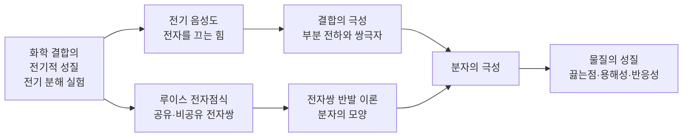
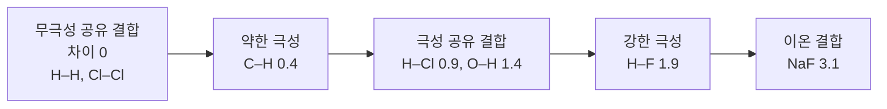
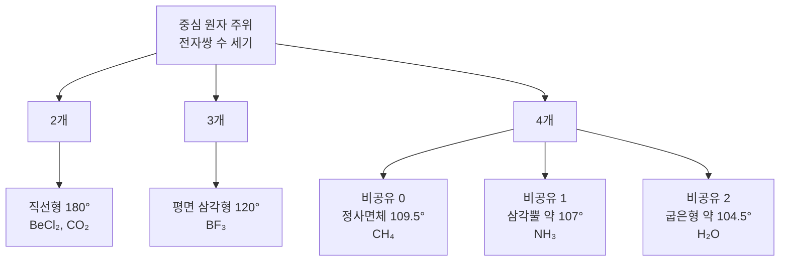

# 화학 2. 물질의 구조와 성질 — 전자쌍이 그리는 분자의 모양
<!-- prev: m2-04, 2-3, 2-4, 2-6 -->
<!-- next: matter-1, matter-2, rxn-2, rxn-3 -->

> [!NOTE]
> **성취기준**
> - **[12화학02-01]** 실험을 통해 화학 결합의 전기적 성질을 설명할 수 있다.
> - **[12화학02-02]** 전기 음성도의 주기적 변화를 이해하고, 결합한 원소들의 전기 음성도 차이와 쌍극자 모멘트를 이용하여 결합의 극성을 판단할 수 있다.
> - **[12화학02-03]** 원자와 분자를 루이스 전자점식으로 표현하고, 전자쌍 반발 이론을 근거로 분자의 구조를 추론하여 모형으로 나타낼 수 있다.
> - **[12화학02-04]** 물질의 물리적, 화학적 성질을 분자의 구조와 연관 짓고, 이에 대한 호기심을 가질 수 있다.

**학습 목표**

1. 물과 용융 염화 나트륨의 전기 분해 결과를 근거로 화학 결합에 전자가 관여함을 설명할 수 있다.
2. 전기 음성도의 주기적 변화를 설명하고, 전기 음성도 차이와 쌍극자 모멘트로 결합의 극성을 판단할 수 있다.
3. 원자와 분자를 루이스 전자점식으로 나타내고 공유 전자쌍과 비공유 전자쌍을 구분할 수 있다.
4. 전자쌍 반발 이론으로 분자의 모양과 결합각을 추론하고 모형으로 나타낼 수 있다.
5. 분자의 구조와 극성을 끓는점, 용해성, 반응성 등 물질의 성질과 연관 지어 설명할 수 있다.

**이 단원의 학습 사다리**

| 단계 | 무엇을 하나? |
|---|---|
| STEP 1. 이전 학습 다시 보기 | 원자의 구조, 주기율표, 옥텟 규칙, 이온 결합과 공유 결합을 다시 꺼낸다 |
| STEP 2. 기초 다지기 | 전기력(쿨롱 힘), 원자가 전자, 3차원 각도와 벡터 합을 디딤돌로 놓는다 |
| STEP 3. 핵심 개념 | 결합의 전기적 성질 → 전기 음성도와 결합의 극성 → 루이스 전자점식 → 전자쌍 반발 이론 → 구조와 성질 |
| STEP 4. 오개념 바로잡기 | "극성 결합이 있으면 극성 분자이다?" 같은 착각을 바로잡는다 |
| STEP 5. 다음 단계로 | 분자 간 상호작용과 수소 결합, 옥텟 규칙의 예외, 혼성 오비탈과 분자 오비탈 |
| STEP 6. 생활·산업·진로 | 계면활성제, 전자레인지, 신약 설계, 분자 모델링 |

---

## 🗺️ 단원 들어가기

물과 기름은 왜 섞이지 않을까? 원자 3개로 이루어진 이산화 탄소(분자량 44)는 상온에서 기체인데, 같은 세 원자 분자이면서 더 가벼운 물(분자량 18)은 왜 액체일까? 플라스틱 빗으로 머리를 빗은 뒤 가는 물줄기에 가까이 대면 물줄기가 휘어지는데, 기름 줄기는 왜 거의 휘지 않을까?

이 질문들의 답은 모두 **분자의 모양**에 있다. 원자는 전자를 주고받거나 나누어 결합하는데, 원자마다 전자를 끌어당기는 힘이 달라 분자 안에 전하가 한쪽으로 치우친다. 또 원자 주위의 전자쌍들은 서로 밀어내며 최대한 멀리 떨어지려 하기 때문에, 분자는 직선, 삼각형, 사면체, 삼각뿔, 굽은형 같은 일정한 3차원 모양을 갖는다. 전하의 치우침과 모양이 합쳐져 물질의 성질이 정해진다.

---

## STEP 1. 🔙 이전 학습 다시 보기

### 연계 개념표

| 이전 단원·성취기준 | 그때 배운 것 | 이 단원에서 확장되는 것 |
|---|---|---|
| 중2 「물질의 구성」 [9과11-02]·[9과11-04] | 원자는 양성자·중성자·전자로 이루어지고, 전자를 잃거나 얻어 이온이 된다 | 전자를 **완전히 주고받으면** 이온 결합, **나누어 가지면** 공유 결합 |
| 통합과학1 「원소의 주기성과 화학 결합의 이유」 [10통과1-02-03] | 전자껍질 모형의 전자 배치, 18족처럼 안정해지려는 경향(옥텟 규칙) | 원자가 전자를 점으로 나타내는 **루이스 전자점식** |
| 통합과학1 「이온 결합과 공유 결합」 [10통과1-02-04] | 이온 결합 물질과 공유 결합 물질의 전기 전도성 차이 | 전기 분해 실험으로 결합에 **전자가 관여**함을 확인, 결합의 **극성** |
| 통합과학1 「물질의 전기적 성질과 소재」 [10통과1-02-06] | 도체·부도체·반도체, 자유 전자의 이동 | 결합의 종류에 따른 전기적 성질 비교 |
| 화학 「화학의 언어」 [12화학01-03] | 화학 반응식의 계수비 = 몰수비 | 전기 분해에서 생성 기체의 부피비 = 몰수비 해석 |

### 준비 운동 (사전 진단)

**Q1.** 산소(O, 원자 번호 8)와 염소(Cl, 원자 번호 17)의 원자가 전자 수를 각각 쓰시오.

**Q2.** 나트륨 원자가 전자 1개를 잃으면 어떤 입자가 되며, 그 전자 배치는 어느 원소와 같아지는가?

**Q3.** 염화 나트륨은 고체 상태에서는 전류가 흐르지 않지만 물에 녹이거나 녹는점 이상으로 가열하여 액체로 만들면 전류가 흐른다. 그 이유는?

**Q4.** 물 분자에서 수소와 산소는 전자를 어떻게 하여 결합하는가?

정답 및 해설

**Q1.** O: 6개(2, 6), Cl: 7개(2, 8, 7). 원자가 전자는 가장 바깥 전자껍질의 전자이다.

**Q2.** 나트륨 이온($\mathrm{Na^+}$)이 되며 전자 배치가 네온(Ne)과 같아진다(2, 8).

**Q3.** 고체에서는 이온이 제자리에 고정되어 움직이지 못하지만, 수용액이나 액체에서는 이온이 자유롭게 움직여 전하를 운반하기 때문이다.

**Q4.** 산소 원자와 수소 원자가 각각 전자를 1개씩 내놓아 만든 **전자쌍을 공유**하여 결합한다(공유 결합).

---

## STEP 2. 🧱 기초 다지기

### ① 전하 사이의 힘 — 쿨롱 힘

두 전하 사이에는 전기력이 작용한다. 다른 부호는 끌어당기고 같은 부호는 밀어낸다. 그 크기는 **전하량의 곱에 비례**하고 **거리의 제곱에 반비례**한다.

$$
F \propto \frac{q_1 q_2}{r^2}
$$

| 상황 | 힘의 변화 |
|---|---|
| 두 전하량을 각각 2배로 | 힘 4배 |
| 거리를 2배로 | 힘 $\dfrac{1}{4}$배 |

화학 결합은 모두 이 전기력으로 설명된다. 이온 결합은 양이온과 음이온 사이의 인력, 공유 결합은 두 원자핵이 그 사이의 전자쌍을 함께 끌어당기는 인력이다.

> [!TIP]
> 💡 **비유** — 공유 결합은 두 사람(원자핵)이 하나의 줄(전자쌍)을 함께 잡아당기는 줄다리기와 같다. 두 사람이 줄을 놓지 않는 한 두 사람은 줄을 사이에 두고 묶여 있다. 힘이 센 사람 쪽으로 줄의 가운데가 쏠리는 것이 다음에 배울 '극성'이다.

### ② 원자가 전자와 옥텟 규칙

- **원자가 전자(valence electron)**: 가장 바깥 전자껍질에 있는 전자. 화학 결합에 참여한다. 2·3주기 전형 원소에서는 족 번호의 일의 자리 수와 같다(18족 제외).
- **옥텟 규칙(octet rule)**: 원자들은 전자를 잃거나 얻거나 공유하여 가장 바깥 껍질에 전자 8개(수소는 2개)를 채워 18족 원소와 같은 안정한 전자 배치를 이루려는 경향이 있다.

| 족 | 1 | 2 | 13 | 14 | 15 | 16 | 17 | 18 |
|---|---|---|---|---|---|---|---|---|
| 2주기 원소 | Li | Be | B | C | N | O | F | Ne |
| 원자가 전자 수 | 1 | 2 | 3 | 4 | 5 | 6 | 7 | 0(8) |
| 공유 결합에 쓰는 홀전자 수(보통) | — | 2 | 3 | 4 | 3 | 2 | 1 | 0 |

### ③ 3차원에서 '가장 멀리' 놓기

공 두 개를 막대 끝에 붙여 서로 최대한 멀리 놓으면 반대 방향(180°)이 된다. 세 개는 같은 평면에서 120°, 네 개는 평면이 아니라 **정사면체의 꼭짓점 방향(109.5°)** 이 가장 멀다. 풍선 여러 개의 꼭지를 한데 묶으면 풍선들이 저절로 이 모양으로 벌어진다.

| 풍선 수 | 저절로 생기는 배치 | 풍선 사이의 각 |
|---|---|---|
| 2 | 직선 | 180° |
| 3 | 평면 삼각형 | 120° |
| 4 | 정사면체 | 109.5° |

### ④ 방향이 있는 양의 합 — 벡터

크기와 방향이 같은 두 줄로 반대쪽에서 당기면 합력은 0이다. 세 사람이 120° 간격으로 같은 힘으로 당겨도 합력은 0이다. 그러나 두 사람이 V자 모양으로 같은 쪽을 향해 당기면 합력이 생긴다. 분자의 극성은 결합마다의 '전하 치우침'을 이렇게 **방향까지 고려하여 더한 결과**로 정해진다.

---

## STEP 3. 📘 핵심 개념

### ① 화학 결합의 전기적 성질 — 전기 분해로 확인하기 [12화학02-01]

화학 결합에 전자가 관여한다는 것을 어떻게 알 수 있을까? 물질에 전류를 흘려 분해해 보면 된다. 전기 에너지로 결합이 끊어지고 새로운 물질이 생긴다면, 그 결합이 **전기적인 힘(전자)** 과 관련되어 있다는 증거가 된다.

#### (1) 물의 전기 분해 — 공유 결합에도 전자가 관여한다

순수한 물은 전류가 거의 흐르지 않으므로, 전류가 잘 흐르도록 황산 나트륨($\mathrm{Na_2SO_4}$) 같은 전해질을 조금 녹인 뒤 전류를 흘린다. 황산 나트륨은 전류를 흐르게 할 뿐 자신은 분해되지 않는다.

| 전극 | 생성 기체 | 확인 방법 | 전극 반응 |
|---|---|---|---|
| (−)극 | 수소 | 불씨를 대면 '퍽' 소리를 내며 탄다 | $\mathrm{2H_2O + 2e^- \rightarrow H_2 + 2OH^-}$ |
| (+)극 | 산소 | 꺼져 가는 불씨를 대면 다시 타오른다 | $\mathrm{2H_2O \rightarrow O_2 + 4H^+ + 4e^-}$ |
| 전체 | 수소 : 산소 = 2 : 1(부피비) | | $\mathrm{2H_2O(l) \rightarrow 2H_2(g) + O_2(g)}$ |

물 분자는 공유 결합으로 이루어진 분자인데도, 전자를 공급하거나 빼앗으면 결합이 끊어지고 새 물질이 생긴다. 즉 **공유 결합도 전자를 매개로 한 결합**이다. 생성 기체의 부피비 2 : 1은 반응식의 계수비(몰수비)와 같다.

> [!NOTE]
> (−)극 주변에는 $\mathrm{OH^-}$이, (+)극 주변에는 $\mathrm{H^+}$이 생기므로, BTB 용액을 넣고 전기 분해하면 (−)극 쪽은 파란색, (+)극 쪽은 노란색으로 변한다. 전극에서 전자가 오간다는 또 하나의 증거이다.

<!-- fig:chem-2-water-electrolysis -->

#### (2) 용융 염화 나트륨의 전기 분해 — 이온 결합은 이온 사이의 전기적 인력

염화 나트륨을 약 801 °C 이상으로 가열하여 녹인 뒤 전류를 흘리면 다음과 같이 분해된다.

| 전극 | 반응 | 생성 물질 |
|---|---|---|
| (−)극 | $\mathrm{Na^+ + e^- \rightarrow Na}$ | 은백색 금속 나트륨 |
| (+)극 | $\mathrm{2Cl^- \rightarrow Cl_2 + 2e^-}$ | 황록색 염소 기체 |
| 전체 | $\mathrm{2NaCl(l) \rightarrow 2Na(l) + Cl_2(g)}$ | |

$\mathrm{Na^+}$은 (−)극으로, $\mathrm{Cl^-}$은 (+)극으로 끌려간다. 이는 염화 나트륨이 **전하를 띤 이온**으로 이루어져 있고, 이온 결합이 양이온과 음이온 사이의 **정전기적 인력**임을 보여 준다.

<!-- fig:chem-2-molten-nacl -->

> [!WARNING]
> 용융 염화 나트륨의 전기 분해는 고온이고 독성 기체인 염소가 생기므로 학교 실험실에서 직접 하지 않는다. 산업 현장에서 금속 나트륨과 염소를 얻는 방법으로 자료를 통해 학습한다.

#### (3) 결합의 종류와 전기적 성질 비교

| 구분 | 이온 결합 | 공유 결합 | 금속 결합(참고) |
|---|---|---|---|
| 결합하는 원소 | 금속 + 비금속 | 비금속 + 비금속 | 금속 + 금속 |
| 전자의 역할 | 전자를 **주고받아** 생긴 양이온·음이온의 인력 | 전자쌍을 **공유** | 자유 전자와 양이온의 인력 |
| 예 | NaCl, MgO, $\mathrm{CaF_2}$ | $\mathrm{H_2O}$, $\mathrm{CO_2}$, $\mathrm{CH_4}$ | Na, Cu, Fe |
| 고체의 전기 전도성 | 없음 | 대부분 없음(흑연 예외) | 있음 |
| 액체·수용액의 전기 전도성 | 있음 | 대부분 없음(HCl처럼 물에서 이온화하면 있음) | 있음(액체) |

#### (4) 결합의 세기와 거리 — 에너지로 보는 결합

두 수소 원자가 멀리서 다가오면 원자핵과 상대 원자의 전자 사이의 인력 때문에 에너지가 낮아진다. 그러나 너무 가까워지면 두 원자핵 사이의 반발력이 커져 에너지가 다시 높아진다. 에너지가 **가장 낮은 거리**에서 결합이 이루어지며, 이 거리가 **결합 길이**, 이때 낮아진 에너지만큼이 **결합 에너지**이다. 수소 분자의 결합 길이는 약 74 pm, 결합 에너지는 약 436 kJ/mol이다.

| 두 원자 사이 거리 | 우세한 힘 | 에너지 |
|---|---|---|
| 아주 멀다 | 거의 상호작용 없음 | 0(기준) |
| 가까워진다 | 인력 | 점점 낮아진다 |
| 결합 길이 | 인력과 반발력의 균형 | **최저** |
| 더 가까워진다 | 원자핵 사이의 반발력 | 급격히 높아진다 |

<!-- fig:chem-2-bond-energy-curve -->

이온 결합도 마찬가지이다. 쿨롱 힘에 따라 **이온의 전하가 클수록, 이온 사이 거리가 짧을수록** 결합이 강해지고 녹는점이 높다.

| 화합물 | 이온의 전하 | 이온 사이 거리 | 녹는점(약) |
|---|---|---|---|
| NaF | +1, −1 | 짧다 | 993 °C |
| NaCl | +1, −1 | ↓ | 801 °C |
| NaBr | +1, −1 | ↓ | 747 °C |
| NaI | +1, −1 | 길다 | 661 °C |
| MgO | +2, −2 | NaF와 비슷 | 2800 °C |

#### 예제 1

황산 나트륨을 녹인 물을 전기 분해하였더니 (−)극에서 기체 24 mL가 모였다. (1) (+)극에서 모인 기체의 종류와 부피는? (2) 분해된 물은 몇 mol인가? (단, 기체 부피는 0 °C, 1 atm 기준이다.)

**풀이**
(1) (+)극은 산소, 부피비 $\mathrm{H_2 : O_2} = 2 : 1$이므로 12 mL
(2) $\mathrm{H_2}$: $0.024\ \mathrm{L} \div 22.4\ \mathrm{L/mol} \approx 1.07\times10^{-3}\ \mathrm{mol}$. 계수비 $\mathrm{H_2O : H_2} = 2 : 2$이므로 분해된 물도 약 $1.07\times10^{-3}$ mol이다.

#### ✔ 바로 확인

1. (O/X) 물을 전기 분해할 때 황산 나트륨을 넣는 까닭은 황산 나트륨이 분해되어 수소를 내기 때문이다.
2. 빈칸: 물의 전기 분해에서 (−)극에서 생기는 기체는 (    )이고, 모인 기체의 부피비는 수소 : 산소 = (    )이다.
3. 용융 염화 나트륨을 전기 분해할 때 $\mathrm{Na^+}$은 어느 극으로 끌려가는가?
4. 고르기: NaF와 MgO 중 녹는점이 더 높은 것은?

정답

1. X — 황산 나트륨은 전류를 잘 흐르게 할 뿐 자신은 분해되지 않는다.
2. 수소, 2 : 1 — 반응식 $\mathrm{2H_2O \rightarrow 2H_2 + O_2}$의 계수비와 같다.
3. (−)극 — 양이온이므로 (−)극으로 끌려가 전자를 얻어 나트륨이 된다.
4. MgO — 이온의 전하(+2, −2)가 커서 정전기적 인력이 훨씬 크다.

### ② 전기 음성도와 그 주기적 변화 [12화학02-02]

공유 결합에서 두 원자가 전자쌍을 똑같이 나누어 가질까? 원자마다 전자를 끌어당기는 힘이 다르다. 공유 결합한 원자가 **공유 전자쌍을 끌어당기는 능력을 상대적인 수치로 나타낸 것**을 **전기 음성도(electronegativity)** 라고 한다. 미국의 화학자 폴링이 제안한 값이 널리 쓰이며, 가장 큰 플루오린(F)을 4.0으로 정한다.

| 주기＼족 | 1 | 2 | 13 | 14 | 15 | 16 | 17 |
|---|---|---|---|---|---|---|---|
| 1 | H 2.1 | | | | | | |
| 2 | Li 1.0 | Be 1.5 | B 2.0 | C 2.5 | N 3.0 | O 3.5 | F 4.0 |
| 3 | Na 0.9 | Mg 1.2 | Al 1.5 | Si 1.8 | P 2.1 | S 2.5 | Cl 3.0 |
| 4 | K 0.8 | | | | | | Br 2.8 |

(폴링의 전기 음성도. 자료에 따라 소수 둘째 자리 값이 조금씩 다르다.)

#### 주기적 변화와 그 이유

| 방향 | 변화 | 이유 |
|---|---|---|
| 같은 주기에서 오른쪽으로 | **증가** | 원자 번호가 커져 원자핵의 전하가 커지고, 전자껍질 수는 같아 원자 반지름이 작아지므로 원자핵이 공유 전자쌍을 더 강하게 끌어당긴다 |
| 같은 족에서 아래로 | **감소** | 전자껍질 수가 늘어 원자 반지름이 커지고, 공유 전자쌍이 원자핵에서 멀어져 끌어당기는 힘이 약해진다 |

결국 전기 음성도는 주기율표의 **오른쪽 위(F)로 갈수록 크고, 왼쪽 아래로 갈수록 작다.** 금속 원소는 전기 음성도가 작고 비금속 원소는 크다. 18족 원소는 대부분 결합을 하지 않아 보통 값을 정하지 않는다.

<!-- fig:chem-2-electronegativity-trend -->

> [!TIP]
> 💡 **비유** — 전기 음성도는 원자의 '전자 욕심'이다. 원자핵의 전하(욕심의 크기)가 클수록, 전자쌍과의 거리(손 닿는 거리)가 가까울수록 욕심을 잘 채운다. F, O, N은 욕심 많은 원자 3총사로 기억하자.

#### ✔ 바로 확인

1. (O/X) 같은 주기에서 오른쪽으로 갈수록 전기 음성도가 커진다.
2. 고르기: O와 S 중 전기 음성도가 더 큰 원소와 그 까닭은?
3. 빈칸: 폴링의 전기 음성도에서 가장 큰 원소는 (    )이고 그 값은 (    )이다.

정답

1. O — 원자핵의 전하가 커지고 원자 반지름이 작아진다.
2. O — 같은 16족에서 위쪽에 있어 원자 반지름이 작아 공유 전자쌍을 더 세게 끈다.
3. F, 4.0

### ③ 결합의 극성과 쌍극자 모멘트 [12화학02-02]

#### (1) 무극성 공유 결합과 극성 공유 결합

- **무극성 공유 결합(nonpolar covalent bond)**: 같은 원자끼리의 결합. 전기 음성도 차이가 0이라 공유 전자쌍이 어느 쪽으로도 치우치지 않는다. 예) H–H, Cl–Cl, O=O
- **극성 공유 결합(polar covalent bond)**: 다른 원자끼리의 결합. 공유 전자쌍이 전기 음성도가 큰 원자 쪽으로 치우쳐, 그 원자는 **부분적인 음전하(δ−)**, 상대 원자는 **부분적인 양전하(δ+)** 를 띤다. 예) $\mathrm{\overset{\delta+}{H}–\overset{\delta-}{Cl}}$

전기 음성도 차이가 클수록 전자쌍이 더 많이 치우쳐 결합의 극성이 크다. 차이가 아주 크면 전자가 거의 한쪽으로 넘어가 이온 결합에 가까워진다. 즉 무극성 공유 결합 → 극성 공유 결합 → 이온 결합은 끊어진 칸이 아니라 **연속적인 변화**이다.

#### (2) 쌍극자 모멘트 — 극성의 크기와 방향

크기가 같고 부호가 반대인 두 전하가 일정한 거리만큼 떨어져 있는 것을 **쌍극자(dipole)** 라 하고, 전하의 크기와 두 전하 사이 거리의 곱으로 극성의 정도를 나타낸 양을 **쌍극자 모멘트(dipole moment)** 라고 한다. 이 교과에서는 쌍극자 모멘트를 **정성적으로**, 즉 크기와 방향을 화살표로 비교하는 수준에서 다룬다.

- 화학에서는 화살표를 **부분 양전하(δ+) 쪽에서 부분 음전하(δ−) 쪽으로** 그리고, δ+ 쪽 꼬리에 짧은 세로선을 그어 '+'를 표시한다. 예) H–Cl에서 화살표는 H에서 Cl을 향한다.
- 전기 음성도 차이가 클수록 화살표가 길다(쌍극자 모멘트가 크다).
- 무극성 결합의 쌍극자 모멘트는 0이다.

| 결합 | 전기 음성도 차이 | 부분 전하 | 쌍극자 화살표 방향 | 극성 |
|---|---|---|---|---|
| H–H | 0 | 없음 | 없음 | 무극성 |
| C–H | 0.4 | C δ−, H δ+ | H → C | 약한 극성 |
| N–H | 0.9 | N δ−, H δ+ | H → N | 극성 |
| H–Cl | 0.9 | Cl δ−, H δ+ | H → Cl | 극성 |
| C=O | 1.0 | O δ−, C δ+ | C → O | 극성 |
| O–H | 1.4 | O δ−, H δ+ | H → O | 강한 극성 |
| H–F | 1.9 | F δ−, H δ+ | H → F | 매우 강한 극성 |

#### 예제 2

H–F, H–Cl, H–Br, H–I 결합을 극성이 큰 순서로 나열하고, 각 결합에서 δ−를 띠는 원자를 쓰시오. (전기 음성도: H 2.1, F 4.0, Cl 3.0, Br 2.8, I 2.5)

**풀이** 전기 음성도 차이: H–F 1.9, H–Cl 0.9, H–Br 0.7, H–I 0.4
극성: **H–F > H–Cl > H–Br > H–I**. 모든 결합에서 할로젠 원자가 δ−, 수소가 δ+를 띤다. 17족에서 아래로 갈수록 전기 음성도가 작아지므로 극성도 작아진다.

#### ✔ 바로 확인

1. (O/X) Cl–Cl 결합은 극성 공유 결합이다.
2. N–H 결합에서 부분적인 음전하(δ−)를 띠는 원자는? (N 3.0, H 2.1)
3. H–F 결합의 쌍극자 화살표는 어느 원자에서 어느 원자 쪽을 향하는가?
4. 고르기: C–H(차이 0.4)와 O–H(차이 1.4) 중 극성이 더 큰 결합은?

정답

1. X — 같은 원자끼리의 결합이라 전기 음성도 차이가 0인 무극성 공유 결합이다.
2. N — 전기 음성도가 더 커서 공유 전자쌍을 끌어당긴다.
3. H에서 F 쪽 — δ+에서 δ− 쪽으로 그린다.
4. O–H — 전기 음성도 차이가 클수록 극성이 크다.

### ④ 루이스 전자점식 — 원자가 전자를 점으로 [12화학02-03]

#### (1) 원자의 루이스 전자점식

원소 기호 주위에 **원자가 전자를 점으로** 나타낸 식을 **루이스 전자점식(Lewis electron-dot formula)** 이라고 한다. 네 방향(위·아래·왼쪽·오른쪽)에 하나씩 찍고 다섯 번째부터 짝을 지운다. 짝을 이루지 않은 전자를 **홀전자**라 한다.

| 원소 | 원자가 전자 | 전자점식 모양(글로 설명) | 홀전자 수 |
|---|---|---|---|
| H | 1 | H 옆에 점 1개 | 1 |
| Be | 2 | Be 양옆에 점 1개씩 | 2 |
| B | 3 | B 세 방향에 점 1개씩 | 3 |
| C | 4 | C 네 방향에 점 1개씩 | 4 |
| N | 5 | 한 방향은 점 2개(쌍), 세 방향은 1개씩 | 3 |
| O | 6 | 두 방향은 쌍, 두 방향은 1개씩 | 2 |
| F, Cl | 7 | 세 방향은 쌍, 한 방향은 1개 | 1 |
| Ne, Ar | 8 | 네 방향 모두 쌍 | 0 |

홀전자 수가 그 원자가 보통 만드는 공유 결합의 수이다. 그래서 수소는 1개, 산소는 2개, 질소는 3개, 탄소는 4개의 결합을 만든다.

#### (2) 분자의 루이스 전자점식

공유 결합에서 두 원자가 함께 가진 전자쌍을 **공유 전자쌍**, 한 원자에만 속하고 결합에 참여하지 않는 전자쌍을 **비공유 전자쌍(고립 전자쌍)** 이라 한다. 공유 전자쌍 1개를 선(–) 하나로 나타낸 식을 **구조식**이라고 한다.

| 분자 | 구조식 | 공유 전자쌍 | 비공유 전자쌍 | 결합의 종류 |
|---|---|---|---|---|
| $\mathrm{H_2}$ | H–H | 1 | 0 | 단일 결합 |
| $\mathrm{Cl_2}$ | Cl–Cl | 1 | 6 | 단일 결합 |
| $\mathrm{H_2O}$ | H–O–H | 2 | 2(O) | 단일 결합 2개 |
| $\mathrm{NH_3}$ | N에 H 3개 | 3 | 1(N) | 단일 결합 3개 |
| $\mathrm{CH_4}$ | C에 H 4개 | 4 | 0 | 단일 결합 4개 |
| $\mathrm{O_2}$ | O=O | 2 | 4 | 이중 결합 |
| $\mathrm{CO_2}$ | O=C=O | 4 | 4(O에 2개씩) | 이중 결합 2개 |
| $\mathrm{N_2}$ | N≡N | 3 | 2 | 삼중 결합 |
| HCN | H–C≡N | 4 | 1(N) | 단일 1, 삼중 1 |

<!-- fig:chem-2-lewis-dots -->

#### (3) 분자의 전자점식 그리는 순서 — $\mathrm{CO_2}$

| 단계 | 할 일 | $\mathrm{CO_2}$ |
|---|---|---|
| ① 원자가 전자 총수 | 모든 원자의 원자가 전자를 더한다 | $4 + 6\times2 = 16$개(8쌍) |
| ② 뼈대 | 결합을 가장 많이 만드는 원자(보통 전기 음성도가 작은 원자, H 제외)를 중심에 | O–C–O |
| ③ 바깥 원자 채우기 | 바깥 원자의 옥텟을 비공유 전자쌍으로 채운다 | 단일 결합 2쌍 + O에 3쌍씩 = 8쌍 사용 |
| ④ 중심 원자 확인 | 중심 원자가 옥텟이 아니면 비공유 전자쌍을 옮겨 다중 결합을 만든다 | C 주위 4개뿐 → O의 비공유 전자쌍 1쌍씩을 공유 → O=C=O |
| ⑤ 최종 확인 | 모든 원자가 옥텟(H는 2개)을 만족하는가 | C 8개, O 8개씩 ✔ |

> [!NOTE]
> 이온 결합 물질도 전자점식으로 나타낼 수 있다. 예를 들어 NaCl은 $\mathrm{[Na]^+}$와 점 8개로 둘러싸인 $\mathrm{[Cl]^-}$로, 전자 1개가 나트륨에서 염소로 **완전히 옮겨 갔음**을 표현한다.

#### 옥텟 규칙을 따르지 않는 중심 원자 — Be, B

교육과정은 중심 원자를 **2, 3주기 전형 원소 중 Be, B와 옥텟 규칙을 따르는 경우로 한정**한다.

| 분자 | 중심 원자 주위 전자 수 | 특징 |
|---|---|---|
| $\mathrm{BeCl_2}$(기체 상태) | 4개(공유 전자쌍 2) | Be는 원자가 전자가 2개뿐이어서 옥텟에 못 미친다 |
| $\mathrm{BF_3}$ | 6개(공유 전자쌍 3) | B는 원자가 전자가 3개뿐이어서 옥텟에 못 미친다 |

#### 예제 3

$\mathrm{N_2}$, $\mathrm{H_2O}$, HCN 분자의 공유 전자쌍 수와 비공유 전자쌍 수를 각각 구하시오.

**풀이**
- $\mathrm{N_2}$: 원자가 전자 10개(5쌍). N≡N 삼중 결합 3쌍 + 각 N에 비공유 1쌍씩 → 공유 3, 비공유 2
- $\mathrm{H_2O}$: 원자가 전자 8개(4쌍). O–H 2쌍 + O에 비공유 2쌍 → 공유 2, 비공유 2
- HCN: 원자가 전자 $1 + 4 + 5 = 10$개(5쌍). H–C 1쌍 + C≡N 3쌍 + N에 비공유 1쌍 → 공유 4, 비공유 1

#### ✔ 바로 확인

1. 빈칸: 산소 원자의 루이스 전자점식에서 홀전자는 (    )개이다.
2. HCl 분자의 공유 전자쌍 수와 비공유 전자쌍 수를 쓰시오.
3. (O/X) $\mathrm{BF_3}$의 B는 옥텟 규칙을 만족한다.

정답

1. 2 — 원자가 전자 6개 중 두 방향은 쌍, 두 방향은 홀전자이다.
2. 공유 1, 비공유 3 — 원자가 전자 $1 + 7 = 8$개(4쌍) 중 H–Cl 1쌍, 나머지 3쌍은 Cl에 있다.
3. X — B 주위 전자는 6개(공유 전자쌍 3개)뿐이다.

### ⑤ 전자쌍 반발 이론으로 분자 모양 추론하기 [12화학02-03]

#### (1) 전자쌍 반발 이론의 핵심

**전자쌍 반발 이론(VSEPR, valence shell electron pair repulsion theory)**: 중심 원자 주위의 전자쌍들은 모두 음전하를 띠므로 서로 밀어내며, **반발력이 가장 작도록 최대한 멀리 떨어져 배치된다.** 이 배치가 분자의 모양을 결정한다.

- 다중 결합(이중·삼중)은 같은 방향에 모여 있으므로 **전자쌍 1개처럼** 취급한다.
- 비공유 전자쌍은 중심 원자에만 붙잡혀 있어 공간을 더 넓게 차지하므로 반발력이 더 크다.

$$
\text{비공유–비공유} > \text{비공유–공유} > \text{공유–공유}
$$

#### (2) 전자쌍 배치와 분자 모양

| 중심 원자 주위 전자쌍(다중 결합 = 1) | 공유 / 비공유 | 전자쌍 배치 | 분자 모양 | 결합각 | 예 |
|---|---|---|---|---|---|
| 2 | 2 / 0 | 직선 | **직선형** | 180° | $\mathrm{BeCl_2}$, $\mathrm{CO_2}$, HCN |
| 3 | 3 / 0 | 평면 삼각형 | **평면 삼각형** | 120° | $\mathrm{BF_3}$, HCHO(약 120°) |
| 4 | 4 / 0 | 사면체 | **정사면체** | 109.5° | $\mathrm{CH_4}$, $\mathrm{CCl_4}$ |
| 4 | 3 / 1 | 사면체 | **삼각뿔** | 약 107° | $\mathrm{NH_3}$ |
| 4 | 2 / 2 | 사면체 | **굽은형** | 약 104.5° | $\mathrm{H_2O}$ |

> [!IMPORTANT]
> **전자쌍의 배치**와 **분자의 모양**은 다르다. $\mathrm{NH_3}$와 $\mathrm{H_2O}$의 전자쌍 배치는 둘 다 사면체이지만, 분자 모양은 **원자의 위치만** 보고 정하므로 $\mathrm{NH_3}$는 삼각뿔, $\mathrm{H_2O}$는 굽은형이다. 비공유 전자쌍이 공유 전자쌍을 더 세게 밀어 결합각은 $\mathrm{CH_4}$(109.5°) > $\mathrm{NH_3}$(약 107°) > $\mathrm{H_2O}$(약 104.5°) 순으로 작아진다.

> [!TIP]
> 💡 **비유** — 묶인 풍선 4개 중 하나가 유난히 큰 풍선(비공유 전자쌍)이면, 나머지 작은 풍선 3개는 큰 풍선에 밀려 서로 조금 더 가까워진다. 큰 풍선이 2개면 남은 풍선 둘 사이는 더 좁아진다.

<!-- sim:vsepr -->

#### (3) 중심 원자가 여러 개인 분자

탄소 화합물처럼 중심 원자가 여러 개이면 **각 중심 원자마다** 전자쌍 반발 이론을 적용한다.

| 분자 | 각 탄소 주위 전자쌍 | 각 탄소 주변 모양 | 분자 전체 |
|---|---|---|---|
| 에테인 $\mathrm{C_2H_6}$ | 4(단일 결합 4) | 사면체 | 입체 구조 |
| 에텐 $\mathrm{C_2H_4}$ | 3(단일 2 + 이중 1) | 평면 삼각형(약 120°) | 6개 원자가 모두 한 평면 |
| 에타인 $\mathrm{C_2H_2}$ | 2(단일 1 + 삼중 1) | 직선(180°) | 4개 원자가 모두 한 직선 |

#### 예제 4

다음 분자의 모양과 결합각을 전자쌍 반발 이론으로 추론하시오. (1) $\mathrm{BF_3}$ (2) HCN (3) $\mathrm{CH_2Cl_2}$

**풀이**
(1) B 주위 공유 전자쌍 3, 비공유 0 → 평면 삼각형, 120°
(2) C 주위 H–C 단일 결합 1 + C≡N 삼중 결합 1 = 전자쌍 2개 취급 → 직선형, 180°
(3) C 주위 공유 전자쌍 4, 비공유 0 → 사면체(H와 Cl의 크기·전기 음성도가 달라 정사면체에서 조금 벗어난다), 약 109.5°

#### 분자 모형으로 나타내기

| 모형 | 특징 | 쓰임 |
|---|---|---|
| 막대–공 모형 | 원자를 공, 결합을 막대로. 결합각이 잘 보인다 | 분자 모양·결합각 이해 |
| 공간 채움 모형 | 원자의 실제 크기 비율로 공을 겹쳐 붙인다 | 분자의 실제 부피·겉모양 |
| 분자 모델링 소프트웨어 | 3차원으로 돌려 보고, 결합각·결합 길이를 측정, 전하 분포를 색으로 표시 | 신약 설계, 소재 설계 |

#### ✔ 바로 확인

1. 짝짓기: 중심 원자 주위 전자쌍 (가) 2개 (나) 3개 (다) 4개(비공유 0) — ㄱ. 정사면체 ㄴ. 직선형 ㄷ. 평면 삼각형
2. (O/X) $\mathrm{NH_3}$는 전자쌍 배치와 분자 모양이 모두 사면체이다.
3. $\mathrm{CO_2}$에서 중심 원자 C 주위의 전자쌍은 몇 개로 취급하는가?
4. 빈칸: 에타인($\mathrm{C_2H_2}$)에서 각 탄소 주위의 결합각은 (    )°이다.

정답

1. (가)–ㄴ, (나)–ㄷ, (다)–ㄱ
2. X — 전자쌍 배치는 사면체이지만 분자 모양은 원자 위치로 정하므로 삼각뿔이다.
3. 2개 — 이중 결합 2개를 각각 전자쌍 1개처럼 취급하여 직선형이다.
4. 180 — 단일 결합 1 + 삼중 결합 1 = 전자쌍 2개 취급

### ⑥ 분자의 구조와 물질의 성질 [12화학02-04]

#### (1) 분자의 극성 — 결합의 극성 + 분자의 모양

분자 전체의 극성은 각 결합의 쌍극자를 **방향까지 고려해 더해** 정한다. 합이 0이면 **무극성 분자**, 0이 아니면 **극성 분자**이다.

| 분자 | 결합의 극성 | 분자 모양 | 쌍극자의 합 | 분자의 극성 |
|---|---|---|---|---|
| $\mathrm{H_2}$, $\mathrm{O_2}$, $\mathrm{N_2}$ | 무극성 | 직선 | 0 | 무극성 |
| $\mathrm{CO_2}$ | 극성(C=O) | 직선형(대칭) | 반대 방향으로 상쇄 → 0 | **무극성** |
| $\mathrm{BF_3}$ | 극성(B–F) | 평면 삼각형(대칭) | 120° 간격으로 상쇄 → 0 | **무극성** |
| $\mathrm{CH_4}$, $\mathrm{CCl_4}$ | 극성 | 정사면체(대칭) | 상쇄 → 0 | **무극성** |
| $\mathrm{H_2O}$ | 극성(O–H) | 굽은형 | O 쪽으로 합이 남는다 | **극성** |
| $\mathrm{NH_3}$ | 극성(N–H) | 삼각뿔 | N 쪽으로 합이 남는다 | **극성** |
| $\mathrm{CHCl_3}$, $\mathrm{CH_2Cl_2}$ | 극성 | 사면체(비대칭) | 상쇄되지 않음 | **극성** |
| HCl, HF | 극성 | 직선(이원자) | 결합의 쌍극자 그대로 | **극성** |

> [!IMPORTANT]
> **극성 결합이 있어도 분자가 대칭이면 무극성 분자가 될 수 있다.** 이산화 탄소와 물은 둘 다 극성 결합을 가진 세 원자 분자이지만, 직선형인 이산화 탄소는 무극성, 굽은형인 물은 극성이다. 분자의 모양이 성질을 가르는 대표적인 예이다.

<!-- fig:chem-2-dipole-sum -->

#### (2) 극성과 물리적 성질 ① — 끓는점

분자로 이루어진 물질이 끓으려면 **분자 사이의 인력**을 끊어야 한다. 극성 분자는 한 분자의 δ+ 부분과 이웃 분자의 δ− 부분이 서로 끌어당기므로, 분자의 크기(분자량)가 비슷하면 **극성 분자의 끓는점이 무극성 분자보다 높다.**

| 비교 | 무극성 분자 | 극성 분자 |
|---|---|---|
| 분자량 약 28 | $\mathrm{N_2}$ 약 −196 °C | CO 약 −192 °C |
| 분자량 약 37 | $\mathrm{F_2}$(38) 약 −188 °C | HCl(36.5) 약 −85 °C |
| 분자량 약 16~18 | $\mathrm{CH_4}$(16) 약 −162 °C | $\mathrm{NH_3}$(17) 약 −33 °C, $\mathrm{H_2O}$(18) 100 °C |

물과 암모니아의 끓는점이 특히 높은 까닭은 전기 음성도가 매우 큰 O, N에 결합한 H가 이웃 분자의 O, N과 강하게 끌어당기는 **수소 결합** 때문이다. 수소 결합과 분자 간 상호작용의 자세한 내용은 진로 선택 「물질의 세 가지 상태」, 「용액의 성질」에서 다룬다.

#### (3) 극성과 물리적 성질 ② — 용해성과 대전체 실험

'**비슷한 것이 비슷한 것을 녹인다**'. 극성 물질은 극성 용매에, 무극성 물질은 무극성 용매에 잘 녹는다.

| 용질 → / 용매 ↓ | 염화 나트륨(이온) | 에탄올(극성) | 아이오딘 $\mathrm{I_2}$(무극성) |
|---|---|---|---|
| 물(극성) | 잘 녹는다 | 잘 섞인다 | 거의 녹지 않는다 |
| 헥세인(무극성) | 거의 녹지 않는다 | 섞인다(에탄올 분자에 무극성인 탄화수소 부분도 있다) | 잘 녹는다(보라색) |

또 플라스틱 막대를 털가죽으로 문질러 대전시킨 뒤 가는 액체 줄기에 가까이 대면, **극성 분자인 물의 줄기는 막대 쪽으로 휘지만, 무극성 분자인 헥세인의 줄기는 거의 휘지 않는다.** 극성 분자는 대전체 쪽으로 반대 부호의 부분 전하를 돌려 끌려오기 때문이다.

<!-- fig:chem-2-charged-stream -->

#### (4) 구조와 화학적 성질 — 반응성도 모양에서 나온다

| 구조적 특징 | 화학적 성질 | 예 |
|---|---|---|
| 중심 원자가 옥텟에 못 미침(B의 빈자리) | 다른 분자의 비공유 전자쌍을 받아들여 결합한다 | $\mathrm{BF_3 + NH_3 \rightarrow F_3B\text{–}NH_3}$ (N의 비공유 전자쌍을 B가 받는다) |
| 비공유 전자쌍이 있음 | 전자쌍을 내주어 $\mathrm{H^+}$ 등과 결합한다 | $\mathrm{NH_3 + H^+ \rightarrow NH_4^+}$, $\mathrm{H_2O + H^+ \rightarrow H_3O^+}$ |
| 탄소–탄소 이중 결합 | 다른 원자가 결합에 '더해지는' 반응을 잘한다 | 에텐은 적갈색 브로민수의 색을 없애지만, 에테인은 그렇지 않다 |
| 극성 결합(δ+ 탄소) | δ+ 원자가 전자쌍을 가진 물질의 공격을 받는다 | 탄소 화합물 반응의 출발점(진로 선택 「탄소 화합물과 반응」) |
| 분자의 3차원 모양 | 몸속 수용체·효소에 꼭 맞아야 작용한다 | 약물, 향기 분자, 효소와 기질 |

#### 예제 5 — 같은 원자, 다른 모양, 다른 성질

1,2-다이클로로에텐($\mathrm{C_2H_2Cl_2}$)에는 두 Cl 원자가 이중 결합의 **같은 쪽**에 있는 분자(시스형)와 **반대쪽**에 있는 분자(트랜스형)가 있다. 끓는점은 시스형이 약 60 °C, 트랜스형이 약 48 °C이다. 그 까닭을 분자의 극성으로 설명하시오.

<!-- fig:chem-2-cis-trans -->

**풀이** 두 분자는 구성 원자와 분자량이 같다. 에텐 구조라 모든 원자가 한 평면에 있다. 트랜스형은 두 C–Cl 결합의 쌍극자가 반대 방향을 향해 서로 상쇄되어 **무극성**에 가깝고, 시스형은 두 쌍극자가 같은 쪽을 향해 합이 남아 **극성 분자**이다. 극성 분자 사이의 인력이 더 크므로 시스형의 끓는점이 더 높다.

#### ✔ 바로 확인

1. (O/X) $\mathrm{CCl_4}$는 극성 결합을 가지므로 극성 분자이다.
2. 고르기: 분자량이 비슷한 $\mathrm{N_2}$와 CO 중 끓는점이 더 높은 것은?
3. 아이오딘($\mathrm{I_2}$)이 더 잘 녹는 용매는 물과 헥세인 중 어느 것인가?
4. 대전된 막대를 가는 헥세인 줄기에 가까이 대면 줄기는 어떻게 되는가?

정답

1. X — 정사면체 대칭이라 결합의 쌍극자가 상쇄되어 무극성 분자이다.
2. CO — 극성 분자라 분자 사이의 인력이 더 크다.
3. 헥세인 — 무극성 물질은 무극성 용매에 잘 녹는다.
4. 거의 휘지 않는다 — 헥세인은 무극성 분자이다.

---

## STEP 4. ⚠️ 오개념 바로잡기

| 흔한 오개념 | 올바른 개념 | 왜 그럴까? |
|---|---|---|
| 극성 결합이 있으면 반드시 극성 분자이다 | 분자 모양이 **대칭**이면 결합의 쌍극자가 상쇄되어 무극성 분자가 된다 | $\mathrm{CO_2}$, $\mathrm{BF_3}$, $\mathrm{CH_4}$는 극성 결합이 있지만 무극성 분자이다 |
| 물 분자는 직선 모양이다(H–O–H로 쓰니까) | 물은 **굽은형**(약 104.5°)이다 | 구조식은 연결만 나타낸다. O의 비공유 전자쌍 2개가 결합을 밀어 굽게 만든다 |
| 분자 모양은 전자쌍 배치와 같다 | 분자 모양은 **원자의 위치**로 정한다 | $\mathrm{NH_3}$는 전자쌍 배치가 사면체이지만 분자 모양은 삼각뿔이다 |
| 이중 결합은 전자쌍 2개로 세어 모양을 정한다 | 다중 결합은 **전자쌍 1개처럼** 취급한다 | 이중 결합의 두 전자쌍은 같은 두 원자 사이, 같은 방향에 있다 |
| 이온 결합과 공유 결합은 완전히 다른 별개의 결합이다 | 전기 음성도 차이에 따라 **연속적으로** 변한다 | 차이가 커질수록 공유 전자쌍이 점점 한쪽으로 치우쳐 이온성이 커진다 |
| 분자가 끓을 때 분자 안의 공유 결합이 끊어진다 | 끓을 때는 **분자 사이의 인력**이 끊어진다 | 물이 끓어 생긴 수증기도 $\mathrm{H_2O}$ 분자 그대로이다 |
| 순수한 물을 전기 분해하면 전류가 잘 흐른다 | 순수한 물은 전류가 거의 흐르지 않아 **전해질**을 넣는다 | 물은 아주 조금만 이온화하므로 전하를 나를 이온이 매우 적다(「역동적인 화학 반응」) |

---

## STEP 5. 🎓 다음 단계로 한 걸음 더

> [!CAUTION]
> 이 절은 **화학 교육과정 범위 밖의 심화 내용**으로 평가 대상이 아니다. 분자 구조의 생각이 진로 선택 과목과 대학에서 어떻게 확장되는지 미리 보는 맛보기이다.

### 진로 선택 과목·대학과의 연결

| 과목 | 이어지는 내용 |
|---|---|
| 물질과 에너지 「물질의 세 가지 상태」 | 분산력·쌍극자–쌍극자 힘·수소 결합 등 **분자 간 상호작용**과 끓는점, 결정성 고체의 분류 |
| 물질과 에너지 「용액의 성질」 | 물의 특별한 성질(얼음이 물에 뜨는 이유, 높은 비열)을 수소 결합으로 설명 |
| 화학 반응의 세계 「산화·환원 반응」 | 전기 분해의 원리를 산화수 변화로 정량화, 산업용 전기 분해 |
| 화학 반응의 세계 「탄소 화합물과 반응」 | 작용기의 구조와 반응, 중합으로 만드는 고분자 |
| 대학 일반화학·무기화학·유기화학 | 오비탈, 혼성 오비탈, 분자 오비탈, 형식 전하와 공명, 입체 화학 |

### ① 옥텟을 넘는 분자 — 확장된 옥텟

3주기 이상의 원자는 중심 원자 주위에 전자쌍 5개나 6개를 둘 수 있다. 예를 들어 $\mathrm{PCl_5}$는 전자쌍 5개로 **삼각쌍뿔**, $\mathrm{SF_6}$는 전자쌍 6개로 **정팔면체** 모양이다. 전자쌍 반발 이론은 그대로 적용되어, 전자쌍이 5개, 6개일 때도 '가장 멀리' 배치하면 이 모양이 나온다.

### ② 왜 전자쌍은 그 방향으로 뻗을까? — 혼성 오비탈

대학 화학에서는 전자를 '점'이 아니라 원자핵 주위에서 전자가 발견될 확률 분포인 **오비탈(orbital)** 로 다룬다. 탄소의 오비탈 하나(s)와 셋(p)이 섞여 네 개의 똑같은 $sp^3$ **혼성 오비탈**을 만들면, 이들이 정사면체 방향을 향해 $\mathrm{CH_4}$의 109.5°가 설명된다. 에텐의 평면 구조는 $sp^2$, 에타인의 직선 구조는 $sp$ 혼성으로 설명한다. 나아가 **분자 오비탈 이론**은 산소 분자가 자석에 끌리는 성질(상자성)처럼 전자점식으로 설명할 수 없는 현상까지 설명한다.

### ③ 모양이 같은데 거울에 비친 분자 — 거울상 이성질체

탄소에 서로 다른 네 원자(원자단)가 붙으면, 오른손과 왼손처럼 거울에 비친 모습이 서로 겹쳐지지 않는 두 분자가 생긴다. 이 두 분자는 끓는점 같은 물리적 성질은 같지만, 몸속 수용체와는 다르게 결합하여 맛·향·약효가 다를 수 있다. 그래서 의약품을 만들 때는 원하는 한쪽만 골라 합성하는 기술이 중요하다.

### 고등학교 「화학」 vs 다음 단계

| 구분 | 고등학교 「화학」 | 진로 선택·대학 |
|---|---|---|
| 전자 표현 | 루이스 전자점식(점) | 오비탈, 전자 배치, 혼성, 분자 오비탈 |
| 분자 구조 | 전자쌍 반발 이론, 중심 원자 Be, B와 옥텟 | 확장된 옥텟, 공명, 형식 전하, 입체 화학 |
| 극성 | 전기 음성도 차이, 쌍극자 모멘트의 정성적 비교 | 쌍극자 모멘트의 정량적 측정과 계산 |
| 분자 사이의 힘 | 극성 분자 > 무극성 분자(끓는점) | 분산력, 쌍극자 힘, 수소 결합의 정량 비교 |
| 관련 전공 | — | 화학, 신소재공학, 약학, 화학공학, 계산화학 |

---

## STEP 6. 🏭 생활·산업·진로 연결

### 사례 1. 세제와 비누 — 극성 머리와 무극성 꼬리

- **원리** 계면활성제 분자는 한쪽 끝은 물과 잘 어울리는 **극성(또는 이온) 부분**, 다른 쪽은 기름과 잘 어울리는 긴 **무극성 탄화수소 사슬**로 되어 있다. 무극성 꼬리가 기름때 속으로 파고들고 극성 머리가 바깥 물 쪽을 향해 기름을 둘러싼 작은 알갱이를 만들어 물에 씻겨 나가게 한다.
- **어디에 쓰이나** 세탁 세제, 주방 세제, 샴푸, 화장품의 유화제, 마요네즈 같은 식품 유화, 기름 유출 사고의 방제제.

### 사례 2. 전자레인지 — 극성 분자를 흔드는 기술

- **원리** 전자레인지는 방향이 빠르게 바뀌는 전자기파(마이크로파)를 쏜다. 극성 분자인 물은 전기장의 방향에 맞추어 계속 방향을 바꾸려 하고, 이 운동 에너지가 주변 분자와의 충돌로 열이 된다.
- **어디에 쓰이나** 음식 데우기. 물기가 거의 없는 그릇이나 무극성 기름 자체는 상대적으로 잘 데워지지 않는다. 같은 원리는 공업용 건조·가열 장치에도 쓰인다.

### 사례 3. 신약 설계와 분자 모델링

- **원리** 약 분자는 표적 단백질의 오목한 자리에 모양과 전하 분포가 꼭 맞아야 결합한다(열쇠와 자물쇠). 분자 모델링 소프트웨어로 후보 분자의 3차원 모양과 부분 전하를 계산하면, 실제로 합성하기 전에 결합 가능성을 예측할 수 있다.
- **어디에 쓰이나** 신약 후보 물질 탐색, 농약·향료 개발. 최근에는 인공지능이 단백질과 분자의 3차원 구조를 예측하는 기술도 함께 쓰인다.

### 사례 4. 전기 분해 산업 — 결합을 전기로 끊는다

- **원리** 소금물을 전기 분해하면 염소 기체, 수소 기체, 수산화 나트륨을 얻는다. 물을 전기 분해하면 수소와 산소를 얻는다.
- **어디에 쓰이나** 염소(수돗물 소독, PVC 원료)와 수산화 나트륨(비누·종이·섬유 공업)은 대표적인 기초 화학 물질이다. 재생 에너지로 물을 전기 분해해 얻는 '그린 수소'는 탄소 배출을 줄일 미래 에너지로 주목받는다.

### 관련 진로와 학과

| 진로 | 하는 일 | 관련 학과 |
|---|---|---|
| 신약 개발 연구원 | 표적 단백질에 맞는 분자 설계·합성 | 약학, 화학, 생명과학 |
| 계산 화학자 | 컴퓨터로 분자 구조·성질 예측 | 화학, 물리학, 컴퓨터공학 |
| 화장품·생활용품 연구원 | 계면활성제, 유화 제형 개발 | 화학, 화학공학, 화장품학 |
| 소재 엔지니어 | 분자 구조를 설계하여 원하는 성질의 고분자·전자 소재 개발 | 신소재공학, 고분자공학 |
| 수소 에너지 엔지니어 | 수전해 장치와 전극 촉매 개발 | 화학공학, 에너지공학 |

---

## 🔬 탐구 활동

### 활동 A. 물의 전기 분해 실험하기

**목표** 물을 전기 분해하여 생성되는 물질을 확인하고, 공유 결합에 전자가 관여함을 추론한다.

**준비물** 전기 분해 장치(또는 시험관 2개와 탄소 막대 전극), 직류 전원 장치(약 9~12 V), 황산 나트륨, 증류수, BTB 용액, 성냥, 향, 보안경, 장갑, 실험복

**과정**
1. 증류수에 황산 나트륨을 약간 녹이고 BTB 용액을 몇 방울 넣는다.
2. 전기 분해 장치에 용액을 가득 채우고 전원을 연결하여 전류를 흘린다.
3. 일정 시간마다 각 전극에 모인 기체의 부피와 전극 주변 용액의 색을 기록한다.
4. (−)극 기체에는 성냥불을, (+)극 기체에는 꺼져 가는 향불을 대어 확인한다.

**결과 기록**

| 시간(분) | (−)극 기체(mL) | (+)극 기체(mL) | 부피비 | (−)극 주변 색 | (+)극 주변 색 |
|---|---|---|---|---|---|
| 2 | | | | | |
| 4 | | | | | |
| 6 | | | | | |

**생각해 보기**
1. 두 기체의 부피비는 반응식 $\mathrm{2H_2O \rightarrow 2H_2 + O_2}$의 계수비와 일치하는가? 다르다면 그 원인은? (산소가 물에 조금 더 잘 녹는다는 점 등)
2. 전류를 흘렸을 때만 물이 분해된다는 사실로부터 물 분자의 결합에 대해 무엇을 추론할 수 있을까?
3. BTB 색 변화로부터 각 전극에서 어떤 이온이 생겼는지 추론해 보자.

> [!WARNING]
> **안전 수칙** 보안경·장갑·실험복을 착용한다. 수소는 불이 붙기 쉬우므로 기체를 확인할 때 소량만 다루고 화기 가까이 두지 않는다. 전원을 끈 뒤 전극을 만진다. 실험이 끝난 뒤 남은 용액은 화학 실험실 폐수 및 폐기물 처리 기준에 따라 지정된 폐액통에 모은다.

### 활동 B. 소프트웨어로 분자 구조 모델링하기

**목표** 분자 모델링 소프트웨어(무료로 공개된 웹 기반 분자 편집기 등)로 분자를 그리고, 전자쌍 반발 이론의 예측과 비교한다.

**과정**
1. $\mathrm{BeCl_2}$, $\mathrm{BF_3}$, $\mathrm{CH_4}$, $\mathrm{NH_3}$, $\mathrm{H_2O}$, $\mathrm{CO_2}$, $\mathrm{C_2H_4}$를 차례로 그리고, 구조 최적화 기능으로 안정한 모양을 만든다.
2. 측정 도구로 결합각을 재고, 전하 분포(정전기 전위) 표시 기능이 있으면 색으로 δ+, δ− 부분을 확인한다.
3. 막대–공 모형 키트로 같은 분자를 직접 만들어 화면과 비교한다.

**결과 기록**

| 분자 | 예측한 모양(전자쌍 반발 이론) | 예측 결합각 | 측정 결합각 | 분자의 극성 |
|---|---|---|---|---|
| $\mathrm{BF_3}$ | | | | |
| $\mathrm{CH_4}$ | | | | |
| $\mathrm{NH_3}$ | | | | |
| $\mathrm{H_2O}$ | | | | |
| $\mathrm{CO_2}$ | | | | |

**생각해 보기**
1. $\mathrm{CH_4}$, $\mathrm{NH_3}$, $\mathrm{H_2O}$의 결합각이 줄어드는 순서를 비공유 전자쌍으로 설명해 보자.
2. 종이에 그린 구조식과 3차원 모형을 비교할 때 가장 크게 달라 보이는 분자는 무엇인가?

---

## ✅ 개념 확인 문제

### 기본

**1.** 다음 원소 중 전기 음성도가 가장 큰 것과 가장 작은 것을 고르고, 그 까닭을 주기적 변화로 설명하시오.
Na, Mg, N, O, F, Cl

정답 및 해설

**정답** 가장 큰 것: F, 가장 작은 것: Na

전기 음성도는 같은 주기에서 오른쪽으로 갈수록 원자핵의 전하가 커지고 원자 반지름이 작아져 증가하고, 같은 족에서 아래로 갈수록 원자 반지름이 커져 감소한다. F는 2주기 17족으로 가장 오른쪽 위에 있고, Na는 3주기 1족으로 가장 왼쪽 아래에 있다.

**2.** 다음 중 결합의 극성이 가장 큰 것은? (전기 음성도: H 2.1, C 2.5, N 3.0, O 3.5, Cl 3.0)
① C–H ② N–H ③ O–H ④ C–Cl ⑤ Cl–Cl

정답 및 해설

**정답 ③**

전기 음성도 차이: ① 0.4 ② 0.9 ③ 1.4 ④ 0.5 ⑤ 0. 차이가 가장 큰 O–H의 극성이 가장 크다. ⑤는 무극성 공유 결합이다.

**3.** $\mathrm{NH_3}$, $\mathrm{CO_2}$, $\mathrm{N_2}$ 분자에서 공유 전자쌍 수와 비공유 전자쌍 수를 각각 쓰시오.

정답 및 해설

**정답** $\mathrm{NH_3}$: 공유 3, 비공유 1 / $\mathrm{CO_2}$: 공유 4, 비공유 4 / $\mathrm{N_2}$: 공유 3, 비공유 2

$\mathrm{NH_3}$는 원자가 전자 8개(4쌍) 중 N–H 3쌍, N에 1쌍. $\mathrm{CO_2}$는 16개(8쌍) 중 C=O 이중 결합 2개(4쌍), 각 O에 2쌍씩. $\mathrm{N_2}$는 10개(5쌍) 중 삼중 결합 3쌍, 각 N에 1쌍씩.

**4.** 다음 분자와 그 모양을 바르게 짝 지으시오.
(가) $\mathrm{BeCl_2}$ (나) $\mathrm{BF_3}$ (다) $\mathrm{CH_4}$ (라) $\mathrm{NH_3}$ (마) $\mathrm{H_2O}$
ㄱ. 굽은형 ㄴ. 삼각뿔 ㄷ. 직선형 ㄹ. 정사면체 ㅁ. 평면 삼각형

정답 및 해설

**정답** (가)–ㄷ, (나)–ㅁ, (다)–ㄹ, (라)–ㄴ, (마)–ㄱ

중심 원자 주위 전자쌍(공유/비공유): $\mathrm{BeCl_2}$ 2/0, $\mathrm{BF_3}$ 3/0, $\mathrm{CH_4}$ 4/0, $\mathrm{NH_3}$ 3/1, $\mathrm{H_2O}$ 2/2.

### 응용

**5.** 다음 분자 중 극성 분자를 **모두** 고르시오.
$\mathrm{CO_2}$, $\mathrm{H_2O}$, $\mathrm{BF_3}$, $\mathrm{NH_3}$, $\mathrm{CCl_4}$, $\mathrm{CHCl_3}$, HCN

정답 및 해설

**정답** $\mathrm{H_2O}$, $\mathrm{NH_3}$, $\mathrm{CHCl_3}$, HCN

$\mathrm{CO_2}$(직선형), $\mathrm{BF_3}$(평면 삼각형), $\mathrm{CCl_4}$(정사면체)는 대칭이라 결합의 쌍극자가 상쇄된다. $\mathrm{H_2O}$(굽은형), $\mathrm{NH_3}$(삼각뿔)는 상쇄되지 않는다. $\mathrm{CHCl_3}$는 사면체이지만 네 결합이 같지 않아 상쇄되지 않는다. HCN은 직선형이지만 양 끝이 H와 N으로 달라 H–C와 C≡N의 쌍극자가 모두 N 쪽을 향하므로 합이 남는다.

**6.** $\mathrm{CH_4}$, $\mathrm{NH_3}$, $\mathrm{H_2O}$의 결합각을 큰 순서로 나열하고, 세 분자의 중심 원자 주위 전자쌍 수가 모두 같은데도 결합각이 다른 이유를 서술하시오.

정답 및 해설

**정답** $\mathrm{CH_4}$(109.5°) > $\mathrm{NH_3}$(약 107°) > $\mathrm{H_2O}$(약 104.5°)

세 분자 모두 중심 원자 주위에 전자쌍이 4개라 전자쌍 배치는 사면체이다. 그러나 비공유 전자쌍 수가 0, 1, 2개로 늘어난다. 비공유 전자쌍은 공유 전자쌍보다 반발력이 크므로 공유 전자쌍들을 더 가깝게 밀어, 비공유 전자쌍이 많을수록 결합각이 작아진다.

**7.** 표는 이온 결합 화합물의 녹는점이다. MgO의 녹는점이 NaF보다 매우 높은 이유와 NaF > NaCl인 이유를 각각 설명하시오.

| 화합물 | NaF | NaCl | MgO |
|---|---|---|---|
| 녹는점(약) | 993 °C | 801 °C | 2800 °C |

정답 및 해설

**정답 및 해설**
이온 사이의 정전기적 인력은 이온의 전하량의 곱에 비례하고 거리의 제곱에 반비례한다.
- MgO: 이온의 전하가 +2, −2로 NaF(+1, −1)보다 전하량의 곱이 4배이고 이온 사이 거리는 비슷하므로 인력이 훨씬 커서 녹는점이 매우 높다.
- NaF > NaCl: 전하는 같지만 $\mathrm{F^-}$이 $\mathrm{Cl^-}$보다 작아 이온 사이 거리가 짧으므로 인력이 더 크다.

**8.** 같은 분자식 $\mathrm{C_2H_2Cl_2}$를 가진 시스형과 트랜스형 1,2-다이클로로에텐에 대한 설명으로 옳은 것을 **모두** 고르시오.
ㄱ. 두 분자 모두 모든 원자가 한 평면에 있다.
ㄴ. 트랜스형은 무극성 분자에 가깝다.
ㄷ. 분자량이 같으므로 끓는점도 같다.

정답 및 해설

**정답 ㄱ, ㄴ**

ㄱ. 각 탄소 주위 전자쌍이 3개(이중 결합 1 + 단일 결합 2)로 평면 삼각형이므로 6개 원자가 모두 한 평면에 있다. ㄴ. 트랜스형은 두 C–Cl 쌍극자가 반대 방향이라 상쇄된다. ㄷ. 시스형은 극성 분자라 분자 사이 인력이 커서 끓는점이 더 높다(약 60 °C 대 약 48 °C).

### 융합·서술형

**9. [생활 연계]** 기름때 묻은 접시를 물로만 씻으면 잘 지워지지 않지만 주방 세제를 쓰면 잘 지워진다. 물, 기름, 세제 분자의 구조와 극성을 이용하여 그 이유를 서술하시오.

정답 및 해설

**예시 답안**
물은 굽은형 극성 분자이고, 기름은 탄소와 수소로 이루어진 긴 사슬로 C–H 결합의 극성이 매우 작아 무극성에 가깝다. 극성 물질은 극성 물질과, 무극성 물질은 무극성 물질과 잘 섞이므로 물과 기름은 섞이지 않는다. 세제 분자는 한쪽 끝은 극성(이온) 부분, 다른 쪽은 무극성 탄화수소 사슬로 이루어져 있어, 무극성 꼬리는 기름 속에 파고들고 극성 머리는 물 쪽을 향하여 기름을 감싼 작은 알갱이를 만든다. 이 알갱이의 바깥은 극성이므로 물에 씻겨 나간다.

**채점 포인트** ① 물의 극성과 기름의 무극성 ② '비슷한 것끼리 녹는다' ③ 세제 분자의 양쪽 성질과 작용 방식

**10. [화학 반응 연계]** $\mathrm{BF_3}$와 $\mathrm{NH_3}$를 섞으면 두 분자가 결합하여 $\mathrm{F_3B\text{–}NH_3}$가 생긴다. (1) 두 분자의 루이스 전자점식에서 중심 원자 주위의 전자 수를 비교하여 이 반응이 일어나는 까닭을 설명하고, (2) 반응 전후 붕소(B) 주위의 모양이 어떻게 바뀔지 전자쌍 반발 이론으로 예측하시오.

정답 및 해설

**예시 답안**
(1) $\mathrm{BF_3}$의 B는 공유 전자쌍 3개, 즉 전자 6개만 가지고 있어 옥텟에 전자쌍 하나가 모자란다. $\mathrm{NH_3}$의 N에는 결합에 쓰이지 않은 비공유 전자쌍이 1개 있다. N의 비공유 전자쌍이 B의 빈자리로 들어가 두 원자가 그 전자쌍을 공유하면, B도 전자 8개를 갖게 되어 안정해진다.
(2) 반응 전 B 주위 전자쌍은 3개라 평면 삼각형(120°)이지만, 반응 후에는 전자쌍이 4개(B–F 3개, B–N 1개)가 되므로 사면체 모양(약 109.5°)으로 바뀐다. 분자의 구조(빈자리, 비공유 전자쌍)가 화학적 성질(반응성)을 결정하는 예이다.

**채점 포인트** ① B의 옥텟 부족 ② N의 비공유 전자쌍 ③ 평면 삼각형 → 사면체 예측

### 실력 다지기

**11.** 물($\mathrm{H_2O}$)과 플루오린화 산소($\mathrm{OF_2}$)는 모두 산소가 중심 원자인 세 원자 분자이다. (전기 음성도: H 2.1, O 3.5, F 4.0)
(1) 두 분자의 모양을 전자쌍 반발 이론으로 추론하시오. (2) 각 분자에서 산소 원자가 띠는 부분 전하의 부호를 쓰시오. (3) 두 분자는 극성 분자인지 판단하고, 분자 전체 쌍극자의 방향이 산소 원자를 기준으로 어떻게 다른지 쓰시오.

정답 및 해설

**정답** (1) 둘 다 굽은형 (2) $\mathrm{H_2O}$의 O는 δ−, $\mathrm{OF_2}$의 O는 δ+ (3) 둘 다 극성 분자. $\mathrm{H_2O}$는 산소 쪽, $\mathrm{OF_2}$는 두 F 쪽(산소 반대쪽)을 향한다.

(1) 두 분자 모두 O 주위에 공유 전자쌍 2개, 비공유 전자쌍 2개 → 전자쌍 배치는 사면체, 분자 모양은 굽은형이다.
(2) O–H에서는 O(3.5)가 H(2.1)보다 전기 음성도가 커서 δ−이고, O–F에서는 F(4.0)가 더 커서 O가 δ+이다.
(3) 굽은형이라 두 결합의 쌍극자가 상쇄되지 않는다. 결합 쌍극자가 $\mathrm{H_2O}$에서는 O를 향하고 $\mathrm{OF_2}$에서는 F를 향하므로, 합의 방향도 반대가 된다. 모양이 같아도 결합한 원자의 전기 음성도에 따라 부분 전하의 부호가 바뀐다.

**채점 포인트** ① 중심 원자의 비공유 전자쌍으로 굽은형 추론 ② 전기 음성도 비교로 부분 전하 판단 ③ 쌍극자 합의 방향 비교

**12.** 삼염화 붕소($\mathrm{BCl_3}$)와 삼염화 인($\mathrm{PCl_3}$)은 모두 중심 원자에 Cl 3개가 결합한 분자이다. (B는 13족, P는 15족, 전기 음성도: B 2.0, P 2.1, Cl 3.0)
(1) 각 분자의 공유 전자쌍 수와 비공유 전자쌍 수(분자 전체)를 구하시오. (2) 분자 모양, 결합각의 크기, 분자의 극성을 비교하시오.

정답 및 해설

**정답** (1) $\mathrm{BCl_3}$: 공유 3, 비공유 9 / $\mathrm{PCl_3}$: 공유 3, 비공유 10 (2) $\mathrm{BCl_3}$ 평면 삼각형·120°·무극성, $\mathrm{PCl_3}$ 삼각뿔·109.5°보다 작음·극성

(1) $\mathrm{BCl_3}$: 원자가 전자 $3 + 7\times3 = 24$개(12쌍) → B–Cl 3쌍, 각 Cl에 3쌍씩 9쌍. B는 옥텟에 못 미친다. $\mathrm{PCl_3}$: $5 + 21 = 26$개(13쌍) → P–Cl 3쌍, Cl에 9쌍, P에 1쌍으로 비공유 10쌍.
(2) B 주위 전자쌍 3개(비공유 0) → 평면 삼각형, 120°, 대칭이라 B–Cl 쌍극자가 상쇄되어 무극성. P 주위 전자쌍 4개(비공유 1) → 삼각뿔, 비공유 전자쌍의 큰 반발로 결합각이 109.5°보다 작고, 쌍극자가 상쇄되지 않아 극성.

**채점 포인트** ① 원자가 전자 총수로 전자쌍 세기 ② 중심 원자의 비공유 전자쌍 유무로 모양 결정 ③ 대칭성으로 극성 판단

**13.** 사염화 탄소($\mathrm{CCl_4}$)와 클로로폼($\mathrm{CHCl_3}$)은 모두 무색 액체이다. 두 액체로 각각 가는 줄기를 만들고 대전된 막대를 가까이 대었다.
(1) 어느 액체의 줄기가 막대 쪽으로 휘는지 분자 모양과 극성으로 설명하시오. (2) 아이오딘($\mathrm{I_2}$)을 더 잘 녹이는 액체는 어느 것으로 예상되는지 까닭과 함께 쓰시오.

정답 및 해설

**정답** (1) $\mathrm{CHCl_3}$ (2) $\mathrm{CCl_4}$

(1) 두 분자 모두 C 주위 전자쌍 4개(비공유 0)인 사면체이다. $\mathrm{CCl_4}$는 네 결합이 모두 같아 쌍극자가 상쇄되는 무극성 분자이지만, $\mathrm{CHCl_3}$는 C–H 하나가 C–Cl과 달라 쌍극자가 상쇄되지 않는 극성 분자이다. 극성 분자는 부분 전하를 막대 쪽으로 돌려 끌리므로 $\mathrm{CHCl_3}$ 줄기가 휜다.
(2) $\mathrm{I_2}$는 무극성 분자이므로 '비슷한 것이 비슷한 것을 녹인다'에 따라 무극성인 $\mathrm{CCl_4}$에 더 잘 녹는다.

**채점 포인트** ① 같은 사면체라도 대칭 여부로 극성이 갈림 ② 대전체 실험 결과와 극성 연결 ③ 용해성과 극성 연결

**14.** 표는 두 원자로 된 분자 $\mathrm{X_2}$와 $\mathrm{Y_2}$에서 에너지가 가장 낮아지는 원자핵 사이 거리와 그때 낮아진 에너지이다.

| 분자 | 에너지가 가장 낮은 거리 | 낮아진 에너지 |
|---|---|---|
| $\mathrm{X_2}$ | 74 pm | 436 kJ/mol |
| $\mathrm{Y_2}$ | 199 pm | 242 kJ/mol |

(1) 결합 길이가 더 긴 분자와 결합이 더 강한 분자를 쓰시오. (2) $\mathrm{Y_2}$ 1 mol을 원자로 모두 떼어 놓는 데 필요한 에너지는? (3) $\mathrm{X_2}$에서 두 원자핵을 50 pm까지 가깝게 하면 우세한 힘은 무엇이며, 에너지는 74 pm일 때보다 어떻게 되는가?

정답 및 해설

**정답** (1) 결합 길이: $\mathrm{Y_2}$, 결합 세기: $\mathrm{X_2}$ (2) 242 kJ (3) 원자핵 사이의 반발력, 에너지가 높아진다.

(1) 에너지가 가장 낮은 거리가 결합 길이이고, 낮아진 에너지가 결합 에너지이다. 결합 에너지가 클수록 결합을 끊기 어렵다.
(2) 결합할 때 낮아진 에너지만큼을 다시 넣어야 원자로 떨어진다.
(3) 결합 길이보다 가까워지면 두 원자핵 사이의 반발력이 커져 에너지가 급격히 높아진다(그림의 왼쪽 가파른 부분).

### 도전

**15.** 2주기 원소 X, Y의 플루오린화물 $\mathrm{XF_3}$와 $\mathrm{YF_3}$는 모두 중심 원자 X, Y에 F 원자 3개가 단일 결합한 분자이다. $\mathrm{XF_3}$는 쌍극자 모멘트가 0이고, $\mathrm{YF_3}$는 0이 아니다. (단, 중심 원자는 Be, B이거나 옥텟 규칙을 따른다.)
(1) $\mathrm{XF_3}$와 $\mathrm{YF_3}$의 분자 모양을 추론하고, X와 Y의 족과 원소 기호를 쓰시오. (2) 두 분자의 F–중심 원자–F 결합각을 비교하시오. (3) $\mathrm{YF_3}$가 $\mathrm{H^+}$과 결합할 수 있다면 어느 원자의 무엇을 이용하는지 쓰시오.

정답 및 해설

**정답** (1) $\mathrm{XF_3}$ 평면 삼각형, X는 13족 B / $\mathrm{YF_3}$ 삼각뿔, Y는 15족 N (2) $\mathrm{XF_3}$(120°) > $\mathrm{YF_3}$(109.5°보다 작음) (3) Y(N)의 비공유 전자쌍

(1) 결합이 모두 극성(F의 전기 음성도가 가장 큼)인데 쌍극자 합이 0이려면 세 결합이 같은 평면에서 120° 간격, 즉 평면 삼각형이어야 한다. 그러려면 중심 원자에 비공유 전자쌍이 없어야 하므로 X의 원자가 전자는 3개 → 13족 붕소(B). $\mathrm{YF_3}$는 극성이므로 대칭이 깨진 모양이다. 단일 결합 3개를 만들고 옥텟을 이루려면 비공유 전자쌍 1개가 남아야 하므로 원자가 전자 5개 → 15족 질소(N), 모양은 삼각뿔이다.
(2) N 주위는 전자쌍 4개(사면체 배치)이고 비공유 전자쌍이 공유 전자쌍을 더 세게 밀어 109.5°보다 작다.
(3) $\mathrm{NH_3 + H^+ \rightarrow NH_4^+}$처럼, N의 비공유 전자쌍을 내주어 결합한다.

**채점 포인트** ① 쌍극자 0 → 대칭 모양 → 비공유 전자쌍 없음 → 원자가 전자 3개의 추론 사슬 ② 극성 → 비공유 전자쌍 1개 → 15족 ③ 결합각 비교 ④ 비공유 전자쌍과 반응성 연결

**16.** 어떤 학생이 황산 나트륨을 녹인 물을 전기 분해하여 각 전극에 모인 기체의 부피를 0 °C, 1 atm으로 환산해 기록하였다.

| 시간(분) | 2 | 4 | 6 |
|---|---|---|---|
| (−)극 기체(mL) | 6.0 | 12.0 | 18.0 |
| (+)극 기체(mL) | 2.6 | 5.5 | 8.4 |

(1) 6분 동안 분해된 물의 몰수와 질량을 (−)극 기체로부터 구하시오(유효 숫자 두 자리). (2) (+)극 기체가 이론값보다 적게 모인 까닭을 한 가지 쓰시오. (3) 전원의 (+)와 (−)를 바꾸어 연결하고 새로 실험하면, 각 시험관의 기체 부피와 전극 주변 BTB 색이 어떻게 달라지는지 예측하시오.

정답 및 해설

**정답** (1) 약 $8.0\times10^{-4}$ mol, 약 0.014 g (2) 산소가 수소보다 물에 조금 더 잘 녹기 때문 (3) 기체가 많이(2배) 모이는 시험관과 파란색·노란색이 생기는 쪽이 서로 바뀐다.

(1) (−)극 기체는 수소. $0.018\ \mathrm{L} \div 22.4\ \mathrm{L/mol} \approx 8.0\times10^{-4}$ mol. 계수비 $\mathrm{H_2O : H_2} = 2 : 2 = 1 : 1$이므로 물도 $8.0\times10^{-4}$ mol, 질량 $\approx 8.0\times10^{-4}\times18 \approx 0.014$ g.
(2) 이론값은 수소의 절반인 9.0 mL이지만 8.4 mL만 모였다.
(3) 수소는 언제나 (−)극에서, 산소는 (+)극에서 생긴다. 연결을 바꾸면 전에 산소가 모이던 시험관에 수소가 2배 부피로 모이고, 그 전극 주변이 $\mathrm{OH^-}$으로 파란색, 반대쪽이 $\mathrm{H^+}$으로 노란색이 된다.

**채점 포인트** ① 기체 부피 → 몰수 → 계수비 → 질량 ② 측정값과 이론값의 차이 원인 ③ 전극의 극성과 생성 물질의 관계로 예측

**17.** 에탄올($\mathrm{CH_3CH_2OH}$)과 다이메틸 에테르($\mathrm{CH_3OCH_3}$)는 분자식이 $\mathrm{C_2H_6O}$로 같고 분자량도 46으로 같지만, 끓는점은 에탄올 약 78 °C, 다이메틸 에테르 약 −24 °C이다. (단, 전기 음성도가 매우 큰 O에 직접 결합한 H는 이웃 분자의 O와 특히 강하게 끌어당기며, 이 인력을 수소 결합이라고 한다.)
(1) 두 분자에서 산소 원자 주위의 전자쌍 수와 그 주변 모양을 추론하고, 두 분자가 극성 분자인지 판단하시오. (2) 끓는점 차이를 분자의 구조로 설명하시오.

정답 및 해설

**예시 답안**
(1) 두 분자 모두 O에 공유 전자쌍 2개(에탄올은 C–O, O–H, 에테르는 C–O 2개)와 비공유 전자쌍 2개가 있어 O 주위는 물처럼 굽은형이다. 굽은 모양이라 결합의 쌍극자가 상쇄되지 않으므로 둘 다 극성 분자이다.
(2) 분자량이 같고 둘 다 극성 분자인데도 끓는점이 크게 다른 것은 에탄올에만 전기 음성도가 매우 큰 O에 결합한 H(O–H)가 있기 때문이다. 이 H가 이웃 분자의 O와 강하게 끌어당겨 물처럼 수소 결합을 이루므로, 분자 사이 인력이 커서 끓는점이 높다. 다이메틸 에테르의 H는 모두 C에 결합해 있어 이런 인력이 생기지 않는다.

**채점 포인트** ① O 주위 비공유 전자쌍 2개 → 굽은형 → 극성 ② 분자량·극성만으로는 차이를 설명할 수 없음을 인식 ③ O–H의 유무와 분자 사이 인력(수소 결합) 연결

---

## 📝 한눈에 정리

### 핵심 요약

- 물과 용융 염화 나트륨의 전기 분해에서 결합이 전기로 끊어지는 것은 **화학 결합에 전자가 관여**한다는 증거이다.
- 이온 결합은 양이온과 음이온의 정전기적 인력으로, 이온의 **전하가 클수록, 거리가 짧을수록** 강하다.
- **전기 음성도**는 공유 전자쌍을 끌어당기는 능력으로, 주기율표의 **오른쪽 위(F)로 갈수록 크다.**
- 전기 음성도 차이가 클수록 결합의 극성이 크며, 쌍극자 모멘트는 δ+에서 δ− 쪽 화살표로 정성적으로 나타낸다.
- **루이스 전자점식**은 원자가 전자를 점으로 나타내며, 공유 전자쌍과 비공유 전자쌍을 구분한다.
- **전자쌍 반발 이론**: 중심 원자 주위 전자쌍이 최대한 멀리 배치된다. 2개 직선(180°), 3개 평면 삼각형(120°), 4개 사면체(109.5°). 비공유 전자쌍이 있으면 삼각뿔(약 107°), 굽은형(약 104.5°).
- 분자의 극성은 결합의 극성과 **분자 모양(대칭성)** 으로 정한다. $\mathrm{CO_2}$는 무극성, $\mathrm{H_2O}$는 극성.
- 분자의 구조와 극성은 **끓는점, 용해성, 대전체에 대한 반응, 화학 반응성**을 결정한다.

### 핵심 용어

| 용어 | 뜻 |
|---|---|
| 전기 분해 | 전기 에너지로 화합물을 분해하는 것 |
| 전기 음성도 | 공유 결합에서 원자가 공유 전자쌍을 끌어당기는 능력의 상대적 수치 |
| 극성 공유 결합 | 전기 음성도가 다른 원자 사이의 결합으로 공유 전자쌍이 한쪽으로 치우친 결합 |
| 부분 전하(δ+, δ−) | 공유 전자쌍의 치우침으로 생긴 완전하지 않은 전하 |
| 쌍극자 모멘트 | 전하의 크기와 두 전하 사이 거리의 곱. 결합·분자의 극성의 크기와 방향 |
| 루이스 전자점식 | 원소 기호 주위에 원자가 전자를 점으로 나타낸 식 |
| 공유 전자쌍 | 두 원자가 공유하여 결합을 이루는 전자쌍 |
| 비공유 전자쌍 | 결합에 참여하지 않고 한 원자에만 속한 전자쌍 |
| 전자쌍 반발 이론 | 중심 원자 주위 전자쌍이 반발을 최소로 하도록 배치되어 분자 모양이 정해진다는 이론 |
| 결합각 | 중심 원자와 결합한 두 원자가 이루는 각 |
| 극성 분자 | 쌍극자 모멘트의 합이 0이 아닌 분자 |
| 무극성 분자 | 쌍극자 모멘트의 합이 0인 분자 |

### 다음 단원으로

분자는 모양을 가진 채로 끊임없이 움직이고 서로 반응한다. 다음 단원 「화학 평형」에서는 반응물이 생성물로 바뀌는 동시에 생성물이 다시 반응물로 돌아가는 **가역 반응**을 다루며, 겉으로는 멈춘 듯 보이지만 분자 수준에서는 쉬지 않고 반응이 일어나는 **동적 평형**의 세계로 들어간다. 이 단원에서 배운 분자 간 인력과 수소 결합은 진로 선택 「물질의 세 가지 상태」와 「용액의 성질」에서 본격적으로 확장된다.
