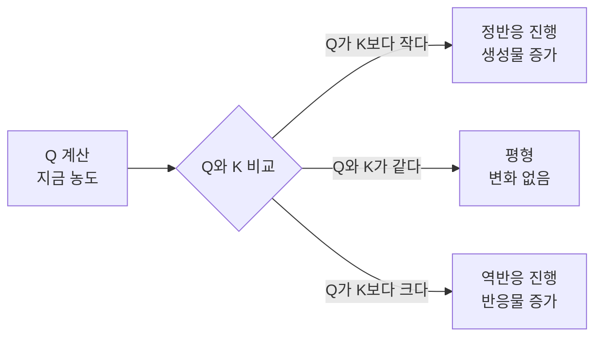

# 화학 3. 화학 평형 — 멈춘 듯 쉬지 않는 반응
<!-- prev: m3-01, 4-4, 4-5, chem-1 -->
<!-- next: chem-4, matter-3, matter-4, rxn-1 -->

> [!NOTE]
> **성취기준**
> - **[12화학03-01]** 가역 반응에서 나타나는 화학 평형 상태의 특징을 설명할 수 있다.
> - **[12화학03-02]** 화학 반응에서 반응물과 생성물의 농도 자료를 통해 평형 상수의 의미를 설명할 수 있다.
> - **[12화학03-03]** 반응 지수의 의미를 알고, 이를 평형 상수와 비교하여 반응의 진행 방향을 예측할 수 있다.
> - **[12화학03-04]** 농도, 압력, 온도 변화에 따른 화학 평형의 이동을 이해하고, 이를 일상생활 속 현상을 설명하는 데 적용하여 화학의 유용함을 느낄 수 있다.

**학습 목표**

1. 가역 반응과 비가역 반응을 구분하고, 생활 속 가역 반응의 예를 들 수 있다.
2. 화학 평형 상태에서 거시적으로 관찰되는 특징과 분자 수준의 동적 평형을 구분하여 설명할 수 있다.
3. 평형 농도 자료에서 일정한 값을 갖는 농도비를 찾아 평형 상수식을 쓰고, 평형 상수의 크기가 뜻하는 바를 설명할 수 있다.
4. 반응 지수를 구하여 평형 상수와 비교하고 반응이 진행할 방향을 예측할 수 있다.
5. 농도·압력·온도 변화에 따른 평형 이동을 르샤틀리에 원리로 예측하고, 생활과 산업 속 현상을 설명할 수 있다.

**이 단원의 학습 사다리**

| 단계 | 무엇을 하나? |
|---|---|
| STEP 1. 이전 학습 다시 보기 | 화학 반응식과 계수비, 몰, 산·염기, 반응의 열 출입을 다시 꺼낸다 |
| STEP 2. 기초 다지기 | 몰 농도의 뜻, 반응 속도의 생각, 거듭제곱과 비의 계산을 디딤돌로 놓는다 |
| STEP 3. 핵심 개념 | 가역 반응 → 동적 평형 → 평형 상수 → 반응 지수 → 평형 이동(농도·압력·온도) → 생활과 산업 |
| STEP 4. 오개념 바로잡기 | "평형에서는 반응이 멈춘다?", "평형이면 반응물과 생성물의 양이 같다?"를 바로잡는다 |
| STEP 5. 다음 단계로 | 압력 평형 상수, 평형과 자발성, 반응 속도와 평형, 산·염기 평형과 완충 용액 |
| STEP 6. 생활·산업·진로 | 암모니아 합성, 헤모글로빈과 산소, 탄산음료, 충치와 불소 |

---

## 🗺️ 단원 들어가기

탄산음료 병을 열기 전에는 기포가 거의 보이지 않는다. 그런데 뚜껑을 여는 순간 기포가 쏟아져 나온다. 병 속에서는 무슨 일이 일어나고 있었을까?

밀폐된 병 안에서 이산화 탄소는 끊임없이 음료에 녹아 들어가고, 동시에 음료에서 빠져나오고 있었다. 녹아 들어가는 빠르기와 빠져나오는 빠르기가 같아 겉으로는 아무 변화가 없어 보였을 뿐이다. 뚜껑을 열어 병 속 기체의 압력이 낮아지면 이 균형이 깨지고, 계는 새로운 균형을 찾아 이산화 탄소를 내보낸다.

이처럼 **겉으로는 멈춘 듯하지만 분자 수준에서는 양쪽 방향의 반응이 같은 빠르기로 계속 일어나는 상태**가 화학 평형이다. 평형은 우리 몸이 산소를 나르는 방식, 석회 동굴이 만들어지는 과정, 비료 공장의 생산량까지 결정한다.

---

## STEP 1. 🔙 이전 학습 다시 보기

### 연계 개념표

| 이전 단원·성취기준 | 그때 배운 것 | 이 단원에서 확장되는 것 |
|---|---|---|
| 중3 「화학 반응의 규칙성」 [9과16-02] | 화학 반응식과 계수비 | 계수가 평형 상수식의 **지수**가 된다 |
| 중3 「화학 반응의 규칙성」 [9과16-06] | 화학 반응에서 열에너지가 출입한다 | 열의 출입 방향으로 **온도에 따른 평형 이동**을 예측한다 |
| 통합과학2 「산과 염기, 중화 반응」 [10통과2-01-04] | 산은 $\mathrm{H^+}$, 염기는 $\mathrm{OH^-}$을 내놓는다 | 이온화도 평형이다(다음 단원의 물의 자동 이온화) |
| 통합과학2 「물질 변화와 에너지 출입」 [10통과2-01-05] | 에너지를 흡수·방출하는 반응과 그 이용 | 발열·흡열 반응의 평형이 온도에 따라 이동한다 |
| 화학 「화학의 언어」 [12화학01-02]·[12화학01-03] | 몰, 계수비 = 몰수비, 한계 반응물 | 반응이 '끝까지 가지 않는' 경우의 양적 관계(반응 전·후 표) |

### 준비 운동 (사전 진단)

**Q1.** 다음 중 반대 방향으로도 쉽게 일어나는 변화를 고르시오.
ㄱ. 종이가 탄다 ㄴ. 물이 얼었다 녹는다 ㄷ. 달걀이 익는다 ㄹ. 밀폐된 병 속에서 물이 증발했다가 다시 응결한다

**Q2.** $\mathrm{N_2 + 3H_2 \rightarrow 2NH_3}$에서 $\mathrm{N_2}$ 1 mol과 $\mathrm{H_2}$ 3 mol을 넣었는데 $\mathrm{NH_3}$가 1 mol만 생기고 더 이상 변화가 없었다. 이때 남은 $\mathrm{N_2}$와 $\mathrm{H_2}$의 몰수는?

**Q3.** 진한 탄산음료를 데우면 기체가 더 많이 나올까, 덜 나올까?

정답 및 해설

**Q1. ㄴ, ㄹ** — 물리 변화인 상태 변화는 조건에 따라 양방향으로 일어난다. 연소와 단백질 변성은 되돌리기 어렵다.

**Q2.** $\mathrm{N_2}$ 0.5 mol, $\mathrm{H_2}$ 1.5 mol — $\mathrm{NH_3}$ 1 mol을 만드는 데 $\mathrm{N_2}$ 0.5 mol, $\mathrm{H_2}$ 1.5 mol이 쓰였다. 한계 반응물이 없는데도 반응물이 남는다는 점이 이 단원의 출발점이다.

**Q3.** 더 많이 나온다 — 기체는 온도가 높을수록 액체에 덜 녹는다.

---

## STEP 2. 🧱 기초 다지기

### ① 몰 농도 — 평형 상수를 위한 최소한의 도구

평형을 다룰 때는 물질의 양을 **부피 1 L 속에 들어 있는 몰수**로 나타낸다. 이를 **몰 농도(molarity)** 라 하고, 단위는 mol/L(또는 M)이다. 화학식을 대괄호로 묶어 $[\mathrm{A}]$로 쓴다.

$$
[\mathrm{A}] = \frac{\mathrm{A}\text{의 몰수(mol)}}{\text{부피(L)}}
$$

- 2 L 용기에 기체 A 0.4 mol → $[\mathrm{A}] = 0.2\ \mathrm{mol/L}$
- 몰 농도의 자세한 내용과 용액 만들기는 「역동적인 화학 반응」에서 다룬다.

### ② 반응 속도 — 빠르기는 농도에 따라 달라진다

반응이 일어나려면 분자끼리 충돌해야 한다. 분자가 많을수록(농도가 클수록) 충돌이 잦아 반응이 빠르다. 그래서 반응물의 농도가 줄어들면 반응이 점점 느려지고, 생성물이 쌓이면 그 생성물이 되돌아가는 반응은 점점 빨라진다. 이 생각이 동적 평형을 이해하는 열쇠이다.

> [!TIP]
> 💡 **비유** — 두 교실 사이의 문이 열려 있는 쉬는 시간을 생각하자. 처음에 A반에 학생이 많으면 A→B로 가는 학생이 많다. B반에 사람이 늘수록 B→A로 오는 학생도 늘어난다. 결국 1분 동안 A→B로 가는 학생 수와 B→A로 오는 학생 수가 같아지면, 학생들은 계속 오가는데도 **각 교실의 인원은 변하지 않는다.**

### ③ 거듭제곱과 비의 계산

평형 상수식에는 농도의 거듭제곱이 나온다.

- $(0.2)^2 = 0.04$, $(0.1)^3 = 0.001$, $(2\times10^{-2})^2 = 4\times10^{-4}$
- 모든 농도가 2배가 되면 $[\mathrm{A}]^2$는 4배, $[\mathrm{B}]^3$는 8배가 된다.
- $\dfrac{1}{K}$: 분자와 분모를 바꾼 값. $K = 50$이면 $\dfrac{1}{K} = 0.02$

---

## STEP 3. 📘 핵심 개념

### ① 가역 반응과 비가역 반응 [12화학03-01]

조건에 따라 정반응과 역반응이 모두 일어날 수 있는 반응을 **가역 반응(reversible reaction)** 이라 하고, 기호 $\rightleftharpoons$로 나타낸다. 반응물 → 생성물 방향을 **정반응**, 생성물 → 반응물 방향을 **역반응**이라고 한다.

$$
\mathrm{aA + bB} \rightleftharpoons \mathrm{cC + dD}
$$

한쪽 방향으로만 일어나 되돌리기 어려운 반응은 **비가역 반응**이다. 연소, 기체·앙금이 생겨 계 밖으로 빠져나가는 반응, 중화 반응 등이 대표적이다.

| 가역 반응의 예 | 반응식 | 관찰할 수 있는 현상 |
|---|---|---|
| 석회 동굴과 종유석 | $\mathrm{CaCO_3(s) + H_2O(l) + CO_2(aq) \rightleftharpoons Ca^{2+}(aq) + 2HCO_3^-(aq)}$ | 석회암이 녹아 동굴이 생기고(정반응), 동굴 천장에서 다시 석출되어 종유석이 자란다(역반응) |
| 이산화 질소와 사산화 이질소 | $\mathrm{2NO_2(g) \rightleftharpoons N_2O_4(g)}$ | 적갈색 $\mathrm{NO_2}$와 무색 $\mathrm{N_2O_4}$ 사이에서 온도·압력에 따라 색이 변한다 |
| 황산 구리(II) 오수화물 | $\mathrm{CuSO_4\cdot5H_2O(s) \rightleftharpoons CuSO_4(s) + 5H_2O(g)}$ | 푸른색 결정을 가열하면 흰색, 물을 떨어뜨리면 다시 푸른색 |
| 염화 코발트(II) | $\mathrm{[Co(H_2O)_6]^{2+} + 4Cl^- \rightleftharpoons [CoCl_4]^{2-} + 6H_2O}$ | 분홍색 ⇄ 푸른색. 습도 표시 종이(염화 코발트 종이)에 쓰인다 |
| 헤모글로빈과 산소 | $\mathrm{Hb + O_2 \rightleftharpoons HbO_2}$ | 폐에서 산소와 결합하고 조직에서 산소를 내놓는다 |
| 상태 변화(물리 변화) | $\mathrm{H_2O(l) \rightleftharpoons H_2O(g)}$ | 밀폐된 병 속 물의 양이 일정하게 유지된다 |

> [!NOTE]
> 엄밀히 말하면 거의 모든 반응은 가역적이다. 다만 연소처럼 역반응이 무시할 만큼 작거나, 생성물이 계 밖으로 빠져나가 역반응이 일어날 수 없으면 비가역 반응으로 취급한다.

#### ✔ 바로 확인

1. (O/X) 가역 반응은 조건에 따라 정반응과 역반응이 모두 일어날 수 있는 반응이다.
2. 빈칸: 반응물 → 생성물 방향을 (    ), 생성물 → 반응물 방향을 (    )이라고 한다.
3. 고르기: 다음 중 보통 비가역 반응으로 취급하는 것은? ㄱ. 메테인의 연소 ㄴ. 푸른색 황산 구리(II) 오수화물의 가열 ㄷ. 밀폐된 병 속 물의 증발

정답

1. O — 이런 반응을 기호 $\rightleftharpoons$로 나타낸다.
2. 정반응, 역반응
3. ㄱ — 연소는 역반응이 무시할 만큼 작다. ㄴ은 물을 떨어뜨리면 다시 푸른색, ㄷ은 응결로 되돌아간다.

### ② 화학 평형 상태 — 거시적 특징과 동적 평형 [12화학03-01]

밀폐된 용기에 무색의 $\mathrm{N_2O_4}$를 넣고 일정한 온도에 두면, 점점 적갈색 $\mathrm{NO_2}$가 생겨 색이 진해지다가 어느 순간부터 색이 더 이상 변하지 않는다. 이때 반응이 멈춘 것일까?

| 시간 | 정반응($\mathrm{N_2O_4 \rightarrow 2NO_2}$) 속도 | 역반응($\mathrm{2NO_2 \rightarrow N_2O_4}$) 속도 | 겉으로 보이는 모습 |
|---|---|---|---|
| 처음 | 가장 빠르다($\mathrm{N_2O_4}$ 많음) | 0($\mathrm{NO_2}$ 없음) | 무색 |
| 시간이 지남 | 점점 느려진다 | 점점 빨라진다 | 점점 적갈색 |
| 평형 도달 | **같아진다** | **같아진다** | 색이 일정 |

<!-- fig:chem-3-conc-rate-graphs -->

교육과정은 평형 상태의 특징을 **거시적으로 관찰 가능한 특징**과 **동적 평형**으로 나누어 이해하도록 한다.

| 구분 | 특징 | 확인 방법 |
|---|---|---|
| 거시적 특징 | 반응물과 생성물의 농도(양)가 **일정하게 유지**된다. 색, 압력, 질량 등 겉으로 드러나는 성질이 변하지 않는다 | 색의 진하기, 압력계, 전기 전도도 측정 |
| 거시적 특징 | 반응물과 생성물이 **함께 존재**한다(어느 쪽도 0이 아니다) | 평형 혼합물의 성분 분석 |
| 거시적 특징 | 정반응 쪽에서 출발하든 역반응 쪽에서 출발하든 같은 조건이면 같은 평형 상태에 도달한다 | $\mathrm{N_2O_4}$만 넣은 용기와 $\mathrm{NO_2}$만 넣은 용기 비교 |
| 동적 평형 | 분자 수준에서는 정반응과 역반응이 **같은 속도로 계속** 일어난다 | 방사성 동위 원소 추적 실험 등 간접 증거 |

> [!IMPORTANT]
> **화학 평형 = 동적 평형(dynamic equilibrium)**. 반응이 멈춘 것이 아니라 정반응 속도 = 역반응 속도라서 **알짜 변화가 없는** 상태이다. 평형 상태에서 반응물과 생성물의 농도는 '일정'할 뿐 '같은' 것이 아니다.

<!-- fig:chem-3-dynamic-equilibrium -->

#### 동적 평형의 증거 — 포화 용액 속 결정

포화된 아이오딘화 납 수용액 속에 아이오딘화 납 결정이 가라앉아 있다고 하자. 여기에 방사성 아이오딘으로 표지한 결정을 넣으면, 결정의 질량과 용액의 농도는 변하지 않는데도 시간이 지나면 **용액에서 방사선이 검출**된다. 결정이 녹아 나오는 과정(용해)과 용액에서 결정으로 되돌아가는 과정(석출)이 같은 속도로 계속 일어나고 있다는 증거이다.

<!-- fig:chem-3-tracer-evidence -->

> [!TIP]
> 💡 **비유** — 에스컬레이터를 거꾸로 걸어 올라가는 사람을 떠올리자. 에스컬레이터가 내려가는 빠르기와 사람이 걸어 올라가는 빠르기가 같으면, 사람은 열심히 걷는데도 같은 자리에 머문다. 멈춘 것이 아니라 두 움직임이 **균형**을 이룬 것이다.

#### 생활 속 평형 세 가지 유형

| 유형 | 예 | 평형 상태에서 같아지는 것 |
|---|---|---|
| 상평형 | 밀폐된 병 속의 물과 수증기 | 증발 속도 = 응축 속도 |
| 용해 평형 | 설탕이 더 녹지 않는 포화 용액 | 용해 속도 = 석출 속도 |
| 화학 평형 | $\mathrm{2NO_2 \rightleftharpoons N_2O_4}$ | 정반응 속도 = 역반응 속도 |

#### ✔ 바로 확인

1. (O/X) 평형 상태에서는 정반응과 역반응이 모두 멈춘다.
2. (O/X) 평형 상태에서는 반응물과 생성물이 함께 존재한다.
3. 그래프 읽기: 위의 농도·속도 그래프 (나)에서 평형에 이르기 전 정반응 속도는 시간이 지날수록 커지는가, 작아지는가?
4. 빈칸: 포화 용액이 용해 평형에 있을 때는 (    ) 속도와 (    ) 속도가 같다.

정답

1. X — 두 반응이 같은 속도로 계속 일어나는 동적 평형이다.
2. O — 어느 쪽 농도도 0이 아니다.
3. 작아진다 — 반응물 $\mathrm{N_2O_4}$의 농도가 줄기 때문이다.
4. 용해, 석출

### ③ 평형 상수 — 농도 자료에서 찾은 규칙 [12화학03-02]

#### (1) 농도 자료에서 일정한 값 찾기

어떤 온도에서 수소와 아이오딘으로 아이오딘화 수소를 만드는 반응 $\mathrm{H_2(g) + I_2(g) \rightleftharpoons 2HI(g)}$를 처음 농도를 바꾸어 가며 네 번 실험하고, 평형에 도달했을 때의 농도를 측정했다.

| 실험 | $[\mathrm{H_2}]$ (M) | $[\mathrm{I_2}]$ (M) | $[\mathrm{HI}]$ (M) | $\dfrac{[\mathrm{HI}]}{[\mathrm{H_2}][\mathrm{I_2}]}$ | $\dfrac{[\mathrm{HI}]^2}{[\mathrm{H_2}][\mathrm{I_2}]}$ |
|---|---|---|---|---|---|
| 1 | 0.10 | 0.20 | 1.0 | 50 | **50** |
| 2 | 0.20 | 0.40 | 2.0 | 25 | **50** |
| 3 | 0.050 | 0.10 | 0.50 | 100 | **50** |
| 4 | 0.40 | 0.050 | 1.0 | 50 | **50** |

평형 농도 자체는 실험마다 다르지만, 생성물 농도를 **계수만큼 거듭제곱**하여 반응물 농도의 거듭제곱으로 나눈 값은 항상 50으로 일정하다. 이 일정한 값이 **평형 상수(equilibrium constant, K)** 이다. 이 규칙을 **화학 평형의 법칙(질량 작용의 법칙)** 이라고 한다.

#### (2) 평형 상수식

$$
\mathrm{aA + bB} \rightleftharpoons \mathrm{cC + dD}
\qquad
K = \frac{[\mathrm{C}]^c[\mathrm{D}]^d}{[\mathrm{A}]^a[\mathrm{B}]^b}
$$

- 분자에는 **생성물**, 분모에는 **반응물**의 평형 몰 농도를 쓰고, 각각 **계수만큼 거듭제곱**한다.
- **순수한 고체와 액체**는 농도가 일정하다고 보아 식에 쓰지 않는다. 수용액 반응에서 용매인 물도 쓰지 않는다.
- 평형 상수는 **온도가 일정하면 일정**하다. 처음 농도, 압력, 촉매에 관계없다.
- 이 교과에서는 몰 농도로 나타낸 평형 상수만 다룬다.

| 반응 | 평형 상수식 |
|---|---|
| $\mathrm{N_2(g) + 3H_2(g) \rightleftharpoons 2NH_3(g)}$ | $K = \dfrac{[\mathrm{NH_3}]^2}{[\mathrm{N_2}][\mathrm{H_2}]^3}$ |
| $\mathrm{N_2O_4(g) \rightleftharpoons 2NO_2(g)}$ | $K = \dfrac{[\mathrm{NO_2}]^2}{[\mathrm{N_2O_4}]}$ |
| $\mathrm{CaCO_3(s) \rightleftharpoons CaO(s) + CO_2(g)}$ | $K = [\mathrm{CO_2}]$ (고체 제외) |
| $\mathrm{Fe^{3+}(aq) + SCN^-(aq) \rightleftharpoons FeSCN^{2+}(aq)}$ | $K = \dfrac{[\mathrm{FeSCN^{2+}}]}{[\mathrm{Fe^{3+}}][\mathrm{SCN^-}]}$ |
| $\mathrm{CH_3COOH(aq) + H_2O(l) \rightleftharpoons CH_3COO^-(aq) + H_3O^+(aq)}$ | $K = \dfrac{[\mathrm{CH_3COO^-}][\mathrm{H_3O^+}]}{[\mathrm{CH_3COOH}]}$ (물 제외) |

#### (3) 평형 상수의 크기가 뜻하는 것

| K의 크기 | 평형 혼합물의 모습 | 의미 | 예 |
|---|---|---|---|
| $K \gg 1$ (예: $10^{10}$) | 거의 생성물 | 정반응이 거의 끝까지 진행 | 강산의 이온화, 연소 |
| $K \approx 1$ | 반응물과 생성물이 비슷하게 섞임 | 양쪽 모두 상당량 존재 | |
| $K \ll 1$ (예: $10^{-10}$) | 거의 반응물 | 정반응이 조금만 진행 | 물의 자동 이온화 |

평형 상수는 반응이 **얼마나 많이** 진행하는지를 알려 줄 뿐, **얼마나 빨리** 진행하는지는 알려 주지 않는다. K가 커도 반응이 매우 느릴 수 있다.

#### (4) 반응식이 바뀌면 K도 바뀐다

| 반응식 | 평형 상수 |
|---|---|
| $\mathrm{H_2 + I_2 \rightleftharpoons 2HI}$ | $K = 50$ |
| 역반응: $\mathrm{2HI \rightleftharpoons H_2 + I_2}$ | $K' = \dfrac{1}{K} = 0.02$ |
| 계수를 $\dfrac{1}{2}$배: $\mathrm{\tfrac{1}{2}H_2 + \tfrac{1}{2}I_2 \rightleftharpoons HI}$ | $K'' = K^{1/2} = \sqrt{50} \approx 7.1$ |

#### 예제 1 — 평형 농도로 K 구하기

1 L 용기에 $\mathrm{N_2O_4}$ 1.0 mol을 넣고 일정한 온도에 두었더니 평형에서 $\mathrm{N_2O_4}$가 0.8 mol 남았다. 이 온도에서 $\mathrm{N_2O_4(g) \rightleftharpoons 2NO_2(g)}$의 평형 상수를 구하시오.

**풀이** 반응 전·후 표(「화학의 언어」의 양적 관계)를 쓴다.

| (단위: M) | $\mathrm{N_2O_4}$ | $\mathrm{NO_2}$ |
|---|---|---|
| 처음 | 1.0 | 0 |
| 변화 | $-0.2$ | $+0.4$ |
| 평형 | 0.8 | 0.4 |

$$
K = \frac{[\mathrm{NO_2}]^2}{[\mathrm{N_2O_4}]} = \frac{(0.4)^2}{0.8} = 0.2
$$

#### 예제 2 — K로 평형 농도 구하기

어떤 온도에서 $\mathrm{H_2 + I_2 \rightleftharpoons 2HI}$의 $K = 64$이다. 1 L 용기에 $\mathrm{H_2}$와 $\mathrm{I_2}$를 1.0 mol씩 넣었을 때 평형 농도를 구하시오.

**풀이** 반응한 $\mathrm{H_2}$를 $x$ M이라 하면 평형에서 $[\mathrm{H_2}] = [\mathrm{I_2}] = 1.0 - x$, $[\mathrm{HI}] = 2x$

$$
\frac{(2x)^2}{(1.0 - x)^2} = 64 \;\Rightarrow\; \frac{2x}{1.0 - x} = 8 \;\Rightarrow\; x = 0.8
$$

$[\mathrm{H_2}] = [\mathrm{I_2}] = 0.2\ \mathrm{M}$, $[\mathrm{HI}] = 1.6\ \mathrm{M}$. 한계 반응물이 없어도 반응물이 20 % 남는다. 이것이 가역 반응의 양적 관계이다.

#### ✔ 바로 확인

1. $\mathrm{2NO(g) + O_2(g) \rightleftharpoons 2NO_2(g)}$의 평형 상수식을 쓰시오.
2. (O/X) 온도가 같아도 처음 농도를 바꾸어 실험하면 평형 상수가 달라진다.
3. 1 L 용기에서 $\mathrm{H_2 + I_2 \rightleftharpoons 2HI}$의 평형 농도가 $[\mathrm{H_2}] = [\mathrm{I_2}] = 0.10\ \mathrm{M}$, $[\mathrm{HI}] = 0.70\ \mathrm{M}$이다. K는?
4. 고르기: $K = 10^{-10}$인 반응의 평형 혼합물은 (거의 반응물 / 거의 생성물)이다.

정답

1. $K = \dfrac{[\mathrm{NO_2}]^2}{[\mathrm{NO}]^2[\mathrm{O_2}]}$ — 계수가 지수가 된다.
2. X — K는 온도가 같으면 처음 농도와 관계없이 일정하다.
3. 49 — $(0.70)^2 \div (0.10\times0.10) = 49$
4. 거의 반응물 — 정반응이 아주 조금만 진행한다.

### ④ 반응 지수 — 지금 어느 쪽으로 갈까? [12화학03-03]

평형에 도달하기 **전**이나 평형이 깨진 **직후**의 임의의 농도를 평형 상수식과 같은 꼴에 넣어 계산한 값을 **반응 지수(reaction quotient, Q)** 라고 한다.

$$
Q = \frac{[\mathrm{C}]^c[\mathrm{D}]^d}{[\mathrm{A}]^a[\mathrm{B}]^b} \quad (\text{지금 이 순간의 농도})
$$

Q는 '지금 상태', K는 '도착할 상태'이다. 둘을 비교하면 반응이 어느 방향으로 진행할지 알 수 있다.

| 비교 | 상태 | 진행 방향 | 까닭 |
|---|---|---|---|
| $Q < K$ | 생성물이 평형보다 적다 | **정반응** 우세 | 생성물을 늘려 Q를 키워야 K에 도달 |
| $Q = K$ | 평형 상태 | 알짜 변화 없음 | |
| $Q > K$ | 생성물이 평형보다 많다 | **역반응** 우세 | 생성물을 줄여 Q를 작게 해야 K에 도달 |

> [!TIP]
> 💡 **비유** — K는 내비게이션의 '목적지', Q는 '현재 위치'이다. 현재 위치가 목적지보다 뒤(Q < K)면 앞으로, 지나쳤으면(Q > K) 뒤로 가야 한다. 목적지에 도착하면(Q = K) 멈춰 서 있지만, 엔진(정·역반응)은 계속 돌고 있다.

#### 예제 3

$\mathrm{H_2 + I_2 \rightleftharpoons 2HI}$, $K = 50$인 온도에서 다음 혼합물은 어느 방향으로 반응이 진행하는가?
(1) $[\mathrm{H_2}] = 0.10$, $[\mathrm{I_2}] = 0.10$, $[\mathrm{HI}] = 0.50$ (M)
(2) $[\mathrm{H_2}] = 0.10$, $[\mathrm{I_2}] = 0.10$, $[\mathrm{HI}] = 1.0$ (M)

**풀이**
(1) $Q = \dfrac{(0.50)^2}{0.10\times0.10} = 25 < 50$ → **정반응** 진행($\mathrm{HI}$ 증가)
(2) $Q = \dfrac{(1.0)^2}{0.10\times0.10} = 100 > 50$ → **역반응** 진행($\mathrm{HI}$ 분해)

#### ✔ 바로 확인

1. 빈칸: 반응 지수 Q가 평형 상수 K보다 작으면 (    ) 반응이 우세하게 진행한다.
2. $\mathrm{N_2O_4 \rightleftharpoons 2NO_2}$($K = 0.2$)에서 $[\mathrm{N_2O_4}] = 0.50\ \mathrm{M}$, $[\mathrm{NO_2}] = 0.20\ \mathrm{M}$이면 어느 쪽으로 진행하는가?
3. (O/X) $Q = K$이면 정반응과 역반응이 모두 멈춘 것이다.

정답

1. 정 — 생성물을 늘려 Q를 키워야 K에 도달한다.
2. 정반응 — $Q = (0.20)^2 \div 0.50 = 0.08 < 0.2$
3. X — 평형 상태로, 두 반응이 같은 속도로 계속 일어난다.

### ⑤ 평형의 이동 — 르샤틀리에 원리 [12화학03-04]

평형 상태의 계에 농도, 압력, 온도 같은 조건을 바꾸면 평형이 깨지고, 계는 새로운 평형을 향해 반응이 한쪽으로 진행한다. 이를 **평형 이동**이라 한다. 프랑스의 화학자 르샤틀리에는 이 방향을 다음과 같이 정리했다.

> [!IMPORTANT]
> **르샤틀리에 원리(Le Chatelier's principle)** — 평형 상태에 있는 계의 조건을 변화시키면, 계는 그 **변화를 줄이는 방향**으로 평형이 이동하여 새로운 평형에 도달한다.

#### (1) 농도 변화

| 변화 | 직후의 Q | 평형 이동 방향 | 변화를 줄이는 방식 |
|---|---|---|---|
| 반응물 농도 증가 | $Q < K$ | 정반응 | 넣어 준 반응물을 소모 |
| 반응물 농도 감소 | $Q > K$ | 역반응 | 줄어든 반응물을 보충 |
| 생성물 농도 증가 | $Q > K$ | 역반응 | 넣어 준 생성물을 소모 |
| 생성물 농도 감소(제거) | $Q < K$ | 정반응 | 제거된 생성물을 보충 |

예를 들어 $\mathrm{Fe^{3+}}$(연한 노란색) $+$ $\mathrm{SCN^-}$(무색) $\rightleftharpoons$ $\mathrm{FeSCN^{2+}}$(붉은색) 평형 혼합물에 $\mathrm{Fe^{3+}}$이나 $\mathrm{SCN^-}$을 더 넣으면 정반응 쪽으로 이동하여 붉은색이 진해진다. 농도 변화로 평형이 이동해도 온도가 같으므로 **K는 변하지 않는다.**

<!-- fig:chem-3-conc-shift-graph -->

#### (2) 압력(부피) 변화 — 기체 반응

기체 반응에서 부피를 줄여 압력을 높이면 계는 압력을 낮추는 방향, 즉 **기체의 전체 몰수가 줄어드는 방향**으로 이동한다.

| 반응 | 기체 몰수 (반응물 → 생성물) | 압력 증가(부피 감소) 시 | 압력 감소(부피 증가) 시 |
|---|---|---|---|
| $\mathrm{N_2 + 3H_2 \rightleftharpoons 2NH_3}$ | 4 → 2 | 정반응 | 역반응 |
| $\mathrm{2NO_2 \rightleftharpoons N_2O_4}$ | 2 → 1 | 정반응(색이 옅어지는 쪽) | 역반응 |
| $\mathrm{N_2O_4 \rightleftharpoons 2NO_2}$ | 1 → 2 | 역반응 | 정반응 |
| $\mathrm{H_2 + I_2 \rightleftharpoons 2HI}$ | 2 → 2 | 이동하지 않음 | 이동하지 않음 |

**왜 그럴까? — Q로 확인하기** 온도를 일정하게 하고 부피를 절반으로 줄이면 모든 기체의 농도가 2배가 된다. $\mathrm{N_2 + 3H_2 \rightleftharpoons 2NH_3}$에서

$$
Q = \frac{(2[\mathrm{NH_3}])^2}{(2[\mathrm{N_2}])(2[\mathrm{H_2}])^3} = \frac{4}{16}\cdot\frac{[\mathrm{NH_3}]^2}{[\mathrm{N_2}][\mathrm{H_2}]^3} = \frac{K}{4} < K
$$

이므로 정반응이 진행한다. 반면 $\mathrm{H_2 + I_2 \rightleftharpoons 2HI}$는 분자·분모가 모두 4배가 되어 $Q = K$로 그대로이다.

> [!WARNING]
> 부피를 일정하게 유지한 채 반응에 참여하지 않는 기체(예: 아르곤)를 넣으면 전체 압력은 커지지만, 반응하는 각 기체의 **몰 농도는 변하지 않으므로** $Q = K$이고 평형은 이동하지 않는다. "압력이 커졌다"보다 **"반응에 참여하는 기체의 농도가 어떻게 변했나"** 를 따져야 한다.

<!-- fig:chem-3-syringe-shift -->

#### (3) 온도 변화

정반응이 열을 방출하면(발열 반응) 역반응은 열을 흡수한다(흡열 반응). 온도를 높이면 계는 **열을 흡수하는 방향(흡열 방향)**, 온도를 낮추면 **열을 방출하는 방향(발열 방향)** 으로 이동한다. 열을 반응식의 '물질'처럼 생각하면 쉽다.

| 반응 | 정반응 | 온도를 높이면 | 온도를 낮추면 | K의 변화(온도 상승 시) |
|---|---|---|---|---|
| $\mathrm{N_2 + 3H_2 \rightleftharpoons 2NH_3}$ + 열 | 발열 | 역반응 | 정반응 | 감소 |
| $\mathrm{2NO_2}$(적갈색) $\rightleftharpoons$ $\mathrm{N_2O_4}$(무색) + 열 | 발열 | 역반응(적갈색 진해짐) | 정반응(색 옅어짐) | 감소 |
| $\mathrm{[Co(H_2O)_6]^{2+}}$(분홍) $+ \mathrm{4Cl^-}$ + 열 $\rightleftharpoons$ $\mathrm{[CoCl_4]^{2-}}$(파랑) $+ \mathrm{6H_2O}$ | 흡열 | 정반응(파란색) | 역반응(분홍색) | 증가 |

<!-- fig:chem-3-temperature-tubes -->

> [!IMPORTANT]
> 농도·압력 변화는 Q를 바꾸어 평형을 이동시키지만 **K는 그대로**이다. 온도 변화는 **K 자체를 바꾼다.** 발열 반응은 온도가 높아지면 K가 작아지고, 흡열 반응은 K가 커진다.

#### (4) 촉매는 평형을 이동시키지 않는다

촉매는 정반응과 역반응을 **똑같이** 빠르게 하므로 평형에 **빨리 도달**하게 할 뿐, 평형의 위치와 K를 바꾸지 않는다. 촉매와 반응 속도는 진로 선택 「반응 속도」에서 자세히 다룬다.

#### 평형 이동 한눈에 보기

| 조건 변화 | 평형 이동 방향 | K |
|---|---|---|
| 반응물 첨가 / 생성물 제거 | 정반응 | 변화 없음 |
| 생성물 첨가 / 반응물 제거 | 역반응 | 변화 없음 |
| 압력 증가(부피 감소) | 기체 몰수가 줄어드는 쪽 | 변화 없음 |
| 압력 감소(부피 증가) | 기체 몰수가 늘어나는 쪽 | 변화 없음 |
| 온도 상승 | 흡열 반응 쪽 | 변한다 |
| 온도 하강 | 발열 반응 쪽 | 변한다 |
| 촉매 첨가 | 이동하지 않음(빨리 도달) | 변화 없음 |

<!-- sim:equilibrium -->

#### 예제 4 — 주사기 속의 색 변화

$\mathrm{2NO_2(g)}$(적갈색) $\rightleftharpoons$ $\mathrm{N_2O_4(g)}$(무색) 평형 혼합물이 든 주사기의 피스톤을 빠르게 눌러 부피를 절반으로 줄였다. 주사기 옆에서 본 색은 어떻게 변하는가? (온도는 일정)

**풀이**
- **누른 직후**: 부피가 줄어 $\mathrm{NO_2}$의 농도가 순간적으로 2배가 되므로 색이 **진해진다.**
- **그 뒤**: 압력이 커졌으므로 기체 몰수가 줄어드는 정반응 쪽으로 평형이 이동하여 $\mathrm{NO_2}$가 줄고 색이 **조금 옅어진다.**
- **새 평형**: 그래도 처음보다는 $\mathrm{NO_2}$ 농도가 크므로 처음보다 **진하다.** 르샤틀리에 원리는 변화를 '줄일' 뿐 '완전히 없애지' 못한다.

#### ✔ 바로 확인

1. 짝짓기: $\mathrm{N_2 + 3H_2 \rightleftharpoons 2NH_3}$에서 (가) 부피 감소 (나) $\mathrm{NH_3}$ 첨가 — 각각 정반응·역반응 중 어느 쪽으로 이동하는가?
2. (O/X) 농도·압력·온도 중 평형 상수 K를 바꾸는 것은 온도뿐이다.
3. 빈칸: $\mathrm{2NO_2}$(적갈색) $\rightleftharpoons$ $\mathrm{N_2O_4}$(무색) + 열 평형 혼합물을 얼음물에 넣으면 색이 (    ).
4. 그래프 읽기: 반응물을 더 넣은 농도–시간 그래프에서 새 평형의 $[\mathrm{N_2O_4}]$는 처음 평형의 0.80 M보다 큰가, 작은가?

정답

1. (가) 정반응(기체 몰수 4 → 2) (나) 역반응(넣은 생성물을 소모)
2. O — 농도·압력 변화는 Q만 바꾼다.
3. 옅어진다 — 열을 방출하는 정반응 쪽으로 이동한다.
4. 크다(1.25 M) — 르샤틀리에 원리는 변화를 줄일 뿐 없애지 못한다.

### ⑥ 생활과 산업 속 화학 평형 [12화학03-04]

| 현상 | 관련 평형 | 평형 이동으로 설명하기 |
|---|---|---|
| 탄산음료 뚜껑을 열면 기포 | $\mathrm{CO_2(g) \rightleftharpoons CO_2(aq)}$ | 병 속 $\mathrm{CO_2}$ 기체의 압력(농도) 감소 → 녹아 있던 $\mathrm{CO_2}$가 기체로 빠져나오는 쪽으로 이동 |
| 고산 지대 적응 | $\mathrm{Hb + O_2 \rightleftharpoons HbO_2}$ | 높은 곳은 산소 농도가 낮아 역반응 쪽으로 이동 → 산소를 나르는 $\mathrm{HbO_2}$ 감소(고산병). 몸이 오래 적응하면 헤모글로빈을 늘려 정반응 쪽으로 되돌린다 |
| 일산화 탄소 중독 치료 | Hb에 CO가 산소보다 훨씬 강하게 결합 | 고농도 산소를 공급하여 산소 농도를 높여 CO를 밀어내는 쪽으로 이동 |
| 충치 | $\mathrm{Ca_5(PO_4)_3OH(s) \rightleftharpoons 5Ca^{2+} + 3PO_4^{3-} + OH^-}$ | 입속 세균이 만든 산이 $\mathrm{OH^-}$을 제거 → 정반응 쪽으로 이동하여 법랑질이 녹는다 |
| 석회 동굴과 종유석 | $\mathrm{CaCO_3 + H_2O + CO_2 \rightleftharpoons Ca^{2+} + 2HCO_3^-}$ | 이산화 탄소가 많이 녹은 지하수 → 정반응(석회암 용해). 동굴 천장에서 물방울의 $\mathrm{CO_2}$가 빠져나가면 역반응(종유석 성장) |
| 해양 산성화와 산호 | 바닷물의 탄산 평형 | 대기 $\mathrm{CO_2}$ 증가로 바닷물의 산성도가 높아져 탄산 칼슘 껍데기·골격을 만들기 어려워진다 |
| 암모니아 합성 | $\mathrm{N_2 + 3H_2 \rightleftharpoons 2NH_3}$ + 열 | STEP 6 사례 1 |

표 첫째 줄의 탄산음료는 평형 이동을 눈으로 볼 수 있는 가장 쉬운 예이다.

<!-- photo:chem-3-soda-co2-release -->

> [!TIP]
> 💡 **요령** — 생활 속 평형 문제는 세 단계로 푼다. ① 관련된 평형 반응식을 쓴다. ② 무엇이 늘었거나 줄었는지(농도·압력·온도) 찾는다. ③ 그 변화를 줄이는 방향을 고른다.

#### ✔ 바로 확인

1. (O/X) 탄산음료의 뚜껑을 열면 $\mathrm{CO_2(aq) \rightarrow CO_2(g)}$ 쪽으로 평형이 이동한다.
2. 고르기: 충치가 생길 때 입속의 산이 제거하여 법랑질이 녹는 쪽으로 평형을 이동시키는 이온은? ($\mathrm{Ca^{2+}}$ / $\mathrm{PO_4^{3-}}$ / $\mathrm{OH^-}$)
3. 빈칸: 높은 산에 오르면 산소 농도가 낮아져 $\mathrm{Hb + O_2 \rightleftharpoons HbO_2}$에서 $\mathrm{HbO_2}$가 (    )한다.

정답

1. O — 병 속 $\mathrm{CO_2}$ 기체의 압력이 낮아진 변화를 줄이는 방향이다.
2. $\mathrm{OH^-}$ — 산의 $\mathrm{H^+}$가 $\mathrm{OH^-}$와 반응해 생성물이 제거된다.
3. 감소 — 반응물인 $\mathrm{O_2}$가 줄어 역반응 쪽으로 이동한다.

---

## STEP 4. ⚠️ 오개념 바로잡기

| 흔한 오개념 | 올바른 개념 | 왜 그럴까? |
|---|---|---|
| 평형 상태에서는 반응이 멈춘다 | 정반응과 역반응이 **같은 속도로 계속** 일어난다(동적 평형) | 방사성 동위 원소 추적 실험에서 평형 상태에서도 입자가 계속 오간다 |
| 평형 상태에서는 반응물과 생성물의 농도가 같다 | 농도가 **일정**할 뿐 같지 않다 | 농도의 비율은 K로 정해지며, K가 크면 생성물이, 작으면 반응물이 훨씬 많다 |
| 반응물을 더 넣으면 K가 커진다 | 온도가 같으면 K는 **변하지 않는다** | 농도 변화는 Q를 바꾸고, 계가 다시 Q = K가 되도록 이동할 뿐이다 |
| 촉매를 넣으면 생성물이 더 많이 생긴다 | 촉매는 평형에 **빨리 도달**하게 할 뿐 평형의 위치를 바꾸지 않는다 | 촉매는 정반응과 역반응을 똑같이 빠르게 한다 |
| 압력을 높이면 모든 기체 평형이 이동한다 | 반응물과 생성물의 **기체 몰수가 같으면** 이동하지 않는다 | $\mathrm{H_2 + I_2 \rightleftharpoons 2HI}$에서는 Q가 변하지 않는다 |
| K가 큰 반응은 빠르게 일어난다 | K는 **얼마나 많이**, 속도는 **얼마나 빨리**를 나타내는 별개의 성질이다 | 수소와 산소의 반응은 K가 매우 크지만 불꽃이 없으면 거의 일어나지 않는다 |
| 르샤틀리에 원리에 따라 변화가 완전히 없어진다 | 변화를 **일부 줄일** 뿐 원래 상태로 완전히 되돌리지 못한다 | $\mathrm{NO_2}$ 주사기를 누르면 새 평형의 색은 처음보다 여전히 진하다 |

---

## STEP 5. 🎓 다음 단계로 한 걸음 더

> [!CAUTION]
> 이 절은 **화학 교육과정 범위 밖의 심화 내용**으로 평가 대상이 아니다. 화학 평형의 생각이 진로 선택 과목과 대학에서 어떻게 확장되는지 미리 보는 맛보기이다.

### 진로 선택 과목·대학과의 연결

| 과목 | 이어지는 내용 |
|---|---|
| 「화학」 「역동적인 화학 반응」 | 물의 자동 이온화 평형과 이온화 상수 $K_w$, pH |
| 물질과 에너지 「화학 변화의 자발성」 | 엔탈피·엔트로피, 반응이 저절로 일어나는 방향과 평형의 관계 |
| 물질과 에너지 「반응 속도」 | 반응 속도식, 활성화 에너지와 촉매 — 평형에 '얼마나 빨리' 도달하는가 |
| 화학 반응의 세계 「산·염기 평형」 | 산·염기의 이온화 상수 $K_a$, $K_b$, 염의 가수 분해, 생체 내 완충 작용 |
| 대학 일반화학·물리화학 | 압력 평형 상수 $K_p$, 깁스 에너지와 평형 상수, 판트호프 식 |

### ① 압력으로 나타내는 평형 상수 $K_p$

기체 반응은 농도 대신 각 기체의 **부분 압력**으로 평형 상수를 나타내기도 한다. 진로 선택 「물질의 세 가지 상태」에서 배우는 이상 기체 방정식으로 농도와 압력이 서로 바뀐다. 예를 들어 $\mathrm{N_2O_4 \rightleftharpoons 2NO_2}$에서 $K_p = \dfrac{P_{\mathrm{NO_2}}^2}{P_{\mathrm{N_2O_4}}}$이다.

### ② 평형 상수와 자발성 — 왜 K는 그 값일까?

대학 물리화학에서는 평형 상수가 반응의 **깁스 에너지 변화**와 연결된다.

$$
\Delta G^\circ = -RT\ln K
$$

$\Delta G^\circ$가 음수로 클수록 K가 크다. 즉 평형 상수는 반응물과 생성물의 '에너지 차이'와 '무질서도 차이'가 겨루어 정해진 값이다. 진로 선택 「화학 변화의 자발성」에서 엔탈피와 엔트로피로 이 관계의 기초를 배운다.

### ③ 평형 상수와 반응 속도

동적 평형에서 정반응 속도와 역반응 속도가 같다는 것을 식으로 쓰면, 간단한 반응에서는 정반응 속도 상수 $k_{\text{정}}$와 역반응 속도 상수 $k_{\text{역}}$의 비가 평형 상수가 된다($K = k_{\text{정}}/k_{\text{역}}$). 평형이 '속도의 균형'이라는 이 단원의 설명이 수식으로 이어진다.

### ④ 우리 몸의 평형 — 완충 작용

혈액의 pH는 약 7.4로 거의 일정하게 유지된다. 혈액 속 탄산–탄산수소 이온 평형 $\mathrm{CO_2 + H_2O \rightleftharpoons H_2CO_3 \rightleftharpoons H^+ + HCO_3^-}$이 산이 들어오면 역반응 쪽으로, 염기가 들어오면 정반응 쪽으로 이동하여 $\mathrm{H^+}$ 농도의 변화를 줄인다. 진로 선택 「산·염기 평형」에서 이 **완충 작용**을 평형 상수로 정량적으로 다룬다.

### 고등학교 「화학」 vs 다음 단계

| 구분 | 고등학교 「화학」 「화학 평형」 | 진로 선택·대학 |
|---|---|---|
| 평형 상수 | 몰 농도로 나타낸 K | $K_p$, 활동도로 나타낸 열역학적 평형 상수 |
| K의 의미 | 농도 자료에서 찾은 일정한 비, 크기의 의미 | $\Delta G^\circ = -RT\ln K$, 속도 상수의 비 |
| 온도의 영향 | 발열·흡열에 따른 정성적 예측 | 판트호프 식으로 정량 계산 |
| 응용 | 생활 속 평형 이동 설명 | 산·염기 평형, 용해도곱, 착이온 평형, 공정 최적화 |
| 관련 전공 | — | 화학, 화학공학, 생화학, 환경공학, 의학 |

---

## STEP 6. 🏭 생활·산업·진로 연결

### 사례 1. 암모니아 합성 — 평형과 속도 사이의 줄타기

$$
\mathrm{N_2(g) + 3H_2(g) \rightleftharpoons 2NH_3(g)} + \text{열}
$$

| 조건 | 평형만 생각하면 | 실제 공정의 선택 | 까닭 |
|---|---|---|---|
| 압력 | 높을수록 유리(기체 4 mol → 2 mol) | 수백 기압(약 200 atm 안팎) | 압력이 너무 높으면 설비 비용과 위험이 커진다 |
| 온도 | 낮을수록 유리(정반응이 발열) | 약 400~500 °C | 온도가 낮으면 반응이 너무 느리다. 수득률과 속도의 타협 |
| 촉매 | 평형 위치에 영향 없음 | 철을 주성분으로 하는 촉매 | 평형에 빨리 도달하게 한다 |
| 생성물 | 제거하면 정반응 쪽으로 이동 | 암모니아를 냉각해 액체로 분리하고, 남은 $\mathrm{N_2}$·$\mathrm{H_2}$는 다시 반응기로 | 전체 수득률을 높인다 |

교육과정이 말하는 "산업 현장에서 수득률을 높이기 위해 화학 평형을 이용한 사례"의 대표이다.

### 사례 2. 헤모글로빈 — 폐와 조직 사이의 평형 셔틀

- **원리** $\mathrm{Hb + O_2 \rightleftharpoons HbO_2}$. 산소 농도가 높은 폐에서는 정반응 쪽으로, 산소를 많이 쓰는 근육 조직에서는 역반응 쪽으로 이동하여 산소를 내놓는다.
- **어디에 쓰이나** 고산 등반 전 적응 훈련, 운동선수의 고지대 훈련, 일산화 탄소 중독 환자의 고압 산소 치료.

### 사례 3. 탄산음료와 맥주 공장 — 압력으로 기체를 가둔다

- **원리** $\mathrm{CO_2(g) \rightleftharpoons CO_2(aq)}$. 높은 압력에서 이산화 탄소를 녹여 병에 담고, 차갑게 보관하면 기체가 덜 빠져나온다(기체의 용해는 열을 방출하므로 온도가 낮을수록 더 많이 녹는다).
- **어디에 쓰이나** 음료 충전 공정의 압력·온도 관리, 탄산수 제조기.

### 사례 4. 충치 예방 — 불소의 평형 전략

- **원리** 법랑질의 하이드록시아파타이트 $\mathrm{Ca_5(PO_4)_3OH}$는 산성 환경에서 녹는 쪽으로 평형이 이동한다. 플루오린화 이온이 있으면 산에 더 잘 견디는 플루오린아파타이트 $\mathrm{Ca_5(PO_4)_3F}$가 생긴다.
- **어디에 쓰이나** 불소가 든 치약, 치과의 불소 도포. 단 음식을 먹은 뒤 양치하는 습관은 입속 산을 줄여 평형을 녹지 않는 쪽으로 되돌린다.

### 관련 진로와 학과

| 진로 | 하는 일 | 관련 학과 |
|---|---|---|
| 화학 공정 엔지니어 | 압력·온도·분리 조건을 최적화하여 수득률 향상 | 화학공학, 화학생물공학 |
| 촉매 연구원 | 평형에 빨리 도달하게 하는 촉매 개발 | 화학, 화학공학, 신소재공학 |
| 의사·호흡기 치료사 | 산소 치료, 혈액 가스 분석 | 의학, 간호학, 임상병리학 |
| 해양·환경 과학자 | 해양 산성화와 탄산 평형 연구 | 해양학, 환경공학, 지구과학 |
| 식품 공학자 | 탄산음료·발효 식품의 공정 관리 | 식품공학, 생명공학 |

---

## 🔬 탐구 활동

### 활동 A. 자료 해석으로 평형 농도비의 규칙성 찾기

**목표** 평형 농도 자료를 여러 방식으로 계산해 보고, 일정한 값을 갖는 농도비를 스스로 찾는다.

**자료** 일정한 온도에서 $\mathrm{N_2O_4(g) \rightleftharpoons 2NO_2(g)}$의 평형 농도

| 실험 | $[\mathrm{N_2O_4}]$ (M) | $[\mathrm{NO_2}]$ (M) |
|---|---|---|
| 1 | 0.80 | 0.40 |
| 2 | 0.20 | 0.20 |
| 3 | 0.45 | 0.30 |
| 4 | 1.25 | 0.50 |

**과정**
1. 스프레드시트에 자료를 입력한다.
2. 다음 세 가지 값을 각각 계산하는 열을 만든다. $\dfrac{[\mathrm{NO_2}]}{[\mathrm{N_2O_4}]}$, $\dfrac{2[\mathrm{NO_2}]}{[\mathrm{N_2O_4}]}$, $\dfrac{[\mathrm{NO_2}]^2}{[\mathrm{N_2O_4}]}$
3. 어느 값이 실험과 관계없이 일정한지 찾고, 그 값을 반응식의 계수와 관련 지어 설명한다.

**결과 기록**

| 실험 | $\dfrac{[\mathrm{NO_2}]}{[\mathrm{N_2O_4}]}$ | $\dfrac{2[\mathrm{NO_2}]}{[\mathrm{N_2O_4}]}$ | $\dfrac{[\mathrm{NO_2}]^2}{[\mathrm{N_2O_4}]}$ |
|---|---|---|---|
| 1 | | | |
| 2 | | | |
| 3 | | | |
| 4 | | | |

**생각해 보기**
1. 일정한 값이 나온 식은 무엇이며, 그 값은 얼마인가? (모두 0.20이 나와야 한다)
2. 계수 '2'는 식에서 어떤 역할을 하는가?

### 활동 B. 농도, 압력, 온도 변화에 따른 평형 이동 실험

**목표** 세 가지 조건 변화에서 평형이 이동하는 방향을 색 변화로 관찰하고 르샤틀리에 원리로 설명한다.

**준비물** 염화 코발트(II) 수용액, 진한 염산(교사가 다룸), 물, 얼음물, 뜨거운 물(약 70 °C), 시험관, 0.1 M 염화 철(III) 수용액, 0.1 M 싸이오사이안산 칼륨 수용액, 보안경, 장갑, 실험복, (압력) 이산화 질소 모의실험 프로그램

**과정**
1. **농도** 묽은 $\mathrm{Fe^{3+}}$ 용액과 $\mathrm{SCN^-}$ 용액을 섞어 연한 붉은색 평형 혼합물을 만들고 시험관 3개에 나눈다. 하나는 비교용, 하나에는 $\mathrm{Fe^{3+}}$ 용액, 다른 하나에는 $\mathrm{SCN^-}$ 용액을 몇 방울 넣고 색을 비교한다.
2. **온도** 염화 코발트 용액에 염산을 넣어 보라색 정도의 혼합물을 만든 뒤(교사 시범) 세 시험관에 나누어 얼음물, 실온, 뜨거운 물에 담그고 색을 비교한다.
3. **압력** 독성이 있는 이산화 질소 대신 모의실험 프로그램에서 주사기의 부피를 바꾸어 $\mathrm{NO_2}$와 $\mathrm{N_2O_4}$ 분자 수의 변화를 관찰한다.

**결과 기록**

| 조건 변화 | 관찰한 색 변화 | 평형 이동 방향 | 르샤틀리에 원리로 설명 |
|---|---|---|---|
| $\mathrm{Fe^{3+}}$ 첨가 | | | |
| $\mathrm{SCN^-}$ 첨가 | | | |
| 코발트 용액 냉각 | | | |
| 코발트 용액 가열 | | | |
| 주사기 부피 감소(모의) | | | |

**생각해 보기**
1. 코발트 용액의 색 변화로 볼 때 $\mathrm{[Co(H_2O)_6]^{2+} \rightarrow [CoCl_4]^{2-}}$ 방향은 흡열인가 발열인가?
2. 세 조건 중 평형 상수 K를 바꾸는 것은 무엇인가?

> [!WARNING]
> **안전 수칙** 보안경·장갑·실험복을 반드시 착용한다. 진한 염산은 교사가 환기 장치 안에서 다룬다. 코발트 화합물은 피부에 닿지 않게 하고, 뜨거운 물에 데지 않도록 주의한다. 이산화 질소는 독성 기체이므로 학생 실험으로 만들지 않는다. 남은 용액은 중금속 폐액통 등 화학 실험실 폐수 및 폐기물 처리 기준에 따라 분리하여 버린다.

---

## ✅ 개념 확인 문제

### 기본

**1.** 밀폐된 용기에서 $\mathrm{N_2O_4(g) \rightleftharpoons 2NO_2(g)}$ 반응이 평형에 도달했다. 옳은 설명을 **모두** 고르시오.
ㄱ. 정반응과 역반응이 모두 멈추었다.
ㄴ. 정반응 속도와 역반응 속도가 같다.
ㄷ. $[\mathrm{N_2O_4}]$와 $[\mathrm{NO_2}]$가 같다.
ㄹ. 용기 속 기체의 색이 더 이상 변하지 않는다.

정답 및 해설

**정답 ㄴ, ㄹ**

ㄱ. 평형은 동적 평형으로 반응은 계속 일어난다. ㄷ. 농도는 일정할 뿐 같을 필요가 없다. ㄹ은 거시적으로 관찰되는 특징, ㄴ은 분자 수준의 동적 평형이다.

**2.** 다음 반응의 평형 상수식을 쓰시오.
(1) $\mathrm{2SO_2(g) + O_2(g) \rightleftharpoons 2SO_3(g)}$
(2) $\mathrm{C(s) + H_2O(g) \rightleftharpoons CO(g) + H_2(g)}$

정답 및 해설

**정답** (1) $K = \dfrac{[\mathrm{SO_3}]^2}{[\mathrm{SO_2}]^2[\mathrm{O_2}]}$ (2) $K = \dfrac{[\mathrm{CO}][\mathrm{H_2}]}{[\mathrm{H_2O}]}$

(2)에서 고체 탄소는 식에 쓰지 않는다. 이 반응에서 수증기는 기체이므로 식에 포함된다.

**3.** 어떤 온도에서 $\mathrm{H_2(g) + I_2(g) \rightleftharpoons 2HI(g)}$의 평형 상수가 50이다. 같은 온도에서 $\mathrm{2HI(g) \rightleftharpoons H_2(g) + I_2(g)}$의 평형 상수는?

정답 및 해설

**정답** 0.02

역반응의 평형 상수식은 원래 식의 분자와 분모를 바꾼 것이므로 $\dfrac{1}{50} = 0.02$이다.

**4.** 평형 상수 K에 대한 설명으로 옳지 **않은** 것은?
① 온도가 일정하면 처음 농도와 관계없이 일정하다.
② K가 매우 크면 평형에서 생성물이 반응물보다 훨씬 많다.
③ 촉매를 넣으면 K가 커진다.
④ 순수한 고체의 농도는 평형 상수식에 쓰지 않는다.
⑤ 발열 반응은 온도를 높이면 K가 작아진다.

정답 및 해설

**정답 ③**

촉매는 정반응과 역반응의 속도를 똑같이 빠르게 할 뿐 평형의 위치와 K를 바꾸지 않는다.

### 응용

**5.** 2 L 용기에 $\mathrm{N_2O_4}$ 1.0 mol을 넣고 일정한 온도에 두었더니, 평형에서 $\mathrm{NO_2}$가 0.4 mol 생겼다. $\mathrm{N_2O_4(g) \rightleftharpoons 2NO_2(g)}$의 평형 상수를 구하시오.

정답 및 해설

**정답** 0.1

$\mathrm{NO_2}$ 0.4 mol이 생기려면 $\mathrm{N_2O_4}$ 0.2 mol이 반응해야 하므로 평형에서 $\mathrm{N_2O_4}$는 0.8 mol이다. 몰 농도로 바꾸면 $[\mathrm{N_2O_4}] = 0.8/2 = 0.4\ \mathrm{M}$, $[\mathrm{NO_2}] = 0.4/2 = 0.2\ \mathrm{M}$.
$K = \dfrac{(0.2)^2}{0.4} = 0.1$. 몰수가 아니라 **몰 농도**를 넣어야 한다는 점에 주의한다(몰수를 넣으면 0.2로 틀린다).

**6.** 어떤 온도에서 $\mathrm{H_2 + I_2 \rightleftharpoons 2HI}$의 $K = 64$이다. 1 L 용기에 $\mathrm{H_2}$와 $\mathrm{I_2}$를 0.50 mol씩 넣었을 때 평형에서 각 물질의 농도를 구하시오.

정답 및 해설

**정답** $[\mathrm{H_2}] = [\mathrm{I_2}] = 0.10\ \mathrm{M}$, $[\mathrm{HI}] = 0.80\ \mathrm{M}$

반응한 $\mathrm{H_2}$를 $x$라 하면 $\dfrac{(2x)^2}{(0.50 - x)^2} = 64$ → $\dfrac{2x}{0.50 - x} = 8$ → $2x = 4.0 - 8x$ → $x = 0.40$.
검산: $\dfrac{(0.80)^2}{0.10\times0.10} = 64$ ✔

**7.** $\mathrm{N_2(g) + 3H_2(g) \rightleftharpoons 2NH_3(g)}$ + 열 반응이 평형 상태에 있다. 다음 변화에서 평형 이동 방향과 K의 변화를 쓰시오.
(1) $\mathrm{H_2}$를 더 넣는다. (2) $\mathrm{NH_3}$를 제거한다. (3) 부피를 줄인다. (4) 온도를 높인다. (5) 촉매를 넣는다.

정답 및 해설

**정답**
(1) 정반응, K 변화 없음 (2) 정반응, K 변화 없음 (3) 정반응(기체 몰수 4 → 2), K 변화 없음 (4) 역반응(흡열 방향), K 감소 (5) 이동하지 않음, K 변화 없음

온도 변화만 K를 바꾼다.

**8.** $\mathrm{2NO_2}$(적갈색) $\rightleftharpoons$ $\mathrm{N_2O_4}$(무색) + 열 평형 혼합물이 든 유리관 두 개를 하나는 얼음물에, 하나는 뜨거운 물에 넣었다. (1) 각 유리관의 색 변화를 예측하고, (2) 두 온도에서의 평형 상수를 비교하시오.

정답 및 해설

**정답**
(1) 얼음물: 열을 방출하는 정반응 쪽으로 이동하여 $\mathrm{NO_2}$가 줄어 색이 옅어진다. 뜨거운 물: 열을 흡수하는 역반응 쪽으로 이동하여 $\mathrm{NO_2}$가 늘어 적갈색이 진해진다.
(2) 정반응이 발열 반응이므로 온도가 낮을수록 K가 크다. 얼음물에서의 K > 뜨거운 물에서의 K.

### 융합·서술형

**9. [산업 연계]** 암모니아 공장은 평형만 생각하면 온도를 낮출수록 유리한데도 약 400~500 °C에서 운전한다. (1) 그 까닭을 평형과 반응 속도를 함께 고려하여 서술하고, (2) 이 온도에서 수득률을 높이기 위해 쓰는 방법을 두 가지 이상 제시하시오.

정답 및 해설

**예시 답안**
(1) 암모니아 합성의 정반응은 발열 반응이므로 온도가 낮을수록 평형이 생성물 쪽으로 치우쳐 평형 상태의 암모니아 비율이 크다. 그러나 온도가 너무 낮으면 반응이 매우 느려 평형에 도달하는 데 오랜 시간이 걸리므로, 일정한 시간 동안 생산되는 양이 오히려 적다. 그래서 평형상의 불리함을 일부 감수하고 반응 속도가 충분한 온도를 선택한다.
(2) ① 압력을 높여 기체 몰수가 줄어드는 정반응 쪽으로 평형을 이동시킨다. ② 생성된 암모니아를 냉각하여 액체로 분리·제거해 정반응 쪽으로 이동시킨다. ③ 남은 질소와 수소를 다시 반응기로 보낸다. ④ 촉매로 평형에 빨리 도달하게 한다.

**채점 포인트** ① 발열 반응과 온도의 관계 ② 반응 속도와의 타협 ③ 압력·생성물 제거·촉매 중 두 가지 이상

**10. [생명 연계]** 해발 고도가 매우 높은 곳에 오르면 숨이 차고 머리가 아픈 고산병 증상이 나타나지만, 그곳에서 몇 주 지내면 증상이 줄어든다. $\mathrm{Hb + O_2 \rightleftharpoons HbO_2}$ 평형을 이용하여 (1) 고산병이 생기는 까닭과 (2) 몸이 적응하는 과정을 르샤틀리에 원리로 서술하시오.

정답 및 해설

**예시 답안**
(1) 높은 곳은 기압이 낮아 폐로 들어오는 산소의 농도가 낮다. 반응물인 $\mathrm{O_2}$의 농도가 줄어들면 그 변화를 줄이는 방향, 즉 역반응 쪽으로 평형이 이동하여 산소와 결합한 헤모글로빈($\mathrm{HbO_2}$)이 줄어든다. 그 결과 조직에 공급되는 산소가 부족해진다.
(2) 오래 머물면 몸이 적혈구와 헤모글로빈을 더 많이 만든다. 반응물인 Hb의 농도가 증가하면 정반응 쪽으로 평형이 이동하여 $\mathrm{HbO_2}$가 다시 늘어나므로 산소 공급이 회복된다.

**채점 포인트** ① 산소 농도 감소 → 역반응 쪽 이동 ② 헤모글로빈 증가 → 정반응 쪽 이동 ③ 르샤틀리에 원리의 정확한 적용

### 실력 다지기

**11.** 2 L 용기에 기체 A 2.0 mol을 넣고 일정한 온도에서 반응 $\mathrm{A(g) \rightleftharpoons 2B(g)}$를 진행시키며 몰수를 측정했다.

| 시간 | 0 | $t_1$ | $t_2$ | $t_3$ |
|---|---|---|---|---|
| A (mol) | 2.0 | 1.5 | 1.0 | 1.0 |
| B (mol) | 0 | 1.0 | 2.0 | 2.0 |

(1) 이 온도에서의 평형 상수를 구하시오. (2) $t_1$일 때 정반응 속도와 역반응 속도 중 어느 쪽이 빠른지 반응 지수로 판단하시오. (3) 어떤 학생이 몰수를 그대로 넣어 K = 4라고 답했다. 무엇이 잘못되었는가?

정답 및 해설

**정답** (1) K = 2 (2) 정반응 속도가 더 빠르다 (3) 몰수가 아니라 몰 농도를 넣어야 한다

(1) $t_2$ 이후 몰수가 변하지 않으므로 평형이다. $[\mathrm{A}] = 1.0/2 = 0.50\ \mathrm{M}$, $[\mathrm{B}] = 2.0/2 = 1.0\ \mathrm{M}$ → $K = \dfrac{(1.0)^2}{0.50} = 2$
(2) $t_1$: $[\mathrm{A}] = 0.75\ \mathrm{M}$, $[\mathrm{B}] = 0.50\ \mathrm{M}$ → $Q = \dfrac{(0.50)^2}{0.75} \approx 0.33 < K$ 이므로 정반응 쪽으로 진행 중이다. 즉 정반응 속도 > 역반응 속도.
(3) $\dfrac{(2.0)^2}{1.0} = 4$는 몰수를 넣은 값이다. 이 반응은 양쪽의 계수 합이 달라 부피(2 L)가 약분되지 않으므로 반드시 몰 농도로 바꾸어야 한다.

**12.** $\mathrm{Fe^{3+}}$(연한 노란색) $+$ $\mathrm{SCN^-}$(무색) $\rightleftharpoons$ $\mathrm{FeSCN^{2+}}$(붉은색) 평형 혼합물에 같은 부피의 증류수를 넣어 전체 부피를 2배로 만들었다. (1) 물을 넣은 직후의 반응 지수 Q는 K의 몇 배인가? (2) 평형은 어느 쪽으로 이동하는가? (3) 새 평형에서 K는 어떻게 되는가?

정답 및 해설

**정답** (1) 2배 (2) 역반응 쪽 (3) 변하지 않는다

(1) 세 이온의 농도가 모두 $\dfrac{1}{2}$이 되므로 $Q = \dfrac{\tfrac{1}{2}[\mathrm{FeSCN^{2+}}]}{\tfrac{1}{2}[\mathrm{Fe^{3+}}]\cdot\tfrac{1}{2}[\mathrm{SCN^-}]} = 2K$
(2) $Q > K$ 이므로 역반응 쪽으로 이동해 $\mathrm{FeSCN^{2+}}$가 줄어든다. 묽어진 데다 평형까지 역반응 쪽으로 이동하므로 붉은색이 옅어진다. 반응물 쪽 이온 수가 더 많으므로, 묽어져 줄어든 이온 수를 늘리는 쪽으로 이동한다고 볼 수도 있다.
(3) 온도가 같으므로 K는 그대로이다.

**채점 포인트** ① 모든 농도가 절반이 됨을 Q에 반영 ② Q와 K 비교로 방향 결정 ③ K 불변

**13.** 1 L 용기에서 $\mathrm{N_2(g) + 3H_2(g) \rightleftharpoons 2NH_3(g)}$가 평형을 이루고 있다. 시각 $t_1$에 어떤 조건 하나를 바꾸었더니 농도가 아래 표와 그림과 같이 변했다(온도 일정).

| | 처음 평형 | $t_1$ 직후 | 새 평형 |
|---|---|---|---|
| $[\mathrm{N_2}]$ (M) | 0.30 | 0.30 | 0.20 |
| $[\mathrm{H_2}]$ (M) | 0.90 | 0.90 | 0.60 |
| $[\mathrm{NH_3}]$ (M) | 1.8 | 0.60 | 0.80 |

(1) $t_1$에 바꾼 조건은 무엇인가? (2) 새 평형까지 세 물질의 농도 변화량의 비를 구하고 반응식과 관련지으시오. (3) 처음 평형과 새 평형의 K를 비교하시오.

<!-- fig:chem-3-q-nh3-removal -->

정답 및 해설

**정답** (1) $\mathrm{NH_3}$ 1.2 mol을 제거했다 (2) 0.10 : 0.30 : 0.20 = 1 : 3 : 2 (계수비) (3) 같다(약 14.8)

(1) $\mathrm{N_2}$, $\mathrm{H_2}$는 그대로이고 $\mathrm{NH_3}$만 1.8 → 0.60 M으로 갑자기 줄었다. 생성물을 제거한 것이다. 직후 $Q = \dfrac{(0.60)^2}{0.30\times(0.90)^3} \approx 1.6$으로 K보다 작아 정반응이 진행한다.
(2) $\mathrm{N_2}$ 0.10 M, $\mathrm{H_2}$ 0.30 M 감소, $\mathrm{NH_3}$ 0.20 M 증가 → 1 : 3 : 2로 반응식의 계수비와 같다.
(3) 처음: $\dfrac{(1.8)^2}{0.30\times(0.90)^3} \approx 14.8$, 새 평형: $\dfrac{(0.80)^2}{0.20\times(0.60)^3} \approx 14.8$. 온도가 같으므로 K는 같다. 새 평형의 $[\mathrm{NH_3}]$(0.80 M)는 처음(1.8 M)보다 작다 — 제거의 효과를 일부만 되돌린다.

**14.** $\mathrm{2SO_2(g) + O_2(g) \rightleftharpoons 2SO_3(g)}$의 평형 상수는 온도 $T_1$에서 100, 그보다 높은 온도 $T_2$에서 10이다. (1) 정반응은 발열 반응인가, 흡열 반응인가? (2) 온도 $T_2$에서 반응 지수가 50인 혼합물은 어느 쪽으로 진행하는가? (3) 온도를 $T_2$로 유지한 채 $\mathrm{SO_3}$의 비율을 높이려면 부피를 어떻게 해야 하는가?

정답 및 해설

**정답** (1) 발열 반응 (2) 역반응 쪽 (3) 부피를 줄인다(압력을 높인다)

(1) 온도가 높아질 때 K가 작아졌으므로 온도 상승 시 역반응 쪽으로 이동한 것이다. 역반응이 흡열이므로 정반응은 발열이다.
(2) $T_2$에서 K = 10이므로 $Q = 50 > K$ → 역반응 쪽으로 진행한다. ($T_1$에서였다면 $Q < 100$이므로 정반응 쪽 — 같은 혼합물도 온도에 따라 방향이 달라진다.)
(3) 기체 몰수가 3 → 2로 줄어드는 정반응 쪽으로 이동시키려면 부피를 줄여 압력을 높인다. 이때 K는 변하지 않는다.

### 도전

**15.** 그림 (가)와 같이 피스톤이 달린 실린더 속에서 $\mathrm{A(g) \rightleftharpoons 2B(g)}$(B는 색이 있고 A는 무색)가 $[\mathrm{A}] = [\mathrm{B}] = 1.0\ \mathrm{M}$인 평형을 이루고 있다. 온도를 일정하게 유지하며 피스톤을 눌러 그림 (나)와 같이 부피를 절반으로 줄였다. (1) 누른 직후의 Q를 구하고 평형 이동 방향을 판단하시오. (2) 새 평형에서 $[\mathrm{A}]$와 $[\mathrm{B}]$를 구하시오. (3) 실린더 옆에서 본 색은 처음 평형과 비교해 어떠한가? 그 까닭을 르샤틀리에 원리의 한계와 관련지어 설명하시오.

<!-- fig:chem-3-q-piston-compress -->

정답 및 해설

**정답** (1) Q = 2, 역반응 쪽 (2) $[\mathrm{A}] = 2.25\ \mathrm{M}$, $[\mathrm{B}] = 1.5\ \mathrm{M}$ (3) 처음보다 진하다

<!-- fig:chem-3-q-piston-graph -->

(1) 처음 $K = \dfrac{(1.0)^2}{1.0} = 1.0$. 부피가 절반이 되면 두 농도가 모두 2.0 M → $Q = \dfrac{(2.0)^2}{2.0} = 2.0 > K$ → 역반응(기체 몰수가 줄어드는 쪽)으로 이동한다.
(2) A가 $x$ M 늘면 B는 $2x$ M 준다. $\dfrac{(2.0 - 2x)^2}{2.0 + x} = 1.0$ → $4x^2 - 9x + 2.0 = 0$ → $x = 0.25$ (다른 근 2.0은 B가 음수가 되어 버린다). $[\mathrm{A}] = 2.25\ \mathrm{M}$, $[\mathrm{B}] = 1.5\ \mathrm{M}$. 검산: $(1.5)^2 / 2.25 = 1.0$ ✔
(3) $[\mathrm{B}]$가 처음 1.0 M에서 1.5 M이 되었으므로 색이 진하다. 평형 이동으로 B가 2.0 M에서 1.5 M으로 줄었지만, 압축으로 생긴 농도 증가를 완전히 없애지는 못한다. 또 처음 평형에서 두 농도가 같았던 것은 우연이며, 새 평형에서는 같지 않다는 점에서도 '평형 = 농도가 같음'이 아님을 알 수 있다.

**채점 포인트** ① 압축 직후 농도 2배와 Q 계산 ② 반응 전·후 표로 방정식 세우고 알맞은 근 선택 ③ 색 비교와 '변화를 줄일 뿐 없애지 못함' 설명

**16.** 어떤 온도에서 $\mathrm{H_2(g) + I_2(g) \rightleftharpoons 2HI(g)}$의 $K = 64$이다. (1) 1 L 용기에 $\mathrm{HI}$만 2.0 mol 넣었을 때 평형 농도를 구하시오. (2) 이 결과를 예제 2(같은 온도, $\mathrm{H_2}$와 $\mathrm{I_2}$를 1.0 mol씩 넣음)의 결과와 비교하고, 평형 상태의 어떤 특징을 보여 주는지 설명하시오. (3) (1)의 평형 혼합물이 든 용기의 부피를 온도 일정하게 2 L로 늘리면 평형은 이동하는가? Q로 판단하시오.

정답 및 해설

**정답** (1) $[\mathrm{H_2}] = [\mathrm{I_2}] = 0.20\ \mathrm{M}$, $[\mathrm{HI}] = 1.6\ \mathrm{M}$ (2) 같은 평형에 도달 (3) 이동하지 않는다

(1) 역반응으로 $\mathrm{H_2}$가 $x$ M 생기면 $[\mathrm{HI}] = 2.0 - 2x$. $\dfrac{(2.0 - 2x)^2}{x^2} = 64$ → $\dfrac{2.0 - 2x}{x} = 8$ → $x = 0.20$
(2) 예제 2의 평형 농도($[\mathrm{H_2}] = [\mathrm{I_2}] = 0.20$, $[\mathrm{HI}] = 1.6$ M)와 똑같다. HI 2.0 mol은 $\mathrm{H_2}$·$\mathrm{I_2}$ 1.0 mol씩과 원자 수가 같으므로, 정반응 쪽에서 출발하든 역반응 쪽에서 출발하든 같은 조건이면 같은 평형 상태에 도달한다는 거시적 특징을 보여 준다.
(3) 모든 농도가 절반 → $Q = \dfrac{(0.80)^2}{0.10\times0.10} = 64 = K$. 반응물과 생성물의 기체 몰수가 2로 같아 Q가 변하지 않으므로 이동하지 않는다.

**채점 포인트** ① 역반응 쪽 반응 전·후 표 ② 두 출발점이 같은 평형에 이른다는 특징 ③ Q = K 확인

**17.** 염화 코발트(II) 수용액에 염산을 넣어 보라색 평형 혼합물을 만들었다.

$$
\mathrm{[Co(H_2O)_6]^{2+}}(\text{분홍}) + \mathrm{4Cl^-} + \text{열} \rightleftharpoons \mathrm{[CoCl_4]^{2-}}(\text{파랑}) + \mathrm{6H_2O}
$$

이 혼합물을 그림과 같이 네 시험관에 나누어 (가) 진한 염산을 조금 넣고, (나) 증류수를 넣어 부피를 2배로 하고, (다) 뜨거운 물에 담그고, (라) 질산 은 수용액을 조금 넣었다($\mathrm{Ag^+ + Cl^- \rightarrow AgCl}$ 흰색 앙금). 각 시험관의 색 변화를 예측하고 까닭을 쓰시오. 또 네 조작 중 K를 바꾸는 것을 고르시오.

<!-- fig:chem-3-q-cobalt-tubes -->

정답 및 해설

**예시 답안**
(가) 파란색 쪽: $\mathrm{Cl^-}$ 농도가 커져 그것을 소모하는 정반응 쪽으로 이동한다.
(나) 분홍색 쪽: 물은 용매라 평형 상수식에 쓰지 않으므로 $K = \dfrac{[\mathrm{CoCl_4^{2-}}]}{[\mathrm{Co(H_2O)_6^{2+}}][\mathrm{Cl^-}]^4}$. 부피가 2배가 되면 세 이온 농도가 모두 $\dfrac{1}{2}$이 되어 $Q = \dfrac{1/2}{(1/2)(1/2)^4}K = 16K > K$ → 역반응 쪽으로 이동한다.
(다) 파란색 쪽: 온도를 높이면 열을 흡수하는 정반응 쪽으로 이동한다.
(라) 분홍색 쪽: $\mathrm{Cl^-}$이 AgCl 앙금으로 빠져나가 농도가 줄어든 변화를 보충하는 역반응 쪽으로 이동한다.
K를 바꾸는 것은 온도 변화인 (다)뿐이며, 정반응이 흡열이므로 K가 커진다.

**채점 포인트** ① (나)에서 물을 식에 넣지 않고 Q를 계산 ② (라)에서 앙금 생성을 '생성물이 아닌 반응물의 제거'로 해석 ③ 온도만 K를 바꿈

---

## 📝 한눈에 정리

### 핵심 요약

- **가역 반응**은 정반응과 역반응이 모두 일어날 수 있는 반응으로 $\rightleftharpoons$로 나타낸다.
- **화학 평형**에서는 반응물과 생성물의 농도가 일정하게 유지되고(거시적 특징), 정반응 속도 = 역반응 속도로 반응이 계속된다(**동적 평형**).
- 평형 농도 자료에서 $K = \dfrac{[\mathrm{C}]^c[\mathrm{D}]^d}{[\mathrm{A}]^a[\mathrm{B}]^b}$가 일정하다. 고체·액체(용매 물)는 식에 쓰지 않는다.
- K는 **온도에만** 의존하며, K가 크면 생성물 쪽으로 많이 진행한 것이다. 역반응의 K는 $1/K$이다.
- 임의의 순간 농도로 구한 **반응 지수 Q**를 K와 비교한다: $Q < K$ 정반응, $Q = K$ 평형, $Q > K$ 역반응.
- **르샤틀리에 원리**: 조건 변화를 줄이는 방향으로 평형이 이동한다.
- 농도: 넣은 물질을 소모하는 쪽 / 압력 증가: 기체 몰수가 줄어드는 쪽 / 온도 상승: 흡열 쪽. 온도만 K를 바꾸고, 촉매는 평형을 이동시키지 않는다.
- 암모니아 합성, 헤모글로빈, 탄산음료, 충치, 석회 동굴은 모두 평형 이동으로 설명된다.

### 핵심 용어

| 용어 | 뜻 |
|---|---|
| 가역 반응 | 조건에 따라 정반응과 역반응이 모두 일어날 수 있는 반응 |
| 비가역 반응 | 한쪽 방향으로만 일어나 되돌리기 어려운 반응 |
| 화학 평형 | 정반응 속도와 역반응 속도가 같아 농도가 일정하게 유지되는 상태 |
| 동적 평형 | 겉으로는 변화가 없지만 분자 수준에서 양방향 변화가 같은 속도로 계속되는 평형 |
| 몰 농도 | 용액(또는 기체) 1 L 속에 들어 있는 물질의 몰수(mol/L, M) |
| 평형 상수(K) | 평형에서 생성물 농도의 거듭제곱 곱을 반응물 농도의 거듭제곱 곱으로 나눈 일정한 값 |
| 반응 지수(Q) | 임의의 순간 농도를 평형 상수식의 꼴에 넣어 구한 값 |
| 평형 이동 | 조건 변화로 평형이 깨져 새로운 평형으로 반응이 진행하는 것 |
| 르샤틀리에 원리 | 평형 상태의 계는 가해진 조건 변화를 줄이는 방향으로 이동한다는 원리 |
| 발열 반응·흡열 반응 | 열을 방출하는 반응·열을 흡수하는 반응 |
| 수득률 | 이론적으로 얻을 수 있는 양에 대한 실제로 얻은 양의 비율 |

### 다음 단원으로

평형 상수가 아주 작은 대표적인 평형이 바로 물 자신의 이온화이다. 다음 단원 「역동적인 화학 반응」에서는 순수한 물 속에서도 일어나는 **물의 자동 이온화 평형**과 그 평형 상수 $K_w$를 이용해 수소 이온의 농도를 pH로 나타내고, 몰 농도를 정확히 이해한 뒤 중화 반응의 양적 관계와 중화 적정으로 미지 용액의 농도를 찾아본다.
