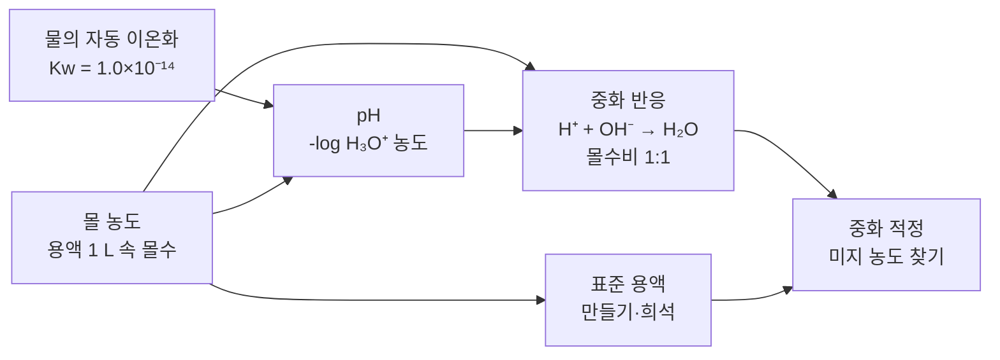

# 화학 4. 역동적인 화학 반응 — pH와 몰 농도로 읽는 산과 염기
<!-- prev: m3-01, 4-4, chem-1, chem-3 -->
<!-- next: rxn-1, matter-2 -->

> [!NOTE]
> **성취기준**
> - **[12화학04-01]** 물의 자동 이온화와 물의 이온화 상수를 이해하고, 수소 이온의 농도를 pH로 표현할 수 있다.
> - **[12화학04-02]** 몰 농도의 의미를 이해하고, 원하는 몰 농도의 용액을 만들 수 있다.
> - **[12화학04-03]** 중화 반응을 이해하고, 중화 반응에서의 양적 관계를 설명할 수 있다.
> - **[12화학04-04]** 중화 적정 실험을 계획하고 수행하여 미지 시료의 농도를 찾을 수 있다.

**학습 목표**

1. 순수한 물에서도 자동 이온화 평형이 일어남을 알고, 물의 이온화 상수 $K_w$를 이용해 $[\mathrm{H_3O^+}]$와 $[\mathrm{OH^-}]$의 관계를 설명할 수 있다.
2. 수소 이온의 농도를 pH(와 pOH)로 나타내고, 용액의 액성을 판단할 수 있다.
3. 몰 농도의 의미를 알고, 부피 플라스크를 이용하여 원하는 몰 농도의 용액을 만들거나 희석할 수 있다.
4. 강산과 강염기의 중화 반응에서 $\mathrm{H^+}$와 $\mathrm{OH^-}$가 1 : 1의 몰수비로 반응함을 이용하여 양적 관계를 설명할 수 있다.
5. 중화 적정 실험을 계획·수행하여 미지 시료(예: 식초 속 아세트산)의 농도를 구할 수 있다.

**이 단원의 학습 사다리**

| 단계 | 무엇을 하나? |
|---|---|
| STEP 1. 이전 학습 다시 보기 | 산·염기의 정의, 지시약, pH의 대략적 의미, 평형 상수를 다시 꺼낸다 |
| STEP 2. 기초 다지기 | 로그($\log$)와 10의 거듭제곱, 이온화식, '용액'과 '용매'의 구분을 디딤돌로 놓는다 |
| STEP 3. 핵심 개념 | 몰 농도 → 용액 만들기·희석 → 물의 자동 이온화와 $K_w$ → pH → 중화 반응의 양적 관계 → 중화 적정 |
| STEP 4. 오개념 바로잡기 | "중화되면 항상 중성이다?", "강산을 계속 희석하면 염기성이 된다?"를 바로잡는다 |
| STEP 5. 다음 단계로 | 브뢴스테드–로리 산·염기, 약산의 이온화 상수, 적정 곡선, 완충 용액 |
| STEP 6. 생활·산업·진로 | 수질 관리, 토양 개량, 식품 품질 관리, 의약품 분석 |

---

## 🗺️ 단원 들어가기

식초병에는 "산도 6~7 %"처럼 숫자가 적혀 있다. 이 숫자는 누가, 어떻게 쟀을까? 수영장 관리자는 물의 pH를 매일 확인하고, 농부는 산성 토양에 석회를 뿌린다. 얼마나 뿌려야 할까?

이 질문에 답하려면 두 가지 언어가 필요하다. 첫째, 용액 속에 산이나 염기가 **얼마나 들어 있는지** 나타내는 **몰 농도**. 둘째, 용액이 **얼마나 산성인지** 나타내는 **pH**. 그리고 이 둘을 연결하는 열쇠는 뜻밖에도 순수한 물 자신이다. 물 분자는 아주 조금씩 스스로 이온으로 나뉘는 평형을 이루고 있고, 이 평형이 모든 수용액의 $\mathrm{H_3O^+}$와 $\mathrm{OH^-}$ 농도를 묶어 준다.

이 단원에서는 몰 농도로 용액을 만들고, pH로 산성도를 표현하며, 중화 반응의 양적 관계를 이용해 **모르는 용액의 농도를 실험으로 찾아내는** 중화 적정까지 해 본다.

---

## STEP 1. 🔙 이전 학습 다시 보기

### 연계 개념표

| 이전 단원·성취기준 | 그때 배운 것 | 이 단원에서 확장되는 것 |
|---|---|---|
| 중3 「화학 반응의 규칙성」 [9과16-02]·[9과16-06] | 계수비 = 입자 수비, 반응에서 열 출입 | 중화 반응의 몰수비 1 : 1, 생성된 물의 양과 중화열 |
| 통합과학2 「산과 염기, 중화 반응」 [10통과2-01-04] | 아레니우스 산·염기, 지시약, pH의 대략적 의미, 중화 반응의 온도·지시약 변화 | pH를 **로그로 정의**하고 계산, 중화의 **양적 관계** |
| 화학 「화학의 언어」 [12화학01-02]·[12화학01-03] | 몰, 몰질량, 화학 반응식의 양적 관계 | 질량 → 몰 → **몰 농도**, 용액의 부피로 몰수 구하기 |
| 화학 「화학 평형」 [12화학03-02] | 평형 상수, 물·고체는 식에 쓰지 않는다 | 물의 자동 이온화 평형과 **물의 이온화 상수** $K_w$ |

### 준비 운동 (사전 진단)

**Q1.** 염산(HCl 수용액)과 수산화 나트륨 수용액의 이온화식을 쓰시오.

**Q2.** pH 3인 용액은 pH 5인 용액보다 $\mathrm{H^+}$ 농도가 몇 배 큰가?

**Q3.** 페놀프탈레인 용액은 산성, 중성, 염기성에서 각각 어떤 색인가?

**Q4.** 1 L 용기에 기체 0.5 mol이 들어 있다. 이 기체의 몰 농도는?

정답 및 해설

**Q1.** $\mathrm{HCl \rightarrow H^+ + Cl^-}$, $\mathrm{NaOH \rightarrow Na^+ + OH^-}$

**Q2.** 100배 — pH가 1 작아질 때마다 $\mathrm{H^+}$ 농도는 10배이므로 $10\times10 = 100$배이다.

**Q3.** 산성·중성: 무색, 염기성: 붉은색

**Q4.** 0.5 mol/L(0.5 M) — 「화학 평형」에서 평형 상수를 구할 때 쓴 몰 농도이다.

---

## STEP 2. 🧱 기초 다지기

### ① 10의 거듭제곱과 로그

$\log$(상용로그)는 "10을 몇 번 곱해야 이 수가 되는가"를 묻는 함수이다.

$$
\log 10^{n} = n \qquad \log(a \times b) = \log a + \log b
$$

| 수 | $10^{-1}$ | $10^{-3}$ | $10^{-7}$ | $10^{-12}$ | $2\times10^{-3}$ | $5\times10^{-4}$ |
|---|---|---|---|---|---|---|
| $\log$ 값 | $-1$ | $-3$ | $-7$ | $-12$ | $0.30 - 3 = -2.70$ | $0.70 - 4 = -3.30$ |

이 단원에서는 $\log 2 = 0.30$, $\log 3 = 0.48$, $\log 5 = 0.70$을 쓴다.

> [!TIP]
> 💡 **비유** — 지진의 규모, 소리의 데시벨(dB), 별의 등급처럼 **아주 넓은 범위**의 값을 다룰 때 로그를 쓴다. $\mathrm{H^+}$ 농도도 1 M에서 $10^{-14}$ M까지 100조 배 범위에 걸쳐 있어서, 로그를 써서 0~14의 다루기 쉬운 숫자로 바꾼다.

### ② 산과 염기의 이온화와 '가수'

| 물질 | 이온화식 | 1 mol이 내놓는 $\mathrm{H^+}$ 또는 $\mathrm{OH^-}$ |
|---|---|---|
| 염산 | $\mathrm{HCl \rightarrow H^+ + Cl^-}$ | $\mathrm{H^+}$ 1 mol(1가 산) |
| 질산 | $\mathrm{HNO_3 \rightarrow H^+ + NO_3^-}$ | $\mathrm{H^+}$ 1 mol(1가 산) |
| 황산 | $\mathrm{H_2SO_4 \rightarrow 2H^+ + SO_4^{2-}}$ | $\mathrm{H^+}$ 2 mol(2가 산) |
| 수산화 나트륨 | $\mathrm{NaOH \rightarrow Na^+ + OH^-}$ | $\mathrm{OH^-}$ 1 mol(1가 염기) |
| 수산화 칼륨 | $\mathrm{KOH \rightarrow K^+ + OH^-}$ | $\mathrm{OH^-}$ 1 mol(1가 염기) |
| 수산화 칼슘 | $\mathrm{Ca(OH)_2 \rightarrow Ca^{2+} + 2OH^-}$ | $\mathrm{OH^-}$ 2 mol(2가 염기) |

물에서 거의 모두 이온화하는 산·염기를 **강산·강염기**, 일부만 이온화하는 것을 **약산·약염기**라고 한다. 아세트산($\mathrm{CH_3COOH}$)과 암모니아($\mathrm{NH_3}$)는 대표적인 약산·약염기이다. 이 단원의 양적 계산은 **강산과 강염기**를 중심으로 한다.

> [!NOTE]
> 수용액 속 수소 이온은 실제로는 물 분자와 결합한 **하이드로늄 이온($\mathrm{H_3O^+}$)** 으로 존재한다. 이 책에서는 $\mathrm{H^+}$와 $\mathrm{H_3O^+}$를 같은 뜻으로 쓴다.

### ③ '용액'과 '용매'는 다르다

- **용질**: 녹는 물질(예: 소금), **용매**: 녹이는 물질(예: 물), **용액** = 용질 + 용매(예: 소금물)
- 소금 58.5 g을 **물 1 L에 녹이면** 용액의 부피는 1 L보다 조금 커진다. 그래서 정확한 농도의 용액을 만들 때는 '용매의 부피'가 아니라 '**용액의 부피**'를 맞추어야 한다.

---

## STEP 3. 📘 핵심 개념

### ① 몰 농도의 의미 [12화학04-02]

**몰 농도(molarity, M)** 는 **용액 1 L 속에 녹아 있는 용질의 몰수**이다.

$$
\text{몰 농도(M)} = \frac{\text{용질의 몰수(mol)}}{\text{용액의 부피(L)}}
\qquad
\text{용질의 몰수} = \text{몰 농도} \times \text{용액의 부피}
$$

몰 농도를 쓰면 **부피만 재어도 용질의 입자 수(몰수)를 알 수 있다.** 반응은 입자끼리 일어나므로, 몰 농도는 화학 반응의 양적 관계를 다루기에 가장 편리한 농도이다.

| 농도 표현 | 정의 | 장점 | 단점 |
|---|---|---|---|
| 퍼센트 농도(%) | 용액 100 g 속 용질의 질량(g) | 저울만 있으면 된다, 생활에서 익숙하다 | 입자 수를 바로 알 수 없다 |
| 몰 농도(M) | 용액 1 L 속 용질의 몰수 | 부피로 입자 수를 바로 안다 → 반응 계산에 편리 | 온도에 따라 부피가 변하면 값이 조금 변한다 |

#### 예제 1

수산화 나트륨(NaOH) 4.0 g을 물에 녹여 수용액 500 mL를 만들었다. 이 용액의 몰 농도는? (NaOH의 화학식량 = 40)

**풀이** 몰수 $= 4.0 \div 40 = 0.10\ \mathrm{mol}$, 부피 $= 0.500\ \mathrm{L}$
몰 농도 $= 0.10 \div 0.500 = 0.20\ \mathrm{M}$

#### 예제 2 — 부피로 몰수 알아내기

0.20 M 염산 25 mL에 들어 있는 HCl의 몰수와 $\mathrm{H^+}$의 몰수는?

**풀이** $0.20\ \mathrm{mol/L} \times 0.025\ \mathrm{L} = 5.0\times10^{-3}\ \mathrm{mol}$. HCl은 강산(1가)이므로 $\mathrm{H^+}$도 $5.0\times10^{-3}$ mol이다.

### ② 원하는 몰 농도의 용액 만들기 [12화학04-02]

#### (1) 고체 용질로 표준 용액 만들기 — 0.10 M 염화 나트륨 수용액 250 mL

농도를 정확히 아는 용액을 **표준 용액(standard solution)** 이라고 한다.

| 단계 | 할 일 | 계산·요령 |
|---|---|---|
| ① 계산 | 필요한 용질의 질량을 구한다 | $0.10\ \mathrm{M}\times0.250\ \mathrm{L} = 0.025\ \mathrm{mol}$, $0.025\times58.5 \approx 1.46\ \mathrm{g}$ |
| ② 측정 | 전자저울로 NaCl 1.46 g을 잰다 | 칭량 접시 질량은 영점 조정 |
| ③ 녹이기 | 비커에 증류수를 조금 넣고 완전히 녹인다 | 부피 플라스크에 바로 넣지 않는다 |
| ④ 옮기기 | 250 mL **부피 플라스크**에 깔때기로 옮긴다 | 비커와 유리 막대를 증류수로 2~3번 헹궈 그 물도 넣는다(용질 손실 방지) |
| ⑤ 표선 맞추기 | 증류수를 넣다가 마지막엔 스포이트로 한 방울씩, 눈높이에서 **용액의 아랫면(메니스커스)** 이 표선에 닿게 한다 | 표선을 넘기면 처음부터 다시 만든다 |
| ⑥ 섞기 | 마개를 막고 여러 번 뒤집어 고르게 섞는다 | 이름·농도·날짜를 적은 라벨을 붙인다 |

> [!WARNING]
> "NaCl 1.46 g을 **물 250 mL에** 녹인다"는 틀린 방법이다. 용액의 부피가 250 mL를 넘어 농도가 0.10 M보다 작아진다. 반드시 **용액의 전체 부피**를 부피 플라스크로 맞춘다.

#### (2) 진한 용액을 희석하기

용액에 물을 더해 묽혀도 **용질의 몰수는 변하지 않는다.**

$$
M_1 V_1 = M_2 V_2 \qquad (\text{희석 전 몰수} = \text{희석 후 몰수})
$$

#### 예제 3 — 시판 진한 염산으로 묽은 염산 만들기

시판 진한 염산은 질량 퍼센트 농도가 약 37 %, 밀도가 약 1.19 g/mL이다. (1) 이 염산의 몰 농도를 구하고, (2) 이것으로 0.10 M 염산 500 mL를 만들려면 진한 염산 몇 mL가 필요한가? (HCl = 36.5)

**풀이**
(1) 용액 1 L(1000 mL)의 질량 $= 1000\times1.19 = 1190\ \mathrm{g}$ → HCl의 질량 $= 1190\times0.37 \approx 440\ \mathrm{g}$ → 몰수 $= 440 \div 36.5 \approx 12\ \mathrm{mol}$ → 약 **12 M**
(2) $12\times V_1 = 0.10\times500\ \mathrm{mL}$ → $V_1 \approx 4.2\ \mathrm{mL}$

> [!WARNING]
> **진한 산을 희석할 때는 반드시 물에 산을 조금씩 넣는다.** 산에 물을 부으면 많은 열이 한꺼번에 발생해 용액이 끓어 튈 수 있다. 진한 산은 환기 장치 안에서 교사가 다룬다.

### ③ 물의 자동 이온화와 물의 이온화 상수 [12화학04-01]

#### (1) 순수한 물도 이온을 가지고 있다

아주 순수한 물에도 전류가 **아주 조금** 흐른다. 물 분자 일부가 서로 $\mathrm{H^+}$를 주고받아 이온으로 나뉘기 때문이다. 이를 **물의 자동 이온화(autoionization of water)** 라고 한다.

$$
\mathrm{H_2O(l) + H_2O(l) \rightleftharpoons H_3O^+(aq) + OH^-(aq)}
$$

이 반응은 정반응과 역반응이 계속 일어나는 **동적 평형**이며, 평형은 반응물(물) 쪽으로 크게 치우쳐 있다. 25 °C에서 물 분자 약 5억 개 중 1개 정도만 이온화되어 있다.

#### (2) 물의 이온화 상수 $K_w$

「화학 평형」에서 배운 대로 용매인 물은 평형 상수식에 쓰지 않으므로 다음과 같은 일정한 값이 나온다. 이를 **물의 이온화 상수(ion-product constant of water)** 라고 한다.

$$
K_w = [\mathrm{H_3O^+}][\mathrm{OH^-}] = 1.0\times10^{-14} \quad (25\ ^\circ\mathrm{C})
$$

순수한 물에서는 $\mathrm{H_3O^+}$와 $\mathrm{OH^-}$가 1 : 1로 생기므로 $[\mathrm{H_3O^+}] = [\mathrm{OH^-}] = 1.0\times10^{-7}\ \mathrm{M}$이다.

> [!IMPORTANT]
> $K_w$는 **순수한 물뿐 아니라 모든 수용액에서** 성립한다. 산을 넣어 $[\mathrm{H_3O^+}]$가 커지면 평형이 역반응 쪽으로 이동하여 $[\mathrm{OH^-}]$가 작아지고, 두 농도의 곱은 늘 $1.0\times10^{-14}$이다(25 °C). 그래서 한쪽 농도만 알면 다른 쪽을 바로 구할 수 있다.

| 용액 | $[\mathrm{H_3O^+}]$와 $[\mathrm{OH^-}]$의 관계 | 25 °C에서 |
|---|---|---|
| 산성 | $[\mathrm{H_3O^+}] > [\mathrm{OH^-}]$ | $[\mathrm{H_3O^+}] > 1.0\times10^{-7}\ \mathrm{M}$ |
| 중성 | $[\mathrm{H_3O^+}] = [\mathrm{OH^-}]$ | $[\mathrm{H_3O^+}] = 1.0\times10^{-7}\ \mathrm{M}$ |
| 염기성 | $[\mathrm{H_3O^+}] < [\mathrm{OH^-}]$ | $[\mathrm{H_3O^+}] < 1.0\times10^{-7}\ \mathrm{M}$ |

#### (3) $K_w$는 온도에 따라 달라진다

물의 자동 이온화는 **흡열 반응**이므로, 온도가 높아지면 정반응 쪽으로 평형이 이동하여 $K_w$가 커진다(「화학 평형」의 온도 효과).

| 온도 | $K_w$(약) | 중성일 때 $[\mathrm{H_3O^+}]$(약) | 중성의 pH(약) |
|---|---|---|---|
| 0 °C | $1.1\times10^{-15}$ | $3.4\times10^{-8}\ \mathrm{M}$ | 7.5 |
| 25 °C | $1.0\times10^{-14}$ | $1.0\times10^{-7}\ \mathrm{M}$ | 7.0 |
| 50 °C | $5.5\times10^{-14}$ | $2.3\times10^{-7}\ \mathrm{M}$ | 6.6 |

50 °C의 순수한 물은 pH가 약 6.6이지만 $[\mathrm{H_3O^+}] = [\mathrm{OH^-}]$이므로 **여전히 중성**이다. "pH 7 = 중성"은 25 °C에서만 맞는 말이다.

#### 예제 4

25 °C에서 0.010 M 수산화 나트륨 수용액의 $[\mathrm{OH^-}]$와 $[\mathrm{H_3O^+}]$는?

**풀이** NaOH는 강염기이므로 $[\mathrm{OH^-}] = 0.010 = 1.0\times10^{-2}\ \mathrm{M}$
$[\mathrm{H_3O^+}] = \dfrac{K_w}{[\mathrm{OH^-}]} = \dfrac{1.0\times10^{-14}}{1.0\times10^{-2}} = 1.0\times10^{-12}\ \mathrm{M}$
염기성 용액에도 $\mathrm{H_3O^+}$가 0이 아니라 아주 적게 존재한다.

### ④ pH — 수소 이온 농도를 숫자 하나로 [12화학04-01]

$$
\mathrm{pH} = -\log[\mathrm{H_3O^+}] \qquad \mathrm{pOH} = -\log[\mathrm{OH^-}]
$$

$K_w = [\mathrm{H_3O^+}][\mathrm{OH^-}] = 1.0\times10^{-14}$의 양변에 $-\log$를 취하면 25 °C에서 다음 관계가 나온다.

$$
\mathrm{pH} + \mathrm{pOH} = 14
$$

| $[\mathrm{H_3O^+}]$ (M) | $10^{0}$ | $10^{-2}$ | $10^{-4}$ | $10^{-7}$ | $10^{-10}$ | $10^{-12}$ | $10^{-14}$ |
|---|---|---|---|---|---|---|---|
| $[\mathrm{OH^-}]$ (M) | $10^{-14}$ | $10^{-12}$ | $10^{-10}$ | $10^{-7}$ | $10^{-4}$ | $10^{-2}$ | $10^{0}$ |
| pH | 0 | 2 | 4 | 7 | 10 | 12 | 14 |
| pOH | 14 | 12 | 10 | 7 | 4 | 2 | 0 |
| 액성 | 강한 산성 | 산성 | 약한 산성 | 중성 | 약한 염기성 | 염기성 | 강한 염기성 |

- pH가 **1 작아지면** $[\mathrm{H_3O^+}]$는 **10배** 커진다. 통합과학에서 배운 규칙이 로그의 정의에서 나온다.
- pH는 0보다 작거나 14보다 클 수도 있다(예: 진한 염산). 0~14는 생활에서 흔히 만나는 범위이다.

#### 예제 5

25 °C에서 다음 용액의 pH를 구하시오. (1) 0.0010 M 염산 (2) 0.010 M 수산화 나트륨 수용액 (3) $[\mathrm{H_3O^+}] = 2.0\times10^{-3}\ \mathrm{M}$인 용액 ($\log 2 = 0.30$)

**풀이**
(1) $[\mathrm{H_3O^+}] = 1.0\times10^{-3}$ → pH = 3
(2) $[\mathrm{OH^-}] = 1.0\times10^{-2}$ → pOH = 2 → pH $= 14 - 2 = 12$
(3) pH $= -\log(2.0\times10^{-3}) = 3 - 0.30 = 2.70$

#### 강산을 희석하면 pH는 어떻게 변할까?

0.10 M 염산을 10배씩 계속 희석하면 $[\mathrm{H_3O^+}]$가 10분의 1씩 줄어 pH가 1씩 커진다. 그런데 계속 희석해도 pH는 **7을 넘지 않는다.** 산의 농도가 $10^{-7}$ M 정도로 작아지면 물의 자동 이온화로 생기는 $\mathrm{H_3O^+}$를 더 이상 무시할 수 없기 때문이다.

| 희석 횟수(10배씩) | 0 | 1 | 2 | 3 | 4 | 5 | … | 매우 많이 |
|---|---|---|---|---|---|---|---|---|
| HCl 농도(M) | $10^{-1}$ | $10^{-2}$ | $10^{-3}$ | $10^{-4}$ | $10^{-5}$ | $10^{-6}$ | … | 0에 가까움 |
| pH | 1 | 2 | 3 | 4 | 5 | 6 | … | 7에 가까워짐(넘지 않음) |

> [!TIP]
> 💡 **비유** — 오렌지 주스에 물을 아무리 많이 부어도 결국 '거의 물'이 될 뿐 '우유'가 되지는 않는다. 산을 희석하면 '거의 중성인 물'에 가까워질 뿐 염기성이 되지 않는다.

### ⑤ 중화 반응의 양적 관계 [12화학04-03]

#### (1) 중화 반응의 본질 — 알짜 이온 반응식

산의 $\mathrm{H^+}$와 염기의 $\mathrm{OH^-}$가 만나 물이 되는 반응이 **중화 반응**이다. 반응에 참여하지 않는 이온(**구경꾼 이온**)을 빼고 쓴 식을 **알짜 이온 반응식**이라 한다.

$$
\mathrm{HCl(aq) + NaOH(aq) \rightarrow NaCl(aq) + H_2O(l)}
$$

$$
\text{알짜 이온 반응식: } \mathrm{H^+(aq) + OH^-(aq) \rightarrow H_2O(l)}
$$

$\mathrm{Na^+}$과 $\mathrm{Cl^-}$은 구경꾼 이온이다. 어떤 강산과 강염기든 알짜 반응은 같으므로, **$\mathrm{H^+}$와 $\mathrm{OH^-}$는 항상 1 : 1의 몰수비로 반응한다.** 중화 반응의 평형 상수는 $1/K_w = 1.0\times10^{14}$으로 매우 커서 사실상 끝까지 진행한다.

#### (2) 중화의 양적 관계식

산과 염기가 **완전히 중화**되는 점(중화점)에서는 산이 내놓은 $\mathrm{H^+}$의 몰수와 염기가 내놓은 $\mathrm{OH^-}$의 몰수가 같다.

$$
n M V = n' M' V'
$$

($n$, $n'$: 산·염기의 가수, $M$, $M'$: 몰 농도, $V$, $V'$: 부피)

| 반응 | 가수 | 중화 조건 |
|---|---|---|
| HCl + NaOH | 1, 1 | $MV = M'V'$ |
| $\mathrm{H_2SO_4}$ + NaOH | 2, 1 | $2MV = M'V'$ |
| HCl + $\mathrm{Ca(OH)_2}$ | 1, 2 | $MV = 2M'V'$ |

#### 예제 6

0.10 M 황산 10 mL를 완전히 중화하는 데 필요한 0.10 M 수산화 나트륨 수용액의 부피는?

**풀이** $2\times0.10\times10 = 1\times0.10\times V'$ → $V' = 20\ \mathrm{mL}$
황산은 1 mol이 $\mathrm{H^+}$ 2 mol을 내놓으므로, 같은 농도의 염산보다 2배의 염기가 필요하다.

#### (3) 혼합 용액 속 이온 수의 변화

0.10 M 염산 20 mL(HCl 2.0 mmol)에 0.10 M 수산화 나트륨 수용액을 조금씩 넣을 때 이온의 양(mmol, 1 mmol = $10^{-3}$ mol)은 다음과 같이 변한다.

| 넣은 NaOH(mL) | $\mathrm{H^+}$ | $\mathrm{Cl^-}$ | $\mathrm{Na^+}$ | $\mathrm{OH^-}$ | 전체 이온 | 생성된 물 | 액성 |
|---|---|---|---|---|---|---|---|
| 0 | 2.0 | 2.0 | 0 | 0 | 4.0 | 0 | 산성 |
| 10 | 1.0 | 2.0 | 1.0 | 0 | 4.0 | 1.0 | 산성 |
| 20(중화점) | 0 | 2.0 | 2.0 | 0 | 4.0 | 2.0 | 중성 |
| 30 | 0 | 2.0 | 3.0 | 1.0 | 5.0 | 2.0 | 염기성 |

- **구경꾼 이온** $\mathrm{Cl^-}$은 일정, $\mathrm{Na^+}$은 넣은 만큼 계속 증가
- $\mathrm{H^+}$은 줄어들다 중화점에서 0, $\mathrm{OH^-}$은 중화점 이후부터 증가
- 전체 이온 수는 중화점까지 일정($\mathrm{H^+}$ 하나가 사라질 때 $\mathrm{Na^+}$ 하나가 들어옴)하다가 그 뒤 증가
- **생성된 물의 양**과 **방출된 중화열**은 중화점까지 증가하다 그 뒤 일정. 그래서 혼합 용액의 온도는 중화점에서 가장 높다(통합과학에서 측정한 온도 그래프의 이유).

> [!TIP]
> 💡 **요령** — 중화 문제는 '이온 장부'를 쓰면 쉽다. 먼저 $\mathrm{H^+}$와 $\mathrm{OH^-}$의 몰수를 따로 적고, 작은 쪽만큼 서로 지우고(물 생성), 남은 쪽을 보고 액성을 판단한다.

#### 예제 7 — 혼합 용액의 pH

25 °C에서 0.10 M 염산 55 mL와 0.10 M 수산화 나트륨 수용액 45 mL를 섞었다. 혼합 용액의 pH는? (부피는 단순히 더해진다고 가정)

**풀이** $\mathrm{H^+}$: $0.10\times0.055 = 5.5\times10^{-3}$ mol, $\mathrm{OH^-}$: $0.10\times0.045 = 4.5\times10^{-3}$ mol
중화 후 남은 $\mathrm{H^+}$ $= 1.0\times10^{-3}$ mol, 전체 부피 $= 0.100\ \mathrm{L}$
$[\mathrm{H_3O^+}] = 1.0\times10^{-3} / 0.100 = 1.0\times10^{-2}\ \mathrm{M}$ → **pH = 2**

> [!IMPORTANT]
> **중화 반응 ≠ 중성.** 중화 반응은 $\mathrm{H^+}$와 $\mathrm{OH^-}$가 물이 되는 '반응'이고, 중성은 $[\mathrm{H_3O^+}] = [\mathrm{OH^-}]$인 '상태'이다. 한쪽이 남으면 중화 반응이 일어난 뒤에도 산성이나 염기성이다. (약산과 강염기처럼 세기가 다른 산·염기는 중화점에서도 중성이 아닐 수 있다. 이는 진로 선택 「산·염기 평형」에서 다룬다.)

### ⑥ 중화 적정 — 미지 시료의 농도 찾기 [12화학04-04]

농도를 아는 산(또는 염기) 표준 용액으로 농도를 모르는 염기(또는 산)를 중화시켜, 중화점까지 넣은 부피로 미지 농도를 구하는 실험을 **중화 적정(neutralization titration)** 이라고 한다.

#### (1) 실험 도구

| 도구 | 쓰임 | 사용 요령 |
|---|---|---|
| 부피 피펫 + 피펫 필러 | 미지 시료를 정확한 부피(예: 10.00 mL)만큼 옮긴다 | 입으로 빨지 않고 필러를 쓴다. 옮길 용액으로 2~3번 헹군다 |
| 뷰렛 | 표준 용액을 조금씩 떨어뜨리고, 넣은 부피를 0.05 mL 단위까지 읽는다 | 넣을 표준 용액으로 헹군 뒤 채운다. 끝의 공기 방울을 뺀다. 눈높이에서 메니스커스 아랫면을 읽는다 |
| 삼각 플라스크 | 시료와 지시약을 담고 흔들며 적정한다 | 증류수로 젖어 있어도 된다(용질의 몰수는 그대로) |
| 부피 플라스크 | 표준 용액 제조, 시료 희석 | 표선까지 정확히 |
| 지시약(페놀프탈레인) | 중화점 근처에서 색이 변해 종말점을 알려 준다 | 2~3방울만 넣는다 |

- **중화점**: 산의 $\mathrm{H^+}$ 몰수와 염기의 $\mathrm{OH^-}$ 몰수가 같아지는 점(이론적인 점)
- **종말점**: 지시약의 색이 변하여 적정을 멈추는 점(실험으로 확인하는 점). 알맞은 지시약을 고르면 종말점이 중화점과 거의 같다.

#### (2) 적정 실험 계획하기 — 식초 속 아세트산의 함량

| 단계 | 할 일 | 까닭 |
|---|---|---|
| ① 표준 용액 준비 | 0.10 M NaOH 수용액을 만든다(가능하면 표준 산으로 정확한 농도를 확인한다) | NaOH는 공기 중의 수분과 이산화 탄소를 흡수해 질량만으로는 농도가 조금 틀릴 수 있다 |
| ② 시료 희석 | 식초 10.00 mL를 부피 피펫으로 취해 100 mL 부피 플라스크에 넣고 표선까지 증류수를 채운다(10배 희석) | 원래 식초는 진해서 뷰렛 한 번으로 적정하기 어렵다. 식초의 색도 옅어져 종말점이 잘 보인다 |
| ③ 시료 취하기 | 희석한 식초 10.00 mL를 삼각 플라스크에 넣고 페놀프탈레인 2~3방울을 넣는다 | |
| ④ 적정 | 뷰렛의 처음 눈금을 읽고 NaOH를 조금씩 떨어뜨리며 흔든다. 붉은색이 흔들어도 약 30초 이상 사라지지 않으면 멈추고 나중 눈금을 읽는다 | 종말점 근처에서는 한 방울씩 |
| ⑤ 반복 | 같은 실험을 3회 이상 하고 평균을 낸다 | 우연 오차를 줄인다 |
| ⑥ 계산 | 몰수 관계로 농도·함량을 구한다 | 아래 예제 |

#### 예제 8 — 식초의 아세트산 함량

위의 방법으로 적정했더니 0.10 M NaOH 수용액이 평균 8.0 mL 들어갔다. 원래 식초의 아세트산 몰 농도와 질량–부피 백분율(용액 100 mL 속 아세트산의 g)을 구하시오. (아세트산 $\mathrm{CH_3COOH}$의 분자량 = 60)

**풀이** 아세트산은 1가 산이다. $\mathrm{CH_3COOH + NaOH \rightarrow CH_3COONa + H_2O}$ (몰수비 1 : 1)
- 넣은 NaOH의 몰수 $= 0.10\times0.0080 = 8.0\times10^{-4}$ mol = 희석 식초 10.00 mL 속 아세트산 몰수
- 희석 식초의 농도 $= 8.0\times10^{-4} / 0.01000 = 0.080\ \mathrm{M}$
- 원래 식초(10배 진함) $= 0.80\ \mathrm{M}$
- 1 L 속 아세트산 질량 $= 0.80\times60 = 48\ \mathrm{g}$ → 100 mL 속 4.8 g → **약 4.8 %**

> [!NOTE]
> 아세트산은 약산이지만, 적정에 쓰는 수산화 나트륨이 아세트산 분자를 하나씩 모두 중화하므로 **몰수비 1 : 1**은 그대로 성립한다. 이 단원에서는 이 양적 관계만 쓴다. 적정하는 동안 pH가 어떻게 변하는지(중화 적정 곡선)와 이 경우 페놀프탈레인을 쓰는 이유는 진로 선택 「산·염기 평형」에서 다룬다.

#### (3) 오차의 원인 찾기

| 실수 | 측정된 NaOH 부피 | 계산된 시료 농도 |
|---|---|---|
| 뷰렛을 표준 용액으로 헹구지 않고 물기가 남은 채 사용 | 커진다(표준 용액이 묽어짐) | 실제보다 크다 |
| 종말점을 지나쳐 진한 붉은색이 될 때까지 넣음 | 커진다 | 실제보다 크다 |
| 뷰렛 끝의 공기 방울이 적정 중 빠짐 | 눈금상 커진다 | 실제보다 크다 |
| 삼각 플라스크가 증류수로 젖어 있음 | 변하지 않는다 | 영향 없음 |
| 피펫으로 취한 시료가 표선보다 적음 | 작아진다 | 실제보다 작다 |

---

## STEP 4. ⚠️ 오개념 바로잡기

| 흔한 오개념 | 올바른 개념 | 왜 그럴까? |
|---|---|---|
| 순수한 물에는 이온이 전혀 없다 | 자동 이온화로 $\mathrm{H_3O^+}$와 $\mathrm{OH^-}$가 각각 $1.0\times10^{-7}$ M씩 있다(25 °C) | 아주 순수한 물에도 전류가 아주 조금 흐른다 |
| 산성 용액에는 $\mathrm{OH^-}$이 없다 | 모든 수용액에 $\mathrm{H_3O^+}$와 $\mathrm{OH^-}$가 함께 있다 | $K_w = [\mathrm{H_3O^+}][\mathrm{OH^-}]$가 일정하므로 한쪽이 0이 될 수 없다 |
| pH 7은 언제나 중성이다 | 중성은 $[\mathrm{H_3O^+}] = [\mathrm{OH^-}]$인 상태이며, pH 7은 **25 °C에서만** 중성이다 | $K_w$가 온도에 따라 변해 50 °C 순수한 물의 pH는 약 6.6이다 |
| 강산을 계속 희석하면 결국 염기성이 된다 | pH는 7에 가까워질 뿐 **7을 넘지 않는다** | 희석해도 산이 염기로 바뀌지 않고, 물의 자동 이온화가 중성 쪽으로 붙잡는다 |
| 중화 반응이 일어나면 항상 중성이 된다 | $\mathrm{H^+}$와 $\mathrm{OH^-}$ 중 **남은 쪽**이 있으면 산성 또는 염기성이다 | 중화는 '반응', 중성은 '상태'이다 |
| 같은 농도·같은 부피의 산이면 필요한 염기의 양도 같다 | 산의 **가수**에 따라 다르다 | 0.1 M 황산은 0.1 M 염산보다 $\mathrm{H^+}$를 2배 내놓는다 |
| 1 M 용액은 용질 1 mol을 물 1 L에 녹인 것이다 | 용질 1 mol을 녹여 **용액 전체를 1 L**로 만든 것이다 | 용질이 녹으면 부피가 변하므로 부피 플라스크로 용액의 부피를 맞춘다 |

---

## STEP 5. 🎓 다음 단계로 한 걸음 더

> [!CAUTION]
> 이 절은 **화학 교육과정 범위 밖의 심화 내용**으로 평가 대상이 아니다. 산·염기와 농도의 생각이 진로 선택 과목과 대학에서 어떻게 확장되는지 미리 보는 맛보기이다.

### 진로 선택 과목·대학과의 연결

| 과목 | 이어지는 내용 |
|---|---|
| 화학 반응의 세계 「산·염기 평형」 | 브뢴스테드–로리 산·염기, 이온화 상수 $K_a$·$K_b$, 약산·약염기의 pH, 중화 적정 곡선, 염의 가수 분해, 완충 작용 |
| 물질과 에너지 「용액의 성질」 | 몰랄 농도와 끓는점 오름·어는점 내림, 삼투압 |
| 대학 분석화학 | 1차 표준 물질로 표준화, 전위차 적정, 산화·환원 적정, 오차와 불확도 분석 |
| 대학 생화학·생리학 | 혈액의 완충계, 효소 활성과 pH |

### ① 산과 염기의 정의가 넓어진다 — 브뢴스테드–로리

이 단원의 물의 자동 이온화 $\mathrm{H_2O + H_2O \rightleftharpoons H_3O^+ + OH^-}$를 보면, 한 물 분자는 $\mathrm{H^+}$를 **내주고**, 다른 물 분자는 $\mathrm{H^+}$를 **받는다**. 진로 선택에서는 산을 '$\mathrm{H^+}$를 내주는 물질', 염기를 '$\mathrm{H^+}$를 받는 물질'로 정의하는 **브뢴스테드–로리 정의**를 배운다. 이렇게 보면 물은 산도 되고 염기도 되는 **양쪽성 물질**이고, $\mathrm{OH^-}$이 없는 암모니아가 왜 염기인지도 설명된다.

### ② 약산의 pH — 이온화 상수

0.10 M 아세트산은 일부만 이온화하므로 pH가 1이 아니라 약 2.9이다. 진로 선택에서는 아세트산의 이온화 상수 $K_a = \dfrac{[\mathrm{CH_3COO^-}][\mathrm{H_3O^+}]}{[\mathrm{CH_3COOH}]}$(25 °C에서 약 $1.8\times10^{-5}$)를 써서 이 값을 계산한다. 「화학 평형」의 평형 상수가 산·염기에 그대로 쓰이는 것이다.

### ③ 적정 곡선 — 적정하는 동안 pH는 어떻게 변할까?

넣은 염기의 부피에 따라 pH를 그린 **중화 적정 곡선**은 중화점 근처에서 pH가 수직에 가깝게 급변한다. 강산–강염기는 pH 7 근처, 약산–강염기는 염기성 쪽(pH 약 8~9)에서 급변하므로, 그 범위에서 색이 변하는 지시약(예: 페놀프탈레인)을 골라야 한다. 이 곡선의 해석이 진로 선택 [12반응01-03]의 내용이다.

### 고등학교 「화학」 vs 다음 단계

| 구분 | 고등학교 「화학」 | 진로 선택·대학 |
|---|---|---|
| 산·염기 정의 | 아레니우스 정의 중심, 물의 자동 이온화 | 브뢴스테드–로리, 루이스 정의 |
| pH 계산 | 강산·강염기, 혼합 용액 | 약산·약염기($K_a$, $K_b$), 염 용액, 완충 용액 |
| 중화의 양적 관계 | 강산–강염기, $nMV = n'M'V'$ | 약산–강염기, 다양성자산, 적정 곡선 해석 |
| 적정 | 지시약 종말점, 미지 농도 | 표준화, 전위차 적정, pH 센서, 불확도 계산 |
| 관련 전공 | — | 화학, 환경공학, 식품공학, 약학, 의학 |

---

## STEP 6. 🏭 생활·산업·진로 연결

### 사례 1. 수질과 수영장 관리 — pH를 지켜라

- **원리** 하천·수돗물·수영장 물의 pH는 생물과 사람의 건강, 소독 효과, 배관 부식에 영향을 준다. 우리나라 먹는물 수질 기준에서 pH는 약 5.8~8.5 범위로 관리된다.
- **어디에 쓰이나** 정수장과 하수 처리장은 pH 센서로 연속 측정하고, 산이나 염기를 넣어 중화한다. 산업 폐수도 배출 전에 중화 처리해야 한다.

### 사례 2. 토양 개량 — 산성 토양에 석회를

- **원리** 산성비나 비료 때문에 산성화된 토양에는 탄산 칼슘이나 수산화 칼슘(소석회) 같은 염기성 물질을 뿌려 중화한다.
- **어디에 쓰이나** 토양의 산도를 측정하고, 중화에 필요한 석회의 양을 중화의 양적 관계로 계산하여 알맞게 뿌린다. 너무 많이 뿌리면 반대로 염기성 토양이 되어 작물에 해롭다.

### 사례 3. 식품 품질 관리 — 식초와 우유의 산도

- **원리** 식초의 산도, 우유·요구르트의 산도, 김치의 숙성 정도는 모두 적정으로 측정할 수 있다.
- **어디에 쓰이나** 식품 회사의 품질 관리실에서는 자동 적정기로 제품마다 산도를 확인하여 맛과 보존성을 일정하게 유지한다. 김치는 숙성되면서 젖산이 생겨 산도가 높아진다.

### 사례 4. 의약품과 임상 검사

- **원리** 의약품의 유효 성분 함량을 정확한 농도의 표준 용액과 비교·적정하여 확인한다. 주사액과 수액은 몸에 맞는 농도와 pH로 정밀하게 만들어야 한다.
- **어디에 쓰이나** 제약 회사의 품질 시험, 병원의 혈액 가스 분석(혈액 pH가 약 7.35~7.45를 벗어나면 위험하다).

### 관련 진로와 학과

| 진로 | 하는 일 | 관련 학과 |
|---|---|---|
| 수질 환경 기술자 | 상하수도·폐수의 pH·농도 측정과 중화 처리 | 환경공학, 화학공학 |
| 식품 품질 관리원 | 제품의 산도·성분 적정과 분석 | 식품공학, 식품영양학 |
| 분석 연구원 | 표준 용액 제조, 정밀 적정, 분석법 개발 | 화학, 분석화학 |
| 임상병리사 | 혈액·체액의 화학 성분과 pH 검사 | 임상병리학, 보건학 |
| 농업 연구원 | 토양 산도 진단과 개량 처방 | 농화학, 원예학, 토양학 |

---

## 🔬 탐구 활동

### 활동 A. 표준 용액을 만들고, 강산 희석에 따른 pH 변화 그래프로 나타내기

**목표** 부피 플라스크로 0.10 M 염산을 만들고, 10배씩 희석하며 pH 데이터를 수집·그래프로 나타내 몰 농도와 pH의 관계를 해석한다.

**준비물** 1.0 M 염산(교사가 준비), 100 mL 부피 플라스크 여러 개, 10 mL 부피 피펫과 피펫 필러, 비커, pH 센서(또는 pH 미터)와 데이터 수집 장치, 증류수, 보안경, 장갑, 실험복

**과정**
1. 1.0 M 염산 10.00 mL를 부피 피펫으로 취해 100 mL 부피 플라스크에 넣고 표선까지 증류수를 채워 0.10 M 염산을 만든다.
2. 같은 방법으로 0.10 M → 0.010 M → … → $1.0\times10^{-6}$ M까지 10배씩 희석한다.
3. 묽은 용액부터 차례로 pH를 측정한다(측정할 때마다 전극을 증류수로 헹군다).
4. 가로축을 $-\log[\mathrm{HCl}]$, 세로축을 측정한 pH로 하여 그래프를 그린다.

**결과 기록**

| HCl 농도(M) | $10^{-1}$ | $10^{-2}$ | $10^{-3}$ | $10^{-4}$ | $10^{-5}$ | $10^{-6}$ |
|---|---|---|---|---|---|---|
| 예상 pH | 1 | 2 | 3 | 4 | 5 | 6 |
| 측정 pH | | | | | | |

**생각해 보기**
1. 진한 쪽에서 그래프는 어떤 모양인가? 기울기는 얼마에 가까운가?
2. 아주 묽은 쪽에서 측정값이 예상에서 벗어난다면 그 이유는? (물의 자동 이온화, 공기 중 이산화 탄소가 녹아드는 것 등)
3. 같은 실험을 NaOH로 하면 그래프는 어떻게 될지 예측해 보자.

### 활동 B. 식초 속 아세트산 함량 구하기 (중화 적정)

**목표** 중화 적정 실험을 계획하고 수행하여 시판 식초 속 아세트산의 함량을 구하고, 제품 표시값과 비교한다.

**준비물** 시판 식초, 0.10 M NaOH 표준 용액, 뷰렛과 뷰렛 집게, 스탠드, 10 mL 부피 피펫, 피펫 필러, 100 mL 부피 플라스크, 삼각 플라스크 3개, 페놀프탈레인 용액, 흰 종이, 보안경, 장갑, 실험복

**과정**
1. 모둠별로 STEP 3 ⑥의 표를 참고하여 실험 순서와 역할을 계획서로 쓴다.
2. 식초를 10배 희석하고, 희석 식초 10.00 mL를 삼각 플라스크에 넣은 뒤 페놀프탈레인을 2~3방울 넣는다.
3. 흰 종이 위에서 플라스크를 흔들며 NaOH 표준 용액을 적정한다. 연한 붉은색이 약 30초 유지되면 멈춘다.
4. 3회 반복하고 평균 부피로 아세트산의 몰 농도와 함량을 계산한다.

**결과 기록**

| 회 | 처음 눈금(mL) | 나중 눈금(mL) | 넣은 NaOH(mL) |
|---|---|---|---|
| 1 | | | |
| 2 | | | |
| 3 | | | |
| 평균 | | | |

| 계산 항목 | 값 |
|---|---|
| NaOH 몰수(mol) | |
| 희석 식초의 아세트산 농도(M) | |
| 원래 식초의 아세트산 농도(M) | |
| 아세트산 함량(g/100 mL) | |
| 제품 표시 산도와의 차이 | |

**생각해 보기**
1. 측정값이 표시값과 다르다면 어떤 오차 원인이 있을까? STEP 3의 '오차의 원인' 표와 비교해 보자.
2. 색이 있는 과일 식초는 종말점을 보기 어렵다. 어떻게 해결할 수 있을까? (희석, pH 센서 사용 등)

> [!WARNING]
> **안전 수칙** 산·염기 수용액을 다룰 때는 보안경·장갑·실험복을 착용한다. 피펫은 반드시 필러를 사용하고 입으로 빨지 않는다. 수산화 나트륨은 피부와 눈에 매우 해로우므로 묻으면 즉시 많은 물로 씻는다. 실험이 끝난 뒤 남은 산·염기 용액은 화학 실험실 폐수 및 폐기물 처리 기준에 따라 중화하거나 지정된 폐액통에 모은다.

---

## ✅ 개념 확인 문제

### 기본

**1.** 25 °C에서 어떤 수용액의 $[\mathrm{OH^-}] = 1.0\times10^{-3}\ \mathrm{M}$이다. 이 용액의 $[\mathrm{H_3O^+}]$, pH, 액성을 구하시오.

정답 및 해설

**정답** $[\mathrm{H_3O^+}] = 1.0\times10^{-11}\ \mathrm{M}$, pH = 11, 염기성

$[\mathrm{H_3O^+}] = K_w / [\mathrm{OH^-}] = 1.0\times10^{-14} / 1.0\times10^{-3} = 1.0\times10^{-11}\ \mathrm{M}$. pH $= 11$. 또는 pOH = 3, pH $= 14 - 3 = 11$.

**2.** 25 °C에서 다음 용액의 pH를 구하시오. (1) 0.0010 M 질산 (2) 0.0050 M 수산화 칼슘 수용액(완전히 이온화한다고 가정)

정답 및 해설

**정답** (1) 3 (2) 12

(1) 질산은 1가 강산 → $[\mathrm{H_3O^+}] = 1.0\times10^{-3}$ → pH 3
(2) $\mathrm{Ca(OH)_2}$는 2가 염기 → $[\mathrm{OH^-}] = 2\times0.0050 = 1.0\times10^{-2}$ → pOH 2 → pH 12

**3.** 수산화 나트륨 2.0 g을 녹여 만든 수용액 250 mL의 몰 농도를 구하시오. (NaOH = 40)

정답 및 해설

**정답** 0.20 M

몰수 $= 2.0 / 40 = 0.050$ mol, 몰 농도 $= 0.050 / 0.250 = 0.20$ M

**4.** 0.10 M 황산 구리(II) 수용액 100 mL를 만드는 과정을 순서대로 나열하시오.
(가) 부피 플라스크에 옮기고 비커를 증류수로 헹궈 그 물도 넣는다.
(나) 필요한 황산 구리(II)의 질량을 계산하여 전자저울로 잰다.
(다) 마개를 막고 뒤집어 고르게 섞는다.
(라) 비커에서 소량의 증류수에 녹인다.
(마) 증류수를 표선까지 채운다.

정답 및 해설

**정답** (나) → (라) → (가) → (마) → (다)

용질을 비커에서 먼저 녹인 뒤 부피 플라스크로 옮기고, 용액 전체의 부피를 표선에 맞춘다.

### 응용

**5.** 6.0 M 염산으로 0.50 M 염산 300 mL를 만들려고 한다. 필요한 6.0 M 염산의 부피를 구하고, 희석할 때 주의할 점을 한 가지 쓰시오.

정답 및 해설

**정답** 25 mL. 물에 산을 조금씩 넣는다(산에 물을 붓지 않는다).

$6.0\times V_1 = 0.50\times300$ → $V_1 = 25$ mL. 희석 전후 용질의 몰수($0.15$ mol)는 같다. 진한 산을 희석하면 열이 많이 나므로, 부피 플라스크에 증류수를 먼저 일부 넣고 산을 천천히 넣은 뒤 식혀서 표선을 맞춘다.

**6.** 0.10 M 염산 20 mL에 0.10 M 수산화 나트륨 수용액을 30 mL 넣었다. 혼합 용액에서 (1) 가장 많은 이온, (2) 존재하지 않는 이온(무시할 만큼 적은 이온), (3) 생성된 물의 몰수를 구하시오.

정답 및 해설

**정답** (1) $\mathrm{Na^+}$ (2) $\mathrm{H^+}$ (3) $2.0\times10^{-3}$ mol

처음 $\mathrm{H^+}$ = $\mathrm{Cl^-}$ = 2.0 mmol, 넣은 $\mathrm{Na^+}$ = $\mathrm{OH^-}$ = 3.0 mmol. 중화로 $\mathrm{H^+}$ 2.0 mmol과 $\mathrm{OH^-}$ 2.0 mmol이 물 2.0 mmol이 된다. 남은 이온: $\mathrm{Na^+}$ 3.0, $\mathrm{Cl^-}$ 2.0, $\mathrm{OH^-}$ 1.0 mmol, $\mathrm{H^+}$ 0. (엄밀히 $\mathrm{H^+}$는 $K_w$에 따라 아주 적게 존재한다.)

**7.** 25 °C에서 0.10 M 염산 40 mL와 0.10 M 수산화 나트륨 수용액 60 mL를 섞은 용액의 pH를 구하시오. (부피는 더해진다고 가정, $\log 2 = 0.30$)

정답 및 해설

**정답** pH 12.3

$\mathrm{H^+}$ $4.0\times10^{-3}$ mol, $\mathrm{OH^-}$ $6.0\times10^{-3}$ mol → 남은 $\mathrm{OH^-}$ $2.0\times10^{-3}$ mol, 부피 0.100 L → $[\mathrm{OH^-}] = 2.0\times10^{-2}$ M → pOH $= 2 - 0.30 = 1.70$ → pH $= 14 - 1.70 = 12.3$

**8.** 농도를 모르는 염산 10.0 mL를 0.10 M NaOH 표준 용액으로 적정하였더니 종말점까지 12.5 mL가 들어갔다. (1) 염산의 몰 농도는? (2) 적정 전에 뷰렛을 증류수로만 헹구고 NaOH로 헹구지 않았다면, 구한 농도는 실제보다 커지는가, 작아지는가?

정답 및 해설

**정답** (1) 0.125 M (2) 커진다

(1) $M\times10.0 = 0.10\times12.5$ → $M = 0.125$ M
(2) 뷰렛 안의 물 때문에 NaOH 표준 용액이 묽어져 같은 몰수를 넣는 데 더 많은 부피가 필요하다. 계산에는 0.10 M을 그대로 쓰므로 부피가 커진 만큼 염산 농도가 실제보다 크게 계산된다.

### 융합·서술형

**9. [생활·산업 연계]** 어떤 식초를 10배 희석한 뒤 10.0 mL를 취해 0.10 M NaOH로 적정하였더니 평균 10.0 mL가 들어갔다. (1) 원래 식초의 아세트산 몰 농도와 함량(g/100 mL)을 구하시오. (아세트산 분자량 = 60) (2) 아세트산은 약산인데도 강염기와 몰수비 1 : 1로 계산할 수 있는 이유를 서술하시오.

정답 및 해설

**예시 답안**
(1) NaOH 몰수 $= 0.10\times0.0100 = 1.0\times10^{-3}$ mol = 희석 식초 10.0 mL 속 아세트산 몰수 → 희석 식초 0.10 M → 원래 식초 1.0 M → $1.0\times60 = 60$ g/L → **6.0 g/100 mL(약 6.0 %)**
(2) 아세트산은 물에서 일부만 이온화하지만, 수산화 나트륨을 넣으면 $\mathrm{OH^-}$이 아세트산의 $\mathrm{H^+}$와 반응하여 계속 중화하고, 그만큼 남은 아세트산이 다시 이온화하는 방향으로 평형이 이동한다. 결국 아세트산 분자는 모두 중화되므로, 아세트산 1 mol은 NaOH 1 mol과 반응한다. 이온화 정도(산의 세기)는 pH에 영향을 줄 뿐 **중화에 필요한 염기의 몰수**에는 영향을 주지 않는다.

**채점 포인트** ① 희석 배수를 고려한 농도 계산 ② 함량 환산 ③ 평형 이동과 몰수비의 관계

**10. [평형 연계]** 0.10 M 염산을 10배씩 계속 희석하면서 pH를 측정하였다. 처음에는 pH가 1, 2, 3, …으로 1씩 커졌지만, $10^{-6}$ M을 지나자 pH가 7에 가까워질 뿐 7을 넘지 않았다. 이 결과를 물의 자동 이온화 평형과 $K_w$를 이용하여 서술하시오.

정답 및 해설

**예시 답안**
물은 $\mathrm{H_2O + H_2O \rightleftharpoons H_3O^+ + OH^-}$의 자동 이온화 평형을 이루며, 25 °C에서 $K_w = [\mathrm{H_3O^+}][\mathrm{OH^-}] = 1.0\times10^{-14}$이고 순수한 물에도 $\mathrm{H_3O^+}$가 $1.0\times10^{-7}$ M 있다. 염산이 진할 때는 산이 내놓는 $\mathrm{H_3O^+}$가 물에서 생기는 양보다 훨씬 많아 염산 농도만으로 pH가 정해진다. 그러나 염산 농도가 $10^{-7}$ M 근처로 작아지면 물의 자동 이온화로 생기는 $\mathrm{H_3O^+}$를 무시할 수 없고, 전체 $[\mathrm{H_3O^+}]$는 늘 $1.0\times10^{-7}$ M 이상이다. 산을 넣으면 $[\mathrm{H_3O^+}] \ge [\mathrm{OH^-}]$이므로 pH는 7에 가까워질 뿐 7보다 커지지 않는다.

**채점 포인트** ① 물의 자동 이온화와 $K_w$ ② 진한 영역과 묽은 영역의 차이 ③ 산을 희석해도 염기성이 되지 않음

---

## 📝 한눈에 정리

### 핵심 요약

- **몰 농도(M)** = 용질의 몰수 ÷ **용액**의 부피(L). 용질의 몰수 = 몰 농도 × 부피.
- 표준 용액은 용질을 녹인 뒤 **부피 플라스크**로 용액 전체 부피를 맞춰 만든다. 희석할 때는 $M_1V_1 = M_2V_2$.
- **물의 자동 이온화**: $\mathrm{H_2O + H_2O \rightleftharpoons H_3O^+ + OH^-}$, $K_w = [\mathrm{H_3O^+}][\mathrm{OH^-}] = 1.0\times10^{-14}$(25 °C). 모든 수용액에서 성립하고 온도가 높을수록 커진다.
- **pH** $= -\log[\mathrm{H_3O^+}]$, pOH $= -\log[\mathrm{OH^-}]$, 25 °C에서 pH + pOH = 14. pH 1 차이 = 농도 10배.
- 중성은 $[\mathrm{H_3O^+}] = [\mathrm{OH^-}]$인 상태이며, pH 7은 25 °C에서만 중성이다.
- 중화 반응의 알짜 이온 반응식은 $\mathrm{H^+ + OH^- \rightarrow H_2O}$, 몰수비 1 : 1. 완전 중화 조건은 $nMV = n'M'V'$.
- 중화 과정에서 구경꾼 이온은 반응하지 않으며, 생성된 물의 양과 중화열은 중화점까지 증가한다. 중화 반응 ≠ 중성.
- **중화 적정**은 표준 용액으로 미지 시료를 중화점(종말점)까지 반응시켜 농도를 구한다. 식초 속 아세트산 함량도 이 방법으로 구한다.

### 핵심 용어

| 용어 | 뜻 |
|---|---|
| 몰 농도 | 용액 1 L 속에 녹아 있는 용질의 몰수(mol/L, M) |
| 표준 용액 | 농도를 정확히 알고 있는 용액 |
| 부피 플라스크 | 표선까지 채우면 정해진 부피의 용액이 되는 유리 기구 |
| 물의 자동 이온화 | 물 분자끼리 $\mathrm{H^+}$를 주고받아 $\mathrm{H_3O^+}$와 $\mathrm{OH^-}$를 만드는 평형 |
| 물의 이온화 상수($K_w$) | $[\mathrm{H_3O^+}][\mathrm{OH^-}]$, 25 °C에서 $1.0\times10^{-14}$ |
| pH | 수소 이온 농도의 음의 상용로그, $-\log[\mathrm{H_3O^+}]$ |
| 중화 반응 | 산의 $\mathrm{H^+}$와 염기의 $\mathrm{OH^-}$가 반응하여 물이 생기는 반응 |
| 알짜 이온 반응식 | 실제로 반응에 참여한 이온만으로 나타낸 반응식 |
| 구경꾼 이온 | 용액 속에 있지만 반응에 참여하지 않는 이온 |
| 중화 적정 | 농도를 아는 산(염기)으로 미지 염기(산)의 농도를 구하는 실험 |
| 중화점·종말점 | 산과 염기가 완전히 중화되는 점·지시약의 색 변화로 적정을 멈추는 점 |
| 뷰렛 | 떨어뜨린 용액의 부피를 정밀하게 읽을 수 있는 눈금 유리관 |

### 다음 단원으로

이 단원으로 「화학」의 네 영역을 마쳤다. 몰(화학의 언어)로 양을 세고, 분자 구조로 성질을 이해하고, 평형으로 반응의 방향을 예측하며, 몰 농도와 pH로 산·염기 반응을 정량적으로 다루었다. 진로 선택 「산·염기 평형」에서는 산과 염기를 $\mathrm{H^+}$를 주고받는 관점으로 넓히고, 약산·약염기의 이온화 상수, 적정 곡선, 우리 몸의 완충 작용을 탐구한다. 「용액의 성질」에서는 농도가 끓는점·어는점·삼투압을 어떻게 바꾸는지 배운다.
