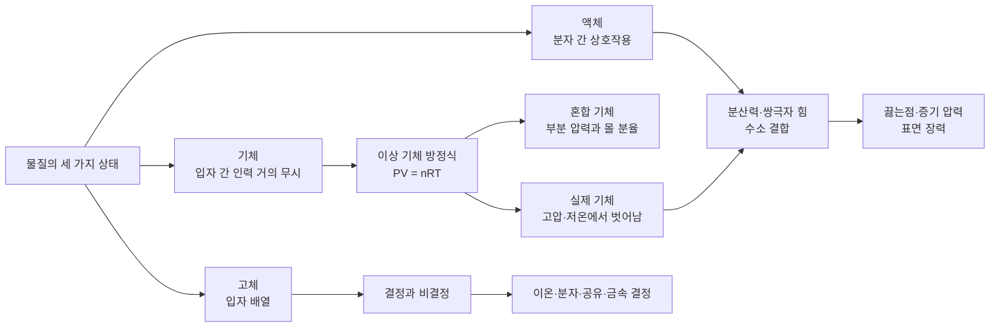

# 물질과 에너지 1. 물질의 세 가지 상태 — 기체·액체·고체를 하나의 눈으로 보기
<!-- prev: m1-04, m1-06, m2-01, 2-4, chem-1, chem-2 -->
<!-- next: matter-2, mech-2 -->

> [!NOTE]
> **성취기준**
> - **[12물에01-01]** 기체의 온도, 압력, 부피, 몰수 사이의 관계를 통합적으로 이해하고, 이상 기체 방정식을 근사적으로 활용하는 사례를 조사하여 화학의 유용함을 인식할 수 있다.
> - **[12물에01-02]** 혼합 기체의 부분 압력과 몰 분율의 관계를 알고, 일상생활에서 유용하게 사용되는 혼합 기체에 호기심을 가질 수 있다.
> - **[12물에01-03]** 물질이 액체로 존재할 수 있는 이유를 분자 간 상호작용으로 이해하고, 액체의 종류에 따라 끓는점이 달라짐을 설명할 수 있다.
> - **[12물에01-04]** 고체를 결정과 비결정으로 구분하고, 결정성 고체를 화학 결합의 종류에 따라 분류할 수 있다.

**학습 목표**

1. 보일 법칙, 샤를 법칙, 아보가드로 법칙을 하나로 묶어 이상 기체 방정식 $PV = nRT$를 이끌어 내고, 기체의 몰수·몰질량·밀도를 계산할 수 있다.
2. 이상 기체 방정식이 잘 맞는 조건과 잘 맞지 않는 조건을 분자의 크기와 분자 간 인력으로 설명할 수 있다.
3. 혼합 기체에서 부분 압력과 몰 분율의 관계($P_A = X_A P_{\text{전체}}$)를 이용하여 잠수용 기체, 고산 지대의 산소 등 생활 속 혼합 기체를 해석할 수 있다.
4. 분산력, 쌍극자–쌍극자 힘, 수소 결합으로 물질이 액체로 존재하는 이유와 액체마다 끓는점이 다른 이유를 설명할 수 있다.
5. 고체를 결정과 비결정으로 구분하고, 결정성 고체를 이온 결정·분자 결정·공유 결정·금속 결정으로 분류하여 성질과 연결할 수 있다.

**이 단원의 학습 사다리**

| 단계 | 무엇을 하나? |
|---|---|
| STEP 1. 이전 학습 다시 보기 | 중학교의 입자 모형·기체 법칙, 「화학」의 몰과 결합의 극성을 다시 꺼내 본다 |
| STEP 2. 기초 다지기 | 압력의 단위, 절대 온도, 몰, 비례식 다루기를 디딤돌로 놓는다 |
| STEP 3. 핵심 개념 | 기체 법칙 → 이상 기체 방정식 → 실제 기체 → 분압과 몰 분율 → 분자 간 상호작용과 액체 → 상태 그림 → 고체의 분류 |
| STEP 4. 오개념 바로잡기 | "수소 결합은 분자 안의 결합이다?" 같은 착각을 바로잡는다 |
| STEP 5. 대학 전공으로 | 반데르발스 식, 클라우지우스–클라페이롱 식, 결정 구조와 X선 회절 |
| STEP 6. 생활·산업·진로 | 에어백, 잠수용 혼합 기체, 반도체 공정 가스, 소재 산업 |

---

## 🗺️ 단원 들어가기

겨울 아침 자동차 계기판에 "타이어 공기압 낮음" 경고가 뜬다. 밤새 바람이 빠진 것일까? 아니다. 기온이 내려가면 타이어 속 기체 분자의 움직임이 느려져 압력이 떨어진 것이다. 해발 8800 m가 넘는 에베레스트 정상에서는 공기 중 산소의 비율이 해수면과 거의 같은데도 숨쉬기가 매우 힘들다. 왜일까?

물($\mathrm{H_2O}$, 분자량 18)은 상온에서 액체인데, 훨씬 무거운 이산화 탄소($\mathrm{CO_2}$, 분자량 44)는 기체이다. 같은 탄소로 이루어진 다이아몬드와 흑연, 같은 이산화 규소로 이루어진 수정과 유리는 성질이 전혀 다르다. 이 단원에서는 **입자 사이의 거리와 입자 사이에 작용하는 힘**이라는 두 가지 눈으로 기체·액체·고체를 차례로 살펴본다.

---

## STEP 1. 🔙 이전 학습 다시 보기

### 연계 개념표

| 이전 단원·성취기준 | 그때 배운 것 | 이 단원에서 확장되는 것 |
|---|---|---|
| 중1 「물질의 상태 변화」 [9과04-02] | 고체·액체·기체를 입자 사이 거리, 배열, 운동성으로 비교하는 입자 모형 | 입자 사이의 **인력의 종류와 세기**로 상태를 설명한다 |
| 중1 「기체의 성질」 [9과06-02], [9과06-03] | 압력이 커지면 부피가 줄고, 온도가 높아지면 부피가 커진다(정성적) | 보일·샤를·아보가드로 법칙을 **식으로 통합**한 이상 기체 방정식 |
| 중2 「물질의 특성」 [9과08-01] | 끓는점·녹는점은 물질마다 다른 고유한 특성이다 | 끓는점이 다른 **이유**를 분자 간 상호작용으로 설명한다 |
| 통합과학1 「이온 결합과 공유 결합」 [10통과1-02-04] | 이온 결합 물질과 공유 결합 물질의 전기 전도성 차이 | 화학 결합의 종류로 결정성 고체를 **네 가지로 분류**한다 |
| 화학 「화학의 언어」 [12화학01-02] | 질량·입자 수·기체 부피를 몰로 환산한다(0 °C, 1 atm에서 22.4 L) | 어떤 온도·압력에서도 쓸 수 있는 $n = \dfrac{PV}{RT}$ |
| 화학 「물질의 구조와 성질」 [12화학02-02], [12화학02-03] | 전기 음성도, 결합의 극성, 분자 구조와 극성 분자 | 극성 분자 사이의 쌍극자–쌍극자 힘, 수소 결합 |

### 준비 운동 (사전 진단)

**Q1.** 주사기 입구를 막고 피스톤을 눌러 기체의 부피를 절반으로 줄였다. 온도가 일정할 때 기체의 압력은 어떻게 되는가?

**Q2.** 0 °C, 1 atm에서 산소 기체 11.2 L는 몇 mol인가?

**Q3.** 다음 분자 중 극성 분자를 모두 고르시오.
ㄱ. $\mathrm{CO_2}$ ㄴ. $\mathrm{H_2O}$ ㄷ. $\mathrm{CH_4}$ ㄹ. $\mathrm{NH_3}$

**Q4.** 물이 끓을 때 끊어지는 것은 무엇인가? ① O–H 공유 결합 ② 물 분자 사이의 인력

정답 및 해설

**Q1.** 처음의 2배가 된다. 온도가 일정하면 압력과 부피는 반비례한다(보일 법칙). 같은 수의 입자가 절반의 공간에서 벽에 더 자주 충돌하기 때문이다.

**Q2.** 0.5 mol. 0 °C, 1 atm에서 기체 1 mol의 부피는 약 22.4 L이므로 $11.2 \div 22.4 = 0.5$이다.

**Q3.** ㄴ, ㄹ. $\mathrm{CO_2}$는 직선형, $\mathrm{CH_4}$는 정사면체형이어서 결합의 극성이 서로 상쇄된다. 굽은형인 $\mathrm{H_2O}$와 삼각뿔형인 $\mathrm{NH_3}$는 극성 분자이다.

**Q4.** ②. 끓음은 상태 변화(물리 변화)이므로 분자 자체는 그대로이고, **분자 사이의 인력**만 끊어진다. 수증기도 여전히 $\mathrm{H_2O}$ 분자이다.

---

## STEP 2. 🧱 기초 다지기

### ① 압력과 그 단위

**압력(pressure)** 은 단위 면적에 수직으로 작용하는 힘이다. 기체의 압력은 수많은 기체 분자가 벽에 충돌하면서 가하는 힘의 평균이다.

$$
P = \frac{F}{A}, \qquad 1\ \mathrm{Pa} = 1\ \mathrm{N/m^2}
$$

화학에서는 여러 단위를 함께 쓰므로 환산 관계를 익혀 두자: $1\ \mathrm{atm} = 760\ \mathrm{mmHg} \approx 101.3\ \mathrm{kPa} \approx 1.013\ \mathrm{bar}$. 혈압과 증기 압력 자료는 주로 mmHg, 기상 자료는 hPa, 공업용 압력계와 잠수 장비는 bar를 쓴다.

> [!TIP]
> 💡 **비유** — 기체의 압력은 '빗방울이 우산을 두드리는 세기'와 같다. 빗방울(분자)이 많을수록, 빠를수록 우산(벽)에 전해지는 힘이 커진다. 압력은 **입자 수**와 **입자의 빠르기(온도)** 로 정해진다.

### ② 절대 온도

기체 법칙에서는 반드시 **절대 온도(absolute temperature, K)** 를 쓴다.

$$
T(\mathrm{K}) = t(^\circ\mathrm{C}) + 273
$$

섭씨 온도로 계산하면 0 °C에서 부피가 0이 되는 이상한 결과가 나온다. 절대 온도는 입자의 평균 운동 에너지에 비례하는 온도이므로, 0 K은 이론상 입자 운동이 가장 작아지는 온도이다.

### ③ 몰과 몰 분율

- **몰(mole)**: $6.02\times10^{23}$개의 입자 묶음. 질량(g)을 몰질량(g/mol)으로 나누면 몰수가 된다.
- **몰 분율(mole fraction)**: 혼합물에서 한 성분의 몰수가 전체 몰수에서 차지하는 비율이다.

$$
X_A = \frac{n_A}{n_{\text{전체}}}, \qquad X_A + X_B + \cdots = 1
$$

몰 분율은 단위가 없는 수이다. 공기에서 질소의 몰 분율은 약 0.78, 산소는 약 0.21이다.

---

## STEP 3. 📘 핵심 개념

### ① 기체 법칙을 하나로 — 이상 기체 방정식

중학교에서 정성적으로 배운 관계를 실험 자료로 정리하면 다음 세 법칙이 된다.

| 법칙 | 일정한 것 | 관계 | 입자 모형으로 보면 |
|---|---|---|---|
| **보일 법칙(Boyle's law)** | $n$, $T$ | $P \propto \dfrac{1}{V}$, $PV = $ 일정 | 부피가 줄면 같은 입자가 벽에 더 자주 충돌한다 |
| **샤를 법칙(Charles's law)** | $n$, $P$ | $V \propto T$ | 온도가 높으면 입자가 빨라져 같은 압력을 유지하려면 공간이 넓어져야 한다 |
| **아보가드로 법칙(Avogadro's law)** | $P$, $T$ | $V \propto n$ | 같은 온도·압력에서 기체의 종류와 관계없이 같은 부피에 같은 수의 분자가 들어 있다 |

<!-- fig:matter-1-gas-law-graphs -->

세 관계를 합치면 $V \propto \dfrac{nT}{P}$이고, 비례 상수를 $R$로 두면 다음 식을 얻는다.

$$
\boxed{\;PV = nRT\;}
$$

이것이 **이상 기체 방정식(ideal gas equation)** 이고, $R$을 **기체 상수(gas constant)** 라고 한다.

$$
R = 0.082\ \mathrm{atm\cdot L/(mol\cdot K)} = 8.314\ \mathrm{J/(mol\cdot K)}
$$

0 °C(273 K), 1 atm에서 1 mol의 부피를 계산하면 $V = \dfrac{1\times0.082\times273}{1} \approx 22.4\ \mathrm{L}$이다. 「화학의 언어」에서 외웠던 22.4 L는 이 식의 한 가지 경우였던 셈이다. 25 °C(298 K), 1 atm에서는 약 24.4 L가 된다.

> [!IMPORTANT]
> 이상 기체 방정식의 네 변수 $P, V, n, T$ 중 **세 개를 알면 나머지 하나가 정해진다.** 기체의 상태는 이 네 양으로 완전히 기술된다. 단위를 $R$에 맞추는 것(atm, L, mol, K)을 잊지 말자.

#### 이상 기체 방정식이 알려 주는 여러 가지 양

몰수 $n = \dfrac{w}{M}$($w$: 질량, $M$: 몰질량)을 대입하면 기체의 **몰질량**과 **밀도**도 구할 수 있다.

$$
M = \frac{wRT}{PV}, \qquad d = \frac{w}{V} = \frac{PM}{RT}
$$

- 같은 온도·압력에서 기체의 밀도는 **몰질량에 비례**한다. 헬륨($M=4$) 풍선이 뜨고 이산화 탄소($M=44$)가 바닥에 깔리는 이유이다.
- 같은 기체라도 **온도가 높을수록 밀도가 작다.** 열기구가 뜨는 원리이다.

#### 예제 1 — 에어백을 채우는 기체의 양

초창기 자동차 에어백에는 아자이드화 나트륨($\mathrm{NaN_3}$, 몰질량 65 g/mol)이 분해되어 질소 기체를 내는 반응이 쓰였다.

$$
\mathrm{2NaN_3(s) \rightarrow 2Na(s) + 3N_2(g)}
$$

25 °C(298 K), 1.2 atm에서 60 L의 에어백을 채우려면 $\mathrm{NaN_3}$가 약 몇 g 필요한가?

**풀이**
① 필요한 질소의 몰수: $n = \dfrac{PV}{RT} = \dfrac{1.2\times60}{0.082\times298} \approx 2.95\ \mathrm{mol}$
② 반응식의 계수비 $\mathrm{NaN_3 : N_2 = 2 : 3}$이므로 $\mathrm{NaN_3}$는 $2.95\times\dfrac{2}{3} \approx 1.96\ \mathrm{mol}$
③ 질량: $1.96\times65 \approx 128\ \mathrm{g}$

약 130 g의 고체가 순식간에 60 L의 기체로 바뀐다. 실제 에어백에서는 남는 나트륨을 처리하는 반응이 함께 일어나도록 설계했으며, 오늘날에는 더 안전한 다른 기체 발생제도 쓰인다.

#### 예제 2 — 기체의 정체 밝히기

어떤 순수한 기체 1.00 L의 질량을 27 °C(300 K), 1.00 atm에서 측정하였더니 1.30 g이었다. 이 기체는 $\mathrm{CH_4}$, $\mathrm{N_2}$, $\mathrm{O_2}$, $\mathrm{CO_2}$ 중 무엇인가?

**풀이**

$$
M = \frac{wRT}{PV} = \frac{1.30\times0.082\times300}{1.00\times1.00} \approx 32.0\ \mathrm{g/mol}
$$

몰질량이 32 g/mol이므로 산소($\mathrm{O_2}$)이다. 이처럼 **질량·부피·온도·압력만 재면 눈에 보이지 않는 기체의 종류를 추론할 수 있다.** 이것이 탐구 활동 A의 원리이다.

#### 예제 3 — 열기구는 얼마나 뜰 수 있을까?

공기의 평균 몰질량을 29 g/mol이라 하자. 1 atm에서 27 °C(300 K) 바깥 공기와 100 °C(373 K)로 데운 열기구 속 공기의 밀도를 비교하시오.

**풀이**
- 바깥 공기: $d = \dfrac{1\times29}{0.082\times300} \approx 1.18\ \mathrm{g/L}$
- 데운 공기: $d = \dfrac{1\times29}{0.082\times373} \approx 0.95\ \mathrm{g/L}$

1 L마다 약 0.23 g 가볍다. $1\ \mathrm{m^3} = 1000\ \mathrm{L}$이므로 부피 $1\ \mathrm{m^3}$마다 약 230 g을 들어 올릴 수 있다. 사람과 바구니를 합쳐 수백 kg을 띄우려면 열기구의 부피가 수천 $\mathrm{m^3}$나 되어야 하는 이유이다.

#### 생활 속 '처음–나중' 문제: $\dfrac{P_1V_1}{T_1} = \dfrac{P_2V_2}{T_2}$

| 상황 | 일정한 것 | 변하는 것 | 결과 |
|---|---|---|---|
| 겨울철 타이어 공기압 경고 | $n$, $V$(거의) | $T$ 감소 | $P$ 감소 |
| 등산 중 부풀어 오른 과자 봉지 | $n$, $T$(거의) | 바깥 $P$ 감소 | $V$ 증가 |
| 뜨거운 물에 넣은 찌그러진 탁구공 | $n$, $P$(거의) | $T$ 증가 | $V$ 증가 → 펴진다 |
| 자전거 펌프로 바람 넣기 | $T$, $V$(거의) | $n$ 증가 | $P$ 증가 |

<!-- sim:ideal-gas -->

#### ✔ 바로 확인

1. (O/X) 기체 법칙으로 계산할 때는 섭씨 온도를 그대로 넣어도 된다.
2. 빈칸: 온도와 몰수가 일정할 때 기체의 부피를 3배로 늘리면 압력은 처음의 (    )배가 된다.
3. 27 °C, 1 atm에서 이상 기체 2.0 mol의 부피는 몇 L인가? ($R = 0.082\ \mathrm{atm\cdot L/(mol\cdot K)}$)
4. 고르기: 같은 온도·압력에서 밀도가 가장 큰 기체는? ① He ② $\mathrm{N_2}$ ③ $\mathrm{CO_2}$

정답

1. X — 반드시 절대 온도(K = °C + 273)를 쓴다.
2. 1/3 — 보일 법칙: $PV$가 일정하므로 압력과 부피는 반비례한다.
3. 49.2 L — $V = \dfrac{nRT}{P} = \dfrac{2.0\times0.082\times300}{1} = 49.2\ \mathrm{L}$
4. ③ — $d = \dfrac{PM}{RT}$이므로 같은 온도·압력에서 밀도는 몰질량(He 4, $\mathrm{N_2}$ 28, $\mathrm{CO_2}$ 44)에 비례한다.

### ② 이상 기체와 실제 기체 — '근사'의 의미

이상 기체 방정식은 두 가지 가정 위에 서 있다.

1. 기체 분자 자체의 부피는 기체 전체 부피에 비해 **무시할 만큼 작다.**
2. 기체 분자 사이에는 **인력이나 반발력이 작용하지 않는다.**

이 가정을 완벽히 만족하는 기체를 **이상 기체(ideal gas)** 라고 한다. 실제 기체는 분자의 크기도 있고 분자 사이에 인력도 있으므로, 이상 기체 방정식은 실제 기체에 대한 **근사식**이다.

| 조건 | 분자 사이 거리 | 이상 기체 방정식과의 일치 | 이유 |
|---|---|---|---|
| 낮은 압력, 높은 온도 | 매우 멀다 | 잘 맞는다 | 분자의 부피와 인력이 모두 무시할 만하다 |
| 높은 압력 | 가깝다 | 벗어난다 | 분자 자체의 부피가 무시할 수 없게 된다 |
| 낮은 온도(액화 직전) | 가깝고 느리다 | 벗어난다 | 분자 사이 인력의 영향이 커진다 |
| 분자 간 인력이 큰 기체($\mathrm{NH_3}$, $\mathrm{H_2O}$ 등) | — | 같은 조건에서도 더 벗어난다 | 극성이 커서 서로 끌어당긴다 |

0 °C, 1 atm에서 기체 1 mol의 실제 부피를 보면 차이를 확인할 수 있다(값은 대략적인 값이다).

| 기체 | 1 mol의 부피(L) | 이상 기체 값과의 차이 |
|---|---|---|
| He | 약 22.43 | 거의 없다 |
| $\mathrm{N_2}$ | 약 22.40 | 거의 없다 |
| $\mathrm{CO_2}$ | 약 22.26 | 약간 작다 |
| $\mathrm{NH_3}$ | 약 22.1 | 더 작다 |

인력이 큰 분자일수록 서로 끌어당겨 부피가 이상 기체보다 작아진다. 그래도 차이가 1~2 % 정도에 불과하므로, **상온·상압에서는 대부분의 기체에 이상 기체 방정식을 근사적으로 사용해도 충분하다.**

> [!TIP]
> 💡 **비유** — 이상 기체는 '서로 모르는 사람들이 넓은 운동장에 흩어져 걷는 모습'이다. 운동장이 넓으면(저압) 사람의 몸집(분자 부피)은 문제가 되지 않고, 바쁘게 걸으면(고온) 아는 사람끼리 멈춰서 이야기하지도(인력) 않는다. 그런데 좁은 복도(고압)나 한가한 쉬는 시간(저온)이 되면 몸집과 친분이 무시할 수 없게 된다.

#### 이상 기체 방정식을 근사적으로 활용하는 사례

| 분야 | 활용 내용 |
|---|---|
| 기상 관측 | 라디오존데(기상 관측 풍선)가 높이 오를수록 바깥 압력이 줄어 부피가 커진다. 풍선이 터지는 고도를 예측한다 |
| 의료 | 산소통 압력과 부피로 남은 산소의 양과 사용 가능 시간을 계산한다 |
| 화학 공정 | 반응기에 넣을 기체의 몰수를 압력·온도 측정으로 조절한다 |
| 잠수 | 공기통의 압력으로 남은 공기량을 계산하고, 깊이에 따른 폐 속 공기 부피 변화를 예측한다 |
| 자동차·항공 | 타이어 압력 감지 장치, 고도에 따른 기내 압력 관리 |
| 실험실 | 기체의 몰질량 측정, 기체 발생 반응의 수득량 계산 |

#### ✔ 바로 확인

1. (O/X) 이상 기체는 분자 사이에 인력이 없고, 분자 자체의 부피를 무시할 수 있는 기체이다.
2. 고르기: 실제 기체가 이상 기체에서 더 크게 벗어나는 조건은? (가) 낮은 압력·높은 온도 (나) 높은 압력·낮은 온도
3. 빈칸: 0 °C, 1 atm에서 $\mathrm{NH_3}$ 1 mol의 부피가 22.4 L보다 작은 것은 분자 사이의 (    )이 커서 서로 끌어당기기 때문이다.

정답

1. O — 이상 기체 방정식이 서 있는 두 가정이다.
2. (나) — 고압에서는 분자 자체의 부피, 저온에서는 분자 간 인력을 무시할 수 없다.
3. 인력 — 극성이 큰 분자일수록 서로 끌어당겨 부피가 이상 기체보다 작아진다.

### ③ 혼합 기체의 부분 압력과 몰 분율

공기, 숨 쉴 때 내뱉는 날숨, 용접에 쓰는 보호 가스는 모두 여러 기체가 섞인 **혼합 기체**이다. 이상 기체에서는 분자 사이에 상호작용이 없으므로, 섞인 기체들은 **서로를 신경 쓰지 않고 각자 혼자 있는 것처럼** 행동한다.

**부분 압력(partial pressure, 분압)** 은 혼합 기체의 한 성분이 같은 온도에서 혼합 기체 전체 부피를 혼자 차지할 때 나타내는 압력이다. 돌턴은 혼합 기체의 전체 압력이 각 성분 기체의 부분 압력의 합과 같다는 것을 밝혔다(**돌턴의 부분 압력 법칙**, Dalton's law of partial pressures).

$$
P_{\text{전체}} = P_A + P_B + P_C + \cdots
$$

각 성분에 대해 $P_A = \dfrac{n_A RT}{V}$이고 전체에 대해 $P_{\text{전체}} = \dfrac{n_{\text{전체}} RT}{V}$이므로, 두 식을 나누면 다음 관계가 나온다.

$$
\frac{P_A}{P_{\text{전체}}} = \frac{n_A}{n_{\text{전체}}} = X_A
\qquad\Longrightarrow\qquad
\boxed{\;P_A = X_A\,P_{\text{전체}}\;}
$$

**부분 압력은 몰 분율에 비례한다.** 같은 온도·압력에서 부피비는 몰수비와 같으므로, 기체의 부피 백분율(%)은 곧 몰 분율이다.

<!-- fig:matter-1-partial-pressure -->

> [!TIP]
> 💡 **비유** — 혼합 기체의 전체 압력은 '반 전체가 박수 치는 소리', 부분 압력은 '그중 한 모둠이 내는 박수 소리'이다. 학생 30명 중 6명인 모둠(몰 분율 0.2)이 내는 소리는 전체의 20 %이다. 반 전체가 더 세게 치면(전체 압력 증가) 그 모둠의 소리도 같은 비율로 커진다.

> [!NOTE]
> **수상 치환으로 모은 기체**에는 수증기가 섞여 있다. 25 °C에서 전체 압력 1.000 atm으로 수소를 모았다면 물의 증기 압력(약 0.031 atm)을 빼서 $P_{\mathrm{H_2}} = 1.000 - 0.031 = 0.969\ \mathrm{atm}$을 써야 한다(탐구 활동 A).

#### 깊이와 높이에 따라 달라지는 산소의 부분 압력

우리 몸이 느끼는 것은 산소의 '비율'이 아니라 **산소의 부분 압력**이다. 폐에서 혈액으로 산소가 녹아 들어가는 정도가 부분 압력에 따라 정해지기 때문이다.

| 장소 | 전체 압력(약) | 산소 몰 분율 | 산소 부분 압력(약) | 몸에 미치는 영향 |
|---|---|---|---|---|
| 해수면 | 1 atm | 0.21 | 0.21 atm | 정상 |
| 에베레스트 정상 | 0.33 atm | 0.21 | 0.07 atm | 심한 저산소, 대부분 산소통 필요 |
| 수심 10 m | 2 atm | 0.21 | 0.42 atm | 잠수 가능 |
| 수심 30 m | 4 atm | 0.21 | 0.84 atm | 질소 부분 압력이 높아 질소 마취 위험 |
| 수심 60 m | 7 atm | 0.21 | 1.47 atm | 산소 중독 위험이 커지는 범위 |

물속에서는 약 10 m 깊어질 때마다 압력이 약 1 atm씩 커진다. 그래서 깊이 잠수할 때는 산소나 질소의 몰 분율을 조절한 혼합 기체를 쓴다.

| 생활 속 혼합 기체 | 주요 성분 | 몰 분율을 조절하는 이유 |
|---|---|---|
| 나이트록스(nitrox) | 산소 비율을 공기보다 높인 산소+질소 | 질소 부분 압력을 낮춰 감압병 위험을 줄인다(대신 깊이 제한) |
| 헬리옥스(heliox), 트라이믹스 | 헬륨+산소(+질소) | 깊은 수심에서 산소·질소의 부분 압력을 안전한 범위로 낮춘다 |
| 과자 봉지 충전 기체 | 주로 질소 | 산소 부분 압력을 낮춰 산화(눅눅해짐·산패)를 늦춘다 |
| 용접 보호 가스 | 아르곤+이산화 탄소 등 | 녹은 금속이 공기 중 산소와 반응하지 않게 막는다 |
| 액화 석유 가스(LPG) | 프로페인+뷰테인 | 계절에 따라 비율을 바꿔 겨울에도 잘 기화되게 한다 |
| 의료용 마취 기체 | 산소+마취 기체 | 마취 기체의 부분 압력으로 마취 깊이를 조절한다 |

#### 예제 4 — 나이트록스

산소 32 %, 질소 68 %(부피 백분율)인 나이트록스로 수심 30 m(전체 압력 4.0 atm)까지 잠수하였다. 산소와 질소의 부분 압력을 구하고, 같은 깊이에서 공기(산소 21 %, 질소 79 %로 가정)를 쓸 때와 비교하시오.

**풀이**
- 나이트록스: $P_{\mathrm{O_2}} = 0.32\times4.0 = 1.28\ \mathrm{atm}$, $P_{\mathrm{N_2}} = 0.68\times4.0 = 2.72\ \mathrm{atm}$
- 공기: $P_{\mathrm{O_2}} = 0.21\times4.0 = 0.84\ \mathrm{atm}$, $P_{\mathrm{N_2}} = 0.79\times4.0 = 3.16\ \mathrm{atm}$

나이트록스는 질소 부분 압력을 낮추지만 산소 부분 압력이 높아지므로, 산소 중독을 피하려면 내려갈 수 있는 최대 깊이가 공기보다 얕아진다. 혼합 기체는 **목적에 따라 몰 분율을 설계하는 기술**이다.

#### ✔ 바로 확인

1. 빈칸: 혼합 기체의 전체 압력은 각 성분 기체의 (    )의 합과 같다.
2. 질소 0.8 mol과 산소 0.2 mol이 섞인 혼합 기체의 전체 압력이 5.0 atm이다. 질소의 부분 압력은?
3. (O/X) 에베레스트 정상에서 숨쉬기 어려운 것은 공기 중 산소의 몰 분율이 0.21보다 크게 줄어들기 때문이다.

정답

1. 부분 압력 — 돌턴의 부분 압력 법칙이다.
2. 4.0 atm — $X_{\mathrm{N_2}} = 0.8$이므로 $P_{\mathrm{N_2}} = 0.8\times5.0 = 4.0\ \mathrm{atm}$
3. X — 몰 분율은 거의 같고, 전체 압력이 낮아 산소의 부분 압력이 작기 때문이다.

### ④ 액체는 왜 존재할까? — 분자 간 상호작용

기체 분자는 운동 에너지가 커서 서로의 인력을 뿌리치고 흩어진다. 온도가 낮아져 분자의 운동 에너지가 **분자 사이의 인력**보다 작아지면, 분자들은 서로 붙어 있으면서도 자리를 바꾸며 움직이는 **액체**가 된다. 즉, 물질이 액체로 존재할 수 있는 것은 **분자 간 상호작용(intermolecular interaction)** 덕분이다.

> [!IMPORTANT]
> **분자 간 상호작용**은 분자와 분자 **사이**의 인력이고, **공유 결합**은 분자 **안**에서 원자끼리 전자쌍을 공유하는 결합이다. 분자 간 상호작용은 공유 결합보다 훨씬 약하다(대체로 수십 분의 1 이하). 액체가 끓을 때 끊어지는 것은 분자 간 상호작용뿐이다.

#### (1) 분산력 — 모든 분자에 있는 힘

전자는 원자핵 주위를 끊임없이 움직이므로, 무극성 분자라도 어느 순간 전자가 한쪽으로 쏠려 **순간 쌍극자**가 생긴다. 이 순간 쌍극자가 이웃 분자의 전자 구름을 밀고 당겨 **유발 쌍극자**를 만들고, 둘 사이에 약한 인력이 생긴다. 이것을 **분산력(dispersion force, 런던 분산력)** 이라고 한다.

- 모든 분자 사이에 작용한다(무극성 분자 사이에는 사실상 이것뿐이다).
- 분자가 크고 전자 수가 많을수록(대체로 분자량이 클수록) 전자 구름이 잘 일그러져 분산력이 커진다.
- 분자 모양이 길쭉하여 접촉 면적이 넓을수록 커진다.

| 할로젠 | 분자량 | 끓는점(°C, 약) | 실온 상태 |
|---|---|---|---|
| $\mathrm{F_2}$ | 38 | −188 | 기체 |
| $\mathrm{Cl_2}$ | 71 | −34 | 기체 |
| $\mathrm{Br_2}$ | 160 | 59 | 액체 |
| $\mathrm{I_2}$ | 254 | 184 | 고체 |

모두 무극성 분자이지만 분자량이 커지면서 분산력이 커져, 기체 → 액체 → 고체로 상태가 바뀐다.

| 알케인 | 분자식 | 끓는점(°C, 약) | 쓰임 |
|---|---|---|---|
| 메테인 | $\mathrm{CH_4}$ | −162 | 도시가스(LNG) |
| 프로페인 | $\mathrm{C_3H_8}$ | −42 | LPG |
| 뷰테인 | $\mathrm{C_4H_{10}}$ | −1 | 휴대용 가스 |
| 헥세인 | $\mathrm{C_6H_{14}}$ | 69 | 용매 |
| 옥테인 | $\mathrm{C_8H_{18}}$ | 126 | 휘발유 성분 |

**분자 모양의 효과**: 분자식이 $\mathrm{C_5H_{12}}$로 같은 펜테인 중 사슬 모양인 노말펜테인의 끓는점은 약 36 °C, 공처럼 둥근 네오펜테인은 약 10 °C이다. 둥근 분자는 서로 닿는 면적이 작아 분산력이 약하기 때문이다.

#### (2) 쌍극자–쌍극자 힘 — 극성 분자 사이의 힘

극성 분자는 한쪽이 부분적인 양전하($\delta^+$), 다른 쪽이 부분적인 음전하($\delta^-$)를 띤 **영구 쌍극자**이다. 극성 분자들은 $\delta^+$와 $\delta^-$가 마주 보도록 늘어서며 서로 끌어당기는데, 이를 **쌍극자–쌍극자 힘(dipole–dipole force)** 이라고 한다.

분자량이 비슷하면 극성 분자가 무극성 분자보다 끓는점이 높다. 예를 들어 분자량이 비슷한 $\mathrm{F_2}$(38, 무극성)의 끓는점은 약 −188 °C이지만 $\mathrm{HCl}$(36.5, 극성)은 약 −85 °C이다.

#### (3) 수소 결합 — 특별히 강한 분자 간 상호작용

수소가 전기 음성도가 매우 큰 **F, O, N**에 직접 결합하면, 수소의 전자가 크게 끌려가 수소 원자핵이 거의 드러난다. 이 수소가 이웃 분자의 F, O, N에 있는 비공유 전자쌍에 강하게 끌리는데, 이를 **수소 결합(hydrogen bond)** 이라고 한다.

$$
\mathrm{O{-}H\cdots O}, \quad \mathrm{N{-}H\cdots O}, \quad \mathrm{F{-}H\cdots F}
$$

(실선은 분자 안의 공유 결합, 점선은 분자 사이의 수소 결합이다.) 수소 결합은 분자 간 상호작용 중 가장 강하지만, 여전히 공유 결합보다는 훨씬 약하다.

<!-- fig:matter-1-imf-types -->

#### 수소 화합물의 끓는점 — 세 가지 힘을 한 그래프로

14족~17족 원소의 수소 화합물의 끓는점(°C, 약)을 주기별로 정리하면 다음과 같다.

| 주기 | 14족 | 15족 | 16족 | 17족 |
|---|---|---|---|---|
| 2 | $\mathrm{CH_4}$ −162 | $\mathrm{NH_3}$ −33 | $\mathrm{H_2O}$ 100 | $\mathrm{HF}$ 20 |
| 3 | $\mathrm{SiH_4}$ −112 | $\mathrm{PH_3}$ −88 | $\mathrm{H_2S}$ −60 | $\mathrm{HCl}$ −85 |
| 4 | $\mathrm{GeH_4}$ −88 | $\mathrm{AsH_3}$ −62 | $\mathrm{H_2Se}$ −41 | $\mathrm{HBr}$ −67 |
| 5 | $\mathrm{SnH_4}$ −52 | $\mathrm{SbH_3}$ −17 | $\mathrm{H_2Te}$ −2 | $\mathrm{HI}$ −35 |

이 표를 꺾은선 그래프(가로축: 주기, 세로축: 끓는점, 족마다 선 하나)로 그리면 세 가지를 읽을 수 있다.

1. **14족**은 모두 무극성 분자이므로 주기가 커질수록(분자량 증가 → 분산력 증가) 끓는점이 고르게 높아진다.
2. **15~17족**의 3~5주기도 같은 경향을 보인다. 같은 주기에서 14족보다 끓는점이 높은 것은 극성 분자이기 때문이다.
3. **2주기의 $\mathrm{NH_3}$, $\mathrm{H_2O}$, $\mathrm{HF}$만 예외적으로 높다.** 분자량이 가장 작은데도 끓는점이 가장 높거나 높은 편인 것은 **수소 결합** 때문이다. 경향대로라면 물의 끓는점은 약 −80 °C 근처였을 것이고, 지구의 물은 대부분 수증기였을 것이다.

<!-- fig:matter-1-hydride-bp -->

> [!TIP]
> 💡 **비유** — 분산력은 '정전기로 살짝 달라붙는 비닐', 쌍극자–쌍극자 힘은 '약한 냉장고 자석', 수소 결합은 '찍찍이(벨크로)'이다. 모두 떼어 낼 수 있지만(끓음) 떼는 데 필요한 힘이 다르다. 반면 공유 결합은 '용접'에 해당한다.

#### 예제 5

분자식이 $\mathrm{C_2H_6O}$로 같은 에탄올($\mathrm{CH_3CH_2OH}$)의 끓는점은 약 78 °C, 다이메틸 에터($\mathrm{CH_3OCH_3}$)의 끓는점은 약 −24 °C이다. 그 이유를 설명하시오.

**풀이** 두 물질은 분자량이 46으로 같아 분산력은 비슷하다. 에탄올에는 O에 직접 결합한 H(–OH)가 있어 분자 사이에 **수소 결합**을 이룬다. 다이메틸 에터의 H는 모두 C에 결합해 있어 분자 사이에 수소 결합을 이루지 못한다(극성은 있어 쌍극자–쌍극자 힘은 작용한다). 따라서 에탄올의 끓는점이 100 °C 이상 높다.

#### 분자 간 상호작용과 액체의 성질

| 성질 | 뜻 | 분자 간 상호작용이 클수록 | 생활 속 예 |
|---|---|---|---|
| **증기 압력(vapor pressure)** | 일정 온도에서 액체와 평형을 이룬 증기의 압력 | 작다 | 에터·아세톤은 증기 압력이 커서 금방 날아간다 |
| **끓는점(boiling point)** | 증기 압력이 외부 압력과 같아지는 온도 | 높다 | 물 100 °C, 에탄올 78 °C |
| **표면 장력(surface tension)** | 액체 표면을 최소로 줄이려는 힘 | 크다 | 소금쟁이, 물방울이 둥근 이유 |
| **점성(viscosity)** | 흐름에 저항하는 정도 | 대체로 크다 | 글리세롤·꿀은 끈적하다 |
| **기화열(heat of vaporization)** | 액체 1 mol(또는 1 g)을 기화시키는 데 드는 열 | 크다 | 땀이 마르면 시원하다 |

20 °C에서 증기 압력은 다이에틸 에터가 약 440 mmHg, 에탄올이 약 44 mmHg, 물이 약 17.5 mmHg이다. 증기 압력이 큰 액체일수록 더 낮은 온도에서 외부 압력(760 mmHg)에 도달하므로 끓는점이 낮다(다이에틸 에터 약 35 °C).

<!-- fig:matter-1-vapor-pressure -->

> [!NOTE]
> 끓는점은 **외부 압력에 따라 달라진다.** 높은 산에서는 대기압이 낮아 물이 100 °C보다 낮은 온도에서 끓고(에베레스트 정상 근처에서는 약 70 °C), 압력솥은 내부 압력을 높여 물의 끓는점을 약 120 °C까지 올린다. 그래서 물질의 끓는점은 보통 1 atm에서의 값(기준 끓는점)으로 비교한다.

<!-- photo:matter-1-kettle-pressure-cooker -->

<!-- fig:matter-1-surface-tension -->

#### ✔ 바로 확인

1. 짝짓기: 액체 상태의 물질과, 그 분자 사이에 작용하는 가장 특징적인 힘을 이으시오.
   ㄱ. $\mathrm{Br_2}$ ㄴ. $\mathrm{HCl}$ ㄷ. $\mathrm{HF}$ — A. 분산력 B. 쌍극자–쌍극자 힘 C. 수소 결합
2. (O/X) 분자량이 비슷하면 극성 분자가 무극성 분자보다 끓는점이 높다.
3. 고르기: 20 °C에서 증기 압력이 가장 큰 액체는? ① 물 ② 에탄올 ③ 다이에틸 에터
4. 빈칸: 분자 간 상호작용이 클수록 표면 장력은 (    )지고, 증기 압력은 (    )진다.

정답

1. ㄱ–A, ㄴ–B, ㄷ–C — $\mathrm{Br_2}$는 무극성, $\mathrm{HCl}$은 극성, $\mathrm{HF}$는 F에 결합한 H가 있다.
2. O — 분산력이 비슷할 때 극성 분자는 쌍극자–쌍극자 힘이 더해진다($\mathrm{F_2}$ −188 °C, $\mathrm{HCl}$ −85 °C).
3. ③ — 분자 간 상호작용이 가장 약해 증기 압력이 약 440 mmHg로 가장 크다.
4. 커, 작아 — 표면 분자가 안쪽으로 세게 당겨지고, 액체에서 빠져나가는 분자는 줄어든다.

### ⑤ 온도와 압력에 따라 달라지는 상태 — 상평형 그림

같은 물질도 온도와 압력에 따라 기체·액체·고체 중 어느 상태로 존재할지가 달라진다. 가로축을 온도, 세로축을 압력으로 하여 각 상태가 안정한 영역을 나타낸 것이 **상평형 그림(phase diagram)** 이다.

물의 상평형 그림을 말로 그려 보면 다음과 같다.
- 왼쪽 위(저온·고압)는 **고체**, 가운데는 **액체**, 오른쪽 아래(고온·저압)는 **기체** 영역이다.
- 세 영역을 가르는 세 곡선은 각각 융해 곡선(고체–액체), 증기 압력 곡선(액체–기체), 승화 곡선(고체–기체)이다. 곡선 위에서는 두 상태가 함께 존재한다.
- 세 곡선이 만나는 **삼중점(triple point)** 에서는 세 상태가 함께 존재한다. 물의 삼중점은 약 0.01 °C, 0.006 atm이다.
- 물의 융해 곡선은 **왼쪽으로 기울어져** 있다. 압력을 높이면 얼음이 녹는점이 조금 낮아진다. 얼음이 물보다 밀도가 작은 특이한 성질 때문이다(「용액의 성질」에서 다룬다).

| 물질 | 삼중점(약) | 1 atm에서 일어나는 일 | 생활 예 |
|---|---|---|---|
| 물 | 0.01 °C, 0.006 atm | 0 °C에서 융해, 100 °C에서 끓음 | 대기압이 삼중점보다 커서 액체 물이 존재한다 |
| 이산화 탄소 | −57 °C, 5.1 atm | 액체가 되지 않고 −78 °C에서 **승화** | 드라이아이스. 액체 $\mathrm{CO_2}$를 만들려면 5.1 atm보다 큰 압력이 필요하다 |

<!-- fig:matter-1-water-phase -->

#### ✔ 바로 확인

1. (O/X) 상평형 그림에서 곡선 위의 점에서는 두 상태가 함께 존재한다.
2. 빈칸: 고체·액체·기체 세 상태가 함께 존재하는 온도와 압력의 점을 (    )이라고 한다.
3. 1 atm에서 드라이아이스를 가열하면 액체가 되지 않고 바로 기체가 된다. 그 까닭을 삼중점으로 설명하시오.
4. 0 °C, 1 atm의 얼음에 온도를 그대로 두고 압력을 크게 높이면 어떤 상태가 되는가?

정답

1. O — 융해·증기 압력·승화 곡선은 두 상태의 경계이다.
2. 삼중점 — 물은 약 0.01 °C, 0.006 atm이다.
3. 1 atm이 $\mathrm{CO_2}$의 삼중점 압력(5.1 atm)보다 낮아, 그 압력에서는 액체 영역을 지나지 않고 고체에서 기체로 바로 승화한다.
4. 액체(물) — 물의 융해 곡선이 왼쪽으로 기울어 있어, 압력을 높이면 녹는점이 0 °C보다 낮아진다.

### ⑥ 고체의 분류 — 결정과 비결정

고체 입자는 제자리에서 진동할 뿐 자리를 바꾸지 못한다. 고체는 입자 배열의 규칙성에 따라 두 가지로 나뉜다.

| 구분 | **결정성 고체(crystalline solid)** | **비결정성 고체(amorphous solid)** |
|---|---|---|
| 입자 배열 | 3차원으로 **규칙적**으로 반복된다 | **불규칙**하다(액체가 굳은 듯한 배열) |
| 겉모양 | 일정한 각을 이루는 평평한 면(결정면)이 나타나기 쉽다 | 특정한 모양 없이 깨지면 곡면이 생긴다 |
| 녹는점 | **일정한 녹는점**이 있다 | 일정한 녹는점 없이 온도 범위에 걸쳐 서서히 물러진다 |
| 예 | 얼음, 소금, 설탕, 수정, 다이아몬드, 금속 | 유리, 대부분의 플라스틱, 고무, 엿, 비정질 실리콘 |

수정과 유리는 모두 주성분이 이산화 규소($\mathrm{SiO_2}$)이지만, 수정은 $\mathrm{SiO_4}$ 사면체가 규칙적으로 이어진 결정이고, 유리는 녹은 상태를 빠르게 식혀 불규칙한 배열이 그대로 굳은 비결정이다. 유리 공예가가 유리를 녹는점 없이 서서히 물렁해지는 상태에서 불어 모양을 만들 수 있는 것은 유리가 비결정이기 때문이다.

<!-- fig:matter-1-crystal-amorphous -->

> [!TIP]
> 💡 **비유** — 결정은 '운동장에 줄 맞춰 선 학생들', 비결정은 '쉬는 시간에 운동장에 멈춰 선 학생들'이다. 줄 맞춰 선 학생들은 신호(녹는점) 하나에 한꺼번에 흩어지지만, 제멋대로 선 학생들은 가장자리부터 조금씩 흩어진다.

#### 결정성 고체를 화학 결합의 종류로 분류하기

결정을 이루는 입자가 무엇이고, 입자를 붙잡는 힘이 무엇인지에 따라 결정성 고체를 네 가지로 나눈다. (결정 안에서 입자가 어떤 기하학적 구조로 쌓이는지는 이 과목에서 다루지 않는다.)

| 구분 | **이온 결정** | **분자 결정** | **공유 결정**(원자 결정) | **금속 결정** |
|---|---|---|---|---|
| 구성 입자 | 양이온과 음이온 | 분자 | 원자 | 금속 양이온과 자유 전자 |
| 입자 사이의 힘 | 이온 결합(정전기적 인력) | 분자 간 상호작용 | 공유 결합(그물처럼 연결) | 금속 결합 |
| 녹는점 | 높다 | 낮다 | 매우 높다 | 대체로 높다(범위가 넓다) |
| 단단함 | 단단하지만 힘을 주면 쪼개진다 | 무르다 | 매우 단단하다(흑연은 예외) | 펴지고 늘어난다(연성·전성) |
| 전기 전도성 | 고체 ×, 액체·수용액 ○ | × | ×(흑연은 ○) | 고체·액체 ○ |
| 예 | $\mathrm{NaCl}$, $\mathrm{CaF_2}$, $\mathrm{MgO}$ | 얼음, 드라이아이스, 아이오딘, 설탕, 나프탈렌 | 다이아몬드, 흑연, 수정($\mathrm{SiO_2}$), 탄화 규소($\mathrm{SiC}$) | 철, 구리, 나트륨, 금 |

몇 가지 물질의 녹는점(°C, 약)을 비교하면 결합의 세기 차이가 드러난다.

| 결정 | 물질 | 녹는점(°C, 약) | 녹을 때 끊어지는 것 |
|---|---|---|---|
| 분자 결정 | 드라이아이스($\mathrm{CO_2}$) | −78(승화) | 분산력 |
| 분자 결정 | 얼음($\mathrm{H_2O}$) | 0 | 수소 결합 |
| 분자 결정 | 나프탈렌 | 80 | 분산력 |
| 금속 결정 | 나트륨 | 98 | 금속 결합(약함) |
| 이온 결정 | 염화 나트륨 | 801 | 이온 결합 |
| 금속 결정 | 철 | 1538 | 금속 결합 |
| 공유 결정 | 수정($\mathrm{SiO_2}$) | 약 1700 | 공유 결합 |
| 공유 결정 | 다이아몬드 | 3500 이상(압력에 따라 다름) | 공유 결합 |

> [!IMPORTANT]
> 분자 결정이 녹을 때는 **분자 간 상호작용**만 끊어지고 분자는 그대로이다. 공유 결정이 녹으려면 **공유 결합 자체**를 끊어야 한다. 같은 '공유 결합 물질'이라도 얼음(분자 결정)과 수정(공유 결정)의 녹는점이 1700 °C 가까이 차이 나는 이유이다.

<!-- sim:crystal-types -->

#### 예제 6 — 미지의 고체 분류하기

다음은 고체 A~D의 성질이다. 각각을 결정의 종류로 분류하시오.

| 고체 | 녹는점 | 고체의 전기 전도성 | 액체의 전기 전도성 | 기타 |
|---|---|---|---|---|
| A | 약 2700 °C 이상 | × | × | 물에 녹지 않고 매우 단단하다 |
| B | 약 800 °C | × | ○ | 물에 잘 녹고, 망치로 치면 쪼개진다 |
| C | 약 1080 °C | ○ | ○ | 두드리면 얇게 펴진다 |
| D | 약 80 °C | × | × | 특유의 냄새가 나고 상온에서 서서히 승화한다 |

**풀이** A는 녹는점이 매우 높고 전기가 통하지 않으므로 **공유 결정**(예: 탄화 규소), B는 고체에서는 전기가 통하지 않지만 액체에서 통하므로 **이온 결정**(예: 염화 나트륨), C는 고체에서도 전기가 통하고 연성·전성이 있으므로 **금속 결정**(예: 구리), D는 녹는점이 낮고 승화하므로 **분자 결정**(예: 나프탈렌)이다.

#### ✔ 바로 확인

1. (O/X) 유리는 일정한 녹는점이 있다.
2. 짝짓기: 다이아몬드, 구리, 염화 나트륨, 아이오딘을 각각 공유 결정, 금속 결정, 이온 결정, 분자 결정 중 하나와 이으시오.
3. 고체 상태에서는 전기가 통하지 않지만 녹이면 전기가 통하는 결정은 무엇인가?
4. 빈칸: 분자 결정이 녹을 때 끊어지는 것은 (    )이고, 공유 결정이 녹을 때 끊어지는 것은 (    )이다.

정답

1. X — 유리는 비결정성 고체여서 온도 범위에 걸쳐 서서히 물러진다.
2. 다이아몬드–공유 결정, 구리–금속 결정, 염화 나트륨–이온 결정, 아이오딘–분자 결정
3. 이온 결정 — 녹으면 이온이 자유롭게 움직일 수 있다.
4. 분자 간 상호작용, 공유 결합 — 그래서 공유 결정의 녹는점이 훨씬 높다.

---

## STEP 4. ⚠️ 오개념 바로잡기

| 흔한 오개념 | 올바른 개념 | 왜 그럴까? |
|---|---|---|
| 기체 법칙에 섭씨 온도를 그대로 넣어도 된다 | 반드시 **절대 온도(K)** 를 쓴다 | 부피와 압력은 입자의 평균 운동 에너지에 비례하며, 이는 절대 온도에 비례한다. 0 °C를 넣으면 부피가 0이 되는 모순이 생긴다 |
| 이상 기체 방정식은 모든 조건에서 정확하다 | **저압·고온**에서 잘 맞는 근사식이다 | 고압에서는 분자 자체의 부피, 저온에서는 분자 간 인력을 무시할 수 없다 |
| 혼합 기체에서 무거운 기체가 부분 압력이 더 크다 | 부분 압력은 질량이 아니라 **몰 분율**에 비례한다 | 이상 기체의 압력은 분자의 종류와 관계없이 분자 수에 의해 정해진다 |
| 높은 산에서 숨이 찬 것은 공기 중 산소 비율이 줄기 때문이다 | 산소의 몰 분율은 거의 같고, **전체 압력이 낮아 산소 부분 압력이 작기** 때문이다 | 대기의 성분비는 고도 약 80 km까지 거의 일정하다 |
| 물이 끓을 때 생기는 거품은 수소와 산소 기체이다 | 거품은 **수증기**이다 | 끓음은 분자 간 상호작용이 끊어지는 물리 변화이며, O–H 공유 결합은 그대로이다 |
| 수소 결합은 분자 안에서 수소와 산소 사이의 결합이다 | 수소 결합은 **한 분자의 H와 다른 분자의 F·O·N 사이**의 분자 간 상호작용이다 | 이름에 '결합'이 붙었지만 공유 결합보다 훨씬 약한 분자 사이의 인력이다 |
| 공유 결합 물질은 모두 녹는점이 낮다 | **분자 결정**은 녹는점이 낮지만 **공유 결정**은 매우 높다 | 분자 결정은 분자 사이 힘만 끊으면 되지만, 공유 결정은 공유 결합을 끊어야 한다 |

---

## STEP 5. 🎓 다음 단계로 한 걸음 더

> [!CAUTION]
> 이 절은 **고등학교 교육과정 범위 밖의 심화 내용**으로 평가 대상이 아니다. 특히 결정 구조(단위 세포, 배위수 등)는 이 과목에서 다루지 않으며, 대학에서 어떻게 확장되는지 맛보기로만 소개한다.

### 대학 전공 과목과의 연결

| 대학 과목 | 이어지는 내용 |
|---|---|
| 일반화학 | 실제 기체 방정식, 기체 분자 운동론, 분자 간 힘, 결정 구조의 기초 |
| 물리화학 | 상평형과 클라우지우스–클라페이롱 식, 통계 열역학으로 보는 기체 |
| 무기화학·고체화학 | 결정 구조(단위 세포), 격자 에너지, X선 회절 |
| 화학공학 열역학 | 실제 기체의 상태 방정식, 압축 인자, 기액 평형 설계 |
| 재료공학 | 결정·비정질 재료, 결함, 상변태 |

### ① 실제 기체를 위한 식 — 반데르발스 방정식

STEP 3의 두 가정(분자 부피 무시, 인력 무시)을 보정한 식이다.

$$
\left(P + \frac{an^2}{V^2}\right)(V - nb) = nRT
$$

$b$는 분자 자체의 부피를 빼 주는 보정, $a$는 분자 간 인력 때문에 벽을 덜 세게 치는 효과를 더해 주는 보정이다. $a$가 큰 기체일수록 분자 간 인력이 크다(예: $\mathrm{H_2O}$, $\mathrm{NH_3}$는 He보다 $a$가 훨씬 크다). 화학공학에서는 더 정밀한 여러 상태 방정식과 **압축 인자** $Z = \dfrac{PV}{nRT}$를 써서 실제 기체를 설계 계산한다. 이상 기체에서는 $Z=1$이다.

### ② 증기 압력과 온도 — 클라우지우스–클라페이롱 식

$$
\ln\frac{P_2}{P_1} = -\frac{\Delta H_{\text{기화}}}{R}\left(\frac{1}{T_2} - \frac{1}{T_1}\right)
$$

기화열이 클수록(분자 간 상호작용이 클수록) 증기 압력이 온도에 민감하게 변한다. 이 식으로 높은 산에서의 끓는점이나 압력솥 안의 온도를 계산할 수 있다.

### ③ 결정 구조와 X선 회절

대학에서는 결정 안의 입자 배열을 **단위 세포**로 나타낸다. 염화 나트륨은 $\mathrm{Na^+}$ 하나를 $\mathrm{Cl^-}$ 6개가 둘러싸는 구조이고, 금속은 공을 빈틈없이 쌓은 듯한 구조가 많다. 결정에 X선을 쪼이면 규칙적인 배열 때문에 특정 방향으로만 강한 X선이 나오는데(브래그 법칙 $2d\sin\theta = n\lambda$), 이를 분석해 원자 사이 거리를 알아낸다. DNA 이중 나선 구조의 발견에도 X선 회절 사진이 결정적 역할을 하였다.

### 지금 vs 다음 단계

| 주제 | 지금(물질과 에너지) | 대학(일반화학·물리화학·재료공학) |
|---|---|---|
| 기체 | 이상 기체 방정식, 근사의 조건(정성적) | 반데르발스 식, 압축 인자, 분자 운동론 유도 |
| 혼합 기체 | $P_A = X_A P_{\text{전체}}$ | 기체 용해도(헨리 법칙), 기액 평형 설계 |
| 액체 | 분자 간 상호작용의 종류와 끓는점 비교 | 퍼텐셜 에너지 곡선, 클라우지우스–클라페이롱 식 |
| 고체 | 결정·비결정 구분, 결합에 따른 네 가지 결정 | 단위 세포, 격자 에너지, X선 회절, 결정 결함 |

---

## STEP 6. 🏭 생활·산업·진로 연결

### 사례 1. 잠수와 의료의 혼합 기체

- **원리** 몸에 영향을 주는 것은 기체의 부분 압력이다. 깊이에 따라 전체 압력이 커지므로 산소·질소·헬륨의 몰 분율을 조절해 각 부분 압력을 안전 범위에 맞춘다.
- **어디에 쓰이나** 레저 잠수의 나이트록스, 해양 구조·심해 작업의 헬륨 혼합 기체, 고압 산소 치료(고압 챔버에서 산소 부분 압력을 높여 일산화 탄소 중독 등을 치료), 수술실의 마취 기체 공급.

### 사례 2. 반도체 공정과 산업용 특수 가스

- **원리** 반도체 공정에서는 실레인($\mathrm{SiH_4}$), 질소, 아르곤, 플루오린 화합물 등 수십 종의 기체를 정해진 비율로 섞어 반응실에 넣는다. 공정 장비는 압력·온도·유량을 측정해 기체의 몰수를 실시간으로 계산하고 조절한다.
- **어디에 쓰이나** 얇은 막을 입히는 증착 공정, 회로를 깎아 내는 식각 공정. 혼합 기체의 몰 분율이 조금만 달라져도 막의 두께와 품질이 달라진다.

### 사례 3. 분자 간 상호작용을 설계하는 생활 화학

- **원리** 끓는점과 증기 압력은 분자 간 상호작용으로 정해진다.
- **어디에 쓰이나** 휴대용 가스레인지 연료(뷰테인)는 끓는점이 약 −1 °C여서 겨울에 잘 기화되지 않는다. 그래서 겨울용 연료에는 끓는점이 더 낮은 아이소뷰테인이나 프로페인을 섞는다. 향수는 증기 압력이 다른 향료를 섞어 시간에 따라 향이 달라지게 한다. 냉장고·에어컨의 냉매는 적당한 압력에서 쉽게 기화·액화하는 물질을 고른다.

### 관련 진로와 학과

| 진로 | 하는 일 | 관련 학과 |
|---|---|---|
| 화학공학 엔지니어 | 기체·액체를 다루는 공정 설계, 증류탑·반응기 운전 | 화학공학과, 화학생물공학과 |
| 반도체 공정 엔지니어 | 공정 가스 조성·압력 제어, 박막 증착 | 신소재공학과, 화학공학과, 전자공학과 |
| 재료 과학자 | 결정·비정질 소재 개발, 소재 분석 | 재료공학과, 화학과, 물리학과 |
| 잠수 의학·고압 의학 전문가 | 감압병·산소 중독 예방, 고압 산소 치료 | 의학과, 간호학과, 해양학과 |
| 기상 연구원 | 기상 관측 풍선, 대기 성분 분석 | 대기과학과, 지구환경과학과 |

---

## 🔬 탐구 활동

### 활동 A. 이상 기체 방정식으로 기체의 종류 확인하기 (실험 설계·수행)

**목표** 휴대용 라이터(또는 부탄가스) 속 기체를 물 위에서 모아 질량, 부피, 온도, 압력을 측정하고, 이상 기체 방정식으로 몰질량을 구하여 기체의 종류를 추론한다.

**준비물** 일회용 가스 라이터(점화 장치를 제거한 것), 전자저울(0.01 g), 눈금 실린더(100 mL), 수조, 물, 온도계, 기압계(또는 기상청 현재 기압 자료), 마른 수건, 장갑, 보안경

**과정**
1. 라이터의 질량 $w_1$을 정밀하게 잰다.
2. 물을 가득 채운 눈금 실린더를 수조에 거꾸로 세우고, 물속에서 라이터의 가스 밸브를 눌러 기체를 약 80~90 mL 모은다.
3. 눈금 실린더 안과 밖의 수면 높이를 같게 맞춘 뒤(안팎 압력을 대기압과 같게 하기 위해) 기체의 부피 $V$를 읽는다.
4. 물의 온도 $t$와 대기압 $P_{\text{대기}}$를 기록하고, 그 온도에서 물의 증기 압력 $P_{\mathrm{H_2O}}$를 자료에서 찾는다.
5. 라이터를 꺼내 물기를 완전히 닦고 말린 뒤 질량 $w_2$를 잰다. 기체의 질량은 $w = w_1 - w_2$이다.
6. $P = P_{\text{대기}} - P_{\mathrm{H_2O}}$로 기체의 부분 압력을 구하고 $M = \dfrac{wRT}{PV}$를 계산한다.

**결과 기록**

| 측정 항목 | 1회 | 2회 | 3회 |
|---|---|---|---|
| 기체의 질량 $w$(g) | | | |
| 기체의 부피 $V$(L) | | | |
| 온도 $T$(K) | | | |
| 기체의 부분 압력 $P$(atm) | | | |
| 몰질량 $M$(g/mol) | | | |

**예시 자료로 연습하기** $w = 0.208\ \mathrm{g}$, $V = 0.0900\ \mathrm{L}$, $t = 25\ ^\circ\mathrm{C}$, $P_{\text{대기}} = 1.000\ \mathrm{atm}$, $P_{\mathrm{H_2O}} = 0.031\ \mathrm{atm}$이면

$$
M = \frac{0.208\times0.082\times298}{0.969\times0.0900} \approx 58\ \mathrm{g/mol}
$$

로 뷰테인($\mathrm{C_4H_{10}}$, 58 g/mol)과 일치한다.

**생각해 보기**
1. 물의 증기 압력을 빼지 않으면 몰질량은 실제보다 크게 나올까, 작게 나올까?
2. 라이터를 덜 말려 물방울이 남았다면 결과는 어떻게 달라질까?
3. 라이터 가스가 순수한 뷰테인이 아니라 프로페인과 섞인 혼합 기체라면, 측정한 몰질량은 무엇을 뜻할까?

> [!WARNING]
> **안전 수칙** 실험실에서 불꽃을 모두 끄고 환기한다. 뷰테인은 인화성이 매우 크므로 모은 기체를 실험실 안에서 버리지 말고 교사의 안내에 따라 처리한다. 보안경과 장갑을 착용하고, 라이터를 오래 누르면 손이 차가워지므로(기화열) 주의한다. 실험 후 남은 물질은 화학 실험실 폐기물 처리 기준에 따라 처리한다.

### 활동 B. 수소 화합물의 끓는점에 영향을 주는 요인 추론하기 (자료 해석)

**목표** 14~17족 수소 화합물의 끓는점 자료(STEP 3 ④의 표)를 그래프로 나타내고, 분자량·극성·수소 결합의 영향을 추론한다.

**과정**
1. 스프레드시트에 주기(2~5)와 족별 끓는점을 입력하고, 족마다 꺾은선 그래프를 그린다.
2. 14족 그래프의 경향을 기준선으로 삼아, 다른 족의 2주기 값이 기준에서 얼마나 벗어나는지 표시한다.
3. 3~5주기 자료만으로 추세선을 그어 '수소 결합이 없다면' 2주기 화합물의 끓는점이 얼마였을지 외삽해 본다.

**결과 기록** 족별로 '2주기 실제 끓는점, 추세선 예측값, 차이, 차이의 원인'을 표로 정리한다.

**생각해 보기**
1. 14족의 2주기 $\mathrm{CH_4}$는 왜 예외가 나타나지 않을까?
2. 차이가 가장 큰 화합물은 무엇이며, 그 이유를 분자 하나가 만들 수 있는 수소 결합의 수로 설명해 보자.
3. 물의 끓는점이 추세선대로였다면 지구 환경은 어떻게 달라졌을까?

---

## ✅ 개념 확인 문제

### 기본

**1.** 27 °C, 2.0 atm에서 부피가 6.15 L인 이상 기체의 몰수를 구하시오. ($R = 0.082\ \mathrm{atm\cdot L/(mol\cdot K)}$)

정답 및 해설

**정답** 0.50 mol

$n = \dfrac{PV}{RT} = \dfrac{2.0\times6.15}{0.082\times300} = \dfrac{12.3}{24.6} = 0.50\ \mathrm{mol}$

**2.** 실제 기체가 이상 기체 방정식에 가장 잘 맞는 조건은?
① 높은 압력, 낮은 온도 ② 높은 압력, 높은 온도 ③ 낮은 압력, 낮은 온도 ④ 낮은 압력, 높은 온도

정답 및 해설

**정답 ④**

압력이 낮으면 분자 사이 거리가 멀어 분자 자체의 부피를 무시할 수 있고, 온도가 높으면 분자의 운동 에너지가 커서 분자 간 인력의 영향이 작다.

**3.** 질소 0.6 mol, 산소 0.3 mol, 아르곤 0.1 mol이 섞인 혼합 기체의 전체 압력이 2.0 atm이다. 산소의 몰 분율과 부분 압력을 구하시오.

정답 및 해설

**정답** 몰 분율 0.3, 부분 압력 0.6 atm

전체 몰수는 $0.6 + 0.3 + 0.1 = 1.0\ \mathrm{mol}$이므로 $X_{\mathrm{O_2}} = 0.3$, $P_{\mathrm{O_2}} = 0.3\times2.0 = 0.6\ \mathrm{atm}$이다.

**4.** 다음 물질을 기준 끓는점이 높은 것부터 순서대로 쓰시오: $\mathrm{H_2O}$, $\mathrm{H_2S}$, $\mathrm{CH_4}$

정답 및 해설

**정답** $\mathrm{H_2O} > \mathrm{H_2S} > \mathrm{CH_4}$

$\mathrm{H_2O}$는 수소 결합을 하므로 가장 높다(100 °C). $\mathrm{H_2S}$(약 −60 °C)는 극성 분자로 쌍극자–쌍극자 힘이 작용하고 분자량도 $\mathrm{CH_4}$보다 크다. $\mathrm{CH_4}$(약 −162 °C)는 무극성이고 분자량이 작아 분산력만 약하게 작용한다.

**5.** 다음 고체를 이온 결정, 분자 결정, 공유 결정, 금속 결정으로 분류하시오.
드라이아이스, 수정, 염화 칼슘, 알루미늄, 설탕, 다이아몬드

정답 및 해설

**정답** 이온 결정: 염화 칼슘 / 분자 결정: 드라이아이스, 설탕 / 공유 결정: 수정, 다이아몬드 / 금속 결정: 알루미늄

### 응용

**6.** 같은 온도·압력에서 어떤 기체의 밀도는 산소 기체 밀도의 2배이다. 이 기체의 몰질량은? (O = 16)

정답 및 해설

**정답** 64 g/mol

$d = \dfrac{PM}{RT}$에서 같은 온도·압력이면 밀도는 몰질량에 비례한다. 산소의 몰질량이 32 g/mol이므로 이 기체는 $2\times32 = 64\ \mathrm{g/mol}$이다(예: $\mathrm{SO_2}$).

**7.** 수심 20 m(전체 압력 3.0 atm)에서 잠수부가 쓰는 기체의 산소 부분 압력을 0.42 atm으로 맞추려면 산소의 몰 분율을 얼마로 해야 하는가? 이것은 공기(산소 몰 분율 0.21)보다 큰가, 작은가?

정답 및 해설

**정답** 0.14, 공기보다 작다.

$X_{\mathrm{O_2}} = \dfrac{P_{\mathrm{O_2}}}{P_{\text{전체}}} = \dfrac{0.42}{3.0} = 0.14$

전체 압력이 커지면 같은 부분 압력을 얻는 데 더 작은 몰 분율로 충분하다. 매우 깊은 곳에서 쓰는 혼합 기체의 산소 비율을 공기보다 낮추는 이유이다.

**8.** 그림과 같이 꼭지로 연결된 두 용기가 있다. 용기 A(2.0 L)에는 27 °C, 1.5 atm의 질소가, 용기 B(1.0 L)에는 27 °C, 3.0 atm의 산소가 들어 있다. 꼭지를 열어 충분한 시간이 지난 뒤(온도 일정), 옳은 것을 **모두** 고르시오.
ㄱ. 전체 압력은 2.0 atm이다.
ㄴ. 질소의 부분 압력은 산소의 부분 압력과 같다.
ㄷ. 산소의 몰 분율은 0.5이다.

<!-- fig:matter-1-q-connected-flasks -->

정답 및 해설

**정답 ㄱ, ㄴ, ㄷ**

전체 부피는 3.0 L이다. $P_{\mathrm{N_2}} = \dfrac{1.5\times2.0}{3.0} = 1.0\ \mathrm{atm}$, $P_{\mathrm{O_2}} = \dfrac{3.0\times1.0}{3.0} = 1.0\ \mathrm{atm}$이므로 전체 압력은 2.0 atm(ㄱ), 두 부분 압력은 같고(ㄴ), 산소의 몰 분율은 $1.0/2.0 = 0.5$(ㄷ)이다.

### 융합·서술형

**9. [환경·진로 연계]** 겨울철 캠핑에서 뷰테인 가스버너의 불꽃이 약해지거나 꺼지는 일이 자주 생긴다. (1) 그 이유를 뷰테인의 끓는점과 증기 압력으로 설명하고, (2) 겨울용 가스에 프로페인을 섞는 이유를 분자 간 상호작용과 부분 압력을 이용해 서술하시오.

정답 및 해설

**예시 답안**
(1) 뷰테인의 기준 끓는점은 약 −1 °C이다. 기온이 이보다 낮거나 비슷하면 통 속 뷰테인의 증기 압력이 대기압과 비슷하거나 작아져, 기체가 잘 뿜어져 나오지 않는다. 또 기화가 일어나면 기화열을 빼앗겨 통이 더 차가워지므로 증기 압력이 더 떨어진다.
(2) 프로페인은 뷰테인보다 분자가 작아 분산력이 약하므로 끓는점(약 −42 °C)이 낮고 같은 온도에서 증기 압력이 크다. 혼합하면 통 안 기체의 전체 압력은 각 성분의 부분 압력의 합이 되므로, 프로페인의 부분 압력이 더해져 추운 날에도 기체가 충분한 압력으로 공급된다.

**채점 포인트** ① 낮은 온도에서 증기 압력 감소 ② 분자 크기와 분산력에 따른 끓는점 차이 ③ 혼합 기체의 전체 압력 = 부분 압력의 합

**10. [소재 연계]** 수정과 유리는 모두 주성분이 $\mathrm{SiO_2}$이다. (1) 두 물질을 결정성 고체와 비결정성 고체로 구분하고, (2) 유리 공예에서 유리를 녹는점 없이 서서히 물렁하게 만들어 모양을 잡을 수 있는 이유를 입자 배열로 설명하시오. (3) 수정의 녹는점이 얼음보다 훨씬 높은 이유를 결정의 종류로 설명하시오.

정답 및 해설

**예시 답안**
(1) 수정은 결정성 고체(공유 결정), 유리는 비결정성 고체이다.
(2) 유리는 입자 배열이 불규칙하여 입자들을 붙잡는 힘의 세기가 자리마다 조금씩 다르다. 그래서 온도를 올리면 약한 곳부터 차례로 풀어지며 넓은 온도 범위에서 서서히 물러지므로, 그 상태에서 불거나 늘려 모양을 만들 수 있다.
(3) 수정은 Si와 O 원자가 공유 결합으로 그물처럼 연결된 공유 결정이므로 녹으려면 공유 결합을 끊어야 한다. 얼음은 분자 결정이므로 분자 사이의 수소 결합만 끊으면 된다.

### 실력 다지기

**11. [기상 관측 연계]** 지상(27 °C, 1.0 atm)에서 부피 2.0 $\mathrm{m^3}$인 기상 관측 풍선을 띄웠더니, 고도 약 10 km(−48 °C, 0.25 atm)까지 올라갔다. 풍선 속 기체는 새지 않고, 풍선은 자유롭게 늘어나 안팎의 압력이 같다고 한다. (1) 이 고도에서 풍선의 부피를 구하시오. (2) 부피 변화에 압력 변화와 온도 변화가 각각 어떤 방향으로 영향을 주었는지 설명하시오.

정답 및 해설

**정답** (1) 6.0 $\mathrm{m^3}$ (2) 압력 감소는 부피를 4배로 늘리고, 온도 감소는 부피를 0.75배로 줄인다.

(1) $n$이 일정하므로 $\dfrac{P_1V_1}{T_1} = \dfrac{P_2V_2}{T_2}$이다. $T_1 = 300\ \mathrm{K}$, $T_2 = 225\ \mathrm{K}$이므로

$V_2 = V_1\times\dfrac{P_1}{P_2}\times\dfrac{T_2}{T_1} = 2.0\times\dfrac{1.0}{0.25}\times\dfrac{225}{300} = 6.0\ \mathrm{m^3}$

(2) 압력이 1/4로 줄어 부피는 4배가 되려 하고(보일 법칙), 절대 온도가 0.75배로 낮아져 부피는 0.75배가 되려 한다(샤를 법칙). 압력 효과가 훨씬 커서 풍선은 크게 부푼다.

**12. [자료 해석]** 표는 세 액체 A~C의 온도에 따른 증기 압력(mmHg, 약)이다. A~C는 다이에틸 에터, 에탄올, 물 중 하나이다.

| 액체 | 0 °C | 20 °C | 40 °C | 60 °C |
|---|---|---|---|---|
| A | 185 | 440 | 920 | 1720 |
| B | 12 | 44 | 135 | 350 |
| C | 5 | 17.5 | 55 | 149 |

(1) A~C를 분자 간 상호작용이 큰 것부터 쓰시오. (2) 40 °C 물중탕에 A~C를 각각 담은 시험관(입구가 열려 있고 외부 압력 760 mmHg)을 넣었을 때 끓는 것을 모두 고르시오. (3) 외부 압력이 350 mmHg인 곳에서 B가 끓는 온도는 약 몇 °C인가?

정답 및 해설

**정답** (1) C > B > A (2) A (3) 약 60 °C

(1) 같은 온도에서 증기 압력이 작을수록 분자 간 상호작용이 크다. 20 °C에서 C < B < A이므로 분자 간 상호작용은 C(물) > B(에탄올) > A(다이에틸 에터)이다.
(2) 액체는 증기 압력이 외부 압력과 같아질 때 끓는다. 40 °C에서 증기 압력이 760 mmHg를 넘는 것은 A(920 mmHg)뿐이다.
(3) B의 증기 압력이 350 mmHg가 되는 온도는 표에서 약 60 °C이다. 외부 압력이 낮아지면 끓는점도 낮아진다.

**13. [분자 간 힘 비교]** 다음 네 물질은 분자량이 32~34로 비슷하다.

| 물질 | $\mathrm{SiH_4}$ | $\mathrm{PH_3}$ | $\mathrm{H_2S}$ | $\mathrm{CH_3OH}$ |
|---|---|---|---|---|
| 분자량 | 32 | 34 | 34 | 32 |
| 기준 끓는점(°C, 약) | −112 | −88 | −60 | 65 |

(1) 분자량이 비슷한데도 끓는점이 크게 다른 까닭을 설명하시오. (2) $\mathrm{SiH_4}$와 $\mathrm{CH_3OH}$에서 분자 사이에 작용하는 가장 중요한 힘을 각각 쓰시오. (3) $\mathrm{CH_3OH}$ 대신 분자량이 같은 정도인 $\mathrm{CH_3F}$(분자량 34)는 수소 결합을 하는가? 까닭과 함께 답하시오.

정답 및 해설

**예시 답안**
(1) 분자량이 비슷하면 분산력은 비슷하다. 끓는점의 차이는 분자의 극성과 수소 결합 여부에서 생긴다. 정사면체형인 $\mathrm{SiH_4}$는 무극성이라 분산력만 작용하고, $\mathrm{PH_3}$와 $\mathrm{H_2S}$는 극성 분자여서 쌍극자–쌍극자 힘이 더해지며, $\mathrm{CH_3OH}$는 O에 결합한 H가 있어 수소 결합을 한다.
(2) $\mathrm{SiH_4}$: 분산력, $\mathrm{CH_3OH}$: 수소 결합
(3) 하지 않는다. $\mathrm{CH_3F}$의 H는 모두 C에 결합해 있다. 수소 결합은 F, O, N에 **직접 결합한 H**가 이웃 분자의 F, O, N과 끌어당길 때 생기므로, 분자 안에 F가 있다는 것만으로는 수소 결합이 생기지 않는다(극성은 있어 쌍극자–쌍극자 힘은 작용한다).

**채점 포인트** ① 분자량이 비슷하면 분산력이 비슷함 ② 극성 여부, 수소 결합 여부로 차이 설명 ③ 수소 결합의 조건(F·O·N에 직접 결합한 H)

**14. [그래프 해석]** 같은 압력에서 기체 A와 B의 부피를 섭씨 온도에 따라 측정하여 그림과 같이 그래프로 나타냈더니 두 그래프 모두 직선이었다. 0 °C에서 A의 부피는 11.2 L, B의 부피는 22.4 L였다. 옳은 것을 **모두** 고르시오.
ㄱ. 두 직선을 연장하면 모두 −273 °C에서 부피가 0이 된다.
ㄴ. B의 몰수는 A의 2배이다.
ㄷ. 온도를 0 °C에서 100 °C로 올릴 때 B의 부피 증가량은 A의 2배이다.
ㄹ. 온도를 0 °C에서 273 °C로 올리면 A의 부피는 처음의 2배보다 커진다.

<!-- fig:matter-1-q-charles-graph -->

정답 및 해설

**정답 ㄱ, ㄴ, ㄷ**

ㄱ. 샤를 법칙에서 $V \propto T(\mathrm{K})$이므로, 어떤 기체든 연장선은 $T = 0\ \mathrm{K}$(−273 °C)에서 부피 0을 지난다.
ㄴ. 같은 온도·압력에서 부피는 몰수에 비례한다(아보가드로 법칙).
ㄷ. 부피는 $V = V_0\times\dfrac{T}{273}$이므로 기울기는 0 °C에서의 부피 $V_0$에 비례한다. B의 기울기가 A의 2배이다.
ㄹ. $V = 11.2\times\dfrac{546}{273} = 22.4\ \mathrm{L}$로 정확히 2배이다. 2배보다 커지지 않는다.

### 도전

**15. [실험 오류 찾기]** 탐구 활동 A에서 어떤 모둠이 라이터 가스의 몰질량을 64 g/mol로 얻었다. 실제 기체는 뷰테인(58 g/mol)이다. 다음 중 측정값이 실제보다 **크게** 나온 원인이 될 수 있는 것을 모두 고르고, 각각 몰질량 식 $M = \dfrac{wRT}{PV}$의 어느 값이 어떻게 달라졌는지로 설명하시오.
ㄱ. 물의 증기 압력을 빼지 않고 대기압을 기체의 압력으로 썼다.
ㄴ. 라이터에서 나온 기포 일부가 눈금 실린더 밖으로 빠져나갔다.
ㄷ. 눈금 실린더 안의 수면이 바깥 수면보다 **낮은** 상태에서 부피를 읽고, $P_{\text{대기}} - P_{\mathrm{H_2O}}$를 기체의 압력으로 썼다.
ㄹ. 라이터를 물에서 꺼낸 뒤 물기를 덜 닦고 질량을 쟀다.

또 다른 원인은 없고 ㄴ만이 오차의 원인이었다면, 빠져나간 기체는 모은 기체를 포함한 전체의 약 몇 %인가? (아래 그림은 기체를 모으는 장치와, ㄷ처럼 안쪽 수면이 바깥보다 낮은 경우를 나타낸 것이다.)

<!-- fig:matter-1-q-water-displacement -->

정답 및 해설

**정답** ㄴ, ㄷ / 약 9 %

- ㄱ. 실제 기체의 압력보다 큰 값을 $P$에 넣으므로 $M$이 **작게** 나온다. (×)
- ㄴ. 라이터의 질량 감소 $w$에는 빠져나간 기체까지 포함되지만, 부피 $V$는 모은 기체만 잰다. $V$가 실제보다 작으므로 $M$이 **크게** 나온다. (○)
- ㄷ. 안쪽 수면이 바깥보다 낮으면 안쪽 기체는 수면 차만큼 대기압보다 **큰** 압력을 받고 있다. 실제보다 작은 압력을 $P$에 넣었으므로 $M$이 **크게** 나온다. (○)
- ㄹ. 나중 질량 $w_2$가 커져 $w = w_1 - w_2$가 작아지므로 $M$이 **작게** 나온다. (×)

ㄴ만이 원인이면 $M \propto \dfrac{1}{V}$이므로 $\dfrac{V_{\text{모은 것}}}{V_{\text{전체}}} = \dfrac{58}{64} \approx 0.906$이다. 빠져나간 기체는 전체의 약 $1 - 0.906 \approx 0.09$, 즉 약 9 %이다.

**채점 포인트** ① 각 선택지가 $w$, $P$, $V$ 중 무엇을 바꾸는지 지적 ② 수면 차와 기체 압력의 관계(ㄷ) ③ $M$과 $V$의 반비례로 비율 계산

**16. [혼합 기체와 반응]** 부피가 10.0 L인 단단한 강철 용기에 27 °C에서 수소 0.30 mol과 산소 0.20 mol을 넣었다. ($R = 0.082\ \mathrm{atm\cdot L/(mol\cdot K)}$)
(1) 반응 전 전체 압력과 산소의 부분 압력을 구하시오.
(2) 전기 불꽃으로 $\mathrm{2H_2(g) + O_2(g) \rightarrow 2H_2O(g)}$ 반응을 완결시킨 뒤 용기를 127 °C로 유지하였다. 이때 물은 모두 기체로 존재한다. 전체 압력과 각 기체의 부분 압력을 구하시오.
(3) 용기를 다시 27 °C로 식혔더니 물이 대부분 액체로 응축하였다. 27 °C에서 물의 증기 압력이 0.035 atm일 때 용기 속 전체 압력을 구하시오(액체의 부피는 무시한다).

정답 및 해설

**정답** (1) 1.23 atm, 0.492 atm (2) 전체 약 1.15 atm($\mathrm{O_2}$ 0.164 atm, $\mathrm{H_2O}$ 0.984 atm) (3) 약 0.158 atm

(1) $P_{\text{전체}} = \dfrac{0.50\times0.082\times300}{10.0} = 1.23\ \mathrm{atm}$, $X_{\mathrm{O_2}} = \dfrac{0.20}{0.50} = 0.40$이므로 $P_{\mathrm{O_2}} = 0.40\times1.23 \approx 0.492\ \mathrm{atm}$

(2) 수소 0.30 mol은 산소 0.15 mol과 반응하여 물 0.30 mol이 생기고, 산소 0.05 mol이 남는다. 127 °C(400 K)에서
$P_{\mathrm{O_2}} = \dfrac{0.05\times0.082\times400}{10.0} = 0.164\ \mathrm{atm}$, $P_{\mathrm{H_2O}} = \dfrac{0.30\times0.082\times400}{10.0} = 0.984\ \mathrm{atm}$, 전체 $\approx 1.15\ \mathrm{atm}$

(3) 액체 물이 남아 있으므로 수증기의 부분 압력은 그 온도의 증기 압력 0.035 atm으로 정해진다(수증기로 남는 물은 약 0.014 mol뿐이다). 산소는 $P_{\mathrm{O_2}} = \dfrac{0.05\times0.082\times300}{10.0} = 0.123\ \mathrm{atm}$이므로 전체 압력은 $0.123 + 0.035 = 0.158\ \mathrm{atm}$이다.

**채점 포인트** ① 반응 후 남은 물질의 몰수 ② 부분 압력 = 그 성분만의 $\dfrac{nRT}{V}$, 전체 = 합 ③ 액체와 함께 있는 수증기의 부분 압력은 증기 압력으로 정해짐

**17. [처음 보는 상황 — 상평형]** 교사가 보안경을 쓰고 투명하고 단단한 플라스틱 관에 드라이아이스 조각을 넣은 뒤 입구를 단단히 막았다. 잠시 뒤 관 속에서 드라이아이스가 녹아 **액체** $\mathrm{CO_2}$가 생기는 것이 보였다. 이어서 마개를 살짝 풀었더니 액체가 격렬하게 끓으며 사라지고 관 속에는 다시 하얀 고체가 남았다.
(1) 1 atm의 실험실에서는 드라이아이스가 녹지 않는데, 관을 막자 액체가 생긴 까닭을 $\mathrm{CO_2}$의 삼중점(−57 °C, 5.1 atm)을 이용하여 설명하시오.
(2) 마개를 풀었을 때 액체가 끓으며 일부가 다시 고체로 된 까닭을 압력 변화와 기화열로 설명하시오.

정답 및 해설

<!-- fig:matter-1-q-co2-phase-path -->

**예시 답안**
(1) 입구가 열려 있으면 압력이 1 atm으로 삼중점 압력(5.1 atm)보다 낮아, 드라이아이스는 액체 영역을 지나지 않고 승화한다. 관을 막으면 승화한 $\mathrm{CO_2}$ 기체가 빠져나가지 못해 관 속 압력이 계속 높아진다. 압력이 5.1 atm을 넘고 온도가 −57 °C 이상이 되면 상평형 그림에서 액체가 안정한 영역에 들어가므로 고체가 녹아 액체가 생긴다.
(2) 마개를 풀면 압력이 1 atm 가까이로 떨어져 삼중점 압력보다 낮아지므로 액체는 더 이상 안정하지 않아 빠르게 기화(끓음)한다. 기화할 때 주위에서 기화열을 빼앗아 남은 $\mathrm{CO_2}$의 온도가 크게 내려가고, 낮은 압력·낮은 온도인 고체 영역에 들어가 일부가 다시 드라이아이스로 굳는다.

**채점 포인트** ① 1 atm < 삼중점 압력이므로 승화 ② 밀폐하면 압력 상승 → 액체 영역 ③ 압력 감소로 액체가 불안정 ④ 기화열로 냉각되어 고체 영역

> [!WARNING]
> 밀폐 용기 속 드라이아이스는 압력이 급격히 높아져 용기가 터질 수 있다. 이 실험은 학생이 직접 하지 않으며, 교사 시연도 보호 장구와 안전 장치를 갖춘 경우에만 한다.

---

## 📝 한눈에 정리

### 핵심 요약

- 보일·샤를·아보가드로 법칙을 합치면 **이상 기체 방정식 $PV = nRT$** 이다. 온도는 반드시 절대 온도를 쓴다.
- 이상 기체 방정식으로 기체의 몰수, **몰질량** $M = \dfrac{wRT}{PV}$, **밀도** $d = \dfrac{PM}{RT}$를 구할 수 있다.
- 실제 기체는 분자의 부피와 인력 때문에 **고압·저온에서 이상 기체에서 벗어나며**, 상온·상압에서는 근사적으로 잘 맞는다.
- 혼합 기체의 전체 압력은 부분 압력의 합이고, **$P_A = X_A P_{\text{전체}}$** 이다. 몸에 작용하는 것은 산소의 부분 압력이다.
- 물질이 액체로 존재하는 것은 **분자 간 상호작용**(분산력, 쌍극자–쌍극자 힘, 수소 결합) 때문이다.
- 분자 간 상호작용이 클수록 **끓는점·기화열·표면 장력은 크고, 증기 압력은 작다.** $\mathrm{NH_3}$, $\mathrm{H_2O}$, $\mathrm{HF}$는 수소 결합으로 끓는점이 예외적으로 높다.
- 물질은 온도와 압력에 따라 고체·액체·기체로 존재하며, 이를 상평형 그림으로 나타낸다.
- 고체는 **결정**(규칙적 배열, 일정한 녹는점)과 **비결정**(불규칙 배열)으로 나뉘고, 결정성 고체는 **이온·분자·공유·금속 결정**으로 분류한다.

### 핵심 용어

| 용어 | 뜻 |
|---|---|
| 이상 기체 | 분자의 부피와 분자 간 상호작용을 무시할 수 있는 가상의 기체 |
| 기체 상수 $R$ | 이상 기체 방정식의 비례 상수, $0.082\ \mathrm{atm\cdot L/(mol\cdot K)}$ |
| 부분 압력 | 혼합 기체의 한 성분이 전체 부피를 혼자 차지할 때 나타내는 압력 |
| 몰 분율 | 한 성분의 몰수 ÷ 전체 몰수 |
| 분산력 | 순간 쌍극자와 유발 쌍극자 사이의 인력. 모든 분자에 작용 |
| 쌍극자–쌍극자 힘 | 극성 분자의 영구 쌍극자 사이의 인력 |
| 수소 결합 | F, O, N에 결합한 H와 이웃 분자의 F, O, N 사이의 강한 분자 간 인력 |
| 증기 압력 | 일정 온도에서 액체와 평형을 이룬 증기의 압력 |
| 상평형 그림 | 온도와 압력에 따라 안정한 상태를 나타낸 그림 |
| 결정성 고체 | 입자가 규칙적으로 배열되어 일정한 녹는점을 갖는 고체 |
| 비결정성 고체 | 입자 배열이 불규칙하여 일정한 녹는점이 없는 고체 |
| 공유 결정 | 원자들이 공유 결합으로 그물처럼 연결된 결정(다이아몬드, 수정) |

### 다음 단원으로

이 단원에서 분자 간 상호작용, 특히 수소 결합이 액체의 끓는점을 정한다는 것을 배웠다. 다음 단원 「용액의 성질」에서는 수소 결합이 만드는 **물의 특별한 성질**을 살펴보고, 물에 다른 물질이 녹아 있을 때 증기 압력·끓는점·어는점이 어떻게 달라지는지, 그리고 그 변화가 몰 분율과 몰랄 농도로 어떻게 정량적으로 설명되는지 알아본다.
