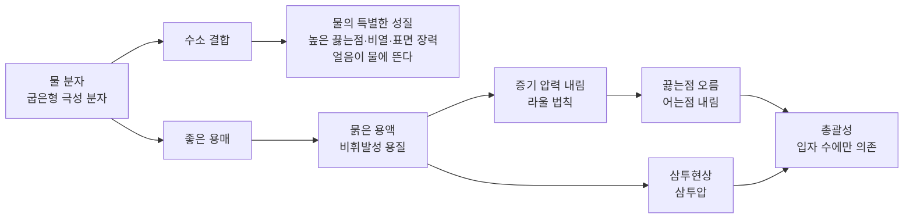

# 물질과 에너지 2. 용액의 성질 — 경이로운 물, 그리고 농도가 바꾸는 것들
<!-- prev: m1-04, m2-01, chem-2, chem-4, matter-1 -->
<!-- next: cell-1, rxn-1 -->

> [!NOTE]
> **성취기준**
> - **[12물에02-01]** 다른 액체와 구별되는 물의 성질을 수소 결합으로 설명하고, 경이로운 물의 성질에 흥미를 느낄 수 있다.
> - **[12물에02-02]** 실험 데이터를 이용하여 용액의 농도에 따른 증기압, 끓는점, 어는점의 변화를 비교하고, 일상생활에서 나타나는 사례와 연관 지어 설명할 수 있다.
> - **[12물에02-03]** 용액의 농도에 따른 삼투현상을 이해하고, 일상생활에서 삼투현상이 나타나는 사례를 찾아 화학 원리가 유용하게 적용됨을 인식할 수 있다.

**학습 목표**

1. 물의 높은 끓는점·비열·기화열·표면 장력과 얼음이 물에 뜨는 성질을 수소 결합으로 설명하고, 이 성질이 지구 환경과 생명에 미치는 영향을 말할 수 있다.
2. 퍼센트 농도, 몰 농도, 몰랄 농도, 몰 분율을 구분하고 서로 환산할 수 있다.
3. 라울 법칙으로 비휘발성 용질이 녹은 용액의 증기 압력 내림을 계산할 수 있다.
4. 실험 데이터로부터 끓는점 오름과 어는점 내림이 몰랄 농도에 비례함을 찾고, 이를 이용해 용질의 몰질량을 구할 수 있다.
5. 삼투현상과 삼투압의 농도 의존성을 이해하고, 김치 절이기·수액·역삼투 정수 등 생활 속 사례를 설명할 수 있다.

**이 단원의 학습 사다리**

| 단계 | 무엇을 하나? |
|---|---|
| STEP 1. 이전 학습 다시 보기 | 중학교의 끓는점·용해, 「화학」의 극성과 몰 농도, 앞 단원의 수소 결합을 꺼내 본다 |
| STEP 2. 기초 다지기 | 용액의 구성, 네 가지 농도, 증기 압력과 동적 평형을 디딤돌로 놓는다 |
| STEP 3. 핵심 개념 | 물과 수소 결합 → 증기 압력 내림 → 끓는점 오름·어는점 내림 → 삼투현상 → 총괄성 |
| STEP 4. 오개념 바로잡기 | "라면 국물은 물보다 훨씬 뜨겁게 끓는다?" 같은 착각을 바로잡는다 |
| STEP 5. 대학 전공으로 | 실제 용액과 활동도, 헨리 법칙, 분별 증류, 화학 퍼텐셜 |
| STEP 6. 생활·산업·진로 | 해수 담수화, 제설제와 부동액, 수액과 의약품, 식품 저장 |

---

## 🗺️ 단원 들어가기

눈이 많이 온 날 도로에 하얀 알갱이(염화 칼슘)를 뿌리면 눈이 녹는다. 기온은 영하인데 왜 녹을까? 김장철에 배추를 소금물에 담가 두면 빳빳하던 배추가 축 늘어지고, 반대로 시든 채소를 맑은 물에 담가 두면 다시 싱싱해진다. 한겨울 호수는 위부터 얼어 그 아래에서 물고기가 겨울을 난다.

이 현상들 뒤에는 두 가지 주인공이 있다. 하나는 **수소 결합으로 이어진 물**이라는 독특한 액체이고, 다른 하나는 **용액에 녹아 있는 입자의 수(농도)** 이다. 이 단원에서는 먼저 물이 왜 '경이로운 액체'인지 살펴보고, 물에 무엇인가 녹아 있을 때 증기 압력·끓는점·어는점·삼투압이 농도에 따라 어떻게 달라지는지 정량적으로 탐구한다.

---

## STEP 1. 🔙 이전 학습 다시 보기

### 연계 개념표

| 이전 단원·성취기준 | 그때 배운 것 | 이 단원에서 확장되는 것 |
|---|---|---|
| 중1 「열」 [9과03-03] | 물질마다 비열이 다르며, 물의 비열이 크다 | 물의 비열이 큰 이유를 **수소 결합**으로 설명한다 |
| 중1 「물질의 상태 변화」 [9과04-04] | 상태 변화 시 열에너지가 출입하고 온도가 일정하다 | 용액에서는 끓는점·어는점 자체가 **농도에 따라 이동**한다 |
| 중2 「물질의 특성」 [9과08-01] | 순물질의 끓는점·녹는점은 일정하고, 혼합물은 그렇지 않다 | 혼합물(용액)의 끓는점·어는점이 **얼마나** 달라지는지 계산한다 |
| 화학 「물질의 구조와 성질」 [12화학02-03], [12화학02-04] | 물 분자는 굽은형 극성 분자이며, 분자 구조가 성질을 결정한다 | 굽은형 극성 구조가 만드는 **수소 결합 그물**과 물의 성질 |
| 화학 「역동적인 화학 반응」 [12화학04-02] | 몰 농도의 의미와 표준 용액 만들기 | 온도와 관계없는 **몰랄 농도**, 몰 분율로 농도를 표현한다 |
| 물질과 에너지 「물질의 세 가지 상태」 [12물에01-03] | 분자 간 상호작용, 수소 결합, 증기 압력과 끓는점 | 용질이 녹으면 용매의 **증기 압력이 낮아지는** 원리 |

### 준비 운동 (사전 진단)

**Q1.** 같은 양의 열을 받을 때 온도가 더 천천히 올라가는 것은 물과 식용유 중 무엇인가?

**Q2.** 수산화 나트륨($\mathrm{NaOH}$, 40 g/mol) 4.0 g을 물에 녹여 용액 1 L를 만들었다. 몰 농도는?

**Q3.** 순수한 물과 소금물을 가열하면 끓기 시작하는 온도는 어떻게 다를까?

**Q4.** 물이 끓는 것은 물의 ( )이(가) 외부 압력과 같아질 때이다.

정답 및 해설

**Q1.** 물. 물은 비열이 약 4.2 J/(g·°C)로 식용유(약 2 J/(g·°C))보다 커서 온도가 천천히 오른다.

**Q2.** 0.10 M. $\mathrm{NaOH}$ $4.0 \div 40 = 0.10\ \mathrm{mol}$이 용액 1 L에 있으므로 0.10 mol/L이다.

**Q3.** 소금물이 순수한 물보다 조금 더 높은 온도에서 끓기 시작하고, 끓는 동안 온도가 서서히 올라간다(물이 증발하며 농도가 진해지므로).

**Q4.** 증기 압력. 「물질의 세 가지 상태」에서 배운 끓는점의 정의이다.

---

## STEP 2. 🧱 기초 다지기

### ① 용액의 구성

**용액(solution)** 은 두 가지 이상의 물질이 고르게 섞인 균일 혼합물이다. 녹이는 물질을 **용매(solvent)**, 녹는 물질을 **용질(solute)** 이라 한다. 이 단원에서 주로 다루는 용액은 다음 조건을 갖는다.

- **묽은 용액**: 용질이 적게 녹아 있어 용질 입자끼리의 상호작용을 무시할 수 있다.
- **비휘발성 용질**: 설탕, 포도당, 염화 나트륨처럼 거의 증발하지 않는 용질이다.
- **비전해질 / 전해질**: 설탕처럼 분자 그대로 녹는 물질은 비전해질, 염화 나트륨처럼 이온으로 나뉘어 녹는 물질은 전해질이다.

### ② 농도를 나타내는 네 가지 방법

| 농도 | 정의 | 단위 | 장점과 쓰임 |
|---|---|---|---|
| 퍼센트 농도 | $\dfrac{\text{용질 질량}}{\text{용액 질량}}\times100$ | % | 생활에서 직관적(생리식염수 0.9 %) |
| **몰 농도(molarity, $M$)** | $\dfrac{\text{용질 몰수}}{\text{용액 부피(L)}}$ | mol/L(M) | 부피를 재기 편해 실험실에서 많이 쓴다. 온도에 따라 부피가 변하면 값이 변한다 |
| **몰랄 농도(molality, $m$)** | $\dfrac{\text{용질 몰수}}{\text{용매 질량(kg)}}$ | mol/kg($m$) | 질량만 쓰므로 **온도가 변해도 일정**하다. 끓는점·어는점 계산에 쓴다 |
| **몰 분율($X$)** | $\dfrac{\text{성분의 몰수}}{\text{전체 몰수}}$ | 없음 | 증기 압력 계산에 쓴다 |

> [!TIP]
> 💡 **요령** — 몰 농도는 '용액' 1 L, 몰랄 농도는 '용매' 1 kg이 기준이다. 끓는점·어는점을 잴 때는 온도를 크게 바꾸므로, 부피 대신 온도에 영향을 받지 않는 질량을 기준으로 삼은 몰랄 농도를 쓴다.

#### 예제 1 — 농도 환산하기

포도당($\mathrm{C_6H_{12}O_6}$, 180 g/mol) 18.0 g을 물 500 g에 녹였다. 몰랄 농도, 포도당의 몰 분율, 퍼센트 농도를 구하시오. (물 18 g/mol)

**풀이**
- 포도당: $18.0\div180 = 0.100\ \mathrm{mol}$, 물: $500\div18 \approx 27.8\ \mathrm{mol}$
- 몰랄 농도: $m = \dfrac{0.100}{0.500} = 0.200\ \mathrm{mol/kg}$
- 몰 분율: $X_{\text{포도당}} = \dfrac{0.100}{0.100 + 27.8} \approx 0.0036$
- 퍼센트 농도: $\dfrac{18.0}{518}\times100 \approx 3.5\ \%$

묽은 수용액에서는 용질의 몰 분율이 매우 작다는 것을 기억해 두자.

### ③ 증기 압력과 동적 평형

밀폐된 용기에 액체를 넣으면 처음에는 증발이 우세하지만, 증기 분자가 늘어나면 다시 액체로 돌아가는 응축도 많아진다. 결국 **증발 속도 = 응축 속도**가 되어 증기의 양이 더 늘지 않는 **동적 평형**에 이른다. 이때 증기가 나타내는 압력이 **증기 압력**이다. 증기 압력은 온도가 높을수록 크고, 같은 온도에서는 분자 간 상호작용이 약한 액체일수록 크다.

| 물의 온도(°C) | 20 | 25 | 50 | 80 | 100 |
|---|---|---|---|---|---|
| 증기 압력(mmHg, 약) | 17.5 | 23.8 | 92.5 | 355 | 760 |

---

## STEP 3. 📘 핵심 개념

### ① 경이로운 물 — 수소 결합이 만드는 특별한 성질

물 분자는 산소 원자에 수소 원자 2개가 약 104.5°의 각도로 결합한 **굽은형 극성 분자**이다. 산소에는 비공유 전자쌍이 2개 있고, 수소는 부분적인 양전하를 띤다. 그래서 물 분자 하나는 **최대 4개의 이웃 분자와 수소 결합**을 할 수 있다(자기 H 2개로 2개, 자기 O의 비공유 전자쌍 2개로 2개). 액체 물은 수소 결합이 끊어지고 이어지기를 끊임없이 반복하는 거대한 그물과 같다.

<!-- fig:matter-2-water-hbond -->

| 물의 성질 | 다른 액체와 비교 | 수소 결합으로 설명하기 | 지구와 생명에 주는 의미 |
|---|---|---|---|
| **높은 끓는점·녹는점** | 분자량이 비슷한 $\mathrm{CH_4}$는 −162 °C에 끓는다 | 분자 사이 수소 결합을 끊는 데 많은 에너지가 필요하다 | 지구 표면 온도에서 물이 액체로 존재한다 |
| **큰 비열** 약 4.18 J/(g·°C) | 에탄올 약 2.4, 철 약 0.45 | 열을 받으면 분자 운동을 빠르게 하기 전에 수소 결합을 흔들고 끊는 데 에너지가 쓰인다 | 해안 지역의 기온 변화가 작다. 체온이 잘 유지된다 |
| **큰 기화열** 약 2260 J/g(100 °C) | 에탄올 약 840 J/g | 기화하려면 모든 수소 결합을 끊어야 한다 | 땀 증발로 체온을 낮춘다. 바다가 증발하며 열을 운반한다 |
| **큰 표면 장력** 약 72 mN/m(25 °C) | 에탄올 약 22 mN/m | 표면의 분자가 안쪽 분자들에게 수소 결합으로 강하게 당겨진다 | 소금쟁이, 둥근 물방울, 모세관 현상으로 식물이 물을 끌어올리는 데 도움 |
| **얼음이 물에 뜬다** 얼음 0.917 g/cm³ | 대부분의 물질은 고체의 밀도가 더 크다 | 얼음에서는 수소 결합이 육각형 그물 구조를 만들어 빈 공간이 많다 | 호수가 위부터 얼어 물속 생물이 겨울을 난다 |
| **4 °C에서 밀도 최대** 약 1.000 g/cm³ | — | 0~4 °C에서는 남아 있던 얼음 같은 구조가 무너지며 부피가 줄어든다 | 겨울 호수 바닥의 물은 약 4 °C로 유지된다 |
| **뛰어난 용매** | 많은 이온·극성 물질을 녹인다 | 극성으로 이온을 둘러싸고(수화), 극성 분자와 수소 결합한다 | 생명체 안의 물질 운반, 화학 반응의 장소 |

<!-- fig:matter-2-water-density -->

#### 얼음은 왜 물보다 가벼울까?

액체 물에서는 수소 결합이 계속 끊어지고 이어지므로 분자들이 빈틈을 채우며 촘촘하게 모일 수 있다. 그러나 얼음이 되면 모든 분자가 이웃 4개와 정해진 방향으로 수소 결합을 하여 **빈 공간이 많은 육각형 그물 구조**로 고정된다. 그래서 같은 질량일 때 얼음의 부피가 물보다 약 9 % 크다. 겨울에 수도관이 터지고, 바위 틈에 스민 물이 얼어 바위가 쪼개지는(풍화) 이유이다.

<!-- fig:matter-2-ice-water -->

> [!TIP]
> 💡 **비유** — 액체 물은 '붐비는 지하철 안 사람들'처럼 이리저리 끼어들며 빈틈없이 서 있다. 얼음은 '모두 양팔을 뻗어 옆 사람과 손을 잡은 강강술래'와 같다. 손을 잡은 팔 길이만큼 사이가 벌어져 같은 인원이 더 넓은 자리를 차지한다.

#### 예제 2 — 물은 왜 기후를 조절할까?

질량이 1 kg으로 같은 물과 모래가 각각 햇빛으로 41.8 kJ의 열을 흡수했다. 모래의 비열을 약 0.8 J/(g·°C)라 할 때 각각의 온도 변화를 구하시오.

**풀이** $Q = cm\Delta t$에서 $\Delta t = \dfrac{Q}{cm}$
- 물: $\Delta t = \dfrac{41\,800}{4.18\times1000} = 10\ ^\circ\mathrm{C}$
- 모래: $\Delta t = \dfrac{41\,800}{0.8\times1000} \approx 52\ ^\circ\mathrm{C}$

같은 열을 받아도 물의 온도는 모래의 약 5분의 1만 오른다. 여름 바닷가에서 모래사장은 뜨겁고 바닷물은 시원한 이유이며, 바다가 지구 기후의 온도 조절 장치 역할을 하는 이유이다.

#### 예제 3 — 땀 한 컵의 냉각 효과

체온(37 °C)에서 물의 기화열을 약 2400 J/g이라 하자. 운동 중 땀 100 g이 증발하면 몸에서 빼앗기는 열은 얼마인가? 이 열을 체중 60 kg인 사람(몸의 평균 비열을 약 3.5 J/(g·°C)로 가정)의 체온 변화로 바꾸면?

**풀이**
- 빼앗기는 열: $Q = 100\times2400 = 240\,000\ \mathrm{J} = 240\ \mathrm{kJ}$
- 체온 변화: $\Delta t = \dfrac{240\,000}{3.5\times60\,000} \approx 1.1\ ^\circ\mathrm{C}$

땀 한 컵 정도의 증발로 체온을 약 1 °C 넘게 낮출 수 있다. 물의 기화열이 크기 때문에 가능한 일이다.

#### ✔ 바로 확인

1. (O/X) 물 분자 하나는 이웃 분자와 최대 2개의 수소 결합을 할 수 있다.
2. 빈칸: 액체 물의 밀도는 약 (    ) °C에서 가장 크다.
3. 고르기: 질량이 같은 물, 에탄올, 철이 같은 양의 열을 받았을 때 온도가 가장 적게 오르는 것은?
4. 얼음(0.917 g/cm³) 100 cm³가 모두 녹으면 물(1.00 g/cm³)은 약 몇 cm³가 되는가?

정답

1. X — 자기 H 2개와 O의 비공유 전자쌍 2개로 최대 4개의 이웃과 수소 결합한다.
2. 4 — 그래서 겨울 호수 바닥의 물은 약 4 °C로 유지된다.
3. 물 — 비열이 약 4.18 J/(g·°C)로 가장 크다(에탄올 약 2.4, 철 약 0.45).
4. 약 91.7 cm³ — 질량 $0.917\times100 = 91.7\ \mathrm{g}$은 그대로이고, 물의 밀도가 1.00 g/cm³이므로 부피가 줄어든다.

### ② 증기 압력 내림 — 라울 법칙

순수한 물과 설탕물을 같은 온도에서 비교하면 **설탕물의 증기 압력이 더 낮다.** 이를 **증기 압력 내림(vapor pressure lowering)** 이라고 한다.

- 용액의 표면 일부를 증발하지 않는 용질 입자가 차지하므로, 같은 시간 동안 표면에서 튀어 나가는 용매 분자 수가 줄어든다.
- 증기에서 액체로 돌아오는 분자는 용액 표면 어디에나 붙을 수 있으므로, 더 적은 증기 분자 수에서 평형이 이루어진다.

<!-- fig:matter-2-vp-lowering -->

라울은 묽은 용액에서 용매의 증기 압력이 **용매의 몰 분율에 비례**함을 밝혔다(**라울 법칙**, Raoult's law).

$$
P_{\text{용액}} = X_{\text{용매}}\,P^{\circ}_{\text{용매}}
$$

$X_{\text{용매}} = 1 - X_{\text{용질}}$이므로 증기 압력 내림은 **용질의 몰 분율에 비례**한다.

$$
\Delta P = P^{\circ}_{\text{용매}} - P_{\text{용액}} = X_{\text{용질}}\,P^{\circ}_{\text{용매}}
$$

> [!IMPORTANT]
> 증기 압력 내림은 **용질의 종류와 관계없이 녹아 있는 용질 입자의 수(몰 분율)에만** 의존한다. 같은 몰 분율이면 설탕이든 포도당이든 같은 만큼 증기 압력이 내려간다.

#### 예제 4

25 °C에서 물의 증기 압력은 23.8 mmHg이다. 물 180 g에 포도당 90 g을 녹인 용액의 증기 압력과 증기 압력 내림을 구하시오. (포도당 180 g/mol, 물 18 g/mol)

**풀이**
- 물 $180\div18 = 10.0\ \mathrm{mol}$, 포도당 $90\div180 = 0.50\ \mathrm{mol}$
- $X_{\text{물}} = \dfrac{10.0}{10.5} \approx 0.952$
- $P_{\text{용액}} = 0.952\times23.8 \approx 22.7\ \mathrm{mmHg}$, $\Delta P \approx 1.1\ \mathrm{mmHg}$

#### 실험으로 보는 증기 압력 내림

밀폐된 상자 안에 순수한 물이 든 비커 A와 진한 설탕물이 든 비커 B를 함께 두고 며칠 지나면, **A의 물은 줄고 B의 설탕물은 늘어난다.** 증기 압력이 큰 A에서 증발한 물 분자가 증기 압력이 작은 B로 응축되기 때문이다. A는 순수한 물이어서 증기 압력이 늘 B보다 크므로, 이 이동은 A의 물이 다 옮겨 갈 때까지 계속된다. (두 비커가 모두 용액이라면 두 용액의 농도, 즉 증기 압력이 같아질 때까지 이동한다.)

<!-- fig:matter-2-beaker-transfer -->

| 생활 속 사례 | 증기 압력 내림으로 설명하기 |
|---|---|
| 꿀이나 잼은 잘 마르지 않는다 | 당이 많이 녹아 물의 증기 압력이 매우 낮다 |
| 습기 제거제(염화 칼슘)에 물이 고인다 | 염화 칼슘이 물에 녹은 진한 용액은 증기 압력이 매우 낮아, 공기 중 수증기가 계속 응축된다 |
| 바닷물은 민물보다 천천히 증발한다 | 녹아 있는 염 때문에 증기 압력이 조금 낮다 |

#### ✔ 바로 확인

1. (O/X) 몰 분율이 같다면 설탕 수용액과 포도당 수용액의 증기 압력 내림은 같다.
2. 25 °C에서 물의 증기 압력은 23.8 mmHg이다. 물의 몰 분율이 0.95인 비휘발성 용질 수용액의 증기 압력은?
3. 빈칸: 증기 압력 내림 $\Delta P$는 (용매 / 용질)의 몰 분율에 비례한다.
4. 밀폐된 상자에 순수한 물과 진한 설탕물을 함께 오래 두면, 양이 늘어나는 것은 어느 쪽인가?

정답

1. O — 증기 압력 내림은 용질의 종류가 아니라 입자 수(몰 분율)에만 의존한다.
2. 약 22.6 mmHg — $P = 0.95\times23.8 \approx 22.6\ \mathrm{mmHg}$
3. 용질 — $\Delta P = X_{\text{용질}}P^\circ_{\text{용매}}$
4. 설탕물 — 증기 압력이 큰 순수한 물에서 증발한 물이 증기 압력이 작은 설탕물로 응축한다.

### ③ 끓는점 오름과 어는점 내림

#### 증기 압력 곡선으로 이해하기

가로축을 온도, 세로축을 증기 압력으로 하는 그래프에서 용액의 증기 압력 곡선은 순수한 용매의 곡선보다 **전체적으로 아래쪽**에 있다.

- **끓는점 오름**: 순수한 물은 100 °C에서 증기 압력이 760 mmHg에 도달한다. 용액은 같은 온도에서 증기 압력이 더 낮으므로 760 mmHg에 도달하려면 **더 높은 온도**가 필요하다.
- **어는점 내림**: 어는점은 액체와 고체(얼음)의 증기 압력이 같아지는 온도이다. 얼음은 순수한 물로만 이루어져 증기 압력 곡선이 그대로이지만, 용액의 곡선은 아래로 내려가 있으므로 두 곡선이 만나는 점이 **더 낮은 온도**로 옮겨 간다. 입자 수준에서 보면, 녹아 있는 용질 입자가 물 분자들이 규칙적인 얼음 구조로 자리 잡는 것을 방해하는 셈이다.

<!-- fig:matter-2-vp-curves -->

#### 몰랄 농도에 비례한다

묽은 용액에서 끓는점 오름($\Delta T_b$)과 어는점 내림($\Delta T_f$)은 용질의 **몰랄 농도에 비례**한다.

$$
\Delta T_b = K_b\, m, \qquad \Delta T_f = K_f\, m
$$

비례 상수 $K_b$(몰랄 오름 상수), $K_f$(몰랄 내림 상수)는 **용매의 종류에 따라 정해지는 값**이며 용질과는 관계없다.

| 용매 | 기준 끓는점(°C) | $K_b$(°C·kg/mol) | 어는점(°C) | $K_f$(°C·kg/mol) |
|---|---|---|---|---|
| 물 | 100.0 | 0.51 | 0.0 | 1.86 |
| 벤젠 | 80.1 | 2.53 | 5.5 | 5.12 |
| 아세트산 | 약 118 | 약 3.1 | 약 17 | 약 3.9 |

물 1 kg에 비전해질 1 mol을 녹이면 끓는점은 약 0.51 °C 오르고, 어는점은 약 1.86 °C 내려간다. **어는점 내림이 끓는점 오름보다 3배 이상 크다**는 점에 주목하자. 그래서 실험에서는 어는점 내림을 측정하는 편이 정밀도가 높다.

#### 실험 데이터로 비례 관계 찾기

다음은 설탕($\mathrm{C_{12}H_{22}O_{11}}$, 342 g/mol)을 물 100 g에 녹인 용액의 어는점과 끓는점을 온도 센서로 측정한 예시 자료이다(설명을 위해 만든 자료이다).

| 설탕(g) | 몰랄 농도($m$) | 측정한 어는점(°C) | $\Delta T_f$(°C) | 측정한 끓는점(°C) | $\Delta T_b$(°C) |
|---|---|---|---|---|---|
| 0 | 0 | 0.00 | 0.00 | 100.00 | 0.00 |
| 17.1 | 0.50 | −0.94 | 0.94 | 100.26 | 0.26 |
| 34.2 | 1.00 | −1.87 | 1.87 | 100.51 | 0.51 |
| 51.3 | 1.50 | −2.80 | 2.80 | 100.77 | 0.77 |

몰랄 농도를 가로축, $\Delta T_f$를 세로축으로 그리면 원점을 지나는 직선이 되고, 기울기는 약 1.87 °C·kg/mol로 물의 $K_f$와 거의 같다. 이처럼 **데이터의 기울기로 비례 상수를 찾는 것**이 성취기준이 요구하는 '실험 데이터를 이용한 비교'의 핵심이다. 실제 측정에서는 농도가 진해질수록 이상적인 직선에서 조금씩 벗어난다.

<!-- fig:matter-2-dtf-graph -->

#### 예제 5 — 포도당 용액의 끓는점과 어는점

예제 1의 포도당 수용액(0.200 $m$)의 끓는점과 어는점을 구하시오.

**풀이**
- $\Delta T_b = 0.51\times0.200 \approx 0.10\ ^\circ\mathrm{C}$ → 끓는점 약 100.10 °C
- $\Delta T_f = 1.86\times0.200 \approx 0.37\ ^\circ\mathrm{C}$ → 어는점 약 −0.37 °C

#### 예제 6 — 어는점 내림으로 몰질량 구하기

어떤 비전해질 2.40 g을 물 50.0 g에 녹인 용액의 어는점은 −0.744 °C였다. 이 물질의 몰질량은?

**풀이**
① $m = \dfrac{\Delta T_f}{K_f} = \dfrac{0.744}{1.86} = 0.400\ \mathrm{mol/kg}$
② 용질의 몰수 $= 0.400\times0.0500 = 0.0200\ \mathrm{mol}$
③ 몰질량 $= \dfrac{2.40}{0.0200} = 120\ \mathrm{g/mol}$

새로 합성한 물질의 몰질량을 확인하는 고전적인 방법이다.

#### 전해질 용액 — 녹아 있는 '입자 수'를 세라

염화 나트륨은 물에 녹으면 $\mathrm{Na^+}$과 $\mathrm{Cl^-}$으로 나뉘어 입자 수가 2배가 된다. 묽은 용액에서는 이온 하나하나가 독립된 입자처럼 행동하므로, 전해질 용액의 끓는점 오름·어는점 내림은 **이온의 총 몰랄 농도**로 계산한다.

| 용질 | 1 mol이 녹아 생기는 입자 수(이상적) | 0.10 $m$ 수용액의 $\Delta T_f$(이상적) |
|---|---|---|
| 포도당 | 1 mol | 0.186 °C |
| $\mathrm{NaCl}$ | 2 mol ($\mathrm{Na^+}$, $\mathrm{Cl^-}$) | 0.372 °C |
| $\mathrm{CaCl_2}$ | 3 mol ($\mathrm{Ca^{2+}}$, $\mathrm{2Cl^-}$) | 0.558 °C |

실제 측정값은 이온끼리 서로 끌어당기는 효과 때문에 이상적인 값보다 조금 작다.

<!-- sim:colligative -->

#### 생활 속 끓는점 오름과 어는점 내림

| 사례 | 원리 |
|---|---|
| 겨울 도로의 제설제(염화 칼슘, 염화 나트륨) | 눈과 얼음 표면에 녹아 용액이 되면 어는점이 0 °C보다 낮아져 영하에서도 녹는다. 1 mol당 입자를 3개 내는 염화 칼슘이 더 효과적이다 |
| 자동차 부동액(에틸렌 글라이콜) | 냉각수의 어는점을 낮춰 겨울에 엔진이 얼어 터지는 것을 막고, 끓는점을 높여 여름 과열도 줄인다 |
| 바닷물은 약 −1.9 °C에서 언다 | 약 3.5 %의 염이 녹아 있기 때문이다. 바다가 얼 때 생기는 얼음은 거의 민물이다 |
| 얼음+소금으로 아이스크림 만들기 | 얼음에 소금을 뿌리면 녹으면서 주위 열을 빼앗고, 소금물의 어는점이 낮아 −10 °C 이하까지 내려간다 |
| 겨울철 바닷물이 강물보다 잘 얼지 않는다 | 녹아 있는 염 때문에 어는점이 낮다 |

#### 예제 7 — 부동액의 설계

물 1.00 kg에 에틸렌 글라이콜($\mathrm{C_2H_6O_2}$, 62 g/mol)을 녹여 어는점을 −18.6 °C로 만들려면 몇 g을 넣어야 하는가? 이때 끓는점은 몇 °C인가? (묽은 용액의 식을 그대로 적용한다.)

**풀이**
- $m = \dfrac{18.6}{1.86} = 10.0\ \mathrm{mol/kg}$ → 에틸렌 글라이콜 $10.0\times62 = 620\ \mathrm{g}$
- $\Delta T_b = 0.51\times10.0 = 5.1\ ^\circ\mathrm{C}$ → 끓는점 약 105.1 °C

실제 부동액은 물과 에틸렌 글라이콜을 비슷한 비율로 섞을 만큼 진하여 묽은 용액의 식에서 꽤 벗어나지만, 경향을 예측하는 데에는 충분히 쓸모가 있다.

#### ✔ 바로 확인

1. 빈칸: 묽은 용액의 끓는점 오름과 어는점 내림은 용질의 (    ) 농도에 비례한다.
2. 1.0 $m$ 비전해질 수용액의 어는점은 몇 °C인가? (물의 $K_f = 1.86$ °C·kg/mol)
3. 0.20 $m$ 포도당 수용액과 어는점이 같은 $\mathrm{NaCl}$ 수용액의 몰랄 농도는? ($\mathrm{NaCl}$은 완전히 이온화한다고 가정한다.)
4. (O/X) 몰랄 내림 상수 $K_f$는 녹인 용질의 종류에 따라 달라진다.

정답

1. 몰랄 — 온도가 변해도 값이 변하지 않는 농도이다.
2. −1.86 °C — $\Delta T_f = 1.86\times1.0 = 1.86\ ^\circ\mathrm{C}$
3. 0.10 $m$ — $\mathrm{NaCl}$ 1 mol은 이온 2 mol을 내므로, 이온의 총 몰랄 농도가 0.20 $m$가 되려면 0.10 $m$이면 된다.
4. X — $K_f$는 용매의 종류로 정해지고 용질과는 관계없다.

### ④ 삼투현상과 삼투압

**반투과성 막(semipermeable membrane)** 은 물 같은 작은 용매 분자는 통과시키지만 크기가 큰 용질 입자는 통과시키지 않는 막이다. 세포막, 셀로판지, 달걀 속껍질 등이 이런 성질을 띤다.

농도가 다른 두 용액을 반투과성 막으로 나누어 두면 **용매가 농도가 묽은 쪽에서 진한 쪽으로 이동**한다. 이 현상을 **삼투(osmosis)** 라고 한다.

- 막의 양쪽에서 물 분자는 서로 반대 방향으로 막을 통과한다.
- 진한 쪽은 막에 닿는 입자 중 용질이 많아 물 분자의 비율이 작으므로, 진한 쪽 → 묽은 쪽으로 가는 물 분자보다 묽은 쪽 → 진한 쪽으로 가는 물 분자가 더 많다.
- 그 결과 진한 쪽의 부피가 늘어난다.

U자관 가운데를 반투과성 막으로 막고 한쪽에 물, 다른 쪽에 설탕물을 넣으면 설탕물 쪽 수면이 점점 올라가다가 멈춘다. 높아진 액체 기둥의 압력이 물의 이동을 막을 만큼 커졌기 때문이다. 이때 **삼투를 막기 위해 용액 쪽에 가해야 하는 압력**을 **삼투압(osmotic pressure, $\pi$)** 이라 한다.

#### 삼투압은 몰 농도와 절대 온도에 비례한다

반트호프는 묽은 용액의 삼투압이 이상 기체 방정식과 같은 꼴을 갖는다는 것을 발견했다.

$$
\pi V = nRT \quad\Longrightarrow\quad \pi = CRT
$$

($C$: 용질의 몰 농도, $R = 0.082\ \mathrm{atm\cdot L/(mol\cdot K)}$, $T$: 절대 온도) 전해질이면 이온의 총 몰 농도를 쓴다.

> [!TIP]
> 💡 **비유** — 삼투는 '사람이 적은 방에서 사람이 많은 방으로 가는 것'이 아니라 '물 분자가 많은 방(묽은 쪽)에서 물 분자가 적은 방(진한 쪽)으로 가는 것'이다. 물의 입장에서 보면 **물이 많은 곳에서 적은 곳으로 퍼져 나가는 확산**과 같다. 막은 물만 지나가게 하는 '회전문'이다.

#### 예제 8 — 묽은 용액도 삼투압은 크다

27 °C에서 0.10 M 포도당 수용액의 삼투압을 구하고, 물기둥의 높이로 나타내시오. (1 atm은 약 10.3 m 물기둥의 압력)

**풀이**

$$
\pi = 0.10\times0.082\times300 \approx 2.46\ \mathrm{atm}
$$

물기둥 높이로 약 $2.46\times10.3 \approx 25\ \mathrm{m}$이다. 겨우 0.1 M 용액이 아파트 8층 높이의 물기둥을 떠받칠 만큼의 삼투압을 낸다. 어는점 내림(약 0.19 °C)보다 훨씬 측정하기 쉬운 큰 효과이다.

#### 예제 9 — 삼투압으로 단백질의 몰질량 구하기

어떤 단백질 1.00 g을 녹여 만든 수용액 100 mL의 삼투압이 27 °C에서 0.00246 atm(약 1.87 mmHg)이었다. 이 단백질의 몰질량을 구하고, 같은 용액의 어는점 내림과 비교하시오.

**풀이**
- $C = \dfrac{\pi}{RT} = \dfrac{0.00246}{0.082\times300} = 1.0\times10^{-4}\ \mathrm{M}$
- 용질의 몰수 $= 1.0\times10^{-4}\times0.100 = 1.0\times10^{-5}\ \mathrm{mol}$
- 몰질량 $= \dfrac{1.00}{1.0\times10^{-5}} = 1.0\times10^{5}\ \mathrm{g/mol}$

같은 용액의 어는점 내림은 약 $1.86\times(1.0\times10^{-4}) \approx 0.0002\ ^\circ\mathrm{C}$로 측정이 거의 불가능하지만, 삼투압은 물기둥 약 2.5 cm로 충분히 잴 수 있다. 몰질량이 큰 고분자·단백질의 몰질량을 구할 때 삼투압을 쓰는 이유이다.

#### 등장액·저장액·고장액

세포를 어떤 용액에 넣었을 때 세포 안과 비교한 용액의 상대적인 농도에 따라 물의 이동 방향이 정해진다.

| 바깥 용액 | 물의 이동 | 적혈구 | 식물 세포 |
|---|---|---|---|
| **고장액**(세포 안보다 진함) | 세포 밖으로 | 쭈그러든다 | 세포막이 세포벽에서 떨어진다(원형질 분리), 시든다 |
| **등장액**(세포 안과 같음) | 알짜 이동 없음 | 정상 | 정상 |
| **저장액**(세포 안보다 묽음) | 세포 안으로 | 부풀다가 터질 수 있다(용혈) | 팽팽해진다(세포벽이 있어 터지지 않음) |

<!-- fig:matter-2-tonicity -->

사람 혈액의 삼투압은 37 °C에서 약 7.7 atm으로, 0.9 % 염화 나트륨 수용액(생리식염수)과 거의 같다. 그래서 정맥 주사용 수액과 콘택트렌즈 보존액은 이 농도에 맞춰 만든다.

#### 예제 10 — 생리식염수는 왜 0.9 %일까?

0.9 % 염화 나트륨 수용액은 1 L에 약 9.0 g의 $\mathrm{NaCl}$(58.5 g/mol)을 포함한다. 37 °C(310 K)에서 이 용액의 삼투압을 구하시오. ($\mathrm{NaCl}$은 완전히 이온화한다고 가정한다.)

**풀이**
- $\mathrm{NaCl}$의 몰 농도 $= 9.0\div58.5 \approx 0.154\ \mathrm{M}$, 이온의 총 몰 농도 $\approx 0.308\ \mathrm{M}$
- $\pi = 0.308\times0.082\times310 \approx 7.8\ \mathrm{atm}$

혈액의 삼투압(약 7.7 atm)과 거의 같은 등장액이다. 만약 순수한 물을 혈관에 대량으로 넣으면 적혈구가 물을 흡수해 터질 수 있다.

#### 생활 속 삼투현상

| 사례 | 원리 |
|---|---|
| 김장 배추를 소금에 절인다 | 고장액인 소금물로 배추 세포의 물이 빠져나가 숨이 죽고, 미생물도 물을 잃어 잘 자라지 못한다 |
| 시든 채소를 찬물에 담그면 싱싱해진다 | 저장액인 물이 세포 안으로 들어가 세포가 팽팽해진다 |
| 민달팽이에 소금을 뿌리면 쪼그라든다 | 몸 표면의 물이 진한 소금 쪽으로 빠져나간다 |
| 비료를 너무 많이 주면 식물이 시든다 | 흙 속 용액이 진해져 뿌리에서 물이 빠져나간다 |
| 잼·꿀·젓갈이 잘 상하지 않는다 | 당이나 염의 농도가 높아 미생물이 물을 빼앗긴다 |
| 바닷물고기와 민물고기 | 바닷물고기는 몸의 물을 잃지 않도록, 민물고기는 들어오는 물을 내보내도록 콩팥과 아가미가 적응해 있다 |

#### 역삼투 — 삼투를 거꾸로 돌리기

용액 쪽에 **삼투압보다 큰 압력**을 가하면 물이 진한 쪽에서 묽은 쪽으로 밀려 나간다. 이것을 **역삼투(reverse osmosis)** 라 한다. 바닷물의 삼투압은 약 27 atm이므로, 그보다 훨씬 큰 압력(대략 50~80 atm)으로 바닷물을 막에 밀어 넣으면 막을 통과한 담수를 얻을 수 있다. 가정용 역삼투 정수기, 중동 등의 대규모 해수 담수화 시설, 반도체 공장의 초순수 제조에 이 원리가 쓰인다.

<!-- fig:matter-2-osmosis-ro -->

#### ✔ 바로 확인

1. 빈칸: 반투과성 막을 사이에 두면 물은 (묽은 / 진한) 쪽에서 (묽은 / 진한) 쪽으로 더 많이 이동한다.
2. 27 °C에서 0.050 M $\mathrm{NaCl}$ 수용액의 삼투압은? (완전히 이온화, $R = 0.082\ \mathrm{atm\cdot L/(mol\cdot K)}$)
3. 짝짓기: 적혈구를 (가) 증류수 (나) 0.9 % $\mathrm{NaCl}$ 수용액 (다) 5 % $\mathrm{NaCl}$ 수용액에 넣었을 때의 변화를 이으시오. — 정상 / 쭈그러든다 / 부푼다
4. (O/X) 역삼투는 용액 쪽에 삼투압보다 큰 압력을 가해 물을 진한 쪽에서 묽은 쪽으로 보내는 것이다.

정답

1. 묽은, 진한 — 물 분자의 비율이 큰 쪽에서 작은 쪽으로 더 많이 이동한다.
2. 약 2.46 atm — 이온의 총 몰 농도 0.10 M, $\pi = 0.10\times0.082\times300 \approx 2.46\ \mathrm{atm}$
3. (가) 부푼다(저장액) (나) 정상(등장액) (다) 쭈그러든다(고장액)
4. O — 해수 담수화와 정수기에 쓰인다.

### ⑤ 묽은 용액의 총괄성 — 입자 수가 전부를 정한다

증기 압력 내림, 끓는점 오름, 어는점 내림, 삼투압은 모두 **용질의 종류가 아니라 녹아 있는 용질 입자의 수(농도)에만 의존**한다. 이런 성질을 **총괄성(colligative property)** 이라고 한다.

| 총괄성 | 식 | 농도 표현 | 크기 비교(0.10 $m$ 비전해질 수용액, 약) | 주로 쓰는 곳 |
|---|---|---|---|---|
| 증기 압력 내림 | $\Delta P = X_{\text{용질}}P^\circ$ | 몰 분율 | 25 °C에서 약 0.04 mmHg | 습도 조절, 증발 억제 |
| 끓는점 오름 | $\Delta T_b = K_b m$ | 몰랄 농도 | 0.05 °C | 증류, 요리 |
| 어는점 내림 | $\Delta T_f = K_f m$ | 몰랄 농도 | 0.19 °C | 몰질량 측정, 제설, 부동액 |
| 삼투압 | $\pi = CRT$ | 몰 농도 | 25 °C에서 약 2.4 atm | 고분자 몰질량, 의료, 담수화 |

> [!IMPORTANT]
> 같은 농도에서 네 효과 중 **삼투압이 단연 크다.** 생명체의 세포는 아주 작은 농도 차이에도 큰 압력 차를 느끼므로, 몸속 체액의 농도를 정밀하게 조절해야 한다.

#### ✔ 바로 확인

1. 빈칸: 용질의 종류와 관계없이 녹아 있는 용질 입자의 수에만 의존하는 용액의 성질을 (    )이라고 한다.
2. 고르기: 0.10 $m$ 비전해질 수용액에서 측정하기 가장 쉬운 큰 효과를 내는 총괄성은? ① 증기 압력 내림 ② 끓는점 오름 ③ 어는점 내림 ④ 삼투압
3. 몰질량이 매우 큰 단백질의 몰질량을 구할 때 주로 쓰는 총괄성은 무엇인가?

정답

1. 총괄성 — 증기 압력 내림, 끓는점 오름, 어는점 내림, 삼투압의 네 가지이다.
2. ④ — 25 °C에서 약 2.4 atm으로, 물기둥 약 25 m에 해당한다. 나머지는 0.04 mmHg, 0.05 °C, 0.19 °C 정도이다.
3. 삼투압 — 농도가 아주 묽어도 측정 가능한 크기로 나타난다.

---

## STEP 4. ⚠️ 오개념 바로잡기

| 흔한 오개념 | 올바른 개념 | 왜 그럴까? |
|---|---|---|
| 라면 국물은 맹물보다 훨씬 뜨겁게 끓는다 | 국물의 끓는점 오름은 **0.5 °C도 되지 않을 만큼** 작다 | 소금 농도가 약 1.5 %인 국물(물 1 kg에 소금 약 15 g)의 이온 총 몰랄 농도는 약 0.5 $m$이므로 $\Delta T_b \approx 0.51\times0.5 \approx 0.26\ ^\circ\mathrm{C}$이다. 국물이 더 뜨겁게 느껴지는 것은 기름층이 증발을 막아 잘 식지 않기 때문이다 |
| 얼음이 물에 뜨는 것은 얼음 속에 공기가 들어 있기 때문이다 | 순수한 얼음도 물에 뜬다. **수소 결합이 만든 빈 공간이 많은 구조** 때문이다 | 얼음의 밀도(0.917 g/cm³)가 물보다 작은 것은 분자 배열의 결과이다 |
| 끓는점 오름과 어는점 내림은 용질의 종류에 따라 정해진다 | 묽은 용액에서는 **용질 입자의 수(몰랄 농도)** 로 정해진다 | 총괄성은 용질의 정체와 무관하다. 다만 전해질은 이온으로 나뉘어 입자 수가 늘어난다 |
| 삼투에서는 용질이 진한 쪽에서 묽은 쪽으로 이동한다 | 반투과성 막을 지나는 것은 **용매**이며, 용매가 묽은 쪽에서 진한 쪽으로 이동한다 | 용질은 막을 통과하지 못한다. 확산과 혼동하기 쉽다 |
| 몰 농도와 몰랄 농도는 같은 값이다 | 묽은 수용액에서만 **거의 같고**, 진한 용액에서는 다르다 | 몰 농도는 용액 1 L, 몰랄 농도는 용매 1 kg이 기준이다 |
| 소금을 뿌리면 얼음이 녹는 것은 소금이 열을 내기 때문이다 | 소금물의 **어는점이 낮아져** 영하에서도 액체가 안정하기 때문이다 | 염화 나트륨의 용해는 오히려 열을 약간 흡수한다. 그래서 얼음+소금은 더 차가워진다 |
| 물의 비열이 큰 것은 물 분자가 무겁기 때문이다 | 물은 분자량이 작다. **수소 결합을 흔드는 데 에너지가 쓰이기** 때문이다 | 분자량이 비슷한 다른 물질보다 비열이 훨씬 크다 |

---

## STEP 5. 🎓 다음 단계로 한 걸음 더

> [!CAUTION]
> 이 절은 **고등학교 교육과정 범위 밖의 심화 내용**으로 평가 대상이 아니다. 대학에서 용액을 어떻게 더 깊이 다루는지 맛보기로 소개한다.

### 대학 전공 과목과의 연결

| 대학 과목 | 이어지는 내용 |
|---|---|
| 일반화학 | 용해의 에너지, 헨리 법칙, 이상 용액과 실제 용액, 반트호프 계수 |
| 물리화학 | 화학 퍼텐셜로 총괄성 유도, 활동도, 상평형과 공비 혼합물 |
| 화학공학(분리 공정) | 증류탑 설계, 막 분리(역삼투·한외 여과), 결정화 |
| 생리학·약학 | 체액의 삼투 농도, 수액 설계, 약물 제형 |
| 환경공학 | 해수 담수화, 수처리 막, 폐수 농축 |

### ① 실제 용액과 활동도

진한 용액에서는 용질 입자끼리의 상호작용 때문에 라울 법칙이나 $\Delta T_f = K_f m$에서 벗어난다. 대학에서는 농도 대신 '실제로 작용하는 유효 농도'인 **활동도(activity)** $a = \gamma x$를 쓴다. 전해질 용액의 실제 입자 수 효과는 **반트호프 계수** $i$로 나타내며, 0.1 $m$ $\mathrm{NaCl}$ 수용액의 $i$는 이상적인 2보다 작은 약 1.9이다.

### ② 휘발성 용질이 섞인 용액 — 분별 증류

두 성분이 모두 휘발성이면 각 성분이 라울 법칙을 따르고, 증기의 전체 압력은 부분 압력의 합이다(「물질의 세 가지 상태」의 돌턴 법칙).

$$
P_{\text{전체}} = X_A P_A^{\circ} + X_B P_B^{\circ}
$$

증기에는 증기 압력이 큰 성분이 더 많이 들어 있으므로, 증발과 응축을 반복하면 두 성분을 분리할 수 있다. 원유를 휘발유·등유·경유로 나누는 정유 공장의 증류탑이 이 원리이다. 물–에탄올처럼 라울 법칙에서 크게 벗어나는 혼합물은 일정한 조성에서 더 이상 분리되지 않는 **공비 혼합물**을 만든다.

### ③ 기체의 용해 — 헨리 법칙

일정 온도에서 기체의 용해도는 그 기체의 **부분 압력에 비례**한다($C = k_H P$). 탄산음료를 따면 거품이 나고, 잠수부가 너무 빨리 올라오면 혈액에 녹아 있던 질소가 기포가 되어 감압병이 생기는 이유이다.

### ④ 총괄성은 왜 입자 수에만 의존할까? — 화학 퍼텐셜

물리화학에서는 용매의 **화학 퍼텐셜**이 용질이 섞이면서 낮아진다는 것으로 네 가지 총괄성을 하나의 원리로 유도한다. 이 과정에서 $K_b = \dfrac{RT_b^2 M_{\text{용매}}}{\Delta H_{\text{기화}}}$처럼 몰랄 오름 상수가 용매의 끓는점과 기화열로 결정된다는 것이 밝혀진다. 용질이 섞이면 무질서도(엔트로피)가 커져 용매가 액체 상태에 머무르려는 경향이 강해진다는 것이 핵심이다(엔트로피는 「화학 변화의 자발성」에서 다룬다).

### 지금 vs 다음 단계

| 주제 | 지금(물질과 에너지) | 대학(일반화학·물리화학·화학공학) |
|---|---|---|
| 물 | 수소 결합으로 성질을 설명 | 분자 동역학 시뮬레이션, 수소 결합 그물의 동역학 |
| 증기 압력 | 비휘발성 용질의 라울 법칙 | 휘발성 혼합물, 이상·실제 용액, 공비 혼합물 |
| 끓는점·어는점 | $\Delta T = Km$, 몰질량 측정 | 화학 퍼텐셜로 유도, 활동도·반트호프 계수 |
| 삼투 | $\pi = CRT$, 생활 사례 | 막 분리 공정 설계, 생체막 수송 |

---

## STEP 6. 🏭 생활·산업·진로 연결

### 사례 1. 역삼투 해수 담수화

- **원리** 바닷물에 삼투압(약 27 atm)보다 큰 압력을 가해 물만 반투과성 막을 통과시킨다.
- **어디에 쓰이나** 물이 부족한 섬·사막 지역의 식수 공급, 가정용 정수기, 반도체·제약 공장의 초순수 제조. 큰 압력을 만드는 데 에너지가 많이 들기 때문에, 막을 지나지 못하고 버려지는 고압의 진한 물에서 압력 에너지를 회수하는 장치를 함께 쓴다. 농축된 바닷물을 배출할 때 해양 생태계에 미치는 영향도 함께 고려해야 한다.

### 사례 2. 제설제와 부동액

- **원리** 어는점 내림. 같은 질량으로 더 많은 입자를 내는 물질일수록 효과가 크다.
- **어디에 쓰이나** 도로 제설제(염화 칼슘·염화 나트륨), 항공기 날개의 결빙 방지액, 자동차 냉각수. 다만 염화 이온은 철을 부식시키고 가로수와 토양에 해를 줄 수 있어, 친환경 제설제(아세트산 칼슘마그네슘 등)도 개발되고 있다.

### 사례 3. 의료와 수액

- **원리** 등장액은 세포 안팎의 물 이동을 막는다.
- **어디에 쓰이나** 생리식염수와 포도당 수액, 안약·콘택트렌즈 용액, 혈액 투석(반투과성 막을 통해 혈액 속 노폐물을 투석액 쪽으로 확산시키고, 투석액의 농도와 압력으로 물의 이동을 조절한다).

### 관련 진로와 학과

| 진로 | 하는 일 | 관련 학과 |
|---|---|---|
| 수처리·환경 엔지니어 | 해수 담수화·정수 공정, 분리막 개발 | 환경공학과, 화학공학과 |
| 제약·제형 연구원 | 주사제·안약의 삼투 농도 설계 | 약학과, 화학과, 제약공학과 |
| 식품 공학자 | 염장·당장, 동결 건조, 아이스크림 제조 공정 | 식품공학과, 식품영양학과 |
| 해양·기후 연구원 | 해수의 염분과 결빙, 해양 순환 연구 | 해양학과, 대기과학과 |
| 의공학자 | 인공 신장(투석기) 막 설계 | 의공학과, 고분자공학과 |

---

## 🔬 탐구 활동

### 활동 A. 온도 센서로 설탕물의 끓는점과 어는점 측정하기

**목표** 몰랄 농도가 다른 설탕물의 어는점과 끓는점을 디지털 온도 센서로 측정하고, 농도와 온도 변화의 비례 관계를 데이터로 확인한다.

**준비물** 디지털 온도 센서와 데이터 수집 장치(또는 스마트 기기 앱), 설탕, 증류수, 전자저울, 대형 시험관, 비커, 얼음, 굵은 소금, 가열 장치(핫플레이트), 끓임쪽, 보안경, 내열 장갑

**과정**
1. 물 100 g에 설탕 0 g, 17.1 g, 34.2 g, 51.3 g을 녹여 0, 0.50, 1.00, 1.50 $m$ 용액을 만든다.
2. **어는점**: 얼음과 굵은 소금을 섞은 한제(약 −10 °C 이하)에 용액이 든 시험관을 꽂고, 센서로 10초 간격으로 온도를 기록하며 천천히 저어 준다. 시간–온도 그래프에서 온도가 잠시 거의 일정하게 유지되는 구간(과냉각 직후 다시 올라간 온도)을 어는점으로 정한다.
3. **끓는점**: 같은 농도의 용액을 끓임쪽과 함께 가열하며 온도를 기록한다. 끓기 시작한 직후의 온도를 끓는점으로 정한다(끓을수록 물이 증발해 농도가 진해짐에 유의한다).
4. 실험 당일 순수한 물의 끓는점을 함께 측정하여 기준으로 삼는다(대기압에 따라 100 °C가 아닐 수 있다).
5. 스프레드시트에 $m$–$\Delta T_f$, $m$–$\Delta T_b$ 그래프를 그리고 추세선의 기울기를 구한다.

<!-- fig:matter-2-cooling-curve -->

**결과 기록**

| 몰랄 농도($m$) | 어는점(°C) | $\Delta T_f$(°C) | 끓는점(°C) | $\Delta T_b$(°C) |
|---|---|---|---|---|
| 0 | | | | |
| 0.50 | | | | |
| 1.00 | | | | |
| 1.50 | | | | |
| 기울기 | — | | — | |

**생각해 보기**
1. 구한 기울기를 물의 $K_f$(1.86), $K_b$(0.51)와 비교하고, 차이가 나는 이유를 찾아보자.
2. 끓는점보다 어는점 측정이 농도 변화를 더 잘 보여 주는 이유는?
3. 설탕 대신 같은 몰수의 소금을 쓰면 그래프의 기울기는 어떻게 달라질까?

> [!WARNING]
> **안전 수칙** 보안경과 내열 장갑을 착용하고, 끓는 용액이 튀지 않도록 끓임쪽을 넣는다. 한제는 피부에 동상을 일으킬 수 있으므로 맨손으로 오래 만지지 않는다. 실험 후 남은 용액은 실험실 폐수 처리 기준에 따라 처리한다.

### 활동 B. 농도와 삼투현상의 관계를 찾는 실험 설계하기

**목표** 용액의 농도에 따라 삼투로 이동하는 물의 양이 어떻게 달라지는지 실험을 설계하고 수행한다.

**설계 예시** 같은 크기로 자른 감자 막대(또는 식초에 담가 껍데기를 녹인 메추리알·달걀)를 농도가 다른 설탕물(0, 0.2, 0.4, 0.6, 0.8 M)에 각각 담그고, 일정 시간 뒤 질량 변화율을 측정한다.

| 단계 | 정할 것 |
|---|---|
| 가설 | 예: "설탕물의 농도가 진할수록 감자의 질량 감소율이 커질 것이다." |
| 조작 변인 | 설탕물의 몰 농도 |
| 종속 변인 | 감자 막대의 질량 변화율 $\dfrac{w_{\text{나중}} - w_{\text{처음}}}{w_{\text{처음}}}\times100$ (%) |
| 통제 변인 | 감자의 크기·부위, 용액의 부피, 온도, 담그는 시간 |

**결과 기록**

| 설탕물 농도(M) | 처음 질량(g) | 나중 질량(g) | 질량 변화율(%) |
|---|---|---|---|
| 0 | | | |
| 0.2 | | | |
| 0.4 | | | |
| 0.6 | | | |
| 0.8 | | | |

**생각해 보기**
1. 질량 변화율이 0이 되는 농도를 그래프에서 찾고, 그 농도가 감자 세포에 대해 어떤 의미를 갖는지 설명해 보자.
2. 질량 대신 길이 변화를 측정하면 어떤 장단점이 있을까?

---

## ✅ 개념 확인 문제

### 기본

**1.** 다음 중 물 분자 사이의 수소 결합으로 설명할 수 **없는** 것은?
① 물의 끓는점이 $\mathrm{H_2S}$보다 높다. ② 얼음이 물에 뜬다. ③ 물이 전기 분해되어 수소와 산소가 생긴다. ④ 물의 표면 장력이 크다.

정답 및 해설

**정답 ③**

전기 분해는 물 분자 안의 O–H 공유 결합이 끊어지는 화학 변화이다. 나머지는 모두 분자 사이의 수소 결합으로 설명되는 물리적 성질이다.

**2.** 물 250 g에 요소($\mathrm{CO(NH_2)_2}$, 60 g/mol) 15 g을 녹인 수용액의 몰랄 농도를 구하시오.

정답 및 해설

**정답** 1.0 mol/kg

요소의 몰수 $= 15\div60 = 0.25\ \mathrm{mol}$, $m = \dfrac{0.25}{0.250} = 1.0\ \mathrm{mol/kg}$

**3.** 0.50 $m$ 포도당 수용액의 끓는점과 어는점을 구하시오. (물의 $K_b = 0.51$, $K_f = 1.86$ °C·kg/mol)

정답 및 해설

**정답** 끓는점 약 100.26 °C, 어는점 −0.93 °C

$\Delta T_b = 0.51\times0.50 \approx 0.26\ ^\circ\mathrm{C}$, $\Delta T_f = 1.86\times0.50 = 0.93\ ^\circ\mathrm{C}$

**4.** 반투과성 막으로 나눈 U자관의 왼쪽에 0.1 M 설탕물, 오른쪽에 0.3 M 설탕물을 같은 높이로 넣었다. 시간이 지나면 어느 쪽 수면이 높아지는가? 그 이유는?

정답 및 해설

**정답** 오른쪽(0.3 M 쪽)

물은 반투과성 막을 지나 묽은 쪽(물 분자의 비율이 큰 쪽)에서 진한 쪽으로 더 많이 이동하므로, 진한 오른쪽의 부피가 늘어난다.

### 응용

**5.** 다음 수용액 (가)~(다)를 어는점이 낮은 것부터 순서대로 쓰시오. (전해질은 완전히 이온화한다고 가정한다.)
(가) 0.10 $m$ 포도당 (나) 0.10 $m$ $\mathrm{NaCl}$ (다) 0.10 $m$ $\mathrm{CaCl_2}$

정답 및 해설

**정답** (다) < (나) < (가)

입자의 총 몰랄 농도는 (가) 0.10, (나) 0.20, (다) 0.30이다. 입자 농도가 클수록 어는점 내림이 크므로 (다)의 어는점이 가장 낮다($\Delta T_f$: 0.186, 0.372, 0.558 °C).

**6.** 어떤 비전해질 6.0 g을 물 200 g에 녹인 용액의 끓는점이 100.255 °C였다(순수한 물의 끓는점 100.000 °C). 이 물질의 몰질량을 구하시오. (물의 $K_b = 0.51$ °C·kg/mol)

정답 및 해설

**정답** 60 g/mol

$m = \dfrac{0.255}{0.51} = 0.50\ \mathrm{mol/kg}$, 용질 몰수 $= 0.50\times0.200 = 0.10\ \mathrm{mol}$, 몰질량 $= 6.0\div0.10 = 60\ \mathrm{g/mol}$

**7.** 27 °C에서 삼투압이 4.92 atm인 포도당 수용액의 몰 농도를 구하시오. 이 용액은 혈액(37 °C에서 약 7.7 atm)과 비교하여 고장액, 등장액, 저장액 중 무엇인가? (온도 차이에 따른 삼투압 변화는 무시하고 비교한다.)

정답 및 해설

**정답** 0.20 M, 저장액

$C = \dfrac{\pi}{RT} = \dfrac{4.92}{0.082\times300} = 0.20\ \mathrm{M}$. 삼투압이 혈액보다 작으므로 혈액에 대해 저장액이다. 이 용액에 적혈구를 넣으면 물이 적혈구 안으로 들어가 부푼다.

**8.** 25 °C에서 물의 증기 압력은 23.8 mmHg이다. 물 9.0 mol에 비휘발성 비전해질 1.0 mol을 녹인 용액의 증기 압력은?

정답 및 해설

**정답** 약 21.4 mmHg

$X_{\text{물}} = \dfrac{9.0}{10.0} = 0.90$, $P = 0.90\times23.8 \approx 21.4\ \mathrm{mmHg}$

### 융합·서술형

**9. [지구·생명 연계]** 물의 밀도가 다른 물질처럼 고체가 될수록 계속 커진다면(얼음이 물에 가라앉는다면) 겨울철 호수와 그 속의 생물에게 어떤 일이 일어날지, 수소 결합과 밀도의 관계를 이용하여 서술하시오.

정답 및 해설

**예시 답안**
실제 물은 수소 결합으로 빈 공간이 많은 얼음 구조를 만들어 얼음의 밀도가 물보다 작다. 그래서 얼음이 수면에 떠서 아래의 물을 덮는 단열층이 되고, 4 °C 근처의 무거운 물이 바닥에 머물러 물고기가 겨울을 날 수 있다. 만약 얼음이 가라앉는다면 표면에서 생긴 얼음이 계속 바닥에 쌓이고 새로운 수면이 다시 찬 공기에 노출되어, 호수가 바닥부터 꽁꽁 얼어붙게 된다. 그러면 물속 생물 대부분이 살아남기 어렵고, 봄이 되어도 바닥의 얼음이 잘 녹지 않을 것이다.

**채점 포인트** ① 수소 결합 → 얼음의 낮은 밀도 ② 얼음이 뜨면 단열층 역할 ③ 가라앉을 경우 바닥부터 결빙

**10. [환경·산업 연계]** 해수 담수화에 쓰는 역삼투 공정에서는 바닷물에 50 atm이 넘는 압력을 가한다. (1) 이렇게 큰 압력이 필요한 이유를 삼투압으로 설명하고, (2) 염분이 더 높은 바다(예: 증발이 많은 해역)에서는 필요한 압력과 에너지가 어떻게 달라질지 예측하시오. (3) 이 공정의 환경적 과제를 한 가지 제시하시오.

정답 및 해설

**예시 답안**
(1) 반투과성 막 양쪽이 담수와 바닷물이면 물은 담수 쪽에서 바닷물 쪽으로 이동하려 한다. 바닷물의 삼투압은 약 27 atm이므로 이보다 큰 압력을 가해야 물이 거꾸로 바닷물에서 담수 쪽으로 밀려 나간다. 물이 빠질수록 남은 바닷물이 진해져 삼투압이 더 커지므로 실제로는 이보다 훨씬 큰 압력이 필요하다.
(2) $\pi = CRT$에서 염분(이온의 총 농도)이 높을수록 삼투압이 크므로, 더 큰 압력과 더 많은 에너지가 필요하다.
(3) 진하게 농축된 바닷물(농축수)이 배출되는 해역의 생태계 영향, 고압 펌프 운전에 드는 에너지와 그에 따른 온실 기체 배출 등.

### 실력 다지기

**11. [농도 환산]** 포도당($\mathrm{C_6H_{12}O_6}$, 180 g/mol) 0.50 mol이 녹아 있는 수용액 1.00 L의 밀도는 1.03 g/mL이다. (1) 이 용액의 몰 농도와 몰랄 농도를 각각 구하시오. (2) 이 용액의 어는점을 구하시오. (물의 $K_f = 1.86$ °C·kg/mol) (3) 몰 농도와 몰랄 농도의 값이 다른 까닭을 설명하시오.

정답 및 해설

**정답** (1) 0.50 M, 약 0.53 mol/kg (2) 약 −0.99 °C (3) 기준이 용액의 부피(1 L)와 용매의 질량(1 kg)으로 다르기 때문이다.

(1) 몰 농도는 $0.50\ \mathrm{mol} \div 1.00\ \mathrm{L} = 0.50\ \mathrm{M}$이다. 용액의 질량은 $1000\times1.03 = 1030\ \mathrm{g}$, 포도당의 질량은 $0.50\times180 = 90\ \mathrm{g}$이므로 물은 $1030 - 90 = 940\ \mathrm{g}$이다. 몰랄 농도는 $\dfrac{0.50}{0.940} \approx 0.53\ \mathrm{mol/kg}$이다.
(2) $\Delta T_f = 1.86\times0.532 \approx 0.99\ ^\circ\mathrm{C}$ → 어는점 약 −0.99 °C
(3) 몰 농도는 용액 1 L, 몰랄 농도는 용매 1 kg을 기준으로 한다. 이 용액 1 L에는 물이 1 kg보다 적게(940 g) 들어 있어 몰랄 농도가 더 크다. 용액이 진할수록 두 값의 차이가 커진다.

**12. [실험 데이터 비교]** 표는 순수한 물, 0.50 $m$ 설탕물, 0.50 $m$ $\mathrm{NaCl}$ 수용액의 끓는점과 어는점을 측정한 예시 자료이다.

| 용액 | 끓는점(°C) | 어는점(°C) |
|---|---|---|
| 순수한 물 | 100.00 | 0.00 |
| 0.50 $m$ 설탕물 | 100.26 | −0.93 |
| 0.50 $m$ $\mathrm{NaCl}$ 수용액 | 100.47 | −1.69 |

(1) $\mathrm{NaCl}$이 완전히 이온화한다고 가정할 때 $\mathrm{NaCl}$ 수용액의 이상적인 어는점을 구하고, 측정값과 비교하시오. (2) 그 차이가 생기는 까닭을 쓰시오. (3) 25 °C에서 세 액체의 증기 압력을 큰 것부터 쓰시오.

정답 및 해설

**정답** (1) −1.86 °C, 측정값(−1.69 °C)은 이상적인 값보다 덜 내려갔다. (2) 이온끼리 서로 끌어당겨 독립된 입자처럼 행동하지 못하는 부분이 있기 때문이다. (3) 순수한 물 > 설탕물 > $\mathrm{NaCl}$ 수용액

(1) 이온의 총 몰랄 농도는 $2\times0.50 = 1.00\ m$이므로 $\Delta T_f = 1.86\times1.00 = 1.86\ ^\circ\mathrm{C}$, 어는점은 −1.86 °C이다. 측정한 $\Delta T_f$(1.69 °C)는 설탕물(0.93 °C)의 2배보다 조금 작다.
(2) 묽은 용액에서는 이온 하나하나가 독립된 입자처럼 행동하지만, 실제로는 양이온과 음이온이 서로 끌어당기는 효과가 있어 입자 수 효과가 이상적인 2배보다 조금 작게 나타난다.
(3) 증기 압력 내림은 녹아 있는 입자 수가 많을수록 크다. 입자 수가 가장 많은 $\mathrm{NaCl}$ 수용액의 증기 압력이 가장 작다(끓는점이 가장 높은 것과 같은 순서이다).

**13. [탐구 결과 해석]** 탐구 활동 B에서 감자 막대를 농도가 다른 설탕물에 담가 질량 변화율을 측정하였다.

| 설탕물(M) | 0 | 0.2 | 0.4 | 0.6 | 0.8 |
|---|---|---|---|---|---|
| 질량 변화율(%) | +8.0 | +2.5 | −2.0 | −6.5 | −10.5 |

(1) 질량 변화율이 0이 되는 설탕물의 농도를 0.2 M과 0.4 M 사이를 직선으로 이어 구하시오. (2) 이 농도가 뜻하는 바를 쓰고, 27 °C에서 감자 세포액의 삼투압을 구하시오. (3) 감자 세포와 등장인 $\mathrm{NaCl}$ 수용액의 몰 농도는 약 얼마인가?

정답 및 해설

**정답** (1) 약 0.31 M (2) 감자 세포와 등장인 농도, 약 7.7 atm (3) 약 0.16 M

(1) 0.2 M에서 +2.5 %, 0.4 M에서 −2.0 %이므로 0.2 M에서 변화율이 0까지 줄어드는 비율은 $\dfrac{2.5}{4.5}$이다. $0.2 + 0.2\times\dfrac{2.5}{4.5} \approx 0.31\ \mathrm{M}$
(2) 물의 알짜 이동이 없는 농도이므로 감자 세포액과 **등장**인 농도이다. $\pi = CRT = 0.311\times0.082\times300 \approx 7.7\ \mathrm{atm}$
(3) $\mathrm{NaCl}$은 이온 2개로 나뉘므로 이온의 총 농도가 0.31 M이 되려면 약 $0.31\div2 \approx 0.16\ \mathrm{M}$이면 된다.

**채점 포인트** ① 변화율 0의 의미(등장) ② 직선 보간 계산 ③ $\pi = CRT$ ④ 전해질의 입자 수 고려

**14. [총괄성 잇기]** 바닷물은 약 −1.9 °C에서 언다. (1) 바닷물에 녹아 있는 입자(이온)의 총 몰랄 농도를 구하시오. (2) 묽은 용액이라 몰 농도와 몰랄 농도가 거의 같다고 할 때, 27 °C에서 바닷물의 삼투압을 구하고 본문의 값(약 27 atm)과 비교하시오. (물의 $K_f = 1.86$ °C·kg/mol)

정답 및 해설

**정답** (1) 약 1.0 mol/kg (2) 약 25 atm, 본문의 값과 비슷하다.

(1) $m = \dfrac{\Delta T_f}{K_f} = \dfrac{1.9}{1.86} \approx 1.02\ \mathrm{mol/kg}$ (이온의 총 몰랄 농도)
(2) $C \approx 1.02\ \mathrm{M}$이라 하면 $\pi = 1.02\times0.082\times300 \approx 25\ \mathrm{atm}$이다. 어는점 내림과 삼투압은 모두 녹아 있는 입자 수로 정해지는 총괄성이므로, 어는점 하나만 재어도 삼투압을 어림할 수 있다. 근사(몰 농도 ≈ 몰랄 농도, 이상적인 용액)를 썼으므로 약간의 차이가 난다.

### 도전

**15. [제설제 비교]** 미지의 흰색 고체 X 2.925 g을 물 100 g에 녹인 용액의 어는점은 −1.86 °C였다. (물의 $K_f = 1.86$ °C·kg/mol, $\mathrm{NaCl}$ 58.5 g/mol, $\mathrm{CaCl_2}$ 111 g/mol, 전해질은 완전히 이온화한다고 가정한다.)
(1) X가 비전해질이라고 가정하면 몰질량은 얼마인가?
(2) 이 수용액은 전류가 잘 흘렀다. X가 $\mathrm{NaCl}$이라고 하면 측정 결과와 맞는지 계산으로 확인하시오.
(3) 같은 질량(2.925 g)의 $\mathrm{CaCl_2}$를 물 100 g에 녹이면 어는점은 몇 °C가 되는가?
(4) 본문에는 "1 mol당 입자를 3개 내는 염화 칼슘이 더 효과적"이라고 하였다. (3)의 결과와 함께, 어떤 기준으로 비교하느냐에 따라 결론이 어떻게 달라지는지 설명하시오.

정답 및 해설

**정답** (1) 29.25 g/mol (2) 맞다 (3) 약 −1.47 °C (4) 몰수가 같으면 $\mathrm{CaCl_2}$, 질량이 같으면 $\mathrm{NaCl}$이 어는점을 더 많이 낮춘다.

(1) $m = \dfrac{1.86}{1.86} = 1.00\ \mathrm{mol/kg}$, 용질 $1.00\times0.100 = 0.100\ \mathrm{mol}$, 몰질량 $= \dfrac{2.925}{0.100} = 29.25\ \mathrm{g/mol}$. 이렇게 작은 몰질량의 고체는 생각하기 어려우므로 전해질일 가능성이 높다.
(2) $\mathrm{NaCl}$ $\dfrac{2.925}{58.5} = 0.0500\ \mathrm{mol}$ → 이온 0.100 mol → 이온의 총 몰랄 농도 1.00 $m$ → $\Delta T_f = 1.86\ ^\circ\mathrm{C}$로 측정값과 같다.
(3) $\mathrm{CaCl_2}$ $\dfrac{2.925}{111} \approx 0.0264\ \mathrm{mol}$ → 이온 $3\times0.0264 \approx 0.0791\ \mathrm{mol}$ → $0.791\ m$ → $\Delta T_f = 1.86\times0.791 \approx 1.47\ ^\circ\mathrm{C}$, 어는점 약 −1.47 °C
(4) 1 mol을 녹이면 $\mathrm{CaCl_2}$는 입자 3 mol, $\mathrm{NaCl}$은 2 mol을 내므로 **같은 몰수**로 비교하면 $\mathrm{CaCl_2}$가 더 효과적이다. 그러나 1 g이 내는 입자 수는 $\mathrm{NaCl}$이 $\dfrac{2}{58.5} \approx 0.034\ \mathrm{mol}$, $\mathrm{CaCl_2}$가 $\dfrac{3}{111} \approx 0.027\ \mathrm{mol}$이므로 **같은 질량**으로 비교하면 (이상적으로는) $\mathrm{NaCl}$이 어는점을 더 많이 낮춘다. 총괄성은 질량이 아니라 입자 수로 정해지므로, 비교의 기준(몰수인지 질량인지)을 분명히 해야 한다.

**채점 포인트** ① 어는점 내림으로 입자의 몰수 구하기 ② 전해질의 이온 수 반영 ③ 몰당·질량당 입자 수를 구분하여 결론 제시

**16. [실험 오류 찾기]** 탐구 활동 A에서 두 학생이 1.00 $m$ 설탕물의 어는점과 끓는점을 측정하였다.
- 학생 갑: 냉각 곡선에서 **가장 낮게 내려간 온도**(−3.0 °C)를 어는점으로 읽고 $K_f = 3.0$ °C·kg/mol을 얻었다.
- 학생 을: 어는점은 바르게 읽었지만, 끓는점은 용액을 **20분 동안 끓인 뒤**의 온도로 읽었다.

(1) 갑의 방법에서 무엇이 잘못되었는지 냉각 곡선의 모양으로 설명하고, 올바르게 읽었다면 얻었을 어는점을 쓰시오. (2) 을이 구한 $K_b$는 실제값(0.51)보다 클까, 작을까? 까닭과 함께 쓰시오. (3) 갑이 어는점을 바르게 읽되, 저어 주지 않고 오래 두어 얼음이 많이 생긴 뒤에야 온도를 읽었다면 어는점 측정값은 실제보다 높아질까, 낮아질까?

정답 및 해설

**정답** (1) 과냉각 최저점을 읽었다. 약 −1.87 °C (2) 크다 (3) 낮아진다

(1) 액체는 어는점 아래로 잠시 내려가는 **과냉각** 상태가 되었다가, 얼음이 생기기 시작하면 온도가 다시 올라가 잠시 유지된다. 가장 낮은 온도는 과냉각의 최저점이지 어는점이 아니다. 다시 올라가 유지되는 온도인 약 −1.87 °C를 읽어야 한다($\Delta T_f = 1.86\times1.00$).
(2) 끓이는 동안 물이 증발하여 용매의 질량이 줄어 실제 몰랄 농도가 1.00 $m$보다 커지므로 끓는점이 더 올라간다. 을은 1.00 $m$으로 계산하였으므로 $K_b = \dfrac{\Delta T_b}{m}$이 실제값보다 **크게** 나온다.
(3) 얼음은 거의 순수한 물로 이루어지므로, 얼음이 생길수록 남은 용액이 진해져 어는점이 더 내려간다. 따라서 측정값은 실제 어는점보다 **낮아진다**.

**채점 포인트** ① 과냉각과 어는점의 구분 ② 증발 → 용매 질량 감소 → 몰랄 농도 증가 ③ 얼음이 생기면 남은 용액의 농도 증가

**17. [밀폐 상자의 정량 예측]** 밀폐된 상자에 비커 A(물 100 g + 포도당 0.10 mol)와 비커 B(물 100 g + 포도당 0.30 mol)를 함께 두고 25 °C에서 오래 기다렸다. 상자 속 수증기의 양은 무시한다. (물 18 g/mol, 25 °C에서 물의 증기 압력 23.8 mmHg)
(1) 처음에 증기 압력이 더 큰 비커는 어느 것이며, 물은 어느 쪽으로 이동하는가?
(2) 물의 이동이 멈추었을 때 A와 B에 들어 있는 물의 질량을 각각 구하시오.
(3) 이때 두 용액의 증기 압력을 구하시오.

정답 및 해설

**정답** (1) A, A → B (2) A 50 g, B 150 g (3) 약 23.0 mmHg

(1) A는 물의 몰 분율이 $\dfrac{5.56}{5.56+0.10} \approx 0.982$(증기 압력 약 23.4 mmHg), B는 $\dfrac{5.56}{5.56+0.30} \approx 0.949$(약 22.6 mmHg)이다. 증기 압력이 큰 A에서 증발한 물이 B에서 응축하므로 물은 A → B로 이동한다.
(2) 두 용액의 증기 압력이 같아지면, 즉 물의 몰 분율이 같아지면(같은 용매와 용질이므로 몰랄 농도가 같아지면) 이동이 멈춘다. 물의 총량은 200 g이고 포도당의 몰수비가 $0.10 : 0.30 = 1 : 3$이므로 물도 $1 : 3$으로 나뉘어야 한다. A 50 g, B 150 g이다(두 용액 모두 2.0 $m$).
(3) 물 50 g은 $\dfrac{50}{18} \approx 2.78\ \mathrm{mol}$이므로 $X_{\text{물}} = \dfrac{2.78}{2.78 + 0.10} \approx 0.965$, $P = 0.965\times23.8 \approx 23.0\ \mathrm{mmHg}$ (B도 같은 값)

**채점 포인트** ① 증기 압력이 큰 쪽에서 작은 쪽으로 물 이동 ② 멈추는 조건 = 증기 압력(몰 분율) 같음 ③ 물의 분배를 용질 몰수비로 계산 ④ 라울 법칙 적용

---

## 📝 한눈에 정리

### 핵심 요약

- 물 분자는 굽은형 극성 분자로, 하나가 최대 4개의 이웃과 **수소 결합**을 한다.
- 수소 결합 때문에 물은 **끓는점·비열·기화열·표면 장력이 크고, 얼음이 물에 뜬다**(4 °C에서 밀도 최대). 이 성질이 지구 기후와 생명을 지탱한다.
- 끓는점·어는점 계산에는 온도와 무관한 **몰랄 농도**($m$ = 용질 mol / 용매 kg), 증기 압력에는 **몰 분율**을 쓴다.
- **라울 법칙** $P_{\text{용액}} = X_{\text{용매}}P^\circ$: 비휘발성 용질이 녹으면 증기 압력이 내려간다.
- **끓는점 오름** $\Delta T_b = K_b m$, **어는점 내림** $\Delta T_f = K_f m$. 물은 $K_b = 0.51$, $K_f = 1.86$ °C·kg/mol이다.
- **삼투**: 반투과성 막을 지나 용매가 묽은 쪽에서 진한 쪽으로 이동한다. **삼투압** $\pi = CRT$.
- 네 가지 성질은 용질의 종류가 아닌 **입자 수에만 의존하는 총괄성**이며, 전해질은 이온의 총 농도로 계산한다.
- 제설제, 부동액, 김치 절이기, 생리식염수, 역삼투 해수 담수화가 모두 이 원리를 이용한다.

### 핵심 용어

| 용어 | 뜻 |
|---|---|
| 수소 결합 | F, O, N에 결합한 H와 이웃 분자의 F, O, N 사이의 강한 분자 간 인력 |
| 몰랄 농도 | 용매 1 kg에 녹아 있는 용질의 몰수 |
| 몰 분율 | 한 성분의 몰수 ÷ 전체 몰수 |
| 라울 법칙 | 용액의 증기 압력은 용매의 몰 분율에 비례한다 |
| 증기 압력 내림 | 비휘발성 용질이 녹아 용매의 증기 압력이 낮아지는 현상 |
| 끓는점 오름 | 용액의 끓는점이 순수한 용매보다 높아지는 현상 |
| 어는점 내림 | 용액의 어는점이 순수한 용매보다 낮아지는 현상 |
| 반투과성 막 | 용매는 통과시키고 용질은 통과시키지 않는 막 |
| 삼투 | 반투과성 막을 지나 용매가 묽은 쪽에서 진한 쪽으로 이동하는 현상 |
| 삼투압 | 삼투를 막기 위해 용액 쪽에 가해야 하는 압력 |
| 역삼투 | 삼투압보다 큰 압력을 가해 용매를 진한 쪽에서 묽은 쪽으로 이동시키는 것 |
| 총괄성 | 용질의 종류와 관계없이 용질 입자의 수에만 의존하는 용액의 성질 |

### 다음 단원으로

이 단원에서 물질이 섞이고 상태가 바뀔 때 일어나는 변화를 농도로 정량화했다. 다음 단원 「화학 변화의 자발성」에서는 화학 반응이 일어날 때 출입하는 열을 **엔탈피**로 나타내고, 열을 흡수하는데도 저절로 일어나는 변화(얼음의 융해, 질산 암모늄의 용해 등)를 **엔트로피**로 설명하며, 화학 변화가 일어나는 방향을 결정하는 원리를 알아본다.
