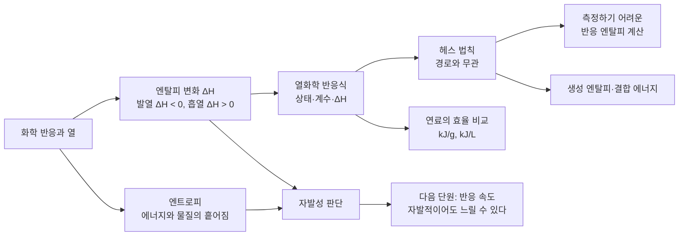

# 물질과 에너지 3. 화학 변화의 자발성 — 열의 출입과 흩어짐이 정하는 변화의 방향
<!-- prev: m3-01, 4-5, chem-3, matter-1, matter-2 -->
<!-- next: matter-4, mech-2, rxn-2, cell-2 -->

> [!NOTE]
> **성취기준**
> - **[12물에03-01]** 엔탈피의 의미를 알고, 엔탈피를 이용하여 열화학 반응식을 표현할 수 있다.
> - **[12물에03-02]** 측정하기 어려운 화학 반응의 엔탈피를 헤스 법칙으로 구하여 화학 법칙의 유용성을 인식할 수 있다.
> - **[12물에03-03]** 엔트로피의 의미를 이해하고, 엔탈피와 엔트로피의 변화로 화학 변화의 자발성을 설명할 수 있다.

**학습 목표**

1. 일정한 압력에서 화학 반응에 출입하는 열을 반응 엔탈피($\Delta H$)로 나타내고, 발열 반응과 흡열 반응을 $\Delta H$의 부호로 구분할 수 있다.
2. 물질의 상태와 반응 엔탈피를 포함한 열화학 반응식을 쓰고, 계수와 방향이 바뀔 때 $\Delta H$가 어떻게 바뀌는지 설명할 수 있다.
3. 헤스 법칙을 이용하여 직접 측정하기 어려운 반응의 엔탈피를 다른 반응의 엔탈피, 생성 엔탈피, 결합 에너지로부터 구할 수 있다.
4. 연소 엔탈피를 단위 질량·단위 부피당 값으로 바꾸어 수소·에탄올 같은 대체 연료와 화석 연료의 효율성을 비교할 수 있다.
5. 엔트로피의 의미를 정성적으로 이해하고, 엔탈피 변화와 엔트로피 변화를 함께 고려하여 화학 변화의 자발성을 설명할 수 있다.

**이 단원의 학습 사다리**

| 단계 | 무엇을 하나? |
|---|---|
| STEP 1. 이전 학습 다시 보기 | 상태 변화와 열, 화학 반응의 열 출입, 중화열, 평형과 온도를 다시 꺼내 본다 |
| STEP 2. 기초 다지기 | 계와 주위, 열량 측정 $Q = cm\Delta t$, 결합과 에너지, '저절로 일어나는 변화'를 디딤돌로 놓는다 |
| STEP 3. 핵심 개념 | 엔탈피 → 열화학 반응식 → 헤스 법칙 → 연료의 효율 → 엔트로피 → 자발성의 판단 |
| STEP 4. 오개념 바로잡기 | "자발적인 반응은 빠르다?", "흡열 반응은 저절로 일어날 수 없다?" 같은 착각을 바로잡는다 |
| STEP 5. 대학 전공으로 | 상태 함수, 엔트로피의 정량화, 깁스 자유 에너지와 평형·전지 |
| STEP 6. 생활·산업·진로 | 수소 연료와 연료 전지, 발열·냉각 제품, 암모니아 합성 |

---

## 🗺️ 단원 들어가기

일회용 손난로는 흔들기만 하면 따뜻해지고, 냉각 팩은 누르기만 하면 차가워진다. 하나는 열을 내고 하나는 열을 흡수하는데, **둘 다 저절로** 일어난다. 따뜻한 방에 둔 얼음도 열을 흡수하며 저절로 녹는다. 그렇다면 "열을 내는 변화만 저절로 일어난다"는 생각은 틀린 것이다. 무엇이 변화의 방향을 정할까?

또 하나의 질문. 탄소가 타서 일산화 탄소만 생기는 반응의 열은 왜 직접 재기 어려울까? 탄소를 산소와 반응시키면 일산화 탄소와 이산화 탄소가 섞여 생기기 때문이다. 화학자들은 이런 반응의 열을 실험하지 않고도 계산해 낸다. 이 단원에서는 반응열을 다루는 언어인 **엔탈피**, 계산의 도구인 **헤스 법칙**, 그리고 변화의 방향을 정하는 또 하나의 열쇠인 **엔트로피**를 차례로 배운다.

---

## STEP 1. 🔙 이전 학습 다시 보기

### 연계 개념표

| 이전 단원·성취기준 | 그때 배운 것 | 이 단원에서 확장되는 것 |
|---|---|---|
| 중1 「열」 [9과03-03] | 물질마다 비열이 다르다 | 물의 온도 변화로 반응열을 측정한다($Q = cm\Delta t$) |
| 중1 「물질의 상태 변화」 [9과04-04] | 융해·기화는 열을 흡수하고 응고·액화는 열을 방출한다 | 상태 변화도 엔탈피 변화로 쓰고, **엔트로피 변화**로 방향을 설명한다 |
| 중3 「화학 반응의 규칙성」 [9과16-06] | 화학 반응에서 열에너지가 출입한다 | 출입하는 열을 **반응 엔탈피**로 정량화한다 |
| 통합과학2 「물질 변화와 에너지 출입」 [10통과2-01-05] | 에너지를 흡수·방출하는 현상과 생활 속 이용(엔탈피는 다루지 않음) | 열화학 반응식과 엔탈피로 같은 현상을 **수치로** 표현한다 |
| 통합과학2 「산과 염기, 중화 반응」 [10통과2-01-04] | 중화 반응에서 용액의 온도가 올라간다 | 중화 반응의 엔탈피를 측정하고 헤스 법칙을 확인한다 |
| 화학 「화학 평형」 [12화학03-04] | 온도를 높이면 평형이 흡열 반응 쪽으로 이동한다 | 발열·흡열을 $\Delta H$의 부호로 정확히 나타낸다 |

### 준비 운동 (사전 진단)

**Q1.** 물 200 g의 온도가 5.0 °C 올랐다. 물이 얻은 열은 몇 J인가? (물의 비열 4.2 J/(g·°C))

**Q2.** 질산 암모늄을 물에 녹이면 용액의 온도가 내려간다. 이 변화는 열을 방출하는가, 흡수하는가?

**Q3.** 다음 중 열을 흡수하는 변화를 모두 고르시오.
ㄱ. 물의 증발 ㄴ. 메테인의 연소 ㄷ. 드라이아이스의 승화 ㄹ. 수증기의 응결

**Q4.** 화학 반응이 일어날 때 반응물의 결합을 끊는 과정은 에너지를 (흡수 / 방출)하고, 생성물의 결합을 만드는 과정은 에너지를 (흡수 / 방출)한다.

정답 및 해설

**Q1.** 4200 J. $Q = 4.2\times200\times5.0 = 4200\ \mathrm{J}$

**Q2.** 흡수한다. 용해 과정이 주위(물)에서 열을 빼앗아 용액의 온도가 내려간다.

**Q3.** ㄱ, ㄷ. 증발과 승화는 입자 사이의 인력을 끊어야 하므로 열을 흡수한다. 연소와 응결은 열을 방출한다.

**Q4.** 흡수, 방출. 결합을 끊으려면 에너지가 필요하고, 결합이 만들어지면 에너지가 나온다.

---

## STEP 2. 🧱 기초 다지기

### ① 계와 주위

열의 출입을 따질 때는 관심의 대상을 **계(system)**, 그 밖의 모든 것을 **주위(surroundings)** 라고 정한다. 비커 속에서 반응이 일어나면 반응하는 물질이 계이고, 용매인 물·비커·공기가 주위이다.

- 계가 주위로 열을 내보내면 **발열(exothermic)**: 주위의 온도가 올라간다.
- 계가 주위로부터 열을 받아들이면 **흡열(endothermic)**: 주위의 온도가 내려간다.

우리가 온도계로 재는 것은 계가 아니라 **주위의 온도 변화**이다.

### ② 열량을 재는 방법 — 열량계

간이 열량계(스타이로폼 컵 두 개를 겹친 것)에서 반응이 일어나면 반응에서 나온 열이 용액의 온도를 바꾼다. 열이 바깥으로 새지 않는다고 가정하면

$$
Q = c\,m\,\Delta t
$$

($c$: 비열, $m$: 용액의 질량, $\Delta t$: 온도 변화)로 반응에서 출입한 열의 양을 구할 수 있다. 묽은 수용액은 비열을 물과 같은 $4.18\ \mathrm{J/(g\cdot ^\circ C)}$, 밀도를 $1\ \mathrm{g/mL}$로 어림한다.

<!-- fig:matter-3-calorimeter -->

### ③ 결합과 에너지

화학 반응은 원자의 재배열이다. 반응물의 결합이 끊어지고(에너지 흡수) 생성물의 결합이 만들어진다(에너지 방출). 둘 중 어느 쪽이 큰지에 따라 반응 전체가 발열인지 흡열인지 정해진다. 결합 1 mol을 끊는 데 필요한 에너지를 **결합 에너지(bond energy)** 라고 한다.

| 결합 | 결합 에너지(kJ/mol, 약) | 결합 | 결합 에너지(kJ/mol, 약) |
|---|---|---|---|
| H–H | 436 | C–H | 413 |
| Cl–Cl | 243 | O=O | 498 |
| H–Cl | 431 | C=O(이산화 탄소) | 799 |
| N≡N | 945 | O–H | 463 |

### ④ '저절로 일어나는 변화'란?

외부에서 계속 에너지를 넣어 주지 않아도 일단 시작되면 스스로 진행되는 변화를 **자발적 변화(spontaneous change)** 라고 한다.

| 자발적인 변화 | 그 반대 방향(비자발적) |
|---|---|
| 뜨거운 커피가 식는다 | 식은 커피가 저절로 뜨거워진다 |
| 잉크 방울이 물 전체로 퍼진다 | 퍼진 잉크가 다시 한 방울로 모인다 |
| 철이 공기 중에서 녹슨다 | 녹이 저절로 철과 산소로 돌아간다 |
| 25 °C에서 얼음이 녹는다 | 25 °C에서 물이 저절로 언다 |

> [!IMPORTANT]
> '자발적'은 **변화가 일어날 수 있는 방향**을 말할 뿐, **얼마나 빨리** 일어나는지는 말해 주지 않는다. 철이 녹스는 것은 자발적이지만 몇 년이 걸리기도 한다. 빠르기는 다음 단원 「반응 속도」의 주제이다.

---

## STEP 3. 📘 핵심 개념

### ① 엔탈피 — 일정한 압력에서 출입하는 열

우리 주변의 반응은 대부분 열린 비커나 대기 중처럼 **압력이 일정한 조건**에서 일어난다. 이때 물질이 가진 에너지를 열의 출입과 연결하여 나타내는 양을 **엔탈피(enthalpy, $H$)** 라고 한다. 엔탈피의 절댓값은 알 수 없지만, 반응 전후의 **변화량**은 일정한 압력에서 출입한 열로 측정할 수 있다.

$$
\Delta H = H_{\text{생성물}} - H_{\text{반응물}} = (\text{일정한 압력에서 계가 흡수한 열})
$$

이 $\Delta H$를 **반응 엔탈피(enthalpy of reaction)** 라고 한다.

| 구분 | 발열 반응 | 흡열 반응 |
|---|---|---|
| 엔탈피의 크기 | $H_{\text{생성물}} < H_{\text{반응물}}$ | $H_{\text{생성물}} > H_{\text{반응물}}$ |
| $\Delta H$의 부호 | $\Delta H < 0$ | $\Delta H > 0$ |
| 주위의 온도 | 올라간다 | 내려간다 |
| 엔탈피 변화 그림 | 반응물이 위층, 생성물이 아래층(내려오는 계단) | 반응물이 아래층, 생성물이 위층(올라가는 계단) |
| 예 | 연소, 중화, 철의 산화, 산화 칼슘과 물 | 질산 암모늄의 용해, 탄산 칼슘의 열분해, 광합성 |

> [!TIP]
> 💡 **비유** — 엔탈피는 '건물의 층수'와 같다. 각 층(물질)이 지면에서 몇 m 높이인지 정확히 알 필요는 없다. 계단을 **몇 층 내려왔는지(발열)** 또는 **몇 층 올라갔는지(흡열)** 만 알면 된다.

<!-- fig:matter-3-exo-endo -->

#### 예제 1 — 중화 반응의 엔탈피 측정

간이 열량계에 25.0 °C의 1.0 M 염산 50 mL와 25.0 °C의 1.0 M 수산화 나트륨 수용액 50 mL를 섞었더니 최고 온도가 31.7 °C였다. 용액의 밀도는 1.0 g/mL, 비열은 4.18 J/(g·°C)이며 열의 손실은 없다고 가정한다. 물 1 mol이 생성될 때의 반응 엔탈피를 구하시오.

**풀이**
① 용액이 얻은 열: $Q = 4.18\times100\times(31.7-25.0) \approx 2800\ \mathrm{J} = 2.80\ \mathrm{kJ}$
② 생성된 물의 몰수: $1.0\ \mathrm{M}\times0.050\ \mathrm{L} = 0.050\ \mathrm{mol}$
③ 물 1 mol당: $2.80\div0.050 = 56\ \mathrm{kJ}$. 열이 방출되었으므로 $\Delta H \approx -56\ \mathrm{kJ}$

강산과 강염기의 중화 반응은 종류와 관계없이 $\mathrm{H^+(aq) + OH^-(aq) \rightarrow H_2O(l)}$이므로 거의 같은 값(약 −56 kJ)을 보인다.

### ② 열화학 반응식

화학 반응식에 **물질의 상태**와 **반응 엔탈피**를 함께 나타낸 것을 **열화학 반응식(thermochemical equation)** 이라고 한다.

$$
\mathrm{CH_4(g) + 2O_2(g) \rightarrow CO_2(g) + 2H_2O(l)} \qquad \Delta H = -890\ \mathrm{kJ}
$$

이 식은 "메테인 기체 1 mol이 산소 기체 2 mol과 반응하여 이산화 탄소 기체 1 mol과 액체 물 2 mol이 생성될 때 890 kJ의 열이 방출된다"는 뜻이다.

#### 열화학 반응식을 쓰고 읽는 규칙

| 규칙 | 예 | 이유 |
|---|---|---|
| ① 물질의 상태를 반드시 쓴다: (s), (l), (g), (aq) | $\mathrm{H_2O(l)}$와 $\mathrm{H_2O(g)}$는 엔탈피가 다르다 | 상태 변화에도 열이 출입한다 |
| ② 계수는 몰수를 뜻하며, 계수를 $n$배 하면 $\Delta H$도 $n$배 | $\mathrm{2CH_4 + 4O_2 \rightarrow \cdots}$ $\Delta H = -1780\ \mathrm{kJ}$ | 반응하는 양이 2배이면 열도 2배이다 |
| ③ 반응의 방향을 바꾸면 $\Delta H$의 부호가 바뀐다 | $\mathrm{CO_2(g) + 2H_2O(l) \rightarrow CH_4(g) + 2O_2(g)}$ $\Delta H = +890\ \mathrm{kJ}$ | 내려온 계단을 다시 올라가는 것과 같다 |
| ④ 분수 계수도 쓸 수 있다 | $\mathrm{H_2(g) + \tfrac{1}{2}O_2(g) \rightarrow H_2O(l)}$ $\Delta H = -285.8\ \mathrm{kJ}$ | 계수는 분자 수가 아닌 몰수이기 때문이다 |

물의 상태에 따른 차이를 보자.

$$
\mathrm{H_2(g) + \tfrac{1}{2}O_2(g) \rightarrow H_2O(l)} \qquad \Delta H = -285.8\ \mathrm{kJ}
$$

$$
\mathrm{H_2(g) + \tfrac{1}{2}O_2(g) \rightarrow H_2O(g)} \qquad \Delta H = -241.8\ \mathrm{kJ}
$$

두 값의 차이 44.0 kJ은 물 1 mol이 25 °C에서 기화할 때 흡수하는 열($\mathrm{H_2O(l) \rightarrow H_2O(g)}$, $\Delta H = +44.0\ \mathrm{kJ}$)과 같다. 「용액의 성질」에서 배운 물의 큰 기화열이 여기에도 드러난다.

#### 여러 가지 반응 엔탈피

| 이름 | 정의 | 예 |
|---|---|---|
| **연소 엔탈피** | 물질 1 mol이 완전히 연소할 때의 반응 엔탈피 | 메테인 −890 kJ/mol |
| **생성 엔탈피** | 화합물 1 mol이 가장 안정한 성분 원소로부터 생성될 때의 반응 엔탈피(원소의 생성 엔탈피는 0) | $\mathrm{H_2O(l)}$ −285.8 kJ/mol |
| **분해 엔탈피** | 화합물 1 mol이 성분 원소로 분해될 때의 반응 엔탈피(생성 엔탈피와 부호만 반대) | $\mathrm{H_2O(l)}$ +285.8 kJ/mol |
| **중화 엔탈피** | 산과 염기가 반응하여 물 1 mol이 생성될 때의 반응 엔탈피 | 약 −56 kJ/mol |
| **용해 엔탈피** | 물질 1 mol이 용매에 녹을 때의 엔탈피 변화 | $\mathrm{NH_4NO_3}$ 약 +26 kJ/mol, $\mathrm{NaOH}$ 약 −44 kJ/mol |

#### 예제 2 — 가스레인지의 열

메테인 8.0 g이 완전히 연소할 때 방출되는 열은 몇 kJ인가? 이 열을 모두 물에 전달한다면 20 °C의 물 몇 kg을 100 °C까지 데울 수 있는가? (C = 12, H = 1, 물의 비열 4.18 J/(g·°C))

**풀이**
① 메테인의 몰수: $8.0\div16 = 0.50\ \mathrm{mol}$ → 방출되는 열 $= 0.50\times890 = 445\ \mathrm{kJ}$
② $m = \dfrac{Q}{c\Delta t} = \dfrac{445\,000}{4.18\times80} \approx 1330\ \mathrm{g}$ → 약 1.3 kg

실제 가스레인지에서는 열의 상당 부분이 공기 중으로 빠져나가므로 이보다 적게 데워진다.

### ③ 헤스 법칙 — 경로와 관계없는 반응 엔탈피

1840년 헤스는 "**화학 반응에서 출입하는 열의 총량은 반응 경로와 관계없이 반응 처음 상태와 나중 상태만으로 결정된다**"는 것을 실험으로 밝혔다. 이것이 **헤스 법칙(Hess's law, 총열량 불변 법칙)** 이다.

탄소가 이산화 탄소가 되는 두 경로를 비교해 보자.

| 경로 | 단계 | $\Delta H$ |
|---|---|---|
| 경로 1(한 번에) | $\mathrm{C(s,흑연) + O_2(g) \rightarrow CO_2(g)}$ | −393.5 kJ |
| 경로 2(두 단계) | $\mathrm{C(s,흑연) + \tfrac{1}{2}O_2(g) \rightarrow CO(g)}$ | $\Delta H_x$ |
| | $\mathrm{CO(g) + \tfrac{1}{2}O_2(g) \rightarrow CO_2(g)}$ | −283.0 kJ |

헤스 법칙에 따르면 두 경로의 총열량이 같으므로

$$
-393.5 = \Delta H_x + (-283.0) \quad\Longrightarrow\quad \Delta H_x = -110.5\ \mathrm{kJ}
$$

탄소를 산소와 반응시키면 일산화 탄소만 얻기가 어려워 $\Delta H_x$를 직접 측정하기 힘들지만, **측정하기 쉬운 두 연소 반응**의 값으로 계산할 수 있다.

> [!TIP]
> 💡 **비유** — 1층에서 5층으로 갈 때 엘리베이터를 타든, 계단으로 3층에 들렀다 가든, 오른 높이는 4층으로 같다. 반응 엔탈피도 '출발층(반응물)과 도착층(생성물)'만으로 정해진다. 엔탈피 변화 그림을 그리면 경로 1의 화살표 하나와 경로 2의 화살표 두 개가 같은 높이 차를 나타낸다.

<!-- fig:matter-3-hess-steps -->

#### 헤스 법칙 계산의 요령 — 반응식을 '더하고 빼기'

1. 구하려는 반응식(목표 식)을 먼저 쓴다.
2. 주어진 반응식에서 목표 식의 물질이 **같은 쪽, 같은 계수**로 나오도록 방향을 바꾸거나(부호 반대) 몇 배 한다($\Delta H$도 같은 배수).
3. 반응식을 모두 더해 양쪽에 같이 있는 물질을 지운다. $\Delta H$도 모두 더한다.

#### 예제 3 — 측정할 수 없는 반응: 흑연이 다이아몬드로

흑연과 다이아몬드의 연소 엔탈피는 다음과 같다.

$$
\mathrm{C(s,흑연) + O_2(g) \rightarrow CO_2(g)} \qquad \Delta H_1 = -393.5\ \mathrm{kJ}
$$

$$
\mathrm{C(s,다이아몬드) + O_2(g) \rightarrow CO_2(g)} \qquad \Delta H_2 = -395.4\ \mathrm{kJ}
$$

$\mathrm{C(s,흑연) \rightarrow C(s,다이아몬드)}$의 반응 엔탈피를 구하시오.

**풀이** 첫째 식은 그대로, 둘째 식은 방향을 바꾸어($+395.4\ \mathrm{kJ}$) 더한다.

$$
\Delta H = \Delta H_1 - \Delta H_2 = -393.5 - (-395.4) = +1.9\ \mathrm{kJ}
$$

흑연이 다이아몬드로 바뀌는 반응은 상온·상압에서는 사실상 일어나지 않아 직접 잴 수 없다. 그러나 헤스 법칙을 쓰면 다이아몬드가 흑연보다 엔탈피가 1.9 kJ/mol 높다는 것을 알 수 있다.

#### 생성 엔탈피로 반응 엔탈피 구하기

모든 반응은 "반응물을 성분 원소로 분해 → 원소로부터 생성물을 생성"하는 두 단계 경로로 생각할 수 있다. 헤스 법칙을 적용하면

$$
\Delta H_{\text{반응}} = \sum \big(\text{생성물의 생성 엔탈피}\times\text{계수}\big) - \sum \big(\text{반응물의 생성 엔탈피}\times\text{계수}\big)
$$

| 물질 | 생성 엔탈피(kJ/mol, 25 °C) | 물질 | 생성 엔탈피(kJ/mol, 25 °C) |
|---|---|---|---|
| $\mathrm{CO_2(g)}$ | −393.5 | $\mathrm{CH_4(g)}$ | −74.8 |
| $\mathrm{CO(g)}$ | −110.5 | $\mathrm{C_3H_8(g)}$ | −103.8 |
| $\mathrm{H_2O(l)}$ | −285.8 | $\mathrm{C_2H_5OH(l)}$ | −277.7 |
| $\mathrm{H_2O(g)}$ | −241.8 | $\mathrm{NH_3(g)}$ | −46.1 |
| $\mathrm{O_2(g)}$, $\mathrm{H_2(g)}$, $\mathrm{C(s,흑연)}$ | 0 | $\mathrm{NaCl(s)}$ | −411.2 |

<!-- fig:matter-3-formation-path -->

#### 예제 4 — 에탄올의 연소 엔탈피

생성 엔탈피 표를 이용하여 다음 반응의 엔탈피를 구하시오.

$$
\mathrm{C_2H_5OH(l) + 3O_2(g) \rightarrow 2CO_2(g) + 3H_2O(l)}
$$

**풀이**

$$
\Delta H = [2(-393.5) + 3(-285.8)] - [(-277.7) + 3(0)] = -1644.4 + 277.7 = -1366.7\ \mathrm{kJ}
$$

에탄올 1 mol(46 g)이 완전히 연소하면 약 1367 kJ의 열이 나온다.

#### 결합 에너지로 반응 엔탈피 어림하기

기체 반응에서는 끊는 결합과 만드는 결합의 에너지로 반응 엔탈피를 어림할 수 있다. 이것도 '모든 결합을 끊어 원자로 만든 뒤 다시 조립한다'는 가상의 경로에 헤스 법칙을 적용한 것이다.

$$
\Delta H \approx \sum(\text{끊어지는 결합의 에너지}) - \sum(\text{생성되는 결합의 에너지})
$$

<!-- fig:matter-3-bond-path -->

#### 예제 5

STEP 2의 결합 에너지 표를 이용하여 다음 두 반응의 엔탈피를 어림하시오.
(1) $\mathrm{H_2(g) + Cl_2(g) \rightarrow 2HCl(g)}$
(2) $\mathrm{CH_4(g) + 2O_2(g) \rightarrow CO_2(g) + 2H_2O(g)}$

**풀이**
(1) 끊는 결합: H–H 436 + Cl–Cl 243 = 679 kJ, 만드는 결합: H–Cl 2 × 431 = 862 kJ → $\Delta H \approx 679 - 862 = -183\ \mathrm{kJ}$
(2) 끊는 결합: C–H 4 × 413 + O=O 2 × 498 = 2648 kJ, 만드는 결합: C=O 2 × 799 + O–H 4 × 463 = 3450 kJ → $\Delta H \approx -802\ \mathrm{kJ}$

(2)의 결과는 생성되는 물이 기체이므로 −890 kJ(액체 물)보다 덜 음수이다. 결합 에너지는 여러 분자에서 구한 **평균값**이므로 계산 결과는 어림값이다.

### ④ 연료의 효율 비교 — 대체 연료와 화석 연료

연소 엔탈피는 1 mol 기준이지만, 연료를 실제로 비교할 때는 **같은 질량** 또는 **같은 부피**에서 얼마나 많은 열이 나오는지가 중요하다. 자동차에 싣는 연료는 무게와 탱크 크기가 모두 제한되기 때문이다.

| 연료 | 연소 엔탈피(kJ/mol) | 몰질량(g/mol) | 단위 질량당 열(kJ/g) | 단위 부피당 열 | 1000 kJ당 $\mathrm{CO_2}$(mol) |
|---|---|---|---|---|---|
| 수소 $\mathrm{H_2(g)}$ | −285.8 | 2.0 | 약 142 | 기체 약 12 kJ/L(25 °C, 1 atm), 액체 약 10 MJ/L | 0 |
| 메테인 $\mathrm{CH_4(g)}$ | −890 | 16.0 | 약 55.5 | 기체 약 36 kJ/L(25 °C, 1 atm) | 약 1.1 |
| 프로페인 $\mathrm{C_3H_8(g)}$ | −2220 | 44.1 | 약 50.3 | — | 약 1.4 |
| 옥테인 $\mathrm{C_8H_{18}(l)}$(휘발유 대표) | −5471 | 114.2 | 약 47.9 | 약 34 MJ/L | 약 1.5 |
| 에탄올 $\mathrm{C_2H_5OH(l)}$ | −1367 | 46.1 | 약 29.7 | 약 23 MJ/L | 약 1.5 |

(연소 생성물의 물은 액체로 기준한 값이다. 1 MJ = 1000 kJ)

이 표에서 다음을 읽을 수 있다.
- **수소**는 단위 질량당 열이 휘발유의 약 3배로 가장 크고, 연소 생성물이 물뿐이다. 그러나 기체 상태에서는 단위 부피당 열이 매우 작아, 압축하거나 −253 °C 정도로 냉각해 액화해야 한다. 액체 수소조차 같은 부피의 휘발유가 내는 열의 3분의 1에도 못 미친다.
- **에탄올**은 분자 안에 이미 산소가 들어 있어(부분적으로 산화된 상태) 단위 질량당 열이 휘발유의 약 60 % 수준이다. 대신 식물에서 얻을 수 있어(바이오에탄올), 식물이 자라며 흡수한 이산화 탄소를 고려하면 탄소 배출을 줄일 수 있다.
- 탄소 수에 비해 수소가 많은 연료(메테인)일수록 같은 열을 낼 때 이산화 탄소가 적게 나온다.

> [!NOTE]
> 연료의 '효율성'은 열량만으로 정해지지 않는다. 연료를 만드는 데 드는 에너지, 저장·운반의 안전성, 오염 물질 배출, 가격 등을 함께 따져야 한다. 수소도 어떤 방법으로 만들었는지(화석 연료 개질 / 재생 에너지 전기로 물 분해)에 따라 환경 영향이 크게 달라진다.

#### 예제 6

같은 질량(1.0 kg)의 수소와 옥테인이 완전히 연소할 때 방출되는 열을 비교하시오.

**풀이**
- 수소: $\dfrac{1000}{2.0}\times285.8 \approx 1.4\times10^5\ \mathrm{kJ}$
- 옥테인: $\dfrac{1000}{114.2}\times5471 \approx 4.8\times10^4\ \mathrm{kJ}$

같은 질량이면 수소가 약 3배의 열을 낸다. 무게가 중요한 로켓 연료로 액체 수소가 쓰이는 이유 중 하나이다.

### ⑤ 엔트로피 — 흩어짐의 정도

엔탈피만으로는 자발성을 설명할 수 없다. 얼음의 융해, 질산 암모늄의 용해는 열을 흡수하는데도($\Delta H > 0$) 저절로 일어난다. 이 변화들의 공통점은 **입자와 에너지가 더 넓게 흩어진다**는 것이다.

**엔트로피(entropy, $S$)** 는 계의 입자와 에너지가 얼마나 흩어져 있는지(입자들이 배열되고 에너지를 나누어 가질 수 있는 방법이 얼마나 많은지)를 나타내는 양이다. 흔히 '무질서도'라고도 부른다.

> [!TIP]
> 💡 **비유** — 동전 4개를 던질 때 '모두 앞면'이 나오는 방법은 1가지뿐이지만 '앞면 2개, 뒷면 2개'가 나오는 방법은 6가지이다. 경우의 수가 많은 상태가 훨씬 자주 나타난다. 분자는 $10^{23}$개 단위이므로, 흩어질 방법이 압도적으로 많은 상태로 저절로 가게 된다. 정리된 방이 저절로 어질러지는 것과 같다.

#### 엔트로피가 커지는 변화(정성적 판단)

| 변화 | 엔트로피 | 이유 |
|---|---|---|
| 고체 → 액체 → 기체 | 커진다 | 입자가 움직일 수 있는 공간과 방법이 많아진다. $S$(기체) ≫ $S$(액체) > $S$(고체) |
| 고체나 액체가 용매에 녹는다 | 대체로 커진다 | 입자가 용액 전체로 퍼진다 |
| 기체의 몰수가 늘어나는 반응 | 커진다 | 기체 분자 수가 많을수록 흩어질 방법이 많다. 예: $\mathrm{CaCO_3(s) \rightarrow CaO(s) + CO_2(g)}$ |
| 온도가 올라간다 | 커진다 | 분자 운동이 활발해져 에너지가 나뉠 방법이 많아진다 |
| 기체가 확산한다, 기체가 팽창한다 | 커진다 | 입자가 차지하는 공간이 넓어진다 |
| 복잡한 분자가 작은 분자 여럿으로 분해 | 커진다 | 입자 수가 늘어난다 |

반대로 기체가 응결하거나, 기체의 몰수가 줄어드는 반응($\mathrm{N_2(g) + 3H_2(g) \rightarrow 2NH_3(g)}$)에서는 계의 엔트로피가 작아진다.

<!-- fig:matter-3-entropy-up -->

#### 예제 7 — 엔트로피 변화의 부호 예측

다음 변화에서 계의 엔트로피가 커지는지 작아지는지 판단하시오.
(1) $\mathrm{H_2O(l) \rightarrow H_2O(g)}$
(2) $\mathrm{2SO_2(g) + O_2(g) \rightarrow 2SO_3(g)}$
(3) $\mathrm{NH_4NO_3(s) \rightarrow NH_4^+(aq) + NO_3^-(aq)}$
(4) $\mathrm{Ag^+(aq) + Cl^-(aq) \rightarrow AgCl(s)}$

**풀이** (1) 커진다(액체 → 기체). (2) 작아진다(기체 3 mol → 2 mol). (3) 커진다(고체 결정이 이온으로 흩어진다). (4) 작아진다(흩어져 있던 이온이 고체 앙금으로 모인다).

#### 엔트로피와 자발성 — 열역학 제2법칙

자발적인 변화에서는 **계와 주위를 합한 전체(우주)의 엔트로피가 증가**한다. 이것을 **열역학 제2법칙(second law of thermodynamics)** 이라고 한다. 따라서 자발성을 판단하려면 계의 엔트로피 변화뿐 아니라 **주위의 엔트로피 변화**도 생각해야 한다.

- 계가 주위로 열을 방출하면(발열, $\Delta H < 0$) 주위의 분자 운동이 활발해져 **주위의 엔트로피가 커진다.**
- 계가 주위에서 열을 흡수하면(흡열, $\Delta H > 0$) **주위의 엔트로피가 작아진다.**
- 같은 양의 열이라도 **주위의 온도가 낮을수록** 주위의 엔트로피를 크게 변화시킨다. 추운 방의 조용한 분위기는 작은 열에도 크게 흔들리지만, 이미 뜨겁고 소란한 방은 같은 열에도 덜 달라지는 것과 같다.

즉, 반응 엔탈피는 **주위의 엔트로피 변화**를 통해 자발성에 기여한다. 엔탈피와 엔트로피는 서로 다른 것이 아니라, 전체 엔트로피라는 하나의 저울에 올라가는 두 개의 추이다.

### ⑥ 엔탈피와 엔트로피로 자발성 설명하기

계의 엔탈피 변화(→ 주위의 엔트로피 변화)와 계의 엔트로피 변화를 함께 고려하면 다음 네 경우로 정리된다.

| 경우 | $\Delta H$(계) | $\Delta S$(계) | 자발성 | 예 |
|---|---|---|---|---|
| Ⅰ | − (발열) | + (흩어짐 증가) | **모든 온도에서 자발적** | 과산화 수소의 분해, 연소 대부분 |
| Ⅱ | + (흡열) | − (흩어짐 감소) | **모든 온도에서 비자발적** | 이산화 탄소와 물이 저절로 포도당과 산소가 되는 반응(광합성은 빛 에너지를 계속 공급받아 일어난다) |
| Ⅲ | − (발열) | − (흩어짐 감소) | **낮은 온도에서 자발적** | 물의 응고(0 °C 아래), 암모니아 합성, 철의 산화 |
| Ⅳ | + (흡열) | + (흩어짐 증가) | **높은 온도에서 자발적** | 얼음의 융해(0 °C 위), 물의 증발, 탄산 칼슘의 열분해, 질산 암모늄의 용해 |

경우 Ⅲ과 Ⅳ에서 온도가 결정적인 이유는 ⑤에서 본 것처럼 **열이 주위의 엔트로피에 미치는 효과는 온도가 낮을수록 크기** 때문이다.
- 낮은 온도에서는 엔탈피 요인(열 방출로 인한 주위 엔트로피 증가)이 상대적으로 중요하다.
- 높은 온도에서는 계의 엔트로피 요인(흩어짐)이 상대적으로 중요하다.

#### 물과 얼음 — 같은 물질, 온도에 따라 바뀌는 방향

| 온도 | 얼음 → 물 ($\Delta H > 0$, $\Delta S > 0$) | 해석 |
|---|---|---|
| 0 °C보다 높다 | 자발적(얼음이 녹는다) | 흩어짐이 커지는 효과가 열 흡수로 주위가 잃는 엔트로피보다 크다 |
| 0 °C | 평형(얼음과 물이 공존) | 두 효과가 정확히 균형을 이룬다 |
| 0 °C보다 낮다 | 비자발적(반대로 물이 언다) | 열 방출로 주위가 얻는 엔트로피가 계의 흩어짐 감소보다 크다 |

> [!IMPORTANT]
> 자발성은 **"전체 엔트로피가 증가하는가?"** 로 판단한다. 발열 반응이 저절로 일어나기 쉬운 것은 열을 방출해 **주위의 엔트로피를 높이기 때문**이고, 흡열 반응도 계의 엔트로피가 충분히 커지면 저절로 일어난다.

<!-- sim:entropy-mixing -->

#### 흡열인데 저절로 일어나는 반응

수산화 바륨 팔수화물($\mathrm{Ba(OH)_2\cdot8H_2O}$) 고체와 염화 암모늄($\mathrm{NH_4Cl}$) 고체를 비커에 넣고 섞으면, 반응이 저절로 일어나며 온도가 0 °C 아래까지 떨어진다. 비커 밑에 물을 적신 나무판을 대 두면 비커가 나무판에 얼어붙을 정도이다.

$$
\mathrm{Ba(OH)_2\cdot8H_2O(s) + 2NH_4Cl(s) \rightarrow BaCl_2(aq) + 2NH_3(g) + 10H_2O(l)}
$$

열을 크게 흡수하지만, 고체 두 가지에서 **기체(암모니아)와 많은 양의 액체 물, 녹아 흩어진 이온**이 생기므로 계의 엔트로피가 매우 크게 증가한다. 그래서 상온에서도 자발적이다.

#### 예제 8 — 자발성 예측하기

탄산 칼슘의 열분해 $\mathrm{CaCO_3(s) \rightarrow CaO(s) + CO_2(g)}$는 $\Delta H = +178\ \mathrm{kJ}$이다. (1) 이 반응의 계의 엔트로피 변화의 부호를 예측하고, (2) 이 반응이 상온에서는 일어나지 않지만 석회 가마(약 900 °C 이상)에서는 일어나는 이유를 설명하시오.

**풀이**
(1) 고체 1 mol에서 고체 1 mol과 기체 1 mol이 생기므로 $\Delta S > 0$이다.
(2) $\Delta H > 0$, $\Delta S > 0$인 경우 Ⅳ이다. 상온에서는 열을 흡수하여 주위의 엔트로피가 줄어드는 효과가 더 커서 비자발적이다. 온도가 높아지면 열이 주위 엔트로피에 미치는 효과가 상대적으로 작아지고, 기체가 생기며 흩어짐이 커지는 효과가 이겨 자발적이 된다.

#### 자발적이어도 느릴 수 있다

다이아몬드가 흑연으로 바뀌는 반응($\Delta H = -1.9\ \mathrm{kJ}$)은 상온·상압에서 자발적이다. 그런데도 다이아몬드 반지는 수백 년이 지나도 흑연이 되지 않는다. 종이와 산소의 반응(연소)도 자발적이지만, 책은 불을 붙이기 전까지 타지 않는다. 자발성은 **변화가 갈 수 있는 방향**을, 반응 속도는 **그 방향으로 얼마나 빨리 가는지**를 알려 준다. 두 개념을 연결하는 '언덕'이 다음 단원의 **활성화 에너지**이다.

---

## STEP 4. ⚠️ 오개념 바로잡기

| 흔한 오개념 | 올바른 개념 | 왜 그럴까? |
|---|---|---|
| 발열 반응은 $\Delta H$가 양수이다 | 발열 반응은 **$\Delta H < 0$** 이다 | $\Delta H$는 계의 엔탈피 변화이다. 계가 열을 내보내면 계의 엔탈피가 줄어든다 |
| 열화학 반응식에서 물질의 상태는 생략해도 된다 | 상태에 따라 $\Delta H$가 달라지므로 **반드시 쓴다** | $\mathrm{H_2O(l)}$와 $\mathrm{H_2O(g)}$의 생성 엔탈피는 44 kJ/mol 차이가 난다 |
| 헤스 법칙은 실제로 그 경로로 반응이 일어나야 성립한다 | 경로는 **가상의 경로**여도 된다 | 반응 엔탈피는 처음과 나중 상태만으로 정해지므로, 계산에 편한 어떤 경로든 쓸 수 있다 |
| 흡열 반응은 저절로 일어날 수 없다 | 계의 **엔트로피가 충분히 증가하면** 흡열 반응도 자발적이다 | 얼음의 융해, 질산 암모늄의 용해, 냉각 팩의 반응이 그 예이다 |
| 자발적인 반응은 빠르게 일어난다 | 자발성은 **방향**만 알려 주며 **속도**와는 관계없다 | 다이아몬드 → 흑연은 자발적이지만 매우 느리다 |
| 계의 엔트로피가 감소하면 그 변화는 결코 자발적이지 않다 | **주위의 엔트로피 증가가 더 크면** 자발적이다 | 0 °C 아래에서 물이 어는 것은 계의 엔트로피가 감소하지만, 방출된 열로 주위의 엔트로피가 더 많이 증가한다 |

---

## STEP 5. 🎓 다음 단계로 한 걸음 더

> [!CAUTION]
> 이 절은 **고등학교 교육과정 범위 밖의 심화 내용**으로 평가 대상이 아니다. 이 과목에서는 엔탈피를 열의 출입으로만 다루고, 엔트로피는 정성적으로 다루며, 깁스 자유 에너지는 다루지 않는다. 대학에서 어떻게 확장되는지 맛보기로만 소개한다.

### 대학 전공 과목과의 연결

| 대학 과목 | 이어지는 내용 |
|---|---|
| 일반화학 | 열역학 제1·2·3법칙, 표준 엔트로피, 깁스 자유 에너지, 자유 에너지와 평형 상수 |
| 물리화학 | 상태 함수와 완전 미분, 통계 역학으로 보는 엔트로피($S = k_\mathrm{B}\ln W$) |
| 화학공학 열역학 | 공정의 에너지 수지, 반응기 열 설계, 엑서지 분석 |
| 전기화학·에너지공학 | 전지의 기전력과 자유 에너지, 연료 전지의 이론 효율 |
| 생화학 | ATP 가수 분해와 짝지어진 반응의 자유 에너지 |

### ① 열역학 함수로서의 엔탈피

대학에서는 엔탈피를 내부 에너지 $U$, 압력 $P$, 부피 $V$로 정의한다.

$$
H = U + PV, \qquad \Delta H = \Delta U + P\Delta V \quad(\text{일정한 압력})
$$

엔탈피는 현재 상태만으로 값이 정해지는 **상태 함수(state function)** 이다. 헤스 법칙은 바로 이 성질의 결과이다. 반면 열과 일은 경로에 따라 달라지는 양이다.

### ② 엔트로피의 정량화

엔트로피 변화는 가역 과정에서 흡수한 열을 절대 온도로 나눈 값으로 정의된다.

$$
\Delta S = \frac{q_{\text{가역}}}{T}, \qquad \Delta S_{\text{주위}} = -\frac{\Delta H_{\text{계}}}{T}
$$

STEP 3에서 "같은 열이라도 온도가 낮을수록 주위의 엔트로피를 크게 바꾼다"고 한 것이 이 식의 $1/T$이다. 볼츠만은 엔트로피를 미시 상태의 수 $W$로 $S = k_\mathrm{B}\ln W$라 나타냈다(동전 비유의 '경우의 수').

### ③ 깁스 자유 에너지

계의 양만으로 자발성을 판단하기 위해 **깁스 자유 에너지** $G = H - TS$를 정의한다. 일정한 온도와 압력에서

$$
\Delta G = \Delta H - T\Delta S, \qquad \Delta G < 0 \text{ 이면 자발적}
$$

STEP 3의 네 가지 경우가 이 한 식으로 정리된다. 예를 들어 얼음의 융해($\Delta H = +6.01\ \mathrm{kJ/mol}$, $\Delta S = +22.0\ \mathrm{J/(mol\cdot K)}$)에서 $\Delta G = 0$이 되는 온도는

$$
T = \frac{\Delta H}{\Delta S} = \frac{6010}{22.0} \approx 273\ \mathrm{K}
$$

로, 정확히 0 °C이다. 암모니아 합성($\Delta H \approx -92\ \mathrm{kJ}$, $\Delta S \approx -199\ \mathrm{J/K}$)은 약 460 K보다 낮은 온도에서 자발적이지만, 실제 공장은 반응 속도를 위해 더 높은 온도를 쓰고 압력과 촉매로 이를 보완한다(「반응 속도」).

### ④ 자유 에너지는 평형과 전지로 이어진다

$$
\Delta G^\circ = -RT\ln K, \qquad \Delta G = -nFE
$$

첫째 식은 「화학 평형」의 평형 상수 $K$와, 둘째 식은 「산화·환원 반응」의 전지 전위 $E$와 자유 에너지를 연결한다. 엔탈피·엔트로피·평형·전기 화학이 하나의 이론으로 묶이는 셈이다.

### 지금 vs 다음 단계

| 주제 | 지금(물질과 에너지) | 대학(일반화학·물리화학) |
|---|---|---|
| 엔탈피 | 일정 압력에서 출입하는 열, 열화학 반응식 | $H = U + PV$, 상태 함수, 열용량과 온도 의존성 |
| 헤스 법칙 | 반응식 더하기, 생성 엔탈피, 결합 에너지 | 상태 함수의 성질, 본–하버 순환으로 격자 에너지 계산 |
| 엔트로피 | 흩어짐의 정도, 부호 예측(정성적) | $\Delta S = q_{\text{가역}}/T$, 표준 몰 엔트로피, $S = k_\mathrm{B}\ln W$ |
| 자발성 | $\Delta H$와 $\Delta S$의 부호, 온도의 영향(정성적) | $\Delta G = \Delta H - T\Delta S$, $\Delta G^\circ = -RT\ln K$ |

---

## STEP 6. 🏭 생활·산업·진로 연결

### 사례 1. 수소 연료와 연료 전지

- **원리** 수소의 연소 엔탈피는 단위 질량당 가장 크고 생성물은 물뿐이다. 연료 전지는 이 반응의 에너지를 불꽃 없이 전기 에너지로 바꾼다.
- **어디에 쓰이나** 수소 연료 전지 자동차·버스, 발전용 연료 전지, 로켓 엔진(액체 수소+액체 산소). 저장(고압 탱크, 액화, 수소 저장 합금)과 생산 방식이 핵심 과제이다.

### 사례 2. 발열·냉각 제품의 설계

- **원리** 용해 엔탈피와 반응 엔탈피의 부호와 크기로 원하는 온도 변화를 설계한다.
- **어디에 쓰이나** 질산 암모늄·요소의 용해를 이용한 냉각 팩, 철의 산화를 이용한 손난로, 산화 칼슘과 물의 반응을 이용한 발열 도시락. 엔탈피 값을 알면 "몇 g을 넣으면 몇 °C가 변하는가"를 미리 계산할 수 있다.

### 사례 3. 암모니아 합성 공정

- **원리** $\mathrm{N_2(g) + 3H_2(g) \rightarrow 2NH_3(g)}$는 발열 반응이면서 기체 몰수가 줄어 엔트로피가 감소한다(경우 Ⅲ). 낮은 온도일수록 유리하지만, 너무 낮으면 반응이 너무 느리다.
- **어디에 쓰이나** 비료의 원료인 암모니아 생산. 공정 엔지니어는 반응 엔탈피로 반응기에서 발생하는 열을 계산해 냉각 장치를 설계하고, 그 열을 다른 공정에 재활용한다.

### 관련 진로와 학과

| 진로 | 하는 일 | 관련 학과 |
|---|---|---|
| 에너지·연료 연구원 | 수소·바이오 연료 개발, 연료 효율 평가 | 에너지공학과, 화학공학과, 화학과 |
| 공정 엔지니어 | 반응기 열 설계, 에너지 회수 | 화학공학과, 기계공학과 |
| 배터리·연료 전지 연구원 | 전기 화학 에너지 변환 장치 개발 | 화학과, 신소재공학과, 전기화학 관련 학과 |
| 열분석·소재 분석가 | 열량 측정 장비로 소재의 열적 성질 분석 | 화학과, 재료공학과 |
| 기후·환경 정책 연구원 | 연료별 탄소 배출 평가, 에너지 전환 정책 | 환경공학과, 에너지정책 관련 학과 |

---

## 🔬 탐구 활동

### 활동 A. 중화 반응으로 헤스 법칙 확인하기

**목표** 고체 수산화 나트륨이 염산과 반응하는 과정을 두 경로로 진행하여 반응 엔탈피를 측정하고, 헤스 법칙이 성립하는지 확인한다.

| 반응 | 열화학 반응식 |
|---|---|
| (1) 용해 | $\mathrm{NaOH(s) \rightarrow NaOH(aq)}$, $\Delta H_1$ |
| (2) 중화 | $\mathrm{NaOH(aq) + HCl(aq) \rightarrow NaCl(aq) + H_2O(l)}$, $\Delta H_2$ |
| (3) 한 번에 | $\mathrm{NaOH(s) + HCl(aq) \rightarrow NaCl(aq) + H_2O(l)}$, $\Delta H_3$ |

헤스 법칙이 성립한다면 $\Delta H_3 = \Delta H_1 + \Delta H_2$이다.

**준비물** 스타이로폼 컵 2개(겹쳐 사용)와 뚜껑, 디지털 온도 센서, 고체 수산화 나트륨, 0.50 M 염산, 1.0 M 염산, 1.0 M 수산화 나트륨 수용액, 증류수, 눈금 실린더, 전자저울, 보안경, 장갑

**과정**
1. 반응 (1): 증류수 100 mL에 $\mathrm{NaOH(s)}$ 2.0 g(0.050 mol)을 넣고 저으며 최고 온도를 측정한다.
2. 반응 (3): 0.50 M 염산 100 mL에 $\mathrm{NaOH(s)}$ 2.0 g을 넣고 최고 온도를 측정한다.
3. 반응 (2): 1.0 M 염산 50 mL와 1.0 M 수산화 나트륨 수용액 50 mL(처음 온도를 같게 맞춘다)를 섞고 최고 온도를 측정한다.
4. 용액의 질량을 약 100 g, 비열을 4.18 J/(g·°C)로 하여 각 반응의 열과 $\mathrm{NaOH}$ 1 mol당 $\Delta H$를 구한다.

**결과 기록**

| 반응 | 처음 온도(°C) | 최고 온도(°C) | $\Delta t$(°C) | $Q$(kJ) | $\Delta H$(kJ/mol) |
|---|---|---|---|---|---|
| (1) | | | | | |
| (2) | | | | | |
| (3) | | | | | |

**예시 결과로 연습하기** 온도 상승이 (1) 5.3 °C, (2) 6.7 °C, (3) 12.0 °C였다면
- $\Delta H_1 = -\dfrac{4.18\times100\times5.3}{0.050} \approx -44\ \mathrm{kJ/mol}$
- $\Delta H_2 = -\dfrac{4.18\times100\times6.7}{0.050} \approx -56\ \mathrm{kJ/mol}$
- $\Delta H_3 = -\dfrac{4.18\times100\times12.0}{0.050} \approx -100\ \mathrm{kJ/mol}$

$\Delta H_1 + \Delta H_2 \approx -100\ \mathrm{kJ/mol} \approx \Delta H_3$이므로 헤스 법칙이 성립한다.

**생각해 보기**
1. 측정한 $\Delta H_3$가 $\Delta H_1 + \Delta H_2$와 다르다면, 그 원인(열 손실, 수산화 나트륨의 수분 흡수 등)은 무엇일까?
2. 열량계의 열 손실을 줄이기 위해 실험 장치를 어떻게 개선할 수 있을까?

> [!WARNING]
> **안전 수칙** 고체 수산화 나트륨은 피부와 눈을 심하게 손상시키므로 반드시 보안경과 장갑을 착용하고 핀셋이나 약숟가락으로 다룬다. 공기 중 수분을 빨리 흡수하므로 무게를 잰 뒤 바로 사용한다. 남은 산·염기 용액은 중화한 뒤 실험실 폐수 처리 기준에 따라 처리한다.

### 활동 B. 대체 연료와 화석 연료의 효율성 비교하기

**목표** 알코올램프(에탄올)와 휴대용 가스 버너(뷰테인)로 같은 양의 물을 데우고, 소모된 연료의 질량으로 단위 질량당 방출 열을 비교한다.

**과정**
1. 알루미늄 캔에 물 200 g을 넣고 처음 온도를 잰다.
2. 연료 장치의 질량을 잰 뒤, 물의 온도가 20 °C 오를 때까지 가열하고 다시 질량을 잰다.
3. $Q = cm\Delta t$로 물이 얻은 열을 구하고, 연료 1 g당 열(kJ/g)을 계산한다.
4. 문헌값(에탄올 약 29.7 kJ/g, 뷰테인 약 49.5 kJ/g)과 비교하여 열 전달 효율을 구한다.

| 연료 | 소모된 질량(g) | 물이 얻은 열(kJ) | 측정값(kJ/g) | 문헌값(kJ/g) | 효율(%) |
|---|---|---|---|---|---|
| 에탄올 | | | | 약 29.7 | |
| 뷰테인 | | | | 약 49.5 | |

**생각해 보기** 측정값이 문헌값보다 훨씬 작은 이유는? 단위 부피당 열과 이산화 탄소 배출량까지 고려하면 어떤 연료가 더 '효율적'이라고 할 수 있을지 모둠별로 토의해 보자.

> [!WARNING]
> **안전 수칙** 보안경을 착용하고 뜨거워진 캔은 집게로 다룬다. 가열 장치 주변에 인화성 물질을 두지 않고, 알코올램프에 연료를 보충할 때는 반드시 불을 끈 뒤 식혀서 한다. 환기가 잘 되는 곳에서 실험한다.

---

## ✅ 개념 확인 문제

### 기본

**1.** 다음 열화학 반응식에 대한 설명으로 옳은 것을 **모두** 고르시오.
$\mathrm{N_2(g) + 3H_2(g) \rightarrow 2NH_3(g)}$ $\Delta H = -92.2\ \mathrm{kJ}$
ㄱ. 발열 반응이다.
ㄴ. $\mathrm{NH_3(g)}$의 생성 엔탈피는 −92.2 kJ/mol이다.
ㄷ. $\mathrm{2NH_3(g) \rightarrow N_2(g) + 3H_2(g)}$의 $\Delta H$는 +92.2 kJ이다.

정답 및 해설

**정답 ㄱ, ㄷ**

ㄱ. $\Delta H < 0$이므로 발열 반응이다. ㄴ. 생성 엔탈피는 화합물 1 mol 기준이므로 $-92.2\div2 = -46.1\ \mathrm{kJ/mol}$이다. ㄷ. 반응의 방향을 바꾸면 부호가 바뀐다.

**2.** 프로페인($\mathrm{C_3H_8}$)의 연소 엔탈피는 −2220 kJ/mol이다. 프로페인 22 g이 완전히 연소할 때 방출되는 열은? (C = 12, H = 1)

정답 및 해설

**정답** 1110 kJ

프로페인의 몰질량은 44 g/mol이므로 22 g은 0.50 mol이다. $0.50\times2220 = 1110\ \mathrm{kJ}$

**3.** 다음 반응 엔탈피를 이용하여 $\mathrm{S(s) + \tfrac{3}{2}O_2(g) \rightarrow SO_3(g)}$의 반응 엔탈피를 구하시오.
- $\mathrm{S(s) + O_2(g) \rightarrow SO_2(g)}$ $\Delta H = -297\ \mathrm{kJ}$
- $\mathrm{2SO_2(g) + O_2(g) \rightarrow 2SO_3(g)}$ $\Delta H = -198\ \mathrm{kJ}$

정답 및 해설

**정답** −396 kJ

둘째 식을 $\tfrac{1}{2}$배 하면 $\mathrm{SO_2(g) + \tfrac{1}{2}O_2(g) \rightarrow SO_3(g)}$, $\Delta H = -99\ \mathrm{kJ}$이다. 첫째 식과 더하면 $-297 + (-99) = -396\ \mathrm{kJ}$

**4.** 다음 변화 중 계의 엔트로피가 감소하는 것은?
① 설탕이 물에 녹는다. ② 드라이아이스가 승화한다. ③ 수증기가 응결하여 이슬이 된다. ④ $\mathrm{2H_2O_2(l) \rightarrow 2H_2O(l) + O_2(g)}$

정답 및 해설

**정답 ③**

기체가 액체가 되면 입자가 움직일 수 있는 공간과 방법이 줄어 엔트로피가 감소한다. ①은 용해, ②는 고체 → 기체, ④는 기체가 생성되므로 엔트로피가 증가한다.

### 응용

**5.** 생성 엔탈피 표(STEP 3 ③)를 이용하여 프로페인의 연소 반응 $\mathrm{C_3H_8(g) + 5O_2(g) \rightarrow 3CO_2(g) + 4H_2O(l)}$의 반응 엔탈피를 구하시오.

정답 및 해설

**정답** −2219.9 kJ(약 −2220 kJ)

$\Delta H = [3(-393.5) + 4(-285.8)] - [(-103.8) + 0] = -1180.5 - 1143.2 + 103.8 = -2219.9\ \mathrm{kJ}$

**6.** 결합 에너지(H–H 436, N≡N 945, N–H 391 kJ/mol)를 이용하여 $\mathrm{N_2(g) + 3H_2(g) \rightarrow 2NH_3(g)}$의 반응 엔탈피를 어림하시오.

정답 및 해설

**정답** 약 −93 kJ

끊는 결합: $945 + 3\times436 = 2253\ \mathrm{kJ}$, 만드는 결합: N–H 6개 $= 6\times391 = 2346\ \mathrm{kJ}$
$\Delta H \approx 2253 - 2346 = -93\ \mathrm{kJ}$ (실제 값 −92.2 kJ과 비슷하다)

**7.** 표는 세 가지 변화의 $\Delta H$와 계의 $\Delta S$ 부호를 나타낸 것이다. 각 변화가 자발적인 온도 조건(모든 온도 / 낮은 온도 / 높은 온도 / 모든 온도에서 비자발)을 쓰시오.

| 변화 | $\Delta H$ | $\Delta S$ |
|---|---|---|
| (가) $\mathrm{H_2O(l) \rightarrow H_2O(s)}$ | − | − |
| (나) $\mathrm{2H_2O_2(l) \rightarrow 2H_2O(l) + O_2(g)}$ | − | + |
| (다) $\mathrm{3O_2(g) \rightarrow 2O_3(g)}$ | + | − |

정답 및 해설

**정답** (가) 낮은 온도, (나) 모든 온도, (다) 모든 온도에서 비자발

(가)는 경우 Ⅲ으로 0 °C 아래에서 자발적이다. (나)는 경우 Ⅰ이다. (다)는 경우 Ⅱ로 저절로 일어나지 않으며, 오존은 번개나 자외선처럼 외부에서 에너지를 공급받을 때 생성된다.

**8.** 연료 A는 단위 질량당 열이 120 kJ/g이지만 단위 부피당 열이 9 MJ/L이고, 연료 B는 각각 45 kJ/g, 33 MJ/L이다. 같은 크기의 연료 탱크로 가장 멀리 달려야 하는 차와, 같은 무게의 연료로 가장 많은 에너지를 얻어야 하는 로켓에 각각 더 알맞은 연료는?

정답 및 해설

**정답** 같은 크기의 탱크: B, 같은 무게: A

탱크 부피가 정해져 있으면 단위 부피당 열이 큰 B가 유리하고, 무게가 정해져 있으면 단위 질량당 열이 큰 A가 유리하다. (A는 액체 수소, B는 휘발유와 비슷한 값이다.)

### 융합·서술형

**9. [생활 연계]** 냉각 팩 속 질산 암모늄의 용해($\Delta H \approx +26\ \mathrm{kJ/mol}$)는 열을 흡수하는데도 저절로 일어난다. (1) 이 변화가 자발적인 이유를 엔트로피로 설명하고, (2) 같은 원리로 '0 °C보다 따뜻한 곳에서 얼음이 녹는 현상'을 설명하시오.

정답 및 해설

**예시 답안**
(1) 질산 암모늄 결정이 물에 녹으면 규칙적으로 배열되어 있던 이온들이 용액 전체로 흩어지므로 계의 엔트로피가 크게 증가한다. 열을 흡수하여 주위의 엔트로피는 조금 줄어들지만, 계의 엔트로피 증가가 더 커서 전체 엔트로피가 증가하므로 자발적이다.
(2) 얼음의 융해도 열을 흡수하지만 규칙적인 얼음 구조가 무너져 엔트로피가 증가한다. 0 °C보다 높은 온도에서는 열 흡수로 주위가 잃는 엔트로피보다 계의 엔트로피 증가가 더 크므로 얼음이 저절로 녹는다.

**채점 포인트** ① 계의 엔트로피 증가(흩어짐) ② 주위의 엔트로피 감소(흡열) ③ 전체 엔트로피 증가로 자발성 판단

**10. [환경·진로 연계]** 수소와 에탄올은 대표적인 대체 연료이다. 단위 질량당 열, 단위 부피당 열, 연소 생성물, 생산 방법을 근거로 두 연료의 장점과 한계를 비교하고, 자동차 연료로서 어느 쪽이 더 적합한지 자신의 의견을 근거와 함께 서술하시오.

정답 및 해설

**예시 답안**
수소는 단위 질량당 열이 약 142 kJ/g으로 에탄올(약 29.7 kJ/g)의 약 5배이고, 연소 생성물이 물뿐이어서 사용 단계에서 이산화 탄소를 배출하지 않는다. 그러나 기체 상태의 단위 부피당 열이 매우 작아 고압 압축이나 액화가 필요하고, 저장·운반 기반 시설이 부족하며, 화석 연료로 만들면 생산 과정에서 이산화 탄소가 배출된다. 에탄올은 상온에서 액체여서 기존 주유 시설을 활용하기 쉽고 단위 부피당 열(약 23 MJ/L)도 크지만, 연소 시 이산화 탄소가 나오고 원료 작물 재배에 토지와 에너지가 든다. (의견 예) 재생 에너지로 생산한 수소를 쓴다면 장기적으로 수소가 더 적합하고, 당장은 기존 시설을 쓸 수 있는 에탄올 혼합 연료가 현실적이다.

**채점 포인트** ① kJ/g, kJ/L 비교 ② 생성물과 탄소 배출 ③ 생산·저장의 한계 ④ 근거에 바탕한 일관된 의견

---

## 📝 한눈에 정리

### 핵심 요약

- **반응 엔탈피** $\Delta H = H_{\text{생성물}} - H_{\text{반응물}}$는 일정한 압력에서 출입하는 열이다. 발열 $\Delta H < 0$, 흡열 $\Delta H > 0$.
- **열화학 반응식**에는 물질의 상태와 $\Delta H$를 쓴다. 계수를 $n$배 하면 $\Delta H$도 $n$배, 방향을 바꾸면 부호가 바뀐다.
- **헤스 법칙**: 반응 엔탈피는 경로와 관계없이 처음과 나중 상태로만 정해진다. 측정하기 어려운 반응($\mathrm{C \rightarrow CO}$, 흑연 → 다이아몬드)의 엔탈피를 계산한다.
- 생성 엔탈피로 $\Delta H = \sum(\text{생성물}) - \sum(\text{반응물})$, 결합 에너지로 $\Delta H \approx \sum(\text{끊는 결합}) - \sum(\text{만드는 결합})$을 구한다.
- 연료는 **kJ/g와 kJ/L**를 함께 비교한다. 수소는 kJ/g이 가장 크지만 kJ/L이 작다.
- **엔트로피**는 입자와 에너지가 흩어진 정도이다. 기체 생성, 용해, 온도 상승, 상태 변화(고체 → 액체 → 기체)에서 커진다.
- 자발적 변화에서는 **계와 주위를 합한 전체 엔트로피가 증가**한다. 발열은 주위의 엔트로피를 높인다.
- $\Delta H$와 $\Delta S$의 부호에 따라 모든 온도 자발 / 낮은 온도 자발 / 높은 온도 자발 / 비자발로 나뉜다. 자발성은 방향일 뿐 속도와는 무관하다.

### 핵심 용어

| 용어 | 뜻 |
|---|---|
| 계와 주위 | 관심의 대상(계)과 그 밖의 모든 것(주위) |
| 엔탈피 | 일정한 압력에서 열의 출입과 연결되는 물질의 에너지 |
| 반응 엔탈피 | 생성물과 반응물의 엔탈피 차이, 일정 압력에서 출입한 열 |
| 열화학 반응식 | 물질의 상태와 반응 엔탈피를 함께 나타낸 화학 반응식 |
| 생성 엔탈피 | 화합물 1 mol이 가장 안정한 성분 원소로부터 생성될 때의 반응 엔탈피 |
| 연소 엔탈피 | 물질 1 mol이 완전히 연소할 때의 반응 엔탈피 |
| 결합 에너지 | 기체 상태에서 결합 1 mol을 끊는 데 필요한 에너지 |
| 헤스 법칙 | 반응 엔탈피는 경로와 관계없이 처음과 나중 상태로 결정된다 |
| 엔트로피 | 입자와 에너지가 흩어진 정도(무질서도) |
| 열역학 제2법칙 | 자발적 변화에서 우주(계+주위)의 엔트로피는 증가한다 |
| 자발적 변화 | 외부의 지속적인 도움 없이 스스로 진행되는 변화 |

### 다음 단원으로

이 단원에서 화학 변화가 **어느 방향으로** 일어나는지를 엔탈피와 엔트로피로 설명했다. 그러나 자발적인 반응도 아주 느릴 수 있다. 다음 단원 「반응 속도」에서는 반응이 **얼마나 빨리** 일어나는지를 농도 변화로 나타내고, 반응 속도식과 반감기를 자료로부터 구하며, 활성화 에너지라는 '언덕'과 농도·온도·촉매가 반응 속도를 어떻게 바꾸는지 탐구한다.
