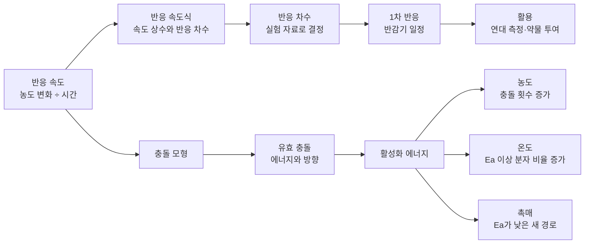

# 물질과 에너지 4. 반응 속도 — 화학 반응의 빠르기를 재고 다스리기
<!-- prev: m3-01, 3-5, chem-3, chem-4, matter-3 -->
<!-- next: cell-2 -->

> [!NOTE]
> **성취기준**
> - **[12물에04-01]** 화학 반응 속도를 반응물의 농도로 표현할 수 있음을 알고, 자료 해석을 통하여 반응 속도식을 구할 수 있다.
> - **[12물에04-02]** 1차 반응의 반감기가 반응물의 농도에 의존하지 않음을 이해하고, 1차 반응의 반감기가 활용되는 사례를 조사⋅발표할 수 있다.
> - **[12물에04-03]** 화학 반응에서 유효 충돌과 활성화 에너지의 의미를 알고, 화학 반응이 일어나기 위한 조건에 관심을 가질 수 있다.
> - **[12물에04-04]** 농도, 온도, 촉매에 따라 반응 속도가 달라짐을 이해하고, 일상생활에서 각각의 예를 찾아 화학의 유용성을 인식할 수 있다.

**학습 목표**

1. 반응 속도를 단위 시간당 반응물이나 생성물의 농도 변화로 나타내고, 반응식의 계수를 고려하여 각 물질의 속도를 비교할 수 있다.
2. 초기 속도 자료를 해석하여 반응 차수와 속도 상수를 구하고 반응 속도식을 쓸 수 있다.
3. 농도–시간 자료에서 반감기를 찾고, 1차 반응의 반감기가 처음 농도와 관계없이 일정함을 확인하며, 방사성 연대 측정·약물 투여 등 활용 사례를 설명할 수 있다.
4. 유효 충돌과 활성화 에너지의 의미를 알고, 반응 경로에 따른 에너지 변화 그림을 해석할 수 있다.
5. 농도·온도·촉매가 반응 속도에 미치는 영향을 충돌 모형과 활성화 에너지로 설명하고, 생활과 환경 문제 해결의 예를 찾을 수 있다.

**이 단원의 학습 사다리**

| 단계 | 무엇을 하나? |
|---|---|
| STEP 1. 이전 학습 다시 보기 | 화학 반응식과 계수비, 몰 농도, 동적 평형, 효소, 자발성을 다시 꺼내 본다 |
| STEP 2. 기초 다지기 | 평균 변화율과 기울기, 거듭제곱 비례, 지수적 감소를 디딤돌로 놓는다 |
| STEP 3. 핵심 개념 | 반응 속도의 표현 → 반응 속도식 → 1차 반응의 반감기 → 유효 충돌과 활성화 에너지 → 농도·온도·촉매 |
| STEP 4. 오개념 바로잡기 | "반응 차수는 반응식의 계수와 같다?", "촉매는 반응열을 줄인다?" 같은 착각을 바로잡는다 |
| STEP 5. 대학 전공으로 | 적분 속도식, 아레니우스 식, 반응 메커니즘, 효소 반응 속도론 |
| STEP 6. 생활·산업·진로 | 자동차 배기가스 촉매, 암모니아 공정, 의약품 투여, 효소 산업 |

---

## 🗺️ 단원 들어가기

앞 단원에서 다이아몬드가 흑연으로 바뀌는 반응은 자발적이라고 배웠다. 그런데 다이아몬드는 왜 영원히 빛날까? 폭죽의 화약은 1초도 안 되어 반응을 마치지만, 철 대문이 녹스는 데에는 몇 년이 걸리고, 석회 동굴의 종유석이 1 cm 자라는 데에는 수십 년 이상이 걸린다.

여름에 음식은 금방 상하지만 냉장고 속에서는 오래간다. 과산화 수소수는 병 속에서 천천히 분해되지만 상처에 바르면 거품이 확 일어난다. 자동차 배기관 속 손바닥만 한 장치는 유독한 일산화 탄소를 순식간에 이산화 탄소로 바꾼다. 이 단원에서는 반응이 **얼마나 빨리** 일어나는지 재는 방법과, 그 빠르기를 **조절하는 방법**을 배운다.

---

## STEP 1. 🔙 이전 학습 다시 보기

### 연계 개념표

| 이전 단원·성취기준 | 그때 배운 것 | 이 단원에서 확장되는 것 |
|---|---|---|
| 중3 「화학 반응의 규칙성」 [9과16-02] | 화학 반응식의 계수비는 입자 수의 비이다 | 계수비로 각 물질의 **농도 변화 속도**를 비교한다 |
| 통합과학1 「생명 시스템과 물질대사」 [10통과1-03-05] | 세포의 화학 반응에는 효소가 필요하다 | 효소는 **생체 촉매**로 활성화 에너지를 낮춘다 |
| 화학 「역동적인 화학 반응」 [12화학04-02] | 몰 농도의 의미와 표준 용액 만들기 | 반응 속도를 몰 농도의 변화($\mathrm{M/s}$)로 나타낸다 |
| 화학 「화학 평형」 [12화학03-01] | 평형 상태에서는 정반응과 역반응의 속도가 같다(동적 평형) | 정반응 속도와 역반응 속도를 **반응 속도식**으로 나타낸다 |
| 화학 「화학 평형」 [12화학03-04] | 온도를 바꾸면 평형이 이동한다 | 온도가 **속도**에 미치는 영향은 평형 이동과 별개로 생각한다 |
| 물질과 에너지 「화학 변화의 자발성」 [12물에03-03] | 자발성은 방향만 알려 주고 속도와는 관계없다 | 자발적인 반응도 느린 이유: **활성화 에너지** |

### 준비 운동 (사전 진단)

**Q1.** $\mathrm{N_2 + 3H_2 \rightarrow 2NH_3}$에서 $\mathrm{N_2}$가 1 mol 소모될 때 $\mathrm{H_2}$와 $\mathrm{NH_3}$는 각각 몇 mol 소모·생성되는가?

**Q2.** 부피 2.0 L인 용기에 기체 A가 0.40 mol 들어 있다. A의 몰 농도는?

**Q3.** 효소는 반응이 끝난 뒤 어떻게 되는가?

**Q4.** 가역 반응이 평형에 도달하면 반응이 멈춘 것인가?

정답 및 해설

**Q1.** $\mathrm{H_2}$ 3 mol 소모, $\mathrm{NH_3}$ 2 mol 생성. 계수비가 곧 몰수비이다.

**Q2.** 0.20 M. $0.40 \div 2.0 = 0.20\ \mathrm{mol/L}$

**Q3.** 변하지 않고 남아 다시 다른 반응물 분자의 반응을 돕는다.

**Q4.** 아니다. 정반응과 역반응이 **같은 속도**로 계속 일어나 겉보기에 변화가 없는 동적 평형 상태이다.

---

## STEP 2. 🧱 기초 다지기

### ① 평균 변화율과 기울기

시간에 따라 변하는 양 $y$가 있을 때, 시간 간격 $\Delta t$ 동안의 **평균 변화율**은 $\dfrac{\Delta y}{\Delta t}$이다. 그래프에서는 두 점을 잇는 직선(할선)의 기울기이고, 간격을 아주 좁히면 그 순간의 **접선의 기울기**가 된다. 자동차의 평균 속력과 속도계에 표시되는 순간 속력의 관계와 같다.

### ② 거듭제곱 비례를 읽는 법

$y = kx^n$일 때 $x$를 2배 하면 $y$는 $2^n$배가 된다.

| $x$를 2배 하면 $y$는 | 1배(변화 없음) | 2배 | 4배 | 8배 |
|---|---|---|---|---|
| 지수 $n$ | 0 | 1 | 2 | 3 |

거꾸로, 한 변수만 바꾸었을 때 결과가 몇 배가 되는지 보면 지수를 알 수 있다. STEP 3에서 반응 차수를 찾는 열쇠이다.

### ③ 일정한 '비율'로 줄어드는 변화

매시간 남은 양의 **절반**씩 줄어드는 양은 $1 \rightarrow \tfrac12 \rightarrow \tfrac14 \rightarrow \tfrac18 \rightarrow \cdots$로 변한다. $n$번 반으로 줄면 남은 비율은 $\left(\tfrac{1}{2}\right)^n$이다. 처음 양이 많든 적든 '절반이 되는 데 걸리는 시간'은 같다. 매달 잔액의 일정 비율이 빠져나가는 통장과 같다.

> [!TIP]
> 💡 **비유** — 같은 양씩 줄어드는 것은 '매일 사탕 2개씩 먹기'(일정한 양), 같은 비율로 줄어드는 것은 '매일 남은 사탕의 절반 먹기'(일정한 비율)이다. 사탕이 100개든 10개든 절반이 되는 데에는 하루가 걸린다.

---

## STEP 3. 📘 핵심 개념

### ① 반응 속도의 표현

**반응 속도(reaction rate)** 는 단위 시간 동안 반응물의 농도가 감소하는 정도 또는 생성물의 농도가 증가하는 정도이다. 농도는 몰 농도를 대괄호로 나타낸다($[\mathrm{A}]$).

$$
\text{반응 속도} = -\frac{\Delta[\text{반응물}]}{\Delta t} = +\frac{\Delta[\text{생성물}]}{\Delta t} \qquad \text{단위: } \mathrm{M/s} = \mathrm{mol/(L\cdot s)}
$$

반응물의 농도는 줄어들어 $\Delta[\text{반응물}] < 0$이므로 앞에 −를 붙여 속도를 양수로 만든다.

#### 계수가 다르면 물질마다 농도 변화의 빠르기가 다르다

$a\mathrm{A} + b\mathrm{B} \rightarrow c\mathrm{C} + d\mathrm{D}$에서 하나의 반응 속도로 나타내려면 각 물질의 농도 변화 속도를 **계수로 나눈다.**

$$
v = -\frac{1}{a}\frac{\Delta[\mathrm{A}]}{\Delta t} = -\frac{1}{b}\frac{\Delta[\mathrm{B}]}{\Delta t} = \frac{1}{c}\frac{\Delta[\mathrm{C}]}{\Delta t} = \frac{1}{d}\frac{\Delta[\mathrm{D}]}{\Delta t}
$$

#### 예제 1

과산화 수소의 분해 $\mathrm{2H_2O_2(aq) \rightarrow 2H_2O(l) + O_2(g)}$에서 $[\mathrm{H_2O_2}]$가 처음 100초 동안 1.00 M에서 0.80 M으로 감소하였다. (1) $\mathrm{H_2O_2}$의 평균 분해 속도, (2) 산소의 평균 생성 속도, (3) 이 반응의 평균 반응 속도를 구하시오.

**풀이**
(1) $-\dfrac{\Delta[\mathrm{H_2O_2}]}{\Delta t} = -\dfrac{0.80 - 1.00}{100} = 2.0\times10^{-3}\ \mathrm{M/s}$
(2) 계수비 $\mathrm{H_2O_2 : O_2 = 2 : 1}$이므로 $1.0\times10^{-3}\ \mathrm{M/s}$
(3) $v = \dfrac{1}{2}\times2.0\times10^{-3} = 1.0\times10^{-3}\ \mathrm{M/s}$

#### 평균 속도와 순간 속도

가로축을 시간, 세로축을 반응물의 농도로 그리면 곡선이 점점 완만해진다. 반응물이 줄어들수록 반응이 느려지기 때문이다.
- **평균 속도**: 두 시각을 잇는 직선의 기울기(의 크기)
- **순간 속도**: 한 시각에서 그은 접선의 기울기(의 크기)
- **초기 속도**: $t = 0$에서의 순간 속도. 생성물이 아직 없어 역반응의 영향을 받지 않으므로 반응 속도식을 구할 때 주로 쓴다.

<!-- fig:matter-4-rate-tangent -->

#### 반응 속도를 측정하는 방법

반응 속도를 재려면 **시간에 따라 변하면서 쉽게 측정할 수 있는 성질**을 골라 농도로 환산한다.

| 측정하는 성질 | 반응의 예 | 사용하는 도구 |
|---|---|---|
| 발생한 기체의 부피 또는 압력 | 마그네슘과 염산, 과산화 수소의 분해 | 기체 주사기, 압력 센서 |
| 질량 감소(기체가 빠져나감) | 탄산 칼슘과 염산 | 전자저울(데이터 기록) |
| 색의 변화(빛의 흡수) | 아이오딘의 생성·소모, 과망가니즈산 이온의 탈색 | 색도계, 분광 광도계 |
| 탁해지는 정도 | 티오황산 나트륨과 염산(황 앙금 생성) | 광 센서, 눈으로 보는 '× 표 사라짐' |
| 전기 전도도, pH | 이온의 수나 $\mathrm{H^+}$ 농도가 변하는 반응 | 전도도 센서, pH 센서 |

<!-- fig:matter-4-rate-methods -->

#### ✔ 바로 확인

1. 한 단계 계산: $\mathrm{2A \rightarrow B}$에서 $[\mathrm{A}]$가 20초 동안 0.50 M에서 0.30 M으로 줄었다. A의 평균 소모 속도와 B의 평균 생성 속도를 구하시오.
2. (O/X) 반응물의 농도–시간 그래프는 대체로 시간이 지날수록 기울기가 완만해진다.
3. 빈칸: $t = 0$에서의 순간 속도를 (    ) 속도라 하며, 반응 속도식을 구할 때 주로 쓴다.
4. 짝짓기: (가) 마그네슘과 염산 (나) 티오황산 나트륨과 염산 — ㄱ. 용액이 탁해지는 데 걸린 시간 ㄴ. 발생한 기체의 부피

정답

1. A: 0.010 M/s, B: 0.0050 M/s — $0.20\div20 = 0.010$, 계수비 A : B = 2 : 1
2. O — 반응물이 줄수록 반응이 느려지기 때문이다.
3. 초기
4. (가)–ㄴ, (나)–ㄱ — 수소 기체가 발생하고, 황 앙금이 생긴다.

### ② 반응 속도식과 반응 차수

일정한 온도에서 반응 속도는 반응물의 농도에 따라 달라진다. 그 관계를 나타낸 식이 **반응 속도식(rate law)** 이다. $a\mathrm{A} + b\mathrm{B} \rightarrow$ 생성물에서

$$
v = k[\mathrm{A}]^m[\mathrm{B}]^n
$$

- $k$: **속도 상수(rate constant)**. 반응의 종류와 **온도**에 따라 정해지며 농도와는 관계없다.
- $m$, $n$: 각 반응물에 대한 **반응 차수(reaction order)**, $m + n$: **전체 반응 차수**

> [!IMPORTANT]
> 반응 차수 $m$, $n$은 반응식의 계수 $a$, $b$와 **같다는 보장이 없다.** 반응 차수는 반드시 **실험 자료로 결정**한다. 반응식은 처음과 끝만 보여 줄 뿐 반응이 실제로 어떤 단계를 거치는지는 알려 주지 않기 때문이다.

| 전체 반응 차수 | 속도식의 예 | 농도를 2배로 하면 속도는 | $k$의 단위 |
|---|---|---|---|
| 0차 | $v = k$ | 변화 없음 | $\mathrm{M/s}$ |
| 1차 | $v = k[\mathrm{A}]$ | 2배 | $\mathrm{s^{-1}}$ |
| 2차 | $v = k[\mathrm{A}]^2$ 또는 $k[\mathrm{A}][\mathrm{B}]$ | 4배 또는 2배(A만 2배) | $\mathrm{M^{-1}s^{-1}}$ |
| 3차 | $v = k[\mathrm{A}]^2[\mathrm{B}]$ | — | $\mathrm{M^{-2}s^{-1}}$ |

| 반응 | 실험으로 구한 속도식 | 계수와 차수 비교 |
|---|---|---|
| $\mathrm{2N_2O_5(g) \rightarrow 4NO_2(g) + O_2(g)}$ | $v = k[\mathrm{N_2O_5}]$ | 계수 2, 차수 1 — 다르다 |
| $\mathrm{2NO(g) + O_2(g) \rightarrow 2NO_2(g)}$ | $v = k[\mathrm{NO}]^2[\mathrm{O_2}]$ | 우연히 같다 |
| $\mathrm{2NO_2(g) + F_2(g) \rightarrow 2NO_2F(g)}$ | $v = k[\mathrm{NO_2}][\mathrm{F_2}]$ | 다르다 |
| $\mathrm{H_2(g) + I_2(g) \rightarrow 2HI(g)}$ | $v = k[\mathrm{H_2}][\mathrm{I_2}]$ | 같다 |

#### 초기 속도법으로 속도식 구하기

반응물의 처음 농도를 바꾸어 가며 초기 속도를 측정하고, **한 번에 한 반응물의 농도만 바꾼 두 실험**을 비교한다.

#### 예제 2

$\mathrm{2NO(g) + O_2(g) \rightarrow 2NO_2(g)}$에 대해 일정한 온도에서 다음 자료를 얻었다(설명을 위해 단순화한 값이다).

| 실험 | $[\mathrm{NO}]$(M) | $[\mathrm{O_2}]$(M) | 초기 속도(M/s) |
|---|---|---|---|
| 1 | 0.010 | 0.010 | $7.0\times10^{-6}$ |
| 2 | 0.020 | 0.010 | $2.8\times10^{-5}$ |
| 3 | 0.010 | 0.020 | $1.4\times10^{-5}$ |

반응 속도식과 속도 상수를 구하시오.

**풀이**
① 실험 1 → 2: $[\mathrm{O_2}]$ 일정, $[\mathrm{NO}]$ 2배 → 속도 4배($2^m = 4$)이므로 $m = 2$
② 실험 1 → 3: $[\mathrm{NO}]$ 일정, $[\mathrm{O_2}]$ 2배 → 속도 2배이므로 $n = 1$
③ $v = k[\mathrm{NO}]^2[\mathrm{O_2}]$, 실험 1 값을 대입하면

$$
k = \frac{7.0\times10^{-6}}{(0.010)^2(0.010)} = 7.0\ \mathrm{M^{-2}s^{-1}}
$$

전체 반응 차수는 3차이다. 구한 $k$로 다른 농도에서의 속도를 예측할 수 있다. 예를 들어 $[\mathrm{NO}] = 0.030\ \mathrm{M}$, $[\mathrm{O_2}] = 0.010\ \mathrm{M}$이면 $v = 7.0\times(0.030)^2\times0.010 = 6.3\times10^{-5}\ \mathrm{M/s}$이다.

> [!TIP]
> 💡 **요령** — 두 반응물의 농도가 함께 바뀐 실험만 있다면, 먼저 한 반응물의 차수를 다른 실험 쌍에서 구한 뒤 그 효과를 나누어 없애고 나머지 차수를 구한다. 그래프로 구할 수도 있다. 초기 속도를 $[\mathrm{A}]$에 대해 그려 직선이면 1차, $[\mathrm{A}]^2$에 대해 그려 직선이면 2차이다.

<!-- fig:matter-4-rate-vs-conc -->

#### 예제 3 — 그래프 자료 해석

반응 $\mathrm{A \rightarrow B}$의 초기 속도를 $[\mathrm{A}]$에 대해 그렸더니 원점을 지나는 직선이고 기울기가 $0.035\ \mathrm{s^{-1}}$였다. 반응 속도식과 $[\mathrm{A}] = 0.40\ \mathrm{M}$일 때의 초기 속도를 구하시오.

**풀이** 속도가 $[\mathrm{A}]$에 정비례하므로 1차 반응이며, 기울기가 속도 상수이다. $v = 0.035[\mathrm{A}]$, $v = 0.035\times0.40 = 0.014\ \mathrm{M/s}$

#### ✔ 바로 확인

1. 반응 속도식이 $v = k[\mathrm{A}]^2$일 때 $[\mathrm{A}]$를 3배로 하면 속도는 몇 배가 되는가?
2. (O/X) 반응 차수는 균형 맞춘 반응식의 계수를 보고 정한다.
3. 1차 반응 $v = k[\mathrm{A}]$에서 속도 상수 $k$의 단위는?
4. 그림 읽기: 초기 속도를 $[\mathrm{A}]$에 대해 그렸더니 $[\mathrm{A}]$와 관계없이 수평선이었다. A에 대한 반응 차수는?

정답

1. 9배 — $3^2 = 9$
2. X — 반응 차수는 실험 자료로만 정한다($\mathrm{2N_2O_5}$의 분해는 1차).
3. $\mathrm{s^{-1}}$ — $k = v/[\mathrm{A}] = (\mathrm{M/s})/\mathrm{M}$
4. 0차 — 농도를 바꾸어도 속도가 변하지 않는다.

### ③ 1차 반응의 반감기

반응물의 농도가 처음 농도의 절반이 되는 데 걸리는 시간을 **반감기(half-life, $t_{1/2}$)** 라고 한다.

다음은 1차 반응 $\mathrm{A \rightarrow}$ 생성물의 농도–시간 자료이다.

| 시간(분) | 0 | 10 | 20 | 30 | 40 |
|---|---|---|---|---|---|
| $[\mathrm{A}]$(M) | 0.800 | 0.400 | 0.200 | 0.100 | 0.050 |

- 0.800 → 0.400 M: 10분, 0.400 → 0.200 M: 10분, 0.200 → 0.100 M: 10분
- **처음 농도가 얼마이든 절반이 되는 데 늘 10분**이 걸린다.

1차 반응에서는 속도가 농도에 비례하므로($v = k[\mathrm{A}]$), 농도가 클 때는 빨리, 작을 때는 천천히 줄어든다. 그 결과 **같은 시간 동안 항상 같은 '비율'만큼** 줄어들게 되어 반감기가 일정하다. 1차 반응의 반감기는 처음 농도와 관계없이 **속도 상수 $k$에 의해서만 정해지며**, $k$가 클수록 반감기가 짧다.

> [!IMPORTANT]
> **1차 반응의 반감기는 반응물의 농도에 의존하지 않는다.** 그래서 반감기를 $n$번 지나면 남은 양은 처음 양의 $\left(\tfrac{1}{2}\right)^n$이다. 처음 양을 몰라도 남은 비율만 알면 경과 시간을 알 수 있다.

<!-- fig:matter-4-half-life -->

#### 반감기로 반응 차수 구별하기

같은 '절반 되기'라도 1차가 아닌 반응은 반감기가 농도에 따라 달라진다.

| 반응 차수 | 자료의 예(시간: 농도) | 연속된 반감기 | 특징 |
|---|---|---|---|
| 0차 | 0분 0.80, 10분 0.40, 15분 0.20 | 10분 → 5분 | 농도가 작아질수록 반감기가 **짧아진다** |
| 1차 | 0분 0.80, 10분 0.40, 20분 0.20, 30분 0.10 | 10분 → 10분 → 10분 | 반감기가 **일정**하다 |
| 2차 | 0분 0.80, 10분 0.40, 30분 0.20, 70분 0.10 | 10분 → 20분 → 40분 | 농도가 작아질수록 반감기가 **길어진다** |

<!-- fig:matter-4-order-halflife -->

#### 예제 4 — 자료에서 반감기 찾기

과산화 수소의 분해(촉매 존재)에서 다음 자료를 얻었다. 반감기를 구하고 이 반응이 1차 반응인지 판단하시오. 또 $[\mathrm{H_2O_2}]$가 0.10 M이 되는 시각을 예측하시오.

| 시간(초) | 0 | 600 | 1200 | 1800 |
|---|---|---|---|---|
| $[\mathrm{H_2O_2}]$(M) | 1.60 | 0.80 | 0.40 | 0.20 |

**풀이** 600초마다 농도가 절반이 되므로 반감기는 600초로 일정하고, 1차 반응이다. 1.60 M에서 0.10 M이 되려면 $1.60\times\left(\tfrac12\right)^n = 0.10$, $\left(\tfrac12\right)^n = \tfrac{1}{16}$에서 $n = 4$이므로 $4\times600 = 2400$초 후이다.

#### 1차 반응의 반감기가 활용되는 사례

방사성 동위 원소의 붕괴는 화학 반응이 아니라 원자핵의 변화이지만, 남은 원자핵의 수에 비례하는 속도로 붕괴하므로 **1차 반응과 같은 규칙**을 따른다.

| 분야 | 사례 | 반감기(약) | 원리 |
|---|---|---|---|
| 고고학·지질학 | 탄소-14 연대 측정 | 5730년 | 생물이 죽으면 탄소-14가 더 들어오지 않고 일정한 반감기로 줄어든다. 남은 비율로 경과 시간을 계산한다 |
| 의학 영상 | 플루오린-18(PET 검사) | 110분 | 반감기가 짧아 검사 후 몸속에서 빨리 사라진다. 대신 병원 가까이에서 만들어 바로 써야 한다 |
| 의학 영상 | 테크네튬-99m | 6시간 | 뼈·심장 영상 검사에 널리 쓰인다 |
| 갑상선 치료 | 아이오딘-131 | 8일 | 갑상선에 모여 방사선을 내고, 일정 기간이 지나면 거의 사라진다 |
| 약학 | 많은 약물의 체내 제거 | 약물마다 다름 | 혈중 농도가 대체로 1차 반응처럼 줄어든다. 반감기로 복용 간격을 정한다 |
| 환경 | 일부 농약·오염 물질의 분해 | 물질·환경마다 다름 | 반감기로 토양·물에 잔류하는 기간을 예측한다 |

> [!NOTE]
> 모든 체내 반응이 1차 반응인 것은 아니다. 예를 들어 알코올(에탄올)은 간의 효소가 처리할 수 있는 양에 한계가 있어, 혈중 농도가 일정한 '양'씩 줄어드는 0차 반응에 가깝게 제거된다. 그래서 술을 깨는 데 걸리는 시간은 마신 양에 거의 비례하여 길어진다. 1차 반응이라면 양이 2배여도 반감기 한 번만큼만 더 걸리는 것과 대조적이다.

#### 예제 5 — 연대 측정과 약물 투여

(1) 어떤 나무 유물에 남아 있는 탄소-14의 비율이 살아 있는 나무의 25 %였다. 이 나무가 죽은 지 약 몇 년이 지났는가? (탄소-14의 반감기 5730년)
(2) 반감기가 6시간인 약 400 mg을 한 번 먹었다. 24시간 뒤 몸속에 남아 있는 양은? (약이 1차 반응으로 제거된다고 가정)

**풀이**
(1) $25\ \% = \left(\tfrac12\right)^2$이므로 반감기 2번 → $2\times5730 = 11\,460$년, 약 1만 1천여 년
(2) 24시간은 반감기 4번 → $400\times\left(\tfrac12\right)^4 = 25\ \mathrm{mg}$

#### ✔ 바로 확인

1. 반감기가 5분인 1차 반응에서 처음 농도가 0.40 M이면 15분 뒤의 농도는?
2. (O/X) 1차 반응의 반감기는 처음 농도가 클수록 길다.
3. 1차 반응에서 반감기가 3번 지나면 반응물은 처음 양의 몇 분의 몇이 남는가?
4. 연속된 반감기가 10분 → 20분 → 40분으로 길어지는 반응은 몇 차 반응인가?

정답

1. 0.050 M — 15분은 반감기 3번, $0.40\times\left(\tfrac12\right)^3 = 0.050$
2. X — 1차 반응의 반감기는 처음 농도와 관계없이 일정하다.
3. $\tfrac{1}{8}$ — $\left(\tfrac12\right)^3$
4. 2차 — 농도가 작아질수록 반감기가 길어진다(그림 4-6).

### ④ 유효 충돌과 활성화 에너지

반응이 일어나려면 반응물 입자가 서로 **충돌**해야 한다(**충돌 모형**). 그러나 상온에서 기체 분자는 1초에 수십억 번 넘게 충돌하는데도 대부분의 반응은 그렇게 빠르지 않다. **모든 충돌이 반응으로 이어지는 것은 아니기 때문이다.**

반응을 일으키는 충돌을 **유효 충돌(effective collision)** 이라 하며, 두 가지 조건이 필요하다.

1. **충분한 에너지**: 충돌하는 입자의 운동 에너지가 기존 결합을 느슨하게 할 만큼 커야 한다.
2. **알맞은 방향**: 반응할 원자끼리 맞닿는 방향으로 충돌해야 한다.

예를 들어 $\mathrm{NO + O_3 \rightarrow NO_2 + O_2}$에서는 NO의 **N 원자 쪽**이 $\mathrm{O_3}$의 끝 산소 원자에 부딪쳐야 반응이 일어난다. O 원자 쪽으로 부딪치면 에너지가 충분해도 튕겨 나간다.

<!-- fig:matter-4-effective-collision -->

> [!TIP]
> 💡 **비유** — 열쇠로 문을 여는 것과 같다. 열쇠를 자물쇠에 대기만 해서는(충돌) 열리지 않는다. **충분히 깊이 밀어 넣고(에너지)**, **톱니가 맞는 방향으로(방향)** 넣어야 문이 열린다(반응).

#### 활성화 에너지와 활성화물

유효 충돌이 일어나는 데 필요한 최소한의 에너지를 **활성화 에너지(activation energy, $E_a$)** 라고 한다. 반응물이 활성화 에너지만큼의 에너지를 얻으면, 기존 결합이 끊어지려 하고 새로운 결합이 만들어지려 하는 에너지가 가장 높은 불안정한 상태에 도달한다. 이 상태의 입자를 **활성화물(activated complex)** 이라 한다.

가로축을 반응 진행, 세로축을 에너지로 한 **반응 경로에 따른 에너지 변화 그림**은 다음과 같다.

| 그림에서 읽는 것 | 의미 |
|---|---|
| 왼쪽 높이 | 반응물의 에너지(엔탈피) |
| 가장 높은 꼭대기 | 활성화물의 에너지 |
| 반응물 → 꼭대기 높이 차 | 정반응의 활성화 에너지 $E_a$ |
| 생성물 → 꼭대기 높이 차 | 역반응의 활성화 에너지 $E_a'$ |
| 반응물과 생성물의 높이 차 | 반응 엔탈피 $\Delta H = E_a - E_a'$ |

- 활성화 에너지가 **클수록** 언덕을 넘을 수 있는 입자가 적어 반응이 **느리다.**
- 반응 엔탈피($\Delta H$)와 활성화 에너지는 **서로 별개의 양**이다. 발열 반응도 언덕이 높으면 느리다. 앞 단원의 다이아몬드와 종이가 그 예이다.

<!-- fig:matter-4-energy-path -->

#### 예제 6

어떤 반응의 정반응 활성화 에너지는 80 kJ/mol이고 반응 엔탈피는 −30 kJ/mol이다. 역반응의 활성화 에너지를 구하고, 정반응과 역반응 중 어느 쪽이 더 빠를지 예측하시오(다른 조건은 같다고 가정).

**풀이** $\Delta H = E_a - E_a'$이므로 $E_a' = 80 - (-30) = 110\ \mathrm{kJ/mol}$. 활성화 에너지가 작은 정반응이 더 빠르다.

#### ✔ 바로 확인

1. 빈칸: 유효 충돌이 일어나려면 충분한 (    )와 알맞은 (    )이 필요하다.
2. 한 단계 계산: 정반응의 활성화 에너지가 60 kJ/mol, 반응 엔탈피가 +20 kJ/mol이면 역반응의 활성화 에너지는?
3. (O/X) 발열 반응은 활성화 에너지가 없어도 시작된다.
4. 빈칸: 반응 경로 그림의 꼭대기에 있는, 에너지가 가장 높은 불안정한 상태를 (    )이라 한다.

정답

1. 에너지, 방향
2. 40 kJ/mol — $\Delta H = E_a - E_a'$이므로 $E_a' = 60 - 20 = 40$
3. X — 발열 반응도 언덕(활성화 에너지)을 넘어야 시작된다. 성냥의 마찰열이 그 예이다.
4. 활성화물

### ⑤ 반응 속도에 영향을 미치는 요인 — 농도, 온도, 촉매

#### (1) 농도: 충돌 횟수를 늘린다

반응물의 농도가 커지면 일정한 부피 안의 입자 수가 많아져 **단위 시간당 충돌 횟수**가 늘고, 유효 충돌의 횟수도 늘어 반응 속도가 빨라진다. 반응 속도식의 $[\mathrm{A}]^m$이 이 효과를 수치로 나타낸 것이다.
- 기체 반응에서 압력을 높이는 것은 농도를 높이는 것과 같다.
- 고체가 참여하는 반응에서는 **표면적**을 넓히면 반응물과 만나는 입자 수가 늘어 빨라진다(가루로 만들기).

| 생활 속 예 | 설명 |
|---|---|
| 산소 농도가 높은 산소통 안에서 향불이 확 타오른다 | 산소 농도가 크면 연소가 빨라진다 |
| 진한 염산에 마그네슘 리본을 넣으면 기포가 더 격렬하다 | $\mathrm{H^+}$ 농도가 크다 |
| 덩어리 설탕보다 가루 설탕이 빨리 녹고, 장작보다 잔가지가 빨리 탄다 | 표면적이 넓다 |
| 밀가루·석탄 가루가 날리는 곳의 분진 폭발 | 공기와 닿는 표면적이 매우 넓어 순식간에 연소한다 |
| 소화를 위해 음식을 잘게 씹는다 | 소화 효소와 닿는 표면적을 넓힌다 |

#### (2) 온도: 활성화 에너지를 넘는 입자의 비율을 늘린다

같은 온도의 기체 분자라도 운동 에너지는 제각각이다. 운동 에너지에 따른 분자 수의 분포를 그래프로 그리면(**맥스웰–볼츠만 분포**), 한쪽으로 꼬리가 긴 산 모양이 된다.

| 온도가 높아지면 | 결과 |
|---|---|
| 산의 꼭대기가 낮아지고 오른쪽(큰 에너지 쪽)으로 이동하며 넓게 퍼진다 | 분자의 평균 운동 에너지가 커진다 |
| $E_a$보다 큰 에너지를 가진 분자(그래프에서 $E_a$ 오른쪽 넓이)가 **크게 늘어난다** | 유효 충돌의 비율이 커진다 |
| 충돌 횟수 자체도 조금 늘어난다 | 효과는 비율 증가보다 훨씬 작다 |

온도가 조금만 올라가도 $E_a$를 넘는 분자의 비율은 몇 배로 늘어날 수 있다. 상온 근처에서 많은 반응은 **온도가 10 °C 오를 때 속도가 약 2배 안팎**으로 빨라진다(반응마다 다르다). 온도를 높이면 속도 상수 $k$가 커지는 것이다.

| 생활 속 예 | 설명 |
|---|---|
| 냉장고·냉동고에 음식을 보관한다 | 부패를 일으키는 반응(미생물의 효소 반응 포함)이 느려진다 |
| 압력솥으로 밥을 빨리 짓는다 | 끓는점이 약 120 °C로 높아져 익는 반응이 빨라진다 |
| 여름에 반찬이 빨리 쉰다 | 온도가 높아 부패 반응이 빠르다 |
| 높은 열이 계속되면 위험하다 | 체내 효소 반응의 균형이 깨지고 효소가 변성될 수 있다 |

> [!WARNING]
> 효소는 단백질이어서 일정 온도(사람의 효소는 대체로 체온 근처)를 넘으면 구조가 변하여(변성) 오히려 반응 속도가 급격히 떨어진다. "온도가 높을수록 항상 빠르다"는 효소 반응에는 그대로 적용되지 않는다.

#### (3) 촉매: 활성화 에너지가 낮은 새 경로를 연다

**촉매(catalyst)** 는 반응에 참여하지만 반응이 끝난 뒤 처음 상태로 되돌아오는 물질로, 반응 속도를 변화시킨다.
- **정촉매**: 활성화 에너지가 **더 낮은 새로운 반응 경로**를 제공하여 반응을 빠르게 한다.
- **부촉매(억제제)**: 반응을 느리게 한다. 식품의 산화 방지제, 과산화 수소수의 분해를 늦추는 안정제 등.

| 촉매가 바꾸는 것 | 촉매가 바꾸지 않는 것 |
|---|---|
| 반응 경로, 활성화 에너지(정반응·역반응 모두 같은 만큼 낮아짐) | 반응물과 생성물의 에너지, **반응 엔탈피 $\Delta H$** |
| 속도 상수 $k$, 평형에 도달하는 시간 | 평형 상수, 평형 상태의 조성 |
| — | 반응의 자발성(방향) |

| 구분 | 예 | 하는 일 |
|---|---|---|
| 균일 촉매(반응물과 같은 상) | 오존층의 염소 원자 | $\mathrm{Cl + O_3 \rightarrow ClO + O_2}$, $\mathrm{ClO + O \rightarrow Cl + O_2}$로 되살아나며 오존을 계속 분해한다(환경에 해로운 촉매 작용) |
| 불균일 촉매(고체 표면) | 자동차 삼원 촉매 변환기(백금·팔라듐·로듐) | $\mathrm{CO}$, 탄화수소를 $\mathrm{CO_2}$, $\mathrm{H_2O}$로 산화하고 질소 산화물을 $\mathrm{N_2}$로 환원한다 |
| 불균일 촉매 | 암모니아 합성의 철 촉매, 황산 제조의 오산화 바나듐 | 낮은 온도에서도 충분한 속도를 얻게 해 에너지를 절약한다 |
| 광촉매 | 이산화 타이타늄 | 빛을 받아 표면의 오염 물질·세균을 분해한다(공기 정화, 자가 세정 유리) |
| 생체 촉매(효소) | 카탈레이스, 아밀레이스, 플라스틱 분해 효소 | 체온에서 생명 반응을 빠르게 한다. 특정 반응물(기질)에만 작용한다 |

#### 예제 7 — 과산화 수소와 카탈레이스

3 % 과산화 수소수는 병 속에서 몇 달에 걸쳐 천천히 분해되지만, 상처에 바르거나 생간·감자 조각을 넣으면 즉시 거품이 생긴다. (1) 거품의 정체는? (2) 이 현상을 활성화 에너지로 설명하시오. (3) 촉매가 들어간 경우와 들어가지 않은 경우, 과산화 수소가 모두 분해되었을 때 발생한 산소의 총량과 방출된 열의 총량을 비교하시오.

**풀이**
(1) 산소($\mathrm{2H_2O_2 \rightarrow 2H_2O + O_2}$)
(2) 혈액·간·감자의 세포에 있는 효소 카탈레이스가 활성화 에너지가 훨씬 낮은 경로를 제공하여, 같은 온도에서 언덕을 넘는 분자의 비율이 크게 늘었기 때문이다.
(3) 둘 다 같다. 촉매는 속도만 바꿀 뿐, 생성물의 양과 반응 엔탈피는 바꾸지 않는다.

#### 세 요인 한눈에 비교

| 요인 | 무엇이 변하나? | 속도 상수 $k$ | 활성화 에너지 | 반응 속도식에서 |
|---|---|---|---|---|
| 농도(압력, 표면적) ↑ | 충돌 횟수 증가 | 변하지 않음 | 변하지 않음 | $[\mathrm{A}]^m$ 증가 |
| 온도 ↑ | $E_a$ 이상 분자의 비율 증가 | 커짐 | 변하지 않음 | $k$ 증가 |
| 정촉매 | 새로운 경로 | 커짐 | 낮아짐 | $k$ 증가 |

<!-- sim:collision-theory -->

#### 촉매와 효소로 환경 문제 해결하기

| 환경 문제 | 촉매·효소를 이용한 해결 |
|---|---|
| 대기 오염(자동차) | 삼원 촉매 변환기, 디젤 차량의 요소수(분해되어 생긴 암모니아가 촉매 표면에서 질소 산화물을 질소로 환원) |
| 대기 오염(공장·발전소) | 선택적 촉매 환원 장치로 굴뚝의 질소 산화물 제거 |
| 수질·토양 오염 | 미생물의 효소로 기름·유기 오염 물질을 분해(생물학적 정화), 광촉매로 폐수 속 유기물 분해 |
| 플라스틱 쓰레기 | 페트(PET)를 단위체로 분해하는 효소의 연구·개량 |
| 에너지 낭비 | 공정 촉매로 반응 온도·압력을 낮춰 에너지 사용과 온실 기체 배출을 줄인다 |

#### ✔ 바로 확인

1. 짝짓기: (가) 냉장고에 음식을 보관한다 (나) 덩어리 설탕보다 가루 설탕이 빨리 녹는다 (다) 감자 조각을 넣은 과산화 수소수에서 거품이 인다 — ㄱ. 표면적 ㄴ. 촉매 ㄷ. 온도
2. (O/X) 정촉매를 넣으면 반응 엔탈피의 크기가 작아진다.
3. 고르기: 온도를 높일 때 커지는 것을 모두 고르시오. ㄱ. 속도 상수 $k$ ㄴ. 활성화 에너지 ㄷ. 활성화 에너지 이상의 에너지를 가진 분자의 비율
4. 온도가 10 °C 오를 때마다 속도가 2배가 되는 반응이라면, 온도를 20 °C 올렸을 때 속도는 약 몇 배인가?

정답

1. (가)–ㄷ, (나)–ㄱ, (다)–ㄴ
2. X — 촉매는 활성화 에너지만 낮추고 $\Delta H$는 그대로 둔다.
3. ㄱ, ㄷ — 활성화 에너지는 온도가 아니라 촉매로 바뀐다.
4. 약 4배 — $2\times2 = 4$

---

## STEP 4. ⚠️ 오개념 바로잡기

| 흔한 오개념 | 올바른 개념 | 왜 그럴까? |
|---|---|---|
| 반응 차수는 반응식의 계수와 같다 | 반응 차수는 **실험으로만** 정해진다 | $\mathrm{2N_2O_5 \rightarrow 4NO_2 + O_2}$의 속도식은 $v = k[\mathrm{N_2O_5}]$로 1차이다. 반응식은 실제 반응 단계를 보여 주지 않는다 |
| 반응 속도는 반응 내내 일정하다 | 대부분의 반응은 반응물이 줄면서 **점점 느려진다** | 속도가 농도에 의존하기 때문이다(0차 반응은 예외) |
| 반감기가 두 번 지나면 반응물이 모두 없어진다 | 두 번 지나면 **4분의 1**이 남는다 | 1차 반응은 매 반감기마다 남은 양의 절반씩 줄어든다 |
| 촉매는 반응열(반응 엔탈피)을 줄여 준다 | 촉매는 **활성화 에너지만** 낮추고 $\Delta H$는 그대로이다 | 반응물과 생성물의 에너지는 촉매와 관계없다 |
| 촉매는 반응에 전혀 참여하지 않는다 | 촉매는 반응에 **참여**한 뒤 **다시 생성**된다 | 오존 분해의 염소 원자처럼 중간 단계에서 반응했다가 되살아난다 |
| 온도를 높이면 충돌 횟수가 늘어서 빨라지는 것이 주된 이유이다 | 주된 이유는 **활성화 에너지 이상의 에너지를 가진 분자의 비율 증가**이다 | 온도가 10 °C 올라도 충돌 횟수는 몇 % 늘 뿐이지만 속도는 2배 안팎이 되기도 한다 |
| 발열 반응은 활성화 에너지가 필요 없다 | 발열 반응도 **활성화 에너지를 넘어야** 시작된다 | 성냥은 마찰열, 가스레인지는 불꽃으로 활성화 에너지를 공급한다 |

---

## STEP 5. 🎓 다음 단계로 한 걸음 더

> [!CAUTION]
> 이 절은 **고등학교 교육과정 범위 밖의 심화 내용**으로 평가 대상이 아니다. 특히 이 과목에서는 적분 속도식을 유도하지 않고 자료 해석으로 반감기를 찾는다. 대학에서 어떻게 확장되는지 맛보기로만 소개한다.

### 대학 전공 과목과의 연결

| 대학 과목 | 이어지는 내용 |
|---|---|
| 일반화학 | 적분 속도식, 아레니우스 식, 반응 메커니즘과 속도 결정 단계 |
| 물리화학 | 충돌 이론, 전이 상태 이론, 분광학을 이용한 초고속 반응 측정 |
| 화학공학(반응 공학) | 반응기 설계(회분식·연속식), 촉매 반응기, 물질·열 전달 |
| 생화학 | 효소 반응 속도론(미카엘리스–멘텐 식), 효소 저해 |
| 약학(약동학) | 약물의 흡수·제거 속도, 투여 간격 설계 |

### ① 적분 속도식 — 반감기 식이 나오는 곳

1차 반응의 속도식 $-\dfrac{d[\mathrm{A}]}{dt} = k[\mathrm{A}]$를 미분 방정식으로 풀면

$$
\ln[\mathrm{A}] = \ln[\mathrm{A}]_0 - kt, \qquad t_{1/2} = \frac{\ln 2}{k} \approx \frac{0.693}{k}
$$

를 얻는다. $\ln[\mathrm{A}]$를 시간에 대해 그리면 직선이 되고 기울기가 $-k$이다. 반감기 식에 처음 농도가 없다는 것이 STEP 3에서 자료로 확인한 '반감기 일정'의 수학적 근거이다. 2차 반응은 $\dfrac{1}{[\mathrm{A}]} = \dfrac{1}{[\mathrm{A}]_0} + kt$, $t_{1/2} = \dfrac{1}{k[\mathrm{A}]_0}$로 처음 농도에 반비례한다.

### ② 아레니우스 식 — 온도와 활성화 에너지

$$
k = A\,e^{-E_a/RT}, \qquad \ln\frac{k_2}{k_1} = \frac{E_a}{R}\left(\frac{1}{T_1} - \frac{1}{T_2}\right)
$$

$E_a = 50\ \mathrm{kJ/mol}$인 반응을 300 K에서 310 K로 데우면 $k_2/k_1 \approx 1.9$로, STEP 3의 '10 °C에 약 2배'가 이 식에서 나온다. 여러 온도에서 $k$를 재어 $\ln k$를 $1/T$에 대해 그리면 기울기 $-E_a/R$로 활성화 에너지를 구할 수 있다.

### ③ 반응 메커니즘과 속도 결정 단계

실제 반응은 여러 **단계 반응**으로 이루어지며, 가장 느린 단계가 전체 속도를 정한다(**속도 결정 단계**). 반응 차수가 계수와 다른 이유가 여기에 있다. 예를 들어 $\mathrm{NO_2 + CO \rightarrow NO + CO_2}$는 저온에서 $v = k[\mathrm{NO_2}]^2$인데, 느린 첫 단계 $\mathrm{2NO_2 \rightarrow NO_3 + NO}$가 속도를 정하기 때문이다.

### ④ 효소 반응 속도론

효소 반응은 기질 농도가 낮을 때는 1차, 높을 때는 효소가 포화되어 0차에 가까워진다(미카엘리스–멘텐 식 $v = \dfrac{V_{\max}[\mathrm{S}]}{K_m + [\mathrm{S}]}$). 알코올 분해가 0차에 가까운 이유도 이것으로 설명된다.

### 지금 vs 다음 단계

| 주제 | 지금(물질과 에너지) | 대학(일반화학·물리화학·반응 공학) |
|---|---|---|
| 반응 속도식 | 초기 속도 자료로 차수와 $k$ 구하기 | 미분·적분 속도식, 메커니즘으로 속도식 유도 |
| 반감기 | 자료에서 찾기, 1차 반응은 일정 | $t_{1/2} = 0.693/k$ 유도, 여러 차수의 반감기 |
| 활성화 에너지 | 유효 충돌, 에너지 변화 그림 | 아레니우스 식, 전이 상태 이론 |
| 촉매 | 새로운 경로, $E_a$ 감소 | 표면 흡착 이론, 효소 속도론, 촉매 설계 |

---

## STEP 6. 🏭 생활·산업·진로 연결

### 사례 1. 자동차 배기가스 정화 촉매

- **원리** 일산화 탄소의 산화, 질소 산화물의 환원은 자발적이지만 그냥 두면 매우 느리다. 귀금속 촉매 표면이 활성화 에너지를 낮춰 배기관을 지나는 짧은 시간 안에 반응을 끝낸다.
- **어디에 쓰이나** 휘발유 차의 삼원 촉매 변환기, 디젤 차의 요소수 장치. 촉매는 일정 온도 이상에서 잘 작동하므로, 엔진 시동 직후 촉매를 빨리 데우는 기술이 중요하다. 비싼 귀금속을 덜 쓰는 촉매 개발도 활발하다.

### 사례 2. 산업 공정 — 속도와 에너지의 균형

- **원리** 온도를 높이면 빨라지지만 에너지가 많이 들고, 발열 반응은 평형 측면에서 불리해질 수 있다. 촉매는 더 낮은 온도에서도 충분한 속도를 준다.
- **어디에 쓰이나** 암모니아 합성(철 촉매), 황산 제조, 석유 정제(제올라이트 촉매), 플라스틱 원료 합성. 화학 제품 대부분이 제조 과정 어딘가에서 촉매를 거친다.

### 사례 3. 의약품과 반감기

- **원리** 약물의 혈중 농도는 대체로 1차 반응처럼 줄어든다. 반감기를 알면 효과가 유지되도록 복용 간격과 양을 정할 수 있다.
- **어디에 쓰이나** 하루 1~3회 복용 지시, 천천히 녹아 나오도록 만든 서방형 제제, 의료용 방사성 의약품의 준비 시간 관리. 약의 유효 기간도 성분이 분해되는 속도로 정한다.

### 사례 4. 효소 산업

- **원리** 효소는 체온 근처의 온화한 조건에서 특정 반응만 빠르게 한다.
- **어디에 쓰이나** 효소 세제(단백질·지방 얼룩 분해), 식품 가공(전분 당화, 치즈 제조), 바이오 연료 생산, 플라스틱 분해 연구.

### 관련 진로와 학과

| 진로 | 하는 일 | 관련 학과 |
|---|---|---|
| 촉매 연구원 | 배기가스·공정용 촉매 개발 | 화학공학과, 화학과, 신소재공학과 |
| 반응 공정 엔지니어 | 반응기 설계, 수율·속도 최적화 | 화학공학과, 공업화학과 |
| 약학 연구원 | 약물의 체내 동태, 제형·유효 기간 연구 | 약학과, 제약공학과 |
| 환경 엔지니어 | 대기·수질 정화 촉매와 미생물 공정 | 환경공학과, 화학공학과 |
| 효소·생명공학 연구원 | 산업용 효소 개발과 개량 | 생명공학과, 생화학과, 미생물학과 |

---

## 🔬 탐구 활동

### 활동 A. 센서로 반응 속도를 측정하는 실험 설계·수행하기

**목표** 과산화 수소의 분해로 발생하는 산소의 압력을 압력 센서로 실시간 측정하여 반응 속도를 구한다.

**준비물** 압력 센서와 데이터 수집 장치(또는 스마트 기기), 밀폐 가능한 삼각 플라스크와 고무마개, 3 % 과산화 수소수, 이산화 망가니즈 가루(또는 감자 조각·건조 효모), 눈금 실린더, 전자저울, 온도계, 보안경, 장갑

**과정**
1. 삼각 플라스크에 과산화 수소수 20 mL를 넣고 압력 센서를 연결한 마개를 준비한다.
2. 촉매(이산화 망가니즈 0.10 g)를 넣고 즉시 마개를 닫은 뒤, 1초 간격으로 압력을 기록한다.
3. 시간–압력 그래프를 그리고, 처음 10초 동안의 기울기로 초기 속도(압력 증가 속도, kPa/s)를 구한다.
4. 압력 증가는 발생한 산소의 몰수에 비례하므로($PV = nRT$, 「물질의 세 가지 상태」), 압력 변화로 반응 속도를 비교할 수 있다.

**결과 기록**

| 시간(s) | 0 | 10 | 20 | 30 | 40 | 60 |
|---|---|---|---|---|---|---|
| 압력(kPa) | | | | | | |
| 압력 증가량(kPa) | 0 | | | | | |

**생각해 보기**
1. 그래프의 기울기는 시간에 따라 어떻게 변하는가? 그 이유를 반응물의 농도로 설명해 보자.
2. 압력이 너무 높아지지 않게 하려면 실험 조건을 어떻게 정해야 할까?

> [!WARNING]
> **안전 수칙** 보안경과 장갑을 착용한다. 밀폐 용기 안의 압력이 지나치게 올라가지 않도록 과산화 수소수의 양과 농도를 작게 하고, 마개가 튀어 나갈 수 있으므로 용기 입구를 얼굴 쪽으로 향하지 않는다. 남은 용액은 실험실 폐수 처리 기준에 따라 처리한다.

### 활동 B. 농도, 온도, 촉매와 반응 속도의 관계 탐구하기

**목표** 티오황산 나트륨과 염산의 반응($\mathrm{Na_2S_2O_3 + 2HCl \rightarrow 2NaCl + S + SO_2 + H_2O}$)에서 생기는 황 앙금 때문에 비커 밑의 × 표가 보이지 않을 때까지의 시간을 측정하여 농도와 온도의 효과를 비교하고, 과산화 수소 분해로 촉매의 효과를 확인한다.

**과정**
1. **농도**: 0.10 M, 0.075 M, 0.050 M, 0.025 M 티오황산 나트륨 수용액 50 mL에 각각 1 M 염산 5 mL를 넣고, × 표가 사라질 때까지의 시간 $t$를 잰다. 반응 속도는 $1/t$에 비례한다고 본다.
2. **온도**: 0.050 M 용액을 10 °C, 20 °C, 30 °C, 40 °C로 맞춘 뒤 같은 방법으로 시간을 잰다.
3. **촉매**: 과산화 수소수 세 시험관에 아무것도 넣지 않은 것, 이산화 망가니즈를 넣은 것, 감자 조각을 넣은 것의 기포 발생을 비교한다(꺼져 가는 불씨를 대어 산소 확인).

**결과 기록**

| 조건 | 농도(M) 또는 온도(°C) | 시간 $t$(s) | $1/t$(s⁻¹) |
|---|---|---|---|
| 농도 1 | 0.10 | | |
| 농도 2 | 0.050 | | |
| 온도 1 | 20 | | |
| 온도 2 | 30 | | |

**생각해 보기**
1. 농도–$1/t$ 그래프가 직선이라면 티오황산 이온에 대한 반응 차수는 얼마라고 추론할 수 있을까?
2. 온도가 10 °C 오를 때 $1/t$은 약 몇 배가 되는가?
3. 감자 조각을 미리 끓여서 넣으면 결과가 어떻게 달라질까? 그 이유는?

> [!WARNING]
> **안전 수칙** 보안경과 장갑을 착용한다. 반응에서 자극성 기체인 이산화 황이 발생하므로 반드시 환기가 잘 되는 곳이나 후드에서 실험하고, 냄새를 직접 맡지 않는다. 사용한 용액은 모아서 실험실 폐기물 처리 기준에 따라 처리한다.

---

## ✅ 개념 확인 문제

### 기본

**1.** $\mathrm{N_2(g) + 3H_2(g) \rightarrow 2NH_3(g)}$에서 $\mathrm{NH_3}$의 생성 속도가 $0.40\ \mathrm{M/s}$일 때 $\mathrm{H_2}$의 소모 속도와 이 반응의 반응 속도를 구하시오.

정답 및 해설

**정답** $\mathrm{H_2}$ 소모 속도 0.60 M/s, 반응 속도 0.20 M/s

계수비 $\mathrm{H_2 : NH_3 = 3 : 2}$이므로 $\mathrm{H_2}$ 소모 속도 $= 0.40\times\dfrac{3}{2} = 0.60\ \mathrm{M/s}$. 반응 속도 $= \dfrac{1}{2}\times0.40 = 0.20\ \mathrm{M/s}$

**2.** 반응 속도식이 $v = k[\mathrm{A}][\mathrm{B}]^2$인 반응에서 $[\mathrm{A}]$와 $[\mathrm{B}]$를 모두 2배로 하면 반응 속도는 몇 배가 되는가? 전체 반응 차수는?

정답 및 해설

**정답** 8배, 3차

$2\times2^2 = 8$배이다. 전체 반응 차수는 $1 + 2 = 3$이다.

**3.** 반감기가 20분인 1차 반응에서 반응물의 처음 농도가 0.80 M이었다. 60분 뒤의 농도는?

정답 및 해설

**정답** 0.10 M

60분은 반감기 3번이므로 $0.80\times\left(\tfrac12\right)^3 = 0.10\ \mathrm{M}$이다.

**4.** 촉매에 대한 설명으로 옳은 것을 **모두** 고르시오.
ㄱ. 정촉매는 반응의 활성화 에너지를 낮춘다.
ㄴ. 정촉매를 넣으면 반응 엔탈피의 크기가 작아진다.
ㄷ. 정촉매는 정반응의 속도만 빠르게 하고 역반응의 속도는 그대로 둔다.

정답 및 해설

**정답 ㄱ**

ㄴ. 촉매는 반응물과 생성물의 에너지를 바꾸지 않으므로 $\Delta H$는 그대로이다. ㄷ. 정반응과 역반응의 활성화 에너지를 같은 만큼 낮추므로 두 반응이 모두 빨라진다.

### 응용

**5.** 반응 $\mathrm{A + B \rightarrow C}$에 대해 다음 자료를 얻었다. 반응 속도식과 속도 상수(단위 포함)를 구하시오.

| 실험 | $[\mathrm{A}]$(M) | $[\mathrm{B}]$(M) | 초기 속도(M/s) |
|---|---|---|---|
| 1 | 0.10 | 0.10 | $2.0\times10^{-3}$ |
| 2 | 0.20 | 0.10 | $4.0\times10^{-3}$ |
| 3 | 0.10 | 0.20 | $8.0\times10^{-3}$ |

정답 및 해설

**정답** $v = k[\mathrm{A}][\mathrm{B}]^2$, $k = 2.0\ \mathrm{M^{-2}s^{-1}}$

실험 1 → 2: $[\mathrm{A}]$ 2배 → 속도 2배이므로 A에 대해 1차. 실험 1 → 3: $[\mathrm{B}]$ 2배 → 속도 4배이므로 B에 대해 2차.
$k = \dfrac{2.0\times10^{-3}}{0.10\times(0.10)^2} = 2.0\ \mathrm{M^{-2}s^{-1}}$

**6.** 다음은 두 반응 (가), (나)의 반응물 농도를 시간에 따라 측정한 자료이다. 1차 반응인 것을 고르고, 그 반감기를 쓰시오.

| 시간(분) | 0 | 5 | 10 | 15 | 20 |
|---|---|---|---|---|---|
| (가) 농도(M) | 0.60 | 0.30 | 0.15 | 0.075 | 0.0375 |
| (나) 농도(M) | 0.60 | 0.45 | 0.30 | 0.15 | 0.00 |

정답 및 해설

**정답** (가), 반감기 5분

(가)는 5분마다 농도가 절반이 되어 반감기가 일정하므로 1차 반응이다. (나)는 0.60 → 0.30 M에 10분, 0.30 → 0.15 M에 5분이 걸려 반감기가 일정하지 않다(5분마다 같은 양 0.15 M씩 줄어드는 0차 반응이다).

**7.** 어떤 반응의 정반응 활성화 에너지는 50 kJ/mol, 역반응 활성화 에너지는 120 kJ/mol이다. (1) 반응 엔탈피를 구하고 발열·흡열을 판단하시오. (2) 정촉매를 넣어 정반응 활성화 에너지가 30 kJ/mol이 되었을 때 역반응 활성화 에너지는?

정답 및 해설

**정답** (1) −70 kJ/mol, 발열 반응 (2) 100 kJ/mol

(1) $\Delta H = E_a - E_a' = 50 - 120 = -70\ \mathrm{kJ/mol}$
(2) 촉매는 정반응·역반응 활성화 에너지를 같은 만큼(20 kJ/mol) 낮추므로 $120 - 20 = 100\ \mathrm{kJ/mol}$. $\Delta H$는 그대로 −70 kJ/mol이다.

<!-- fig:matter-4-q-catalyst-energy -->

**8.** 다음 현상과 관계 깊은 요인(농도, 온도, 촉매, 표면적)을 각각 쓰시오.
(1) 생선을 얼음에 재워 운반한다. (2) 석탄 가루가 날리는 탄광에서 폭발 사고가 일어날 수 있다. (3) 자동차 배기관에 백금이 든 장치를 단다. (4) 산소 호흡기를 쓴 환자 근처에서는 불을 특히 조심해야 한다.

정답 및 해설

**정답** (1) 온도 (2) 표면적 (3) 촉매 (4) 농도

(4)는 산소 농도가 높으면 연소 반응이 매우 빨라지기 때문이다.

### 융합·서술형

**9. [자발성 연계]** 종이의 연소는 발열 반응이고 자발적이다. 그런데 책은 서가에서 수십 년 동안 타지 않고, 성냥불을 대면 그제야 타기 시작한다. 한번 불이 붙으면 계속 타는 이유까지 포함하여, 이 현상을 활성화 에너지와 반응 속도로 설명하시오.

정답 및 해설

**예시 답안**
종이와 산소의 반응은 활성화 에너지가 커서, 상온에서는 그 에너지를 넘는 분자의 비율이 극히 작아 반응 속도가 거의 0이다. 성냥불은 종이의 온도를 높여 활성화 에너지 이상의 에너지를 가진 분자의 비율을 크게 늘리므로 반응이 빠르게 일어난다. 연소는 발열 반응이므로 방출된 열이 주변의 종이를 다시 데워 활성화 에너지를 계속 공급하고, 그래서 불이 스스로 번진다. 자발성은 반응의 방향을, 활성화 에너지는 그 방향으로 가는 빠르기를 결정한다.

<!-- fig:matter-4-q-energy-dist -->

**채점 포인트** ① 큰 활성화 에너지 → 상온에서 느림 ② 가열로 $E_a$ 이상 분자 비율 증가 ③ 발열이 다음 반응의 활성화 에너지를 공급 ④ 자발성과 속도의 구분

**10. [환경·생명 연계]** 성층권에 올라간 염화 플루오린화 탄소(프레온)는 자외선에 분해되어 염소 원자를 내놓는다. 염소 원자 하나가 수많은 오존 분자를 분해할 수 있는 이유를 촉매의 성질로 설명하고, 반대로 촉매가 환경 문제를 해결하는 사례를 한 가지 들어 비교하시오.

정답 및 해설

**예시 답안**
염소 원자는 $\mathrm{Cl + O_3 \rightarrow ClO + O_2}$로 오존을 분해한 뒤 $\mathrm{ClO + O \rightarrow Cl + O_2}$로 다시 염소 원자로 되살아난다. 촉매처럼 반응에 참여한 뒤 다시 생성되므로 소모되지 않고 같은 과정을 수없이 되풀이하여, 적은 양으로도 많은 오존을 분해한다. 반대로 자동차의 삼원 촉매 변환기는 같은 '소모되지 않는 촉매'의 성질을 이용해 일산화 탄소와 질소 산화물을 이산화 탄소와 질소로 바꾸어 대기 오염을 줄인다. 촉매는 반응을 빠르게 할 뿐이므로, 어떤 반응을 빠르게 하느냐에 따라 환경에 해롭기도 이롭기도 하다.

### 실력 다지기

**11.** 반응 $\mathrm{2A + B \rightarrow C}$에 대해 일정한 온도에서 다음 초기 속도 자료를 얻었다. 실험 3은 두 반응물의 농도가 함께 바뀌었다. (1) 반응 속도식과 속도 상수(단위 포함)를 구하고, (2) $[\mathrm{A}] = 0.30\ \mathrm{M}$, $[\mathrm{B}] = 0.20\ \mathrm{M}$일 때의 초기 속도를 예측하시오.

| 실험 | $[\mathrm{A}]$(M) | $[\mathrm{B}]$(M) | 초기 속도(M/s) |
|---|---|---|---|
| 1 | 0.10 | 0.10 | $1.0\times10^{-3}$ |
| 2 | 0.20 | 0.10 | $4.0\times10^{-3}$ |
| 3 | 0.20 | 0.30 | $1.2\times10^{-2}$ |

정답 및 해설

**정답** (1) $v = k[\mathrm{A}]^2[\mathrm{B}]$, $k = 1.0\ \mathrm{M^{-2}s^{-1}}$ (2) $1.8\times10^{-2}\ \mathrm{M/s}$

(1) 실험 1 → 2: $[\mathrm{B}]$ 일정, $[\mathrm{A}]$ 2배 → 속도 4배이므로 A에 대해 2차.
실험 2 → 3: $[\mathrm{A}]$ 일정(0.20 M), $[\mathrm{B}]$ 3배 → 속도 3배이므로 B에 대해 1차.
$k = \dfrac{1.0\times10^{-3}}{(0.10)^2(0.10)} = 1.0\ \mathrm{M^{-2}s^{-1}}$
(2) $v = 1.0\times(0.30)^2\times0.20 = 1.8\times10^{-2}\ \mathrm{M/s}$
반응식의 계수(A 2, B 1)와 차수가 같은 것은 실험으로 확인한 결과일 뿐, 계수를 보고 정한 것이 아니다.

**12.** 밀폐한 플라스크에서 과산화 수소수에 촉매를 넣고 압력 센서로 산소에 의한 압력 증가량을 기록하였다. 반응이 완전히 끝났을 때의 압력 증가량은 40.0 kPa이었다(온도와 부피는 일정).

| 시간(s) | 0 | 10 | 20 | 30 | 60 | 90 |
|---|---|---|---|---|---|---|
| 압력 증가량(kPa) | 0 | 8.3 | 14.8 | 20.0 | 30.0 | 35.0 |

(1) 0~10초와 30~60초의 평균 압력 증가 속도(kPa/s)를 각각 구하고, 차이가 나는 까닭을 설명하시오. (2) 30초, 60초, 90초에 남아 있는 과산화 수소는 처음 양의 몇 분의 몇인지 구하고, 이 반응이 1차 반응인지 판단하시오.

정답 및 해설

**정답** (1) 0.83 kPa/s, 약 0.33 kPa/s (2) $\tfrac12$, $\tfrac14$, $\tfrac18$ — 반감기가 30초로 일정하므로 1차 반응

(1) $8.3\div10 = 0.83\ \mathrm{kPa/s}$, $(30.0 - 20.0)\div30 \approx 0.33\ \mathrm{kPa/s}$. 반응이 진행되면 과산화 수소의 농도가 줄어 반응 속도가 느려진다.
(2) 압력 증가량은 발생한 산소의 몰수에 비례하고, 발생한 산소는 분해된 과산화 수소에 비례한다. 남은 비율 $= \dfrac{40.0 - (\text{압력 증가량})}{40.0}$이므로 30초: $\tfrac{20.0}{40.0} = \tfrac12$, 60초: $\tfrac{10.0}{40.0} = \tfrac14$, 90초: $\tfrac{5.0}{40.0} = \tfrac18$.
30초마다 남은 양이 절반이 되므로 반감기가 일정하고, 1차 반응이다.

<!-- fig:matter-4-q-pressure-curve -->

**채점 포인트** ① 두 구간의 기울기 계산 ② 농도 감소로 속도 감소 설명 ③ 압력 증가량을 남은 비율로 환산 ④ 반감기 일정 → 1차

**13.** 어떤 1차 반응의 반감기가 30 °C에서 40분이다. 이 반응은 온도가 10 °C 오를 때마다 속도 상수가 2배가 된다고 하자. (1) 50 °C에서의 반감기를 구하고 그 까닭을 설명하시오. (2) 50 °C에서 처음 농도 0.80 M인 반응물의 30분 뒤 농도를 구하시오.

정답 및 해설

**정답** (1) 10분 (2) 0.10 M

(1) 30 °C → 50 °C는 20 °C 상승이므로 속도 상수가 $2\times2 = 4$배가 된다. 그러면 같은 농도에서의 속도가 언제나 4배이므로, 농도가 절반이 되는 데 걸리는 시간은 $\tfrac14$로 줄어 $40\div4 = 10$분이다(속도 상수가 클수록 반감기가 짧다).
(2) 30분은 반감기 3번 → $0.80\times\left(\tfrac12\right)^3 = 0.10\ \mathrm{M}$

**14.** 같은 질량의 마그네슘을 충분한 양의 염산에 넣고, 발생한 수소의 부피를 시간에 따라 측정하였다. (가) 1 M 염산 + 마그네슘 리본, (나) 2 M 염산 + 마그네슘 리본, (다) 1 M 염산 + 마그네슘 가루(모두 같은 온도). (1) 처음 기울기가 (가)보다 큰 실험을 모두 고르고 각각의 까닭을 쓰시오. (2) 반응이 끝났을 때 발생한 수소의 총부피를 비교하시오.

정답 및 해설

**정답** (1) (나), (다) (2) 세 실험 모두 같다.

(1) (나)는 $\mathrm{H^+}$의 농도가 커서 단위 시간당 충돌 횟수가 늘고, (다)는 마그네슘의 표면적이 넓어 염산과 만나는 입자 수가 늘어 처음 기울기(초기 속도)가 크다.
(2) 염산이 충분하므로 생기는 수소의 양은 마그네슘의 양으로 정해진다. 마그네슘의 질량이 같으므로 총부피는 같고, 빠르기만 다르다.

<!-- fig:matter-4-q-mg-volume -->

**채점 포인트** ① 농도 → 충돌 횟수 ② 표면적 → 만나는 입자 수 ③ 속도 요인은 생성물의 총량을 바꾸지 않음(한계 반응물)

### 도전

**15. [실험 결과의 오류 찾기]** 학생 A는 활동 B처럼 티오황산 나트륨 수용액 50 mL에 1 M 염산 5 mL를 넣고 × 표가 사라질 때까지의 시간을 측정하였다.

| 실험 | $\mathrm{Na_2S_2O_3}$ 농도(M) | 온도(°C) | 시간 $t$(s) |
|---|---|---|---|
| 1 | 0.10 | 20 | 25 |
| 2 | 0.050 | 20 | 50 |
| 3 | 0.025 | 20 | 100 |
| 4 | 0.050 | 30 | 38 |

(1) 실험 1~3으로 티오황산 이온에 대한 반응 차수를 구하시오. (2) 실험 4에서 학생 A는 티오황산 나트륨 용액만 30 °C로 데우고 염산은 20 °C인 채로 넣었으며, × 표를 더 가늘게 그린 종이를 썼다. 이 두 가지가 결과($t$)에 각각 어떤 영향을 주었을지 설명하고, 온도의 효과를 바르게 알아보기 위한 개선 방법을 제시하시오.

정답 및 해설

**정답** (1) 1차 (2) 해설 참조

(1) 농도가 $\tfrac12$, $\tfrac14$이 될 때 시간은 2배, 4배가 되어 $1/t$(속도)가 $\tfrac12$, $\tfrac14$이 된다. 속도가 농도에 비례하므로 1차이다.
(2) ① 차가운 염산을 섞으면 혼합 용액의 온도가 30 °C보다 낮아져 반응이 덜 빨라지므로 $t$가 길게 측정된다. 그래서 10 °C 상승의 효과가 실제보다 작게 나타난다(50초 → 38초, 약 1.3배). ② × 표가 가늘면 덜 탁해져도 보이지 않게 되므로 $t$가 짧게 측정된다. 두 오류가 서로 반대 방향이어서 결과를 믿을 수 없다.
개선: 두 용액을 모두 30 °C 물중탕에 충분히 담가 온도를 맞추고, 섞은 뒤 혼합 용액의 온도를 측정하여 기록한다. 모든 실험에서 같은 × 표 종이, 같은 비커, 같은 관찰자를 쓰고, 조건마다 3회 이상 반복해 평균을 낸다.

**채점 포인트** ① $1/t$를 속도로 보고 차수 판단 ② 온도 오류의 영향 방향(t 증가, 효과 과소 평가) ③ × 표 오류의 영향 방향(t 감소) ④ 변인 통제와 반복 측정을 포함한 개선안

**16. [약물 투여 설계]** 어떤 약은 1차 반응처럼 몸에서 제거되며 반감기가 6시간이다. 몸속 약의 양이 100 mg 이상이어야 효과가 있고, 800 mg을 넘으면 부작용이 생긴다고 하자(흡수는 즉시 일어난다고 단순화한다). (1) 400 mg을 한 번 먹으면 효과는 몇 시간 동안 지속되는가? (2) 400 mg을 6시간마다 계속 먹을 때 2번째, 3번째, 4번째 복용 직후 몸속의 양을 구하고, 계속 먹어도 800 mg을 넘지 않는지 판단하시오. (3) 이 약이 알코올처럼 일정한 양씩(6시간에 200 mg씩) 제거되는 0차 반응이라면, 같은 방법으로 먹을 때 몇 번째 복용 직후에 800 mg을 넘게 되는가? (2)와 비교하여 반감기 일정이라는 1차 반응의 성질이 왜 중요한지 서술하시오.

정답 및 해설

**정답** (1) 12시간 (2) 600 mg, 700 mg, 750 mg — 800 mg에 가까워지지만 넘지 않는다. (3) 4번째 복용 직후(1000 mg)

(1) 400 → 200(6시간) → 100 mg(12시간)이므로 12시간 동안 효과가 있다.
(2) 다음 복용 직전에는 절반이 남는다. 2번째 직후: $200 + 400 = 600$, 3번째 직후: $300 + 400 = 700$, 4번째 직후: $350 + 400 = 750\ \mathrm{mg}$. 남은 양이 많을수록 6시간 동안 제거되는 양도 많아지므로(절반), 복용 직후 양은 800 mg에 가까워질 뿐 넘지 않는다. 복용 직전 양도 200, 300, 350 mg으로 100 mg 아래로 떨어지지 않는다.
(3) 6시간마다 200 mg만 제거되므로 복용 직후 양은 400 → 600 → 800 → 1000 mg으로 계속 쌓인다. 4번째 복용 직후 800 mg을 넘는다.
1차 반응은 양이 많을수록 빨리 제거되어(같은 시간에 같은 비율) 몸속 양이 일정한 범위로 안정되지만, 0차 반응은 양과 관계없이 같은 양만 제거되어 계속 쌓일 수 있다. 그래서 반감기가 일정한 1차 반응의 약은 반감기를 기준으로 복용 간격과 양을 안전하게 정할 수 있다.

<!-- fig:matter-4-q-dose-sawtooth -->

**채점 포인트** ① 반감기로 지속 시간 계산 ② 복용 직전·직후 양을 차례로 계산 ③ 1차: 일정한 범위로 수렴, 0차: 누적 ④ '같은 시간에 같은 비율'이라는 1차 반응의 특징으로 차이 설명

---

## 📝 한눈에 정리

### 핵심 요약

- **반응 속도**는 단위 시간당 반응물의 농도 감소 또는 생성물의 농도 증가이며, 계수로 나누어 하나의 반응 속도로 나타낸다(단위 M/s).
- **반응 속도식** $v = k[\mathrm{A}]^m[\mathrm{B}]^n$: 반응 차수 $m, n$은 계수가 아니라 **실험 자료(초기 속도법)** 로 정한다. 속도 상수 $k$는 온도에 따라 변한다.
- **1차 반응의 반감기는 반응물의 처음 농도와 관계없이 일정**하다. 반감기를 $n$번 지나면 $\left(\tfrac12\right)^n$이 남는다. 0차·2차 반응은 반감기가 농도에 따라 변한다.
- 1차 반응의 반감기는 탄소-14 연대 측정, 방사성 의약품, 약물 투여 간격 설계에 쓰인다.
- 반응이 일어나려면 **충분한 에너지와 알맞은 방향**을 가진 **유효 충돌**이 필요하며, 그 최소 에너지가 **활성화 에너지**이다. $\Delta H = E_a - E_a'$.
- **농도**(압력, 표면적)를 높이면 충돌 횟수가 늘어 빨라진다.
- **온도**를 높이면 활성화 에너지 이상의 에너지를 가진 분자의 비율이 크게 늘어 $k$가 커진다.
- **정촉매**는 활성화 에너지가 낮은 새 경로를 제공한다. $\Delta H$, 평형 상수, 자발성은 바꾸지 않는다. 촉매와 효소는 대기·수질 오염 해결에 쓰인다.

### 핵심 용어

| 용어 | 뜻 |
|---|---|
| 반응 속도 | 단위 시간당 반응물 또는 생성물의 농도 변화 |
| 초기 속도 | 반응이 시작되는 순간의 반응 속도 |
| 반응 속도식 | 반응 속도와 반응물 농도의 관계식 $v = k[\mathrm{A}]^m[\mathrm{B}]^n$ |
| 속도 상수 | 반응 속도식의 비례 상수. 반응의 종류와 온도로 정해진다 |
| 반응 차수 | 반응 속도식에서 각 반응물 농도의 지수 |
| 반감기 | 반응물의 농도가 처음의 절반이 되는 데 걸리는 시간 |
| 유효 충돌 | 반응을 일으키는 충돌(충분한 에너지와 알맞은 방향) |
| 활성화 에너지 | 유효 충돌에 필요한 최소한의 에너지 |
| 활성화물 | 반응 경로에서 에너지가 가장 높은 불안정한 상태 |
| 촉매 | 반응에 참여한 뒤 다시 생성되어 반응 속도를 바꾸는 물질 |
| 효소 | 생명체 안에서 작용하는 단백질 촉매 |

### 다음 단원으로

「물질과 에너지」에서는 물질의 상태와 용액의 성질, 반응의 에너지와 방향, 그리고 반응의 빠르기를 차례로 탐구했다. 반응의 '방향'과 '빠르기'라는 두 질문은 「세포와 물질대사」의 「물질대사와 에너지」에서 생명체 안의 반응으로 이어진다. 세포는 효소라는 촉매로 체온에서도 필요한 반응을 빠르게 진행시키고, 에너지를 방출하는 반응과 흡수하는 반응을 짝지어 생명을 유지한다.
