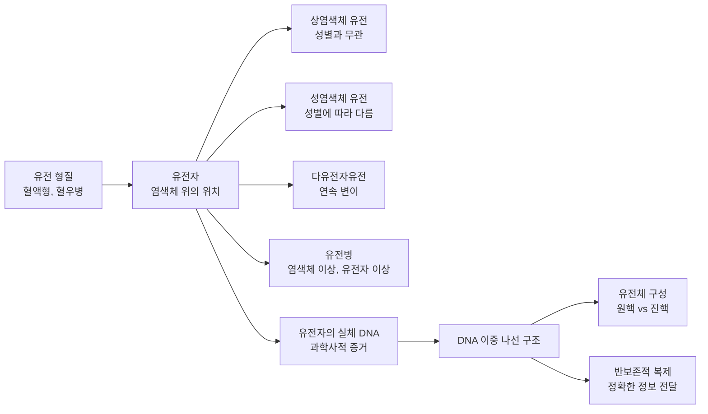
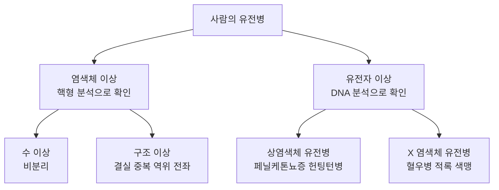
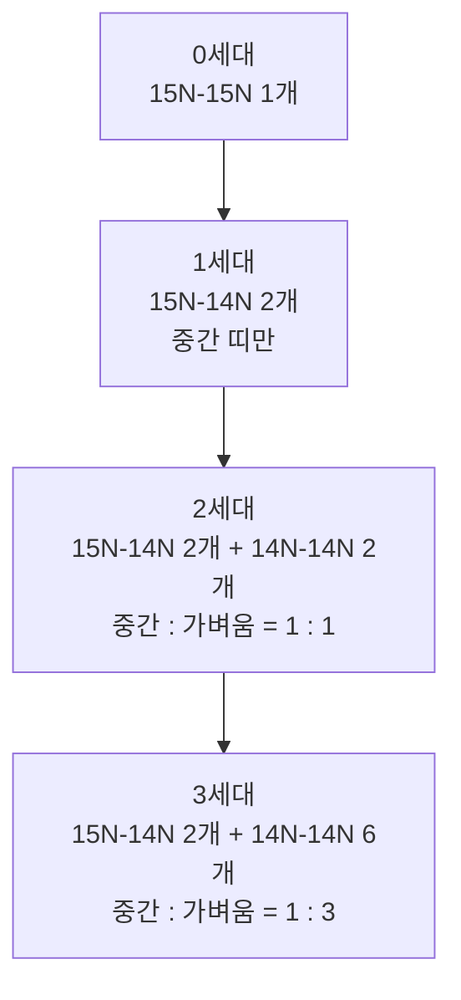

# 생물의 유전 1. 유전자와 유전물질 — 형질을 물려주는 분자, 그리고 그 사본을 만드는 방법
<!-- prev: m3-06, 2-5, 3-6, bio-3, cell-1 -->
<!-- next: gene-2, gene-3 -->

> [!NOTE]
> **성취기준**
> - **[12유전01-01]** 유전 형질이 유전자를 통해 자손에게 유전됨을 이해하고, 상염색체 유전과 성염색체 유전 양상의 차이를 설명할 수 있다.
> - **[12유전01-02]** 사람 유전 연구 방법의 어려움을 이해하고, 사람의 유전 현상 분석을 근거로 유전 형질의 유전적 특성을 추론할 수 있다.
> - **[12유전01-03]** 사람의 다유전자유전에 대해 이해하고, 유전 현상의 다양성 사례를 조사하여 과학적 근거를 활용하여 협력적으로 소통할 수 있다.
> - **[12유전01-04]** 염색체와 유전자 이상에 대해 이해하고, 사람의 유전병을 발병 원인별 조사 계획을 세워 조사할 수 있다.
> - **[12유전01-05]** DNA의 구조와 유전물질 규명 관련 과학사적 연구 결과를 설명하기 위한 발표 자료를 창의적으로 제작할 수 있다.
> - **[12유전01-06]** 원핵세포와 진핵세포의 유전자 구조와 유전체 구성을 이해하고, 공통점과 차이점을 비교하여 설명할 수 있다.
> - **[12유전01-07]** 반보존적 DNA 복제 과정을 이해하고 그 의미를 추론하여 협력적으로 소통할 수 있다.

**학습 목표**

1. 유전 형질이 염색체 위의 유전자를 통해 전달됨을 설명하고, 상염색체 유전과 성염색체(X 염색체) 유전의 양상 차이를 자손의 성별 분포로 구별할 수 있다.
2. 사람 유전 연구가 어려운 이유를 알고, 가계도·쌍둥이·집단 자료를 분석하여 형질의 우열과 유전자의 위치(상염색체/성염색체)를 추론할 수 있다.
3. 사람의 형질 대부분이 여러 유전자와 환경의 영향을 함께 받는 다유전자유전임을 연속 변이 분포로 설명할 수 있다.
4. 염색체 수·구조 이상과 유전자 이상을 구별하고, 대표적인 유전병을 발병 원인별로 분류할 수 있다.
5. 그리피스, 에이버리, 허시와 체이스, 샤가프, 프랭클린, 왓슨과 크릭의 연구가 DNA를 유전물질로 밝혀 가는 과정을 논리적으로 연결하여 설명할 수 있다.
6. 원핵세포와 진핵세포의 유전자 구조·유전체 구성을 비교하고, 메셀슨과 스탈의 실험으로 반보존적 복제의 의미를 추론할 수 있다.

**이 단원의 학습 사다리**

| 단계 | 무엇을 하나? |
|---|---|
| STEP 1. 이전 학습 다시 보기 | 중3 「생식과 유전」, 통합과학 「유전자와 단백질」, 생명과학 「생명의 연속성과 다양성」을 다시 꺼낸다 |
| STEP 2. 기초 다지기 | 대립유전자·유전자형·표현형, 감수 분열의 염색체 행동, 확률의 곱·합 규칙, 뉴클레오타이드의 방향 |
| STEP 3. 핵심 개념 | 상염색체·성염색체 유전 → 가계도 분석 → 다유전자유전 → 유전병 → 유전물질 규명사와 DNA 구조 → 유전체 비교 → 반보존적 복제 |
| STEP 4. 오개념 바로잡기 | "혀 말기는 단일 유전자 형질이다?", "우성은 흔하다?" 같은 착각 |
| STEP 5. 대학 전공으로 | 연관과 교차, 하디-바인베르크 평형, 복제 기구의 분자 수준, 후성유전 |
| STEP 6. 생활·산업·진로 | 신생아 선별 검사, 유전 상담, 유전체 분석 서비스, 법의학 |

---

## 🗺️ 단원 들어가기

영국의 빅토리아 여왕은 아홉 자녀를 두었고, 그 자녀들은 유럽 여러 왕가와 혼인하였다. 그런데 여왕 자신은 건강했는데도, 여왕의 아들 한 명과 손자·증손자 여러 명이 작은 상처에도 피가 잘 멈추지 않는 **혈우병**을 앓았다. 이상한 점은 환자가 **거의 모두 남자**였다는 것이다. 여왕의 딸들은 건강했지만, 그 딸들의 아들 가운데 환자가 나왔다.

왜 이 병은 남자에게 몰려 나타났을까? 건강한 어머니가 어떻게 병을 물려주었을까? 그리고 '물려준다'는 것은 정확히 **무엇을** 물려준다는 뜻일까?

이 단원은 이 질문에 세 겹으로 답한다. 첫째, 형질은 **염색체 위의 유전자**를 통해 전달되고, 유전자가 어느 염색체에 있느냐에 따라 유전 양상이 달라진다. 둘째, 그 유전자의 실체는 **DNA**이며, 과학자들은 여러 실험으로 이를 증명하였다. 셋째, DNA는 **반보존적으로 복제**되기 때문에 세포가 분열하고 세대가 바뀌어도 정보가 정확히 전달된다.

---

## STEP 1. 🔙 이전 학습 다시 보기

### 연계 개념표

| 이전 단원·성취기준 | 그때 배운 것 | 이 단원에서 확장되는 것 |
|---|---|---|
| 중3 「생식과 유전」 [9과21-02] | 염색체와 유전자의 관계, 체세포분열과 생식세포 형성 과정의 염색체 행동 | 감수 분열에서 상동 염색체가 나뉘는 것이 유전 법칙과 염색체 비분리의 원인이 됨 |
| 중3 「생식과 유전」 [9과21-04] | 멘델의 분리 법칙·독립 법칙, 우성과 열성 | 사람의 상염색체 유전, 복대립 유전(ABO식 혈액형), 다유전자유전 |
| 중3 「생식과 유전」 [9과21-05] | 사람 유전 연구 방법(가계도, 쌍둥이), 간단한 가계도 해석 | 가계도로 우열·유전자 위치를 논리적으로 판별하고 확률을 계산 |
| 통합과학1 「지각과 생명체 구성 물질의 규칙성」 | 핵산은 뉴클레오타이드가 결합한 중합체, 염기 A·G·C·T(U) | 당–인산 골격, 5′·3′ 방향, 이중 나선의 역평행 구조 |
| 통합과학1 「유전자와 단백질」 [10통과1-03-06] | DNA·유전자·염색체, 상보적 염기 짝, 전사·번역 | 유전자가 DNA라는 증거, 유전체의 구성, 복제 방식 |
| 생명과학 「생명의 연속성과 다양성」 [12생과03-01, 03-02] | 염색체 구조(염색 분체, 히스톤), 핵형, 감수 분열과 유전적 다양성 | 염색체 이상 유전병, 비분리의 시기 추론, 진핵생물 유전체의 포장 |
| 세포와 물질대사 「세포」 [12세포01-02, 01-04] | 핵산의 기본 구조, 원핵세포와 진핵세포의 차이 | 두 세포의 유전자 구조와 유전체 구성의 차이 |

### 준비 운동 (사전 진단)

**Q1.** 사람의 체세포 하나에 들어 있는 염색체 46개 중 상염색체와 성염색체는 각각 몇 개인가? 남자의 성염색체 구성은?

**Q2.** 유전자형이 $Aa$인 부모 사이에서 열성 표현형($aa$)인 자녀가 태어날 확률은?

**Q3.** DNA에서 아데닌(A)과 짝을 이루는 염기와 구아닌(G)과 짝을 이루는 염기를 쓰시오.

**Q4.** 감수 1분열과 감수 2분열에서 각각 무엇이 분리되는가?

정답 및 해설

**Q1.** 상염색체 44개(22쌍), 성염색체 2개(1쌍). 남자는 XY, 여자는 XX이다.

**Q2.** $\dfrac{1}{4}$ — $Aa \times Aa$에서 자녀의 유전자형은 $AA : Aa : aa = 1 : 2 : 1$이다.

**Q3.** A–T(티민), G–C(사이토신). RNA에서는 T 대신 U(유라실)가 A와 짝을 이룬다.

**Q4.** 감수 1분열에서는 **상동 염색체**가, 감수 2분열에서는 **염색 분체**가 분리된다. 감수 1분열에서 염색체 수가 절반이 된다.

---

## STEP 2. 🧱 기초 다지기

### ① 대립유전자, 유전자형, 표현형

- **유전자 자리(locus)**: 한 유전자가 염색체 위에서 차지하는 위치.
- **대립유전자(allele)**: 상동 염색체의 같은 자리에 있으면서 같은 형질을 다르게 결정하는 유전자. 예: ABO식 혈액형의 $I^A$, $I^B$, $i$.
- **유전자형(genotype)**: 가지고 있는 대립유전자의 조합. 예: $I^Ai$.
- **표현형(phenotype)**: 겉으로 드러나는 형질. 예: A형.
- **동형 접합(homozygous)** 은 두 대립유전자가 같은 경우($AA$, $aa$), **이형 접합(heterozygous)** 은 다른 경우($Aa$)이다.

> [!TIP]
> 💡 **비유** — 상동 염색체 한 쌍은 같은 목차를 가진 요리책 두 권(아버지 쪽, 어머니 쪽)이다. 두 권의 '김치찌개' 쪽은 같은 자리(유전자 자리)에 있지만, 한 권은 "돼지고기를 넣는다", 다른 권은 "참치를 넣는다"라고 다르게 적혀 있을 수 있다. 이것이 대립유전자이다.

### ② 감수 분열과 유전 법칙은 같은 이야기이다

멘델이 말한 '분리'는 감수 1분열에서 **상동 염색체가 갈라지는 것**이고, '독립'은 서로 다른 상동 염색체 쌍이 **무작위로 배열되어 갈라지는 것**이다. 즉, 유전 법칙은 감수 분열 때 염색체가 움직이는 방식의 결과이다. 이를 **유전자의 염색체설**이라 한다. 그러므로 염색체가 잘못 나뉘면(비분리) 유전자도 함께 잘못 전달된다.

| 감수 분열의 사건 | 유전 현상 |
|---|---|
| 상동 염색체의 분리(감수 1분열) | 대립유전자의 분리 → 생식세포는 대립유전자를 하나씩 가짐 |
| 서로 다른 상동 염색체 쌍의 무작위 배열 | 서로 다른 염색체에 있는 유전자의 독립적 전달 |
| 상동 염색체 또는 염색 분체의 비분리 | 염색체 수 이상 → 다운 증후군, 터너 증후군 등 |

### ③ 확률의 곱 규칙과 합 규칙

가계도 문제와 유전 상담은 결국 확률 계산이다.

- **곱 규칙**: 서로 독립인 사건이 **동시에(그리고)** 일어날 확률은 각 확률의 곱이다. 예: 첫째와 둘째가 모두 열성 표현형일 확률 $\dfrac14 \times \dfrac14 = \dfrac{1}{16}$
- **합 규칙**: 동시에 일어날 수 없는 사건 중 **하나(또는)** 가 일어날 확률은 각 확률의 합이다. 예: $Aa\times Aa$에서 자녀가 $AA$ 또는 $Aa$일 확률 $\dfrac14 + \dfrac24 = \dfrac34$
- **조건부 확률**: "이미 정상이라는 것을 알 때" 보인자일 확률은 전체를 정상으로 줄여서 다시 계산한다. $Aa\times Aa$의 정상 자녀 중 $Aa$일 확률은 $\dfrac{2/4}{3/4} = \dfrac23$이다.

> [!IMPORTANT]
> 가계도 문제에서 가장 많이 틀리는 곳이 바로 **조건부 확률**이다. 표현형이 정상인 사람은 $AA$일 수도 $Aa$일 수도 있으며, 부모가 모두 $Aa$이면 그 사람이 $Aa$일 확률은 $\dfrac12$이 아니라 $\dfrac23$이다.

### ④ 뉴클레오타이드에는 방향이 있다

뉴클레오타이드는 **인산 + 당(디옥시리보스) + 염기**로 이루어진다. 당의 탄소에 1′~5′ 번호를 붙이면, 염기는 1′ 탄소에, 인산은 5′ 탄소에 붙어 있다. 한 뉴클레오타이드의 3′ 탄소에 있는 $-\mathrm{OH}$와 다음 뉴클레오타이드의 인산이 결합하여 사슬이 길어진다. 그래서 사슬의 한쪽 끝은 인산이 드러난 **5′ 끝**, 다른 끝은 $-\mathrm{OH}$가 드러난 **3′ 끝**이 된다.

| 구성 | 위치 | 역할 |
|---|---|---|
| 인산 | 당의 5′ 탄소 | 이웃 뉴클레오타이드의 3′ 탄소와 결합 → 당–인산 골격 |
| 당(디옥시리보스) | 중심 | 골격의 뼈대, 탄소 번호의 기준 |
| 염기(A, G, C, T) | 당의 1′ 탄소 | 정보를 담는 '글자', 반대편 염기와 수소 결합 |

<!-- fig:gene-1-nucleotide-strand -->

> [!TIP]
> 💡 **비유** — 뉴클레오타이드 사슬은 '앞뒤가 있는 레고 블록 줄'이다. 블록의 볼록한 면(5′)과 오목한 면(3′)이 정해져 있어서, 새 블록은 언제나 한쪽 끝(3′ 끝)에만 끼울 수 있다. 이 사실은 DNA 복제를 이해하는 열쇠가 된다.

---

## STEP 3. 📘 핵심 개념

### ① 유전자와 유전 형질 — 상염색체 유전과 성염색체 유전 [12유전01-01]

#### 형질은 유전자를 통해 전달된다

부모는 자녀에게 형질 자체를 주는 것이 아니라 **형질을 결정하는 유전자**를 생식세포에 담아 준다. 자녀는 그 유전자를 바탕으로 단백질을 만들고, 그 결과 형질이 나타난다. 유전자와 형질의 관계가 과학적으로 명확히 밝혀진 대표적인 사람의 형질은 다음과 같다.

| 형질 | 관여 유전자(산물) | 유전자의 위치 | 유전 양상 |
|---|---|---|---|
| ABO식 혈액형 | 적혈구 표면의 당 사슬을 붙이는 효소 | 9번 염색체(상염색체) | 복대립 유전, $I^A = I^B > i$ |
| 페닐케톤뇨증 | 페닐알라닌 수산화 효소 | 상염색체(12번) | 상염색체 열성 |
| 헌팅턴병 | 헌팅틴 단백질 | 상염색체(4번) | 상염색체 우성 |
| 적록 색맹 | 망막 원뿔 세포의 시각 색소 단백질 | X 염색체 | X 염색체 열성(반성 유전) |
| 혈우병 A | 혈액 응고 인자 Ⅷ | X 염색체 | X 염색체 열성(반성 유전) |
| 남성으로의 성 결정 | SRY 유전자의 산물(전사 조절 단백질) | Y 염색체 | 아버지 → 아들로만 전달 |

#### ABO식 혈액형 — 상염색체의 복대립 유전

한 형질에 관여하는 대립유전자가 셋 이상이면 **복대립 유전**이라 한다. ABO식 혈액형은 $I^A$, $I^B$, $i$ 세 대립유전자가 관여하고, 한 사람은 그중 두 개를 가진다. $I^A$와 $I^B$는 서로 우열이 없어 함께 발현되고(공동 우성), 둘 다 $i$에 대해 우성이다.

| 표현형 | A형 | B형 | AB형 | O형 |
|---|---|---|---|---|
| 유전자형 | $I^AI^A$, $I^Ai$ | $I^BI^B$, $I^Bi$ | $I^AI^B$ | $ii$ |

유전자형은 6가지, 표현형은 4가지이다. 유전자가 상염색체에 있으므로 아들과 딸에게 나타나는 비율이 같다.

#### 성염색체 유전 — X 염색체 위의 유전자

X 염색체에는 성 결정과 상관없는 유전자도 많다(약 800여 개의 단백질 유전자). 이런 유전자의 형질은 성별에 따라 나타나는 빈도가 다르며, 이를 **반성 유전(sex-linked inheritance)** 이라 한다.

- 남자는 X 염색체가 하나뿐이므로($X Y$) X 위의 대립유전자 하나만으로 표현형이 결정된다. 열성 대립유전자 하나만 있어도 형질이 나타난다.
- 여자는 X가 둘이므로($XX$) 열성 형질은 두 X 모두에 열성 대립유전자가 있어야 나타난다.
- 아들의 X 염색체는 **반드시 어머니에게서** 온다. 아버지는 아들에게 Y를, 딸에게 X를 준다.

| 비교 항목 | 상염색체 유전 | X 염색체 열성 유전 |
|---|---|---|
| 남녀의 발현 빈도 | 거의 같다 | 남자가 여자보다 훨씬 많다 |
| 아버지 → 아들 전달 | 가능 | 불가능(아버지는 아들에게 Y를 줌) |
| 열성 형질인 딸의 아버지 | 정상일 수 있음 | 반드시 열성 형질 |
| 열성 형질인 어머니의 아들 | 정상일 수 있음 | 반드시 열성 형질 |
| 정상인데 대립유전자를 가진 사람(보인자) | 남녀 모두 가능 | 여자만 가능 |
| 대표 예 | ABO식 혈액형, 페닐케톤뇨증 | 적록 색맹, 혈우병 A, 뒤셴 근육 퇴행 위축 |

> [!TIP]
> 💡 **비유** — 남자의 X 염색체는 '예비 타이어 없는 자동차'이다. 타이어(대립유전자)에 문제가 생기면 바로 멈춘다. 여자는 X가 둘이라 하나가 열성이어도 다른 하나가 정상이면 대개 표현형이 정상이다.

#### 예제 1 — 적록 색맹의 유전

정상 남자($X^RY$)와 적록 색맹 보인자 여자($X^RX^r$) 사이에서 자녀가 태어날 때, (1) 아들이 적록 색맹일 확률, (2) 딸이 적록 색맹일 확률, (3) 자녀(성별 모름)가 적록 색맹일 확률을 구하시오.

**풀이** 생식세포: 아버지 $X^R$, $Y$ / 어머니 $X^R$, $X^r$

| | $X^R$ (어머니) | $X^r$ (어머니) |
|---|---|---|
| $X^R$ (아버지) | $X^RX^R$ 정상 딸 | $X^RX^r$ 보인자 딸 |
| $Y$ (아버지) | $X^RY$ 정상 아들 | $X^rY$ 색맹 아들 |

(1) 아들 중 색맹 $\dfrac12$ (2) 딸 중 색맹 $0$ (딸은 아버지에게서 반드시 $X^R$을 받는다) (3) 네 칸 중 한 칸이므로 $\dfrac14$

"아들이 색맹일 확률"(아들이라는 조건이 있음)과 "색맹인 아들이 태어날 확률"($\dfrac14$)은 다른 질문이라는 점에 주의하자.

#### ✔ 바로 확인

1. (O/X) 아버지는 아들에게 X 염색체를 물려준다.
2. 빈칸: ABO식 혈액형처럼 한 형질에 셋 이상의 대립유전자가 관여하는 유전을 (    ) 유전이라 한다.
3. 유전자형이 $I^Ai$인 아버지와 $I^Bi$인 어머니 사이에서 O형 자녀가 태어날 확률은?
4. X 염색체 열성 형질에서 보인자(표현형은 정상이지만 열성 대립유전자를 가진 사람)가 될 수 있는 성별은?

정답

1. X — 아버지는 아들에게 Y 염색체를, 딸에게 X 염색체를 준다.
2. 복대립 — $I^A$, $I^B$, $i$ 세 대립유전자가 관여한다.
3. $\dfrac14$ — 부모가 각각 $\dfrac12$의 확률로 $i$를 주어야 $ii$가 된다.
4. 여자 — 남자는 X가 하나뿐이라 열성 대립유전자가 있으면 형질이 바로 나타난다.

---

### ② 사람 유전 연구의 어려움과 가계도 분석 [12유전01-02]

#### 왜 사람의 유전은 연구하기 어려운가?

| 어려운 점 | 완두·초파리라면? |
|---|---|
| 한 세대가 약 25~30년으로 길다 | 완두는 1년, 초파리는 약 2주에 한 세대 |
| 자손의 수가 적어 통계적으로 분석하기 어렵다 | 한 번 교배로 수십~수백 개체 |
| 원하는 대로 교배시키는 실험을 할 수 없다(윤리) | 형질을 골라 교배할 수 있다 |
| 환경(영양, 생활 습관)을 똑같이 맞출 수 없다 | 실험실에서 환경 통제 가능 |
| 형질에 여러 유전자와 환경이 함께 작용하는 경우가 많다 | 뚜렷이 구분되는 대립 형질을 골라 쓸 수 있다 |

그래서 사람의 유전은 이미 일어난 결과를 모아 **분석**하는 방법으로 연구한다.

| 연구 방법 | 무엇을 하나? | 알아낼 수 있는 것 |
|---|---|---|
| 가계도 분석 | 한 집안의 여러 세대에 걸친 형질 기록을 기호로 정리 | 우열 관계, 상염색체/성염색체 여부, 구성원의 유전자형 |
| 쌍둥이 연구 | 1란성(유전자 같음)과 2란성(형제 수준) 쌍둥이의 형질 일치율 비교 | 형질에 대한 유전과 환경의 상대적 영향 |
| 집단 조사 | 많은 사람의 형질 빈도를 조사·통계 처리 | 형질·대립유전자의 빈도, 지역·집단 간 차이 |
| 염색체·DNA 분석 | 핵형 분석, 유전자 염기 서열 분석 | 염색체 이상, 원인 유전자와 돌연변이 확인 |

#### 가계도 분석의 논리

가계도에서 □는 남자, ○는 여자, 색칠한 기호는 형질이 나타난 사람이며, 가로줄은 부부, 세로줄은 자녀를 잇는다. 분석은 다음 순서로 한다.

1. **우열 판단**: 형질이 **없는** 부모 사이에서 형질이 **있는** 자녀가 나오면, 그 형질은 **열성**이다(부모는 보인자). 반대로 형질이 **있는** 부모 사이에서 형질이 **없는** 자녀가 나오면 그 형질은 **우성**이다.
2. **유전자 위치 판단**(X 염색체 열성인지 확인): 열성 형질인 **딸**의 **아버지**가 정상이거나, 열성 형질인 **어머니**의 **아들**이 정상이면 → X 염색체 열성이 **아니다**(상염색체 열성).
3. **X 염색체 우성인지 확인**: 우성 형질인 **아버지**의 **딸**이 정상이거나, 정상인 **어머니**의 **아들**이 우성 형질이면 → X 염색체 우성이 **아니다**.
4. 남은 가능성으로 유전자형을 정하고, 확률을 계산한다.

> [!WARNING]
> 가계도 하나만으로는 위치를 **확정할 수 없는** 경우도 많다. "모순이 생기는 경우를 지워 나가는 것"이 기본 전략이며, 지워지지 않은 가능성이 둘 이상이면 "둘 다 가능하다"고 답해야 한다.

<!-- fig:gene-1-pedigree -->

#### 예제 2 — 가계도로 유전 방식 추론하기

어떤 유전병에 대한 가계 정보이다.

| 번호 | 성별 | 표현형 | 부모 |
|---|---|---|---|
| 1 | 남 | 정상 | — |
| 2 | 여 | 정상 | — |
| 3 | 여 | **유전병** | 1과 2 |
| 4 | 남 | 정상 | 1과 2 |

(1) 이 유전병은 우성인가, 열성인가? (2) 유전자는 상염색체와 X 염색체 중 어디에 있는가? (3) 4가 유전병 대립유전자를 가지고 있을(보인자일) 확률은? (4) 4가 보인자 여자와 결혼할 때 첫 아이가 유전병일 확률은?

**풀이**
(1) 정상인 1, 2 사이에서 유전병인 3이 태어났으므로 **열성**이다.
(2) 열성 형질인 딸 3의 아버지 1이 정상이다. X 염색체 열성이라면 3($X^aX^a$)은 아버지에게서 $X^a$를 받아야 하므로 1도 유전병이어야 한다. 모순이므로 **상염색체 열성**이다.
(3) 1과 2는 모두 $Aa$이다. 4는 정상이므로 $AA$ 또는 $Aa$이고, 정상 중 $Aa$일 확률은 $\dfrac23$이다.
(4) 4가 $Aa$일 확률 $\dfrac23$ × $Aa\times Aa$에서 $aa$가 나올 확률 $\dfrac14$ $= \dfrac16$

#### 쌍둥이 자료 읽기

1란성 쌍둥이는 유전자가 같고, 2란성 쌍둥이는 형제자매와 같은 수준으로 유전자를 공유한다(평균 절반). 두 쌍둥이 모두 같은 가정에서 자랐다면 환경 차이는 비슷하다고 볼 수 있다. 따라서 **1란성의 일치율이 2란성보다 훨씬 높을수록 그 형질에 대한 유전의 영향이 크다**고 해석한다. 1란성의 일치율이 100%가 아니라면, 그 차이는 **환경의 영향**이다.

| 형질(가상 자료) | 1란성 일치율 | 2란성 일치율 | 해석 |
|---|---|---|---|
| ABO식 혈액형 | 100% | 약 60% | 유전만으로 결정 |
| 형질 P | 약 85% | 약 25% | 유전의 영향이 크지만 환경도 작용 |
| 형질 Q | 약 30% | 약 25% | 환경의 영향이 큼 |

#### ✔ 바로 확인

1. (O/X) 형질이 없는 부모 사이에서 형질이 있는 자녀가 태어났다면, 그 형질은 열성이다.
2. 1란성 쌍둥이의 일치율이 100%가 아닌 형질에서, 1란성 쌍둥이 사이의 차이는 무엇의 영향인가?
3. 고르기: 열성 형질인 딸의 아버지가 정상이다. 이 가계에서 배제되는 유전 방식은? (가) 상염색체 열성 (나) X 염색체 열성
4. 사람의 유전 연구가 어려운 이유를 한 가지 쓰시오.

정답

1. O — 부모가 모두 열성 대립유전자를 가진 보인자이다.
2. 환경 — 1란성 쌍둥이는 유전자가 같다.
3. (나) — X 염색체 열성이라면 딸($X^aX^a$)은 아버지에게서 $X^a$를 받으므로 아버지도 형질을 나타내야 한다.
4. 예: 한 세대가 길다 / 자손 수가 적다 / 교배 실험을 할 수 없다 / 환경을 통제할 수 없다 중 하나.

---

### ③ 사람의 다유전자유전 — 유전 현상의 다양성 [12유전01-03]

#### 대부분의 형질은 '여러 유전자 + 환경'

멘델 형질처럼 유전자 하나로 표현형이 뚜렷하게 나뉘는 형질은 사람에게서 오히려 드물다. 키, 피부색, 몸무게, 혈압 같은 형질은 사람마다 조금씩 다르고, 키를 재 보면 "큰 사람/작은 사람"으로 나뉘지 않고 **연속적인 분포**를 보인다. 이런 형질은 **여러 쌍의 유전자**가 함께 관여하고 **환경**의 영향도 받는다. 이를 **다유전자유전(polygenic inheritance)** 이라 한다.

| 구분 | 단일 유전자 유전 | 다유전자유전 |
|---|---|---|
| 관여 유전자 | 한 쌍 | 여러 쌍(많게는 수천 개의 유전적 변이) |
| 표현형 분포 | 몇 가지로 뚜렷이 구분(불연속 변이) | 연속적, 종 모양 분포(연속 변이) |
| 환경의 영향 | 대개 작다 | 크다 |
| 예 | ABO식 혈액형, 적록 색맹 | 키, 피부색, 몸무게, 혈압 |
| 관련 질병 | 낭성 섬유증, 헌팅턴병 | 제2형 당뇨병, 고혈압, 심혈관 질환(다인자 질환) |

키의 경우 대규모 유전체 연구에서 **수천 개가 넘는 유전적 변이**가 관여한다고 알려져 있고, 한 변이가 바꾸는 키는 대개 1 mm 정도 이하로 아주 작다. 그런데 같은 유전자를 가진 사람이라도 영양 상태가 다르면 키가 달라진다. 실제로 여러 나라에서 지난 100여 년 동안 평균 키가 크게 늘었는데, 이렇게 짧은 기간에 유전자 구성이 크게 바뀔 수는 없으므로 주로 **영양·위생 같은 환경 변화**의 결과로 해석한다.

> [!IMPORTANT]
> 다유전자유전의 핵심 의미는 **"사람의 유전 대부분은 다유전자유전이다"** 는 것이다. 그러므로 "키 유전자", "공부 유전자"처럼 한 유전자가 복잡한 형질을 결정한다는 표현은 과학적이지 않다. 유전자는 **경향성**을 만들고, 실제 표현형은 많은 유전자와 환경이 함께 만든다.

#### 단순 모형으로 보는 연속 변이

피부색이 세 쌍의 유전자 $A/a$, $B/b$, $C/c$(서로 다른 염색체에 있음)에 의해 결정되고, 대문자 대립유전자 하나마다 색소가 같은 양씩 더해진다고 가정해 보자(**누적 효과**). 그러면 표현형은 대문자 대립유전자의 **개수**(0~6개)에 따라 7가지가 된다.

#### 예제 3 — 다유전자유전의 표현형 분포

위 모형에서 $AaBbCc \times AaBbCc$ 사이에서 자녀가 태어날 때, (1) 표현형의 가짓수, (2) 대문자 대립유전자가 3개인 자녀가 태어날 확률, (3) 부모와 표현형이 같은 자녀의 비율을 구하시오.

**풀이** 부모 각각이 생식세포에 대문자를 넣을 확률은 유전자마다 $\dfrac12$이고, 자녀는 대립유전자 6개를 받는다. 대문자 개수 $k$의 확률은 $\binom{6}{k}\left(\dfrac12\right)^6$이다.

| 대문자 개수 | 0 | 1 | 2 | 3 | 4 | 5 | 6 |
|---|---|---|---|---|---|---|---|
| 비율(64분의) | 1 | 6 | 15 | 20 | 15 | 6 | 1 |

(1) 7가지 (2) $\dfrac{20}{64} = \dfrac{5}{16}$ (3) 부모는 대문자 3개이므로 (2)와 같은 $\dfrac{5}{16}$

분포가 가운데가 가장 높은 **종 모양**이 된다. 관여하는 유전자가 더 많아지고 환경의 영향이 더해지면, 계단 모양이던 분포가 매끄러운 곡선이 된다. 이것이 사람의 키·피부색이 연속 변이를 보이는 이유이다.

<!-- fig:gene-1-polygenic -->

> [!TIP]
> 💡 **비유** — 동전 6개를 던져 앞면 수를 세는 것과 같다. 동전이 1개면 결과는 2가지뿐이지만, 6개면 7가지, 100개면 101가지가 되어 거의 연속적으로 보인다. 여기에 '바람(환경)'까지 더해지면 경계는 완전히 사라진다.

#### 유전 현상의 다양성 — 조사·소통의 예

| 현상 | 내용 | 과학적 근거로 소통할 때 주의점 |
|---|---|---|
| 불완전 우성 | 이형 접합이 중간 표현형(예: 분꽃 꽃 색) | 사람 사례는 신중히 고른다 |
| 공동 우성 | 두 대립유전자가 함께 발현(AB형) | 효소의 기능으로 설명 |
| 복대립 유전 | 대립유전자가 셋 이상(ABO식 혈액형) | 한 사람은 그중 둘만 가짐 |
| 다유전자유전 | 키, 피부색 | "○○ 유전자 하나가 결정"이라는 표현을 피함 |
| 다인자 질환 | 당뇨병, 고혈압 | 유전적 위험도 + 생활 습관을 함께 다룸 |

#### ✔ 바로 확인

1. (O/X) 키처럼 연속 변이를 보이는 형질은 대개 한 쌍의 유전자로 결정된다.
2. 빈칸: 다유전자유전 형질은 여러 유전자와 함께 (    )의 영향을 크게 받는다.
3. 누적 효과 모형에서 유전자 2쌍인 $AaBb \times AaBb$의 자녀가 가질 수 있는 표현형은 몇 가지인가?
4. 관여하는 유전자 수가 많아지고 환경의 영향이 더해질수록 표현형 분포의 모양은 어떻게 변하는가?

정답

1. X — 여러 쌍의 유전자와 환경이 함께 작용하는 다유전자유전이다.
2. 환경 — 예: 영양 상태에 따라 키가 달라진다.
3. 5가지 — 대문자 대립유전자 수가 0~4개인 다섯 경우이다.
4. 계단 모양에서 매끄러운 종 모양(연속 변이)에 가까워진다.

---

### ④ 염색체 이상과 유전자 이상 — 사람의 유전병 [12유전01-04]

유전병은 원인에 따라 크게 **염색체 이상**과 **유전자 이상**으로 나뉜다. 염색체 이상은 현미경으로 핵형을 관찰하여 확인할 수 있지만, 유전자 이상은 염기 서열 수준의 변화라서 핵형으로는 보이지 않는다.

#### 염색체 수 이상 — 비분리

감수 분열에서 상동 염색체(감수 1분열) 또는 염색 분체(감수 2분열)가 갈라지지 않고 한쪽으로 함께 가는 것을 **비분리(nondisjunction)** 라 한다. 그 결과 염색체가 하나 더 많거나($n+1$) 적은($n-1$) 생식세포가 생기고, 이것이 정상 생식세포와 수정하면 $2n+1$(삼염색체) 또는 $2n-1$(일염색체)인 자녀가 태어난다.

| 감수 1분열 비분리 | 감수 2분열 비분리 |
|---|---|
| 상동 염색체가 함께 이동 | 한 딸세포에서 염색 분체가 함께 이동 |
| 생식세포 4개가 모두 비정상($n+1$ 2개, $n-1$ 2개) | 4개 중 2개만 비정상($n+1$ 1개, $n-1$ 1개), 2개는 정상 |
| $n+1$ 생식세포에 **서로 다른 상동 염색체**(예: $X^A$와 $X^a$)가 들어감 | $n+1$ 생식세포에 **같은 염색 분체에서 온 동일한** 염색체(예: $X^a$와 $X^a$)가 들어감 |

<!-- fig:gene-1-nondisjunction -->

| 유전병 | 핵형 | 주요 특징 |
|---|---|---|
| 다운 증후군 | $47,\ \mathrm{XX},+21$ 또는 $47,\ \mathrm{XY},+21$ | 21번 삼염색체. 지적 장애, 심장 질환 위험. 산모 나이가 많을수록 발생 빈도 증가 |
| 에드워드 증후군 | 18번 삼염색체 | 심한 발달 이상, 대부분 생후 1년 이내 사망 |
| 터너 증후군 | $45,\ \mathrm{X}$ | 여자, 생식 기관 발달 미흡, 작은 키 |
| 클라인펠터 증후군 | $47,\ \mathrm{XXY}$ | 남자, 정소 발달 미흡, 키가 큰 편 |

#### 염색체 구조 이상

| 종류 | 내용 | 예 |
|---|---|---|
| 결실 | 염색체 일부가 떨어져 없어짐 | 고양이 울음 증후군(5번 염색체 짧은 팔 결실) |
| 중복 | 같은 부분이 두 번 이상 반복 | — |
| 역위 | 일부가 끊어졌다가 거꾸로 붙음 | — |
| 전좌 | 일부가 상동이 아닌 다른 염색체에 붙음 | 만성 골수성 백혈병(9번과 22번 사이의 전좌, 필라델피아 염색체) |

<!-- fig:gene-1-chromosome-structure -->

#### 유전자 이상 — 염기 서열의 변화

| 유전병 | 유전 양상 | 원인 | 결과 |
|---|---|---|---|
| 낫 모양 적혈구 빈혈증 | 상염색체 열성 | 헤모글로빈 β 사슬 유전자의 염기 하나 치환(6번째 아미노산 글루탐산 → 발린) | 산소가 적을 때 헤모글로빈이 뭉쳐 적혈구가 낫 모양, 빈혈 |
| 페닐케톤뇨증(PKU) | 상염색체 열성 | 페닐알라닌 수산화 효소 유전자 이상 | 페닐알라닌이 쌓여 뇌 발달 장애. 신생아 선별 검사 후 식이 조절로 예방 |
| 낭성 섬유증 | 상염색체 열성 | 염화 이온 수송 단백질 유전자 이상 | 끈끈한 점액이 폐·이자에 쌓임 |
| 헌팅턴병 | 상염색체 우성 | 특정 염기 3개(CAG)의 반복이 비정상적으로 늘어남 | 대개 중년 이후 신경 세포 퇴화, 운동·인지 장애 |
| 혈우병 A | X 염색체 열성 | 혈액 응고 인자 Ⅷ 유전자 이상 | 혈액 응고 지연 |
| 뒤셴 근육 퇴행 위축 | X 염색체 열성 | 디스트로핀 유전자 이상 | 근육이 점차 약해짐 |

> [!NOTE]
> 만성 골수성 백혈병의 전좌는 생식세포가 아닌 **골수의 체세포**에서 생기므로 자녀에게 유전되지 않는다. 염색체 이상이라고 모두 '유전되는' 것은 아니다. 거꾸로, 전좌로 생긴 융합 유전자의 단백질만 골라 억제하는 **표적 치료제**가 개발되어(「생명공학기술」 단원) 유전병 연구가 치료로 이어진 대표 사례가 되었다.

#### 예제 4 — 비분리가 일어난 사람 찾기

정상 시각인 아버지($X^RY$)와 적록 색맹 보인자인 어머니($X^RX^r$) 사이에서 **적록 색맹인 터너 증후군 딸**이 태어났다. 감수 분열에서 성염색체 비분리가 일어난 사람은 누구인가? (돌연변이는 비분리 외에는 없다.)

**풀이** 터너 증후군은 X 염색체가 하나($45,\ \mathrm{X}$)이다. 이 딸이 색맹이므로 가진 X는 $X^r$이고, $X^r$은 어머니만 가지고 있다. 아버지의 $X^R$을 받았다면 색맹이 아니었을 것이므로, 아버지에게서는 **성염색체가 없는 정자**가 왔다. 따라서 비분리는 **아버지의 정자 형성 과정**(감수 1분열 또는 감수 2분열)에서 일어났다.

#### ✔ 바로 확인

1. 짝짓기: (가) 다운 증후군 (나) 터너 증후군 (다) 고양이 울음 증후군 — ㄱ. $45,\ \mathrm{X}$ ㄴ. 5번 염색체 일부 결실 ㄷ. 21번 삼염색체
2. (O/X) 낫 모양 적혈구 빈혈증은 핵형 분석으로 확인할 수 있다.
3. 감수 1분열에서 상동 염색체가 비분리되면, 만들어지는 생식세포 4개 중 염색체 수가 비정상인 것은 몇 개인가?
4. 염색체의 일부(예: 구간 B·C·D)가 끊어졌다가 거꾸로 붙은 구조 이상의 이름은?

정답

1. (가)–ㄷ, (나)–ㄱ, (다)–ㄴ — (가)·(나)는 수 이상, (다)는 구조 이상(결실)이다.
2. X — 염기 하나가 바뀐 유전자 이상이므로 핵형으로는 보이지 않고 DNA 분석이 필요하다.
3. 4개 — $n+1$ 2개, $n-1$ 2개가 생긴다.
4. 역위

---

### ⑤ 유전물질 규명의 과학사와 DNA의 구조 [12유전01-05]

20세기 초 과학자들은 유전자가 염색체 위에 있다는 것은 알았지만, 염색체를 이루는 **단백질과 DNA 중 무엇이 유전물질인지** 몰랐다. 당시에는 20종류의 아미노산으로 이루어진 단백질이 4종류의 뉴클레오타이드로 된 DNA보다 다양한 정보를 담기에 유리해 보여서 단백질이라고 생각하는 과학자가 많았다. 이 생각을 뒤집은 실험들을 차례로 보자.

#### (1) 그리피스의 형질 전환 실험 (1928)

폐렴을 일으키는 세균(폐렴쌍구균)에는 피막이 있어 병을 일으키는 **S형**과 피막이 없어 병을 일으키지 못하는 **R형**이 있다.

| 쥐에 주사한 것 | 결과 | 해석 |
|---|---|---|
| 살아 있는 S형 | 죽음 | S형은 병원성이 있다 |
| 살아 있는 R형 | 산다 | R형은 병원성이 없다 |
| 열로 죽인 S형 | 산다 | 죽은 S형은 병을 일으키지 못한다 |
| 열로 죽인 S형 + 살아 있는 R형 | **죽음**, 죽은 쥐에서 **살아 있는 S형** 검출 | 죽은 S형의 어떤 물질이 R형을 S형으로 바꾸었다(**형질 전환**) |

그리피스는 형질 전환을 일으키는 '어떤 물질'이 있다는 것은 밝혔지만, 그것이 무엇인지는 알아내지 못했다.

#### (2) 에이버리 연구진의 실험 (1944)

에이버리와 동료들은 S형 추출물을 여러 분해 효소로 처리한 뒤 R형에 넣어 형질 전환이 일어나는지 확인했다.

| S형 추출물 처리 | 형질 전환 |
|---|---|
| 처리 없음 | 일어남 |
| 단백질 분해 효소 | 일어남 |
| RNA 분해 효소 | 일어남 |
| **DNA 분해 효소** | **일어나지 않음** |

DNA를 없앴을 때만 형질 전환이 사라졌으므로, 형질 전환을 일으키는 물질은 **DNA**이다. 그러나 "추출물에 섞인 미량의 단백질 때문일 수도 있다"는 반론이 남았다.

#### (3) 허시와 체이스의 실험 (1952)

박테리오파지(T2 파지)는 단백질 껍질과 그 안의 DNA로만 이루어진 바이러스로, 대장균에 감염하여 자신을 복제한다. 허시와 체이스는 **단백질에만 있는 황(S)** 과 **DNA에만 있는 인(P)** 을 이용했다.

| 표지 | 감염 후 흔들어 원심 분리 | 방사능이 주로 검출된 곳 | 의미 |
|---|---|---|---|
| $^{35}\mathrm{S}$ (단백질 껍질 표지) | 위층(상층액, 파지 껍질) | 상층액 | 단백질은 대장균 안으로 들어가지 않는다 |
| $^{32}\mathrm{P}$ (DNA 표지) | 아래층(침전물, 대장균) | 침전물 | DNA가 대장균 안으로 들어가 새 파지를 만든다 |

대장균 안으로 들어가 새 파지를 만든 것은 DNA였으므로, 파지의 유전물질은 **DNA**이다.

> [!TIP]
> 💡 **비유** — 택배(파지)가 도착했을 때 상자(단백질 껍질)는 문밖에 두고 안의 설명서(DNA)만 집 안(대장균)에 들어간다. 집 안에서 설명서대로 새 택배가 만들어진다면, 정보를 담은 것은 상자가 아니라 설명서이다. 허시와 체이스는 상자에는 '황 스티커', 설명서에는 '인 스티커'를 붙여 무엇이 들어갔는지 추적했다.

<!-- fig:gene-1-hershey-chase -->

#### (4) DNA 구조를 밝힌 단서와 이중 나선 모형 (1950~1953)

| 연구자 | 발견 | 구조 모형에 준 단서 |
|---|---|---|
| 샤가프 (1950 무렵) | 여러 생물의 DNA에서 $\mathrm{A}=\mathrm{T}$, $\mathrm{G}=\mathrm{C}$. 단, $\dfrac{\mathrm{A+T}}{\mathrm{G+C}}$는 생물 종마다 다름 | A–T, G–C가 짝을 이룬다. 종마다 염기 서열이 다르다 |
| 윌킨스와 프랭클린 (1951~1952) | DNA의 X선 회절 사진(X자 무늬) | 나선 구조, 일정한 지름, 일정한 간격의 반복 |
| 왓슨과 크릭 (1953) | 이중 나선 모형 발표 | 위 자료를 모두 만족하는 구조 |

**DNA 이중 나선의 특징**

- 두 가닥의 폴리뉴클레오타이드가 오른쪽으로 꼬인 **이중 나선**이다.
- 바깥쪽은 **당–인산 골격**, 안쪽은 염기가 마주 보고 **수소 결합**한다.
- **상보적 염기 짝**: A–T는 수소 결합 2개, G–C는 수소 결합 3개. 항상 퓨린(A, G, 고리 2개)과 피리미딘(T, C, 고리 1개)이 짝지으므로 지름이 일정(약 2 nm)하다.
- 두 가닥은 방향이 서로 반대인 **역평행(antiparallel)** 이다. 한 가닥이 5′→3′이면 다른 가닥은 3′→5′이다.
- 염기쌍 사이 간격은 약 0.34 nm, 나선 한 바퀴에 약 10개의 염기쌍(약 3.4 nm)이 있다.

$$
\mathrm{A} = \mathrm{T},\qquad \mathrm{G} = \mathrm{C},\qquad \mathrm{A} + \mathrm{G} = \mathrm{T} + \mathrm{C} = 50\%
$$

<!-- sim:dna-3d -->

> [!IMPORTANT]
> 왓슨과 크릭은 논문에서 "우리가 가정한 특이적 짝짓기는 유전물질의 복제 방식을 곧바로 암시한다"고 썼다. 구조를 알자 **기능(복제)이 보였다**는 점이 이 발견의 진짜 의미이다. 한편 프랭클린의 X선 회절 자료는 모형의 결정적인 근거였지만 그는 1958년에 세상을 떠났고, 1962년 노벨상은 왓슨, 크릭, 윌킨스가 받았다. 과학의 성과가 여러 사람의 자료와 협력 위에 세워진다는 점, 그리고 연구 자료의 공정한 공유와 인정이라는 연구 윤리 문제를 함께 생각해 볼 수 있다.

#### 예제 5 — 샤가프 법칙과 DNA의 크기

이중 가닥 DNA 100 염기쌍(뉴클레오타이드 200개)에서 아데닌(A)이 전체 염기의 30%이다. (1) T, G, C의 비율, (2) 염기쌍 사이 수소 결합의 총수, (3) 이 DNA의 길이를 구하시오.

**풀이**
(1) $\mathrm{T} = \mathrm{A} = 30\%$, $\mathrm{G} = \mathrm{C} = (100 - 60) \div 2 = 20\%$
(2) A는 $200 \times 0.3 = 60$개 → A–T 염기쌍 60개. G는 40개 → G–C 염기쌍 40개. 수소 결합 $= 60 \times 2 + 40 \times 3 = 240$개
(3) $100 \times 0.34\ \mathrm{nm} = 34\ \mathrm{nm}$

G–C 비율이 높은 DNA일수록 수소 결합이 많아 두 가닥을 떼어 내는 데(변성) 더 높은 온도가 필요하다.

#### ✔ 바로 확인

1. 허시와 체이스의 실험에서 $^{32}\mathrm{P}$로 표지한 파지를 감염시킨 뒤 원심 분리하면, 방사능은 주로 상층액과 침전물 중 어디에서 검출되는가?
2. 에이버리 연구진의 실험에서 형질 전환이 일어나지 않은 처리는?
3. 빈칸: DNA에서 A–T 염기쌍은 수소 결합 (    )개, G–C 염기쌍은 (    )개로 연결된다.
4. 이중 가닥 DNA에서 티민(T)이 22%이면 사이토신(C)은 몇 %인가?

정답

1. 침전물 — DNA가 대장균 안으로 들어갔고, 대장균은 무거워 가라앉는다.
2. DNA 분해 효소로 처리한 경우
3. 2, 3
4. 28% — $\mathrm{A} = \mathrm{T} = 22\%$, $\mathrm{G} + \mathrm{C} = 56\%$이고 $\mathrm{G} = \mathrm{C}$이다.

---

### ⑥ 원핵세포와 진핵세포의 유전자 구조와 유전체 [12유전01-06]

**유전체(genome)** 는 한 생물이 가진 유전 정보 전체이다. 원핵세포(세균)와 진핵세포(사람, 효모, 식물)는 모두 DNA를 유전물질로 쓰고 같은 유전 암호를 쓰지만, 유전자와 유전체를 조직하는 방식이 다르다.

#### 유전자의 구조

모든 유전자에는 전사를 시작하게 하는 **프로모터(promoter)**, 단백질 정보를 담은 **암호화 부위**, 전사를 끝내는 부위가 있다. 차이는 그 배열 방식에 있다.

| 구분 | 원핵세포의 유전자 | 진핵세포의 유전자 |
|---|---|---|
| 암호화 부위 | 대부분 끊김 없이 이어져 있다 | **엑손(exon)** 사이에 **인트론(intron)** 이 끼어 있다 |
| 프로모터와 유전자 | 기능이 관련된 여러 유전자가 하나의 프로모터를 함께 쓰기도 한다(**오페론**) | 대개 유전자마다 각자 프로모터가 있다 |
| 조절 부위 | 주로 프로모터 바로 근처 | 프로모터 근처 + 멀리 떨어진 조절 부위(인핸서 등) |
| 전사와 번역 | 같은 공간(세포질)에서 거의 동시에 | 전사(핵) → RNA 가공 → 번역(세포질) |

<!-- fig:gene-1-gene-structure -->

#### 유전체의 구성

| 구분 | 원핵세포(예: 대장균) | 진핵세포(예: 사람) |
|---|---|---|
| DNA의 위치 | 세포질의 핵양체 부위 | 핵(일부는 미토콘드리아·엽록체) |
| DNA 모양 | 대개 **원형** DNA 1개 + 작은 원형 DNA인 **플라스미드** | **선형** DNA 여러 개(사람 핵상 $n=23$) |
| 단백질과의 결합 | 히스톤이 없고, 다른 단백질과 함께 고리 모양으로 꼬여 응축 | **히스톤**에 감겨 **뉴클레오솜**을 이루고 염색질로 응축 |
| 유전체 크기 | 약 460만 염기쌍 | 약 30억 염기쌍(핵상 $n$ 기준) |
| 단백질 유전자 수 | 약 4,000여 개 | 약 2만 개 |
| 단백질 암호화 부위의 비율 | 매우 높다(대부분) | 매우 낮다(약 1~2%) |
| 비암호화 DNA | 적다 | 인트론, 반복 서열, 조절 부위 등 대부분을 차지 |
| 염색체 끝 | 원형이라 끝이 없음 | 끝에 반복 서열인 **텔로미어**가 있음 |
| 복제 시작점 | 대개 1개 | 염색체마다 여러 개 |

<!-- fig:gene-1-genome-packing -->

> [!TIP]
> 💡 **비유** — 세균의 유전체는 '군더더기 없는 요약 노트'이다. 거의 모든 줄이 내용(유전자)이고, 관련된 내용은 한 제목(프로모터) 아래 묶여 있다. 사람의 유전체는 '주석과 광고가 많은 두꺼운 백과사전'이다. 본문(엑손)은 일부뿐이고 사이사이에 인트론이 끼어 있으며, 어떤 부분을 읽을지 정하는 수많은 표시(조절 부위)가 있다. 그러나 이 '군더더기'의 상당수는 유전자 발현 조절 등에 쓰이므로 쓸모없는 것은 아니다.

**공통점**: 유전물질이 DNA이다, 같은 4종류의 염기와 거의 같은 유전 암호를 쓴다, 반보존적으로 복제된다, 유전자는 프로모터에서 전사가 시작된다.

#### 예제 6 — 유전체의 길이와 포장

(1) 대장균 유전체(약 $4.6 \times 10^6$ 염기쌍)를 쭉 펴면 길이는 몇 mm인가? 대장균의 길이를 약 $2\ \mathrm{\mu m}$라 할 때 몇 배인가?
(2) 사람 체세포 하나(핵상 $2n$, 약 $6 \times 10^9$ 염기쌍)의 DNA를 이어 붙인 길이는 몇 m인가?
(3) 유전자 하나당 평균 유전체 길이를 대장균(약 4,300개)과 사람(약 2만 개, $n$ 기준 $3 \times 10^9$ 염기쌍)에 대해 비교하시오.

**풀이**
(1) $4.6\times10^6 \times 0.34\ \mathrm{nm} = 1.564 \times 10^6\ \mathrm{nm} \approx 1.6\ \mathrm{mm}$. $\dfrac{1.564\ \mathrm{mm}}{0.002\ \mathrm{mm}} \approx 780$배
(2) $6\times10^9 \times 0.34 \times 10^{-9}\ \mathrm{m} \approx 2.0\ \mathrm{m}$
(3) 대장균 $\dfrac{4.6\times10^6}{4300} \approx 1.1\times10^3$ 염기쌍(약 1천), 사람 $\dfrac{3\times10^9}{2\times10^4} = 1.5\times10^5$ 염기쌍(15만). 사람 유전체에서는 유전자 하나가 차지하는 '자리'가 대장균보다 100배 이상 넓다. 인트론과 유전자 사이의 긴 비암호화 DNA 때문이다.

#### ✔ 바로 확인

1. (O/X) 사람 유전체에서 가장 큰 비율을 차지하는 것은 단백질 암호화 부위이다.
2. 빈칸: 진핵 유전자에서 최종 mRNA에 남는 부위는 (    ), 잘려 나가는 부위는 (    )이다.
3. 기능이 관련된 여러 유전자가 하나의 프로모터를 함께 쓰는 원핵세포의 유전자 단위를 무엇이라 하는가?
4. 고르기: DNA가 히스톤에 감겨 뉴클레오솜을 이루는 것은 (원핵세포 / 진핵세포)이다.

정답

1. X — 단백질 암호화 부위는 약 1~2%이고, 대부분은 비암호화 DNA이다.
2. 엑손, 인트론
3. 오페론
4. 진핵세포 — 원핵세포에는 히스톤이 없다.

---

### ⑦ 반보존적 DNA 복제와 그 의미 [12유전01-07]

#### 세 가지 가설

DNA가 복제될 때 원래 두 가닥(부모 가닥)이 어떻게 나뉠지에 대해 세 가지 가설이 있었다.

| 가설 | 내용 | 복제 후 두 DNA |
|---|---|---|
| 보존적 복제 | 원래 이중 나선은 그대로 두고 완전히 새 이중 나선을 만든다 | (옛+옛), (새+새) |
| **반보존적 복제** | 두 가닥이 풀린 뒤 각 가닥을 주형으로 새 가닥을 만든다 | (옛+새), (옛+새) |
| 분산적 복제 | 옛 조각과 새 조각이 각 가닥에 섞여 있다 | 모든 가닥이 옛·새 혼합 |

#### 메셀슨과 스탈의 실험 (1958)

1. 대장균을 무거운 질소 동위 원소 $^{15}\mathrm{N}$만 있는 배지에서 여러 세대 키워 DNA를 모두 무겁게($^{15}\mathrm{N}/^{15}\mathrm{N}$) 만든다.
2. 대장균을 가벼운 $^{14}\mathrm{N}$ 배지로 옮겨 한 세대, 두 세대 분열시킨다.
3. 세대마다 DNA를 추출하여 염화 세슘 용액에서 **밀도 기울기 원심 분리**를 한다. 무거운 DNA일수록 아래쪽에 띠를 만든다.

| 세대($^{14}\mathrm{N}$ 배지) | 관찰 결과 | 보존적이라면 | 분산적이라면 |
|---|---|---|---|
| 0 | 무거운 띠($^{15}\mathrm{N}/^{15}\mathrm{N}$)만 | 같음 | 같음 |
| 1 | **중간 띠($^{15}\mathrm{N}/^{14}\mathrm{N}$)만** | 무거운 띠 : 가벼운 띠 = 1 : 1 | 중간 띠만 |
| 2 | **중간 띠 : 가벼운 띠 = 1 : 1** | 무거운 : 가벼운 = 1 : 3 | 중간과 가벼운 사이의 띠 하나 |

1세대 결과로 보존적 복제가, 2세대 결과로 분산적 복제가 배제되어 **반보존적 복제**가 확인되었다.

$n$세대 뒤 DNA는 $2^n$개이고, 그중 원래 $^{15}\mathrm{N}$ 가닥을 하나씩 가진 중간 밀도 DNA는 **항상 2개**이다. 원래 두 가닥은 없어지지 않고 끝까지 하나씩 다른 DNA에 나뉘어 남는다.

<!-- sim:dna-replication -->

#### 복제가 일어나는 과정 — 용어 수준으로

| 단계 | 하는 일 | 관여하는 것(용어) |
|---|---|---|
| ① 풀기 | 복제 시작점에서 두 가닥 사이 수소 결합을 끊어 이중 나선을 푼다 | 헬리케이스 |
| ② 출발점 만들기 | 새 가닥 합성을 시작할 짧은 출발 서열을 붙인다 | RNA 프라이머 |
| ③ 새 가닥 만들기 | 각 옛 가닥을 **주형**으로 상보적인 뉴클레오타이드를 이어 붙인다(5′→3′ 방향) | DNA 중합 효소 |
| ④ 잇기 | 조각난 새 가닥 사이를 연결한다 | DNA 연결 효소 |

DNA 중합 효소는 새 가닥을 3′ 끝 쪽으로만 늘일 수 있고, 두 주형 가닥은 역평행이므로 한쪽 새 가닥은 연속적으로, 다른 쪽은 짧은 조각으로 나뉘어 합성된다. 자세한 과정은 STEP 5에서 맛보기로 다룬다.

#### 반보존적 복제의 의미

| 관점 | 의미 |
|---|---|
| 정확성 | 각 옛 가닥이 '거푸집(주형)'이 되므로, 상보적 짝짓기 규칙만 지키면 원래와 같은 서열이 만들어진다 |
| 오류 검사 | 새 가닥에 잘못 들어간 염기를 옛 가닥과 비교하여 고칠 수 있다(어느 쪽이 원본인지 구별 가능) |
| 연속성 | 세포 분열과 생식을 거쳐도 유전 정보가 세대를 따라 거의 그대로 전달된다 → 「생명의 연속성과 다양성」 |
| 변이 | 아주 드물게 고쳐지지 않은 오류는 **돌연변이**가 되어 유전적 다양성과 진화의 재료가 된다 |
| 기술 | 상보적 짝짓기로 사본을 만드는 원리를 시험관에서 반복한 것이 **PCR**이다(「생명공학기술」) |

> [!TIP]
> 💡 **비유** — 반보존적 복제는 '반쪽 열쇠 복사'와 같다. 지퍼를 열 듯 두 가닥을 열고, 각 반쪽에 맞는 새 반쪽을 끼운다. 새로 만든 두 지퍼는 모두 '옛 반쪽 + 새 반쪽'이다. 원본 반쪽이 남아 있으니 새로 끼운 반쪽이 맞는지 언제든 대조할 수 있다.

#### 예제 7 — 세대가 지난 뒤의 띠 비율

$^{15}\mathrm{N}$ 배지에서 키운 대장균을 $^{14}\mathrm{N}$ 배지로 옮겨 3세대 분열시킨 뒤, 다시 $^{15}\mathrm{N}$ 배지로 옮겨 1세대 분열시켰다. 이때 DNA의 중간 띠($^{15}\mathrm{N}/^{14}\mathrm{N}$), 무거운 띠($^{15}\mathrm{N}/^{15}\mathrm{N}$), 가벼운 띠($^{14}\mathrm{N}/^{14}\mathrm{N}$)의 비를 구하시오.

**풀이** 3세대 뒤 DNA 8개 = 중간 2개 + 가벼운 6개. 가닥으로 보면 $^{15}\mathrm{N}$ 가닥 2개, $^{14}\mathrm{N}$ 가닥 14개이다. $^{15}\mathrm{N}$ 배지에서 한 번 더 복제하면 16개의 가닥이 각각 새 $^{15}\mathrm{N}$ 가닥과 짝을 이룬다.
- 옛 $^{15}\mathrm{N}$ 가닥 2개 → 무거운 DNA 2개
- 옛 $^{14}\mathrm{N}$ 가닥 14개 → 중간 DNA 14개
- 가벼운 DNA 0개

중간 : 무거운 : 가벼운 $= 14 : 2 : 0 = 7 : 1 : 0$

#### ✔ 바로 확인

1. (O/X) 반보존적 복제가 끝난 두 DNA는 각각 옛 가닥 하나와 새 가닥 하나로 이루어진다.
2. 메셀슨과 스탈의 실험에서 $^{14}\mathrm{N}$ 배지 1세대 결과(중간 띠만)로 배제된 가설은?
3. $^{15}\mathrm{N}$ DNA를 가진 대장균을 $^{14}\mathrm{N}$ 배지로 옮겨 2세대 분열시켰을 때, 중간 띠 : 가벼운 띠의 비는?
4. 빈칸: DNA 중합 효소는 새 가닥을 (    )′ 끝 쪽으로만 늘인다.

정답

1. O
2. 보존적 복제 — 보존적이라면 무거운 띠와 가벼운 띠가 1 : 1로 나타나야 한다.
3. 1 : 1 — DNA 4개 중 옛 가닥을 가진 중간 DNA는 2개이다.
4. 3 — 새 가닥은 5′→3′ 방향으로 합성된다.

---

## STEP 4. ⚠️ 오개념 바로잡기

| 흔한 오개념 | 올바른 개념 | 왜 그럴까? |
|---|---|---|
| 우성 형질은 집단에서 더 흔하다 | 우열은 **이형 접합에서 어느 형질이 나타나는가**의 문제이고, 빈도와는 관계없다 | 헌팅턴병은 우성이지만 매우 드물고, O형(열성)은 많은 집단에서 흔하다 |
| 혀 말기, 보조개, 귓불 모양은 멘델 법칙을 따르는 단일 유전자 형질이다 | 이런 형질은 **가계 연구에서 단일 유전자 모형과 맞지 않는 예**가 많이 보고되었다 | 일란성 쌍둥이도 다른 경우가 있고, 여러 유전자·환경의 영향을 받는다. 그래서 교과서는 증명된 사례(ABO, 적록 색맹 등)를 쓴다 |
| X 염색체 열성 유전병은 남자에게만 나타난다 | 여자도 $X^aX^a$이면 나타난다. 다만 남자보다 훨씬 드물다 | 남자는 열성 대립유전자 1개로, 여자는 2개가 있어야 발현된다 |
| 유전병은 모두 부모에게서 물려받는다 | 비분리·새로운 돌연변이처럼 **부모에게 없던 변화**로도 생기며, 체세포 이상(만성 골수성 백혈병)은 유전되지 않는다 | '유전병'은 유전물질의 이상으로 생긴 병이라는 뜻이며 '반드시 물려받은 병'이라는 뜻이 아니다 |
| 다유전자유전 형질은 유전자로 결정되므로 바꿀 수 없다 | 다유전자유전 형질은 **환경의 영향을 크게** 받는다 | 지난 100여 년간의 평균 키 증가는 영양·위생 개선의 영향이다 |
| 허시와 체이스는 $^{32}\mathrm{P}$로 DNA와 단백질을 모두 표지했다 | $^{35}\mathrm{S}$는 **단백질만**, $^{32}\mathrm{P}$는 **DNA만** 표지한다 | 아미노산 일부에만 황이 있고, DNA의 당–인산 골격에만 인이 있다(단백질에는 인이 거의 없음) |
| 사람 유전체는 대부분 단백질 유전자이다 | 단백질 암호화 부위는 약 1~2%뿐이다 | 인트론, 반복 서열, 조절 부위 등 비암호화 DNA가 대부분이다 |

---

## STEP 5. 🎓 다음 단계로 한 걸음 더

> [!CAUTION]
> 이 절은 **「생물의 유전」 교육과정 범위 밖의 심화 내용**으로 평가 대상이 아니다. 이 단원의 개념이 대학 전공 과목에서 어떻게 확장되는지 맛보기로 보여 주기 위한 내용이다.

### 대학 전공 과목과의 연결

| 대학 과목 | 이어지는 내용 |
|---|---|
| 유전학 | 연관과 교차, 유전자 지도, 집단 유전학(하디-바인베르크 평형), 정량 유전학(유전율) |
| 분자생물학 | 복제 기구(복제 분기점, 오카자키 절편), DNA 수선, 텔로미어와 텔로머레이스 |
| 인류유전학·의학유전학 | 유전 상담, 유전체 연관 분석(GWAS), 다유전자 위험 점수 |
| 유전체학·생물정보학 | 유전체 해독, 비교 유전체학, 반복 서열과 전이 인자 |
| 세포생물학 | 염색질 구조, 핵 속 염색체 배치, 세포 주기와 복제 시점 |

### ① 연관과 교차 — 같은 염색체 위의 유전자

멘델의 독립 법칙은 두 유전자가 **서로 다른 염색체**에 있을 때 성립한다. 같은 염색체에 있는 유전자는 함께 전달되는 경향이 있는데(**연관**), 감수 1분열 때 상동 염색체 사이에서 일부가 바뀌는 **교차**가 일어나면 새 조합이 생긴다. 두 유전자가 멀리 떨어져 있을수록 교차가 일어날 확률이 높으므로, 재조합 빈도를 거리처럼 사용하여 **유전자 지도**를 만든다(1% 재조합 = 1 cM, 센티모건).

$$
\text{재조합 빈도} = \frac{\text{재조합형 자손 수}}{\text{전체 자손 수}} \times 100\ (\%)
$$

### ② 하디-바인베르크 평형 — 집단 속의 대립유전자

큰 집단에서 돌연변이·선택·이주가 없고 무작위로 교배하면, 대립유전자 빈도 $p$, $q$($p+q=1$)가 세대가 지나도 변하지 않고 유전자형 빈도는 $p^2 : 2pq : q^2$가 된다. 예를 들어 어떤 상염색체 열성 유전병의 빈도가 $\dfrac{1}{10\,000}$이면 $q = 0.01$, 보인자 빈도는 $2pq \approx 0.02$로 **50명 중 1명**이다. 환자는 드물어도 보인자는 훨씬 많다는 사실은 유전 상담에서 중요하다.

### ③ 복제 분기점의 분자 기계

대학 분자생물학에서는 복제를 '분자 기계'로 다룬다. 복제 분기점에서 한 새 가닥은 분기점이 열리는 방향으로 연속 합성되고(**선도 가닥**), 반대쪽 새 가닥은 1000~2000개(세균) 또는 100~200개(진핵) 뉴클레오타이드 정도의 짧은 **오카자키 절편**으로 만들어져 연결된다(**지연 가닥**). 진핵생물 선형 염색체의 맨 끝은 이 방식으로 완전히 복제할 수 없어 복제할 때마다 조금씩 짧아지는데, 생식세포·줄기세포·암세포에서는 **텔로머레이스**가 끝을 다시 늘린다. 이는 노화와 암 연구로 이어진다.

### ④ 후성유전 — 서열은 같은데 발현이 다르다

DNA 염기 서열이 아니라 DNA의 메틸화, 히스톤 변형 같은 '표시'가 세포 분열 후에도 전달되어 형질에 영향을 주는 현상을 **후성유전(epigenetics)** 이라 한다. 여자의 두 X 염색체 중 하나가 세포마다 무작위로 꺼지는 **X 염색체 불활성화**가 대표적인 예이며, 삼색 고양이의 얼룩무늬가 이것으로 설명된다. 1란성 쌍둥이가 나이가 들수록 달라지는 이유 중 일부도 후성유전으로 연구된다.

### 지금 vs 다음 단계

| 구분 | 고등학교 「생물의 유전」 | 대학교 유전학·분자생물학 |
|---|---|---|
| 유전 양상 | 상염색체·X 염색체 유전, 가계도 분석 | 연관·교차, 유전자 지도, 유전체 연관 분석 |
| 다유전자유전 | 연속 변이의 의미, 단순 누적 모형 | 유전율, 정량 유전학, 다유전자 위험 점수 |
| 유전병 | 염색체 이상과 유전자 이상의 분류 | 돌연변이의 분자 기작, 유전자 치료 전략 |
| DNA 구조 | 이중 나선, 상보성, 역평행 | DNA의 여러 형태, 초나선, 염색질 고차 구조 |
| 복제 | 반보존적 복제의 의미, 효소는 용어 수준 | 복제 기구, 오카자키 절편, 수선, 텔로머레이스 |
| 집단 | 다루지 않음 | 하디-바인베르크 평형, 유전적 부동 |

---

## STEP 6. 🏭 생활·산업·진로 연결

### 사례 1. 신생아 선별 검사 — 유전병을 '예방'하는 검사

- **원리** 페닐케톤뇨증은 상염색체 열성 유전병으로, 태어난 직후에는 증상이 없다. 그러나 페닐알라닌이 쌓이면 뇌 발달이 손상된다. 유전자는 바꿀 수 없어도 **환경(식단)** 을 바꾸면 표현형을 바꿀 수 있다.
- **쓰임** 우리나라에서는 신생아의 발뒤꿈치에서 혈액 몇 방울을 채취해 페닐케톤뇨증 등 선천성 대사 이상을 검사하는 **신생아 선별 검사**를 실시한다. 일찍 발견하면 페닐알라닌을 줄인 특수 분유와 식단으로 정상 발달을 도울 수 있다.

### 사례 2. 유전 상담과 산전 검사

- **원리** 가계도 분석, 조건부 확률, 핵형 분석이 그대로 쓰인다.
- **쓰임** 가족 중 유전병이 있는 사람은 유전 상담에서 자녀에게 전달될 확률을 안내받는다. 산전 검사에서는 태아의 염색체 수 이상(다운 증후군 등)을 선별한다. 최근에는 산모 혈액 속에 떠다니는 태아 유래 DNA 조각을 분석하는 방법도 쓰인다.
- **윤리** 검사 결과를 이유로 한 차별, 개인의 선택과 사회적 압력 사이의 문제를 함께 다룬다(「생명공학기술」).

### 사례 3. 유전체 분석과 정밀 의료

- **원리** 사람 유전체의 구성, 다유전자유전.
- **쓰임** 유전체 해독 비용이 크게 낮아지면서 암 환자의 종양 DNA를 분석해 맞는 치료제를 고르는 **정밀 의료**가 확산되고 있다. 다만 다유전자유전 형질(키, 성격 등)에 대한 '유전자 검사'는 예측력이 제한적이므로 결과를 과신하지 않아야 한다.

### 사례 4. 법의학과 친자 확인

- **원리** 사람마다 반복 횟수가 다른 짧은 반복 서열(STR)은 멘델의 분리 법칙에 따라 부모에게서 하나씩 물려받는다.
- **쓰임** 여러 STR 자리를 동시에 비교하면 개인 식별과 친자 확인이 가능하다. 범죄 수사, 실종자 가족 찾기, 재난 희생자 신원 확인에 쓰인다.

### 관련 진로와 학과

| 진로 | 하는 일 | 관련 학과 |
|---|---|---|
| 유전 상담 전문가 | 유전 질환 가족의 위험도 안내, 검사 결과 설명 | 생명과학, 의학, 간호학, 유전상담 대학원 |
| 임상 유전학자·진단 검사 전문가 | 핵형 분석, 유전자 검사, 신생아 선별 검사 | 의학, 임상병리학, 분자생물학 |
| 유전체 분석가(생물정보학자) | 유전체 데이터 분석, 질병 관련 변이 탐색 | 생물정보학, 생명과학, 통계학, 컴퓨터공학 |
| 법과학 연구원 | DNA 감식, 신원 확인 | 생명과학, 법과학, 화학 |
| 육종 연구원 | 동식물의 유전 형질 분석과 품종 개량 | 농생명과학, 원예학, 동물자원학 |

---

## 🔬 탐구 활동

### 활동 A. 가계도 분석하기

> [!WARNING]
> 학생 본인과 가족의 질병·가족 관계는 **개인 정보**이다. 실제 가족 자료를 수집하거나 발표하지 않고, 교사가 준 **가상 가계도**만 사용한다.

**목표** 가상 가계도 자료를 분석하여 형질의 우열 관계와 유전자의 위치(상염색체/X 염색체)를 논리적으로 추론하고, 근거를 들어 발표한다.

**준비물** 가상 가계도 카드 3종, 활동지, 색연필(또는 디지털 그리기 도구)

**과정**
1. 모둠별로 가계도 카드를 받아 남자(□), 여자(○), 형질 발현(색칠)을 기호로 다시 그린다.
2. STEP 3-②의 순서대로 ① 우열 ② X 염색체 열성 가능성 ③ X 염색체 우성 가능성을 하나씩 검토하고, 모순이 생기는 구성원을 표시한다.
3. 남은 가능성으로 모든 구성원의 유전자형을 적는다. 확정할 수 없으면 가능한 유전자형을 모두 적는다.
4. 가계도마다 "다음 자녀가 형질을 나타낼 확률"을 계산한다.
5. 분석 과정을 정보 그림(인포그래픽)이나 슬라이드로 만들어 다른 모둠과 교차 검토한다.

**결과 기록**

| 가계도 | 우성/열성 | 유전자 위치 | 결정적 근거가 된 구성원 | 다음 자녀의 발현 확률 |
|---|---|---|---|---|
| 1 | | | | |
| 2 | | | | |
| 3 | | | | |

**생각해 보기**
1. 위치를 확정할 수 없었던 가계도가 있었는가? 어떤 구성원 정보가 더 있으면 확정할 수 있을까?
2. 사람의 유전 연구에서 가계도 분석만으로는 한계가 있는 이유를 STEP 3-②의 '어려움'과 연결해 설명해 보자.

### 활동 B. DNA 복제 모의실험하기

**목표** 두 색의 종이 띠로 반보존적·보존적·분산적 복제를 모형화하고, 메셀슨과 스탈의 결과와 비교하여 반보존적 복제의 의미를 추론한다.

**준비물** 파란 종이 띠($^{15}\mathrm{N}$ 가닥), 노란 종이 띠($^{14}\mathrm{N}$ 가닥), 가위, 테이프, 활동지

**과정**
1. 파란 띠 2장을 나란히 붙여 처음 DNA($^{15}\mathrm{N}/^{15}\mathrm{N}$)를 만든다. 띠 끝에 5′, 3′을 적어 역평행이 되게 한다.
2. **반보존적 모형**: 두 띠를 떼어 각각에 노란 띠를 붙여 1세대 DNA 2개를 만든다. 같은 방법으로 3세대까지 진행한다.
3. **보존적 모형**: 처음 DNA는 그대로 두고, 노란 띠 2장으로 새 DNA를 만든다. 3세대까지 진행한다.
4. **분산적 모형**: 띠를 잘게 잘라 파란 조각과 노란 조각을 섞어 붙인다. 3세대까지 진행한다.
5. 모형마다 세대별로 파란 띠만 있는 DNA(무거움), 파랑+노랑(중간), 노란 띠만(가벼움)의 개수를 센다.

**결과 기록**

| 세대 | 반보존적: 무거움/중간/가벼움 | 보존적: 무거움/중간/가벼움 | 분산적: 띠의 위치 |
|---|---|---|---|
| 1 | | | |
| 2 | | | |
| 3 | | | |

**생각해 보기**
1. 메셀슨과 스탈의 1세대 결과만으로 배제할 수 있는 가설과, 2세대 결과가 있어야 배제할 수 있는 가설은 각각 무엇인가?
2. 반보존적 복제에서 처음 파란 띠 2장은 몇 세대 뒤에도 남아 있는가? 이것이 '정보의 보존'과 '오류 검사'에 어떤 의미가 있는지 모둠에서 토의하여 한 문장으로 정리해 보자.

> [!WARNING]
> **안전 수칙** 가위를 사용할 때 날을 다른 사람 쪽으로 향하지 않는다. DNA 추출 실험을 함께 할 경우 에탄올은 인화성이므로 불 가까이에 두지 않고, 보안경을 착용한다.

---

## ✅ 개념 확인 문제

### 기본

**1.** 다음 중 사람에서 X 염색체 열성 유전을 하는 형질만을 있는 대로 고른 것은?
ㄱ. 적록 색맹 ㄴ. ABO식 혈액형 ㄷ. 혈우병 A ㄹ. 페닐케톤뇨증

정답 및 해설

**정답** ㄱ, ㄷ

적록 색맹과 혈우병 A는 X 염색체에 있는 유전자에 의한 열성 형질이다. ABO식 혈액형(9번 염색체)과 페닐케톤뇨증은 상염색체 유전이다.

**2.** 사람의 유전 연구가 완두나 초파리의 유전 연구보다 어려운 이유를 세 가지 쓰시오.

정답 및 해설

**정답(예시)** ① 한 세대가 길다. ② 자손의 수가 적다. ③ 원하는 대로 교배 실험을 할 수 없다(윤리적 문제). ④ 환경을 통제할 수 없다. ⑤ 많은 형질이 여러 유전자와 환경의 영향을 함께 받는다. — 이 중 세 가지

**3.** 그림은 그리피스의 실험에서 쥐에 주사한 네 가지 경우 (가)~(라)를 나타낸 것이다. 쥐가 죽고, 죽은 쥐에서 살아 있는 S형 균이 검출된 경우는 어느 것인가? 이 결과의 의미를 한 문장으로 쓰시오.

<!-- fig:gene-1-q-griffith -->

정답 및 해설

**정답** 열로 죽인 S형 균과 살아 있는 R형 균을 함께 주사한 경우

죽은 S형 균에 있던 어떤 물질이 살아 있는 R형 균을 S형 균으로 바꾸었다(형질 전환). 이 물질이 DNA라는 것은 이후 에이버리 연구진이 밝혔다.

**4.** 이중 가닥 DNA에서 구아닌(G)의 비율이 18%일 때, 아데닌(A)의 비율은 몇 %인가?

정답 및 해설

**정답** 32%

$\mathrm{C} = \mathrm{G} = 18\%$이므로 $\mathrm{A} + \mathrm{T} = 100 - 36 = 64\%$이고, $\mathrm{A} = \mathrm{T}$이므로 $\mathrm{A} = 32\%$이다.

**5.** 원핵세포와 진핵세포의 유전체를 비교한 설명으로 옳은 것만을 있는 대로 고르시오.
ㄱ. 원핵세포의 주 DNA는 대개 원형이고, 진핵세포의 핵 DNA는 선형이다.
ㄴ. 진핵세포의 유전자에는 인트론이 있는 경우가 많다.
ㄷ. 유전체 전체에서 단백질 암호화 부위가 차지하는 비율은 사람이 대장균보다 높다.

정답 및 해설

**정답** ㄱ, ㄴ

ㄷ. 사람 유전체에서 단백질 암호화 부위는 약 1~2%뿐이고, 대장균은 유전체 대부분이 암호화 부위이다. 따라서 대장균이 훨씬 높다.

### 응용

**6.** 그림은 어떤 유전병에 대한 가계도이다. 유전병인 어머니 1과 정상인 아버지 2 사이에서 **정상인 아들 3**과 유전병인 딸 4가 태어났다. 이 유전병은 우성과 열성 중 무엇인지는 알 수 없다고 할 때, 이 가계도만으로 **배제할 수 있는** 유전 방식을 고르시오.
ㄱ. 상염색체 우성 ㄴ. 상염색체 열성 ㄷ. X 염색체 우성 ㄹ. X 염색체 열성

<!-- fig:gene-1-q-pedigree -->

정답 및 해설

**정답** ㄹ

X 염색체 열성이라면 유전병인 어머니 1은 $X^aX^a$이고, 아들은 어머니에게서 반드시 $X^a$를 받으므로 아들 3도 유전병이어야 한다. 아들 3이 정상이므로 X 염색체 열성은 배제된다.
X 염색체 우성은 어머니 1이 $X^AX^a$, 아버지 2가 $X^aY$이면 정상 아들($X^aY$)과 유전병 딸($X^AX^a$)이 모두 가능하므로 배제되지 않는다. 상염색체 우성(1: $Aa$, 2: $aa$)과 상염색체 열성(1: $aa$, 2: $Aa$)도 모두 가능하다.

**7.** 키가 두 쌍의 유전자 $A/a$, $B/b$(서로 다른 염색체)에 의해 결정되고, 대문자 대립유전자 하나마다 키가 같은 양씩 커진다고 하자(환경의 영향은 없다고 가정). $AaBb$와 $AaBb$ 사이에서 자녀가 태어날 때, (1) 표현형은 몇 가지인가? (2) 부모보다 키가 클 확률은?

정답 및 해설

**정답** (1) 5가지 (2) $\dfrac{5}{16}$

대문자 개수 0~4개의 비율은 $1 : 4 : 6 : 4 : 1$(16분의)이다. 부모는 대문자 2개이므로 3개 또는 4개인 경우가 부모보다 크다. $\dfrac{4 + 1}{16} = \dfrac{5}{16}$

**8.** 정상 시각인 아버지와 정상 시각인 어머니 사이에서 **적록 색맹인 클라인펠터 증후군 아들**($47,\ \mathrm{XXY}$)이 태어났다. (1) 어머니의 유전자형은? (2) 비분리는 누구의 생식세포 형성 과정에서, 몇 번째 감수 분열에서 일어났는가? (비분리 외의 돌연변이와 교차는 고려하지 않는다.)

정답 및 해설

**정답** (1) $X^RX^r$ (2) 어머니, 감수 2분열

아들이 색맹이 되려면 두 X 염색체가 모두 $X^r$이어야 한다($X^rX^rY$). 아버지는 정상($X^RY$)이므로 $X^r$을 줄 수 없고 Y만 주었다. 따라서 $X^rX^r$은 모두 어머니에게서 왔다. 어머니는 정상이므로 $X^RX^r$이다. 서로 다른 상동 염색체($X^R$, $X^r$)가 함께 들어간 것이 아니라 **같은** $X^r$ 두 개가 들어갔으므로, $X^r$의 염색 분체가 갈라지지 않은 **감수 2분열 비분리**이다.

**9.** 메셀슨과 스탈의 실험에서 $^{15}\mathrm{N}$ DNA를 가진 대장균을 $^{14}\mathrm{N}$ 배지로 옮겨 4세대 분열시켰다. (1) 전체 DNA 중 중간 밀도 DNA의 비율은? (2) 만약 복제가 보존적이었다면 4세대 뒤 무거운 DNA의 비율은?

정답 및 해설

**정답** (1) $\dfrac18$ (2) $\dfrac{1}{16}$

(1) 4세대 뒤 DNA는 $2^4 = 16$개이고, 중간 밀도 DNA는 항상 2개이므로 $\dfrac{2}{16} = \dfrac18$이다.
(2) 보존적이라면 처음 무거운 DNA 1개가 그대로 남고 나머지 15개는 모두 가벼우므로 $\dfrac{1}{16}$이다.

### 융합·서술형

**10. [과학사·발표]** 에이버리 연구진의 실험 후에도 "DNA가 유전물질"이라는 주장에 반론이 있었다. (1) 그 반론의 내용과, (2) 허시와 체이스의 실험이 어떤 점에서 그 반론에 답할 수 있었는지 서술하시오. (3) 이 내용을 발표 자료로 만들 때 한 장의 정보 그림에 꼭 넣어야 할 요소 두 가지를 제안하시오.

정답 및 해설

**예시 답안**
(1) 에이버리 연구진이 쓴 S형 균 추출물에 **미량의 단백질이 섞여** 있어서, 형질 전환이 그 단백질 때문일 수 있다는 반론이 있었다(당시 단백질이 유전물질이라는 생각이 우세했다).
(2) 허시와 체이스는 단백질에만 있는 황($^{35}\mathrm{S}$)과 DNA에만 있는 인($^{32}\mathrm{P}$)으로 두 물질을 **따로 표지**하여, 파지가 세균에 감염할 때 세균 안으로 들어가 새 파지를 만드는 물질이 DNA임을 보였다. 두 물질을 섞인 상태에서 분해한 것이 아니라 하나씩 추적했다는 점에서 반론에 답할 수 있었다.
(3) 예: 두 표지 실험을 나란히 놓은 비교 그림(상층액/침전물의 방사능), '무엇이 의문이었고 실험이 무엇을 배제했는가'를 보여 주는 화살표 흐름, 연도순 연대표

**채점 포인트** ① 단백질 혼입 반론 ② S와 P를 이용한 선택적 표지 ③ 세균 안으로 들어간 것이 DNA ④ 발표 요소의 타당성

**11. [의료·윤리 연계]** 어떤 상염색체 열성 유전병에 대해 남편과 아내가 모두 보인자로 확인되었다. (1) 첫 아이가 이 유전병일 확률과 정상인 첫 아이가 보인자일 확률을 구하시오. (2) 이 유전병이 페닐케톤뇨증이라면, 유전자형이 같아도 표현형(증상)을 바꿀 수 있는 방법을 '유전과 환경'의 관점에서 설명하시오.

정답 및 해설

**예시 답안**
(1) $Aa \times Aa$이므로 유전병일 확률은 $\dfrac14$이다. 정상 자녀는 $AA : Aa = 1 : 2$이므로 정상인 첫 아이가 보인자일 확률은 $\dfrac23$이다.
(2) 페닐케톤뇨증은 페닐알라닌을 분해하는 효소의 유전자 이상으로 페닐알라닌이 쌓여 뇌 발달이 손상되는 병이다. 유전자형($aa$)은 바꿀 수 없지만, 신생아 선별 검사로 일찍 발견하여 **페닐알라닌 섭취를 제한하는 식이 요법(환경 조절)** 을 하면 증상을 크게 줄일 수 있다. 즉, 표현형은 유전자형과 환경이 함께 결정한다.

**채점 포인트** ① $\dfrac14$, $\dfrac23$ ② 효소 결핍으로 물질 축적 ③ 조기 발견 + 식이 조절로 표현형 변화

### 실력 다지기

**12.** A형인 남자(어머니는 O형, 시각 정상)와 B형인 여자(아버지는 O형이며 적록 색맹, 여자 자신은 시각 정상)가 결혼하였다. ABO식 혈액형 유전자는 9번 염색체에, 적록 색맹 유전자는 X 염색체에 있다. (1) 남자와 여자의 유전자형을 쓰시오. (2) 이 부부의 아이가 O형이면서 적록 색맹일 확률을 구하시오. (3) 이 부부의 아들이 O형이면서 적록 색맹일 확률을 구하시오.

정답 및 해설

**정답** (1) 남자 $I^Ai\,X^RY$, 여자 $I^Bi\,X^RX^r$ (2) $\dfrac{1}{16}$ (3) $\dfrac18$

(1) 남자는 A형인데 어머니가 O형($ii$)이므로 어머니에게서 $i$를 받아 $I^Ai$이다. 여자는 B형인데 아버지가 O형이므로 $I^Bi$이고, 적록 색맹인 아버지에게서 $X^r$을 받았지만 시각이 정상이므로 $X^RX^r$이다.
(2) 두 유전자는 서로 다른 염색체에 있으므로 독립적으로 전달된다(곱 규칙). O형일 확률 $\dfrac12 \times \dfrac12 = \dfrac14$, 적록 색맹일 확률은 $X^rY$인 경우뿐이므로 $\dfrac14$. 따라서 $\dfrac14 \times \dfrac14 = \dfrac{1}{16}$
(3) '아들'이라는 조건이 있으므로 아들 중 색맹일 확률은 $\dfrac12$이다. $\dfrac14 \times \dfrac12 = \dfrac18$

**13.** 다음은 같은 가정에서 자란 쌍둥이를 조사한 가상 자료이다.

| 형질 | 1란성 일치율 | 2란성 일치율 |
|---|---|---|
| X | 95% | 50% |
| Y | 45% | 40% |
| Z(모국어) | 100% | 100% |

(1) 유전의 영향이 가장 크다고 볼 수 있는 형질을 고르고 그 근거를 쓰시오. (2) 형질 Y의 1란성 쌍둥이 사이에 차이가 생기는 까닭을 쓰시오. (3) 형질 Z는 1란성 일치율이 100%인데도 "유전으로 결정된다"고 결론 내릴 수 없다. 그 까닭을 쓰시오.

정답 및 해설

**정답**
(1) **X**. 유전자가 같은 1란성의 일치율(95%)이 유전자를 평균 절반 공유하는 2란성(50%)보다 훨씬 높다. 두 쌍둥이 모두 같은 가정에서 자라 환경 차이는 비슷하므로, 일치율의 차이는 유전자 공유 정도의 차이로 해석된다.
(2) 1란성 쌍둥이는 유전자가 같으므로 차이는 **환경**의 영향이다. Y는 1란성과 2란성의 일치율이 비슷하여 유전보다 환경의 영향이 큰 형질이다.
(3) 1란성과 2란성의 일치율이 **같으므로** 유전자 공유 정도가 결과에 영향을 주지 않았다. 같은 가정에서 자란 쌍둥이는 같은 환경(같은 언어를 쓰는 가족)을 공유하므로 둘 다 100%가 된 것이다. 유전의 영향은 1란성과 2란성의 **차이**로 판단해야 한다.

**채점 포인트** ① 1란성과 2란성의 비교 ② 1란성 내 차이 = 환경 ③ 두 일치율이 같으면 유전의 영향을 말할 수 없음

**14.** 200 염기쌍으로 이루어진 이중 가닥 DNA에서 한 가닥(Ⅰ)의 염기 조성이 A 20%, T 25%, G 30%, C 25%이다. (1) 다른 가닥(Ⅱ)의 염기 조성을 쓰시오. (2) 이중 가닥 전체의 염기 조성을 쓰시오. (3) 두 가닥 사이의 수소 결합 총수를 구하시오.

정답 및 해설

**정답** (1) A 25%, T 20%, G 25%, C 30% (2) A = T = 22.5%, G = C = 27.5% (3) 510개

(1) 가닥 Ⅱ는 가닥 Ⅰ과 상보적이므로 Ⅰ의 A는 Ⅱ의 T, Ⅰ의 T는 Ⅱ의 A, Ⅰ의 G는 Ⅱ의 C, Ⅰ의 C는 Ⅱ의 G가 된다. Ⅱ: A 25%, T 20%, G 25%, C 30%
(2) 두 가닥의 길이가 같으므로 평균을 낸다. A $= (20 + 25) \div 2 = 22.5\%$, G $= (30 + 25) \div 2 = 27.5\%$. 이중 가닥에서는 A = T, G = C가 성립한다(샤가프 법칙). 단일 가닥 Ⅰ에서는 A ≠ T임에 주의한다.
(3) 염기 400개 중 A는 $400 \times 0.225 = 90$개 → A–T 염기쌍 90개, G–C 염기쌍 $200 - 90 = 110$개. 수소 결합 $= 90 \times 2 + 110 \times 3 = 510$개

**15.** 메셀슨과 스탈의 실험을 거꾸로 하여, $^{14}\mathrm{N}$ 배지에서 여러 세대 키운 대장균을 $^{15}\mathrm{N}$ 배지로 옮겨 2세대 분열시켰다. 2세대 뒤 DNA를 밀도 기울기 원심 분리하였을 때, (1) 반보존적 복제라면 나타나는 띠와 그 비, (2) 보존적 복제라면 나타나는 띠와 그 비, (3) 분산적 복제라면 띠가 어디에 나타날지 쓰시오.

정답 및 해설

**정답** (1) 중간 띠 : 무거운 띠 = 1 : 1 (2) 가벼운 띠 : 무거운 띠 = 1 : 3 (3) 중간 띠와 무거운 띠 사이의 띠 하나

<!-- fig:gene-1-q-meselson-reverse -->

(1) 처음 DNA는 $^{14}\mathrm{N}/^{14}\mathrm{N}$이다. 1세대 뒤 2개 모두 $^{14}\mathrm{N}/^{15}\mathrm{N}$(중간). 2세대 뒤 4개 중 옛 $^{14}\mathrm{N}$ 가닥을 가진 2개는 중간, 나머지 2개는 $^{15}\mathrm{N}/^{15}\mathrm{N}$(무거움)이다.
(2) 처음 DNA 1개가 그대로 남고(가벼움), 새로 만든 3개는 모두 무겁다.
(3) 모든 가닥에 옛 조각($^{14}\mathrm{N}$) 비율이 $\dfrac14$, 새 조각($^{15}\mathrm{N}$)이 $\dfrac34$로 섞이므로, 모든 DNA가 중간과 무거움 사이의 같은 밀도를 가진다.

### 도전

**16.** 적록 색맹인 어머니($X^rX^r$)와 시각이 정상인 아버지($X^RY$) 사이에서 **시각이 정상인 클라인펠터 증후군 아들**($47,\ \mathrm{XXY}$)이 태어났다(비분리 외의 돌연변이와 교차는 없다). (1) 이 아들의 성염색체 유전자형을 쓰시오. (2) 비분리는 누구의 생식세포 형성 과정에서, 몇 번째 감수 분열에서 일어났는지 근거와 함께 쓰시오. (3) 만약 이 아들이 **적록 색맹**이었다면 비분리가 일어난 사람과 시기를 어디까지 판단할 수 있는가?

정답 및 해설

**정답** (1) $X^RX^rY$ (2) 아버지, 감수 1분열 (3) 어머니에게서 일어났다는 것은 알 수 있지만, 감수 1분열인지 2분열인지는 판단할 수 없다.

(1) 어머니는 $X^r$만 줄 수 있다. 아들이 정상이려면 $X^R$이 있어야 하는데 $X^R$은 아버지만 가지고 있다. 따라서 $X^RX^rY$이다.
(2) 아들은 아버지에게서 $X^R$과 $Y$를 **함께** 받았다. X와 Y는 감수 1분열에서 서로 갈라져야 하는 상동 염색체 쌍이므로, 둘이 한 정자에 함께 들어갔다면 **아버지의 감수 1분열 비분리**이다(감수 2분열 비분리라면 같은 염색체의 염색 분체 두 개, 즉 $X^RX^R$이나 $YY$가 함께 들어간다).

<!-- fig:gene-1-q-xxy-father -->

(3) 색맹 아들은 $X^rX^rY$이다. 아버지는 $X^r$을 줄 수 없으므로 아버지는 $Y$만 주었고, $X^rX^r$은 어머니에게서 왔다. 그런데 어머니의 두 X가 모두 $X^r$이므로, 서로 다른 상동 염색체가 함께 들어간 것(1분열)인지 같은 염색체의 염색 분체가 함께 들어간 것(2분열)인지 유전자로 **구별할 수 없다**. (예제 4·문항 8처럼 어머니가 이형 접합일 때만 시기를 판단할 수 있다.)

**채점 포인트** ① 정상 시각이므로 $X^R$은 아버지 유래 ② X와 Y가 함께 = 상동 염색체의 비분리 = 감수 1분열 ③ 동형 접합인 어머니에서는 시기를 구별할 수 없음을 근거와 함께 서술

**17.** 허시와 체이스의 실험을 다시 설계한다고 하자. (1) 파지를 $^{32}\mathrm{P}$나 $^{35}\mathrm{S}$ 대신 $^{15}\mathrm{N}$(무거운 질소)이나 방사성 탄소로 표지하면 이 실험의 목적을 이룰 수 없는 까닭을 쓰시오. (2) 만약 단백질이 유전물질이었다면 두 실험의 결과(방사능이 주로 검출되는 곳)는 어떻게 나타났을지 예측하시오. (3) 실제 실험에서 $^{35}\mathrm{S}$ 표지 실험의 침전물에서도 방사능이 조금 검출되었다. 그런데도 결론이 바뀌지 않는 까닭을 $^{32}\mathrm{P}$ 실험 결과와 비교하여 설명하시오.

정답 및 해설

**예시 답안**
(1) 질소와 탄소는 DNA와 단백질에 **모두** 들어 있으므로, 어느 물질이 세균 안으로 들어갔는지 구별할 수 없다. 이 실험의 핵심은 한 물질에만 있는 원소(단백질의 S, DNA의 P)로 **두 물질을 따로** 표지하는 것이다.
(2) 단백질이 세균 안으로 들어가 새 파지를 만들었을 것이므로, $^{35}\mathrm{S}$ 실험에서 방사능이 주로 **침전물**(세균)에서, $^{32}\mathrm{P}$ 실험에서는 주로 **상층액**에서 검출되었을 것이다(실제 결과와 반대).
(3) 흔들어도 세균 표면에 붙은 파지 껍질이 일부 떨어지지 않으면 침전물에 섞일 수 있다. 그러나 방사능이 **주로** 검출된 곳을 비교하면 $^{35}\mathrm{S}$는 대부분 상층액, $^{32}\mathrm{P}$는 대부분 침전물이므로, 두 표지의 분포가 뚜렷이 반대이다. 실험 결과는 소량의 예외가 아니라 두 조건의 차이로 해석한다.

**채점 포인트** ① N·C는 두 물질에 공통 → 구별 불가 ② 단백질이 유전물질일 때의 예측이 실제와 반대임을 명시 ③ 일부 혼입의 원인 + 두 표지의 '주된' 분포 비교로 결론 유지

---

## 📝 한눈에 정리

### 핵심 요약

- 형질은 염색체 위의 **유전자**를 통해 전달되며, 감수 분열의 염색체 행동이 유전 법칙의 바탕이다.
- **상염색체 유전**은 남녀 발현 빈도가 비슷하고, **X 염색체 열성 유전**은 남자에게 많으며 아버지에서 아들로 전달되지 않는다.
- 사람 유전은 가계도·쌍둥이·집단 조사·DNA 분석으로 연구하며, 가계도는 **모순을 지워 가는 논리**와 **조건부 확률**로 분석한다.
- 사람 형질 대부분은 여러 유전자와 환경이 함께 작용하는 **다유전자유전**이며 연속 변이를 보인다.
- 유전병은 **염색체 이상**(비분리에 의한 수 이상, 결실·중복·역위·전좌)과 **유전자 이상**(염기 서열 변화)으로 나뉜다.
- 그리피스 → 에이버리 → 허시·체이스 실험으로 **DNA가 유전물질**임이 밝혀졌고, 샤가프 법칙과 X선 회절 자료를 바탕으로 **이중 나선 모형**(1953)이 제안되었다.
- DNA는 당–인산 골격, 상보적 염기 짝(A–T 2개, G–C 3개 수소 결합), **역평행** 두 가닥으로 이루어진다.
- 원핵세포는 원형 DNA·오페론·인트론 거의 없음, 진핵세포는 선형 DNA·히스톤·엑손과 인트론·비암호화 DNA가 많음이 특징이다.
- 메셀슨과 스탈의 실험은 **반보존적 복제**를 확인했으며, 이는 정보를 정확히 복사하고 오류를 검사할 수 있게 하여 생명의 연속성을 보장한다.

### 핵심 용어

| 용어 | 뜻 |
|---|---|
| 대립유전자 | 상동 염색체의 같은 자리에서 같은 형질을 다르게 결정하는 유전자 |
| 복대립 유전 | 한 형질에 셋 이상의 대립유전자가 관여하는 유전(ABO식 혈액형) |
| 반성 유전 | 성염색체에 있는 유전자에 의한 유전. 성별에 따라 발현 빈도가 다르다 |
| 보인자 | 열성 대립유전자를 가지고 있지만 표현형은 정상인 사람 |
| 가계도 | 한 집안의 형질 발현을 여러 세대에 걸쳐 기호로 나타낸 그림 |
| 다유전자유전 | 여러 쌍의 유전자가 한 형질에 관여하여 연속 변이를 나타내는 유전 |
| 비분리 | 감수 분열에서 상동 염색체나 염색 분체가 분리되지 않는 현상 |
| 형질 전환 | 외부에서 들어온 DNA에 의해 세균의 형질이 바뀌는 현상 |
| 역평행 | DNA 두 가닥의 5′→3′ 방향이 서로 반대인 배열 |
| 유전체 | 한 생물이 가진 유전 정보 전체 |
| 엑손과 인트론 | 진핵 유전자에서 최종 RNA에 남는 부위와 잘려 나가는 부위 |
| 반보존적 복제 | 각 옛 가닥이 주형이 되어 새 DNA가 옛 가닥 하나와 새 가닥 하나로 이루어지는 복제 |

### 다음 단원으로

DNA라는 정보 저장소가 어떻게 생겼고 어떻게 복사되는지 알았다. 그렇다면 이 정보는 어떻게 '읽혀' 단백질이 되고, 같은 유전체를 가진 세포들은 어떻게 서로 다른 유전자를 골라 읽을까? 다음 단원 「유전자의 발현」에서는 전사와 번역, 유전 부호 해독, 그리고 원핵생물과 진핵생물의 발현 조절과 발생 과정의 세포 분화를 탐구한다.
