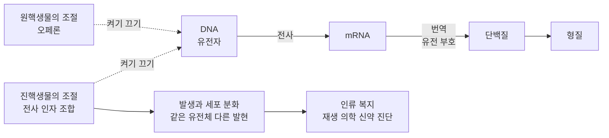
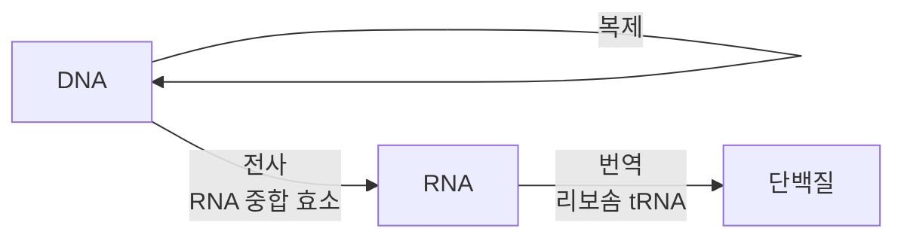
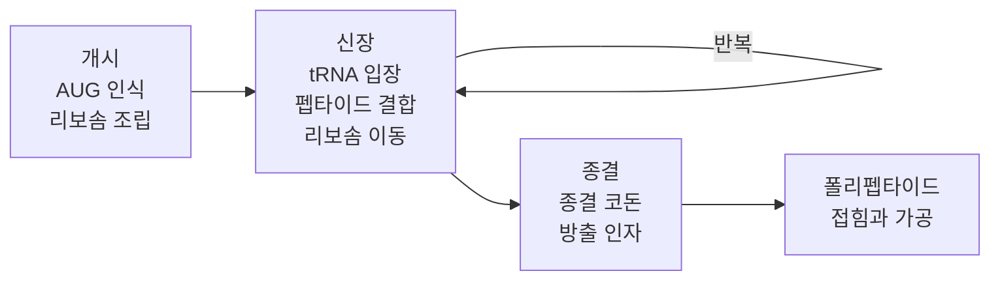
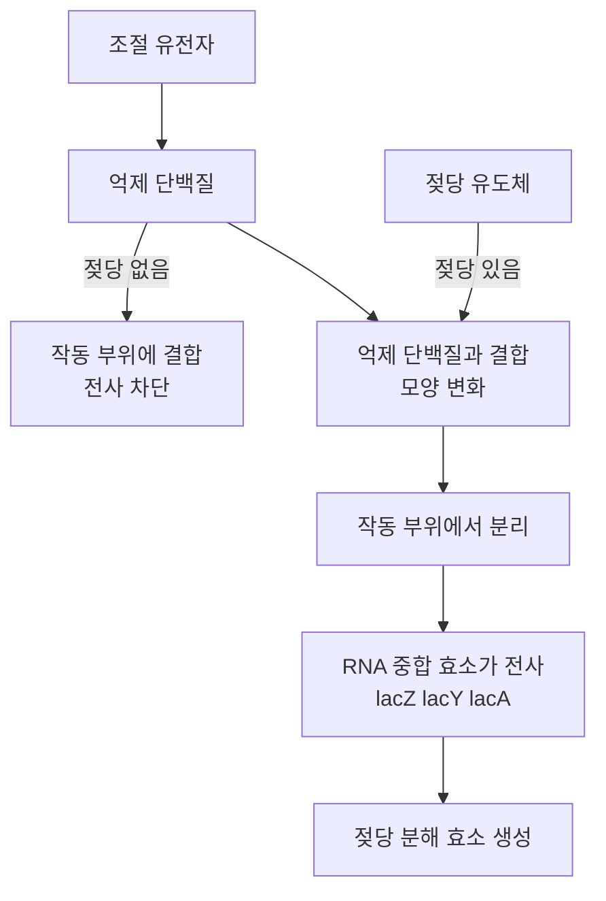
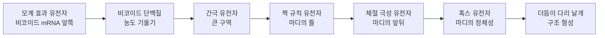

# 생물의 유전 2. 유전자의 발현 — 같은 유전체, 서로 다른 세포
<!-- prev: m3-06, 3-6, bio-3, cell-1, gene-1 -->
<!-- next: gene-3 -->

> [!NOTE]
> **성취기준**
> - **[12유전02-01]** 전사와 번역 과정을 거쳐 유전자가 발현되는 중심원리를 이해하고, 모형을 이용하여 유전자 발현 과정을 설명할 수 있다.
> - **[12유전02-02]** 유전 부호를 이해하고, 유전 부호 표를 사용하여 유전 정보를 해독할 수 있다.
> - **[12유전02-03]** 원핵생물과 진핵생물의 유전자 발현 조절 과정을 비교하기 위한 설명 자료를 다양한 매체를 활용하여 제작할 수 있다.
> - **[12유전02-04]** 생물의 발생 과정에서 세포 분화가 유전자 발현 조절 과정을 통해 일어남을 추론할 수 있다.
> - **[12유전02-05]** 생물의 유전자 발현 조절 및 발생에 대한 연구가 인류 복지에 기여한 사례를 조사하여 협력적으로 소통할 수 있다.

**학습 목표**

1. 중심원리에 따라 전사와 번역이 일어나는 과정을 RNA 중합 효소, 프로모터, tRNA, 리보솜의 역할과 함께 모형으로 설명할 수 있다.
2. 유전 부호(코돈)의 특징을 알고, 유전 부호 표를 이용하여 DNA·mRNA 염기 서열을 아미노산 서열로 해독하고 돌연변이의 영향을 예측할 수 있다.
3. 젖당 오페론을 중심으로 원핵생물의 전사 조절 과정을 설명하고, 진핵생물의 전사 조절이 원핵생물과 다른 점을 비교할 수 있다.
4. 발생 초기의 모계 효과 유전자, 분절 유전자, 혹스 유전자, 핵심 조절 유전자를 예로 들어 세포 분화가 유전자 발현 조절로 일어남을 추론할 수 있다.
5. 유전자 발현 조절과 발생 연구(인공지능 활용 포함)가 의료·산업에 기여한 사례를 조사하여 근거를 들어 소통할 수 있다.

**이 단원의 학습 사다리**

| 단계 | 무엇을 하나? |
|---|---|
| STEP 1. 이전 학습 다시 보기 | 통합과학 「유전자와 단백질」의 전사·번역, 중3의 난할, 「유전자와 유전물질」의 유전자 구조를 다시 꺼낸다 |
| STEP 2. 기초 다지기 | 아미노산과 단백질, 세 종류의 RNA, 경우의 수, '켜기와 끄기'의 논리 |
| STEP 3. 핵심 개념 | 전사 → 번역 → 유전 부호 해독 → 원핵생물의 오페론 → 진핵생물과의 차이 → 발생과 세포 분화 → 인류 복지 기여 |
| STEP 4. 오개념 바로잡기 | "세포마다 유전자가 다르다?", "억제 단백질은 젖당이 있으면 사라진다?" |
| STEP 5. 대학 전공으로 | 후성유전, 마이크로RNA, 발생 신호 경로, 단일 세포 분석과 인공지능 |
| STEP 6. 생활·산업·진로 | 미생물 단백질 공장, 재생 의학, 유전자 발현 진단, 인공지능 단백질 설계 |

---

## 🗺️ 단원 들어가기

우리 몸의 신경 세포, 근육 세포, 적혈구를 만드는 골수 세포는 모양도 하는 일도 전혀 다르다. 그런데 이 세포들은 모두 **수정란 하나**에서 체세포분열로 만들어졌으므로 핵 속의 DNA는 같다. 같은 설계도를 가진 세포들이 어떻게 서로 다른 세포가 될까?

한편 장 속에 사는 대장균은 먹이가 포도당일 때와 젖당일 때 만드는 효소가 다르다. 젖당이 없을 때는 젖당 분해 효소를 거의 만들지 않다가, 젖당이 들어오면 몇 분 안에 그 효소를 대량으로 만든다. 대장균은 어떻게 필요한 유전자만 골라 켤까?

두 질문의 답은 같다. 세포는 유전체의 유전자를 **모두 한꺼번에 쓰지 않고**, 필요한 때와 장소에서 필요한 유전자만 **골라 발현**한다. 이 단원에서는 먼저 유전자가 단백질로 발현되는 과정(전사와 번역)과 그 '언어'(유전 부호)를 익히고, 이어서 그 발현을 켜고 끄는 조절 장치가 세균의 생존과 동물의 발생을 어떻게 이끄는지 탐구한다.

---

## STEP 1. 🔙 이전 학습 다시 보기

### 연계 개념표

| 이전 단원·성취기준 | 그때 배운 것 | 이 단원에서 확장되는 것 |
|---|---|---|
| 중3 「생식과 유전」 [9과21-03] | 수정란이 난할을 거쳐 개체로 발생한다 | 발생 초기에 어떤 유전자가 언제·어디서 켜지는지가 몸의 구조를 결정한다 |
| 통합과학1 「유전자와 단백질」 [10통과1-03-06] | 중심 원리, 전사·번역, 코돈과 유전 암호표의 기초 | 전사·번역의 단계별 과정, 유전 부호의 특징, 돌연변이 해석 |
| 통합과학1 「생명 시스템과 물질대사」 [10통과1-03-05] | 효소는 특정 기질과만 반응한다 | 젖당 분해 효소처럼 효소의 '양'이 유전자 발현 조절로 정해진다 |
| 생명과학 「생명의 연속성과 다양성」 [12생과03-01] | 염색체, DNA, 유전자의 관계 | 염색질이 풀리고 감기는 정도가 유전자 발현에 영향을 준다 |
| 세포와 물질대사 「세포」 [12세포01-02, 01-03] | 핵산·단백질의 기본 구조, 핵·리보솜·소포체·골지체의 기능 | 리보솜에서의 번역 단계, 번역 후 단백질이 이동하는 길 |
| 생물의 유전 「유전자와 유전물질」 [12유전01-06] | 원핵 유전자(오페론), 진핵 유전자(엑손·인트론), 역평행 DNA | 오페론의 조절 원리, RNA 가공, 주형 가닥을 3′→5′로 읽는 전사 |

### 준비 운동 (사전 진단)

**Q1.** DNA 주형 가닥의 염기 서열이 `3′-TACGGA-5′`일 때 전사되는 mRNA의 염기 서열을 5′ 쪽부터 쓰시오.

**Q2.** 코돈이 염기 3개로 이루어져야 하는 이유를 경우의 수로 설명하시오.

**Q3.** 사람의 간세포와 신경 세포에 들어 있는 유전자는 같은가, 다른가? 그 이유는?

**Q4.** 리보솜, tRNA, mRNA 중 아미노산을 직접 운반하는 것은?

정답 및 해설

**Q1.** `5′-AUGCCU-3′` — 상보적인 염기로 바꾸되 T 대신 U를 쓴다. mRNA는 주형 가닥과 역평행이다.

**Q2.** 아미노산은 20종류이다. 염기 1개로는 $4$가지, 2개로는 $4^2 = 16$가지밖에 나타낼 수 없지만, 3개로는 $4^3 = 64$가지를 나타낼 수 있어 20종류를 모두 지정할 수 있다.

**Q3.** 같다. 두 세포 모두 같은 수정란에서 체세포분열로 만들어졌기 때문이다. 다른 것은 **발현하는 유전자**이다.

**Q4.** tRNA

---

## STEP 2. 🧱 기초 다지기

### ① 단백질은 아미노산이 이어진 사슬이다

**아미노산(amino acid)** 은 중심 탄소에 아미노기($-\mathrm{NH_2}$), 카복실기($-\mathrm{COOH}$), 수소, 그리고 종류마다 다른 **곁사슬(R)** 이 붙은 분자이다. 생물의 단백질에 쓰이는 아미노산은 20종류이다. 한 아미노산의 카복실기와 다음 아미노산의 아미노기 사이에서 물이 빠지며 **펩타이드 결합**이 생긴다.

- 아미노산 $n$개가 이어진 폴리펩타이드에는 펩타이드 결합이 $n-1$개 있다.
- 사슬의 한쪽 끝은 아미노기가 남은 **N 말단**, 다른 쪽은 카복실기가 남은 **C 말단**이다. 번역은 N 말단에서 C 말단 방향으로 진행된다.
- 아미노산의 **순서**가 단백질이 접히는 입체 구조를 결정하고, 입체 구조가 기능을 결정한다.

### ② 유전자 발현에 참여하는 세 종류의 RNA

| RNA | 하는 일 | 비유(공장) |
|---|---|---|
| mRNA(전령 RNA) | 유전자의 정보를 리보솜으로 전달. 코돈을 가짐 | 작업 지시서 사본 |
| tRNA(운반 RNA) | 특정 아미노산을 붙여 리보솜으로 운반. 안티코돈으로 코돈을 인식 | 부품 배달원(명찰 = 안티코돈) |
| rRNA(리보솜 RNA) | 단백질과 함께 리보솜을 구성하고, 펩타이드 결합 형성을 촉매 | 조립 기계의 핵심 부품 |

### ③ 방향을 지키는 읽기 규칙

DNA와 RNA의 가닥에는 5′ 끝과 3′ 끝이 있다(「유전자와 유전물질」 STEP 2-④). 유전자 발현에는 세 가지 방향 규칙이 있다.

1. RNA는 항상 **5′ → 3′ 방향으로 합성**된다. 그래서 RNA 중합 효소는 주형 DNA 가닥을 **3′ → 5′ 방향으로** 읽는다.
2. 리보솜은 mRNA를 **5′ → 3′ 방향으로** 읽는다.
3. 서열을 쓸 때는 따로 표시가 없으면 **왼쪽을 5′** 으로 쓴다. 상보적인 서열을 쓸 때는 방향이 뒤집힌다는 점에 주의한다.

### ④ 유전자 발현 조절의 논리 — 스위치와 신호

조절은 결국 '언제 켜고 언제 끄는가'이다.

| 용어 | 뜻 | 일상의 예 |
|---|---|---|
| 음성 조절 | 억제하는 단백질이 붙으면 **꺼진다** | 브레이크를 밟고 있으면 차가 서 있다 |
| 양성 조절 | 활성화하는 단백질이 붙어야 **켜진다** | 가속 페달을 밟아야 차가 나간다 |
| 유도 | 어떤 물질이 있을 때 켜진다 | 사람이 들어오면 켜지는 센서 등 |
| 억제 | 어떤 물질이 많아지면 꺼진다 | 물이 차면 저절로 잠기는 물탱크 밸브 |

> [!TIP]
> 💡 **비유** — 유전체는 한 도시의 모든 가로등이다. 가로등(유전자)은 모두 설치되어 있지만, 어느 거리의 불을 언제 켤지는 '조절 장치'가 정한다. 세포마다 켜진 거리가 다르면 도시의 야경(세포의 특징)이 달라진다.

---

## STEP 3. 📘 핵심 개념

### ① 중심원리와 전사 — DNA의 정보를 RNA로 옮겨 적기 [12유전02-01]

#### 중심원리

유전 정보는 **DNA → RNA → 단백질**의 방향으로 흐른다. DNA의 염기 서열이 RNA로 옮겨지는 과정이 **전사(transcription)**, RNA의 염기 서열이 아미노산 서열로 바뀌는 과정이 **번역(translation)** 이며, 이 원리를 **중심원리(central dogma)** 라 한다.

#### 전사의 과정

1. **개시**: **RNA 중합 효소**가 유전자 앞쪽의 **프로모터**에 결합하고, 그 부위의 DNA 이중 나선을 푼다.
2. **신장**: 두 가닥 중 한 가닥(**주형 가닥**)을 3′→5′ 방향으로 읽으며, 상보적인 리보뉴클레오타이드(A, U, G, C)를 RNA의 3′ 끝에 이어 붙인다. RNA는 5′→3′ 방향으로 길어진다.
3. **종결**: 종결 신호 부위에 이르면 RNA와 RNA 중합 효소가 DNA에서 떨어지고, DNA는 다시 이중 나선이 된다.

주형 가닥의 반대쪽 가닥은 mRNA와 염기 서열이 같고(T 대신 U인 것만 다름) 이 서열이 코돈을 그대로 보여 주므로 **암호 가닥**(비주형 가닥)이라 한다.

<!-- fig:gene-2-transcription-bubble -->

| 구분 | DNA 복제 | 전사 |
|---|---|---|
| 주형 | 두 가닥 모두 | 한 유전자에서 한 가닥만 |
| 범위 | 유전체 전체 | 필요한 유전자 부위만 |
| 효소 | DNA 중합 효소 | RNA 중합 효소 |
| 재료 | 디옥시리보뉴클레오타이드(A, T, G, C) | 리보뉴클레오타이드(A, U, G, C) |
| 출발점 | 프라이머가 필요 | 프라이머 없이 프로모터에서 시작 |
| 산물 | 이중 가닥 DNA | 단일 가닥 RNA |

#### 원핵생물과 진핵생물의 전사 차이와 RNA 가공

| 구분 | 원핵생물 | 진핵생물 |
|---|---|---|
| 장소 | 세포질 | 핵 |
| 전사와 번역 | **동시에** 일어날 수 있다(전사 중인 mRNA에 리보솜이 붙음) | 핵에서 전사·가공 후 세포질로 나가 번역(시간·공간 분리) |
| RNA 중합 효소의 결합 | 효소가 프로모터를 직접 인식(시그마 인자의 도움) | **전사 인자**들이 먼저 프로모터에 결합해야 효소가 결합 |
| mRNA 가공 | 거의 없음 | 5′ 끝에 **모자 구조**, 3′ 끝에 **꼬리(폴리 A)**, 인트론 제거(**RNA 스플라이싱**) |
| mRNA 하나의 정보 | 여러 유전자를 한 mRNA에 담기도 함(오페론) | 대개 유전자 하나 |

진핵세포에서 처음 전사된 RNA(**처음 전사체**)에는 엑손과 인트론이 모두 들어 있다. 인트론을 잘라 내고 엑손을 이어 붙인 뒤, 모자와 꼬리가 붙은 **성숙한 mRNA**만 핵공을 통해 세포질로 나간다. 모자와 꼬리는 mRNA가 분해되지 않게 보호하고 리보솜이 mRNA에 결합하는 것을 돕는다.

<!-- fig:gene-2-rna-processing -->

> [!TIP]
> 💡 **비유** — 전사는 도서관(핵)에서 귀중본(DNA)을 대출하지 않고 필요한 장만 복사(RNA)하는 일이다. 진핵세포는 복사본에서 광고 페이지(인트론)를 잘라 내고, 표지(모자)와 뒷면 보호 비닐(꼬리)을 씌운 뒤에야 작업장(세포질)으로 보낸다.

#### 예제 1 — 주형 가닥에서 mRNA로

어떤 유전자의 DNA 주형 가닥이 `3′-TAC AAG CCG GTA ATT-5′`이다. (1) 암호 가닥과 (2) mRNA의 염기 서열을 방향과 함께 쓰시오.

**풀이**
(1) 암호 가닥(주형 가닥과 상보적, 역평행): `5′-ATG TTC GGC CAT TAA-3′`
(2) mRNA(암호 가닥과 같고 T → U): `5′-AUG UUC GGC CAU UAA-3′`

주형 가닥을 3′ 쪽부터 읽었으므로 mRNA는 5′ 쪽부터 만들어진다.

---

### ② 번역 — 리보솜에서 단백질이 조립되는 과정 [12유전02-01]

#### 번역의 주인공

- **tRNA**: 한쪽 끝(3′ 끝)에 특정 아미노산이 붙고, 반대쪽 고리에 mRNA 코돈과 상보적인 **안티코돈** 3개 염기가 있다. 아미노산을 tRNA에 정확히 붙이는 일은 아미노산마다 다른 효소가 맡는다.
- **리보솜**: rRNA와 단백질로 된 큰 소단위체와 작은 소단위체로 이루어진다. tRNA가 들어가는 세 자리가 있다.

| 리보솜의 자리 | 역할 |
|---|---|
| A 자리 | 새 아미노산을 단 tRNA가 들어오는 곳 |
| P 자리 | 자라나는 폴리펩타이드 사슬을 단 tRNA가 있는 곳 |
| E 자리 | 아미노산을 넘겨준 빈 tRNA가 리보솜을 떠나는 곳 |

#### 번역의 단계

| 단계 | 일어나는 일 |
|---|---|
| 개시 | 작은 소단위체가 mRNA에 결합하여 **개시 코돈 AUG**를 찾는다. 메싸이오닌을 단 개시 tRNA(안티코돈 3′-UAC-5′)가 AUG에 결합하고, 큰 소단위체가 결합하여 리보솜이 완성된다. 개시 tRNA는 P 자리에 있다 |
| 신장 | ① 다음 코돈에 맞는 tRNA가 A 자리로 들어온다. ② P 자리 tRNA의 사슬이 A 자리 tRNA의 아미노산으로 옮겨지며 **펩타이드 결합**이 생긴다. ③ 리보솜이 mRNA를 따라 3′ 쪽으로 코돈 하나만큼 이동한다. 빈 tRNA는 E 자리를 거쳐 나간다. 이것을 반복한다 |
| 종결 | A 자리에 **종결 코돈**(UAA, UAG, UGA)이 오면 이에 맞는 tRNA가 없고 **방출 인자**가 결합한다. 폴리펩타이드가 떨어져 나가고 리보솜이 분리된다 |

한 mRNA에 여러 리보솜이 줄지어 붙어 동시에 번역하기도 하는데, 이를 **폴리솜**이라 한다. 한 장의 지시서로 여러 개의 제품을 동시에 만드는 셈이다. 번역이 끝난 폴리펩타이드는 접혀 입체 구조를 이루고, 일부는 소포체와 골지체를 거쳐 가공·운반된다(「세포」 단원).

<!-- fig:gene-2-ribosome-sites -->

#### 예제 2 — 번역의 수 세기

어떤 mRNA에서 개시 코돈부터 종결 코돈까지의 부위가 453개의 염기로 이루어져 있다. 이 부위가 번역되어 만들어지는 폴리펩타이드에 대하여 (1) 아미노산 수, (2) 펩타이드 결합 수, (3) 번역에 참여한 tRNA의 수(같은 tRNA가 재사용되더라도 아미노산 하나를 운반할 때마다 1회로 셈)를 구하시오.

**풀이**
(1) 코돈 수 $= 453 \div 3 = 151$개. 마지막 코돈은 종결 코돈으로 아미노산을 지정하지 않으므로 아미노산은 $150$개
(2) $150 - 1 = 149$개
(3) 아미노산 하나당 tRNA 한 번이므로 $150$회(종결 코돈에는 tRNA가 아닌 방출 인자가 결합한다)

#### 모형으로 설명하기

전사·번역을 모형으로 나타낼 때 다음 대응을 정확히 지키면 과학적으로 올바른 모형이 된다.

| 실제 | 모형에서 지켜야 할 점 |
|---|---|
| DNA 이중 가닥 | 두 가닥의 방향을 반대로 표시(5′, 3′) |
| RNA 중합 효소 | 주형 가닥 위를 3′→5′ 방향으로 이동 |
| mRNA | 5′ 끝부터 만들어지고, 5′ 끝부터 번역 |
| tRNA | 안티코돈 3개와 아미노산 1개가 짝을 이룸 |
| 리보솜 | 코돈 3개 단위로 이동, A·P·E 자리 표시 |

---

### ③ 유전 부호 — 64개의 코돈으로 20종의 아미노산을 [12유전02-02]

#### 유전 부호 표

mRNA의 연속된 염기 3개가 아미노산 하나를 지정하며, 이 세 염기를 **코돈(codon)** 이라 한다. 코돈과 아미노산의 대응 관계를 **유전 부호(genetic code)** 라 한다.

| 첫째 염기 | 둘째 U | 둘째 C | 둘째 A | 둘째 G |
|---|---|---|---|---|
| **U** | UUU Phe UUC Phe UUA Leu UUG Leu | UCU Ser UCC Ser UCA Ser UCG Ser | UAU Tyr UAC Tyr UAA **종결** UAG **종결** | UGU Cys UGC Cys UGA **종결** UGG Trp |
| **C** | CUU Leu CUC Leu CUA Leu CUG Leu | CCU Pro CCC Pro CCA Pro CCG Pro | CAU His CAC His CAA Gln CAG Gln | CGU Arg CGC Arg CGA Arg CGG Arg |
| **A** | AUU Ile AUC Ile AUA Ile AUG **Met(개시)** | ACU Thr ACC Thr ACA Thr ACG Thr | AAU Asn AAC Asn AAA Lys AAG Lys | AGU Ser AGC Ser AGA Arg AGG Arg |
| **G** | GUU Val GUC Val GUA Val GUG Val | GCU Ala GCC Ala GCA Ala GCG Ala | GAU Asp GAC Asp GAA Glu GAG Glu | GGU Gly GGC Gly GGA Gly GGG Gly |

| 약자 | 아미노산 | 약자 | 아미노산 | 약자 | 아미노산 | 약자 | 아미노산 |
|---|---|---|---|---|---|---|---|
| Phe | 페닐알라닌 | Leu | 류신 | Ile | 아이소류신 | Met | 메싸이오닌 |
| Val | 발린 | Ser | 세린 | Pro | 프롤린 | Thr | 트레오닌 |
| Ala | 알라닌 | Tyr | 타이로신 | His | 히스티딘 | Gln | 글루타민 |
| Asn | 아스파라진 | Lys | 라이신 | Asp | 아스파트산 | Glu | 글루탐산 |
| Cys | 시스테인 | Trp | 트립토판 | Arg | 아르지닌 | Gly | 글리신 |

#### 유전 부호의 특징

| 특징 | 내용 | 확인 방법(표에서) |
|---|---|---|
| 삼중 부호 | 염기 3개가 아미노산 1개를 지정 | $4^3 = 64$개의 코돈 |
| 개시와 종결 | AUG는 메싸이오닌을 지정하면서 번역의 시작 신호. UAA, UAG, UGA는 아미노산을 지정하지 않는 종결 신호 | 아미노산을 지정하는 코돈은 61개 |
| 중복성(축퇴) | 한 아미노산을 여러 코돈이 지정할 수 있다 | Leu, Ser, Arg는 6개, Met과 Trp는 1개 |
| 셋째 염기의 유연성 | 같은 아미노산의 코돈은 대개 첫째·둘째 염기가 같고 셋째만 다르다 | GGU, GGC, GGA, GGG 모두 Gly |
| 겹치지 않고 연속 | 개시 코돈부터 3개씩 끊어 읽으며, 사이에 쉼표가 없다 | 읽는 틀이 한 번 정해지면 끝까지 유지 |
| 보편성 | 세균부터 사람까지 거의 모든 생물이 같은 유전 부호를 쓴다 | 사람 유전자를 대장균에서 발현시킬 수 있는 근거 |

> [!NOTE]
> 유전 부호 해독은 1961년 니런버그와 마테이가 **U만으로 된 인공 RNA(poly-U)** 를 세포 추출액에 넣었더니 **페닐알라닌만 이어진 사슬**이 만들어진 실험에서 시작되었다. 이로써 UUU가 Phe를 지정함이 밝혀졌고, 이후 여러 연구로 1960년대 중반까지 64개 코돈의 의미가 모두 밝혀졌다.

중복성은 오류에 대한 '완충 장치' 역할을 한다. 셋째 염기가 바뀌어도 같은 아미노산이 지정되는 경우가 많고, 성질이 비슷한 아미노산의 코돈끼리 비슷한 경우도 많다(예: 소수성인 Leu, Ile, Val의 코돈은 모두 둘째 염기가 U이다).

#### 예제 3 — 읽는 틀을 찾아 해독하기

mRNA `5′-CCAUGGCUAAAUGGUGAUAG-3′`가 번역될 때 만들어지는 폴리펩타이드의 아미노산 서열을 쓰시오. (번역은 5′ 쪽의 첫 AUG에서 시작한다.)

**풀이** 5′ 쪽부터 AUG를 찾으면 셋째 염기부터 `AUG`가 있다. 여기서부터 3개씩 끊는다.

`CC | AUG | GCU | AAA | UGG | UGA | UAG`

Met – Ala – Lys – Trp – (UGA 종결)

**답** Met-Ala-Lys-Trp (아미노산 4개). 중간의 `AAAUGG`에도 `AUG`가 보이지만, 읽는 틀이 이미 정해졌으므로 새 개시 코돈이 아니다. UGA에서 번역이 끝나므로 뒤의 UAG는 읽히지 않는다.

#### 돌연변이와 유전 부호

| 돌연변이 | 염기 서열 변화의 예(mRNA) | 결과 |
|---|---|---|
| 침묵 돌연변이 | GA**G** → GA**A** (Glu → Glu) | 아미노산 변화 없음(중복성 덕분) |
| 미스센스 돌연변이 | G**A**G → G**U**G (Glu → Val) | 아미노산 하나가 바뀜. 낫 모양 적혈구 빈혈증의 원인 |
| 넌센스 돌연변이 | **G**AG → **U**AG (Glu → 종결) | 번역이 일찍 끝나 짧은 단백질 |
| 틀 이동 돌연변이 | 염기 1개(또는 3의 배수가 아닌 수)의 삽입·결실 | 그 뒤의 코돈이 모두 바뀌어 대개 기능을 잃음 |

#### 예제 4 — 삽입 돌연변이

예제 3의 mRNA에서 개시 코돈 바로 뒤(AUG와 GCU 사이)에 G 하나가 삽입되었다. 새로 만들어지는 폴리펩타이드의 아미노산 서열은?

**풀이** 새 서열: `CC AUG GGC UAA AUG GUG AUA G`

Met – Gly – (UAA 종결)

**답** Met-Gly. 염기 하나의 삽입으로 읽는 틀이 바뀌어 셋째 코돈이 종결 코돈 UAA가 되었다. 아미노산 4개짜리가 2개짜리로 짧아졌다.

#### 예제 5 — 아미노산 서열에서 mRNA를 거꾸로 추론하기

Met-Trp-His-Lys로 이루어진 폴리펩타이드(뒤에 종결 코돈)를 지정할 수 있는 mRNA 염기 서열은 모두 몇 가지인가?

**풀이** 코돈 수: Met 1, Trp 1, His 2, Lys 2, 종결 3 → $1 \times 1 \times 2 \times 2 \times 3 = 12$가지

아미노산 서열로부터 염기 서열을 하나로 정할 수 없는 이유가 바로 유전 부호의 **중복성**이다. 거꾸로 염기 서열을 알면 아미노산 서열은 하나로 정해진다.

> [!TIP]
> 💡 **해독 요령** ① DNA가 주어지면 주형 가닥인지 암호 가닥인지 먼저 확인한다. ② mRNA 5′ 쪽에서 첫 AUG를 찾는다. ③ 3개씩 세로줄을 그어 끊는다. ④ 종결 코돈에서 멈춘다. ⑤ 표에서 '첫째 → 둘째 → 셋째' 순서로 찾는다.

---

### ④ 원핵생물의 유전자 발현 조절 — 젖당 오페론 [12유전02-03]

#### 오페론의 구성

원핵생물에서는 기능이 관련된 여러 유전자가 하나의 프로모터 뒤에 모여 함께 전사된다. 이 단위를 **오페론(operon)** 이라 하며, 자코브와 모노가 대장균의 **젖당 오페론**(lac 오페론)으로 처음 제안하였다(1961년).

| 구성 요소 | 역할 |
|---|---|
| 조절 유전자(lacI) | **억제 단백질**을 만든다. 오페론 밖에 있으며 자신의 프로모터로 늘 조금씩 발현된다 |
| 프로모터 | RNA 중합 효소가 결합하는 부위 |
| 작동 부위(operator) | 억제 단백질이 결합하는 부위. 프로모터와 구조 유전자 사이에 있다 |
| 구조 유전자(lacZ, lacY, lacA) | 젖당 분해 효소(β-갈락토시데이스), 젖당 투과 효소 등 젖당 이용에 필요한 단백질 |

#### 젖당이 없을 때와 있을 때

| 상황 | 일어나는 일 | 결과 |
|---|---|---|
| 젖당 없음 | 억제 단백질이 작동 부위에 결합 → RNA 중합 효소가 구조 유전자를 전사하지 못함 | 젖당 분해 효소 거의 없음(낭비 방지) |
| 젖당 있음 | 젖당에서 만들어진 물질(**젖당 유도체**)이 억제 단백질에 결합 → 억제 단백질의 모양이 바뀌어 작동 부위에서 떨어짐 → 전사 진행 | 젖당 분해 효소 생성 |

이처럼 어떤 물질이 있을 때 유전자 발현이 켜지는 방식을 **유도**라 하고, 젖당 유도체처럼 억제 단백질을 떼어 내는 물질을 **유도 물질**이라 한다.

#### 포도당도 함께 따진다 — 양성 조절

대장균은 포도당과 젖당이 함께 있으면 **포도당을 먼저** 쓴다. 포도당이 부족하면 세포 안에 cAMP가 늘고, cAMP와 결합한 **활성화 단백질(CAP)** 이 프로모터 근처에 붙어 RNA 중합 효소의 결합을 돕는다. 즉, 젖당 오페론은 억제 단백질에 의한 **음성 조절**과 CAP에 의한 **양성 조절**을 함께 받는다.

| 포도당 | 젖당 | 억제 단백질 | CAP의 결합 | 젖당 오페론의 전사 |
|---|---|---|---|---|
| 있음 | 없음 | 작동 부위에 결합 | 거의 없음 | 거의 없음 |
| 없음 | 없음 | 작동 부위에 결합 | 결합 | 거의 없음 |
| 있음 | 있음 | 분리 | 거의 없음 | 낮음 |
| 없음 | 있음 | 분리 | 결합 | **높음** |

> [!TIP]
> 💡 **비유** — 젖당 오페론은 '두 개의 열쇠가 필요한 금고'이다. 억제 단백질이라는 자물쇠를 젖당이 풀어야 하고(음성 조절 해제), 포도당이 떨어졌다는 신호(cAMP–CAP)가 손잡이를 돌려야(양성 조절) 금고가 활짝 열린다. 좋아하는 음식(포도당)이 있는 동안 굳이 다른 음식(젖당)을 소화할 도구를 만들 필요가 없다.

<!-- sim:operon -->

#### 억제되는 오페론 — 트립토판 오페론

트립토판 합성 효소 유전자들로 된 **트립토판 오페론**은 반대로 작동한다. 트립토판이 적을 때는 억제 단백질이 작동 부위에 붙지 못해 전사가 일어나고, 트립토판이 많아지면 트립토판이 억제 단백질에 결합하여 억제 단백질이 **작동 부위에 붙을 수 있게** 되어 전사가 멈춘다. 최종 산물이 충분하면 그 합성을 멈추는 **억제** 방식으로, 생명과학 「항상성과 몸의 조절」에서 배운 음성 피드백과 같은 논리이다.

| 비교 | 젖당 오페론 | 트립토판 오페론 |
|---|---|---|
| 하는 일 | 젖당 **분해** | 트립토판 **합성** |
| 평소 상태 | 꺼짐 | 켜짐 |
| 신호 물질 | 젖당 유도체(억제 단백질을 **떼어 냄**) | 트립토판(억제 단백질이 **붙게 함**) |
| 방식 | 유도 | 억제 |

<!-- fig:gene-2-trp-operon -->

#### 예제 6 — 돌연변이 대장균의 젖당 분해 효소

포도당이 없는 배지에서 다음 대장균을 키울 때, 젖당이 **없는** 경우와 **있는** 경우 정상적인 젖당 분해 효소가 만들어지는지 판단하시오.
(가) 조절 유전자가 결실되어 억제 단백질을 만들지 못하는 균
(나) 작동 부위가 변하여 억제 단백질이 결합하지 못하는 균
(다) 프로모터가 결실된 균
(라) 젖당 유도체와는 결합하지 못하지만 작동 부위에는 정상적으로 결합하는 억제 단백질을 만드는 균

**풀이**

| 균 | 젖당 없음 | 젖당 있음 | 이유 |
|---|---|---|---|
| (가) | 생성 | 생성 | 억제 단백질이 없어 항상 전사 |
| (나) | 생성 | 생성 | 억제 단백질이 있어도 붙을 곳이 없어 항상 전사 |
| (다) | 생성 안 됨 | 생성 안 됨 | RNA 중합 효소가 결합할 곳이 없음 |
| (라) | 생성 안 됨 | 생성 안 됨 | 젖당이 있어도 억제 단백질이 떨어지지 않음 |

---

### ⑤ 진핵생물의 유전자 발현 조절 — 원핵생물과 다른 점 [12유전02-03]

진핵생물에서도 가장 중요한 조절 단계는 **전사 개시**이다. 다만 원핵생물과 다음 점이 다르다.

| 비교 항목 | 원핵생물 | 진핵생물 |
|---|---|---|
| 조절 단위 | 오페론(여러 유전자를 함께 조절) | 대개 **유전자마다** 따로 조절 |
| 전사 개시에 필요한 것 | RNA 중합 효소 + 억제·활성화 단백질 | 여러 **전사 인자**가 프로모터에 모여야 RNA 중합 효소가 결합 |
| 조절 부위의 위치 | 프로모터 바로 옆(작동 부위) | 프로모터 근처 + 수천 염기쌍 이상 떨어진 **인핸서** 등. DNA가 휘어 멀리 있는 조절 단백질이 프로모터에 닿는다 |
| 조절 방식 | 신호 물질 한두 개로 켜고 끔 | 여러 전사 인자의 **조합**으로 결정 |
| DNA 포장의 영향 | 거의 없음 | 염색질이 느슨하면 전사가 쉽고, 단단히 응축되면 전사가 어렵다 |
| 전사 후 조절 | 적음 | 전사 뒤의 여러 단계에서도 조절이 일어난다(자세한 내용은 STEP 5 맛보기) |

#### 조합 조절

사람의 전사 인자는 1000종이 넘는 것으로 알려져 있지만, 세포의 종류와 상황은 그보다 훨씬 많다. 한 유전자의 조절 부위에 여러 전사 인자가 결합해야 발현되도록 하면, 적은 수의 전사 인자로도 많은 종류의 발현 패턴을 만들 수 있다. 이를 **조합 조절**이라 한다.

<!-- fig:gene-2-enhancer-loop -->

#### 예제 7 — 전사 인자의 조합으로 세포의 특징 추론하기

유전자 X, Y, Z는 다음 전사 인자가 **모두** 있을 때만 전사된다. X: 가와 나, Y: 나와 다, Z: 가와 다. 세포 1에는 전사 인자 가, 나가, 세포 2에는 나, 다가, 세포 3에는 가, 나, 다가 모두 있다. 각 세포에서 발현되는 유전자를 쓰시오.

**풀이**
- 세포 1(가, 나): X
- 세포 2(나, 다): Y
- 세포 3(가, 나, 다): X, Y, Z

세 세포는 같은 유전자를 가지고 있지만, 어떤 전사 인자를 가지느냐에 따라 발현하는 유전자가 다르다. 전사 인자 3종류의 조합만으로도 서로 다른 세포 특징이 만들어진다.

> [!IMPORTANT]
> 원핵생물의 조절은 주로 **환경 변화에 빠르게 대응**하는 것이고(젖당이 들어오면 켜기), 다세포 진핵생물의 조절은 그에 더해 **세포마다 다른 유전자 세트를 오랫동안 유지**하여 세포의 정체성을 만드는 것이다. 이 차이가 다음 소절의 '세포 분화'로 이어진다.

---

### ⑥ 발생과 세포 분화 — 유전자 발현 조절로 몸이 만들어진다 [12유전02-04]

#### 세포 분화는 유전자를 잃는 것이 아니다

**세포 분화(cell differentiation)** 는 세포가 특정한 구조와 기능을 갖도록 특수화되는 과정이다. 분화한 세포도 유전자를 모두 가지고 있다는 증거가 있다.

| 증거 | 내용 |
|---|---|
| 거던의 핵이식 실험(1962) | 개구리 올챙이의 **분화한 창자 세포 핵**을 핵을 없앤 난자에 넣었더니, 일부가 정상 올챙이와 개구리로 발생했다 → 분화한 세포의 핵에도 개체 전체를 만드는 유전 정보가 남아 있다 |
| 복제 양 돌리(1996) | 다 자란 양의 젖샘 세포 핵으로 새 개체를 만들었다 |
| 세포마다 다른 단백질 | 적혈구 전구 세포는 헤모글로빈, 이자의 β세포는 인슐린을 만든다. 같은 유전자를 갖고 있지만 서로 다른 유전자를 발현한다 |

<!-- fig:gene-2-nuclear-transfer -->

#### 발생 초기의 유전자 발현 조절 — 초파리에서 배우기

초파리는 발생이 빠르고 돌연변이를 얻기 쉬워 발생 유전학 연구의 모델 생물이 되었다. 초파리의 몸이 앞뒤 축을 따라 마디로 나뉘고 각 마디에 알맞은 구조가 생기는 과정은 **유전자 발현의 연쇄 반응**이다.

| 단계 | 관여하는 유전자 | 하는 일 |
|---|---|---|
| ① 몸의 축 정하기 | **모계 효과 유전자**(예: 비코이드) | 어미가 난자를 만들 때 비코이드 mRNA를 **난자의 앞쪽 끝**에 넣어 둔다. 수정 후 번역된 비코이드 단백질이 앞에서 뒤로 **농도 기울기**를 이루며 퍼져 앞뒤 축의 '위치 정보'가 된다 |
| ② 큰 구역 나누기 | 분절 유전자(간극 유전자) | 비코이드 단백질 같은 전사 인자의 농도에 따라 서로 다른 구역에서 발현된다 |
| ③ 마디 만들기 | 분절 유전자(짝 규칙·체절 극성 유전자) | 앞 단계 유전자들의 산물을 받아 몸을 일정한 간격의 마디로 나눈다 |
| ④ 마디의 정체성 | **혹스 유전자** | 각 마디가 머리, 가슴, 배 중 무엇이 될지 정한다 |

각 단계의 유전자 산물은 대부분 **전사 인자**이며, 다음 단계 유전자의 발현을 켜거나 끈다. 이처럼 앞 단계의 발현 결과가 뒤 단계의 발현을 결정하는 **연쇄적 발현 조절**을 통해, 처음에는 거의 같아 보이던 세포들이 위치에 따라 서로 다른 운명을 갖게 된다.

<!-- fig:gene-2-bicoid-gradient -->

> [!TIP]
> 💡 **비유** — 운동장에 학생들이 서 있고, 앞쪽 무대에서 향수를 뿌렸다고 하자(비코이드). 향이 진한 곳에 선 학생은 "1반", 중간은 "2반", 옅은 곳은 "3반"이 된다. 반마다 다시 번호를 매기고(분절), 번호마다 맡을 역할(혹스)을 정해 주면, 처음엔 같은 학생들이 서로 다른 역할을 맡게 된다. 모두 같은 '규칙집(유전체)'을 갖고 있지만 각자 받은 '신호'가 다른 것이다.

#### 혹스 유전자와 호메오 돌연변이

혹스 유전자에 이상이 생기면 몸의 한 부분이 **다른 부분의 구조로 바뀌는** 돌연변이(호메오 돌연변이)가 나타난다. 예를 들어 안테나페디아 돌연변이 초파리는 더듬이가 있어야 할 머리에 다리가 생기고, 어떤 혹스 유전자의 돌연변이는 원래 평균곤(작은 균형 기관)이 생길 마디에 날개를 하나 더 만들어 날개가 네 장인 초파리를 만든다.

- 혹스 유전자는 염색체 위에서 **몸의 앞뒤 순서와 같은 순서**로 배열되어 있다.
- 초파리는 혹스 유전자가 8개, 사람과 생쥐는 약 39개가 네 묶음으로 있다. 동물 사이에서 서열과 배열이 놀랄 만큼 비슷하게 보존되어 있다.

<!-- fig:gene-2-hox-colinearity -->

#### 핵심 조절 유전자 — 한 유전자가 분화 프로그램을 켠다

어떤 전사 인자는 하나만으로도 특정 세포로의 분화 과정 전체를 시작시킨다. 근육 세포의 **MyoD 유전자**가 대표적이다. 근육이 아닌 세포(섬유아세포)에 MyoD 유전자를 넣어 발현시키면, 이 세포가 근육 특이 단백질을 만들며 근육 세포처럼 바뀐다. MyoD 단백질은 근육 단백질 유전자들의 발현을 켤 뿐 아니라 **자신의 유전자 발현도 계속 켜서** 한번 근육 세포가 된 세포가 그 상태를 유지하게 한다.

#### 예제 8 — 모계 효과 유전자의 유전

비코이드 유전자의 정상 대립유전자를 $B$, 기능을 잃은 대립유전자를 $b$라 하자. 비코이드 단백질이 없는 배아는 머리와 가슴 구조가 만들어지지 않아 발생하지 못한다. (1) $bb$ 암컷과 $BB$ 수컷 사이에서 생긴 배아는 정상인가? (2) $Bb$ 암컷과 $bb$ 수컷 사이에서 생긴 $bb$ 배아는 정상인가? 그 이유는?

**풀이**
(1) **비정상.** 배아의 유전자형은 $Bb$이지만, 앞뒤 축을 정하는 비코이드 mRNA는 **어미가 난자에 넣어 준 것**이다. 어미가 $bb$이면 난자에 정상 비코이드 mRNA가 없어 배아는 머리·가슴을 만들지 못한다.
(2) **정상.** 배아는 $bb$이지만 어미($Bb$)가 정상 비코이드 mRNA를 난자에 넣어 주었기 때문이다. 다만 이 배아가 자라 **암컷**이 되면, 그 암컷이 낳는 배아는 모두 비정상이 된다.

모계 효과 유전자의 표현형은 자기 유전자형이 아니라 **어미의 유전자형**으로 정해진다. 발생 초기에 쓰이는 정보가 어미의 유전자 발현 산물이라는 증거이다.

---

### ⑦ 유전자 발현 조절과 발생 연구가 인류 복지에 기여한 사례 [12유전02-05]

| 사례 | 바탕이 된 연구 | 기여 |
|---|---|---|
| 미생물로 만드는 단백질 의약품 | 원핵생물 프로모터·오페론 연구, 유전 부호의 보편성 | 사람 인슐린, 성장 호르몬 등을 대장균·효모에서 대량 생산 |
| 탈리도마이드 사건과 의약품 안전 | 사지 발생 과정 연구 | 1950년대 말~1960년대 초 임신부가 먹은 진정제 때문에 약 1만 명의 아기가 팔다리 기형으로 태어났다. 이후 신약 허가 때 **태아 발생에 미치는 영향 시험**이 강화되었다 |
| 유도 만능 줄기세포(iPS 세포) | 핵이식 실험, 핵심 조절 유전자 연구 | 2006년 야마나카 연구진이 생쥐의 섬유아세포(피부 등 결합 조직의 세포)에 **전사 인자 유전자 4개**를 넣어 배아 줄기세포처럼 여러 세포로 분화할 수 있는 세포로 되돌렸다. 거던과 함께 2012년 노벨 생리의학상. 환자 맞춤형 세포 치료·질병 모델·신약 시험에 쓰인다 |
| RNA 간섭 치료제 | 특정 mRNA를 분해하거나 번역을 막는 작은 RNA 연구 | 병을 일으키는 단백질의 mRNA만 골라 없애는 치료제가 2018년부터 승인되어 쓰인다 |
| 암의 이해와 진단 | 세포 분열을 조절하는 유전자의 발현 연구 | 암세포는 분열 촉진 유전자가 과하게 켜지거나 억제 유전자가 꺼진 상태이다. 종양의 유전자 발현 양상으로 암의 종류를 나누고 치료 방향을 정한다 |
| 오가노이드 | 발생 과정의 신호와 전사 인자 연구 | 줄기세포에 발생 신호를 순서대로 주어 미니 장기(장, 뇌, 간)를 만들고 질병 연구와 약물 시험에 쓴다 |

#### 인공지능은 어떻게 쓰이는가?

유전자 발현 연구는 막대한 양의 데이터를 만든다. 수만 개 유전자의 발현량을 수십만 개 세포에서 각각 측정하기도 한다. 인공지능은 다음과 같은 일에 쓰인다.

| 쓰임 | 예 |
|---|---|
| 단백질 구조 예측 | 아미노산 서열만으로 단백질의 입체 구조를 높은 정확도로 예측하는 인공지능(알파폴드 등). 이 연구는 2024년 노벨 화학상으로 이어졌다 |
| 조절 부위 예측 | DNA 서열을 입력하면 어느 부위가 인핸서인지, 어떤 전사 인자가 붙을지를 예측 |
| 세포 종류 분류 | 단일 세포의 발현 데이터를 묶어 새로운 세포 종류나 분화 경로를 찾음 |
| 신약 후보 탐색 | 특정 유전자 발현 이상을 되돌릴 화합물을 가상으로 선별 |

> [!WARNING]
> 조사·발표할 때는 ① 출처가 연구 기관·학술지·공공 기관인지 확인하고, ② "기적의 치료", "완치" 같은 과장 표현을 그대로 옮기지 않으며, ③ 임상 시험 단계인지 승인된 치료인지 구분해서 소통한다. 인공지능의 예측도 실험으로 검증되어야 과학적 근거가 된다.

---

## STEP 4. ⚠️ 오개념 바로잡기

| 흔한 오개념 | 올바른 개념 | 왜 그럴까? |
|---|---|---|
| 신경 세포와 근육 세포는 서로 다른 유전자를 가지고 있다 | 같은 유전자를 가지고 있고, **발현하는 유전자가 다르다** | 모두 같은 수정란에서 체세포분열로 생겼다. 핵이식 실험이 이를 보여 준다 |
| 전사는 DNA 두 가닥을 모두 RNA로 바꾼다 | 한 유전자에서는 **한 가닥(주형 가닥)만** 전사된다 | mRNA의 서열은 주형 가닥과 상보적이고 암호 가닥과 같다(T → U) |
| 종결 코돈에도 맞는 tRNA가 있다 | 종결 코돈에는 tRNA 대신 **방출 인자**가 결합한다 | 그래서 코돈 수보다 아미노산 수가 1개 적다 |
| 젖당이 있으면 억제 단백질이 분해되어 없어진다 | 억제 단백질은 그대로 있고, 젖당 유도체가 결합하여 **모양이 바뀌어 작동 부위에서 떨어진다** | 젖당이 사라지면 다시 작동 부위에 결합해 곧바로 전사를 끈다 |
| 조절 유전자는 오페론의 일부이다 | 젖당 오페론의 조절 유전자는 오페론 **밖에** 있고 자신의 프로모터를 가진다 | 오페론 = 프로모터 + 작동 부위 + 구조 유전자 |
| 염기 하나가 바뀌면 단백질이 반드시 바뀐다 | 중복성 때문에 **아미노산이 바뀌지 않는 경우**(침묵 돌연변이)도 있다 | 같은 아미노산의 코돈은 셋째 염기만 다른 경우가 많다 |
| 배아의 표현형은 항상 배아 자신의 유전자형으로 정해진다 | 비코이드 같은 **모계 효과 유전자**는 어미의 유전자형이 배아의 표현형을 정한다 | 발생 초기에는 어미가 난자에 넣어 둔 mRNA와 단백질을 쓴다 |

---

## STEP 5. 🎓 다음 단계로 한 걸음 더

> [!CAUTION]
> 이 절은 **「생물의 유전」 교육과정 범위 밖의 심화 내용**으로 평가 대상이 아니다. 이 단원의 개념이 대학 전공 과목에서 어떻게 확장되는지 맛보기로 보여 주기 위한 내용이다.

### 대학 전공 과목과의 연결

| 대학 과목 | 이어지는 내용 |
|---|---|
| 분자생물학 | 전사 개시 복합체, RNA 가공 기구, 리보솜 구조, 번역 조절 |
| 발생생물학 | 형태 형성 물질, 세포 신호 경로, 유도와 패턴 형성, 진화발생생물학 |
| 후성유전학 | DNA 메틸화, 히스톤 변형, 염색질 재구성, 각인 |
| RNA 생물학 | 마이크로RNA, 긴 비암호화 RNA, RNA 치료제 |
| 시스템생물학·생물정보학 | 유전자 조절 네트워크 모델, 단일 세포 전사체 분석, 인공지능 모델 |

### ① 후성유전 — 염색질에 남기는 표시

DNA의 사이토신에 메틸기가 붙거나(DNA 메틸화), 히스톤 단백질 꼬리에 아세틸기·메틸기가 붙으면 염색질이 감기는 정도가 바뀐다. 대체로 히스톤 아세틸화는 염색질을 느슨하게 하여 전사를 돕고, 프로모터의 DNA 메틸화는 전사를 억제한다. 이런 표시는 세포 분열 후에도 전달되어, 분화한 세포가 자기 정체성을 기억하는 장치가 된다. iPS 세포를 만드는 일은 결국 이 '기억'을 지우고 다시 쓰는 일이다.

### ② 마이크로RNA — 작은 RNA가 큰 유전자를 조절한다

약 20~25개 염기로 된 **마이크로RNA**는 단백질을 만들지 않고, 표적 mRNA와 부분적으로 상보적으로 결합하여 번역을 막거나 분해를 유도한다. 예쁜꼬마선충의 발생 시기 조절 연구에서 처음 발견되었고, 이 발견은 2024년 노벨 생리의학상으로 이어졌다. 사람 유전자의 상당수가 마이크로RNA의 조절을 받는 것으로 추정된다.

### ③ 조절을 수식으로 — 유전자 회로 모델

시스템생물학에서는 활성화 단백질의 농도 $[A]$에 따른 유전자 발현 속도를 다음과 같은 함수(힐 함수)로 나타낸다.

$$
v = v_{\max}\,\frac{[A]^n}{K^n + [A]^n}
$$

$K$는 발현이 절반 켜지는 농도, $n$은 '얼마나 스위치처럼 급격한가'를 나타낸다. $n$이 클수록 비코이드 농도 기울기처럼 **연속적인 신호를 뚜렷한 경계로** 바꿀 수 있다. 이런 모델을 이용해 세균 속에 인공 스위치나 진동자를 설계하는 분야가 **합성생물학**이다.

### ④ 발생 신호 경로와 진화발생생물학

발생 중인 배아에서는 세포가 분비한 신호 단백질(헤지호그, Wnt 등)이 이웃 세포의 전사 인자를 켜고 끈다. 혹스 유전자처럼 이 신호 경로들도 동물 전체에 보존되어 있으며, 그 발현 위치와 시기의 차이가 동물의 다양한 몸 구조를 만든다는 연구가 **진화발생생물학(이보디보)** 이다. 「진화와 생물다양성」에서 배운 변이의 상당 부분이 '어떤 유전자를 가졌는가'보다 '언제 어디서 켜는가'의 차이라는 관점이다.

### 지금 vs 다음 단계

| 구분 | 고등학교 「생물의 유전」 | 대학교 분자생물학·발생생물학 |
|---|---|---|
| 전사 | RNA 중합 효소, 프로모터, 주형 가닥 | 전사 개시 복합체, 매개 복합체, 전사 신장·종결 조절 |
| 번역 | 코돈·안티코돈, A·P·E 자리 | 개시 인자, 리보솜 구조, 번역 품질 관리 |
| 원핵 조절 | 젖당·트립토판 오페론 | 감쇠 조절, 전역 조절자, 리보스위치 |
| 진핵 조절 | 원핵과의 차이(전사 인자, 인핸서, 조합) | 후성유전, 마이크로RNA, 3차원 유전체 구조 |
| 발생 | 비코이드 기울기, 분절·혹스 유전자, MyoD | 신호 경로, 형태 형성 물질 수학 모델, 이보디보 |
| 도구 | 유전 부호 표, 모형 | 단일 세포 전사체 분석, 유전자 회로 설계, 인공지능 |

---

## STEP 6. 🏭 생활·산업·진로 연결

### 사례 1. 미생물 단백질 공장

- **원리** 유전 부호가 보편적이므로 사람 유전자도 대장균·효모에서 번역된다. 강하게 켜지는 프로모터 뒤에 원하는 유전자를 연결하고, 젖당 오페론처럼 **유도 물질을 넣을 때만** 발현되게 하면, 세균이 충분히 늘어난 뒤에 한꺼번에 생산을 시작할 수 있다.
- **쓰임** 당뇨병 치료용 인슐린, 성장 호르몬, 세제용 효소, 백신 단백질 등을 생산한다. 다만 사람 세포에서 일어나는 번역 후 가공(당 사슬 부착 등)이 필요한 단백질은 동물 세포 배양으로 만든다.

### 사례 2. 재생 의학과 세포 치료

- **원리** 세포 분화는 유전자 발현 조절의 결과이므로, 발현을 조절하면 세포의 운명을 바꿀 수 있다.
- **쓰임** iPS 세포나 배아 줄기세포를 원하는 세포(망막 세포, 신경 세포 등)로 분화시켜 손상 조직을 대체하려는 연구가 임상 시험 단계에서 진행되고 있다. 자세한 사례는 「생명공학기술」에서 다룬다.

### 사례 3. 유전자 발현 검사와 정밀 의료

- **원리** 같은 '유방암'이라도 종양 세포에서 켜진 유전자의 조합이 다르다.
- **쓰임** 종양 조직에서 여러 유전자의 mRNA 양을 측정해 재발 위험을 예측하고, 항암 화학 요법이 필요한지를 판단하는 데 참고한다. 특정 수용체 단백질이 과발현된 암에는 그 단백질을 표적으로 하는 치료제를 쓴다.

### 사례 4. 인공지능 단백질 설계와 신약 개발

- **원리** 번역으로 만들어진 아미노산 서열이 입체 구조를 결정하고, 구조가 기능을 결정한다.
- **쓰임** 인공지능이 예측한 단백질 구조를 이용해 질병 단백질에 꼭 맞는 약물 후보를 찾거나, 자연에 없는 새 단백질(효소, 백신 항원)을 설계한다.

### 관련 진로와 학과

| 진로 | 하는 일 | 관련 학과 |
|---|---|---|
| 분자생물학 연구원 | 유전자 발현 조절 기작 연구, 실험 설계 | 생명과학, 분자생물학, 생화학 |
| 발생·줄기세포 연구원 | 세포 분화 유도, 오가노이드 개발 | 생명과학, 의생명과학, 수의학 |
| 바이오 공정 엔지니어 | 미생물·세포 배양으로 단백질 대량 생산 | 생명공학, 화학공학, 미생물학 |
| 생물정보학자·인공지능 연구원 | 발현 데이터 분석, 구조 예측 모델 개발 | 생물정보학, 컴퓨터공학, 통계학 |
| 임상 유전체 분석가 | 종양 유전자 발현 검사 해석 | 의학, 임상병리학, 생명과학 |

---

## 🔬 탐구 활동

### 활동 A. 단백질 합성 과정 모의실험하기

**목표** 카드와 역할 모형으로 전사와 번역을 재현하여, 방향 규칙과 유전 부호 해독, 돌연변이의 영향을 설명한다.

**준비물** DNA 서열 카드(두 가닥, 5′·3′ 표시), 리보뉴클레오타이드 카드(A, U, G, C), tRNA 카드(한 면에 안티코돈, 다른 면에 아미노산), 리보솜 판(A·P·E 자리 표시), 유전 부호 표, 집게, 활동지

**과정**
1. 모둠에서 역할을 나눈다: RNA 중합 효소, 리보솜, tRNA(여러 명), 기록자.
2. **전사**: 'RNA 중합 효소' 학생이 프로모터 표시에서 출발하여 주형 가닥을 3′→5′ 방향으로 따라가며 상보적인 리보뉴클레오타이드 카드를 차례로 이어 mRNA를 만든다.
3. **번역**: 'RNA 가공'이 필요한 진핵 유전자 카드라면 인트론 카드를 먼저 떼어 낸다. 리보솜 판을 mRNA 5′ 쪽에 놓고 AUG를 찾는다.
4. 'tRNA' 학생들은 A 자리 코돈과 상보적인 안티코돈 카드를 들고 들어간다. P 자리의 사슬을 A 자리 아미노산에 집게로 연결(펩타이드 결합)하고, 리보솜 판을 코돈 하나만큼 옮긴다.
5. 종결 코돈이 나오면 '방출 인자' 카드를 놓고 사슬을 떼어 낸다.
6. 교사가 준 **돌연변이 카드**(치환 1개, 삽입 1개)로 DNA를 바꾸어 2~5를 반복하고 결과를 비교한다.

**결과 기록**

| 구분 | mRNA 서열 | 아미노산 서열 | 아미노산 수 | 정상과 비교 |
|---|---|---|---|---|
| 정상 | | | | — |
| 치환 돌연변이 | | | | |
| 삽입 돌연변이 | | | | |

**생각해 보기**
1. 원핵생물의 유전자로 이 활동을 한다면, 전사와 번역의 순서를 어떻게 바꾸어야 실제에 더 가까울까?
2. 치환과 삽입 중 단백질에 더 큰 변화를 일으킨 것은 무엇이며 그 이유는?
3. 이 모형이 실제와 다른 점(크기, 속도, 효소의 역할 등)을 두 가지 이상 찾아보자.

### 활동 B. 원핵생물과 진핵생물의 발현 조절 비교 설명 자료 만들기

**목표** 젖당 오페론과 진핵생물의 전사 조절을 비교하는 설명 자료(짧은 영상, 정보 그림, 슬라이드, 애니메이션 중 택1)를 제작하여 공유한다.

**과정**
1. 모둠별로 매체를 정하고 젖당 오페론의 네 가지 상황(포도당·젖당 유무)을 장면으로 구성한다.
2. 진핵생물에서 다른 점(전사 인자 조합, 인핸서, 염색질, RNA 가공) 중 두 가지 이상을 같은 형식으로 비교한다.
3. 다른 모둠의 자료를 보고 "과학적으로 정확한가", "비교가 분명한가", "출처가 있는가"를 기준으로 서로 평가한다.
4. 유전자 발현 조절 연구에 인공지능이 쓰인 최신 사례를 하나 조사하여 자료 끝에 덧붙인다.

**평가 기준표**

| 기준 | 잘함 | 보통 | 노력 필요 |
|---|---|---|---|
| 과학적 정확성 | 억제 단백질·유도 물질·CAP의 역할이 모두 정확 | 일부 부정확 | 핵심 요소 누락 |
| 비교의 명확성 | 공통점·차이점이 표나 장면으로 분명 | 차이점만 제시 | 비교가 없음 |
| 매체 활용 | 매체 특성을 살려 이해를 도움 | 글 위주 | 내용 전달이 어려움 |

> [!WARNING]
> **안전 및 윤리** 카드 활동 중 집게나 가위를 다룰 때 주의한다. 인터넷 영상·그림을 자료에 사용할 때는 저작권과 출처를 밝히고, 다른 사람의 얼굴이 나오는 영상을 허락 없이 사용하지 않는다.

---

## ✅ 개념 확인 문제

### 기본

**1.** DNA 복제와 전사를 비교한 설명으로 옳은 것만을 있는 대로 고르시오.
ㄱ. 전사는 프로모터에서 시작한다.
ㄴ. 전사에서는 한 유전자의 두 가닥이 모두 주형으로 쓰인다.
ㄷ. 전사에 쓰이는 재료에는 유라실(U)을 가진 뉴클레오타이드가 있다.

정답 및 해설

**정답** ㄱ, ㄷ

ㄴ. 한 유전자에서는 주형 가닥 한 가닥만 전사된다. 두 가닥을 모두 주형으로 쓰는 것은 DNA 복제이다.

**2.** mRNA `5′-AUGCCAUGGAAAUAA-3′`가 번역될 때 만들어지는 아미노산 서열을 쓰시오.

정답 및 해설

**정답** Met-Pro-Trp-Lys

`AUG | CCA | UGG | AAA | UAA` → Met – Pro – Trp – Lys – 종결

**3.** 유전 부호 표에서 (1) 아미노산을 지정하는 코돈의 수, (2) 코돈이 하나뿐인 아미노산 두 가지, (3) 종결 코돈을 모두 쓰시오.

정답 및 해설

**정답** (1) 61개 (2) 메싸이오닌(AUG), 트립토판(UGG) (3) UAA, UAG, UGA

**4.** 젖당 오페론에서 젖당이 없을 때 억제 단백질이 결합하는 부위와, 젖당이 있을 때 억제 단백질에 결합하는 물질을 쓰시오.

정답 및 해설

**정답** 작동 부위(operator), 젖당 유도체(유도 물질)

젖당 유도체가 결합한 억제 단백질은 모양이 바뀌어 작동 부위에서 떨어진다.

**5.** 다음 중 초파리의 발생 과정에서 수정 **전에** 어미가 난자에 넣어 둔 mRNA에 의해 결정되는 것은?
① 마디의 정체성 ② 앞뒤 축 ③ 근육 세포의 분화 ④ 날개의 개수

정답 및 해설

**정답** ②

비코이드 같은 모계 효과 유전자의 mRNA는 난자의 앞쪽에 놓여 있다가 번역되어 농도 기울기를 만들고 앞뒤 축을 정한다. ①과 ④는 혹스 유전자, ③은 MyoD 같은 핵심 조절 유전자와 관련된다.

### 응용

**6.** 어떤 유전자의 DNA **암호 가닥**이 `5′-ATG AAA CAT TGG GGC TGA-3′`이다. (1) 이 유전자가 지정하는 아미노산 서열을 쓰시오. (2) 돌연변이로 암호 가닥의 다섯째 염기가 A에서 G로 바뀌었다(주형 가닥의 짝 염기도 함께 바뀜). 아미노산 서열은 어떻게 되는가? (3) 둘째 코돈의 AAA 중 셋째 A가 결실되면 아미노산 서열은 어떻게 되는가?

정답 및 해설

**정답** (1) Met-Lys-His-Trp-Gly (2) Met-Arg-His-Trp-Gly (3) Met-Asn-Ile-Gly-Ala …(뒤쪽이 계속 읽힘)

(1) mRNA `AUG AAA CAU UGG GGC UGA` → Met – Lys – His – Trp – Gly – 종결
(2) 다섯째 염기는 둘째 코돈의 가운데이다. `AAA` → `AGA`(Arg). 미스센스 돌연변이이다.
(3) 둘째 코돈 `AAA`에서 A 하나가 빠지면 `AA` 뒤에 다음 코돈의 첫 염기 `C`가 붙어 `AAC`(Asn)가 되고, 그 뒤의 읽는 틀이 모두 바뀐다. 결실 후 mRNA `AUG AAC AUU GGG GCU GA…` → Met – Asn – Ile – Gly – Ala … 원래의 종결 코돈 UGA가 틀에서 벗어나 사라졌으므로 번역은 이 서열 뒤쪽의 염기까지 계속된다(틀 이동 돌연변이).

**7.** 포도당이 없는 배지에서 대장균 (가)~(다)를 키웠다. (가)는 정상, (나)는 억제 단백질이 작동 부위에 결합하지 못하는 돌연변이, (다)는 작동 부위에서 떨어지지 않는(유도 물질과 결합하지 못하는) 억제 단백질을 만드는 돌연변이이다. 젖당이 없는 배지와 있는 배지에서 각각 젖당 분해 효소가 생성되는 균을 모두 쓰시오.

정답 및 해설

**정답** 젖당 없음: (나) / 젖당 있음: (가), (나)

(가) 정상 균은 젖당이 있을 때만 생성한다. (나)는 억제 단백질이 작동 부위에 붙지 못하므로 젖당과 관계없이 항상 생성한다. (다)는 억제 단백질이 항상 작동 부위에 붙어 있으므로 젖당이 있어도 생성하지 못한다.

**8.** 개구리 올챙이의 창자 세포 핵을 자외선으로 핵을 파괴한 개구리 난자에 이식하였더니, 일부 난자가 정상 올챙이로 발생하였다. 이 실험 결과로부터 추론할 수 있는 것으로 가장 적절한 것은?
① 분화한 세포는 분화에 필요 없는 유전자를 잃는다.
② 분화한 세포의 핵에도 개체 발생에 필요한 유전 정보가 모두 남아 있다.
③ 창자 세포와 신경 세포는 서로 다른 유전체를 가진다.
④ 세포 분화는 DNA 염기 서열의 변화로 일어난다.

정답 및 해설

**정답** ②

분화한 세포의 핵으로 올챙이 전체(창자뿐 아니라 신경, 근육 등)가 만들어졌으므로, 분화한 세포도 유전 정보를 모두 가지고 있다. 따라서 세포 분화는 유전자를 잃거나 서열이 바뀌는 것이 아니라 유전자 **발현의 차이**로 일어난다.

**9.** 펩타이드 결합이 99개인 폴리펩타이드를 지정하는 mRNA에서, 개시 코돈부터 종결 코돈까지의 염기 수는 몇 개인가?

정답 및 해설

**정답** 303개

펩타이드 결합 99개 → 아미노산 100개 → 아미노산을 지정하는 코돈 100개 + 종결 코돈 1개 = 101개 코돈 → $101 \times 3 = 303$개 염기

### 융합·서술형

**10. [모형·매체 연계]** 학생 A는 젖당 오페론의 설명 영상에서 "젖당이 들어오면 억제 단백질이 분해되어 사라지고, 그래서 유전자가 켜진다"고 설명하였다. (1) 이 설명의 오류를 바로잡고, (2) 이 오류가 있다면 젖당이 모두 소모된 뒤 대장균에 어떤 불리한 일이 생길지 추론하시오.

정답 및 해설

**예시 답안**
(1) 억제 단백질은 분해되지 않는다. 젖당에서 생긴 젖당 유도체가 억제 단백질에 결합하면 억제 단백질의 **입체 구조가 바뀌어** 작동 부위에 결합하지 못하게 되고, 그 결과 RNA 중합 효소가 구조 유전자를 전사한다.
(2) 억제 단백질이 분해되어 사라지는 방식이라면, 젖당이 다 소모된 뒤 억제 단백질을 새로 만들 때까지 전사가 계속되어 필요 없는 효소를 만드는 데 에너지와 물질을 낭비하게 된다. 실제로는 젖당 유도체가 줄어들면 억제 단백질에서 떨어져 나가고 억제 단백질이 곧바로 작동 부위에 다시 결합하므로 빠르게 전사가 꺼진다.

**채점 포인트** ① 유도 물질 결합 → 구조 변화 → 분리 ② 젖당 소모 시 빠른 재결합 ③ 에너지 낭비와 연결한 추론

**11. [의료·인공지능 연계]** iPS 세포는 분화한 피부 세포에 전사 인자 유전자 몇 개를 넣어 만든다. (1) 이 사실이 '세포 분화는 유전자 발현 조절로 일어난다'는 주장의 근거가 되는 이유를 설명하고, (2) iPS 세포 연구에 인공지능을 활용할 수 있는 방법을 하나 제안하시오.

정답 및 해설

**예시 답안**
(1) iPS 세포를 만들 때 피부 세포의 DNA 염기 서열을 새로 만들어 넣는 것이 아니라, **전사 인자**(다른 유전자의 발현을 켜고 끄는 단백질)를 만드는 유전자 몇 개만 넣는다. 그런데도 세포가 다시 여러 종류의 세포로 분화할 수 있는 상태로 바뀌었다. 이는 피부 세포에도 다른 세포가 되는 데 필요한 유전자가 모두 있고, 어떤 유전자가 발현되느냐에 따라 세포의 운명이 정해진다는 것을 보여 준다.
(2) 예: 수많은 세포의 유전자 발현 데이터를 인공지능으로 분석하여 원하는 세포(신경 세포 등)로 가장 효율적으로 분화시키는 전사 인자 조합이나 처리 순서를 예측한다. / 현미경 사진을 인공지능으로 분석하여 분화가 잘된 세포를 자동으로 골라낸다. — 예측 결과는 실험으로 검증해야 한다.

**채점 포인트** ① 전사 인자 = 발현 조절 단백질 ② 유전체는 그대로, 발현이 바뀜 ③ 인공지능 활용의 구체성과 검증 언급

---

## 📝 한눈에 정리

### 핵심 요약

- 유전 정보는 **DNA → RNA → 단백질**로 흐르며(중심원리), 전사는 RNA 중합 효소가 프로모터에서 주형 가닥을 3′→5′로 읽어 RNA를 5′→3′로 합성하는 과정이다.
- 진핵생물은 핵에서 전사 후 **모자·꼬리 부착과 스플라이싱**을 거친 mRNA를 세포질로 보내고, 원핵생물은 전사와 번역이 동시에 일어날 수 있다.
- 번역은 리보솜에서 **개시(AUG) → 신장(tRNA의 안티코돈–코돈 결합, 펩타이드 결합, 이동) → 종결(종결 코돈, 방출 인자)** 순으로 일어난다.
- 유전 부호는 **삼중 부호, 64개 코돈(61개 아미노산 + 3개 종결), 중복성, 연속적 읽기, 보편성**이 특징이다.
- 돌연변이는 침묵·미스센스·넌센스·틀 이동으로 나뉘며 유전 부호 표로 영향을 예측할 수 있다.
- **젖당 오페론**은 젖당이 없으면 억제 단백질이 작동 부위에 붙어 꺼지고, 젖당 유도체가 억제 단백질을 떼어 내면 켜진다(포도당이 없을 때 CAP가 전사를 더 촉진).
- 진핵생물은 유전자마다 따로, 여러 **전사 인자의 조합**과 멀리 떨어진 인핸서, 염색질 상태, 전사 후 단계까지 이용해 조절한다.
- 세포 분화는 유전자를 잃는 것이 아니라 **발현하는 유전자가 달라지는 것**이며, 초파리에서는 모계 효과 유전자(비코이드) → 분절 유전자 → 혹스 유전자의 연쇄 조절로 몸의 구조가 정해진다.
- 발현 조절·발생 연구는 단백질 의약품, iPS 세포, 의약품 안전, RNA 치료제, 인공지능 단백질 구조 예측 등으로 인류 복지에 기여하고 있다.

### 핵심 용어

| 용어 | 뜻 |
|---|---|
| 중심원리 | 유전 정보가 DNA → RNA → 단백질로 흐른다는 원리 |
| 프로모터 | RNA 중합 효소가 결합하여 전사를 시작하는 DNA 부위 |
| 주형 가닥 | 전사 때 RNA 합성의 거푸집으로 쓰이는 DNA 가닥 |
| RNA 스플라이싱 | 처음 전사체에서 인트론을 제거하고 엑손을 연결하는 과정 |
| 코돈과 안티코돈 | mRNA에서 아미노산을 지정하는 염기 3개, 그와 상보적인 tRNA의 염기 3개 |
| 유전 부호 | 코돈과 아미노산의 대응 관계 |
| 오페론 | 하나의 프로모터와 작동 부위에 의해 함께 조절되는 원핵생물의 유전자 묶음 |
| 억제 단백질 | 작동 부위에 결합하여 전사를 막는 조절 단백질 |
| 전사 인자 | 진핵생물에서 프로모터·인핸서에 결합하여 전사를 조절하는 단백질 |
| 세포 분화 | 세포가 특정 구조와 기능을 갖도록 특수화되는 과정 |
| 모계 효과 유전자 | 어미가 난자에 넣어 둔 산물로 배아 초기 발생을 결정하는 유전자 |
| 혹스 유전자 | 몸의 앞뒤 축을 따라 각 부위의 정체성을 결정하는 전사 인자 유전자 |

### 다음 단원으로

유전자를 읽고, 켜고, 끄는 원리를 알게 되었다. 그렇다면 사람이 직접 유전자를 잘라 붙이고, 복제하고, 고쳐 쓸 수도 있지 않을까? 다음 단원 「생명공학기술」에서는 이 원리들이 단일클론항체, 줄기세포, 유전자 편집 같은 기술로 발전하여 난치병 치료와 산업에 쓰이는 사례를 살펴보고, 그 과정에서 생기는 생태적·윤리적 문제를 함께 고민한다.
