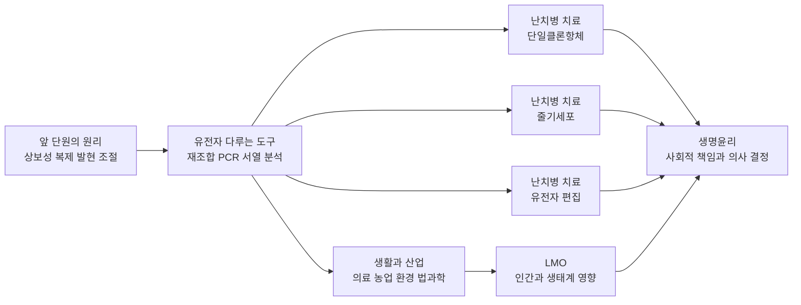
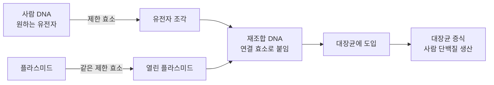
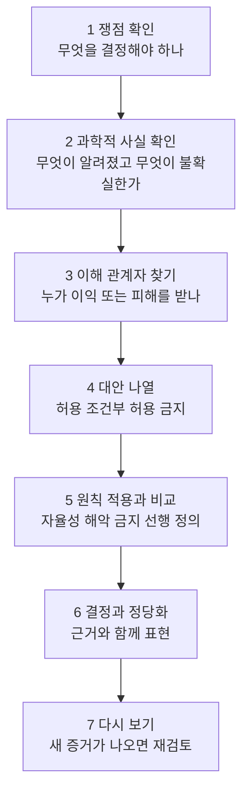

# 생물의 유전 3. 생명공학기술 — 생명의 원리를 도구로 쓰는 기술과 그 책임
<!-- prev: 6-1, 6-4, bio-2, bio-3, gene-1, gene-2 -->

> [!NOTE]
> **성취기준**
> - **[12유전03-01]** 생명공학기술 발달 과정에서의 주요 사건을 조사하고 다양한 매체를 활용하여 발표할 수 있다.
> - **[12유전03-02]** 단일클론항체, 줄기세포, 유전자 편집 기술이 난치병 치료에 활용된 사례를 조사하고, 이러한 치료법의 전망에 대해 협력적으로 소통할 수 있다.
> - **[12유전03-03]** 생명공학기술 관련 학문 분야를 이해하고 우리 생활과 산업에 활용 사례를 조사하여 창의적으로 설명 자료를 제작할 수 있다.
> - **[12유전03-04]** 유전자 변형 생물체(LMO)의 특징을 이해하고 인간과 생태계에 미치는 영향을 추론할 수 있다.
> - **[12유전03-05]** 생명공학기술의 활용 과정에서 나타나는 문제점과 이에 대한 사회적 책임을 인식하고 생명윤리 쟁점에 대해 의사 결정할 수 있다.

**학습 목표**

1. 유전자 재조합, PCR, 염기 서열 분석, 세포 융합, 유전자 편집 등 생명공학기술 발달의 주요 사건을 시대 순으로 정리하고, 각 사건이 우리 생활에 가져온 변화를 발표할 수 있다.
2. 단일클론항체, 줄기세포, 유전자 편집 기술이 난치병 치료에 쓰인 사례를 조사하고, 각 치료법의 장점·한계·전망을 근거를 들어 토의할 수 있다.
3. 유전체학, 생물정보학, 합성생물학 등 생명공학 관련 학문 분야를 알고, 의료·농업·식품·환경·법과학의 활용 사례를 설명 자료로 만들 수 있다.
4. 유전자 변형 생물체(LMO)의 특징과 개발 사례를 알고, 인간의 건강과 생태계에 미칠 수 있는 영향을 자료에 근거해 추론할 수 있다.
5. 생명공학기술의 생태적·윤리적·제도적·사회적 문제를 인식하고, 생명윤리 원칙을 적용하여 쟁점에 대해 의사 결정하고 그 근거를 설명할 수 있다.

**이 단원의 학습 사다리**

| 단계 | 무엇을 하나? |
|---|---|
| STEP 1. 이전 학습 다시 보기 | 통합과학 「감염병과 과학의 유용성」, 「과학기술과 윤리」, 생명과학의 항원 항체 반응, 「유전자와 유전물질」·「유전자의 발현」을 다시 꺼낸다 |
| STEP 2. 기초 다지기 | 유전자를 다루는 도구(제한 효소, 연결 효소, 벡터), 지수적 증폭, 항원 항체의 특이성, 세포의 분화 능력 |
| STEP 3. 핵심 개념 | 기술 발달의 주요 사건 → 단일클론항체 → 줄기세포 → 유전자 편집 → 관련 학문과 활용 → LMO → 생명윤리와 의사 결정 |
| STEP 4. 오개념 바로잡기 | "LMO는 먹으면 내 유전자가 바뀐다?", "줄기세포는 무엇이든 고친다?" |
| STEP 5. 대학 전공으로 | 항체 공학, 염기 교정·프라임 편집, 합성생물학, 생명윤리학·과학기술정책 |
| STEP 6. 생활·산업·진로 | mRNA 백신, 동반 진단, 바이오 소재, 환경 DNA, 바이오 산업의 직업 |

---

## 🗺️ 단원 들어가기

2020년, 새로운 감염병이 전 세계로 퍼지자 과학자들은 바이러스의 유전체 염기 서열을 공개하고, 몇 주 만에 그 서열로 진단 검사(PCR)를 만들었으며, 1년도 안 되어 mRNA 백신을 내놓았다. 같은 시기에 실험실에서는 환자의 혈액 줄기세포에서 유전자 하나의 조절 부위를 '편집'하여 낫 모양 적혈구 빈혈증을 치료하는 임상 시험이 진행되고 있었고, 이 치료법은 2023년에 처음으로 허가되었다.

이 모든 기술의 뿌리는 앞 단원에서 배운 원리이다. **상보적 염기 짝**은 PCR과 유전자 편집의 '주소 찾기'가 되었고, **반보존적 복제**는 시험관 속 DNA 증폭이 되었으며, **유전 부호의 보편성**은 세균이 사람 인슐린을 만들게 했고, **유전자 발현 조절**은 줄기세포와 치료의 열쇠가 되었다.

그러나 "할 수 있다"는 것이 곧 "해도 된다"는 뜻은 아니다. 사람 배아의 유전자를 고쳐도 될까? 해충을 이기는 작물을 들에 심으면 생태계에는 무슨 일이 생길까? 이 단원에서는 생명공학기술의 성과와 함께 그 책임을 고민한다.

---

## STEP 1. 🔙 이전 학습 다시 보기

### 연계 개념표

| 이전 단원·성취기준 | 그때 배운 것 | 이 단원에서 확장되는 것 |
|---|---|---|
| 통합과학2 「감염병과 과학의 유용성」 [10통과2-03-01] | 핵산·단백질을 이용한 감염병 진단(PCR, 신속 항원 검사) | PCR의 증폭 원리, 항원 검사 키트 속 단일클론항체 |
| 통합과학2 「과학기술과 윤리」 [10통과2-03-04] | 과학 관련 사회적 쟁점(SSI), 과학 윤리의 중요성 | 생명윤리 원칙을 적용한 구체적 쟁점의 의사 결정 |
| 생명과학 「생명 시스템의 구성」 [12생과01-01, 01-06] | 생명과학의 성과가 여러 학문과 결합하여 나타남, 생태계 평형 | 생명공학 관련 학문 분야, LMO가 생태계에 미치는 영향 |
| 생명과학 「항상성과 몸의 조절」 [12생과02-06, 02-07] | 항원 항체 반응의 특이성, 백신의 종류와 원리 | 하나의 항원 결정 부위만 인식하는 단일클론항체, mRNA 백신 |
| 생명과학 「생명의 연속성과 다양성」 [12생과03-01, 03-03] | 염색체·DNA·유전자의 관계, 변이와 자연선택 | 유전자를 직접 바꾸는 기술, LMO에 대한 해충 저항성의 진화 |
| 생물의 유전 「유전자와 유전물질」 [12유전01-04, 01-07] | 유전병의 원인, 반보존적 복제 | 유전병 진단·치료 기술, PCR |
| 생물의 유전 「유전자의 발현」 [12유전02-02, 02-04] | 유전 부호의 보편성, 세포 분화와 iPS 세포 | 재조합 단백질 생산, 줄기세포 치료, 발현 조절 부위 편집 |

### 준비 운동 (사전 진단)

**Q1.** 사람의 인슐린 유전자를 대장균에 넣으면 대장균이 사람 인슐린을 만들 수 있다. 이것이 가능한 가장 중요한 이유는 무엇인가?

**Q2.** 항체가 특정 항원에만 결합하는 성질을 무엇이라 하는가?

**Q3.** DNA 한 분자가 복제될 때마다 2배가 된다면, 10번 복제한 뒤 DNA는 몇 분자가 되는가?

**Q4.** "과학기술이 할 수 있는 일"과 "해야 하는 일"을 구분해야 하는 이유를 한 문장으로 쓰시오.

정답 및 해설

**Q1.** 유전 부호가 거의 모든 생물에서 같기(보편성) 때문이다. 대장균도 사람 유전자의 코돈을 같은 아미노산으로 번역한다.

**Q2.** 특이성(항원 항체 반응의 특이성)

**Q3.** $2^{10} = 1024$분자

**Q4.** 예: 기술적으로 가능한 일이라도 사람의 생명·권리·생태계에 해를 끼칠 수 있으므로, 사회적 합의와 윤리적 판단을 거쳐 사용 여부를 정해야 하기 때문이다.

---

## STEP 2. 🧱 기초 다지기

### ① 유전자를 다루는 네 가지 도구

생명공학기술의 원리를 깊이 다루지는 않지만, 사례를 이해하려면 기본 도구는 알아야 한다.

| 도구 | 하는 일 | 비유 |
|---|---|---|
| **제한 효소**(restriction enzyme) | 특정 염기 서열(예: `GAATTC`)을 인식하여 DNA를 자른다 | 특정 단어가 나오면 그 자리를 자르는 가위 |
| **DNA 연결 효소**(DNA ligase) | 잘린 DNA 조각의 당–인산 골격을 이어 붙인다 | 풀 |
| **벡터**(vector) | 원하는 유전자를 세포 안으로 운반하고 복제되게 한다. 세균의 **플라스미드**, 바이러스 등 | 택배 상자 |
| **숙주 세포** | 벡터를 받아들여 유전자를 복제·발현한다. 대장균, 효모, 동물 세포 등 | 공장 |

같은 제한 효소로 자른 DNA 조각들은 끝부분이 서로 상보적이라서(점착 말단) 쉽게 짝을 이룬다. 원하는 유전자와 플라스미드를 같은 제한 효소로 자르고 연결 효소로 붙이면 **재조합 DNA**가 만들어진다. 이것을 숙주 세포에 넣어 원하는 단백질을 얻는 기술이 **유전자 재조합 기술**이다.

### ② 지수적 증폭 — 2배, 2배, 또 2배

복제를 반복할 때마다 DNA가 2배가 되면, $n$번 뒤에는

$$
N = N_0 \times 2^{n}
$$

이 된다($N_0$: 처음 분자 수). $2^{10} \approx 10^3$이므로 30번이면 약 $10^9$배가 된다. 이 계산은 PCR을 이해하는 바탕이다.

### ③ 항원과 항체의 특이성

항체는 항원 전체가 아니라 항원 표면의 작은 부위(**항원 결정 부위**)를 인식한다. 하나의 병원체에는 항원 결정 부위가 여러 개 있으므로, 몸이 만드는 항체는 여러 B 림프구에서 나온 **여러 종류의 항체가 섞인 것**(다클론 항체)이다. 반면 **한 종류의 B 림프구에서 유래하여 한 가지 항원 결정 부위만 인식하는 항체**를 **단일클론항체**라 한다.

### ④ 세포의 분화 능력

| 분화 능력 | 뜻 | 예 |
|---|---|---|
| 전능성 | 태반을 포함한 개체 전체를 만들 수 있음 | 수정란, 초기 할구 |
| 다능성 | 몸을 이루는 거의 모든 종류의 세포로 분화할 수 있음 | 배아 줄기세포, 유도 만능 줄기세포(iPS 세포) |
| 다분화능(제한적) | 특정 조직 계열의 몇 가지 세포로 분화 | 조혈모세포(혈액 세포), 중간엽 줄기세포 |
| 분화 완료 | 대개 다른 세포로 분화하지 않음 | 신경 세포, 적혈구 |

> [!TIP]
> 💡 **비유** — 분화 능력은 '진로의 선택지'와 같다. 수정란은 어떤 학교·학과도 고를 수 있는 초등학생, 배아 줄기세포는 문·이과 어디든 갈 수 있는 중학생, 조혈모세포는 이미 '혈액학과'에 입학한 대학생, 분화가 끝난 세포는 직장인이다. iPS 세포는 직장인을 다시 중학생 상태로 되돌린 것이다(「유전자의 발현」).

---

## STEP 3. 📘 핵심 개념

### ① 생명공학기술 발달의 주요 사건과 우리 생활 [12유전03-01]

생명공학기술은 '유전자를 읽고(분석), 옮기고(재조합), 늘리고(증폭), 고치는(편집)' 능력이 차례로 생기면서 발달했다.

| 시기 | 주요 사건 | 우리 생활에 가져온 변화 |
|---|---|---|
| 1953 | DNA 이중 나선 구조 발표 | 유전 정보를 분자 수준에서 다루는 출발점 |
| 1970년 무렵 | 제한 효소의 발견과 활용 | DNA를 원하는 곳에서 자를 수 있게 됨 |
| 1973 | 재조합 플라스미드를 대장균에 넣어 복제(유전자 재조합 기술) | 미생물을 '단백질 공장'으로 쓰는 길이 열림 |
| 1975 | 아실로마 회의: 과학자들이 재조합 DNA 연구의 안전 지침을 스스로 논의 | 연구자의 사회적 책임과 자율 규제의 선례 |
| 1975 | 세포 융합으로 단일클론항체 생산 기술 개발 | 임신 진단 키트, 항체 치료제, 신속 항원 검사 |
| 1977 | DNA 염기 서열 분석법(생어 방법) 개발 | 유전자의 '글자'를 읽을 수 있게 됨 |
| 1982 | 대장균으로 만든 사람 인슐린이 의약품으로 승인(미국) | 동물 췌장 추출물 대신 사람 인슐린으로 당뇨병 치료 |
| 1983 | PCR(중합 효소 연쇄 반응) 고안 | 감염병 진단, 법의학, 유전자 검사 |
| 1980년대 중반 | DNA 지문(DNA 프로필) 분석 시작 | 범죄 수사, 친자 확인, 신원 확인 |
| 1990~2003 | 인간 유전체 사업 | 질병 유전자 탐색, 유전체 의학의 기반 |
| 1994 | 유전자 변형 작물이 처음 식품으로 판매(미국, 무르지 않는 토마토) | LMO 작물 확산과 안전성 논쟁 |
| 1996 | 체세포 핵치환으로 복제 양 돌리 탄생 | 동물 복제, 줄기세포 연구와 윤리 논쟁 |
| 1998 | 사람 배아 줄기세포 확립 | 재생 의학 연구, 배아 연구 윤리 논쟁 |
| 2006 | 유도 만능 줄기세포(iPS 세포) 개발(생쥐) | 배아를 쓰지 않는 다능성 줄기세포 |
| 2012 | 크리스퍼 유전자 가위(CRISPR-Cas9)를 유전자 편집 도구로 제시 | 빠르고 값싼 유전자 편집. 2020년 노벨 화학상 |
| 2020 | mRNA 백신 긴급 사용 승인 | 감염병 대응 속도의 혁신 |
| 2023 | 크리스퍼 유전자 편집 치료제 첫 허가(낫 모양 적혈구 빈혈증 등) | 유전자 편집이 실제 치료로 |

> [!NOTE]
> 염기 서열 분석 비용은 인간 유전체 사업 당시 한 사람 유전체에 약 30억 달러 규모의 사업비가 들었으나, 오늘날에는 한 사람의 유전체를 수백~1천 달러 수준으로 분석할 수 있을 만큼 낮아졌다. 이 변화가 정밀 의료와 생물정보학의 폭발적 성장을 이끌었다.

#### PCR — 반보존적 복제를 시험관에서 반복하다

**PCR(polymerase chain reaction)** 은 원하는 DNA 부위를 시험관에서 대량으로 복제하는 기술이다. 한 주기는 세 단계로 이루어진다.

| 단계 | 온도(대략) | 일어나는 일 | 연결되는 개념 |
|---|---|---|---|
| ① 변성 | 약 95 °C | 이중 가닥 DNA의 수소 결합이 끊겨 단일 가닥이 됨 | 염기쌍의 수소 결합 |
| ② 결합(풀림) | 약 50~65 °C | 증폭할 부위 양 끝에 상보적인 **프라이머**가 결합 | 상보적 염기 짝 |
| ③ 신장 | 약 72 °C | 열에 강한 DNA 중합 효소가 프라이머에서 새 가닥을 합성 | 반보존적 복제 |

온천에 사는 세균에서 얻은 **열에 강한 DNA 중합 효소** 덕분에, 95 °C로 가열해도 효소가 망가지지 않아 이 주기를 자동으로 반복할 수 있게 되었다.

#### 예제 1 — PCR 증폭 계산

표적 DNA 5분자로 PCR을 시작하였다. 매 주기 증폭 효율이 100%라고 가정할 때, (1) 25주기 뒤의 표적 DNA 분자 수를 구하시오. (2) 한 주기에 2분이 걸린다면 30주기에 걸리는 시간은? (3) 감염병 PCR 검사에서 바이러스 RNA가 많은 시료일수록 증폭 산물이 '검출 가능한 양'에 더 빨리(적은 주기 만에) 도달하는 이유를 설명하시오.

**풀이**
(1) $N = 5 \times 2^{25} = 5 \times 33\,554\,432 = 167\,772\,160 \approx 1.7 \times 10^{8}$분자
(2) $30 \times 2 = 60$분
(3) $N = N_0 \times 2^n$에서 처음 양 $N_0$가 크면 같은 $N$에 도달하는 데 필요한 $n$이 작다. 처음 양이 2배 많으면 1주기 빨리, 1024배 많으면 10주기 빨리 도달한다. 그래서 검출 주기 수로 처음 바이러스 양을 어림할 수 있다(RNA 바이러스는 먼저 RNA를 DNA로 바꾸는 역전사를 거친다).

> [!TIP]
> 💡 **발표 요령** — 연대표를 만들 때는 사건만 나열하지 말고 **"이 기술이 없었다면 오늘 우리 생활의 무엇이 없었을까?"** 를 함께 적어 보자. 예: PCR이 없었다면 감염병 검사, 친자 확인, 많은 유전병 진단이 지금처럼 빠르지 않았을 것이다.

---

### ② 난치병 치료와 단일클론항체 [12유전03-02]

#### 어떻게 만드는가 — 세포 융합

1. 생쥐에게 특정 항원을 주사하여 그 항원에 대한 항체를 만드는 **B 림프구**를 얻는다.
2. B 림프구는 체외에서 오래 살지 못하므로, 무한히 분열하는 **암세포(골수종 세포)** 와 **융합**한다.
3. 융합된 세포(**잡종 세포**, 하이브리도마)는 항체를 만들면서 계속 분열한다.
4. 원하는 항체를 만드는 잡종 세포 하나만 골라 배양(클론)하면 **한 종류의 항체**를 대량으로 얻는다.

> [!TIP]
> 💡 **비유** — B 림프구는 '정확하지만 금방 지치는 장인', 골수종 세포는 '지치지 않지만 아무것도 못 만드는 기계'이다. 둘을 합치면 '지치지 않는 장인'이 된다. 그중 원하는 제품을 만드는 장인 한 명만 골라 복제하면 똑같은 제품을 끝없이 만들 수 있다.

생쥐 항체를 사람에게 그대로 주사하면 사람 면역계가 이를 '남'으로 인식할 수 있다. 그래서 오늘날 치료용 항체는 대부분 사람 항체와 거의 같도록 바꾼 형태(인간화 항체, 사람 항체)로 만든다.

#### 단일클론항체가 쓰인 사례

| 분야 | 사례 | 원리 |
|---|---|---|
| 암 치료 | 일부 유방암 세포 표면에 많은 수용체(HER2)를 표적으로 하는 항체 치료제(1998년 승인) | 암세포 표면의 특정 단백질에만 결합하여 성장 신호를 막고 면역 세포가 공격하게 함 |
| 암 면역 치료 | 면역 세포의 '브레이크' 단백질을 막는 면역 관문 억제제 | T 림프구가 암세포를 다시 공격하게 함(이 연구는 2018년 노벨 생리의학상) |
| 항체–약물 접합체 | 항체에 항암제를 붙여 암세포로만 운반 | '유도 미사일'처럼 정상 세포의 피해를 줄임 |
| 자가 면역 질환 | 류머티즘 관절염 등에서 염증 신호 물질을 막는 항체 | 과도한 면역 반응의 특정 신호만 차단 |
| 진단 | 임신 진단 키트, 감염병 신속 항원 검사 | 특정 호르몬(hCG)이나 바이러스 단백질에만 결합하는 항체로 색 띠를 나타냄 |

#### 예제 2 — 신속 항원 검사 키트 읽기

신속 항원 검사 키트에는 시료가 흘러가는 길에 ① 색소가 붙은 항체(바이러스 단백질 결합), ② 검사선(T)에 고정된 항체(바이러스 단백질의 다른 부위에 결합), ③ 대조선(C)에 고정된, ①의 항체 자체에 결합하는 물질이 차례로 놓여 있다. 다음 결과를 해석하시오.
(가) C에만 선이 나타남 (나) C와 T에 모두 선이 나타남 (다) T에만 선이 나타남

**풀이**
- (가) **음성**: 시료가 정상적으로 흘러 ①이 C에 붙었지만, 바이러스 단백질이 없어 T에는 붙지 않았다.
- (나) **양성**: 바이러스 단백질이 ①과 ② 사이에 '샌드위치'처럼 끼어 T에 색이 나타났고, 남은 ①이 C에도 붙었다.
- (다) **무효**: C가 나타나지 않았으므로 시료가 제대로 흐르지 않았거나 키트에 문제가 있다. 다시 검사한다.

T선의 항체와 색소 항체가 바이러스 단백질의 **서로 다른 항원 결정 부위**를 인식해야 샌드위치가 만들어진다. 단일클론항체이기 때문에 이렇게 정확한 설계가 가능하다.

---

### ③ 난치병 치료와 줄기세포 [12유전03-02]

**줄기세포(stem cell)** 는 스스로 분열하여 같은 세포를 만드는 능력(**자가 재생**)과, 다른 종류의 세포로 분화하는 능력을 함께 가진 세포이다.

| 구분 | 배아 줄기세포 | 성체 줄기세포 | 유도 만능 줄기세포(iPS 세포) |
|---|---|---|---|
| 얻는 곳 | 착상 전 배아(배반포)의 안쪽 세포 덩어리 | 골수, 제대혈, 지방 조직 등 | 피부·혈액 세포에 특정 전사 인자 유전자를 넣어 되돌림 |
| 분화 능력 | 다능성 | 특정 계열로 제한적 | 다능성 |
| 장점 | 분화 능력이 매우 큼 | 이미 치료에 쓰이고 있음. 배아 파괴 문제가 없음 | 환자 자신의 세포로 만들 수 있어 면역 거부 반응이 적음. 배아 파괴 문제가 없음 |
| 한계·문제 | 배아를 파괴하는 윤리 문제, 면역 거부 반응, 종양 형성 위험 | 얻을 수 있는 양이 적고 분화 범위가 좁음 | 종양 형성 위험, 만드는 데 시간·비용이 큼, 품질 관리 |

#### 줄기세포가 쓰인 사례와 전망

| 사례 | 내용 | 상태 |
|---|---|---|
| 조혈모세포 이식 | 백혈병·재생 불량성 빈혈 환자에게 건강한 사람의 골수나 제대혈의 조혈모세포를 이식하여 혈액 세포를 새로 만들게 함 | 수십 년 전부터 표준 치료로 사용 |
| 성체 줄기세포 치료제 | 중간엽 줄기세포 등을 이용한 치료제. 2011년 우리나라에서 세계 최초로 성체 줄기세포 치료제가 허가됨 | 일부 질환에서 허가, 효과에 대한 추가 연구 진행 |
| iPS 세포 유래 망막 세포 이식 | 2014년 일본에서 노인성 황반 변성 환자에게 iPS 세포로 만든 망막 색소 상피 세포를 이식 | 임상 연구 단계 |
| 파킨슨병·당뇨병 | 줄기세포로 도파민 신경 세포, 인슐린 분비 세포를 만들어 이식 | 임상 시험 단계 |
| 질병 모델·신약 시험 | 환자의 iPS 세포로 그 환자의 신경·심장 세포를 만들어 약물 반응 시험 | 연구에 널리 활용 |

> [!WARNING]
> 허가받지 않은 '줄기세포 시술'을 광고하는 곳이 있다. 효과와 안전성이 임상 시험으로 확인되지 않은 시술은 감염, 종양 형성 같은 위험이 있다. 줄기세포 치료는 **허가된 치료인지, 임상 시험 단계인지**를 반드시 확인해야 한다.

#### 예제 3 — 줄기세포 치료법 고르기

다음 두 환자에게 알맞은 줄기세포의 종류를 고르고 이유를 쓰시오.
(가) 백혈병 치료를 위해 항암 치료로 골수의 혈액 세포를 모두 없앤 환자
(나) 망막 세포가 손상되었으며, 다른 사람의 세포를 이식할 때 생길 면역 거부 반응을 최대한 줄이고 싶은 환자

**풀이**
(가) **조혈모세포**(골수 또는 제대혈 유래 성체 줄기세포). 혈액 세포 계열로 분화하는 능력이 있고 오랫동안 치료 효과가 확인된 방법이다. 조직 적합성이 맞는 기증자를 찾는 것이 중요하다.
(나) **환자 자신의 세포로 만든 iPS 세포**. 다능성이 있어 망막 세포로 분화시킬 수 있고, 환자 자신의 유전자를 가지므로 면역 거부 반응이 적다. 단, 종양 형성 위험과 긴 제작 기간을 고려해야 한다.

---

### ④ 난치병 치료와 유전자 편집 [12유전03-02]

**유전자 편집(genome editing)** 은 유전체의 원하는 위치를 정확히 찾아 자르고, 그 부위를 없애거나 바꾸는 기술이다. 가장 널리 쓰이는 **크리스퍼 유전자 가위(CRISPR-Cas9)** 는 세균이 바이러스를 막는 면역 체계에서 유래하였다.

| 구성 | 역할 | 연결되는 개념 |
|---|---|---|
| 가이드 RNA | 표적 DNA와 상보적인 약 20개 염기로 표적 위치를 찾아감 | 상보적 염기 짝 |
| Cas9 단백질 | 가이드 RNA가 결합한 위치의 DNA 두 가닥을 자름 | 효소의 특이성 |
| 세포의 수선 | 잘린 DNA를 세포가 이어 붙이면서 염기가 조금 없어지거나(유전자 기능 제거), 넣어 준 주형대로 고쳐짐(교정) | DNA 수선, 틀 이동 돌연변이 |

#### 예제 4 — 가이드 RNA는 왜 20개 염기일까?

염기 20개로 된 특정 서열이 무작위 서열에 나타날 확률은 한 위치에서 $\left(\dfrac14\right)^{20}$이다. 사람 유전체(약 $3 \times 10^9$ 염기쌍, 두 가닥을 모두 고려하면 약 $6 \times 10^9$개 위치)에서 이 서열이 우연히 나타나는 횟수의 기댓값을 구하고, 가이드 RNA의 길이가 20개 정도인 이유를 설명하시오.

**풀이** $4^{20} = 1\,099\,511\,627\,776 \approx 1.1 \times 10^{12}$이므로 기댓값은

$$
\frac{6 \times 10^{9}}{1.1 \times 10^{12}} \approx 5.5 \times 10^{-3}
$$

이다. 즉, 20개 염기 서열은 사람 유전체 안에서 **우연히 한 번 더 나타날 가능성이 매우 낮아** 원하는 위치 하나만 정확히 찾아갈 수 있다. 반면 염기 10개라면 $4^{10} \approx 1.0 \times 10^6$으로 유전체 안에 약 6천 번 나타나 표적을 구별할 수 없다. 실제로는 몇 개 염기가 틀려도 결합하는 경우가 있어 **표적 이탈**(원하지 않는 위치를 자르는 것)을 줄이는 것이 중요한 과제이다.

#### 유전자 편집이 쓰인 사례 — 낫 모양 적혈구 빈혈증

「유전자와 유전물질」에서 배운 낫 모양 적혈구 빈혈증은 헤모글로빈 β 사슬 유전자의 염기 하나가 바뀐 유전병이다. 2023년 허가된 유전자 편집 치료는 돌연변이 자체를 고치는 대신 「유전자의 발현」에서 배운 **발현 조절**을 이용한다.

1. 환자의 골수에서 조혈모세포를 채취한다.
2. 체외에서 크리스퍼로 **태아형 헤모글로빈 유전자의 발현을 억제하는 단백질(BCL11A)의 유전자 중 적혈구 계열 세포에서 작동하는 조절 부위**를 자른다.
3. 그러면 어른이 되면서 꺼져 있던 **태아형 헤모글로빈** 유전자가 다시 켜져, 낫 모양이 되지 않는 헤모글로빈이 만들어진다.
4. 편집한 세포를 환자에게 다시 넣는다(그 전에 기존 골수 세포를 없애는 강한 약물 치료가 필요하다).

| 구분 | 체세포 유전자 편집 | 생식세포·배아 유전자 편집 |
|---|---|---|
| 대상 | 환자 몸의 특정 세포(혈액, 간 등) | 정자, 난자, 수정란, 배아 |
| 영향 범위 | 환자 본인 | 태어날 아이와 그 **후손 전체** |
| 현재 상황 | 일부 질환에서 치료 허가, 많은 임상 시험 진행 | 대부분의 나라에서 임신 목적의 시행을 법이나 지침으로 금지 |

> [!IMPORTANT]
> 유전자 편집 치료의 전망은 밝지만 과제도 분명하다. ① **표적 이탈**과 장기적 안전성, ② 한 사람당 수십억 원에 이를 만큼 높은 **비용과 접근성**, ③ 생식세포 편집과 '질병 치료가 아닌 능력 향상' 목적 사용의 **윤리** 문제이다. 2018년 한 연구자가 배아의 유전자를 편집한 쌍둥이의 출생을 발표하자 국제 과학계는 이를 강하게 비판했고, 그 연구자는 자국에서 처벌받았다.

---

### ⑤ 생명공학 관련 학문 분야와 생활·산업 속 활용 [12유전03-03]

#### 관련 학문 분야

현대 생명공학의 성과는 생명과학 혼자가 아니라 여러 학문이 결합하여 만들어진다.

| 학문 분야 | 다루는 것 | 관련 기술·직업의 예 |
|---|---|---|
| 유전체학 | 생물의 유전체 전체의 구조와 기능 | 유전체 분석, 질병 유전자 탐색 |
| 단백질체학 | 세포·조직의 단백질 전체의 종류·양·상호작용 | 질병 표지 단백질 발굴 |
| 생물정보학 | 서열·구조·발현 데이터를 컴퓨터로 분석 | 생물정보 분석가, 인공지능 신약 개발 |
| 합성생물학 | 생물의 부품(유전자, 회로)을 설계·조립하여 새 기능 부여 | 미생물로 의약품·연료·소재 생산 |
| 시스템생물학 | 유전자·단백질 네트워크를 전체 시스템으로 이해 | 세포 반응 시뮬레이션 |
| 의약생명공학 | 항체·백신·세포·유전자 치료제 개발 | 바이오의약품 연구원, 임상 시험 전문가 |
| 생물공정공학 | 세포 배양과 정제의 대량 생산 공정 | 바이오 공정 엔지니어 |
| 나노바이오·바이오소재 | 생체 분자와 나노 기술을 결합한 진단·전달 소재 | mRNA 백신의 지질 나노 입자, 바이오센서 |

#### 생활과 산업의 활용 사례

| 분야 | 사례 | 이용한 기술 |
|---|---|---|
| 의료 | 재조합 인슐린·성장 호르몬, mRNA 백신, 분자 진단, 동반 진단 | 유전자 재조합, PCR, 염기 서열 분석 |
| 농업 | 병에 강한 작물을 빠르게 고르는 분자 표지 육종, 유전자 변형·편집 작물 | DNA 분석, 유전자 재조합·편집 |
| 식품 | 치즈 제조용 효소(재조합 효소), 미생물 발효로 만든 단백질, 배양육 연구 | 유전자 재조합, 세포 배양 |
| 환경 | 기름이나 중금속을 분해·흡수하는 미생물을 이용한 생물 정화, 생분해성 플라스틱, 물속 DNA로 생물 분포를 조사하는 환경 DNA 분석 | 미생물 공학, PCR·서열 분석 |
| 에너지 | 미생물·조류를 이용한 바이오 연료 | 합성생물학, 생물공정 |
| 법과학 | DNA 프로필로 범죄 수사, 실종자·재난 희생자 신원 확인 | PCR, 짧은 반복 서열(STR) 분석 |

#### 예제 5 — DNA 프로필이 일치할 확률

어떤 집단에서 세 STR 자리 A, B, C의 유전자형 빈도가 각각 0.1, 0.05, 0.02이고, 세 자리는 서로 독립적으로 유전된다. (1) 무작위로 고른 한 사람이 우연히 세 자리 모두 같은 유전자형을 가질 확률은? (2) 실제 수사에서 10개 이상의 STR 자리를 함께 분석하는 이유는?

**풀이**
(1) 곱 규칙: $0.1 \times 0.05 \times 0.02 = 1 \times 10^{-4}$, 즉 1만 명 중 1명
(2) 자리를 늘릴수록 확률이 곱해져 급격히 작아진다. 예를 들어 빈도 0.1인 자리 10개를 쓰면 $0.1^{10} = 10^{-10}$으로 100억 명 중 1명 수준이 되어, 세계 인구 안에서도 우연히 일치할 가능성이 매우 낮아진다. 단, 일란성 쌍둥이는 DNA 프로필이 같고, 가족끼리는 일치 확률이 더 높다는 점에 주의한다.

> [!TIP]
> 💡 **설명 자료 제작 요령** — "기술 이름 → 바탕 원리(이 책의 어느 단원) → 생활 속 장면 → 관련 직업"의 네 칸 카드로 정리하면 기술과 원리, 진로가 한눈에 이어진다.

---

### ⑥ 유전자 변형 생물체(LMO)의 특징과 영향 [12유전03-04]

#### LMO란?

**유전자 변형 생물체(LMO, living modified organism)** 는 현대 생명공학기술로 만든 새로운 유전물질 조합을 가진 **살아 있는(번식할 수 있는) 생물체**이다. 비슷한 말인 **GMO**(유전자 변형 생물, genetically modified organism)는 이를 원료로 가공한 식품까지 넓게 가리킬 때 흔히 쓴다. 예를 들어 심을 수 있는 유전자 변형 콩은 LMO이고, 그 콩으로 만든 식용유는 GMO 식품이라 부른다.

| 특징 | 내용 |
|---|---|
| 종의 경계를 넘는 유전자 도입 | 세균의 유전자를 식물에, 해파리의 유전자를 물고기에 넣을 수 있다(유전 부호의 보편성) |
| 목표 형질을 정확히 추가 | 전통적 교배 육종보다 원하는 형질만 빠르게 더할 수 있다 |
| 번식·확산 가능 | 살아 있으므로 환경으로 퍼지거나 다른 생물과 교배할 수 있다 → 관리가 필요 |

식물 LMO는 주로 식물에 종양을 만드는 세균(아그로박테리움)의 플라스미드를 벡터로 이용하여 원하는 유전자를 식물 세포의 염색체에 넣고, 그 세포를 키워 식물 개체로 만든다(식물 세포의 전능성 이용).

#### LMO 개발 사례

| LMO | 도입한 형질 | 목적 |
|---|---|---|
| 제초제 내성 콩·옥수수 | 특정 제초제에 영향을 받지 않는 효소의 유전자 | 잡초 관리의 노동력 절감 |
| 해충 저항성 옥수수·목화(Bt 작물) | 토양 세균(바실루스 투린지엔시스)의 독소 단백질 유전자 | 특정 해충의 애벌레만 죽여 살충제 사용 감소 |
| 황금쌀 | 베타카로틴(비타민 A의 전구 물질) 합성 유전자 | 비타민 A 결핍 문제 완화. 필리핀에서 2021년 상업 재배가 승인되었으나 이후 법적 논란을 겪는 등 찬반이 이어지고 있다 |
| 빨리 자라는 연어 | 성장 호르몬 유전자와 조절 부위 | 양식 기간 단축. 2015년 미국에서 식용 동물로는 처음 승인 |
| 형광 관상어 | 해파리·산호의 형광 단백질 유전자 | 관상용 |
| 의약품 생산 미생물 | 사람 인슐린 등의 유전자 | 의약품 대량 생산(밀폐된 시설에서 사용) |

> [!NOTE]
> Bt 독소 단백질은 특정 곤충의 장에 있는 **수용체에 결합**해야 독성을 나타낸다. 사람과 포유류의 장에는 이 수용체가 없어 같은 방식으로 작용하지 않는다. '특이적 결합'이라는 원리가 안전성 판단의 근거가 되는 예이다.

#### 인간과 생태계에 미치는 영향

| 대상 | 기대되는 효과 | 우려되는 영향 |
|---|---|---|
| 인간의 건강 | 영양 강화(황금쌀), 의약품 생산, 살충제 노출 감소 | 새 단백질에 의한 **알레르기** 가능성 → 승인 전 알레르기 유발성 평가 |
| 농업·경제 | 생산성 증가, 노동력 절감 | 종자 특허로 인한 농민의 종자 의존, 다국적 기업 집중 |
| 생태계 | 살충제 사용 감소로 일부 비표적 생물 보호 | ① **유전자 이동**: 꽃가루를 통해 가까운 야생 근연종이나 일반 작물로 도입 유전자가 퍼질 수 있다 ② **비표적 생물**에 대한 영향 ③ **저항성 해충·잡초의 진화**: 같은 독소·제초제를 넓은 지역에 계속 쓰면 저항성을 가진 개체가 자연선택된다 ④ 특정 품종 위주로 재배되어 **유전적 다양성 감소** |

> [!IMPORTANT]
> LMO의 영향은 "무조건 안전" 또는 "무조건 위험"으로 판단할 수 없다. **어떤 유전자를, 어떤 생물에, 어떤 환경에서** 쓰는지에 따라 다르므로, 사례마다 과학적 위해성 평가를 거친다. 국제적으로는 LMO의 국가 간 이동을 관리하는 **카르타헤나 의정서**(2000년 채택, 2003년 발효)가 있고, 우리나라는 2008년부터 「유전자변형생물체의 국가간 이동 등에 관한 법률」을 시행하여 수입·개발·이용을 심사한다. 또 유전자 변형 원료를 쓴 식품에 표시하는 제도를 운영하고 있다.

#### 저항성 해충의 진화 — 「진화와 생물다양성」과 연결하기

Bt 작물만 넓게 심으면 독소에 저항성을 가진 드문 해충만 살아남아 번식하므로, 세대가 지날수록 저항성 해충의 비율이 높아진다. 이를 늦추기 위해 Bt 작물 옆에 일반 작물을 심는 **피난처 전략**을 쓴다. 피난처에서 살아남은 감수성 해충이 저항성 해충과 교배하면 저항성 대립유전자가 퍼지는 속도가 느려진다.

#### 예제 6 — 꽃가루에 의한 유전자 이동 자료 해석

LMO 옥수수 밭에서 떨어진 거리에 따라 일반 옥수수의 종자에서 도입 유전자가 검출된 비율을 조사한 가상 자료이다.

| 거리(m) | 0 | 10 | 25 | 50 | 100 | 200 |
|---|---|---|---|---|---|---|
| 검출 비율(%) | 8.0 | 2.0 | 0.6 | 0.3 | 0.1 | 0.02 |

(1) 거리가 멀어질수록 검출 비율은 어떻게 변하는가? (2) 검출 비율을 0.5% 미만으로 관리하려면 최소 몇 m 이상 떨어뜨려야 하는가(조사한 거리 중에서)? (3) 이 자료만으로 "200 m 떨어지면 유전자 이동이 전혀 없다"고 결론 내릴 수 없는 이유는?

**풀이**
(1) 거리가 멀어질수록 급격히 감소한다(10 m에서 0 m의 4분의 1, 100 m에서 80분의 1).
(2) 25 m에서 0.6%, 50 m에서 0.3%이므로 조사한 거리 중 **50 m**
(3) 200 m에서도 0.02%가 검출되어 0이 아니며, 바람의 방향·세기, 개화 시기, 꽃가루를 옮기는 곤충 등 조건에 따라 결과가 달라질 수 있다. 또 한 번의 조사, 한 작물의 자료만으로 일반화할 수 없다.

---

### ⑦ 생명공학기술의 문제점, 사회적 책임, 생명윤리 의사 결정 [12유전03-05]

#### 생명공학기술이 일으킬 수 있는 문제

| 영역 | 문제점의 예 |
|---|---|
| 생태적 | LMO의 유전자 이동, 저항성 생물의 진화, 생물다양성 감소, 실험실 생물의 유출 |
| 윤리적 | 배아 파괴(배아 줄기세포), 생식세포 유전자 편집, 동물 실험, 인간 복제, 동의 없는 시료 사용 |
| 제도적 | 기술 발전 속도를 따라가지 못하는 법·규제, 유전자 특허, 국가 간 규제 차이 |
| 사회적 | 유전 정보에 의한 고용·보험 **차별**, 유전 정보 유출, 고가 치료의 **접근성 불평등**, 과장 광고와 불안 조장 |

생명윤리와 관련해 역사적으로 자주 다루어지는 사례로는, 1951년 한 환자의 암세포가 본인 동의 없이 채취되어 이후 세계적인 연구용 세포주(헬라 세포)가 된 일, 2005년 무렵 국내에서 사람 배아 줄기세포 논문 조작과 연구용 난자 채취 과정의 윤리 위반이 드러난 일 등이 있다. 이런 사건들은 **사전 동의(informed consent)**, **연구 진실성**, **연구 대상자 보호**의 중요성을 일깨웠다. 우리나라는 「생명윤리 및 안전에 관한 법률」(2005년 시행)에 따라 배아·유전자 연구와 유전자 검사를 관리하고, 연구 기관마다 **기관 생명윤리 위원회**가 연구 계획을 심의한다.

#### 생명윤리의 네 가지 원칙

| 원칙 | 뜻 | 적용 예 |
|---|---|---|
| 자율성 존중 | 충분한 설명을 듣고 스스로 결정할 권리를 존중한다 | 유전자 검사 전 사전 동의, 결과를 알지 않을 권리 |
| 해악 금지 | 해를 끼치지 않는다 | 안전성이 확인되지 않은 시술 금지, 표적 이탈 검증 |
| 선행 | 상대방에게 이익이 되도록 행동한다 | 난치병 환자에게 효과적인 치료 제공 |
| 정의 | 이익과 부담을 공정하게 나눈다 | 고가 치료의 공정한 접근, 연구 대상자 선정의 공정성 |

동물 실험에서는 **3R 원칙**, 즉 대체(Replacement: 가능하면 동물 대신 세포·컴퓨터 모델 사용), 감소(Reduction: 동물 수를 최소화), 개선(Refinement: 고통을 최소화)을 따른다.

#### 의사 결정의 단계

#### 예제 7 — 생명윤리 쟁점 의사 결정

"유전병을 막기 위해 사람 배아의 유전자를 편집하여 임신에 사용하는 것을 허용해야 하는가?"에 대해 위 단계를 적용하여 의사 결정해 보자.

**풀이(예시)**

| 단계 | 정리 |
|---|---|
| 쟁점 | 유전병 예방을 위한 배아 유전자 편집을 임신 목적으로 허용할 것인가 |
| 과학적 사실 | 표적 이탈, 배아의 일부 세포만 편집되는 문제(모자이크) 등 안전성이 충분히 검증되지 않았다. 편집은 후손에게 전달된다. 많은 경우 착상 전 유전 검사처럼 다른 대안이 있다 |
| 이해 관계자 | 유전병 위험이 있는 부모, 태어날 아이(동의할 수 없음), 후손, 의료인, 사회 |
| 대안 | ① 전면 허용 ② 다른 대안이 없는 중증 유전병에 한해 엄격한 심사 후 허용 ③ 안전성 확보 전까지 금지, 기초 연구만 허용 |
| 원칙 적용 | 선행(유전병 예방) ↔ 해악 금지(알 수 없는 위험이 후손까지), 자율성(태어날 아이는 동의할 수 없음), 정의(비싼 기술의 불평등, '능력 향상'으로의 확대 우려) |
| 결정(예) | 현재는 ③. 안전성이 불확실하고 영향이 되돌릴 수 없이 후손에게 전해지며, 당사자의 동의를 받을 수 없기 때문이다. 다만 체세포 유전자 편집 치료 연구는 지원하고, 새로운 증거가 쌓이면 사회적 논의를 거쳐 다시 검토한다 |

정답이 하나인 문제가 아니다. 다른 결론을 내리더라도 **과학적 사실과 윤리 원칙에 근거하여 일관되게 정당화**하는 것이 의사 결정의 핵심이다.

> [!TIP]
> 💡 **토론 요령** — 상대 주장을 반박할 때는 "그건 틀렸다"가 아니라 "그 주장은 ○○ 원칙을 중시하지만, △△ 원칙과 충돌하는 지점이 있다"처럼 **원칙의 충돌**을 짚으면 생산적인 토론이 된다.

---

## STEP 4. ⚠️ 오개념 바로잡기

| 흔한 오개념 | 올바른 개념 | 왜 그럴까? |
|---|---|---|
| LMO 식품을 먹으면 그 유전자가 내 세포에 들어가 내 유전자가 바뀐다 | 먹은 DNA는 소화 기관에서 대부분 분해되며, 사람의 유전자를 바꾸지 않는다 | 우리는 매일 동식물의 DNA를 먹지만 그 유전자가 우리 몸에 들어와 발현되지 않는다. LMO 식품의 안전성은 도입 단백질의 독성·알레르기성 등으로 따로 평가한다 |
| LMO는 모두 위험하다 / 모두 안전하다 | 도입 유전자, 생물 종, 이용 환경에 따라 **사례별로** 평가해야 한다 | 밀폐 시설의 의약품 생산 미생물과 들에 심는 작물은 생태계 위험이 전혀 다르다 |
| 줄기세포 치료는 어떤 병이든 고칠 수 있다 | 허가된 치료는 일부이고, 많은 연구가 임상 시험 단계이다 | 원하는 세포로 정확히 분화시키는 것, 종양 위험, 면역 거부 등 과제가 남아 있다 |
| 단일클론항체는 여러 항원에 두루 결합하는 강력한 항체이다 | 단일클론항체는 **한 가지 항원 결정 부위에만** 결합하는 한 종류의 항체이다 | 한 B 림프구 클론에서 유래하므로 특이성이 매우 높다. 그래서 진단과 표적 치료에 쓰인다 |
| 유전자 가위는 원하는 곳만 100% 정확하게 자른다 | 비슷한 서열을 잘못 자르는 **표적 이탈**이 생길 수 있다 | 가이드 RNA와 염기 몇 개가 틀려도 결합하는 경우가 있어 검증이 필요하다 |
| 체세포 유전자 편집도 자손에게 유전된다 | 체세포 편집은 **환자 본인**에게만 영향을 준다 | 생식세포나 배아를 편집해야 후손에게 전달된다 |
| 생명윤리 쟁점에는 정답이 있으므로 다수결로 정하면 된다 | 과학적 사실을 확인하고 원칙들의 충돌을 따져 **근거 있는 판단**을 하되, 새로운 증거에 따라 재검토한다 | 소수의 권리(예: 환자, 태어날 아이)가 다수결로 침해될 수 있다 |

---

## STEP 5. 🎓 다음 단계로 한 걸음 더

> [!CAUTION]
> 이 절은 **「생물의 유전」 교육과정 범위 밖의 심화 내용**으로 평가 대상이 아니다. 성취기준 해설에 따라 이 단원은 원리보다 사례 중심으로 다루었으며, 여기서는 대학 전공에서 다루는 원리를 맛보기로 보여 준다.

### 대학 전공 과목과의 연결

| 대학 과목 | 이어지는 내용 |
|---|---|
| 생명공학·유전공학 | 유전자 클로닝, 발현 벡터 설계, 단백질 공학, 유전자 편집 기술 |
| 면역학·항체공학 | 하이브리도마 선별, 인간화 항체, 이중 특이성 항체, CAR-T 세포 |
| 줄기세포생물학·재생의학 | 다능성의 분자 기작, 분화 유도 프로토콜, 오가노이드, 조직 공학 |
| 합성생물학·대사공학 | 유전자 회로 설계, 미생물 대사 경로 재설계 |
| 생명윤리학·과학기술정책 | 연구 윤리 제도, 위해성 평가와 규제 과학, 기술 영향 평가 |

### ① 크리스퍼의 분자 원리 — PAM과 두 가지 수선 경로

가장 많이 쓰이는 Cas9은 가이드 RNA와 짝을 이루는 서열 바로 뒤에 `NGG`(N은 아무 염기)라는 짧은 서열(**PAM**)이 있어야 DNA를 자른다. 잘린 DNA는 ① 끊어진 끝을 그대로 이어 붙이는 **비상동 말단 연결**(이때 염기가 조금 없어지거나 더해져 유전자가 망가지기 쉬움)이나 ② 넣어 준 주형 DNA를 이용하는 **상동 재조합 수선**(정확한 교정)으로 수선된다. 최근에는 DNA를 완전히 자르지 않고 염기 하나를 다른 염기로 바꾸는 **염기 교정**, 원하는 서열을 직접 써 넣는 **프라임 편집** 같은 기술도 개발되었다.

### ② 하이브리도마의 선별 원리

세포 융합 후에는 융합하지 않은 B 림프구, 융합하지 않은 골수종 세포, 잡종 세포가 섞여 있다. 특정 대사 경로가 막히는 선택 배지를 쓰면, 그 경로에 결함이 있는 골수종 세포는 죽고 B 림프구는 수명이 짧아 사라져 **잡종 세포만 살아남는다**. 이후 세포를 하나씩 나누어 배양하며 원하는 항체를 만드는 클론을 고른다. 항체의 일부를 사람 항체 서열로 바꾸는 **인간화**, 두 항원에 동시에 결합하는 **이중 특이성 항체**도 대학 항체공학에서 다룬다.

### ③ CAR-T 세포 — 유전자 도입과 면역의 결합

환자의 T 림프구에 암세포 표면 단백질을 인식하는 인공 수용체(CAR)의 유전자를 바이러스 벡터로 넣어 다시 주입하면, T 림프구가 암세포를 찾아 공격한다. 일부 혈액암에서 2017년부터 치료제로 승인되었다. 단일클론항체의 '인식 부위'와 유전자 재조합, 세포 치료가 하나로 합쳐진 기술이다.

### ④ 위해성 평가의 논리

규제 과학에서는 위해성을 대략 **위해성 = 위해 요소의 크기 × 노출 가능성**으로 생각한다. 예를 들어 독성이 있더라도 노출이 거의 없으면 위해성은 낮고, 독성이 약하더라도 노출이 광범위하면 관리가 필요하다. LMO와 신약의 심사는 이런 정량적 사고 위에서 이루어진다.

### 지금 vs 다음 단계

| 구분 | 고등학교 「생물의 유전」 | 대학교 생명공학·관련 전공 |
|---|---|---|
| 접근 방식 | 사례 중심, 생활과 연결 | 원리·설계 중심, 실험 기술 |
| 단일클론항체 | 세포 융합의 개념, 진단·치료 사례 | 하이브리도마 선별, 항체 공학, 이중 특이성 항체 |
| 줄기세포 | 종류와 분화 능력, 치료 사례와 한계 | 다능성 유지 네트워크, 분화 프로토콜, 오가노이드 |
| 유전자 편집 | 가이드 RNA와 Cas9의 역할, 체세포/생식세포 구분 | PAM, 수선 경로, 염기 교정·프라임 편집, 전달 기술 |
| LMO | 특징과 영향 추론, 관리 제도 | 형질 전환 방법, 분자 검출법, 위해성 평가 |
| 윤리 | 원칙 적용과 의사 결정 | 생명윤리학, 연구 윤리 제도, 과학기술정책 |

---

## STEP 6. 🏭 생활·산업·진로 연결

### 사례 1. mRNA 백신 — 번역 원리를 몸 안에서 쓰다

- **원리** 병원체 단백질의 mRNA를 지질 나노 입자에 싸서 주사하면, 우리 세포의 리보솜이 그 mRNA를 번역하여 항원 단백질을 만들고 면역계가 이를 기억한다(「유전자의 발현」의 번역, 생명과학의 백신 원리).
- **쓰임** 2020년 감염병 대유행 때 빠르게 개발되어 쓰였고, 변형된 염기로 mRNA의 안정성을 높이고 불필요한 면역 반응을 줄인 연구는 2023년 노벨 생리의학상을 받았다. 암 백신 등으로 연구가 확장되고 있다.

### 사례 2. 동반 진단과 맞춤 치료

- **원리** 특정 유전자 변이나 단백질 과발현이 있는 환자에게만 효과가 있는 표적 치료제가 많다.
- **쓰임** 치료제를 쓰기 전에 환자의 종양 조직에서 해당 변이·단백질을 검사(동반 진단)하여 효과를 볼 환자를 고른다. 만성 골수성 백혈병의 전좌로 생긴 융합 단백질을 억제하는 표적 치료제가 대표적인 성공 사례이다(「유전자와 유전물질」).

### 사례 3. 바이오 소재와 화이트 바이오

- **원리** 미생물의 대사 경로를 유전자 재조합·합성생물학으로 바꾸어 원하는 물질을 만든다.
- **쓰임** 석유 대신 미생물이나 식물 원료로 만드는 생분해성 플라스틱, 세제·식품용 효소, 화장품 원료 등을 생산한다. 친환경·탄소 감축 정책과 연결된 산업 분야이다.

### 사례 4. 환경 DNA로 생태계 지키기

- **원리** 생물은 피부, 점액, 배설물로 DNA를 환경에 남긴다. PCR과 서열 분석으로 물 한 병 속 DNA만으로 그곳에 사는 생물을 알 수 있다.
- **쓰임** 멸종 위기종이나 외래종의 분포 조사, LMO의 환경 유출 감시에 쓰인다. 생명공학기술이 생태계 보호에도 쓰이는 예이다.

### 관련 진로와 학과

| 진로 | 하는 일 | 관련 학과 |
|---|---|---|
| 바이오의약품 연구원 | 항체·세포·유전자 치료제 개발 | 생명공학, 의생명과학, 약학 |
| 바이오 공정 엔지니어 | 세포 배양·정제 공정 설계와 대량 생산 | 생명공학, 화학공학, 생물공학 |
| 임상 시험 전문가 | 신약·치료법의 안전성과 효과를 시험하고 관리 | 약학, 간호학, 보건학, 생명과학 |
| 생물정보 분석가 | 유전체·단백질 데이터 분석, 인공지능 신약 탐색 | 생물정보학, 컴퓨터공학, 통계학 |
| LMO 안전 관리·위해성 평가 전문가 | LMO의 위해성 심사와 환경 감시 | 농생명과학, 환경공학, 생명과학 |
| 생명윤리 전문가·연구 윤리 심의 위원 | 연구 계획의 윤리 심의, 정책 자문 | 생명윤리학, 철학, 법학, 의학 |
| 바이오 특허 전문가(변리사) | 생명공학 발명의 특허 출원·분쟁 대응 | 생명과학, 법학 |
| 과학 커뮤니케이터·과학 기자 | 생명공학 쟁점을 정확하게 대중에게 전달 | 생명과학, 언론정보학 |

---

## 🔬 탐구 활동

### 활동 A. 단백질 화합물 상호작용 가상 실험하기

**목표** 공개 단백질 구조 데이터와 분자 도킹(docking) 프로그램을 이용하여, 질병 관련 단백질과 약물 후보 화합물의 결합을 가상으로 실험하고, 결합 세기를 비교하여 신약 개발에서 컴퓨터 실험의 역할을 설명한다.

**준비물** 인터넷이 연결된 컴퓨터, 공개 단백질 구조 데이터베이스(PDB), 무료로 공개된 분자 시각화·도킹 프로그램 또는 웹 서비스, 활동지

**과정**
1. **표적 단백질 고르기**: 「유전자와 유전물질」에서 배운 만성 골수성 백혈병의 원인 단백질(전좌로 생긴 융합 단백질의 효소 부분, ABL 인산화 효소)을 표적으로 정한다. PDB에서 이 단백질이 표적 치료제와 결합한 구조를 검색하여 내려받는다.
2. **구조 관찰**: 시각화 프로그램으로 단백질의 입체 구조를 돌려 보며, 약물이 들어가는 '주머니(결합 부위)'를 찾고 그 주변 아미노산을 기록한다.
3. **도킹 준비**: 구조에서 원래 약물을 떼어 낸 뒤, ① 원래 약물(표적 치료제), ② 구조가 비슷한 화합물 1~2개, ③ 관련 없는 작은 분자(대조군, 예: 포도당)를 준비한다.
4. **가상 실험**: 각 화합물을 결합 부위에 도킹하여 **결합 에너지 점수**(단위 $\mathrm{kcal/mol}$, 더 음수일수록 결합이 강하다고 예측)를 기록한다.
5. **결과 비교와 발표**: 화합물별 점수와 결합 모습(어떤 아미노산과 수소 결합을 하는지)을 비교하여 정보 그림이나 짧은 발표 자료로 만든다.

**결과 기록**

| 화합물 | 결합 에너지 점수(kcal/mol) | 수소 결합을 이루는 아미노산 | 원래 약물의 위치와 비교 |
|---|---|---|---|
| 원래 약물(표적 치료제) | | | — |
| 유사 화합물 1 | | | |
| 유사 화합물 2 | | | |
| 대조군(포도당 등) | | | |

**생각해 보기**
1. 대조군 분자의 점수는 원래 약물과 어떻게 달랐는가? 이 결과가 단백질–화합물 결합의 '특이성'에 대해 무엇을 알려 주는가?
2. 도킹 점수가 좋은 화합물이 곧바로 좋은 약이 될 수 없는 이유를 세 가지 이상 들어 보자. (예: 실제 세포에서의 흡수, 독성, 다른 단백질과의 결합, 컴퓨터 모델의 오차)
3. 컴퓨터로 수많은 화합물을 먼저 걸러 내는 방법이 실험 동물 사용을 줄이는 데(3R 원칙) 어떻게 기여할 수 있을까?

> [!WARNING]
> **유의 사항** 가상 실험 결과는 '예측'이며 실제 약효를 보장하지 않는다. 결과를 발표할 때 "신약을 발견했다"처럼 과장하지 않는다. 공개 데이터와 프로그램의 출처와 이용 조건을 밝히고, 학교 컴퓨터에 프로그램을 설치할 때는 교사의 지도를 따른다.

### 활동 B. 생명윤리 쟁점 의사 결정 토론

**목표** 생명공학기술의 쟁점 하나를 골라 STEP 3-⑦의 의사 결정 단계를 적용하고, 다양한 매체로 근거를 공유하며 협력적으로 결론을 도출한다.

**과정**
1. 모둠별로 쟁점 하나를 고른다. (예: LMO 작물의 국내 상업 재배 허용, 배아 줄기세포 연구의 범위, 유전자 검사 결과의 보험 회사 제공, 수십억 원짜리 유전자 치료제의 건강 보험 적용)
2. 역할을 나누어 이해 관계자(환자, 농민, 소비자, 연구자, 기업, 정부, 환경 단체)의 입장에서 근거 자료를 조사한다. 출처의 신뢰성을 함께 평가한다.
3. 대안을 세 가지 이상 만들고, 생명윤리의 네 원칙으로 각 대안을 평가하는 표를 만든다.
4. 모둠의 결정과 그 근거를 발표하고, 다른 모둠의 질문에 답한다.
5. 토론 후 처음 생각과 바뀐 점을 개인 성찰지에 적는다.

**결과 기록**

| 대안 | 자율성 존중 | 해악 금지 | 선행 | 정의 | 종합 판단 |
|---|---|---|---|---|---|
| 1 | | | | | |
| 2 | | | | | |
| 3 | | | | | |

> [!WARNING]
> **토론 수칙** 특정 질병을 가진 사람이나 집단을 비하하는 표현을 쓰지 않는다. 자신이나 가족의 건강 정보 등 개인 정보를 근거로 사용하지 않는다.

---

## ✅ 개념 확인 문제

### 기본

**1.** 다음 생명공학기술의 주요 사건을 일어난 순서대로 나열하시오.
ㄱ. 크리스퍼 유전자 가위를 유전자 편집 도구로 제시 ㄴ. PCR 고안 ㄷ. DNA 이중 나선 구조 발표 ㄹ. 복제 양 돌리 탄생

정답 및 해설

**정답** ㄷ → ㄴ → ㄹ → ㄱ

ㄷ 1953년, ㄴ 1983년, ㄹ 1996년, ㄱ 2012년이다.

**2.** PCR의 한 주기를 이루는 세 단계를 순서대로 쓰고, 각 단계에서 DNA 이중 가닥 사이의 수소 결합은 끊어지는지, 새로 생기는지 쓰시오.

정답 및 해설

**정답** 변성(수소 결합이 끊어짐) → 프라이머 결합(프라이머와 주형 사이에 수소 결합이 생김) → 신장(새 가닥과 주형 사이에 수소 결합이 생김)

**3.** 단일클론항체를 만들 때 B 림프구와 골수종 세포를 융합하는 이유를 각 세포의 특징과 관련지어 쓰시오.

정답 및 해설

**정답** B 림프구는 특정 항원에 대한 항체를 만들지만 체외에서 오래 살지 못하고, 골수종 세포는 항체를 만들지 못하지만 계속 분열한다. 두 세포를 융합하면 **특정 항체를 만들면서 계속 분열하는** 잡종 세포를 얻어, 한 종류의 항체를 대량으로 생산할 수 있다.

**4.** 배아 줄기세포와 유도 만능 줄기세포(iPS 세포)의 공통점 한 가지와, iPS 세포가 배아 줄기세포에 비해 가지는 장점 두 가지를 쓰시오.

정답 및 해설

**정답** 공통점: 다능성(몸을 이루는 거의 모든 세포로 분화 가능)이 있다. / 장점: ① 배아를 파괴하지 않아 윤리 문제가 적다. ② 환자 자신의 세포로 만들 수 있어 면역 거부 반응이 적다.

**5.** LMO에 대한 설명으로 옳은 것만을 있는 대로 고르시오.
ㄱ. LMO는 번식할 수 있는 살아 있는 유전자 변형 생물체이다.
ㄴ. 다른 종의 유전자를 도입할 수 있는 것은 유전 부호가 거의 모든 생물에서 같기 때문이다.
ㄷ. LMO 작물의 도입 유전자는 꽃가루를 통해 다른 개체로 이동할 가능성이 없다.

정답 및 해설

**정답** ㄱ, ㄴ

ㄷ. 꽃가루를 통해 가까운 일반 작물이나 야생 근연종으로 도입 유전자가 이동할 수 있어, 격리 거리 등으로 관리한다.

### 응용

**6.** 표적 DNA 1분자로 PCR을 시작하였다. 효율이 100%일 때, 표적 DNA가 처음으로 $10^6$분자 이상이 되는 것은 몇 번째 주기 뒤인가? 또 처음 표적 DNA가 8분자였다면 몇 주기 더 빨리 $10^6$분자 이상이 되는가?

정답 및 해설

**정답** 20주기 뒤, 3주기 빨라짐

$2^{19} = 524\,288 < 10^6$, $2^{20} = 1\,048\,576 \geq 10^6$이므로 20주기 뒤이다. 처음이 8분자($2^3$)이면 $8 \times 2^{17} = 2^{20}$이므로 17주기 뒤에 같은 양이 되어 3주기 빨라진다.

**7.** 낫 모양 적혈구 빈혈증의 유전자 편집 치료에서는 β 사슬 유전자의 돌연변이를 직접 고치지 않고, 태아형 헤모글로빈 유전자를 다시 발현시킨다. (1) 이 방법은 「유전자의 발현」에서 배운 어떤 원리를 이용한 것인가? (2) 이 치료를 받은 환자의 자녀에게도 치료 효과가 유전되는가? 그 이유는?

정답 및 해설

**정답**
(1) **유전자 발현 조절**. 태아형 헤모글로빈 유전자의 발현을 억제하는 단백질(BCL11A)의 유전자 조절 부위를 잘라 그 억제 단백질이 적혈구 계열 세포에서 덜 만들어지게 함으로써, 꺼져 있던 태아형 헤모글로빈 유전자를 다시 켠다.
(2) **유전되지 않는다.** 환자의 조혈모세포(체세포)만 편집했으므로 생식세포의 유전자는 바뀌지 않는다. 자녀는 부모의 원래 대립유전자를 물려받는다.

**8.** 같은 지역에 여러 해 동안 Bt 옥수수만 계속 넓게 재배하였더니, Bt 독소에 저항성을 가진 해충의 비율이 증가하였다. (1) 이 현상을 변이와 자연선택으로 설명하고, (2) 이를 늦추기 위한 방법을 한 가지 제시하시오.

정답 및 해설

**정답**
(1) 해충 집단에는 원래 드물게 Bt 독소에 저항성을 가진 변이 개체가 있었다. Bt 옥수수가 넓게 재배되면 감수성 개체는 죽고 저항성 개체만 살아남아 번식하므로, 세대가 지날수록 저항성 대립유전자를 가진 개체의 비율이 높아진다(Bt 작물이 저항성 개체를 '만든' 것이 아니라 '선택'한 것이다).
(2) Bt 작물 근처에 일반 작물을 심는 **피난처 전략**: 피난처에서 살아남은 감수성 해충이 저항성 해충과 교배하여 저항성의 확산을 늦춘다. 또는 서로 다른 독소 유전자를 함께 넣은 작물을 쓰거나 작물을 돌려짓기한다.

**9.** 한 범죄 현장의 DNA와 용의자의 DNA를 STR 4개 자리에서 비교하였더니 모두 일치하였다. 이 집단에서 네 자리 유전자형의 빈도가 각각 0.1, 0.2, 0.05, 0.1이고 네 자리는 독립적으로 유전된다. 무작위로 고른 사람이 우연히 네 자리 모두 일치할 확률을 구하고, 이 결과 해석에서 주의할 점을 한 가지 쓰시오.

정답 및 해설

**정답** $1 \times 10^{-4}$ (1만 명 중 1명)

$0.1 \times 0.2 \times 0.05 \times 0.1 = 1 \times 10^{-4}$

주의할 점(예): 인구가 수백만 명인 도시라면 우연히 일치하는 사람이 수백 명 있을 수 있으므로, 이 결과만으로 범인이라고 단정할 수 없고 더 많은 STR 자리를 분석하거나 다른 증거와 함께 판단해야 한다. / 가족끼리는 일치 확률이 더 높다. / 시료 오염 가능성을 확인해야 한다.

### 융합·서술형

**10. [의료·전망 연계]** 단일클론항체, 줄기세포, 유전자 편집 중 하나를 골라, (1) 난치병 치료에 활용된 사례를 하나 쓰고, (2) 그 치료법의 장점과 한계를 각각 한 가지씩 쓴 뒤, (3) 앞으로의 전망을 근거를 들어 서술하시오.

정답 및 해설

**예시 답안(유전자 편집)**
(1) 2023년 허가된 크리스퍼 유전자 편집 치료는 낫 모양 적혈구 빈혈증 환자의 조혈모세포에서 태아형 헤모글로빈 발현을 억제하는 단백질의 조절 부위를 편집하여 정상적으로 기능하는 헤모글로빈을 만들게 한다.
(2) 장점: 한 번의 치료로 원인 세포의 유전 정보를 바꾸어 오래 지속되는 효과를 기대할 수 있다. 한계: 기존 골수를 없애는 강한 약물 치료가 필요하고, 비용이 매우 높으며, 표적 이탈 등 장기적 안전성을 계속 확인해야 한다.
(3) 전망: 염기 교정 등 더 정밀한 기술과 몸 안에서 직접 편집하는 전달 기술이 개발되면 더 많은 유전병에 적용될 수 있다. 다만 비용을 낮추어 공정한 접근성을 확보하는 제도와, 생식세포 편집에 대한 사회적 합의가 함께 필요하다.

**채점 포인트** ① 실제 사례의 정확성 ② 장점·한계를 원리와 연결 ③ 전망에 과학적·사회적 근거 제시

**11. [생태·윤리 의사 결정]** 어느 나라가 비타민 A 결핍이 심한 지역에 황금쌀(베타카로틴 합성 LMO 벼)의 재배를 허용할지 결정하려 한다. (1) 인간과 생태계에 미칠 수 있는 영향을 긍정적 측면과 우려되는 측면으로 나누어 각각 한 가지 이상 추론하고, (2) 생명윤리 원칙 두 가지 이상을 적용하여 자신의 결정을 정당화하시오.

정답 및 해설

**예시 답안**
(1) 긍정적 측면: 주식인 쌀에서 베타카로틴을 섭취하여 비타민 A 결핍에 의한 시력 손상과 질병을 줄일 수 있다. 우려되는 측면: 꽃가루를 통해 주변의 일반 벼나 야생 벼로 도입 유전자가 이동할 수 있다. 황금쌀 품종 위주로 재배되면 지역 벼 품종의 유전적 다양성이 줄 수 있다. 새로운 물질에 대한 알레르기 등 건강 영향을 확인해야 한다.
(2) 결정(예): **조건부 허용**. 선행 원칙(심각한 영양 결핍 문제 해결)에 따라 이익이 크지만, 해악 금지 원칙에 따라 위해성 평가와 격리 재배, 재배 후 환경 감시를 조건으로 한다. 자율성 존중 원칙에 따라 농민과 소비자가 표시를 보고 선택할 수 있게 하고, 정의 원칙에 따라 가난한 농민이 종자를 부담 없이 이용할 수 있게 한다. 동시에 비타민 A 보충제 보급, 식단 다양화 같은 다른 대안도 함께 추진한다.

**채점 포인트** ① 인간·생태계 영향을 모두 추론 ② 근거 있는 우려(유전자 이동, 다양성, 알레르기) ③ 원칙 두 가지 이상의 타당한 적용 ④ 결론의 일관성

---

## 📝 한눈에 정리

### 핵심 요약

- 생명공학기술은 DNA 구조 발견(1953) 이후 유전자 재조합(1973), 단일클론항체(1975), 서열 분석(1977), PCR(1983), 인간 유전체 사업(2003 완료), iPS 세포(2006), 크리스퍼(2012)로 이어지며 발달했다.
- 유전자 재조합은 **제한 효소·연결 효소·벡터·숙주**를 이용하며, **유전 부호의 보편성** 덕분에 미생물이 사람 단백질을 만든다.
- PCR은 변성–프라이머 결합–신장을 반복하여 DNA를 $N_0 \times 2^n$으로 증폭하는, 시험관 속 반보존적 복제이다.
- **단일클론항체**는 B 림프구와 골수종 세포를 융합한 잡종 세포로 만들며, 한 항원 결정 부위에만 결합하여 진단 키트와 암·자가 면역 질환 치료에 쓰인다.
- **줄기세포**(배아, 성체, iPS)는 자가 재생과 분화 능력을 가지며, 조혈모세포 이식처럼 이미 쓰이는 치료와 임상 시험 단계의 치료가 있다.
- **유전자 편집**(크리스퍼)은 가이드 RNA로 위치를 찾고 Cas9이 자르며, 2023년 낫 모양 적혈구 빈혈증 치료에 처음 허가되었다. 체세포 편집과 생식세포 편집은 영향 범위가 다르다.
- 생명공학은 유전체학·생물정보학·합성생물학 등과 결합하여 의료·농업·식품·환경·에너지·법과학에 활용된다.
- **LMO**는 번식 가능한 유전자 변형 생물체로, 생산성·영양 개선의 이익과 함께 알레르기, 유전자 이동, 저항성 해충의 진화, 생물다양성 감소의 우려가 있어 사례별 위해성 평가와 법적 관리를 받는다.
- 생명윤리 쟁점은 **자율성 존중·해악 금지·선행·정의** 원칙과 과학적 사실을 바탕으로 단계적으로 의사 결정하고, 새로운 증거에 따라 재검토한다.

### 핵심 용어

| 용어 | 뜻 |
|---|---|
| 유전자 재조합 기술 | 서로 다른 DNA를 잘라 이어 붙여 재조합 DNA를 만들고 숙주에서 발현시키는 기술 |
| 제한 효소 | 특정 염기 서열을 인식하여 DNA를 자르는 효소 |
| 벡터 | 원하는 유전자를 숙주 세포로 운반하는 DNA(플라스미드, 바이러스 등) |
| PCR | 프라이머와 열에 강한 DNA 중합 효소로 특정 DNA 부위를 반복 복제하여 증폭하는 기술 |
| 단일클론항체 | 한 종류의 B 림프구 클론에서 유래하여 한 가지 항원 결정 부위에만 결합하는 항체 |
| 잡종 세포(하이브리도마) | B 림프구와 골수종 세포를 융합하여 항체를 만들면서 계속 분열하는 세포 |
| 줄기세포 | 자가 재생 능력과 다른 세포로 분화하는 능력을 함께 가진 세포 |
| 유도 만능 줄기세포 | 분화한 체세포에 특정 전사 인자 유전자를 넣어 다능성을 갖게 한 세포 |
| 유전자 편집 | 유전체의 특정 위치를 찾아 자르고 바꾸는 기술(크리스퍼 등) |
| 표적 이탈 | 유전자 가위가 원하지 않는 비슷한 서열을 자르는 현상 |
| LMO | 현대 생명공학기술로 만든 새로운 유전물질 조합을 가진, 번식할 수 있는 생물체 |
| 생명윤리 4원칙 | 자율성 존중, 해악 금지, 선행, 정의 |

### 다음 단원으로

이 단원으로 「생물의 유전」의 여정이 마무리된다. 중학교에서 멘델의 완두로 시작한 '유전'의 이야기는 DNA의 구조와 복제, 유전자의 발현과 조절을 거쳐 사람이 유전자를 읽고 고치는 기술과 그 책임에 이르렀다. 대학에서는 유전학·분자생물학·생명공학·생명윤리학이 이 길을 이어 가며, 「세포와 물질대사」에서 배운 효소와 세포의 원리도 바이오 산업의 공정 설계와 신약 개발에서 다시 만나게 된다.
