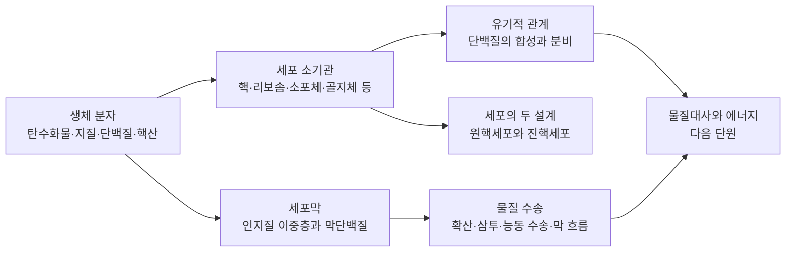
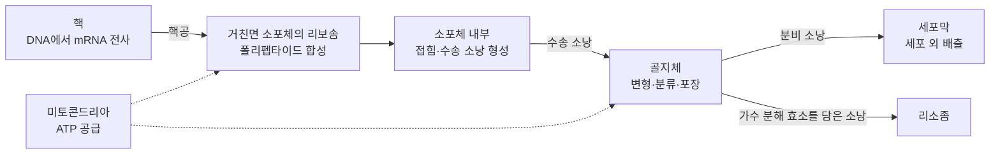

# 세포와 물질대사 1. 세포 — 생명을 이루는 물질과 세포 속 분업
<!-- prev: m1-02, 2-5, 3-5, bio-1, bio-3 -->
<!-- next: cell-2, cell-3, gene-1, gene-2 -->

> [!NOTE]
> **성취기준**
> - **[12세포01-01]** 탄수화물과 지질의 종류와 주요 기능을 이해하고 생물체에 들어있는 탄수화물과 지질을 관찰할 수 있다.
> - **[12세포01-02]** 핵산과 단백질의 기본 구조와 세포에서의 주요 기능을 조사하여 설명할 수 있다.
> - **[12세포01-03]** 동물세포와 식물세포를 구성하는 세포 소기관의 구조와 기능을 이해하고, 세포 소기관들의 유기적 관계를 추론하여 협력적으로 소통할 수 있다.
> - **[12세포01-04]** 원핵세포와 진핵세포의 공통점과 차이점을 설명할 수 있다.
> - **[12세포01-05]** 세포막의 구조와 특성을 이해하고, 세포막을 통한 물질 수송 과정을 추론할 수 있다.

**학습 목표**

1. 탄수화물과 지질을 단위체와 결합 방식에 따라 분류하고, 각각의 주요 기능을 설명하며, 생물 재료에서 녹말과 지질을 검출·관찰할 수 있다.
2. 핵산(DNA, RNA)과 단백질의 기본 구조를 단위체 수준에서 설명하고, 세포에서 맡는 주요 기능을 조사하여 발표할 수 있다.
3. 현미경, 세포 분획법, 자기 방사법으로 세포 소기관의 구조와 기능을 알아내는 원리를 이해하고, 단백질의 합성과 분비를 중심으로 세포 소기관의 유기적 관계를 추론할 수 있다.
4. 원핵세포와 진핵세포를 DNA, 세포 내 막 구조, 리보솜, 세포벽을 기준으로 비교할 수 있다.
5. 유동 모자이크 모형으로 세포막의 구조와 특성을 설명하고, 확산·촉진 확산·삼투·능동 수송·세포 내 섭취와 세포 외 배출을 구별하여 물질 수송 과정을 추론할 수 있다.

**이 단원의 학습 사다리**

| 단계 | 무엇을 하나? |
|---|---|
| STEP 1. 이전 학습 다시 보기 | 중학교 세포 관찰, 통합과학 단위체·세포막, 생명과학 생명 시스템을 다시 꺼내 본다 |
| STEP 2. 기초 다지기 | 단위체와 중합체, 친수성·소수성, 크기 단위, 표면적/부피 비를 디딤돌로 놓는다 |
| STEP 3. 핵심 개념 | 탄수화물·지질 → 핵산·단백질 → 세포 소기관과 연구 방법 → 원핵·진핵세포 → 세포막 수송 |
| STEP 4. 오개념 바로잡기 | "원핵세포에는 DNA가 없다?", "삼투는 용질이 움직이는 것?" 같은 착각을 바로잡는다 |
| STEP 5. 대학으로 한 걸음 더 | 세포내 공생설, 단백질 표적 수송, 막 전위와 네른스트 식, 첨단 현미경 |
| STEP 6. 생활·산업·진로 | 바이오의약품 생산 세포, 항생제의 표적, 약물 전달용 리포솜, 세포 영상 기술 |

---

## 🗺️ 단원 들어가기

사람의 이자(췌장)에 있는 세포 하나는 하루 종일 소화 효소를 만들어 내보낸다. 그 효소는 단백질이고, 단백질의 설계도는 핵 속 DNA에 있다. 그런데 DNA는 핵 밖으로 나오지 않는다. **설계도는 핵 안에 있고, 완성품은 세포 밖으로 나간다.** 그 사이에서 어떤 일이 벌어질까?

또 하나의 장면을 보자. 배추를 소금물에 절이면 숨이 죽고, 시든 상추를 찬물에 담가 두면 다시 아삭해진다. 세포막은 무엇을 통과시키고 무엇을 막는 것일까? 그리고 대장균 같은 세균은 핵도, 소포체도 없는데 어떻게 단백질을 만들까?

이 단원에서는 세포를 이루는 **네 가지 생체 분자**에서 출발하여, 그 분자들이 모여 만든 **세포 소기관**들이 어떻게 분업하고 협력하는지, 그리고 세포의 경계인 **세포막**이 물질을 어떻게 골라 들이고 내보내는지를 따라간다.

---

## STEP 1. 🔙 이전 학습 다시 보기

### 연계표

| 이전 단원·성취기준 | 그때 배운 것 | 이 단원에서 확장되는 것 |
|---|---|---|
| 중1 「생물의 구성과 다양성」 [9과02-01] | 세포는 생명 활동의 기본 단위. 세포벽, 세포막, 핵, 엽록체, 미토콘드리아. 적혈구·신경세포 등 모양과 기능의 관계 | 리보솜·소포체·골지체·리소좀 등 **세포 소기관 전체**와 이들의 **유기적 관계**, 소기관을 알아내는 **연구 방법** |
| 중2 「동물과 에너지」 [9과13-01] | 녹말·단백질·지방이 소화 효소에 의해 작은 영양소로 분해된다. 아이오딘 반응, 베네딕트 반응 | 영양소를 **단위체와 중합체**로 다시 보고, 생물 재료에서 탄수화물·지질을 **현미경으로 확인**한다 |
| 통합과학1 「지각과 생명체 구성 물질의 규칙성」 [10통과1-02-05] | 단백질은 아미노산, 핵산은 뉴클레오타이드라는 단위체가 결합해 만들어진다. DNA 이중 나선과 상보적 염기 결합 | DNA와 RNA의 차이, 단백질 구조의 단계(1차~4차)와 **세포에서의 기능** |
| 통합과학1 「생명 시스템과 물질대사」 [10통과1-03-05] | 세포막은 인지질 이중층과 단백질로 되어 있고 선택적 투과성이 있다. 확산, 삼투, 능동 수송(간단히) | **유동 모자이크 모형**, 촉진 확산·능동 수송·세포 내 섭취와 세포 외 배출의 구분, 수송 단백질의 종류 |
| 생명과학 「생명 시스템의 구성」 [12생과01-02] | 세포–조직–기관–기관계–개체로 이어지는 생명 시스템의 구성 단계 | 가장 작은 생명 시스템인 **세포 내부의 분업 체계** |
| 생명과학 「생명의 연속성과 다양성」 [12생과03-01], [12생과03-04] | 염색체·DNA·유전자의 관계, 3역(세균·고세균·진핵생물) 분류 체계 | 3역 분류의 바탕이 되는 **원핵세포와 진핵세포의 구조 차이** |

### 준비 운동 (사전 진단)

**Q1.** 다음 중 **단위체**와 **중합체**의 짝이 옳지 않은 것은?
① 포도당 – 녹말 ② 아미노산 – 단백질 ③ 뉴클레오타이드 – DNA ④ 지방산 – 셀룰로스

**Q2.** 동물세포에는 없고 식물세포에만 있는 구조를 두 가지 쓰시오.

**Q3.** 적혈구를 증류수에 넣으면 어떻게 될까? 그 이유를 '물의 이동 방향'으로 설명하시오.

**Q4.** 세포막을 이루는 두 가지 주요 성분을 쓰시오.

정답 및 해설

**Q1. ④** — 셀룰로스는 포도당이 결합한 중합체이다. 지방산은 글리세롤과 결합해 중성 지방을 만든다(지질은 엄밀한 의미의 중합체가 아니다. STEP 3에서 다룬다).

**Q2.** 세포벽, 엽록체 (액포는 동물세포에도 작게 있을 수 있으나 식물세포에서 크게 발달한 **중심 액포**가 특징이다.)

**Q3.** 적혈구가 부풀다가 터진다. 증류수는 적혈구 내부보다 용질 농도가 낮으므로 물이 세포 **안으로** 삼투해 들어오기 때문이다.

**Q4.** 인지질, 단백질

---

## STEP 2. 🧱 기초 다지기

### ① 단위체와 중합체 — 레고 블록의 규칙

생명체의 큰 분자는 대부분 작은 **단위체(monomer)** 가 사슬처럼 이어진 **중합체(polymer)** 이다. 단위체가 결합할 때는 물 분자가 하나씩 빠져나오고(**탈수 축합**, dehydration synthesis), 중합체가 분해될 때는 물 분자가 하나씩 들어간다(**가수 분해**, hydrolysis).

| 중합체 | 단위체 | 결합 이름 |
|---|---|---|
| 다당류(녹말, 글리코젠, 셀룰로스) | 단당류(포도당 등) | 글리코시드 결합 |
| 단백질 | 아미노산(20종류) | 펩타이드 결합 |
| 핵산(DNA, RNA) | 뉴클레오타이드 | 인산다이에스터 결합 |

> [!TIP]
> 💡 **비유** — 레고 블록 하나를 끼울 때마다 작은 '물방울 스티커'를 하나씩 떼어 낸다고 생각하자(탈수 축합). 반대로 블록을 떼어 낼 때는 스티커를 다시 붙여야 한다(가수 분해). 소화는 거대한 레고 작품을 블록 단위로 분해하는 과정이다.

#### 예제 1 — 물 분자는 몇 개?

아미노산 100개가 한 줄로 연결되어 폴리펩타이드 1개를 만들 때 생기는 물 분자 수와 펩타이드 결합 수를 구하시오.

**풀이** 한 줄로 $n$개를 이으면 결합은 $n-1$개이고, 결합 하나마다 물 1분자가 빠져나온다. 따라서 펩타이드 결합 99개, 물 분자 99개이다.

### ② 친수성과 소수성 — 물과 친한가, 기름과 친한가

물 분자는 전하가 한쪽으로 치우친 **극성 분자**이다. 극성이 있거나 전하를 띤 부분은 물과 잘 어울리는데, 이를 **친수성(hydrophilic)** 이라 한다. 탄소와 수소로만 길게 이어진 부분은 물과 어울리지 못하고 자기들끼리 뭉치는데, 이를 **소수성(hydrophobic)** 이라 한다.

- 식초(물)와 식용유를 섞어 흔들어도 곧 두 층으로 나뉘는 이유: 기름 분자가 소수성이기 때문이다.
- 세포막, 단백질의 접힘, 지질의 저장 방식은 모두 이 성질로 설명된다.

### ③ 세포의 크기와 단위

| 단위 | 크기 | 예 |
|---|---|---|
| 밀리미터(mm) | $10^{-3}\ \mathrm{m}$ | 개구리 알, 달걀 노른자(세포 하나) |
| 마이크로미터(µm) | $10^{-6}\ \mathrm{m}$ | 대부분의 동식물 세포 약 10~100 µm, 세균 약 1~10 µm, 적혈구 지름 약 7~8 µm |
| 나노미터(nm) | $10^{-9}\ \mathrm{m}$ | 리보솜 약 25 nm, 세포막 두께 약 7~10 nm, 바이러스 수십~수백 nm |

광학 현미경의 해상력은 약 0.2 µm이므로 세균은 보이지만 리보솜이나 세포막의 이중층은 보이지 않는다. 이것이 **전자 현미경**이 필요한 이유이다.

### ④ 수학 도구 — 표면적 대 부피의 비

세포는 왜 대부분 작을까? 한 변이 $a$인 정육면체 세포를 생각하자.

$$
\frac{\text{표면적}}{\text{부피}} = \frac{6a^2}{a^3} = \frac{6}{a}
$$

| 한 변 $a$ | 표면적 | 부피 | 표면적/부피 |
|---|---|---|---|
| 1 µm | 6 µm² | 1 µm³ | 6 |
| 10 µm | 600 µm² | 1000 µm³ | 0.6 |
| 100 µm | 60000 µm² | 1000000 µm³ | 0.06 |

세포가 커질수록 부피(물질을 소비하는 쪽)는 세제곱으로, 표면적(물질이 드나드는 문)은 제곱으로 커진다. 크기가 10배가 되면 '문 한 칸이 감당할 몫'이 10배가 되어 물질 교환이 따라가지 못한다. 그래서 세포는 작게 유지되거나, 소장 융털 세포의 미세 융털처럼 **표면을 주름지게** 하여 표면적을 늘린다. 이 아이디어는 미토콘드리아의 크리스타와 엽록체의 틸라코이드에서 다시 만난다(「세포호흡과 광합성」).

---

## STEP 3. 📘 핵심 개념

### ① 탄수화물과 지질 — 에너지원이자 구조 재료 [12세포01-01]

생명체를 이루는 물질은 물(약 70%)을 제외하면 대부분 **탄수화물, 지질, 단백질, 핵산**의 네 가지 유기물이다. 먼저 에너지 저장과 구조 형성을 주로 맡는 탄수화물과 지질을 보자.

#### (1) 탄수화물(carbohydrate)

탄소, 수소, 산소로 이루어지며, 크기에 따라 셋으로 나눈다.

| 구분 | 예 | 구성 | 주요 기능·특징 |
|---|---|---|---|
| **단당류** | 포도당, 과당, 갈락토스 | 더 이상 가수 분해되지 않는 단위 | 세포호흡의 주된 에너지원(포도당) |
| | 리보스, 디옥시리보스 | 탄소 5개짜리 당(5탄당) | RNA와 DNA의 구성 성분 |
| **이당류** | 엿당(맥아당) | 포도당 + 포도당 | 엿기름·식혜의 단맛 |
| | 설탕(자당) | 포도당 + 과당 | 식물 체관을 통한 양분 수송 형태 |
| | 젖당 | 포도당 + 갈락토스 | 포유류 젖의 당 |
| **다당류** | 녹말 | 포도당 수백~수천 개 | 식물의 저장 탄수화물(감자, 쌀) |
| | 글리코젠 | 포도당, 가지가 많음 | 동물의 저장 탄수화물(간, 근육) |
| | 셀룰로스 | 포도당, 곧은 사슬이 나란히 결합 | 식물 세포벽의 주성분 |
| | 키틴 | 질소를 포함한 당의 중합체 | 곤충·갑각류 외골격, 균류 세포벽 |

같은 포도당으로 만들어졌는데 녹말은 소화되고 셀룰로스는 소화되지 않는다. 포도당이 **연결되는 방향**이 달라 녹말은 나선형으로 감기고, 셀룰로스는 곧게 뻗은 사슬이 서로 나란히 붙어 단단한 섬유가 된다. 사람에게는 셀룰로스의 결합을 끊는 효소가 없어 셀룰로스는 식이 섬유로 배출된다. 소나 흰개미는 소화관 속 미생물의 효소를 빌려 셀룰로스를 분해한다.

> [!TIP]
> 💡 **비유** — 녹말과 글리코젠은 '통장'(필요할 때 꺼내 쓰는 에너지), 셀룰로스와 키틴은 '건축 자재'(구조)이다. 글리코젠은 가지가 많아 끝부분이 많으므로, 여러 효소가 동시에 포도당을 떼어 낼 수 있어 운동할 때 빠르게 에너지를 꺼낼 수 있다.

#### (2) 지질(lipid)

지질은 단위체 구조가 정해져 있다기보다 **물에 잘 녹지 않는(소수성)** 성질로 묶은 물질들이다.

| 종류 | 기본 구조(간단한 형태) | 주요 기능 | 예 |
|---|---|---|---|
| **중성 지방** | 글리세롤 1 + 지방산 3 | 에너지 저장(1 g당 약 9 kcal), 단열, 충격 완화 | 피하 지방, 식용유, 버터 |
| **인지질** | 글리세롤 + 지방산 2 + 인산이 포함된 머리 | **세포막의 기본 골격** | 세포막, 달걀노른자의 레시틴 |
| **스테로이드** | 탄소 고리 4개가 붙은 구조 | 세포막 유동성 조절, 호르몬 | 콜레스테롤, 성호르몬, 비타민 D |
| 왁스 | 긴 지방산 + 긴 알코올 | 방수, 수분 증발 방지 | 잎의 큐티클, 밀랍 |

- 중성 지방은 1 g당 저장 에너지가 탄수화물(약 4 kcal)의 2배 이상이다. 그래서 오래 저장하거나 이동하며 에너지를 지녀야 하는 동물(철새, 겨울잠 자는 곰)은 주로 지방으로 저장한다.
- 지방산 사슬에 이중 결합이 없으면 **포화 지방산**(실온에서 고체, 동물성 기름), 이중 결합이 있어 사슬이 꺾이면 **불포화 지방산**(실온에서 액체, 식물성 기름)이 많다.
- **인지질**은 친수성 머리와 소수성 꼬리를 함께 가져서, 물속에서 저절로 꼬리를 안쪽으로 모은 **이중층**을 만든다. 이것이 ⑤의 세포막이다.

<!-- fig:cell-1-lipids -->

#### 예제 2 — 저장 에너지 비교

체중 60 kg인 사람의 체지방이 15%이고, 간과 근육의 글리코젠이 모두 합해 약 0.5 kg이라고 하자. 지방과 글리코젠에 저장된 에너지를 각각 어림하시오. (지방 9 kcal/g, 탄수화물 4 kcal/g으로 계산한다.)

**풀이**
- 지방: $60\ \mathrm{kg} \times 0.15 = 9\ \mathrm{kg} = 9000\ \mathrm{g}$, $9000 \times 9 = 81000\ \mathrm{kcal}$
- 글리코젠: $500\ \mathrm{g} \times 4 = 2000\ \mathrm{kcal}$

지방에 저장된 에너지가 약 40배 많다. 글리코젠은 하루치 정도의 '비상금', 지방은 장기 '적금'인 셈이다.

#### (3) 생물체 속 탄수화물과 지질 확인하기

| 검출 대상 | 시약 | 양성 반응 | 현미경 관찰 예 |
|---|---|---|---|
| 녹말 | 아이오딘–아이오딘화 칼륨 용액 | 청람색 | 감자 단면 세포 속 녹말 알갱이(녹말립)가 청람색으로 보인다 |
| 포도당·엿당 등 환원당 | 베네딕트 용액 + 가열 | 황적색 침전 | (용액 반응으로 확인) 양파즙, 포도즙 |
| 지질 | 수단 Ⅲ 용액 | 선홍색(붉은색) | 땅콩 떡잎 얇은 절편 속 기름방울이 붉게 보인다 |
| (참고) 단백질 | 뷰렛 용액(5% 수산화 나트륨 + 1% 황산 구리 수용액) | 보라색 | (용액 반응으로 확인) 달걀흰자 |

> [!IMPORTANT]
> 설탕은 이당류이지만 베네딕트 반응에 **음성**이다. 베네딕트 반응은 '당이면 모두'가 아니라 **환원당**을 검출한다. 또 지질은 물에 녹지 않으므로, 수단 Ⅲ로 물든 기름방울은 세포 속에서 **둥근 방울** 형태로 관찰된다.

#### ✔ 바로 확인

1. (O/X) 설탕은 이당류이므로 베네딕트 반응에 양성이다.
2. 빈칸: 동물의 저장 탄수화물은 (    )이고, 식물 세포벽의 주성분은 (    )이다.
3. 글리세롤 1분자에 지방산 3분자가 결합한 지질은 무엇인가? (중성 지방 / 인지질 / 스테로이드)
4. 땅콩 떡잎의 얇은 절편을 수단 Ⅲ 용액으로 염색하면 무엇이 어떤 색으로 보이는가?

정답

1. X — 베네딕트 반응은 환원당을 검출하며, 설탕은 환원당이 아니어서 음성이다.
2. 글리코젠, 셀룰로스 — 둘 다 포도당이 단위체이다.
3. 중성 지방 — 인지질은 지방산 2개와 인산이 포함된 머리를 가진다.
4. 기름방울(지질)이 선홍색으로 보인다 — 지질은 물에 녹지 않아 둥근 방울 모양이다.

---

### ② 핵산과 단백질 — 정보와 기능 [12세포01-02]

#### (1) 핵산(nucleic acid): 유전 정보의 저장과 전달

핵산의 단위체는 **뉴클레오타이드(nucleotide)** 이며, **인산 + 5탄당 + 염기** 세 부분으로 되어 있다. 한 뉴클레오타이드의 당과 다음 뉴클레오타이드의 인산이 결합하여 '당–인산' 뼈대가 만들어지고, 염기는 뼈대 옆으로 튀어나온다.

| 구분 | DNA(디옥시리보핵산) | RNA(리보핵산) |
|---|---|---|
| 5탄당 | 디옥시리보스 | 리보스 |
| 염기 | A, G, C, **T** | A, G, C, **U** |
| 구조 | 두 가닥이 꼬인 **이중 나선**(A–T, G–C 상보 결합) | 대개 **단일 가닥** |
| 주요 위치 | 핵(진핵세포), 핵양체(원핵세포), 미토콘드리아·엽록체 | 핵에서 만들어져 세포질에서 작용 |
| 주요 기능 | 유전 정보의 **저장**과 전달(복제) | 유전 정보의 **전달과 발현**: mRNA(설계도 사본), tRNA(아미노산 운반), rRNA(리보솜 구성) |

- DNA는 두 가닥의 염기가 서로 맞물리므로 한 가닥만 알면 다른 가닥을 알 수 있다. 이 성질이 정확한 복제의 비밀이다.
- 뉴클레오타이드는 핵산의 재료만이 아니다. 세포의 에너지 화폐인 **ATP**, 전자를 나르는 **NAD⁺, FAD**도 뉴클레오타이드에서 유래한 분자이다. 다음 두 단원(「물질대사와 에너지」, 「세포호흡과 광합성」)의 주인공들이 모두 이 가족이다.

<!-- fig:cell-1-nucleotide-dna -->

#### 예제 3 — 염기 조성

어떤 이중 가닥 DNA에서 아데닌(A)이 전체 염기의 30%이다. 구아닌(G)은 몇 %인가?

**풀이** 상보 결합에 의해 A = T = 30%. 나머지 40%를 G와 C가 똑같이 나누므로 G = C = 20%이다.

#### (2) 단백질(protein): 세포의 일꾼

단백질의 단위체는 **아미노산(amino acid)** 이다. 모든 아미노산은 가운데 탄소에 아미노기, 카복실기, 수소, 그리고 종류마다 다른 **곁사슬(R기)** 이 붙어 있다. 20종류의 곁사슬은 크기·전하·친수성이 서로 달라서, 어떤 순서로 이어지느냐에 따라 단백질의 접히는 모양이 정해진다.

| 구조 단계 | 무엇이 정해지나? | 비유 |
|---|---|---|
| 1차 구조 | 아미노산의 **배열 순서**(유전자가 정한다) | 구슬을 꿴 순서 |
| 2차 구조 | 사슬 일부가 α 나선, β 병풍 모양으로 규칙적으로 접힘 | 구슬 줄의 일부를 꼬거나 접기 |
| 3차 구조 | 폴리펩타이드 전체가 접힌 입체 모양 | 줄 전체를 뭉쳐 만든 모양 |
| 4차 구조 | 여러 폴리펩타이드가 모여 하나의 단백질을 이룸 | 뭉친 덩어리 여러 개를 조립(예: 헤모글로빈은 4개) |

<!-- fig:cell-1-protein-levels -->

> [!IMPORTANT]
> **구조가 기능을 결정한다.** 열·강한 산과 염기·중금속 등으로 입체 구조가 풀리면(이를 **변성**, denaturation이라 한다) 아미노산 순서는 그대로여도 기능을 잃는다. 달걀을 삶으면 흰자가 굳고 다시 투명해지지 않는 것이 변성의 예이다. 효소가 온도와 pH에 민감한 이유도 여기에 있다(「물질대사와 에너지」).

| 단백질의 기능 | 예 |
|---|---|
| 촉매(효소) | 아밀레이스, 펩신, DNA 중합 효소 |
| 구조 | 콜라겐(피부·연골), 케라틴(머리카락), 세포 골격 단백질 |
| 운반 | 헤모글로빈(산소), 세포막의 운반체·통로 단백질 |
| 신호 전달 | 인슐린(호르몬), 세포막의 수용체 |
| 방어 | 항체 |
| 운동 | 액틴과 마이오신(근육 수축) |

> [!TIP]
> 💡 **비유** — DNA는 도서관 깊은 곳에 보관된 **원본 설계도**, mRNA는 현장으로 들고 가는 **복사본**, 단백질은 그 설계도로 만든 **기계**이다. 원본은 함부로 꺼내지 않고, 필요한 만큼 복사해서 쓴다. 이 흐름은 「생물의 유전」의 「유전자의 발현」에서 자세히 다룬다.

#### ✔ 바로 확인

1. (O/X) RNA에는 타이민(T) 대신 유라실(U)이 있다.
2. 이중 가닥 DNA에서 구아닌(G)이 전체 염기의 35%이면 아데닌(A)은 몇 %인가?
3. 짝짓기: 1차 구조, 4차 구조 ― (가) 아미노산의 배열 순서 (나) 여러 폴리펩타이드가 모여 이룬 구조
4. 삶아서 굳은 달걀흰자의 단백질은 아미노산 순서가 그대로인데도 기능을 잃는다. 이 현상을 무엇이라 하는가?

정답

1. O — 5탄당도 DNA는 디옥시리보스, RNA는 리보스로 다르다.
2. 15% — G = C = 35%이므로 A + T = 30%, A = T = 15%이다.
3. 1차 구조–(가), 4차 구조–(나)
4. 변성 — 열 때문에 입체 구조가 풀렸기 때문이다.

---

### ③ 세포 소기관의 구조·기능과 유기적 관계 [12세포01-03]

#### (1) 세포 소기관을 알아내는 방법

| 방법 | 원리 | 알아낸 것의 예 |
|---|---|---|
| **광학 현미경** | 가시광선과 유리 렌즈. 해상력 약 0.2 µm. 살아 있는 세포 관찰 가능 | 핵, 엽록체, 세포 모양, 세포 분열 |
| **투과 전자 현미경**(TEM) | 전자선이 얇은 시료를 투과. 해상력 약 0.1~1 nm 수준. 평면 내부 구조 | 미토콘드리아의 크리스타, 소포체·골지체의 막 구조, 리보솜 |
| **주사 전자 현미경**(SEM) | 전자선을 시료 표면에 쪼여 튀어나온 전자를 검출. 입체적인 표면 | 세포 표면의 섬모·미세 융털, 꽃가루 표면 |
| **세포 분획법**(cell fractionation) | 세포를 깨뜨린 뒤 원심 분리기로 회전 속도를 단계적으로 높여 **크고 무거운 것부터** 가라앉혀 분리 | 분리한 소기관마다 어떤 효소·반응이 있는지 확인(예: 미토콘드리아 분획에서 세포호흡 효소) |
| **자기 방사법**(autoradiography) | 방사성 동위 원소로 표지한 물질을 넣고, 방사선이 감광 필름을 감광시키는 위치를 시간 순서대로 추적 | 단백질이 거친면 소포체 → 골지체 → 분비 소낭 → 세포 밖으로 이동하는 경로 |

세포 분획법에서 가라앉는 순서는 대체로 다음과 같다.

$$
\text{핵} \;\rightarrow\; \text{미토콘드리아·엽록체} \;\rightarrow\; \text{소포체·골지체 조각 등 막 조각} \;\rightarrow\; \text{리보솜}
$$

(느린 회전에서 먼저 가라앉는 것 → 매우 빠른 회전에서야 가라앉는 것)

> [!TIP]
> 💡 **비유** — 세포 분획법은 흙탕물을 컵에 담아 두면 자갈 → 모래 → 고운 진흙 순서로 가라앉는 것을 빠르게 돌려 앞당긴 것이다. 자기 방사법은 택배 상자에 **GPS 추적기**를 달아 어느 물류 센터를 거쳐 가는지 시간별로 확인하는 것과 같다.

<!-- fig:cell-1-fractionation -->

#### (2) 주요 세포 소기관

| 소기관 | 구조 | 기능 | 동물 | 식물 |
|---|---|---|---|---|
| **핵** | 2중막(핵막)과 핵공, 염색질, 인 | DNA 보관, 전사(mRNA 합성), 인에서 리보솜 RNA 합성 | ○ | ○ |
| **리보솜** | 막이 없음, 큰 단위체 + 작은 단위체(rRNA + 단백질) | 단백질 합성(번역) | ○ | ○ |
| **거친면 소포체** | 리보솜이 붙은 납작한 막 주머니 | 분비 단백질·막단백질의 합성과 수송 | ○ | ○ |
| **매끈면 소포체** | 리보솜이 없는 관 모양 막 | 지질(인지질, 스테로이드) 합성, 간세포의 해독, 근육 세포의 칼슘 이온 저장 | ○ | ○ |
| **골지체** | 납작한 주머니가 겹친 단일막 구조 | 단백질의 변형(당 붙이기 등)·분류·포장, 분비 소낭과 리소좀 형성 | ○ | ○ |
| **리소좀** | 가수 분해 효소가 든 단일막 주머니(내부 산성) | 세포 내 소화, 낡은 소기관 분해 | ○ | 드묾 |
| **액포** | 단일막(식물은 큰 중심 액포) | 물·색소·노폐물 저장, 식물세포의 팽압 유지 | 작음 | ○(큼) |
| **미토콘드리아** | 2중막, 안쪽 막이 접힌 크리스타, 기질, 자체 DNA·리보솜 | 세포호흡으로 ATP 생산 | ○ | ○ |
| **엽록체** | 2중막, 틸라코이드(그라나), 스트로마, 자체 DNA·리보솜 | 광합성 | × | ○ |
| **세포 골격** | 미세 섬유, 중간 섬유, 미세 소관 | 세포 모양 유지, 소낭·소기관 이동의 '레일', 세포 분열 | ○ | ○ |
| **중심체** | 미세 소관으로 된 중심립 한 쌍 | 세포 분열 시 방추사 형성에 관여 | ○ | 대부분 × |
| **세포벽** | 셀룰로스가 주성분 | 세포 보호, 모양 유지, 팽압에 대한 지지 | × | ○ |

막 구조로 묶어 보면 다음과 같다.

| 막 구조 | 소기관 |
|---|---|
| 2중막 | 핵, 미토콘드리아, 엽록체 |
| 단일막 | 소포체, 골지체, 리소좀, 액포 |
| 막 없음 | 리보솜, 중심체, 세포 골격 |

<!-- fig:cell-1-animal-plant-cell -->

#### (3) 유기적 관계 — 분비 단백질이 세포 밖으로 나가기까지

이자의 꽈리세포(소화 효소 분비), 이자섬의 β세포(인슐린 분비), 형질 세포(항체 분비)처럼 단백질을 많이 내보내는 세포는 거친면 소포체와 골지체가 특히 발달해 있다. 분비 단백질 하나가 만들어져 나가는 길을 따라가 보자.

1. **핵**: 유전자의 정보가 mRNA로 전사되어 핵공을 통해 세포질로 나온다.
2. **리보솜 → 거친면 소포체**: 리보솜이 단백질을 합성하며 소포체에 붙고, 합성된 폴리펩타이드는 소포체 내부로 들어가 접힌다.
3. **수송 소낭 → 골지체**: 소포체 막이 떨어져 나와 만든 소낭이 단백질을 골지체로 나른다. 골지체는 당을 붙이는 등 단백질을 다듬고 목적지별로 분류한다.
4. **분비 소낭 → 세포막**: 분비 소낭이 세포막과 융합하며 단백질을 세포 밖으로 내보낸다(세포 외 배출).
5. 이 모든 과정의 에너지(ATP)는 **미토콘드리아**가 공급하고, 소낭은 **세포 골격**을 레일 삼아 이동한다.

<!-- fig:cell-1-secretion-path -->

> [!TIP]
> 💡 **비유** — 세포는 하나의 공장이다. 핵은 설계도를 보관한 **본사**, 리보솜은 **조립 라인**, 거친면 소포체는 조립 직후 제품이 지나가는 **컨베이어 통로**, 골지체는 포장하고 송장을 붙이는 **물류 센터**, 분비 소낭은 **택배 트럭**, 미토콘드리아는 **발전소**, 리소좀은 **재활용 센터**이다. 어느 한 부서만 멈춰도 제품은 출고되지 못한다.

#### 예제 4 — 자기 방사법 자료 해석

이자 세포에 방사성 동위 원소로 표지한 아미노산을 짧은 시간 공급한 뒤 표지되지 않은 아미노산으로 바꾸었다. 시간에 따라 방사능이 검출된 위치의 비율은 다음과 같았다(가상의 자료).

| 경과 시간 | 거친면 소포체 | 골지체 | 분비 소낭 |
|---|---|---|---|
| 3분 | 85% | 10% | 5% |
| 20분 | 25% | 60% | 15% |
| 120분 | 5% | 15% | 80% |

(1) 표지된 물질이 이동한 경로를 쓰시오. (2) 표지된 아미노산이 처음 쓰인 곳은 어디이며, 그렇게 판단한 근거는?

**풀이** (1) 방사능의 최댓값이 시간이 지나며 거친면 소포체 → 골지체 → 분비 소낭으로 옮겨 가므로 이 순서로 이동했다. (2) 가장 이른 시간(3분)에 방사능이 가장 많은 거친면 소포체(에 붙은 리보솜)에서 아미노산이 단백질로 합성되었다. 아미노산은 단백질의 단위체이므로, 방사능이 이동한다는 것은 '표지된 단백질'이 이동한다는 뜻이다.

#### ✔ 바로 확인

1. 세포 분획법에서 가장 느린 회전에서 먼저 가라앉는 소기관은?
2. 빈칸: 분비 단백질은 거친면 소포체 → (    ) → 분비 소낭 → 세포 외 배출의 순서로 이동한다.
3. (O/X) 리보솜은 단일막으로 싸인 소기관이다.
4. 동물세포와 식물세포의 구조 그림에서 식물세포에만 있는 구조 세 가지를 쓰시오.

정답

1. 핵 — 크고 무거운 것부터 가라앉는다.
2. 골지체 — 단백질을 변형·분류·포장한다.
3. X — 리보솜은 막이 없다.
4. 세포벽, 엽록체, 큰 중심 액포

---

### ④ 원핵세포와 진핵세포 [12세포01-04]

모든 세포는 **세포막, 세포질, 리보솜, 유전 물질인 DNA**를 가진다. 이것이 공통점이다. 차이는 유전 물질을 어떻게 보관하고, 세포 안을 막으로 얼마나 나누었느냐에 있다.

| 비교 기준 | 원핵세포(세균, 고세균) | 진핵세포(원생생물, 균류, 식물, 동물) |
|---|---|---|
| **DNA** | 핵막이 없어 세포질의 **핵양체**에 있다. 대개 고리 모양 DNA 1개 + 작은 고리 DNA인 **플라스미드** | **핵막으로 둘러싸인 핵** 속에 있다. 선형 DNA 여러 개가 단백질(히스톤)과 함께 염색체를 이룬다 |
| **세포 내 막 구조** | 막으로 된 세포 소기관이 **없다** | 소포체, 골지체, 미토콘드리아, (엽록체) 등 **막성 소기관**이 있다 |
| **리보솜** | 있다. 진핵세포의 것보다 작다(70S) | 있다. 세포질의 리보솜은 더 크다(80S). 미토콘드리아·엽록체 속 리보솜은 원핵세포와 비슷하다 |
| **세포벽** | 대부분 있다. 세균은 **펩티도글리칸**이 주성분 | 식물은 셀룰로스, 균류는 키틴. **동물세포에는 없다** |
| 크기 | 대체로 약 1~10 µm | 대체로 약 10~100 µm |
| 예 | 대장균, 젖산균, 남세균(광합성을 하지만 엽록체는 없다) | 효모, 아메바, 양파 표피 세포, 사람의 간세포 |

(S는 원심 분리할 때 가라앉는 속도를 나타내는 단위로, 값이 클수록 크고 무겁다는 뜻이다. 숫자의 정확한 의미는 이 과목에서 외울 필요가 없다.)

> [!IMPORTANT]
> 원핵세포에는 핵막이 없으므로 **전사와 번역이 같은 공간에서 동시에** 일어날 수 있다. mRNA가 다 만들어지기도 전에 리보솜이 붙어 번역을 시작한다. 진핵세포에서는 전사(핵)와 번역(세포질)이 공간적으로 분리되어 있다. 이 차이는 「생물의 유전」에서 유전자 발현 조절의 차이로 이어진다.

남세균은 엽록체 없이 광합성을 하고, 호기성 세균은 미토콘드리아 없이 산소 호흡을 한다. 막성 소기관이 없는 대신 **세포막이나 세포막이 안으로 접혀 들어간 구조**에 광합성 색소와 전자 전달 효소가 붙어 있기 때문이다. "특정 소기관이 없다 = 그 기능이 없다"가 아니다.

<!-- fig:cell-1-prokaryote-eukaryote -->

#### 예제 5 — 세포 판별하기

세포 X~Z의 특징이 다음과 같다. X~Z는 각각 대장균, 시금치 잎 세포, 사람의 간세포 중 하나이다.

| 특징 | X | Y | Z |
|---|---|---|---|
| 핵막 | 있음 | 없음 | 있음 |
| 세포벽 | 없음 | 있음 | 있음 |
| 엽록체 | 없음 | 없음 | 있음 |

**풀이** 핵막이 없는 Y는 원핵세포인 **대장균**이다. 핵막이 있고 세포벽이 없는 X는 **사람의 간세포**, 핵막·세포벽·엽록체가 모두 있는 Z는 **시금치 잎 세포**이다. 참고로 Y의 세포벽 주성분은 펩티도글리칸, Z의 세포벽 주성분은 셀룰로스이다.

#### ✔ 바로 확인

1. (O/X) 원핵세포에는 리보솜이 없다.
2. 빈칸: 원핵세포의 DNA가 모여 있는 막 없는 부위는 (    )이고, 작은 고리 모양 DNA는 (    )이다.
3. 세균 세포벽의 주성분은 무엇인가?
4. (O/X) 남세균은 엽록체가 없으므로 광합성을 할 수 없다.

정답

1. X — 모든 세포에 리보솜이 있다. 원핵세포의 리보솜은 진핵세포 세포질의 것보다 작을 뿐이다.
2. 핵양체, 플라스미드
3. 펩티도글리칸 — 식물(셀룰로스), 균류(키틴)와 다르다.
4. X — 세포막이나 세포막이 접혀 들어간 구조에 광합성 색소가 있어 광합성을 한다.

---

### ⑤ 세포막의 구조와 물질 수송 [12세포01-05]

#### (1) 유동 모자이크 모형

1972년 싱어(Singer)와 니컬슨(Nicolson)이 제안한 **유동 모자이크 모형(fluid mosaic model)** 에 따르면 세포막은 다음과 같다.

- **인지질 이중층**: 친수성 머리는 물이 있는 바깥(세포 밖, 세포질)을 향하고, 소수성 꼬리는 안쪽에서 마주 본다.
- **막단백질**: 이중층을 관통하는 단백질(수송, 수용체)과 표면에 붙은 단백질이 **모자이크**처럼 박혀 있다.
- **유동성**: 인지질과 단백질 대부분은 막의 평면 안에서 **옆으로 움직인다**. 동물세포막의 **콜레스테롤**은 온도 변화에도 유동성이 너무 크거나 작아지지 않게 조절한다.
- **당 사슬**: 세포 바깥쪽 면에는 단백질이나 지질에 당이 붙은 당단백질·당지질이 있어 세포끼리 서로를 알아보는 표지(예: ABO 혈액형 항원)가 된다.

> [!TIP]
> 💡 **비유** — 세포막은 '단단한 벽'이 아니라 **비눗방울 막 위에 떠 있는 작은 배들**과 같다. 비눗방울은 찔러도 쉽게 다시 메워지고(유동성), 배(단백질)들은 막 위를 떠다니며 각자 문지기·안테나 역할을 한다.

**유동성의 증거** — 사람 세포와 생쥐 세포의 막단백질을 서로 다른 색 형광 물질로 표시한 뒤 두 세포를 융합하면, 처음에는 두 색이 반반 나뉘어 있다가 약 40분 정도 지나면 섞인다. 막단백질이 막 위에서 움직인다는 뜻이다. 온도를 낮추면 섞이는 속도가 느려진다.

<!-- fig:cell-1-fluid-mosaic -->

#### (2) 선택적 투과성

| 물질 | 인지질 이중층 통과 | 이유 |
|---|---|---|
| $\mathrm{O_2}$, $\mathrm{CO_2}$, 스테로이드 호르몬 등 작은 비극성(소수성) 분자 | 잘 통과 | 소수성 꼬리 층에 녹아 들어간다 |
| 물, 요소처럼 작은 극성 분자 | 조금 통과(물은 **아쿠아포린**으로 빠르게) | 작아서 일부는 통과하지만 소수성 층이 방해한다 |
| 포도당 같은 큰 극성 분자 | 거의 통과 못 함 | 수송 단백질이 필요하다 |
| $\mathrm{Na^+}$, $\mathrm{K^+}$, $\mathrm{Cl^-}$ 등 이온 | 거의 통과 못 함 | 전하를 띠어 물 분자에 둘러싸여 있고, 소수성 층을 지나지 못한다 |

#### (3) 물질 수송의 종류

| 수송 방식 | 농도 기울기 | 에너지(ATP) | 막단백질 | 예 |
|---|---|---|---|---|
| **단순 확산** | 높은 → 낮은 | 불필요 | 불필요 | 폐포와 모세 혈관 사이의 $\mathrm{O_2}$, $\mathrm{CO_2}$ 교환 |
| **촉진 확산** | 높은 → 낮은 | 불필요 | **통로 단백질** 또는 **운반체 단백질** | 포도당 운반체를 통한 적혈구의 포도당 흡수, 이온 통로를 통한 $\mathrm{K^+}$ 유출, 아쿠아포린을 통한 물 이동 |
| **삼투** | 물이 용질 농도 낮은 → 높은 쪽 | 불필요 | 아쿠아포린이 돕기도 함 | 배추 절이기, 적혈구 용혈 |
| **능동 수송** | 낮은 → 높은(**거슬러**) | **필요** | 운반체 단백질(펌프) | **나트륨–칼륨 펌프**, 소장 융털의 포도당 흡수, 뿌리털의 무기 염류 흡수 |
| **세포 내 섭취** | — | 필요 | — | 백혈구의 식세포 작용(세균 삼키기), 음세포 작용 |
| **세포 외 배출** | — | 필요 | — | 소화 효소·인슐린 분비, 신경 전달 물질 방출 |

**① 단순 확산과 촉진 확산의 구별** — 세포 밖 농도를 높여 가며 흡수 속도를 재면 두 방식이 그래프로 구별된다.

| 세포 밖 농도 | 단순 확산 속도 | 촉진 확산 속도 |
|---|---|---|
| 낮을 때 | 농도에 비례해 증가 | 농도에 따라 빠르게 증가 |
| 높을 때 | **계속 비례해 증가**(직선) | 수송 단백질이 모두 쓰이면 **더 이상 증가하지 않음**(포화) |

촉진 확산의 그래프가 '평평해지는' 까닭은 운반체의 수가 한정되어 있기 때문이다. 매표소 창구가 5개뿐이면 줄 선 사람이 아무리 많아도 1분에 처리하는 인원은 정해져 있는 것과 같다.

**② 삼투와 세포의 변화**

| 세포 밖 용액 | 동물세포(적혈구) | 식물세포(양파 표피, 검정말 잎) |
|---|---|---|
| **저장액**(세포 안보다 용질 농도 낮음) | 물이 들어와 부풀다 터진다(**용혈**) | 물이 들어와 액포가 커지고 세포벽을 미는 **팽압**이 생겨 탱탱해진다. 세포벽 때문에 터지지 않는다 |
| **등장액** | 겉보기 변화 없음(드나드는 물의 양이 같다) | 팽압이 줄어 다소 시든다 |
| **고장액**(세포 안보다 용질 농도 높음) | 물이 빠져나가 쭈그러든다 | 물이 빠져나가 세포막이 세포벽에서 떨어지는 **원형질 분리**가 일어난다 |

<!-- fig:cell-1-tonicity -->

> [!IMPORTANT]
> 삼투에서 막을 통과해 움직이는 것은 **물**이다. 용질이 막을 통과하지 못하기 때문에 대신 물이 움직이는 것이다. 수액에 쓰이는 생리 식염수(약 0.9% 염화 나트륨 수용액)는 사람 혈액과 거의 **등장**이어서 적혈구가 터지거나 쭈그러들지 않는다.

**③ 능동 수송 — 나트륨–칼륨 펌프** 대부분의 동물세포는 세포 안에 $\mathrm{K^+}$이 많고 밖에 $\mathrm{Na^+}$이 많다. 이 농도 차이는 저절로 생기지 않는다. 나트륨–칼륨 펌프는 ATP 1분자를 분해할 때마다 $\mathrm{Na^+}$ 3개를 밖으로, $\mathrm{K^+}$ 2개를 안으로 농도 기울기를 거슬러 옮긴다. 신경 세포가 신호를 전달할 수 있는 바탕이 바로 이 기울기이다(「항상성과 몸의 조절」).

**④ 세포 내 섭취와 세포 외 배출** 단백질이나 세균처럼 큰 물질은 수송 단백질로 옮길 수 없다. 세포막이 물질을 감싸 소낭을 만들어 들이거나(세포 내 섭취), 소낭이 세포막에 융합하여 내보낸다(세포 외 배출). ③에서 본 분비 단백질의 마지막 단계가 세포 외 배출이다. 이때 소낭의 막이 세포막의 일부가 되므로, 세포는 막을 끊임없이 재활용한다.

<!-- sim:membrane-transport -->

#### 예제 6 — 수송 방식 추론하기

물질 X의 흡수 속도를 측정하였다. (가) 세포 밖 X 농도가 세포 안보다 낮을 때도 X가 계속 세포 안으로 들어왔다. (나) 세포호흡 저해제를 처리하자 흡수가 거의 멈추었다. X의 수송 방식은?

**풀이** (가) 농도 기울기를 거슬러 이동하고, (나) ATP 공급이 끊기자 멈추었으므로 **능동 수송**이다. 단순 확산이나 촉진 확산이라면 농도가 낮은 쪽으로 '거슬러' 들어올 수 없고, 세포호흡 저해제의 영향도 거의 받지 않는다.

#### 예제 7 — 원형질 분리 비율 계산

양파 표피를 서로 다른 농도의 설탕 용액에 20분 담근 뒤 시야 속 세포 50개 중 원형질 분리가 일어난 세포 수를 세었다.

| 설탕 용액(M) | 0.2 | 0.3 | 0.4 | 0.5 | 0.6 |
|---|---|---|---|---|---|
| 원형질 분리 세포 수 | 0 | 5 | 24 | 41 | 50 |

원형질 분리 비율이 50%에 가장 가까운 농도는 얼마이고, 이것은 무엇을 뜻하는가?

**풀이** 비율은 각각 0%, 10%, 48%, 82%, 100%이다. 0.4 M에서 48%로 50%에 가장 가깝다. 세포마다 액포의 농도가 조금씩 다르므로, 절반의 세포가 원형질 분리를 보이는 농도를 **세포액과 거의 등장인 농도**로 어림할 수 있다. 따라서 이 양파 표피 세포액의 농도는 0.4 M 설탕 용액과 비슷하다.

#### ✔ 바로 확인

1. (O/X) 삼투에서 막을 통과해 이동하는 것은 용질이다.
2. $\mathrm{O_2}$, 포도당, $\mathrm{Na^+}$ 중 인지질 이중층을 직접 잘 통과하는 것은?
3. 빈칸: 나트륨–칼륨 펌프는 ATP 1분자를 쓸 때 $\mathrm{Na^+}$ (    )개를 밖으로, $\mathrm{K^+}$ (    )개를 안으로 옮긴다.
4. 양파 표피 세포를 고장액에 넣으면 일어나는 현상의 이름은?

정답

1. X — 막을 통과하는 것은 물이다.
2. $\mathrm{O_2}$ — 작은 비극성 분자이다. 포도당과 이온은 수송 단백질이 필요하다.
3. 3, 2
4. 원형질 분리 — 물이 빠져나가 세포막이 세포벽에서 떨어진다.

---

## STEP 4. ⚠️ 오개념 바로잡기

| 흔한 오개념 | 올바른 개념 | 왜 그럴까? |
|---|---|---|
| 원핵세포에는 핵이 없으므로 DNA도 없다 | 원핵세포에도 DNA가 있으며, 핵막 없이 **핵양체**에 있다 | DNA는 모든 세포의 유전 물질이다. 없는 것은 DNA가 아니라 핵막이다 |
| 미토콘드리아가 없는 세균은 산소 호흡을 못 한다 | 많은 세균이 **세포막**에 있는 효소로 산소 호흡을 한다 | 소기관이 없어도 그 기능을 맡는 막과 효소가 다른 곳에 있을 수 있다 |
| 삼투는 용질이 진한 쪽에서 묽은 쪽으로 이동하는 것이다 | 삼투는 **물**이 용질 농도가 낮은 쪽에서 높은 쪽으로 이동하는 것이다 | 반투과성 막이 용질을 막기 때문에 물이 대신 움직인다 |
| 식물세포를 저장액에 넣으면 동물세포처럼 터진다 | **세포벽** 때문에 터지지 않고 팽압이 생긴다 | 세포벽이 바깥에서 받쳐 주어 부피 증가에 한계가 있다 |
| 세포막은 크기만으로 물질을 거른다 | 크기뿐 아니라 **극성·전하**에 따라 선택한다 | $\mathrm{Na^+}$은 매우 작지만 전하 때문에 이중층을 통과하지 못한다 |
| 지방은 몸에 나쁜 물질일 뿐이다 | 지질은 에너지 저장, **세포막**, 호르몬, 단열 등 필수 기능을 한다 | 인지질이 없으면 세포막 자체가 없다 |
| 녹말과 셀룰로스는 단위체가 다르다 | 둘 다 **포도당**이 단위체이며 결합 방식이 다르다 | 결합 방향이 달라 모양과 소화 가능성이 달라진다 |

---

## STEP 5. 🎓 다음 단계로 한 걸음 더

> [!CAUTION]
> 이 절은 **「세포와 물질대사」 교육과정 범위 밖의 심화 내용**으로 평가 대상이 아니다. 대학 전공 과목에서 이 단원의 개념이 어떻게 확장되는지 맛보기로 보여 주기 위한 내용이다.

### 대학 전공 과목과의 연결

| 대학 과목 | 이어지는 내용 |
|---|---|
| 세포생물학·분자세포생물학 | 막 수송의 정량 분석, 단백질 표적 수송, 세포 골격과 운동, 세포 신호 전달 |
| 생화학 | 탄수화물·지질·단백질·핵산의 화학 구조, 단백질 접힘의 열역학 |
| 미생물학 | 세균·고세균의 세포 구조, 세포벽 합성과 항생제 |
| 생리학·신경생물학 | 막 전위, 이온 통로, 활동 전위 |
| 구조생물학 | 저온 전자 현미경, X선 결정학, 단백질 구조 예측 |

### ① 세포내 공생설 — 미토콘드리아와 엽록체는 원래 세균이었다?

미토콘드리아와 엽록체는 **2중막**을 가지고, 자체 **고리 모양 DNA**와 **원핵세포형 리보솜**을 가지며, 세포 안에서 **분열하여 스스로 증식**한다. 이런 증거를 바탕으로, 먼 옛날 산소 호흡을 하던 세균과 광합성 세균이 다른 세포 안으로 들어가 함께 살게 되었다는 **세포내 공생설**이 널리 받아들여진다. 대학 세포생물학과 진화생물학에서 이 가설의 분자적 증거(유전체 비교)를 다룬다. 이 단원의 '원핵세포 vs 진핵세포' 비교표가 바로 이 가설의 출발점이다.

### ② 단백질은 주소를 어떻게 알까? — 신호 서열

리보솜에서 막 만들어진 단백질의 앞부분에는 **신호 서열**이라는 짧은 아미노산 배열이 있다. 이 '우편번호'가 있으면 리보솜이 소포체에 붙고, 없으면 세포질에 남는다. 미토콘드리아로 가는 단백질, 핵으로 가는 단백질도 각각의 신호를 가진다. 이 원리를 밝힌 연구(블로벨)는 1999년 노벨 생리의학상을 받았다. STEP 3 ③의 '분비 경로'가 세포 안의 정교한 **우편 시스템**의 일부였던 것이다.

### ③ 막 전위와 네른스트 식

세포막 안팎의 이온 농도 차이는 전압(막 전위)을 만든다. 한 종류의 이온만 막을 통과할 수 있을 때 평형이 되는 전위는 **네른스트 식**으로 구한다.

$$
E_{\text{이온}} = \frac{RT}{zF}\ln\frac{[\text{이온}]_{\text{밖}}}{[\text{이온}]_{\text{안}}}
$$

($R$: 기체 상수, $T$: 절대 온도, $z$: 이온의 전하수, $F$: 패러데이 상수 약 $96485\ \mathrm{C/mol}$)

**예** 37 °C에서 $\mathrm{K^+}$ 농도가 세포 밖 5 mM, 안 140 mM이면

$$
E_{\mathrm{K}} = \frac{8.314 \times 310}{1 \times 96485}\ln\frac{5}{140} \approx 0.0267 \times (-3.33) \approx -0.089\ \mathrm{V} = -89\ \mathrm{mV}
$$

나트륨–칼륨 펌프가 만든 농도 기울기가 신경 세포의 휴지 전위(약 −70 mV)의 바탕이 된다는 것을 숫자로 확인할 수 있다.

### ④ 보이지 않던 것을 보는 현미경

- **형광 단백질**: 해파리에서 얻은 녹색 형광 단백질(GFP) 유전자를 원하는 단백질 유전자에 이어 붙이면, 살아 있는 세포에서 그 단백질이 어디로 가는지 실시간으로 볼 수 있다(2008년 노벨 화학상).
- **초고해상도 형광 현미경**: 광학 현미경의 해상력 한계(약 0.2 µm)를 넘어선 기술(2014년 노벨 화학상).
- **저온 전자 현미경(cryo-EM)**: 시료를 급속 냉동해 단백질 분자 하나의 입체 구조를 원자 수준에 가깝게 본다(2017년 노벨 화학상).

### 지금 vs 다음 단계

| 구분 | 고등학교 「세포와 물질대사」 | 대학 세포생물학·생화학 |
|---|---|---|
| 생체 분자 | 단위체와 기능 중심, 간단한 모형 | 화학 구조식, 결합 에너지, 단백질 접힘의 열역학 |
| 세포 소기관 | 구조·기능과 분비 경로 | 신호 서열, 소낭 수송 단백질, 소기관 간 신호 |
| 원핵·진핵 | DNA, 막 구조, 리보솜, 세포벽 비교 | 유전체 구조, 세포내 공생의 분자적 증거 |
| 막 수송 | 수송 방식의 구분과 추론 | 네른스트·골드만 식, 수송 단백질의 구조와 속도론 |
| 연구 방법 | 현미경, 세포 분획법, 자기 방사법의 원리 | 형광 영상, cryo-EM, 단일 세포 분석 |

---

## STEP 6. 🏭 생활·산업·진로 연결

### 사례 1. 단백질 의약품을 만드는 '세포 공장'

- **원리** 인슐린이나 항체 같은 단백질 의약품은 화학적으로 합성하기 어렵다. 그래서 사람의 유전자를 넣은 세포가 대신 만들게 한다. 단순한 단백질은 대장균(원핵세포)으로도 만들 수 있지만, **당 사슬이 붙어야 제대로 기능하는 단백질**(예: 많은 항체 의약품)은 골지체를 가진 **동물세포**(햄스터 난소 유래 세포 등)를 배양해서 만든다.
- **어디에 쓰이나** 당뇨병 치료용 인슐린, 암·자가 면역 질환 치료용 항체 의약품. STEP 3 ③의 '소포체–골지체 분비 경로'와 ④의 '원핵세포 vs 진핵세포 차이'가 곧 생산 세포를 고르는 기준이 된다.

### 사례 2. 항생제는 왜 세균만 공격할까?

- **원리** 많은 항생제는 원핵세포에만 있는 구조를 표적으로 한다. 페니실린 계열은 세균 세포벽(펩티도글리칸)을 만드는 효소를 방해하고, 일부 항생제는 원핵세포형 리보솜에 결합해 단백질 합성을 막는다. 사람 세포에는 펩티도글리칸 세포벽이 없고 세포질 리보솜의 구조가 다르기 때문에 상대적으로 안전하다.
- **어디에 쓰이나** 감염병 치료. 항생제를 함부로 쓰면 내성 세균이 늘어나므로 처방대로 복용해야 한다.

### 사례 3. 세포막을 닮은 약물 운반체 — 리포솜과 지질 나노 입자

- **원리** 인지질은 물속에서 저절로 이중층 주머니(리포솜)를 만든다. 이 주머니 안에 약물이나 핵산을 담으면, 세포막과 융합하거나 세포 내 섭취로 세포 안에 전달할 수 있다.
- **어디에 쓰이나** 항암제 전달, mRNA 백신(지질 나노 입자에 mRNA를 담음), 화장품 성분 전달.

### 사례 4. 식품 저장과 삼투

- **원리** 소금이나 설탕에 절이면 식품 밖이 고장액이 되어 미생물 세포에서 물이 빠져나가 증식하지 못한다.
- **어디에 쓰이나** 젓갈, 장아찌, 잼, 김치 절임. 반대로 시든 채소를 찬물에 담그면 저장액 속에서 세포가 팽압을 되찾아 아삭해진다.

### 관련 진로와 학과

| 진로 | 하는 일 | 관련 학과 |
|---|---|---|
| 바이오의약품 연구원 | 단백질 의약품을 만드는 세포주 개발, 배양 공정 설계 | 생명과학, 생명공학, 화학공학, 약학 |
| 세포생물학자 | 세포 소기관의 기능과 질병의 관계 연구 | 생명과학, 분자생물학, 의학 |
| 미생물학자·감염병 연구원 | 세균 구조 연구, 항생제·내성 연구 | 미생물학, 생명과학, 수의학, 의학 |
| 바이오 이미징 엔지니어 | 형광·전자 현미경, 영상 분석 소프트웨어 개발 | 생명공학, 물리학, 전자공학, 컴퓨터공학 |
| 제형·약물 전달 연구원 | 리포솜·나노 입자 설계 | 약학, 화학, 화학공학, 재료공학 |

---

## 🔬 탐구 활동

### 활동 A. 현미경으로 세포의 크기 측정하고 녹말·지질 관찰하기

**목표** 마이크로미터를 이용해 세포의 크기를 측정하고, 생물 재료 속 녹말과 지질을 시약으로 확인하여 현미경으로 관찰한다.

**준비물** 광학 현미경, 접안 마이크로미터, 대물 마이크로미터(1 눈금 = 10 µm), 감자, 땅콩(물에 불린 것), 양파, 아이오딘–아이오딘화 칼륨 용액, 수단 Ⅲ 용액, 50% 에탄올, 받침유리, 덮개유리, 면도칼, 핀셋, 스포이트, 장갑, 보안경

**과정**
1. **마이크로미터 보정**: 접안 마이크로미터를 접안렌즈에 넣고, 대물 마이크로미터를 재물대에 올린다. 두 눈금의 0점을 맞춘 뒤, 두 눈금이 다시 정확히 겹치는 곳을 찾는다.
2. 접안 마이크로미터 1 눈금의 길이를 계산한다.

$$
\text{접안 1 눈금} = \frac{\text{겹친 대물 눈금 수} \times 10\ \mathrm{µm}}{\text{겹친 접안 눈금 수}}
$$

3. **녹말 관찰**: 감자 단면을 받침유리에 살짝 문질러 즙을 묻히고 아이오딘–아이오딘화 칼륨 용액을 한 방울 떨어뜨린 뒤 덮개유리를 덮어 관찰한다. 청람색 녹말 알갱이의 지름을 접안 눈금으로 잰다.
4. **지질 관찰**: 땅콩 떡잎을 면도칼로 최대한 얇게 자른 뒤 수단 Ⅲ 용액으로 몇 분 염색하고, 50% 에탄올로 여분의 염색액을 씻어 낸 뒤 관찰한다.
5. **세포 크기 측정**: 양파 표피를 벗겨 관찰하고, 세포 5개의 긴 쪽 길이를 측정해 평균을 낸다.
6. (선택) 현미경용 이미지 분석 소프트웨어나 스마트폰 앱으로 같은 사진을 측정하여 결과를 비교한다.

**결과 기록**

| 관찰 대상 | 시약과 색 변화 | 접안 눈금 수 | 실제 크기(µm) |
|---|---|---|---|
| 감자 녹말 알갱이 | | | |
| 땅콩 기름방울 | | | |
| 양파 표피 세포(평균) | — | | |

**예시 계산** 40배 대물렌즈에서 대물 눈금 10칸과 접안 눈금 25칸이 겹쳤다면 접안 1 눈금 $= 10\times10 / 25 = 4\ \mathrm{µm}$이다. 양파 세포가 접안 눈금 60칸이면 실제 길이는 $60 \times 4 = 240\ \mathrm{µm}$이다.

**생각해 보기**
1. 대물렌즈 배율을 높이면 접안 마이크로미터 1 눈금의 실제 길이는 어떻게 변할까? 그 이유는?
2. 같은 감자 세포 안에 녹말 알갱이가 여러 개 있는 것은 감자의 어떤 기능과 관련이 있을까?
3. 땅콩에 지질이 많은 이유를 '씨앗의 발아'와 관련지어 설명해 보자.

> [!WARNING]
> **안전 수칙** 면도칼은 몸 바깥쪽으로 밀며 자른다. 아이오딘 용액과 수단 Ⅲ 용액은 피부·옷에 묻지 않게 장갑과 보안경을 쓴다. 에탄올은 불 가까이 두지 않는다. 사용한 생물 재료와 시약 폐액은 교사의 안내에 따라 **분리하여 수거**한다.

### 활동 B. 세포에서 삼투 현상 관찰하기

**목표** 식물세포를 농도가 다른 용액에 넣어 원형질 분리와 원형질 분리 복귀를 관찰하고, 세포막을 통한 물의 이동을 추론한다.

**준비물** 자주색 양파(또는 검정말 잎), 증류수, 설탕 용액(0.2, 0.3, 0.4, 0.5, 0.6 M), 현미경, 받침유리, 덮개유리, 거름종이, 스포이트

**과정**
1. 자주색 양파의 바깥쪽 표피를 작게 벗겨 증류수로 표본을 만들고 관찰한다(자주색 액포가 세포를 가득 채운다).
2. 덮개유리 한쪽에 0.6 M 설탕 용액을 떨어뜨리고 반대쪽에서 거름종이로 빨아들여 용액을 바꾼다. 5분 간격으로 관찰한다.
3. 같은 방법으로 다시 증류수로 바꾸고, 원형질 분리가 복귀되는지 관찰한다.
4. 모둠별로 농도를 나누어 맡아, 20분 후 세포 50개 중 원형질 분리 세포 수를 센다(STEP 3 예제 7 참고).

**결과 기록**

| 설탕 용액(M) | 0.2 | 0.3 | 0.4 | 0.5 | 0.6 |
|---|---|---|---|---|---|
| 원형질 분리 세포 수(/50) | | | | | |
| 비율(%) | | | | | |

**생각해 보기**
1. 원형질 분리가 일어났을 때 세포막과 세포벽 사이에는 무엇이 채워져 있을까?
2. 같은 실험을 적혈구로 하면 결과가 어떻게 다를까? 차이를 만드는 구조는?
3. 모둠의 결과로 이 양파 세포액의 농도를 어림해 보고, 근거를 발표해 보자.

> [!WARNING]
> **안전 수칙** 받침유리와 덮개유리는 깨지기 쉬우므로 조심해서 다루고, 깨진 유리는 맨손으로 줍지 않는다. 현미경의 반사경으로 직사광선을 보지 않는다.

> [!NOTE]
> 교육과정의 다른 탐구 활동인 **핵산과 단백질의 모형 제작하기**(색 구슬·빨대로 뉴클레오타이드와 아미노산 사슬 만들기)와 **간이 원심분리기구 제작하기**(샐러드 탈수기나 손 원심 분리 장난감으로 흙탕물·우유를 분리해 보고 세포 분획법의 원리 설명하기)도 함께 해 볼 수 있다.

---

## ✅ 개념 확인 문제

### 기본

**1.** 다음 중 단위체가 **포도당이 아닌** 것은?
① 녹말 ② 글리코젠 ③ 셀룰로스 ④ 키틴 ⑤ 엿당

정답 및 해설

**정답 ④**

키틴은 질소를 포함한 당(포도당에서 변형된 당)의 중합체이다. 녹말·글리코젠·셀룰로스는 포도당의 중합체이고, 엿당은 포도당 2분자로 된 이당류이다.

**2.** DNA와 RNA의 차이를 5탄당과 염기 측면에서 각각 쓰시오.

정답 및 해설

**정답** 5탄당: DNA는 디옥시리보스, RNA는 리보스. 염기: DNA는 타이민(T), RNA는 유라실(U)을 가진다(A, G, C는 공통).

**3.** 다음 세포 소기관 중 **2중막** 구조를 가진 것을 모두 고르시오.
ㄱ. 핵 ㄴ. 골지체 ㄷ. 미토콘드리아 ㄹ. 리소좀 ㅁ. 엽록체 ㅂ. 리보솜

정답 및 해설

**정답 ㄱ, ㄷ, ㅁ**

골지체와 리소좀은 단일막, 리보솜은 막이 없다.

**4.** 원핵세포와 진핵세포에 **공통으로** 있는 구조를 모두 고르시오.
ㄱ. 세포막 ㄴ. 핵막 ㄷ. 리보솜 ㄹ. 미토콘드리아 ㅁ. DNA

정답 및 해설

**정답 ㄱ, ㄷ, ㅁ**

모든 세포는 세포막, 세포질, 리보솜, DNA를 가진다. 핵막과 미토콘드리아는 진핵세포에만 있다.

**5.** 대물 마이크로미터(1 눈금 = 10 µm) 8 눈금과 접안 마이크로미터 20 눈금이 겹쳤다. 이 배율에서 어떤 세포가 접안 눈금 15칸을 차지했다면 세포의 실제 길이는 몇 µm인가?

정답 및 해설

**정답** 60 µm

접안 1 눈금 $= 8 \times 10 / 20 = 4\ \mathrm{µm}$. 세포 길이 $= 15 \times 4 = 60\ \mathrm{µm}$.

### 응용

**6.** 세포를 깨뜨린 액을 원심 분리하여 분획 Ⅰ~Ⅳ를 순서대로 얻었다. 각 분획의 특징이 다음과 같을 때, Ⅰ~Ⅳ에 해당하는 주요 구조를 쓰시오.
- Ⅰ: 가장 느린 회전에서 가라앉았고, DNA가 대부분 들어 있다.
- Ⅱ: 포도당이 분해되고 남은 물질을 받아 산소를 소비하며 ATP를 만든다.
- Ⅲ: 막 조각이 많고, 일부에 리보솜이 붙어 있다.
- Ⅳ: 가장 빠른 회전에서 가라앉았으며, 막이 없고 RNA와 단백질로 되어 있다.

정답 및 해설

**정답** Ⅰ 핵, Ⅱ 미토콘드리아, Ⅲ 소포체(·골지체) 막 조각, Ⅳ 리보솜

크고 무거운 것부터 가라앉는다. Ⅲ에 리보솜이 붙은 막 조각이 있다는 것은 거친면 소포체가 깨진 조각임을 보여 준다.

**7.** 그래프에서 물질 A의 흡수 속도는 세포 밖 농도에 비례하여 계속 증가하고, 물질 B의 흡수 속도는 처음에는 증가하다가 일정한 값에서 더 증가하지 않았다. 두 물질 모두 농도가 높은 쪽에서 낮은 쪽으로 이동하고, 세포호흡 저해제의 영향을 받지 않았다. 옳은 설명을 **모두** 고르시오.
ㄱ. A는 단순 확산으로 이동한다.
ㄴ. B는 수송 단백질을 이용한다.
ㄷ. B의 흡수 속도가 일정해지는 것은 ATP가 부족하기 때문이다.

정답 및 해설

**정답 ㄱ, ㄴ**

ㄱ. 농도에 비례하고 포화가 없으므로 단순 확산이다.
ㄴ. 포화가 나타나므로 수의 한계가 있는 수송 단백질을 이용하는 촉진 확산이다.
ㄷ. 세포호흡 저해제의 영향을 받지 않았으므로 ATP와 관계없다. 포화는 수송 단백질이 모두 사용 중이기 때문이다.

**8.** 사람의 형질 세포(항체를 분비하는 세포)와 적혈구 전구 세포(헤모글로빈을 세포 안에 쌓는 세포)를 전자 현미경으로 비교하였다. 거친면 소포체와 골지체가 더 발달한 세포는 어느 것이며, 그 이유는?

정답 및 해설

**정답** 형질 세포

항체는 세포 밖으로 **분비**되는 단백질이므로 거친면 소포체에서 합성되어 골지체를 거쳐 세포 외 배출된다. 헤모글로빈은 세포 안(세포질)에 머무는 단백질이므로 주로 세포질의 자유 리보솜에서 합성된다. 분비량이 많은 세포일수록 분비 경로의 소기관이 발달한다.

**9.** 적혈구를 0.3% 염화 나트륨 수용액에, 양파 표피 세포를 20% 설탕 용액에 각각 넣었다. 각 세포에서 일어나는 변화와 물의 이동 방향을 쓰시오. (적혈구 세포액은 약 0.9% 염화 나트륨 수용액과 등장이며, 20% 설탕 용액은 양파 세포액보다 고장액이다.)

정답 및 해설

**정답** 적혈구: 저장액이므로 물이 세포 안으로 들어와 부풀다 터진다(용혈). 양파 표피 세포: 고장액이므로 물이 세포 밖으로 빠져나가 원형질 분리가 일어난다.

### 융합·서술형

**10. [의약 연계]** 어떤 항생제는 세균의 리보솜에 결합하여 단백질 합성을 억제하지만, 사람 세포의 세포질 리보솜에는 거의 결합하지 않는다. (1) 이 항생제가 사람에게 비교적 안전한 이유를 원핵세포와 진핵세포의 차이로 설명하고, (2) 그럼에도 고용량으로 오래 쓰면 사람 세포에 부작용이 나타날 수 있는 이유를 세포 소기관과 관련지어 추론하시오.

정답 및 해설

**예시 답안**
(1) 원핵세포의 리보솜은 진핵세포의 세포질 리보솜보다 작고 구성이 달라, 항생제가 세균 리보솜에만 선택적으로 결합할 수 있다. 따라서 세균의 단백질 합성만 억제한다.
(2) 사람 세포의 **미토콘드리아** 속 리보솜은 원핵세포의 리보솜과 비슷하다. 따라서 고용량·장기간 사용하면 미토콘드리아의 단백질 합성이 방해받아 ATP 생산이 줄어드는 등의 부작용이 생길 수 있다.

**채점 포인트** ① 원핵세포와 진핵세포 리보솜의 차이 ② 미토콘드리아 리보솜이 원핵세포형임을 연결

**11. [소통·모형]** 이자의 꽈리세포에서 소화 효소(단백질)가 합성되어 분비되기까지 관여하는 세포 소기관을 순서대로 쓰고, 각 소기관의 역할을 한 문장씩 설명하시오. 또 이 세포에서 골지체 기능만 선택적으로 멈추게 하면 소화 효소가 주로 어디에 쌓일지 추론하시오.

정답 및 해설

**예시 답안**
핵(유전자를 mRNA로 전사) → 거친면 소포체의 리보솜(mRNA 정보로 단백질 합성) → 거친면 소포체(단백질을 접고 수송 소낭으로 내보냄) → 골지체(단백질을 변형·분류·포장하여 분비 소낭 형성) → 분비 소낭(세포막과 융합) → 세포 외 배출. 이 과정에 필요한 ATP는 미토콘드리아가 공급한다.
골지체가 멈추면 소포체에서 골지체로 넘어가지 못한 효소가 **소포체(와 소포체 근처의 수송 소낭)** 에 쌓일 것이다.

**채점 포인트** ① 순서의 정확성 ② 각 소기관 역할 ③ 경로가 막힌 지점의 바로 앞에 쌓인다는 추론

### 실력 다지기

**12.** 한 변이 20 µm인 정육면체 세포 A 1개와, 같은 전체 부피를 한 변이 10 µm인 정육면체 세포 B 8개로 나눈 경우를 비교하려고 한다. (1) A 1개의 표면적과 B 8개의 표면적 합을 각각 구하시오. (2) 두 경우의 표면적/부피 비를 구하고, 물질 교환 측면에서 어느 쪽이 유리한지 설명하시오.

정답 및 해설

**정답** (1) A: 2400 µm², B 8개: 4800 µm² (2) A 0.3, B 0.6 — B가 유리하다.

(1) A의 표면적 $= 6 \times 20^2 = 2400\ \mathrm{µm^2}$. B 1개의 표면적 $= 6 \times 10^2 = 600\ \mathrm{µm^2}$이므로 8개는 $4800\ \mathrm{µm^2}$이다.
(2) 전체 부피는 둘 다 $20^3 = 8 \times 10^3 = 8000\ \mathrm{µm^3}$로 같다. 표면적/부피는 A가 $2400/8000 = 0.3$, B가 $4800/8000 = 0.6$이다. 같은 부피(물질을 소비하는 쪽)에 대해 물질이 드나드는 막(문)이 2배이므로 B 쪽이 물질 교환에 유리하다.

**13.** 같은 크기로 자른 감자 조각을 농도가 다른 설탕 용액에 1시간 담근 뒤 질량 변화율을 측정하였다.

| 설탕 용액(M) | 0 | 0.2 | 0.4 | 0.6 | 0.8 |
|---|---|---|---|---|---|
| 질량 변화율(%) | +12 | +5 | −2 | −9 | −15 |

(1) 질량이 변하지 않을 것으로 예상되는 설탕 용액의 농도를 두 점 사이를 직선으로 이어 어림하시오(소수 둘째 자리까지). (2) 이 농도는 무엇을 뜻하는가? (3) 0.8 M 용액에서 질량이 줄어든 까닭을 물의 이동 방향으로 설명하시오.

정답 및 해설

**정답** (1) 약 0.34 M (2) 감자 세포액과 거의 등장인 농도 (3) 고장액이므로 물이 세포 밖으로 빠져나갔다.

(1) 질량 변화율이 +5%(0.2 M)에서 −2%(0.4 M)로 바뀌므로 0이 되는 곳은 그 사이이다. $0.2 + 0.2 \times \dfrac{5}{5+2} \approx 0.2 + 0.143 = 0.34\ \mathrm{M}$
(2) 드나드는 물의 양이 같아 질량이 변하지 않는 농도이므로, 감자 세포액의 용질 농도가 이 설탕 용액과 거의 같다(등장).
(3) 0.8 M 용액은 세포액보다 용질 농도가 높은 고장액이다. 물은 용질 농도가 낮은 쪽(세포 안)에서 높은 쪽(바깥 용액)으로 삼투하여 빠져나가므로 질량이 줄었다.

**채점 포인트** ① 두 점 사이에서 0이 되는 곳을 비례로 계산 ② 등장의 의미 ③ 물의 이동 방향을 '세포 안 → 밖'으로 정확히 서술

**14.** 차가운 바다에 사는 물고기의 세포막 인지질에는 따뜻한 곳에 사는 물고기보다 불포화 지방산이 더 많이 들어 있다. (1) 불포화 지방산과 포화 지방산의 사슬 모양 차이를 쓰고, (2) 이 차이가 차가운 환경에서 세포막에 어떤 이점이 되는지 '유동성'이라는 말을 넣어 추론하시오.

정답 및 해설

**예시 답안**
(1) 포화 지방산은 이중 결합이 없어 사슬이 곧고, 불포화 지방산은 이중 결합에서 사슬이 꺾인다.
(2) 온도가 낮으면 인지질 분자가 덜 움직여 막이 굳기 쉽다(실온에서 포화 지방이 고체인 것과 같다). 꼬리가 꺾인 불포화 지방산이 많으면 인지질끼리 촘촘하게 쌓이지 못해 차가운 곳에서도 막의 **유동성**이 유지된다. 그래서 막단백질이 막 위에서 움직이고 수송 단백질이 제대로 작동할 수 있다.

**채점 포인트** ① 이중 결합 → 사슬이 꺾임 ② 꺾인 사슬이 촘촘한 배열을 막아 낮은 온도에서도 유동성 유지 ③ 유동성이 막 기능(단백질 이동·수송)에 필요함을 연결

**15.** 염기 2000개(1000쌍)로 된 이중 가닥 DNA가 있다. 이 DNA 전체에서 아데닌(A)은 22%이고, 두 가닥 중 가닥 Ⅰ의 염기 1000개 중 A는 300개이다. (1) 이 DNA 전체의 구아닌(G) 수 (2) 가닥 Ⅱ의 타이민(T) 수 (3) 가닥 Ⅱ의 A 수를 구하시오.

정답 및 해설

**정답** (1) 560개 (2) 300개 (3) 140개

(1) 전체 A = T = 22%이므로 G = C = $(100 - 44)/2 = 28\%$. $2000 \times 0.28 = 560$개
(2) 가닥 Ⅱ의 T는 가닥 Ⅰ의 A와 상보 결합하므로 300개이다.
(3) 전체 A는 $2000 \times 0.22 = 440$개이다. 가닥 Ⅰ에 300개가 있으므로 가닥 Ⅱ의 A는 $440 - 300 = 140$개이다.

### 도전

**16.** 이자의 꽈리세포에 방사성 동위 원소로 표지한 아미노산을 3분 동안 공급한 뒤 표지되지 않은 아미노산으로 바꾸었다. 이때 한 세포 무리에는 **분비 소낭이 세포막과 융합하지 못하게 하는 물질 Z**를 함께 처리하였다(Z는 다른 과정에는 영향을 주지 않는다). 예제 4의 정상 세포 결과와 비교하여 (1) 120분 뒤 방사능이 가장 많이 검출될 곳 (2) 세포 밖 배양액에서 검출되는 방사능의 변화 (3) Z를 오래 처리할 때 세포막의 넓이와 세포질 속 소낭 수가 어떻게 될지 각각 추론하시오.

정답 및 해설

**예시 답안**
(1) 분비 소낭. 합성(거친면 소포체) → 골지체 → 분비 소낭까지는 정상적으로 진행되지만 마지막 단계인 세포 외 배출이 막혀, 표지된 단백질이 분비 소낭에 머문다. 정상 세포보다 분비 소낭의 비율이 더 높게 유지된다.
(2) 정상 세포에서는 시간이 지나며 세포 밖에서 방사능이 늘지만, Z를 처리하면 세포 밖으로 나가는 표지 단백질이 거의 없어 배양액의 방사능이 거의 늘지 않는다.
(3) 세포 외 배출 때는 소낭의 막이 세포막의 일부가 된다. 융합이 막히면 세포막에 더해지는 막이 줄어 세포막 넓이를 유지·보충하기 어려워지고, 분비 소낭은 세포질에 계속 쌓여 수가 늘어난다.

**채점 포인트** ① 경로 중 막힌 단계 바로 앞(분비 소낭)에 쌓인다는 추론 ② 세포 밖 방사능이 증가하지 않음 ③ 소낭 막이 세포막에 합쳐진다는 막 재활용 개념을 이용한 예측

**17.** 자주색 양파 표피를 (가) 0.5 M 설탕 용액과 (나) 0.5 M 요소 용액에 각각 넣고 현미경으로 관찰하였다. 두 용액은 처음에 모두 양파 세포액보다 고장액이었다. (가)에서는 원형질 분리가 일어난 뒤 그대로 유지되었고, (나)에서는 원형질 분리가 일어났다가 30분쯤 지나자 저절로 복귀되었다. (1) 두 결과의 차이를 설탕과 요소의 막 투과성 차이로 설명하고, (2) (나)에서 원형질 분리가 복귀되는 동안 물이 어느 방향으로 이동했는지 까닭과 함께 쓰시오. (3) 이 결과로 볼 때 '고장액에 넣으면 원형질 분리가 계속 유지된다'는 말은 어떤 조건에서만 옳은가?

정답 및 해설

**예시 답안**
(1) 설탕은 큰 극성 분자여서 세포막을 거의 통과하지 못하므로 바깥 용액이 계속 고장액으로 남아 원형질 분리가 유지된다. 요소는 작은 극성 분자여서 느리지만 막을 통과할 수 있다. 처음에는 물이 빨리 빠져나가 원형질 분리가 일어나지만, 시간이 지나며 요소가 세포 안으로 들어와 세포 안의 용질 농도가 높아진다.
(2) 물은 바깥에서 세포 안으로 이동하였다. 요소가 들어와 세포 안의 용질 농도가 바깥보다 높아지면, 물은 용질 농도가 낮은 쪽(바깥)에서 높은 쪽(세포 안)으로 삼투하므로 액포가 다시 커져 세포막이 세포벽 쪽으로 돌아간다.
(3) 용질이 막을 (거의) 통과하지 못하는 경우에만 옳다. 용질이 막을 통과할 수 있으면 시간이 지나며 안팎 농도 차이가 줄어 결과가 달라진다.

**채점 포인트** ① 설탕·요소의 막 투과성 차이 ② 요소 유입 → 세포 안 용질 농도 증가 → 물 유입의 인과 ③ 삼투의 조건(용질이 막을 통과하지 못함)을 일반화

---

## 📝 한눈에 정리

### 핵심 요약

- 생체 분자의 대부분은 **단위체가 탈수 축합으로 연결된 중합체**이며, 가수 분해로 분해된다.
- **탄수화물**은 단당류·이당류·다당류로 나뉘며 에너지원(포도당, 녹말, 글리코젠)과 구조(셀룰로스, 키틴)를 맡는다. **지질**은 중성 지방(에너지 저장), 인지질(세포막), 스테로이드(호르몬, 막 유동성)로 나뉜다.
- 녹말은 아이오딘 반응(청람색), 환원당은 베네딕트 반응(황적색), 지질은 수단 Ⅲ(선홍색)로 확인한다.
- **핵산**(뉴클레오타이드 = 인산 + 5탄당 + 염기)은 유전 정보를, **단백질**(아미노산 20종)은 효소·구조·운반·신호·방어 등 기능을 맡으며, 단백질의 **입체 구조가 기능**을 정한다.
- 세포 소기관은 **현미경, 세포 분획법, 자기 방사법**으로 밝혀졌다. 분비 단백질은 **핵 → 리보솜·거친면 소포체 → 골지체 → 분비 소낭 → 세포 외 배출** 경로로 만들어진다.
- 원핵세포와 진핵세포는 모두 세포막·리보솜·DNA를 가지며, **핵막과 막성 소기관의 유무, DNA의 형태, 리보솜 크기, 세포벽 성분**이 다르다.
- 세포막은 **유동 모자이크 모형**(인지질 이중층 + 막단백질)으로 설명되며 **선택적 투과성**이 있다.
- 물질 수송: 단순 확산·촉진 확산·삼투(에너지 불필요, 농도 기울기 따라) vs 능동 수송·세포 내 섭취·세포 외 배출(에너지 필요).

### 핵심 용어

| 용어 | 뜻 |
|---|---|
| 탈수 축합 / 가수 분해 | 단위체가 물을 내놓으며 결합하는 반응 / 물이 들어가며 결합이 끊어지는 반응 |
| 인지질 | 친수성 머리와 소수성 꼬리를 가진 지질. 세포막의 기본 골격 |
| 뉴클레오타이드 | 인산, 5탄당, 염기로 된 핵산의 단위체 |
| 변성 | 단백질의 입체 구조가 풀려 기능을 잃는 것 |
| 세포 분획법 | 원심 분리로 세포 소기관을 크기·무게에 따라 분리하는 방법 |
| 자기 방사법 | 방사성 동위 원소로 표지한 물질의 위치를 시간에 따라 추적하는 방법 |
| 골지체 | 단백질을 변형·분류·포장하여 분비 소낭과 리소좀을 만드는 소기관 |
| 핵양체 | 원핵세포에서 DNA가 모여 있는 세포질 부위(막이 없음) |
| 유동 모자이크 모형 | 유동성 있는 인지질 이중층에 단백질이 모자이크처럼 박힌 세포막 모형 |
| 촉진 확산 | 수송 단백질을 통해 농도 기울기를 따라 일어나는 확산 |
| 능동 수송 | ATP를 써서 농도 기울기를 거슬러 물질을 옮기는 수송 |
| 원형질 분리 | 고장액에서 식물세포의 세포막이 세포벽에서 떨어지는 현상 |

### 다음 단원으로

이 단원에서 세포라는 공장의 **재료(생체 분자)와 설비(세포 소기관, 세포막)** 를 살펴보았다. 공장이 돌아가려면 원료를 가공하는 **화학 반응**과 그 반응을 움직이는 **에너지**가 필요하다. 다음 단원 「물질대사와 에너지」에서는 세포 속 화학 반응인 물질대사, 에너지 화폐 ATP, 그리고 반응을 조절하는 단백질인 **효소**를 다룬다.
