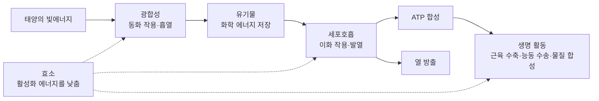
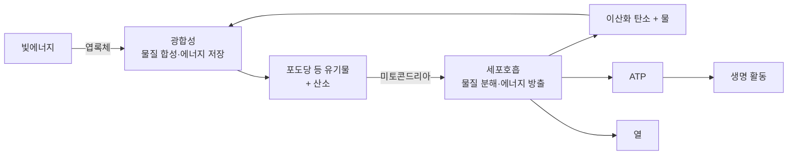

# 세포와 물질대사 2. 물질대사와 에너지 — ATP와 효소가 움직이는 생명의 화학
<!-- prev: m2-05, m2-06, 3-5, 4-5, bio-1, cell-1 -->
<!-- next: cell-3, gene-3 -->

> [!NOTE]
> **성취기준**
> - **[12세포02-01]** 물질대사는 생명체에서 생명을 유지하기 위해 일어나는 화학 반응임을 이해하고 에너지의 출입이 동반됨을 추론할 수 있다.
> - **[12세포02-02]** 생명 활동에 필요한 에너지를 공급하는 과정에서 광합성과 세포호흡 그리고 ATP의 역할을 설명할 수 있다.
> - **[12세포02-03]** 효소의 종류와 특성을 이해하고 효소의 활성에 영향을 미치는 요인에 대한 실험을 설계하여 수행할 수 있다.
> - **[12세포02-04]** 효소의 작용 기작을 이해하고, 생명체 내에서 일어나는 효소 작용의 중요성에 대해 다양한 매체를 활용하여 협력적으로 소통할 수 있다.
> - **[12세포02-05]** 효소가 우리 생활이나 산업에 다양하게 이용되는 사례를 조사하여 발표할 수 있다.

**학습 목표**

1. 물질대사를 동화 작용과 이화 작용으로 구분하고, 각 과정에서 에너지가 흡수되거나 방출됨을 에너지 그래프로 추론할 수 있다.
2. 하루 에너지 섭취량과 소비량을 계산하여 비교하고, 균형 있는 에너지 섭취와 소비의 중요성을 설명할 수 있다.
3. 광합성(물질 합성과 에너지 저장)과 세포호흡(물질 분해와 에너지 생성) 사이에서 ATP가 에너지를 저장·전달하는 역할을 설명할 수 있다.
4. 효소의 구성, 종류, 특성을 이해하고, 온도·pH·기질 농도·효소 농도·저해제가 효소 활성에 미치는 영향을 스스로 변인을 정하여 실험으로 확인할 수 있다.
5. 효소–기질 복합체와 활성화 에너지로 효소의 작용 기작을 설명하고, 생명체와 산업에서 효소가 중요한 이유를 사례로 발표할 수 있다.

**이 단원의 학습 사다리**

| 단계 | 무엇을 하나? |
|---|---|
| STEP 1. 이전 학습 다시 보기 | 중학교 광합성·소화 효소, 통합과학 물질대사·효소·에너지 출입, 생명과학 에너지 전환을 다시 꺼내 본다 |
| STEP 2. 기초 다지기 | 에너지 보존, 발열·흡열 반응, 활성화 에너지, 칼로리 단위, 변인 통제를 디딤돌로 놓는다 |
| STEP 3. 핵심 개념 | 물질대사와 에너지 출입 → ATP와 에너지 흐름 → 효소의 종류·특성·활성 요인 → 작용 기작과 중요성 → 생활·산업 이용 |
| STEP 4. 오개념 바로잡기 | "ATP는 에너지를 '만든다'?", "효소는 반응열을 줄인다?" 같은 착각을 바로잡는다 |
| STEP 5. 대학으로 한 걸음 더 | 깁스 자유 에너지와 짝반응, 효소 반응 속도론과 저해 양식, 다른 자리 입체성 조절 |
| STEP 6. 생활·산업·진로 | 식품·세제·의료 진단·바이오 연료·유전자 기술의 효소 |

---

## 🗺️ 단원 들어가기

밥을 오래 씹으면 단맛이 난다. 겨울철 식혜는 엿기름을 따뜻한 밥에 섞어 몇 시간 두면 만들어지지만, 끓여 버린 엿기름으로는 만들 수 없다. 한편 같은 포도당이라도 불에 태우면 순식간에 열과 빛을 내며 사라지는데, 우리 몸속에서는 체온 37 °C에서 조용히, 단계적으로 분해되어 근육을 움직이고 뇌를 깨운다.

무엇이 체온에서 이렇게 많은 화학 반응을 가능하게 할까? 그리고 그 반응에서 나온 에너지는 어떤 형태로 저장되었다가 필요한 곳에서 쓰일까? 이 단원의 두 주인공은 **ATP**(에너지 화폐)와 **효소**(생체 촉매)이다.

---

## STEP 1. 🔙 이전 학습 다시 보기

### 연계표

| 이전 단원·성취기준 | 그때 배운 것 | 이 단원에서 확장되는 것 |
|---|---|---|
| 중2 「식물과 에너지」 [9과12-01], [9과12-02] | 광합성은 빛에너지로 이산화 탄소와 물에서 포도당과 산소를 만든다. 호흡은 양분을 분해해 에너지를 얻는다 | 광합성 = **동화 작용·에너지 저장**, 세포호흡 = **이화 작용·에너지 방출**이며, 두 과정이 **ATP**로 이어진다 |
| 중2 「동물과 에너지」 [9과13-01], [9과13-05] | 아밀레이스, 펩신, 트립신, 라이페이스가 영양소를 분해한다. 동물은 세포호흡으로 에너지를 얻는다 | 소화 효소를 **가수 분해 효소**라는 효소 분류 안에 놓고, 효소의 공통 원리로 일반화한다 |
| 통합과학1 「생명 시스템과 물질대사」 [10통과1-03-05] | 물질대사는 동화·이화로 나뉘고, 효소는 활성화 에너지를 낮추며 기질 특이성이 있고 온도·pH의 영향을 받는다 | 효소의 **구성(보조 인자)·분류(6가지)·작용 기작(효소–기질 복합체)**, 기질 농도·저해제의 영향, 실험 설계 |
| 통합과학2 「물질 변화와 에너지 출입」 [10통과2-01-05] | 화학 반응에서 에너지를 방출(발열)하거나 흡수(흡열)한다 | 생명체의 반응도 발열·흡열 반응이며, 흡열 반응은 **ATP 분해와 짝지어** 일어난다 |
| 생명과학 「생명 시스템의 구성」 [12생과01-03], [12생과01-05] | 물질대사에서 에너지가 ATP로 저장되고 사용된다. 대사성 질환과 생활 습관 | ATP의 **구조와 ATP–ADP 순환**, 에너지 섭취·소비량의 정량 비교 |
| 진로 선택 「세포」 [12세포01-02] | 단백질은 아미노산으로 이루어지고 입체 구조가 기능을 결정한다. ATP도 뉴클레오타이드 계열이다 | 효소의 **활성 부위**와 변성, ATP의 구조 |

### 준비 운동 (사전 진단)

**Q1.** 다음 중 동화 작용에 해당하는 것을 모두 고르시오.
ㄱ. 광합성 ㄴ. 녹말의 소화 ㄷ. 아미노산으로 단백질 합성 ㄹ. 세포호흡

**Q2.** 효소가 반응 속도를 빠르게 하는 까닭을 '에너지'라는 말을 넣어 한 문장으로 쓰시오.

**Q3.** 침 속 아밀레이스를 끓인 뒤 녹말 용액과 섞으면 어떻게 될까? 그 이유는?

**Q4.** 탄수화물·단백질·지방 1 g이 몸속에서 내는 에너지를 각각 어림하여 쓰시오.

정답 및 해설

**Q1. ㄱ, ㄷ** — 작은 분자로 큰 분자를 합성하며 에너지를 흡수하는 과정이 동화 작용이다. 소화와 세포호흡은 큰 분자를 분해하는 이화 작용이다.

**Q2.** 효소는 반응이 일어나는 데 필요한 최소한의 에너지인 **활성화 에너지를 낮추어** 반응 속도를 빠르게 한다.

**Q3.** 녹말이 분해되지 않는다. 효소는 단백질이므로 높은 온도에서 입체 구조가 변성되어 기능을 잃는다.

**Q4.** 탄수화물 약 4 kcal, 단백질 약 4 kcal, 지방 약 9 kcal

---

## STEP 2. 🧱 기초 다지기

### ① 에너지는 사라지지 않고 형태만 바뀐다

에너지는 새로 생기거나 없어지지 않고 다른 형태로 **전환**될 뿐이다(에너지 보존). 생명체도 이 법칙을 벗어나지 못한다. 식물은 빛에너지를 화학 에너지로, 동물은 화학 에너지를 운동·열·전기 에너지 등으로 전환한다. 다만 전환할 때마다 일부는 반드시 **열**로 흩어져 다시 쓰기 어려워진다. 그래서 생명체는 바깥에서 **계속** 에너지를 공급받아야 한다.

### ② 발열 반응과 흡열 반응

| 구분 | 에너지 출입 | 반응물과 생성물의 에너지 | 생명체의 예 |
|---|---|---|---|
| **발열 반응** | 에너지 방출 | 반응물 > 생성물 | 세포호흡, 소화(가수 분해), ATP 분해 |
| **흡열 반응** | 에너지 흡수 | 반응물 < 생성물 | 광합성, 단백질 합성, ATP 합성 |

> [!TIP]
> 💡 **비유** — 에너지 그래프를 '언덕 위아래'로 생각하자. 발열 반응은 언덕 위(높은 에너지)에서 아래로 굴러 내려가며 에너지를 내놓는 것, 흡열 반응은 언덕 아래에서 위로 공을 밀어 올리는 데 에너지를 넣는 것이다.

### ③ 활성화 에너지 — 반응 앞의 '문턱'

에너지를 내놓는 발열 반응이라도 저절로 바로 일어나지는 않는다. 성냥은 공기 중에서 타면 열을 내지만, 그어서 처음에 에너지를 주어야 불이 붙는다. 반응이 시작되기 위해 넘어야 하는 최소한의 에너지를 **활성화 에너지(activation energy)** 라고 한다. **촉매**는 이 문턱을 낮추어 반응을 빠르게 하는 물질이다. 생명체의 촉매가 효소이다.

<!-- fig:cell-2-exo-endo -->

### ④ 에너지의 단위

| 단위 | 관계 | 쓰임 |
|---|---|---|
| 칼로리(cal) | 물 1 g을 1 °C 올리는 데 필요한 열량(약) | 식품 영양 표시는 킬로칼로리(kcal) |
| 줄(J) | 1 cal ≈ 4.18 J | 과학의 표준 단위. 1 kcal ≈ 4.18 kJ |

### ⑤ 실험 설계의 기본 — 변인 통제

| 변인 | 뜻 | 효소 실험의 예 |
|---|---|---|
| **조작 변인** | 실험자가 일부러 바꾸는 조건 | 온도(10, 20, 30, 40, 50, 60 °C) |
| **종속 변인** | 조작 변인에 따라 변하는 결과(측정값) | 발생한 산소 기체의 부피, 녹말이 사라지는 시간 |
| **통제 변인** | 모든 실험군에서 똑같이 유지하는 조건 | 효소 양, 기질 농도와 부피, pH, 반응 시간 |
| **대조군** | 비교 기준이 되는 집단 | 효소 대신 증류수(또는 끓인 효소액)를 넣은 시험관 |

조작 변인을 **한 번에 하나만** 바꿔야 결과의 원인을 그 변인 때문이라고 말할 수 있다.

---

## STEP 3. 📘 핵심 개념

### ① 물질대사와 에너지의 출입 [12세포02-01]

#### (1) 물질대사는 생명을 유지하는 화학 반응의 총합

**물질대사(metabolism)** 는 생명체 안에서 일어나는 모든 화학 반응이다. 숨을 쉬고, 체온을 유지하고, 상처를 아물게 하고, 생각하는 모든 일이 물질대사로 이루어진다. 물질대사가 멈추면 생명도 멈춘다.

| 구분 | **동화 작용**(anabolism) | **이화 작용**(catabolism) |
|---|---|---|
| 물질의 변화 | 작은 분자 → 큰 분자(합성) | 큰 분자 → 작은 분자(분해) |
| 에너지 출입 | 에너지 **흡수**(흡열) | 에너지 **방출**(발열) |
| 예 | 광합성, 단백질 합성, 글리코젠 합성, DNA 복제 | 세포호흡, 소화, 글리코젠 분해 |
| 생명체에서의 의미 | 몸을 만들고 에너지를 **저장** | 저장된 에너지를 **꺼내 씀** |

두 작용은 따로 노는 것이 아니다. 이화 작용에서 방출된 에너지의 일부가 ATP에 담겨 동화 작용에 쓰인다. 예를 들어 운동 후 근육이 커지는 것은, 포도당을 분해해 얻은 ATP를 써서 아미노산으로 근육 단백질을 합성한 결과이다.

#### (2) 연소와 세포호흡 — 같은 결과, 다른 과정

| 비교 | 포도당의 연소 | 세포호흡 |
|---|---|---|
| 반응물과 생성물 | 포도당 + 산소 → 이산화 탄소 + 물 | 같다 |
| 방출되는 총 에너지 | 같다 | 같다 |
| 진행 방식 | 한 번에 빠르게 | **효소에 의해 여러 단계로** 조금씩 |
| 온도 | 높은 온도 필요(점화) | 체온(약 37 °C) |
| 에너지의 형태 | 거의 모두 열과 빛 | 일부는 **ATP**에 저장, 나머지는 열(체온 유지) |

> [!IMPORTANT]
> 세포호흡이 연소처럼 한꺼번에 에너지를 내놓으면 세포는 그 열을 감당하지 못하고, 에너지를 저장하지도 못한다. **효소가 반응을 단계로 쪼개기 때문에** 세포는 각 단계에서 나오는 작은 에너지 꾸러미를 ATP로 붙잡을 수 있다. 계단으로 천천히 내려오며 한 칸마다 동전을 줍는 것과 같다.

#### (3) 에너지 섭취와 소비의 균형

우리 몸이 하루에 쓰는 에너지는 크게 세 가지로 나뉜다.

| 구분 | 뜻 | 대략적인 크기 |
|---|---|---|
| **기초 대사량** | 깨어 있고 편안히 누워 있을 때 생명 유지(심장 박동, 호흡, 체온 유지 등)에 필요한 최소 에너지 | 성인 약 1200~1800 kcal(체격·성별·나이에 따라 다르다) |
| **활동 대사량** | 걷기, 공부, 운동 등 활동에 쓰는 에너지 | 활동량에 따라 크게 다르다 |
| 식사에 의한 열 생산 | 음식물을 소화·흡수·저장하는 데 쓰는 에너지 | 섭취 에너지의 약 10% |

**에너지 섭취량 > 소비량**이 계속되면 남는 에너지는 주로 중성 지방으로 저장되어 비만으로 이어지고, 이는 당뇨병·고혈압 같은 **대사성 질환**의 위험을 높인다. 반대로 **섭취량 < 소비량**이 계속되면 저장된 글리코젠과 지방, 심하면 근육 단백질까지 분해해 쓰게 되어 영양 결핍과 면역력 저하가 나타난다. 성장기에는 몸을 만드는 동화 작용이 활발하므로 에너지와 단백질을 특히 균형 있게 섭취해야 한다.

#### 예제 1 — 하루 에너지 수지 계산

어떤 학생이 하루 동안 탄수화물 320 g, 단백질 80 g, 지방 70 g을 섭취했다. 이 학생의 기초 대사량은 1500 kcal, 활동 대사량은 700 kcal이고, 식사에 의한 열 생산은 섭취 에너지의 10%라고 하자. (탄수화물·단백질 4 kcal/g, 지방 9 kcal/g)

(1) 섭취 에너지 (2) 소비 에너지 (3) 에너지 수지를 구하시오.

**풀이**
(1) $320\times4 + 80\times4 + 70\times9 = 1280 + 320 + 630 = 2230\ \mathrm{kcal}$
(2) $1500 + 700 + 0.1 \times 2230 = 1500 + 700 + 223 = 2423\ \mathrm{kcal}$
(3) $2230 - 2423 = -193\ \mathrm{kcal}$

하루 약 193 kcal가 부족하다. 지방 1 g을 약 9 kcal로 보면 이 상태가 계속될 때 하루 약 21 g의 지방이 분해되어 쓰이는 셈이다($193 \div 9 \approx 21$). 실제 체중 변화는 수분과 근육량 변화도 함께 일어나므로 이렇게 단순하지는 않다.

#### ✔ 바로 확인

1. (O/X) 동화 작용은 에너지를 방출하는 반응이다.
2. 소화, 단백질 합성, 세포호흡, 글리코젠 합성 중 이화 작용을 모두 고르시오.
3. 세포호흡이 포도당의 연소와 다른 점을 한 가지 쓰시오.
4. 탄수화물 50 g과 지방 10 g을 먹었을 때 섭취한 에너지는? (탄수화물 4 kcal/g, 지방 9 kcal/g)

정답

1. X — 동화 작용은 작은 분자로 큰 분자를 합성하며 에너지를 흡수한다.
2. 소화, 세포호흡 — 큰 분자가 작은 분자로 분해된다.
3. 효소에 의해 여러 단계로 조금씩 일어난다(또는 체온에서 일어난다, 에너지의 일부를 ATP에 저장한다).
4. 290 kcal — $50\times4 + 10\times9 = 200 + 90$

---

### ② 광합성, 세포호흡 그리고 ATP [12세포02-02]

#### (1) 생명 활동의 에너지 흐름

| 과정 | 물질의 변화 | 에너지의 변화 | 장소 |
|---|---|---|---|
| **광합성** | $\mathrm{CO_2}$ + $\mathrm{H_2O}$ → 포도당 + $\mathrm{O_2}$(**합성**) | 빛에너지 → 유기물의 화학 에너지(**저장**) | 엽록체 |
| **세포호흡** | 포도당 + $\mathrm{O_2}$ → $\mathrm{CO_2}$ + $\mathrm{H_2O}$(**분해**) | 유기물의 화학 에너지 → ATP의 화학 에너지 + 열(**방출**) | 세포질 + 미토콘드리아 |

광합성의 생성물은 세포호흡의 반응물이 되고, 세포호흡의 생성물은 광합성의 반응물이 된다. **물질은 순환하지만 에너지는 한 방향으로 흐르며 결국 열로 빠져나간다.** 광합성에서도 엽록체는 빛에너지로 먼저 ATP(와 전자 운반체 NADPH)를 만들고, 그 에너지로 포도당을 합성한다. 즉 ATP는 광합성과 세포호흡 **양쪽 모두에서** 에너지를 옮기는 운반자이다(자세한 단계는 「세포호흡과 광합성」).

#### (2) ATP의 구조

**ATP(adenosine triphosphate, 아데노신 삼인산)** 는 다음 세 부분으로 되어 있다.

$$
\text{ATP} = \underbrace{\text{아데닌(염기)} + \text{리보스(5탄당)}}_{\text{아데노신}} + \text{인산} - \text{인산} - \text{인산}
$$

- 「세포」 단원에서 본 RNA의 뉴클레오타이드(아데닌 + 리보스 + 인산 1개)에 인산이 두 개 더 붙은 모양이다.
- 음전하를 띤 인산기 세 개가 좁은 곳에 몰려 있어 서로 밀어낸다. 그래서 끝의 인산 결합이 끊어지면 더 안정한 상태가 되며 에너지가 방출된다. 흔히 이 결합을 **고에너지 인산 결합**이라 부른다.

$$
\mathrm{ATP} + \mathrm{H_2O} \;\longrightarrow\; \mathrm{ADP} + \mathrm{P_i} + \text{에너지(약 } 7.3\ \mathrm{kcal/mol})
$$

($\mathrm{P_i}$: 무기 인산. 7.3 kcal/mol(약 30.5 kJ/mol)은 표준 조건의 값이며, 실제 세포 속 조건에서는 이보다 더 크다.)

#### (3) ATP–ADP 순환 — 충전과 방전을 반복하는 배터리

| 방향 | 반응 | 에너지 | 어디서? |
|---|---|---|---|
| ATP 합성(충전) | ADP + $\mathrm{P_i}$ → ATP | 흡수(흡열) | 세포호흡(미토콘드리아·세포질), 광합성 명반응(엽록체) |
| ATP 분해(방전) | ATP → ADP + $\mathrm{P_i}$ | 방출(발열) | 에너지를 쓰는 곳이면 어디든 |

> [!TIP]
> 💡 **비유** — 포도당은 은행에 맡긴 **큰돈(예금)**, ATP는 지갑 속 **현금(동전)** 이다. 자판기(근육, 펌프)는 예금 통장을 받지 않고 동전만 받는다. 그래서 세포는 포도당을 분해해 에너지를 ATP라는 작은 단위로 '환전'해 두고 쓴다. 쓰고 남은 ADP는 다시 충전되어 ATP가 된다.

<!-- fig:cell-2-atp-cycle -->

#### (4) ATP 에너지가 쓰이는 곳

| 에너지의 형태 | 생명 활동의 예 |
|---|---|
| 기계적 에너지 | 근육 수축(액틴·마이오신), 섬모·편모 운동, 소낭 이동 |
| 화학 에너지 | 단백질·핵산·글리코젠 합성 등 동화 작용 |
| 수송(삼투적) 에너지 | 나트륨–칼륨 펌프 같은 **능동 수송**(「세포」) |
| 전기 에너지 | 신경 세포의 이온 농도 차이 유지 → 신경 신호 |
| 빛에너지 | 반딧불이의 발광(루시페린–루시페레이스 반응) |
| 열에너지 | 체온 유지(ATP 사용 과정에서 방출되는 열) |

**에너지 짝반응** — 흡열 반응은 혼자서는 잘 일어나지 않는다. 세포는 흡열 반응을 ATP 분해(발열)와 **짝지어**, 둘을 합친 전체 반응이 에너지를 방출하도록 만든다. 예를 들어 근육 단백질의 합성이나 펌프의 작동은 ATP 분해와 같은 효소(단백질) 위에서 맞물려 일어난다.

#### 예제 2 — 하루에 쓰는 ATP의 양

어떤 사람이 하루에 쓰는 에너지 2000 kcal 중 절반이 ATP를 거쳐 쓰인다고 가정하자. ATP 1 mol의 분해로 7.3 kcal를 얻고, ATP의 몰질량이 약 507 g/mol일 때, 하루 동안 분해되는 ATP의 질량을 어림하시오.

**풀이**
- ATP 몰수: $1000 \div 7.3 \approx 137\ \mathrm{mol}$
- 질량: $137 \times 507 \approx 69\,000\ \mathrm{g} \approx 69\ \mathrm{kg}$

몸무게만큼의 ATP를 하루에 쓰는 셈이다. 그런데 몸속에 있는 ATP는 어느 순간이든 수십~수백 g 정도에 불과하다. 따라서 **ATP는 저장 물질이 아니라, 하루에도 수백 번 이상 ADP ⇄ ATP로 재충전되며 '돌려 쓰는' 운반 물질**이라는 결론을 얻는다.

#### ✔ 바로 확인

1. 빈칸: ATP는 아데닌 + (    ) + 인산 3개로 되어 있다.
2. (O/X) 우리 몸에는 ATP가 대량으로 저장되어 있다.
3. ATP가 ADP와 무기 인산으로 분해되는 반응은 발열 반응인가, 흡열 반응인가?
4. ADP와 무기 인산으로 ATP를 합성하는 데 필요한 에너지를 공급하는 과정 두 가지는?

정답

1. 리보스 — 아데닌과 리보스를 합쳐 아데노신이라 한다.
2. X — 소량만 있으며 ADP ⇄ ATP로 빠르게 재생해 쓴다. 저장은 글리코젠·지방이 맡는다.
3. 발열 반응 — 방출된 에너지가 생명 활동에 쓰인다.
4. 세포호흡, 광합성의 명반응

---

### ③ 효소의 종류와 특성, 활성에 영향을 미치는 요인 [12세포02-03]

#### (1) 효소의 구성

대부분의 효소는 **단백질**이다(일부 RNA도 촉매 작용을 한다). 많은 효소는 단백질 부분만으로는 작동하지 못하고 비단백질 성분의 도움이 필요하다.

$$
\text{전효소(완전한 효소)} = \text{주효소(단백질 부분)} + \text{보조 인자}
$$

| 보조 인자 | 성질 | 예 |
|---|---|---|
| **금속 이온** | 무기물. 기질과의 결합이나 전자 이동을 돕는다 | $\mathrm{Mg^{2+}}$(ATP를 쓰는 효소), $\mathrm{Zn^{2+}}$, $\mathrm{Fe^{2+}}$, $\mathrm{Cu^{2+}}$ |
| **조효소** | 유기물. 많은 수가 **비타민**에서 만들어진다. 전자·원자단을 운반한다 | $\mathrm{NAD^+}$(비타민 B₃ 계열에서 유래), FAD(비타민 B₂에서 유래), 조효소 A |

주효소는 열에 약하지만(단백질), 조효소는 비교적 열에 강하고 크기가 작아 투석막을 통과한다. 비타민이 몸에 적은 양으로도 꼭 필요한 이유는 조효소의 재료이기 때문이다.

#### (2) 효소의 종류

국제 생화학 분자생물학 연합(IUBMB)은 효소를 **촉매하는 반응의 종류**에 따라 분류한다. 고등학교에서는 전통적인 6가지 분류를 익힌다.

| 효소 종류 | 촉매하는 반응 | 예 |
|---|---|---|
| **산화 환원 효소** | 전자(수소)를 주고받는 산화·환원 반응 | 탈수소 효소, 카탈레이스(과산화 수소 분해) |
| **전이 효소** | 원자단(아미노기, 인산기 등)을 다른 분자로 옮김 | 아미노기 전이 효소, 인산기를 옮기는 인산화 효소 |
| **가수 분해 효소** | 물을 넣어 결합을 끊음 | 아밀레이스, 펩신, 트립신, 라이페이스, 락테이스 |
| **제거 부가 효소**(분해 효소) | 물 없이 원자단을 떼어 내거나 붙임(이중 결합 형성) | 탈탄산 효소($\mathrm{CO_2}$를 떼어 냄) |
| **이성질화 효소** | 분자 내 원자 배열을 바꿈(이성질체로 전환) | 포도당 이성질화 효소(포도당 ⇄ 과당) |
| **연결 효소**(합성 효소) | ATP 에너지를 써서 두 분자를 결합 | DNA 연결 효소 |

(2018년에는 물질을 막 너머로 옮기는 반응을 촉매하는 '자리옮김 효소'가 7번째 분류로 추가되었다.)

> [!TIP]
> 💡 이름 짓는 요령 — 효소 이름은 대개 **기질 이름 + '-에이스(-ase)'** 이다. 녹말(아밀로스) → 아밀레이스, 지질(lipid) → 라이페이스, 젖당(lactose) → 락테이스. 다만 펩신, 트립신처럼 오래전에 붙은 이름은 이 규칙을 따르지 않는다.

#### (3) 효소의 특성

| 특성 | 설명 | 예·증거 |
|---|---|---|
| **기질 특이성** | 활성 부위와 입체 구조가 맞는 특정 기질에만 작용한다 | 아밀레이스는 녹말은 분해하지만 셀룰로스는 분해하지 못한다 |
| **반복 사용** | 반응 전후에 변하지 않아 적은 양으로 많은 기질을 처리한다 | 카탈레이스 1분자는 1초에 수백만 개 이상의 과산화 수소를 분해할 수 있다 |
| **활성화 에너지만 낮춤** | 반응열(반응물과 생성물의 에너지 차이)은 바꾸지 않는다 | 효소가 있든 없든 반응 전후 에너지 차이는 같다 |
| **반응 방향은 바꾸지 않음** | 일어날 수 있는 반응을 **빠르게** 할 뿐, 일어나지 않는 반응을 일으키지는 못한다 | 흡열 반응은 ATP 등과 짝지어져야 진행된다 |
| **환경의 영향을 받음** | 단백질이므로 온도·pH에 따라 입체 구조가 변한다 | 끓인 엿기름으로는 식혜가 되지 않는다 |

#### (4) 효소 활성에 영향을 미치는 요인

**① 온도** — 온도가 오르면 분자 운동이 활발해져 효소와 기질이 더 자주 충돌하므로 반응 속도가 증가한다. 그러나 일정 온도를 넘으면 효소 단백질이 **변성**되어 속도가 급격히 떨어진다. 반응 속도가 가장 빠른 온도를 **최적 온도**라고 하며, 사람 효소는 대개 35~40 °C 부근이다. 온천에 사는 세균의 효소는 70 °C 이상에서 잘 작동하기도 한다.

**② pH** — pH가 변하면 활성 부위의 아미노산 곁사슬의 전하 상태가 바뀌어 기질과의 결합이 달라진다. 효소마다 **최적 pH**가 다르다.

| 효소 | 작용 장소 | 최적 pH(약) |
|---|---|---|
| 펩신 | 위(염산 분비) | 2 |
| 침 아밀레이스 | 입 | 7 |
| 트립신 | 소장(이자액, 약한 염기성) | 8 |

<!-- fig:cell-2-temp-ph -->

**③ 기질 농도** — 효소 양이 일정할 때, 기질 농도가 낮으면 농도에 따라 반응 속도가 빠르게 증가하다가, 기질이 충분히 많아지면 모든 효소의 활성 부위가 기질로 채워져(**포화**) 더 이상 빨라지지 않는다.

**④ 효소 농도** — 기질이 충분할 때 반응 속도는 효소 농도에 거의 비례한다.

**⑤ 저해제** — 효소 작용을 방해하는 물질이다.

| 저해제 | 결합 위치 | 기질 농도를 높이면? | 예 |
|---|---|---|---|
| **경쟁적 저해제** | 기질과 모양이 비슷해 **활성 부위**를 두고 기질과 경쟁 | 기질이 이길 확률이 높아져 저해 효과가 **줄어든다**(최대 속도는 회복) | 메탄올 중독 치료에 에탄올을 쓰는 원리(같은 효소를 두고 경쟁) |
| **비경쟁적 저해제** | 활성 부위가 **아닌** 다른 부위에 결합해 효소의 모양을 바꿈 | 기질을 늘려도 저해가 **풀리지 않는다**(최대 속도 감소) | 일부 중금속 이온 |

<!-- sim:enzyme-kinetics -->

#### 예제 3 — 그래프 해석: 저해제의 종류 판별

같은 양의 효소에 기질 농도를 바꾸며 초기 반응 속도를 측정하였다(상대값).

| 기질 농도(상대값) | 1 | 2 | 5 | 10 | 50 |
|---|---|---|---|---|---|
| 저해제 없음 | 33 | 50 | 71 | 83 | 96 |
| 저해제 A 첨가 | 17 | 29 | 50 | 67 | 91 |
| 저해제 B 첨가 | 17 | 25 | 36 | 42 | 48 |

A와 B는 각각 경쟁적 저해제와 비경쟁적 저해제 중 무엇인가?

**풀이** 기질 농도가 매우 높을 때(50), A를 넣은 경우는 91로 저해제가 없을 때(96)에 거의 가까워진다. 기질이 많아지면 기질이 활성 부위 경쟁에서 이기므로 A는 **경쟁적 저해제**이다. B는 기질을 늘려도 최대 속도가 약 절반(48)에 머무르므로 **비경쟁적 저해제**이다.

#### ✔ 바로 확인

1. 짝짓기: 아밀레이스, 카탈레이스, DNA 연결 효소 ― (가) 산화 환원 효소 (나) 가수 분해 효소 (다) 연결 효소
2. (O/X) 조효소는 대부분 비타민에서 만들어지는 유기물이다.
3. 온도·pH 그래프에서 펩신의 최적 pH는 약 얼마인가?
4. 기질이 충분히 많을 때 효소 농도를 2배로 늘리면 초기 반응 속도는 어떻게 되는가?

정답

1. 아밀레이스–(나), 카탈레이스–(가), DNA 연결 효소–(다)
2. O — 예: $\mathrm{NAD^+}$, FAD
3. 약 2 — 염산이 분비되는 위에서 작용한다.
4. 약 2배가 된다 — 기질이 충분하면 반응 속도는 효소 농도에 거의 비례한다.

---

### ④ 효소의 작용 기작과 생명체에서의 중요성 [12세포02-04]

#### (1) 활성화 에너지를 낮추는 효소

| 에너지 그래프의 구간 | 효소 없음 | 효소 있음 |
|---|---|---|
| 반응물의 에너지 | 같다 | 같다 |
| 활성화 에너지(언덕의 높이) | 높다 | **낮다** |
| 생성물의 에너지 | 같다 | 같다 |
| 반응열(반응물 − 생성물) | 같다 | 같다 |

<!-- fig:cell-2-activation-energy -->

#### 예제 4 — 에너지 그래프 읽기

어떤 반응에서 반응물의 에너지가 100, 생성물의 에너지가 40, 효소가 없을 때 활성화 상태의 에너지가 180, 효소가 있을 때 활성화 상태의 에너지가 130이다(단위는 kJ/mol, 가상의 값). (1) 반응열 (2) 효소가 없을 때와 있을 때의 활성화 에너지 (3) 이 반응은 발열과 흡열 중 무엇인가?

**풀이**
(1) $100 - 40 = 60\ \mathrm{kJ/mol}$ 방출(효소 유무와 관계없음)
(2) 효소 없음: $180 - 100 = 80\ \mathrm{kJ/mol}$, 효소 있음: $130 - 100 = 30\ \mathrm{kJ/mol}$
(3) 생성물의 에너지가 더 낮으므로 **발열 반응**이다. 효소는 활성화 에너지를 50 kJ/mol 낮추었지만 반응열은 그대로이다.

#### (2) 효소–기질 복합체

효소가 반응을 촉매하는 과정은 다음과 같이 한 바퀴 도는 **순환**이다.

$$
\text{효소(E)} + \text{기질(S)} \;\rightleftharpoons\; \text{효소–기질 복합체(ES)} \;\longrightarrow\; \text{효소(E)} + \text{생성물(P)}
$$

1. 기질이 효소 표면의 움푹한 부위인 **활성 부위(active site)** 에 결합한다.
2. 결합하면서 효소의 모양이 기질을 더 꼭 감싸도록 살짝 바뀐다(**유도 적합**, induced fit). 이때 기질의 결합이 늘어나 끊어지기 쉬워지거나, 두 기질이 반응하기 좋은 방향으로 가까이 놓인다.
3. 생성물이 만들어져 활성 부위에서 떨어져 나간다.
4. 효소는 원래 모양으로 돌아와 새 기질과 다시 결합한다.

> [!TIP]
> 💡 **비유** — 예전에는 효소와 기질을 딱딱한 '자물쇠와 열쇠'로 설명했다(자물쇠–열쇠 모형). 지금은 손에 끼우면 손 모양에 맞게 늘어나는 **고무장갑**에 더 가깝다고 본다(유도 적합 모형). 장갑(효소)은 손(기질)이 들어오면 꼭 맞게 조여지고, 손이 빠지면 원래 모양으로 돌아온다.

<!-- fig:cell-2-induced-fit -->

#### (3) 효소 작용은 왜 중요한가

**① 체온에서 반응이 가능해진다** — 효소가 없다면 몸속 반응 대부분은 너무 느려서 생명을 유지할 수 없다. 효소는 반응을 수백만 배 이상 빠르게 하기도 한다.

**② 대사 경로를 단계별로 진행하고 조절한다** — 세포호흡처럼 수십 단계로 이루어진 반응은 **단계마다 다른 효소**가 맡는다. 이렇게 이어진 반응의 사슬을 **대사 경로**라고 한다.

$$
\text{A} \xrightarrow{\text{효소 1}} \text{B} \xrightarrow{\text{효소 2}} \text{C} \xrightarrow{\text{효소 3}} \text{D}
$$

- 최종 생성물 D가 많아지면 D가 경로 앞쪽의 효소 1에 결합해 작용을 억제한다. 이를 **피드백 저해(되먹임 억제)** 라고 하며, 필요 이상으로 생성물이 만들어지지 않게 한다. 「항상성과 몸의 조절」에서 배운 음성 피드백이 분자 수준에서도 일어나는 것이다.

<!-- fig:cell-2-feedback -->

**③ 효소 하나의 이상이 질병이 된다**

| 사례 | 원인 | 결과 |
|---|---|---|
| 페닐케톤뇨증 | 아미노산 페닐알라닌을 다른 물질로 바꾸는 효소의 유전적 결핍 | 페닐알라닌이 쌓여 신경 발달에 문제. 신생아 선별 검사와 식이 조절로 관리 |
| 젖당 불내증 | 성인이 된 뒤 락테이스 활성 감소 | 우유를 마시면 젖당이 대장에서 세균에 의해 발효되어 복통·설사 |
| 알코올 대사의 개인차 | 알코올 대사 중간 산물(아세트알데하이드)을 분해하는 효소의 활성이 낮은 사람이 있다 | 술을 조금만 마셔도 얼굴이 붉어지고 두근거림. 동아시아인에게 비교적 흔하다 |

**④ 의약품의 표적이 된다** — 많은 약은 특정 효소의 저해제이다. 페니실린은 세균의 세포벽 합성 효소를 막고(「세포」), 일부 진통·소염제는 염증 물질을 만드는 효소를 억제한다.

#### 예제 5 — 대사 경로 추론

어떤 세균의 대사 경로 '물질 A → B → C → D'에서 효소 1, 2, 3이 차례로 작용한다. 돌연변이 균주 X는 최소 배지에 C를 넣어 주면 자라지만 B를 넣어 주면 자라지 않는다(D는 생존에 꼭 필요하다). X에서 결핍된 효소는?

**풀이** C를 넣으면 C → D(효소 3)가 진행되어 자라므로 효소 3은 정상이다. B를 넣어도 자라지 않으므로 B → C를 맡는 **효소 2**가 결핍되었다. 이처럼 대사 경로의 각 단계는 각각의 효소(그리고 그 효소의 유전자)에 의존한다. 이 생각은 「생물의 유전」의 '1유전자 1효소설'로 이어진다.

#### ✔ 바로 확인

1. (O/X) 효소는 반응물과 생성물의 에너지 차이(반응열)를 줄인다.
2. 빈칸: 기질이 결합하는 효소의 부위는 (    )이고, 기질이 결합할 때 효소의 모양이 기질에 꼭 맞게 바뀌는 것을 (    )이라 한다.
3. 반응물의 에너지가 50, 생성물이 20, 효소가 있을 때 언덕 꼭대기(활성화 상태)가 90이다. 효소가 있을 때의 활성화 에너지는? (단위 생략)
4. 피드백 저해에서 경로 첫 단계의 효소를 억제하는 물질은 무엇인가?

정답

1. X — 효소는 활성화 에너지만 낮춘다.
2. 활성 부위, 유도 적합
3. 40 — $90 - 50 = 40$. 활성화 에너지는 반응물에서 꼭대기까지의 높이이다.
4. 그 경로의 최종 생성물

---

### ⑤ 생활과 산업에서의 효소 이용 [12세포02-05]

효소는 **특이성이 높고, 온화한 조건(상온·상압·중성 근처)에서 작동하며, 생분해되어 환경 부담이 적다.** 그래서 고온·고압과 강한 화학 약품이 필요한 공정을 효소 공정으로 바꾸는 사례가 늘고 있다.

| 분야 | 효소(종류) | 이용 원리 | 예 |
|---|---|---|---|
| 전통 식품 | 엿기름의 아밀레이스(가수 분해) | 밥의 녹말 → 엿당 | 식혜, 조청 |
| 전통 식품 | 메주·누룩 속 미생물의 단백질 분해 효소·아밀레이스 | 콩 단백질 → 아미노산(감칠맛), 녹말 → 당 → 알코올 | 된장, 간장, 막걸리 |
| 식품 가공 | 키모신(레닛, 가수 분해) | 우유 단백질의 특정 결합을 끊어 응고 | 치즈 |
| 식품 가공 | 펙티네이스(가수 분해) | 과일 세포벽의 펙틴 분해 | 과일 주스를 맑게, 착즙량 증가 |
| 식품 가공 | 락테이스(가수 분해) | 젖당 → 포도당 + 갈락토스 | 젖당 불내증용 우유 |
| 식품 가공 | 포도당 이성질화 효소(이성질화) | 포도당 → 과당(더 달다) | 액상 과당 |
| 조리 | 파인애플(브로멜라인), 키위(액티니딘), 파파야(파파인)의 단백질 분해 효소 | 고기 단백질 분해 | 고기 연육, (반대로) 생파인애플 젤리가 안 굳는 이유 |
| 세제 | 단백질 분해 효소, 라이페이스, 아밀레이스 | 핏자국·기름때·음식 얼룩 분해 | 효소 세제(낮은 온도에서도 세척) |
| 의료 진단 | 포도당 산화 효소(산화 환원) | 혈액 속 포도당만 골라 반응시켜 전류·색 변화로 측정 | 혈당 측정기, 소변 검사지 |
| 의약 | 소화 효소, 혈전 용해 효소 | 소화 보조, 혈관 속 혈전 분해 | 소화제, 뇌졸중·심근 경색 응급 치료제 |
| 생명공학 | 제한 효소, DNA 연결 효소, 내열성 DNA 중합 효소 | DNA를 자르고 붙이고 복제 | 유전자 재조합, PCR 진단 |
| 에너지·환경 | 셀룰레이스(가수 분해) | 볏짚·나무의 셀룰로스 → 포도당 → 발효 | 바이오 에탄올 |
| 환경 | 플라스틱 분해 효소 | PET 등 플라스틱 결합 분해 연구 | 플라스틱 재활용 연구 |

#### 예제 6 — 효소 세제의 온도 선택

어떤 효소 세제 속 단백질 분해 효소의 상대 활성이 다음과 같다.

| 온도(°C) | 20 | 30 | 40 | 50 | 60 | 70 |
|---|---|---|---|---|---|---|
| 상대 활성(%) | 40 | 65 | 90 | 100 | 55 | 10 |

(1) 최적 온도는? (2) "뜨거울수록 세척이 잘된다"며 70 °C 물을 쓰면 어떤 문제가 생기는가?

**풀이** (1) 50 °C (2) 70 °C에서는 효소가 변성되어 활성이 10%로 떨어지므로, 효소 세제의 장점(단백질 얼룩 분해)이 거의 사라진다. 효소 세제는 **효소의 최적 온도 부근**에서 쓰는 것이 효과적이다.

#### ✔ 바로 확인

1. 혈당 측정기는 효소의 어떤 특성을 이용하여 혈액 속 여러 물질 중 포도당만 측정하는가?
2. (O/X) 생파인애플을 넣은 젤라틴(단백질) 젤리가 잘 굳지 않는 것은 파인애플의 단백질 분해 효소 때문이다.
3. PCR에 온천 세균에서 얻은 DNA 중합 효소를 쓰는 까닭은?

정답

1. 기질 특이성 — 포도당 산화 효소는 포도당에만 작용한다.
2. O — 브로멜라인이 젤라틴 단백질을 분해한다.
3. 90 °C 이상으로 가열해도 변성되지 않아, 가열과 냉각을 반복해도 계속 작용하기 때문이다.

---

## STEP 4. ⚠️ 오개념 바로잡기

| 흔한 오개념 | 올바른 개념 | 왜 그럴까? |
|---|---|---|
| ATP가 에너지를 만들어 낸다 | ATP는 에너지를 **저장·전달**하는 운반자이다. 에너지의 근원은 유기물(결국 빛) | 에너지는 생성되지 않는다. ATP는 포도당의 에너지를 '환전'해 둔 것이다 |
| 몸속에 ATP가 많이 저장되어 있다 | ATP는 소량만 있고 **빠르게 재생**된다. 저장은 글리코젠·지방이 맡는다 | 하루에 몸무게만큼의 ATP를 쓰지만 몸속 ATP는 수십~수백 g뿐이다 |
| 효소는 반응열을 줄여 준다 | 효소는 **활성화 에너지만** 낮추고 반응열은 바꾸지 않는다 | 반응물과 생성물의 에너지는 효소와 무관하다 |
| 효소는 반응에 쓰이면 없어진다 | 효소는 반응 전후에 **변하지 않고 반복** 사용된다 | 효소–기질 복합체를 거친 뒤 효소는 원래대로 돌아온다 |
| 온도가 높을수록 효소 반응은 계속 빨라진다 | **최적 온도**를 넘으면 변성으로 급격히 느려진다 | 효소는 단백질이므로 열에 의해 입체 구조가 망가진다 |
| 낮은 온도에서도 효소가 변성된다 | 낮은 온도에서는 **활성이 줄 뿐** 대개 변성되지 않으며, 온도를 올리면 회복된다 | 그래서 효소 시약이나 식품은 냉장·냉동 보관한다 |
| 동화 작용과 이화 작용은 서로 다른 생물에서 일어난다 | **한 세포 안에서 동시에** 일어난다. 식물도 세포호흡을 한다 | 식물세포에도 미토콘드리아가 있고, 밤낮 없이 호흡한다 |

---

## STEP 5. 🎓 다음 단계로 한 걸음 더

> [!CAUTION]
> 이 절은 **「세포와 물질대사」 교육과정 범위 밖의 심화 내용**으로 평가 대상이 아니다. 대학 전공 과목에서 이 단원의 개념이 어떻게 확장되는지 맛보기로 보여 주기 위한 내용이다.

### 대학 전공 과목과의 연결

| 대학 과목 | 이어지는 내용 |
|---|---|
| 생화학 | 생체 에너지학(자유 에너지), 효소 반응 속도론, 대사 경로와 조절 |
| 물리화학·생물물리학 | 열역학 법칙, 반응 속도 이론, 전이 상태 |
| 영양학·운동생리학 | 에너지 대사 측정(호흡 열량계), 운동 강도에 따른 에너지원 전환 |
| 효소공학·생물공정공학 | 효소 고정화, 효소 개량(단백질 공학), 산업용 생물 반응기 |

### ① 깁스 자유 에너지와 짝반응

「물질과 에너지」의 「화학 변화의 자발성」에서는 엔탈피와 엔트로피로 자발성을 정성적으로 판단했다. 대학 생화학에서는 둘을 합친 **깁스 자유 에너지 변화** $\Delta G$로 판단한다.

$$
\Delta G = \Delta H - T\Delta S, \qquad \Delta G < 0 \text{ 이면 자발적}
$$

세포 속 흡열성(비자발적) 반응은 ATP 가수 분해와 짝지어 진행된다. 예를 들어 글루탐산과 암모니아로 글루타민을 만드는 반응은 표준 조건에서 $\Delta G^{\circ\prime} \approx +14.2\ \mathrm{kJ/mol}$로 저절로 일어나지 않지만, ATP 가수 분해($\approx -30.5\ \mathrm{kJ/mol}$)와 짝지으면

$$
\Delta G^{\circ\prime}_{\text{전체}} \approx +14.2 + (-30.5) = -16.3\ \mathrm{kJ/mol}
$$

으로 전체가 자발적이 된다. STEP 3 ②의 '에너지 짝반응'을 숫자로 표현한 것이다.

### ② 효소 반응 속도론 — 미카엘리스–멘텐 식과 저해 양식

$$
v = \frac{V_{\max}[S]}{K_m + [S]}
$$

양변의 역수를 취하면 직선 식(라인위버–버크 도표)이 된다.

$$
\frac{1}{v} = \frac{K_m}{V_{\max}}\cdot\frac{1}{[S]} + \frac{1}{V_{\max}}
$$

| 저해 양식 | $V_{\max}$ | $K_m$(겉보기) | 직선 그래프의 변화 |
|---|---|---|---|
| 경쟁적 저해 | 변화 없음 | 커짐 | 세로축 절편은 같고 기울기만 커짐 |
| 비경쟁적 저해 | 작아짐 | 변화 없음 | 가로축 절편은 같고 세로축 절편이 커짐 |

STEP 3 예제 3의 자료는 $V_{\max}=100$, $K_m=2$인 효소에서, 저해제 A가 겉보기 $K_m$을 5로 키우고(경쟁적) 저해제 B가 $V_{\max}$를 50으로 줄인(비경쟁적) 경우를 이 식으로 계산해 만든 것이다. 예를 들어 저해제 A가 있고 $[S]=5$일 때 $v = 100\times5/(5+5) = 50$, 저해제 B가 있고 $[S]=5$일 때 $v = 50\times5/(2+5) \approx 36$이다. 이처럼 실제 측정 자료에서 $K_m$과 $V_{\max}$를 거꾸로 구해 저해 양식을 판별하는 것이 대학 생화학 실험의 핵심 기술이다.

### ③ 다른 자리 입체성 조절(알로스테릭 조절)

STEP 3 ④의 피드백 저해에서 최종 생성물은 효소의 활성 부위가 아닌 **조절 부위**에 결합한다. 이런 효소는 여러 개의 소단위로 되어 있어 기질 농도에 따른 반응 속도 그래프가 S자 모양을 그리기도 한다. 세포호흡의 속도가 ATP와 ADP의 비율에 따라 조절되는 것도 이 원리이다(「세포호흡과 광합성」).

### ④ 효소를 '설계'하는 시대

자연의 효소를 개량해 더 높은 온도나 유기 용매에서도 작동하게 만드는 **단백질 공학**이 발전하고 있다. 돌연변이와 선택을 반복해 효소를 실험실에서 진화시키는 **유도 진화** 기술은 2018년 노벨 화학상을 받았고, 최근에는 인공지능으로 단백질 구조를 예측하고 새 효소를 설계하는 연구도 활발하다.

### 지금 vs 다음 단계

| 구분 | 고등학교 「세포와 물질대사」 | 대학 생화학·효소공학 |
|---|---|---|
| 에너지 | 발열·흡열, ATP 분해 에너지(약 7.3 kcal/mol) | 깁스 자유 에너지, 실제 세포 조건의 $\Delta G$ 계산 |
| 효소 작용 | 활성화 에너지, 효소–기질 복합체, 유도 적합 | 전이 상태 안정화, 촉매 잔기의 화학적 기작 |
| 활성 요인 | 온도·pH·기질 농도·저해제의 정성적·그래프 해석 | $K_m$, $V_{\max}$, 저해 상수의 정량 분석 |
| 조절 | 피드백 저해 | 알로스테릭 조절, 공유 결합 변형(인산화), 유전자 발현 조절 |
| 응용 | 생활·산업 사례 조사 | 효소 고정화, 단백질 공학, 공정 설계 |

---

## STEP 6. 🏭 생활·산업·진로 연결

### 사례 1. 혈당 측정기 — 효소의 특이성을 전기 신호로

- **원리** 측정 띠에 **포도당 산화 효소**(또는 포도당 탈수소 효소)가 발라져 있다. 혈액 한 방울을 묻히면 효소가 혈액 속 수많은 물질 중 **포도당만** 골라 산화시키고, 이때 이동한 전자의 양(전류)을 측정해 혈당을 계산한다.
- **어디에 쓰이나** 당뇨병 환자의 자가 혈당 측정, 피부에 붙여 혈당을 연속으로 재는 연속 혈당 측정기. 기질 특이성과 산화·환원 반응(「세포호흡과 광합성」)이 함께 쓰인다.

### 사례 2. 효소 세제와 저온 세탁

- **원리** 단백질 분해 효소, 라이페이스, 아밀레이스가 각각 피·땀, 기름, 음식 얼룩을 분해한다. 효소 덕분에 낮은 온도로도 세척력이 높아져 물을 데우는 에너지를 줄일 수 있다.
- **어디에 쓰이나** 세탁 세제, 식기 세척기 세제. 저온에서도 활성이 높은 효소를 개량하는 것이 연구의 핵심이다.

### 사례 3. 우리 전통 발효 식품 속 효소

- **원리** 엿기름(싹 튼 보리)은 발아 과정에서 아밀레이스가 많이 만들어진다. 식혜는 이 효소가 밥의 녹말을 엿당으로 바꾸는 반응이고, 최적 온도(약 55~65 °C 부근)를 유지하는 것이 맛을 좌우한다. 된장·간장은 미생물이 내놓는 효소가 콩 단백질을 아미노산으로 분해해 감칠맛을 낸다.
- **어디에 쓰이나** 식품 산업에서는 이 과정을 효소와 미생물을 정밀하게 조절하는 공정으로 표준화한다.

### 사례 4. PCR과 유전자 진단

- **원리** 온천에 사는 세균에서 얻은 **내열성 DNA 중합 효소**는 90 °C 이상에서도 변성되지 않는다. 그래서 가열(DNA 가닥 분리)과 냉각을 반복하는 PCR에서 효소를 매번 새로 넣지 않아도 DNA를 계속 복제할 수 있다.
- **어디에 쓰이나** 감염병 진단, 법의학, 유전자 검사(「생명공학기술」).

### 관련 진로와 학과

| 진로 | 하는 일 | 관련 학과 |
|---|---|---|
| 효소·생물공정 엔지니어 | 산업용 효소 개량·생산, 생물 반응기 운영 | 생명공학, 화학공학, 생물공학 |
| 식품 연구원 | 발효·효소 공정으로 식품 개발 | 식품공학, 식품영양학, 발효공학 |
| 임상 영양사·운동 처방사 | 에너지 섭취·소비 평가, 식단과 운동 처방 | 식품영양학, 체육학, 운동생리학 |
| 체외 진단 기기 개발자 | 효소·바이오 센서 기반 진단 기기 개발 | 의공학, 전자공학, 생명공학 |
| 신약 연구원 | 질병 관련 효소를 표적으로 하는 저해제 개발 | 약학, 화학, 생화학 |

---

## 🔬 탐구 활동

### 활동 A. 효소의 활성에 영향을 미치는 요인 — 실험 설계하여 수행하기

**목표** 감자(또는 간)에 들어 있는 카탈레이스의 활성에 영향을 미치는 요인을 스스로 정하고, 변인을 통제한 실험을 설계하여 수행한다.

**반응** 과산화 수소 → 물 + 산소(카탈레이스는 산화 환원 효소이다.)

**준비물** 감자, 강판, 거름종이를 지름 1 cm로 뚫은 원판, 3% 과산화 수소수, 증류수, pH 완충 용액(pH 3, 5, 7, 9, 11), 비커, 핀셋, 온도계, 수조(물중탕), 얼음, 초시계, 장갑, 보안경

**측정 방법(원판 부상법)** 감자 즙을 적신 거름종이 원판을 과산화 수소수가 담긴 비커 바닥에 가라앉히면, 발생한 산소 기포가 원판에 붙어 원판이 떠오른다. **떠오를 때까지 걸린 시간이 짧을수록 효소 활성이 크다.** (반응 속도 ∝ 1/시간으로 비교한다.)

**과정**
1. 모둠별로 조사할 요인을 하나 고른다: 온도 / pH / 기질(과산화 수소) 농도 / 효소(감자 즙) 농도.
2. 아래 설계표를 먼저 완성한다.

| 설계 항목 | 우리 모둠의 계획 |
|---|---|
| 가설 | (예: "온도가 높아질수록 활성이 증가하다가 일정 온도 이상에서는 감소할 것이다.") |
| 조작 변인과 수준 | (예: 5, 20, 35, 50, 65 °C) |
| 통제 변인 | (예: 감자 즙 농도, 원판 크기, 과산화 수소 농도와 부피, 비커 크기) |
| 종속 변인 | 원판이 떠오르는 데 걸린 시간(초) |
| 대조군 | (예: 증류수에 적신 원판, 끓인 감자 즙에 적신 원판) |
| 반복 횟수 | 수준마다 3회 이상 |

3. 감자 30 g을 갈아 증류수 30 mL와 섞고 거른다. 온도 실험이라면 감자 즙과 과산화 수소수를 **각각 해당 온도에서 5분 이상** 둔 뒤 반응시킨다.
4. 측정값을 기록하고 평균과 반응 속도(1/시간)를 계산해 그래프로 나타낸다.

**결과 기록**

| 조작 변인 수준 | 1회(초) | 2회(초) | 3회(초) | 평균(초) | 반응 속도(1/평균 시간) |
|---|---|---|---|---|---|
| | | | | | |
| | | | | | |
| | | | | | |

**예시 처리** 35 °C에서 6.2, 5.8, 6.0초였다면 평균 6.0초, 반응 속도는 $1/6.0 \approx 0.17\ \mathrm{s^{-1}}$이다.

**생각해 보기**
1. 측정 결과가 가설을 지지하는가? 그래프의 모양을 효소의 변성과 분자 충돌로 설명해 보자.
2. 끓인 감자 즙 대조군이 필요한 이유는 무엇일까?
3. 반복 측정값의 차이가 컸다면 그 원인은 무엇이고, 어떻게 줄일 수 있을까?
4. 다른 모둠의 요인(pH, 농도)과 결과를 모아 '효소 활성 요인 정보 그림'을 함께 만들어 발표해 보자.

> [!WARNING]
> **안전 수칙** 과산화 수소수는 피부와 눈을 자극하므로 장갑과 보안경을 착용한다. 강판과 칼은 조심해서 다룬다. 뜨거운 물중탕은 화상에 주의한다. 사용한 감자 찌꺼기와 용액은 교사의 지시에 따라 분리하여 버린다.

### 활동 B. 1일 칼로리 섭취량과 소비량을 조사하여 비교하기

**목표** 자신의 하루 에너지 섭취량과 소비량을 조사하여 비교하고, 균형 있는 에너지 섭취와 소비의 의미를 토의한다.

**준비물** 식품 영양 성분 표시, 식품 영양 정보 데이터베이스(공공 디지털 플랫폼), 스마트폰 걸음 수·활동량 앱, 계산기 또는 스프레드시트

**과정**
1. 하루 동안 먹은 음식과 양을 모두 기록하고, 영양 정보로 탄수화물·단백질·지방의 양과 에너지를 계산한다.
2. 기초 대사량을 공식이나 체성분 측정기로 어림한다.
3. 하루 활동을 시간대별로 기록하고, 활동별 에너지 소비량(체중 1 kg, 1시간당 소비량)을 찾아 활동 대사량을 계산한다.
4. 스프레드시트로 섭취량과 소비량을 비교하는 그래프를 만든다.

**결과 기록**

| 구분 | 항목 | 에너지(kcal) |
|---|---|---|
| 섭취 | 아침 / 점심 / 저녁 / 간식 | |
| 소비 | 기초 대사량 | |
| 소비 | 활동 대사량 | |
| 소비 | 식사에 의한 열 생산(섭취량의 약 10%) | |
| 수지 | 섭취 − 소비 | |

**생각해 보기**
1. 에너지 수지가 + 또는 −로 계속된다면 몸에서 어떤 물질대사가 일어날까? 동화·이화 작용으로 설명해 보자.
2. 섭취 에너지가 같더라도 영양소 구성(탄수화물·단백질·지방의 비율)이 중요한 이유는?
3. 조사 결과는 개인 정보이므로 모둠 발표 때는 수치 대신 경향만 공유하는 방법을 생각해 보자.

> [!NOTE]
> 교육과정의 또 다른 탐구 활동 **발아 중인 콩의 물질대사와 에너지대사 탐구하기**도 해 볼 수 있다. 보온병에 발아 중인 콩과 삶은 콩을 각각 넣고 온도 변화를 비교하면(세포호흡의 열 방출), 발아 콩 쪽에서 석회수를 뿌옇게 하는 기체가 더 많이 나오고, 베네딕트 반응으로 저장 양분이 분해되어 생긴 당을 확인할 수도 있다(콩은 녹말보다 단백질·지방을 주로 저장하므로, 녹말이 당으로 바뀌는 것을 보려면 발아 중인 보리·옥수수 등이 더 알맞다).

---

## ✅ 개념 확인 문제

### 기본

**1.** 다음 중 이화 작용이면서 에너지를 방출하는 반응을 모두 고르시오.
ㄱ. 포도당 → 이산화 탄소 + 물 ㄴ. 아미노산 → 단백질 ㄷ. 녹말 → 엿당 ㄹ. ADP + 인산 → ATP

정답 및 해설

**정답 ㄱ, ㄷ**

ㄱ은 세포호흡, ㄷ은 소화(가수 분해)로 큰 분자가 작은 분자로 분해되며 에너지를 방출한다. ㄴ과 ㄹ은 합성 반응으로 에너지를 흡수한다.

**2.** ATP를 구성하는 세 가지 성분을 쓰고, ATP가 ADP로 될 때 떨어져 나가는 것을 쓰시오.

정답 및 해설

**정답** 아데닌, 리보스, 인산 3개. ADP가 될 때 끝의 인산 1개(무기 인산)가 떨어져 나가며 에너지가 방출된다.

**3.** 효소의 특성으로 옳지 **않은** 것은?
① 특정 기질에만 작용한다.
② 반응 후에도 변하지 않아 다시 쓰인다.
③ 활성화 에너지를 낮춘다.
④ 반응물과 생성물의 에너지 차이(반응열)를 줄인다.
⑤ 온도와 pH의 영향을 받는다.

정답 및 해설

**정답 ④**

효소는 활성화 에너지만 낮추며 반응열은 바꾸지 않는다.

**4.** 다음 효소를 촉매하는 반응의 종류에 따라 분류하시오.
(가) 라이페이스 (나) 포도당을 과당으로 바꾸는 효소 (다) DNA 조각을 이어 붙이는 DNA 연결 효소 (라) 카탈레이스

정답 및 해설

**정답** (가) 가수 분해 효소 (나) 이성질화 효소 (다) 연결 효소(합성 효소) (라) 산화 환원 효소

**5.** 어떤 사람이 탄수화물 250 g, 단백질 60 g, 지방 50 g을 먹었다. 섭취한 에너지는 몇 kcal인가? (탄수화물·단백질 4 kcal/g, 지방 9 kcal/g)

정답 및 해설

**정답** 1690 kcal

$250\times4 + 60\times4 + 50\times9 = 1000 + 240 + 450 = 1690\ \mathrm{kcal}$

### 응용

**6.** 펩신과 트립신의 pH에 따른 활성을 측정하였다. 한 효소는 pH 2 부근에서, 다른 효소는 pH 8 부근에서 활성이 가장 컸다. (1) 각각 어떤 효소인지 쓰고, (2) 이 결과를 작용 장소와 관련지어 설명하시오. (3) 펩신이 소장으로 내려가면 활성이 어떻게 되겠는가?

정답 및 해설

**정답** (1) pH 2: 펩신, pH 8: 트립신
(2) 펩신은 염산이 분비되는 강한 산성의 위에서, 트립신은 이자액이 분비되어 약한 염기성인 소장에서 작용하므로 각 장소의 pH에 맞는 최적 pH를 가진다.
(3) 소장은 약한 염기성이므로 펩신은 최적 pH에서 멀어져 활성을 거의 잃는다.

**7.** 효소 X의 반응 속도를 기질 농도에 따라 측정한 결과, 기질 농도가 일정 값 이상이 되자 반응 속도가 더 이상 증가하지 않았다. 이 상태에서 반응 속도를 더 높이는 방법으로 옳은 것을 **모두** 고르시오. (온도와 pH는 최적 조건이다.)
ㄱ. 기질 농도를 더 높인다. ㄴ. 효소 X의 농도를 높인다. ㄷ. 온도를 최적 온도보다 20 °C 높인다.

정답 및 해설

**정답 ㄴ**

모든 효소의 활성 부위가 포화된 상태이므로 기질을 더 넣어도 속도는 그대로이다(ㄱ ✕). 효소의 수를 늘리면 동시에 처리하는 기질이 늘어난다(ㄴ ○). 최적 온도보다 높이면 변성으로 오히려 느려진다(ㄷ ✕).

**8.** 어떤 대사 경로 '물질 P → Q → R → S'에서 최종 생성물 S를 많이 넣어 주었더니, P에서 Q로 가는 반응이 거의 멈추었다. 이 현상의 이름과 생명체에서의 의미를 쓰시오.

정답 및 해설

**정답** 피드백 저해(되먹임 억제)

최종 생성물 S가 경로 첫 단계의 효소에 결합하여 작용을 억제한다. 이렇게 하면 S가 충분할 때 원료(P)와 에너지를 낭비하지 않고, S가 부족해지면 억제가 풀려 다시 합성된다. 세포가 물질대사를 스스로 조절하는 방법이다.

**9.** 메탄올을 잘못 마시면 몸속에서 메탄올이 효소에 의해 독성 물질로 바뀌어 시력 손상 등이 생긴다. 응급 처치로 에탄올을 투여하기도 하는데, 이는 에탄올이 메탄올과 같은 효소의 활성 부위를 두고 경쟁하기 때문이다. 에탄올은 이 효소에 대해 어떤 저해제처럼 작용하며, 메탄올 농도가 매우 높을 때 효과가 어떻게 달라질지 추론하시오.

정답 및 해설

**정답** 경쟁적 저해제처럼 작용한다.

에탄올이 활성 부위를 차지하는 동안 메탄올은 독성 물질로 바뀌지 못하고, 그사이 메탄올이 몸 밖으로 배출될 시간을 번다. 메탄올 농도가 매우 높으면 메탄올이 활성 부위 경쟁에서 이길 확률이 커져 에탄올의 효과가 줄어든다. 따라서 충분한 양의 에탄올을 투여하거나 다른 치료를 함께 해야 한다.

### 융합·서술형

**10. [실험 설계]** 학생 A는 "침 속 아밀레이스는 체온 근처에서 가장 잘 작용할 것이다."라는 가설을 세웠다. 녹말 용액과 아이오딘–아이오딘화 칼륨 용액을 이용하여 이 가설을 검증하는 실험을 설계하시오. 조작 변인, 통제 변인 2가지 이상, 종속 변인, 대조군을 포함하시오.

정답 및 해설

**예시 답안**
- 조작 변인: 반응 온도(예: 0, 20, 37, 60, 80 °C)
- 통제 변인: 침(효소액)의 농도와 부피, 녹말 용액의 농도와 부피, pH, 아이오딘 용액을 떨어뜨리는 간격
- 종속 변인: 녹말이 모두 분해되어 아이오딘 반응이 더 이상 청람색을 띠지 않을 때까지 걸린 시간
- 대조군: 침 대신 증류수를 넣은 시험관(각 온도), 끓인 침을 넣은 시험관
- 방법: 침과 녹말 용액을 각 온도에서 미리 5분 둔 뒤 섞고, 1분마다 한 방울씩 덜어 아이오딘 용액과 반응시켜 색을 확인한다. 각 온도에서 3회 반복한다.
- 예상: 37 °C 근처에서 시간이 가장 짧고, 80 °C에서는 변성으로 분해되지 않을 것이다.

**채점 포인트** ① 조작 변인 1개만 변화 ② 통제 변인 2개 이상 ③ 측정 가능한 종속 변인 ④ 대조군 설정 ⑤ 반복

**11. [에너지·건강 연계]** "ATP는 에너지 화폐이다."라는 표현을 (1) 광합성, (2) 세포호흡, (3) 근육 수축과 능동 수송을 모두 넣어 설명하고, (4) 우리 몸이 ATP를 대량 저장하지 않고 글리코젠과 지방으로 저장하는 이유를 추론하시오.

정답 및 해설

**예시 답안**
(1) 광합성에서 엽록체는 빛에너지로 ATP(와 NADPH)를 만들고, 이 ATP의 에너지로 이산화 탄소를 포도당으로 합성한다(에너지 저장).
(2) 세포호흡에서 포도당이 단계적으로 분해되며 방출된 에너지의 일부가 ADP와 인산을 결합시켜 ATP로 저장된다.
(3) 근육 세포는 ATP를 분해해 얻은 에너지로 수축하고, 나트륨–칼륨 펌프는 ATP 에너지로 이온을 농도 기울기를 거슬러 옮긴다.
→ 이처럼 에너지가 여러 형태로 '환전'되어 생명 활동이라는 '거래'에 바로 쓰이므로 ATP를 에너지 화폐라고 한다.
(4) ATP는 분자 하나당 저장하는 에너지에 비해 무겁고(예제 2: 하루 사용량이 몸무게 정도), 불안정해 쉽게 분해된다. 반면 지방은 1 g당 에너지가 크고 물에 녹지 않아 부피를 적게 차지하며 안정하다. 그래서 장기 저장은 지방·글리코젠으로 하고, ATP는 필요할 때 빠르게 재생해 쓴다.

**채점 포인트** ① ATP의 합성(광합성·세포호흡)과 사용(근육·능동 수송)을 모두 언급 ② 저장 물질과 운반 물질의 차이를 근거로 추론

### 실력 다지기

**12.** 어떤 세포 속 반응 Y의 에너지가 다음과 같다(단위 kJ/mol, 가상의 값).

| 구분 | 반응물 | 생성물 | 활성화 상태(효소 없음) | 활성화 상태(효소 있음) |
|---|---|---|---|---|
| 에너지 | 40 | 90 | 160 | 120 |

(1) 반응 Y는 발열 반응과 흡열 반응 중 무엇이며, 출입하는 에너지는 얼마인가? (2) 효소는 활성화 에너지를 얼마나 낮추었는가? (3) 효소가 있어도 반응 Y가 세포 안에서 저절로 잘 진행되지 않는 까닭과, 세포가 이 반응을 진행시키는 방법을 쓰시오.

정답 및 해설

**정답** (1) 흡열 반응, 50 kJ/mol 흡수 (2) 40 kJ/mol (3) 아래 해설

(1) 생성물(90)이 반응물(40)보다 에너지가 높으므로 흡열 반응이며, $90 - 40 = 50\ \mathrm{kJ/mol}$을 흡수한다.
(2) 효소 없음: $160 - 40 = 120$, 효소 있음: $120 - 40 = 80$이므로 $120 - 80 = 40\ \mathrm{kJ/mol}$ 낮추었다.
(3) 효소는 활성화 에너지만 낮출 뿐 반응의 방향을 바꾸지 못하므로, 에너지를 흡수해야 하는 반응은 효소만으로는 잘 진행되지 않는다. 세포는 이 반응을 ATP 분해(발열)와 **짝지어**, 두 반응을 합친 전체가 에너지를 방출하도록 하여 진행시킨다(에너지 짝반응).

**채점 포인트** ① 흡열과 흡수량 계산 ② 활성화 에너지는 반응물에서 꼭대기까지 ③ 효소는 반응 방향을 바꾸지 못함 + ATP와의 짝반응

**13.** 감자 즙을 적신 거름종이 원판이 과산화 수소수에서 떠오르는 데 걸린 시간을 온도별로 측정하였다(각 온도에서 감자 즙과 과산화 수소수를 미리 5분 두었다).

| 온도(°C) | 10 | 20 | 30 | 40 | 50 | 60 |
|---|---|---|---|---|---|---|
| 떠오른 시간(초) | 40 | 22 | 12 | 8 | 15 | 60 |

(1) 각 온도의 반응 속도(1/시간)를 소수 셋째 자리까지 구하고 최적 온도를 쓰시오. (2) 60 °C에서 처리한 감자 즙을 40 °C로 식혀 다시 측정하면 떠오르는 시간이 8초에 가까워질까? (3) 10 °C에 두었던 감자 즙을 40 °C로 데워 측정하면 어떨까? (2)와 (3)의 차이를 설명하시오.

정답 및 해설

**정답** (1) 0.025, 0.045, 0.083, 0.125, 0.067, 0.017 $\mathrm{s^{-1}}$, 최적 온도 40 °C(측정한 온도 가운데)
(2) 8초에 가까워지지 않는다(여전히 오래 걸린다). (3) 8초에 가깝게 회복된다.

(1) 예: $1/40 = 0.025$, $1/8 = 0.125$. 반응 속도가 가장 큰 40 °C가 측정한 온도 가운데 최적이다.
(2)·(3) 60 °C에서는 효소 단백질의 입체 구조가 풀려 **변성**되었으므로 온도를 낮춰도 활성이 거의 돌아오지 않는다. 10 °C에서는 분자 운동이 느려 반응이 느렸을 뿐 효소는 변성되지 않았으므로, 40 °C로 데우면 활성이 회복된다.

**채점 포인트** ① 1/시간 계산과 최적 온도 ② 고온 = 변성(회복 안 됨), 저온 = 활성 감소(회복됨)의 구별

**14.** 효모 추출액을 투석막 주머니에 넣고 증류수 속에 두었더니, 크기가 작은 물질은 막 밖으로 빠져나가고 큰 물질은 주머니 안에 남았다. 주머니 안의 액(A)과 바깥 액(B)으로 포도당 분해 반응 실험을 하였다.

| 실험 | 넣은 것 | 반응 |
|---|---|---|
| ㉠ | A만 | 일어나지 않음 |
| ㉡ | B만 | 일어나지 않음 |
| ㉢ | A + B | 일어남 |
| ㉣ | 끓인 A + B | 일어나지 않음 |
| ㉤ | A + 끓인 B | 일어남 |

(1) A와 B에 들어 있는 효소의 구성 성분을 각각 쓰시오. (2) ㉣과 ㉤의 결과가 다른 까닭을 설명하시오.

정답 및 해설

**정답** (1) A: 주효소(단백질 부분), B: 조효소(보조 인자)

(1) 둘 중 하나만으로는 반응이 일어나지 않고 섞어야 일어나므로(㉠~㉢) 전효소 = 주효소 + 보조 인자의 관계이다. 크기가 커서 주머니 안에 남은 A가 단백질인 주효소이고, 크기가 작아 투석막을 통과한 B가 조효소이다.
(2) 주효소는 단백질이라 끓이면 변성되어 기능을 잃으므로 ㉣에서는 반응이 일어나지 않는다. 조효소는 크기가 작은 유기물로 비교적 열에 강하므로, 끓인 B도 기능을 유지해 ㉤에서는 반응이 일어난다.

**채점 포인트** ① 투석막 통과 여부(크기)로 주효소·조효소 구별 ② 열에 대한 성질 차이로 ㉣·㉤ 설명

**15.** 어떤 사람이 하루에 쓰는 에너지 2400 kcal 중 40%가 ATP를 거쳐 쓰인다고 하자. ATP 1 mol의 분해로 7.3 kcal를 얻고, ATP의 몰질량은 약 507 g/mol이다. (1) 하루 동안 분해되는 ATP의 질량을 kg 단위로 어림하시오(정수로). (2) 이 사람의 몸속에 있는 ATP가 어느 순간이든 약 100 g이라면, ATP 분자 하나는 하루에 평균 몇 번 재생되어 쓰이는 셈인가?

정답 및 해설

**정답** (1) 약 67 kg (2) 약 670번

(1) ATP를 거치는 에너지: $2400 \times 0.4 = 960\ \mathrm{kcal}$. ATP 몰수: $960 \div 7.3 \approx 131.5\ \mathrm{mol}$. 질량: $131.5 \times 507 \approx 66\,700\ \mathrm{g} \approx 67\ \mathrm{kg}$
(2) $66\,700\ \mathrm{g} \div 100\ \mathrm{g} \approx 667$이므로 약 670번 재생된다. ATP가 저장 물질이 아니라 ADP ⇄ ATP를 빠르게 반복하는 운반 물질임을 보여 준다.

### 도전

**16.** 학생 B는 감자의 카탈레이스에 대한 pH의 영향을 알아보는 실험을 다음과 같이 하였다.
- pH 3 완충 용액 시험관은 오전에 약 20 °C 교실에서, pH 7과 pH 11 시험관은 오후에 약 30 °C 실험실에서 측정하였다.
- pH 3 시험관에는 감자 즙 2 mL, 나머지에는 1 mL를 넣었다.
- 각 pH에서 원판 부상 시간을 한 번씩만 측정하였고, 감자 즙 대신 증류수를 넣은 시험관은 만들지 않았다.
- 결과는 pH 7에서 가장 빨랐고, B는 "카탈레이스의 최적 pH는 7이다."라고 결론지었다.

(1) 이 실험 설계의 문제점을 세 가지 이상 찾고 각각 고치는 방법을 쓰시오. (2) B의 결론은 실험 결과로 보아 어디까지 말할 수 있는지 고쳐 쓰시오.

정답 및 해설

**예시 답안**
(1) ① 온도가 pH마다 달랐다 → 온도는 통제 변인이므로 모든 시험관을 같은 온도(물중탕)에서 측정한다. ② 감자 즙(효소) 양이 달랐다 → 효소 양을 모두 같게 한다. ③ 한 번씩만 측정했다 → 각 pH에서 3회 이상 반복하여 평균을 낸다. ④ 대조군이 없다 → 증류수(또는 끓인 감자 즙)를 넣은 시험관으로 효소가 없을 때의 결과를 확인한다. ⑤ pH 수준이 3개뿐이다 → pH 간격을 좁혀(예: 3, 5, 6, 7, 8, 9, 11) 측정한다.
(2) "측정한 pH 3, 7, 11 가운데에서는 pH 7에서 활성이 가장 컸다." 정도만 말할 수 있다. 최적 pH가 정확히 7인지는 그 주변 pH를 측정해야 알 수 있고, 온도와 효소 양이 통제되지 않았으므로 이 결과조차 pH 때문이라고 단정하기 어렵다.

**채점 포인트** ① 통제 변인(온도, 효소 양) 두 가지 지적 ② 반복 측정 ③ 대조군 ④ 결론을 측정 범위 안으로 한정하고 변인 통제 실패를 언급

**17.** 최적 온도와 최적 pH에서, 일정한 양의 효소 E로 기질 농도에 따른 초기 반응 속도 곡선 ㉮를 얻었다. 기질 농도가 매우 높을 때 반응 속도는 100(상대값)으로 일정해졌다. 다음 조건 (가)~(라)로 바꾸면 곡선이 어떻게 달라질지, '기질 농도가 낮을 때'와 '기질 농도가 매우 높을 때(최대 속도)'로 나누어 ㉮와 비교하여 예측하고 까닭을 쓰시오.
(가) 효소 E의 양만 2배로 늘린다. (나) 경쟁적 저해제를 넣는다. (다) 비경쟁적 저해제를 넣는다. (라) 온도만 최적 온도보다 15 °C 낮춘다(효소는 변성되지 않는다).

정답 및 해설

**예시 답안**

| 조건 | 기질 농도가 낮을 때 | 최대 속도 | 까닭 |
|---|---|---|---|
| (가) | ㉮보다 빠름 | 약 200으로 커짐 | 활성 부위의 총수가 2배가 되어 동시에 처리하는 기질이 늘어난다 |
| (나) | ㉮보다 느림 | 100에 가까워짐 | 저해제가 활성 부위를 두고 경쟁하지만, 기질이 매우 많으면 기질이 경쟁에서 이긴다 |
| (다) | ㉮보다 느림 | 100보다 작음 | 저해제가 다른 부위에 붙어 효소 모양을 바꾸므로 기질을 늘려도 저해가 풀리지 않는다 |
| (라) | ㉮보다 느림 | 100보다 작음 | 분자 운동이 느려 효소와 기질의 충돌과 반응이 느려진다. 변성은 아니므로 온도를 되돌리면 회복된다 |

(나)와 (다)는 기질 농도가 낮을 때는 둘 다 느려 구별하기 어렵고, **기질 농도가 매우 높을 때** 최대 속도가 회복되는지로 구별해야 한다. (다)와 (라)는 곡선 모양이 비슷하게 낮아지지만, (라)는 온도를 되돌리면 회복된다는 점이 다르다.

**채점 포인트** ① 네 조건의 최대 속도 예측 ② 경쟁적·비경쟁적 저해의 구별 기준(높은 기질 농도) ③ 저온은 변성이 아님을 근거로 설명

---

## 📝 한눈에 정리

### 핵심 요약

- **물질대사**는 생명을 유지하기 위해 생명체에서 일어나는 모든 화학 반응이며, **동화 작용**(합성·에너지 흡수)과 **이화 작용**(분해·에너지 방출)으로 나뉜다.
- 세포호흡은 연소와 달리 **효소에 의해 여러 단계로** 진행되어 에너지의 일부를 ATP로 저장하고 나머지는 열로 방출한다.
- 에너지 **섭취량과 소비량(기초 대사량 + 활동 대사량 + 식사에 의한 열 생산)의 균형**이 깨지면 비만·대사성 질환이나 영양 결핍이 생긴다.
- 광합성은 빛에너지를 유기물의 화학 에너지로 **저장**하고, 세포호흡은 유기물을 분해해 에너지를 **ATP로 전환**한다. ATP는 **아데닌 + 리보스 + 인산 3개**이며 분해될 때 약 7.3 kcal/mol을 방출한다.
- ATP는 저장 물질이 아니라 **ADP ⇄ ATP로 빠르게 순환**하는 에너지 운반자이며, 흡열 반응은 ATP 분해와 짝지어 진행된다.
- 효소는 대부분 단백질이며 **주효소 + 보조 인자(금속 이온, 조효소)** 로 작동하고, 반응 종류에 따라 6가지로 분류한다.
- 효소는 **기질 특이성**을 가지며 **활성화 에너지만** 낮추고, 온도·pH(최적 조건), 기질 농도(포화), 효소 농도, **경쟁적·비경쟁적 저해제**의 영향을 받는다.
- 효소는 **효소–기질 복합체**를 형성하고(유도 적합) 반응 후 원래대로 돌아오며, 대사 경로의 단계를 맡고 **피드백 저해**로 조절된다.
- 효소는 식품·세제·의료 진단·의약·생명공학·에너지 산업에 널리 이용된다.

### 핵심 용어

| 용어 | 뜻 |
|---|---|
| 물질대사 | 생명체에서 일어나는 모든 화학 반응. 동화 작용과 이화 작용 |
| 기초 대사량 | 생명 유지에 필요한 최소한의 에너지량 |
| ATP | 아데닌·리보스·인산 3개로 된 에너지 운반 물질 |
| 에너지 짝반응 | 흡열 반응을 ATP 분해 같은 발열 반응과 짝지어 진행시키는 것 |
| 활성화 에너지 | 반응이 일어나기 위해 필요한 최소한의 에너지 |
| 활성 부위 | 효소에서 기질이 결합하는 특정 부위 |
| 효소–기질 복합체 | 효소와 기질이 결합한 중간 상태 |
| 보조 인자 | 효소 작용에 필요한 비단백질 성분(금속 이온, 조효소) |
| 기질 특이성 | 효소가 특정 기질에만 작용하는 성질 |
| 최적 온도·최적 pH | 효소의 반응 속도가 가장 빠른 온도·pH |
| 경쟁적 저해제 | 기질과 활성 부위를 두고 경쟁하는 저해제 |
| 피드백 저해 | 최종 생성물이 경로 앞 단계의 효소를 억제하는 조절 |

### 다음 단원으로

이 단원에서 ATP가 광합성과 세포호흡 사이에서 에너지를 나르고, 효소가 수많은 반응을 단계별로 진행시킨다는 큰 그림을 보았다. 다음 단원 「세포호흡과 광합성」에서는 미토콘드리아와 엽록체 안으로 들어가, 해당 과정·TCA 회로·전자 전달계와 명반응·탄소 고정반응이 **어떤 단계로, 어떤 효소와 전자 운반체를 거쳐** ATP를 만들고 쓰는지 하나씩 따라간다.
