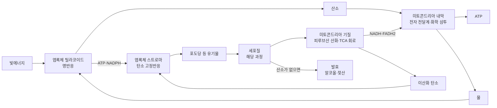
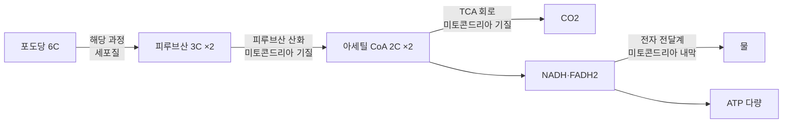
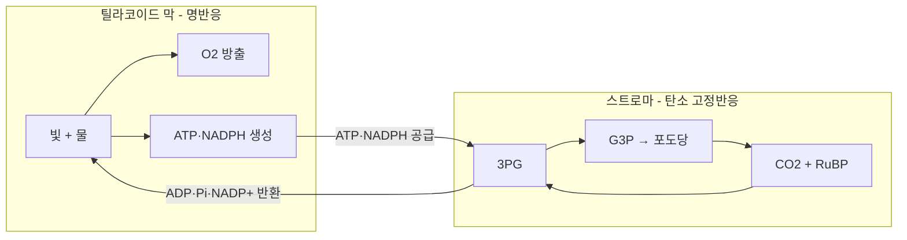

# 세포와 물질대사 3. 세포호흡과 광합성 — 전자의 흐름이 만드는 생명의 에너지
<!-- prev: m2-05, m2-06, 3-5, 4-3, bio-1, cell-2 -->
<!-- next: rxn-2 -->

> [!NOTE]
> **성취기준**
> - **[12세포03-01]** 미토콘드리아의 구조를 이해하고 생명체 내에서의 미토콘드리아의 기능을 추론할 수 있다.
> - **[12세포03-02]** 세포호흡 과정의 단계별 특징을 다양한 매체를 활용하여 협력적으로 소통할 수 있다.
> - **[12세포03-03]** 세포호흡 과정에서의 인산화 과정을 기질 수준의 인산화와 산화적 인산화 과정으로 구분할 수 있다.
> - **[12세포03-04]** 산소호흡과 발효의 공통점과 차이점을 이해하고, 실생활에서 발효를 이용한 사례 조사 계획을 세워 조사할 수 있다.
> - **[12세포03-05]** 엽록체의 구조를 이해하고 기능과 관련지어 설명할 수 있다.
> - **[12세포03-06]** 광합성의 명반응과 탄소 고정반응을 단계별로 구분하여 특징을 이해하고 두 반응의 상호 관계를 추론할 수 있다.
> - **[12세포03-07]** 광합성과 세포호흡의 전자 전달계를 비교하여 공통점과 차이점을 다양한 매체를 활용하여 설명할 수 있다.
> - **[12세포03-08]** 광합성 관련 과학사적 연구 결과를 조사하여 시각화 자료를 창의적으로 제작하여 협력적으로 소통할 수 있다.

**학습 목표**

1. 미토콘드리아의 막 구조(외막, 내막과 크리스타, 막 사이 공간, 기질)를 세포호흡의 각 단계가 일어나는 장소와 관련지어 설명할 수 있다.
2. 세포호흡을 해당 과정, 피루브산의 산화, TCA 회로, 전자 전달계로 나누어 각 단계의 장소·물질 변화·생성물을 정리하고, 기질 수준의 인산화와 산화적 인산화(화학 삼투)를 구분할 수 있다.
3. 산소호흡과 발효(알코올 발효, 젖산 발효)의 공통점과 차이점을 설명하고, 실생활의 발효 이용 사례를 조사할 수 있다.
4. 엽록체의 구조를 광합성 색소와 명반응·탄소 고정반응의 장소와 관련지어 설명하고, 두 반응의 단계별 특징과 상호 관계를 추론할 수 있다.
5. 광합성과 세포호흡의 전자 전달계를 에너지, 효소, 산화·환원의 관점에서 비교할 수 있다.
6. 광합성 연구의 과학사적 실험을 조사하여 시각화 자료로 제작하고 발표할 수 있다.

**이 단원의 학습 사다리**

| 단계 | 무엇을 하나? |
|---|---|
| STEP 1. 이전 학습 다시 보기 | 중학교 광합성·호흡, 통합과학 산화·환원, 생명과학 에너지 전환, 「물질대사와 에너지」의 ATP·효소를 다시 꺼내 본다 |
| STEP 2. 기초 다지기 | 산화·환원과 전자 운반체, 농도 기울기의 에너지, 탄소 수 세기, 빛과 색소를 디딤돌로 놓는다 |
| STEP 3. 핵심 개념 | 미토콘드리아 → 세포호흡 4단계 → 두 가지 인산화 → 발효 → 엽록체 → 명반응·탄소 고정반응 → 전자 전달계 비교 → 광합성 과학사 |
| STEP 4. 오개념 바로잡기 | "식물은 낮에 광합성만 한다?", "광합성의 산소는 이산화 탄소에서 나온다?" 같은 착각을 바로잡는다 |
| STEP 5. 대학으로 한 걸음 더 | 양성자 구동력, 회전하는 ATP 합성 효소, 환원 전위와 자유 에너지, C₄·CAM 식물 |
| STEP 6. 생활·산업·진로 | 발효 식품 산업, 운동과 젖산, 갈색 지방, 인공 광합성과 작물 개량 |

---

## 🗺️ 단원 들어가기

100 m를 전력 질주한 뒤에는 숨이 턱까지 차고 다리가 묵직하다. 마라톤 선수는 두 시간 넘게 달리면서도 일정한 속도를 유지한다. 두 사람의 근육 세포는 같은 포도당을 쓰는데 무엇이 다를까? 김치는 왜 시간이 지나면 시어지고, 빵 반죽은 왜 부풀까?

한편 숲의 나무는 공기 중의 이산화 탄소와 뿌리에서 올린 물만으로 수십 톤의 몸을 만든다. 1600년대의 한 학자는 버드나무를 화분에 5년 동안 키운 뒤 "나무는 물로 만들어진다"고 결론 내렸다. 그 결론은 맞았을까, 틀렸을까?

이 단원은 **두 개의 발전소**, 미토콘드리아와 엽록체 안으로 들어간다. 두 발전소는 정반대의 일을 하는 것 같지만, 놀랍게도 **전자를 단계적으로 흘려보내 막 안팎에 수소 이온 농도 차이를 만들고, 그 힘으로 ATP를 만든다**는 같은 설계를 쓴다.

---

## STEP 1. 🔙 이전 학습 다시 보기

### 연계표

| 이전 단원·성취기준 | 그때 배운 것 | 이 단원에서 확장되는 것 |
|---|---|---|
| 중1 「생물의 구성과 다양성」 [9과02-01] | 엽록체는 광합성, 미토콘드리아는 호흡을 하는 세포 구조 | 두 소기관의 **내부 막 구조**와 각 부위에서 일어나는 반응 |
| 중2 「식물과 에너지」 [9과12-01]~[9과12-03] | 광합성의 재료(이산화 탄소, 물, 빛)와 산물(포도당, 산소), 광합성과 호흡의 관계, 광합성 산물의 저장과 이용 | 광합성을 **명반응과 탄소 고정반응**으로 나누고, 각 단계의 물질·에너지 변화를 추적 |
| 중2 「동물과 에너지」 [9과13-05] | 동물은 소화·순환·호흡·배설이 함께 작용하여 세포호흡으로 에너지를 얻는다 | 세포 안에서 세포호흡이 **4단계**로 진행되는 과정과 ATP 생성량 |
| 통합과학1 「생명 시스템과 물질대사」 [10통과1-03-05] | 세포에서 효소가 화학 반응을 돕는다. 물질대사는 동화·이화 작용 | 세포호흡과 광합성은 **효소가 조절하는 일련의 화학 반응**임 |
| 통합과학2 「산화와 환원」 [10통과2-01-03] | 광합성과 호흡을 산소·전자의 이동으로 본 산화·환원 반응으로 이해 | NADH·FADH₂·NADPH 같은 **전자 운반체**와 전자 전달계 |
| 생명과학 「생명 시스템의 구성」 [12생과01-03] | 물질대사에서 에너지가 ATP로 저장되고 사용된다 | ATP가 **어디서, 어떤 방식(인산화)으로** 몇 개 만들어지는지 |
| 진로 선택 「물질대사와 에너지」 [12세포02-02] | 광합성(물질 합성·에너지 저장)과 세포호흡(물질 분해·에너지 생성)을 ATP가 잇는다 | 같은 그림을 **분자 수준의 단계**로 확대 |

### 준비 운동 (사전 진단)

**Q1.** 광합성과 세포호흡의 전체 반응식을 쓰시오.

**Q2.** 다음 중 산화에 해당하는 것을 모두 고르시오.
ㄱ. 물질이 산소를 얻는다. ㄴ. 물질이 전자를 잃는다. ㄷ. 물질이 수소를 얻는다.

**Q3.** 미토콘드리아와 엽록체에 공통으로 있는 구조적 특징을 두 가지 쓰시오.

**Q4.** 효모를 설탕물에 넣고 공기를 차단하면 어떤 기체가 생기는가?

정답 및 해설

**Q1.** 광합성: $6\mathrm{CO_2} + 12\mathrm{H_2O} \rightarrow \mathrm{C_6H_{12}O_6} + 6\mathrm{O_2} + 6\mathrm{H_2O}$ (간단히 $6\mathrm{CO_2} + 6\mathrm{H_2O} \rightarrow \mathrm{C_6H_{12}O_6} + 6\mathrm{O_2}$)
세포호흡: $\mathrm{C_6H_{12}O_6} + 6\mathrm{O_2} + 6\mathrm{H_2O} \rightarrow 6\mathrm{CO_2} + 12\mathrm{H_2O}$ + 에너지 (간단히 $\mathrm{C_6H_{12}O_6} + 6\mathrm{O_2} \rightarrow 6\mathrm{CO_2} + 6\mathrm{H_2O}$ + 에너지)

**Q2. ㄱ, ㄴ** — 수소를 얻는 것은 환원이다(수소를 잃는 것이 산화).

**Q3.** 2중막, 자체 DNA와 리보솜(이 밖에 내부에 막 구조가 발달해 표면적이 넓다).

**Q4.** 이산화 탄소(알코올 발효로 에탄올과 함께 생긴다).

---

## STEP 2. 🧱 기초 다지기

### ① 산화·환원과 전자 운반체

생명체에서 산화·환원은 대개 **전자가 수소와 함께**(수소 원자 = 수소 이온 + 전자) 이동하는 형태로 일어난다.

| 구분 | 산소 기준 | 전자 기준 | 수소 기준 |
|---|---|---|---|
| **산화** | 산소를 얻음 | 전자를 잃음 | 수소를 잃음 |
| **환원** | 산소를 잃음 | 전자를 얻음 | 수소를 얻음 |

세포호흡에서 포도당은 수소(전자)를 잃고 이산화 탄소로 **산화**되며, 산소는 전자를 얻어 물로 **환원**된다. 광합성에서는 반대로 물이 산화되어 산소가 되고, 이산화 탄소가 환원되어 포도당이 된다.

포도당에서 떨어져 나온 전자는 혼자 돌아다니지 않고 **전자 운반체**에 실려 옮겨진다. 이들은 모두 조효소이다(「물질대사와 에너지」).

| 전자 운반체(산화형 → 환원형) | 주로 쓰이는 곳 | 비유 |
|---|---|---|
| $\mathrm{NAD^+}$ → NADH | 세포호흡(해당 과정, 피루브산 산화, TCA 회로) | 전자를 싣는 **빈 택시 → 손님 태운 택시** |
| FAD → $\mathrm{FADH_2}$ | 세포호흡(TCA 회로) | 조금 작은 택시 |
| $\mathrm{NADP^+}$ → NADPH | 광합성(명반응에서 만들고 탄소 고정반응에서 씀) | 광합성 전용 택시 |

### ② 농도 기울기도 에너지다 — 댐과 수력 발전기

댐에 물을 높이 가두어 두면 그 물이 떨어지며 발전기를 돌린다. 막을 사이에 두고 한쪽에 수소 이온($\mathrm{H^+}$)을 많이 모아 두는 것도 '높은 곳에 가둔 물'과 같다. $\mathrm{H^+}$이 농도가 낮은 쪽으로 돌아가려는 흐름은 막에 박힌 **ATP 합성 효소**라는 '발전기'를 통해서만 가능하고, 이때 ADP와 인산이 ATP로 결합한다. 이것이 **화학 삼투**(chemiosmosis)이다.

> [!TIP]
> 💡 **비유** — 전자 전달계는 **양수 펌프**(물을 높은 곳으로 퍼 올리는 장치), ATP 합성 효소는 **수력 발전기**이다. 펌프를 돌리는 에너지는 미토콘드리아에서는 음식물(NADH)에서, 엽록체에서는 햇빛에서 온다.

### ③ 탄소 수 세기 — 분자 구조식 대신 '탄소 몇 개'로 추적하기

이 단원에서는 유기물의 구조식을 쓰지 않고, **탄소 수**로 물질의 변화를 따라간다.

$$
\underbrace{\text{포도당}}_{6\mathrm{C}} \rightarrow 2 \times \underbrace{\text{피루브산}}_{3\mathrm{C}} \rightarrow 2 \times \underbrace{\text{아세틸 CoA}}_{2\mathrm{C}} + 2\,\mathrm{CO_2} \rightarrow \cdots \rightarrow 6\,\mathrm{CO_2}
$$

탄소의 수는 반응 전후에 보존된다. 6 = 2×3 = 2×2 + 2 처럼 탄소 장부를 맞춰 보면 각 단계에서 이산화 탄소가 몇 개 나오는지 알 수 있다.

### ④ 빛과 색소

햇빛(백색광)은 여러 파장의 빛이 섞여 있다. 색소는 특정 파장의 빛을 **흡수**하고 나머지를 반사·투과한다. 잎이 초록색으로 보이는 것은 엽록소가 **청자색광과 적색광을 주로 흡수**하고 녹색광을 상대적으로 적게 흡수해 반사하기 때문이다. 흡수된 빛에너지만 광합성에 쓰일 수 있다.

---

## STEP 3. 📘 핵심 개념

### ① 미토콘드리아의 구조와 기능 [12세포03-01]

| 구조 | 특징 | 일어나는 일 |
|---|---|---|
| **외막** | 매끈하며 비교적 투과성이 크다 | 미토콘드리아와 세포질의 경계 |
| **내막** | 안쪽으로 주름진 **크리스타**(cristae)를 만든다. 투과성이 매우 낮다 | **전자 전달계**와 **ATP 합성 효소**가 박혀 있다 |
| **막 사이 공간** | 외막과 내막 사이 | 전자 전달계가 퍼낸 $\mathrm{H^+}$이 모여 농도가 높아진다 |
| **기질**(matrix) | 내막 안쪽의 액체 부분. 자체 DNA, 리보솜, 많은 효소 | **피루브산의 산화**, **TCA 회로**, ATP 합성 효소가 ATP를 만드는 쪽 |

**구조로 기능 추론하기**
- 크리스타는 내막의 **표면적을 넓혀** 전자 전달계와 ATP 합성 효소를 더 많이 배치할 수 있게 한다(「세포」의 표면적/부피 비 아이디어).
- 내막의 투과성이 낮기 때문에 $\mathrm{H^+}$ 농도 차이가 새어 나가지 않고 유지된다. 댐에 구멍이 나지 않아야 발전할 수 있는 것과 같다.
- 자체 DNA와 리보솜이 있어 일부 단백질을 스스로 만들고, 세포 안에서 분열하여 수가 늘어난다.

**어떤 세포에 미토콘드리아가 많을까?** 에너지를 많이 쓰는 세포일수록 미토콘드리아가 많고 크리스타가 촘촘하다.

| 세포 | 미토콘드리아의 특징 | 이유 |
|---|---|---|
| 심장 근육 세포 | 세포 부피의 상당 부분(약 3분의 1 정도)을 차지할 만큼 많다 | 쉬지 않고 수축해야 한다 |
| 정자 | 꼬리가 시작되는 부분(중편)에 나선형으로 모여 있다 | 편모 운동에 ATP를 공급한다 |
| 콩팥 세뇨관 세포 | 막 가까이에 많다 | 능동 수송으로 물질을 재흡수한다 |
| 성숙한 적혈구(포유류) | **없다** | 운반하는 산소를 스스로 쓰지 않고, 해당 과정으로만 ATP를 얻는다 |

---

### ② 세포호흡 과정의 단계별 특징 [12세포03-02]

세포호흡은 효소가 조절하는 수십 개의 반응이 이어진 대사 경로이며, 크게 네 단계로 나눈다.

#### (1) 해당 과정(glycolysis) — 세포질, 산소 불필요

포도당(6C) 1분자가 피루브산(3C) 2분자로 분해된다.

| 구간 | 일어나는 일 | ATP | NADH |
|---|---|---|---|
| 에너지 투자 단계 | ATP 2분자를 써서 포도당을 활성화(인산 부착)하고 3탄소 화합물 2개로 쪼갠다 | −2 | 0 |
| 에너지 수확 단계 | 3탄소 화합물이 산화되며 $\mathrm{NAD^+}$가 환원되고, 기질에서 ADP로 인산이 옮겨져 ATP가 생긴다 | +4 | +2 |
| **합계** | 포도당 → 피루브산 2 | **순 +2** | **+2** |

> [!TIP]
> 💡 **비유** — 장사를 시작하려면 먼저 밑천(ATP 2개)을 투자해야 한다. 그 뒤에 4개를 벌어 들이니 순이익은 2개이다.

#### (2) 피루브산의 산화 — 미토콘드리아 기질, 산소가 있을 때

피루브산이 미토콘드리아 기질로 들어가 이산화 탄소 1분자를 내놓고(**탈탄산**), 수소를 $\mathrm{NAD^+}$에 주며(**탈수소**), 조효소 A와 결합해 **아세틸 CoA(2C)** 가 된다.

$$
\text{피루브산(3C)} + \mathrm{NAD^+} + \text{CoA} \rightarrow \text{아세틸 CoA(2C)} + \mathrm{CO_2} + \mathrm{NADH}
$$

포도당 1분자당으로는 2번 일어나므로 $\mathrm{CO_2}$ 2, NADH 2가 생긴다.

#### (3) TCA 회로(시트르산 회로) — 미토콘드리아 기질

1. 아세틸 CoA(2C)가 4탄소 화합물(옥살아세트산)과 결합해 6탄소 화합물(시트르산)이 된다.
2. 6탄소 화합물이 차례로 탈탄산·탈수소되며 5탄소 → 4탄소 화합물이 되고, 그 과정에서 $\mathrm{CO_2}$ 2, NADH 3, $\mathrm{FADH_2}$ 1, ATP 1이 생긴다.
3. 4탄소 화합물은 여러 단계를 거쳐 처음의 옥살아세트산으로 **되돌아온다**(그래서 '회로'이다).

| TCA 회로 1회전(아세틸 CoA 1분자) | 포도당 1분자당(2회전) |
|---|---|
| $\mathrm{CO_2}$ 2 | $\mathrm{CO_2}$ 4 |
| NADH 3 | NADH 6 |
| $\mathrm{FADH_2}$ 1 | $\mathrm{FADH_2}$ 2 |
| ATP 1 | ATP 2 |

여기까지 오면 포도당의 탄소 6개는 **모두 이산화 탄소로** 나갔다(피루브산 산화 2 + TCA 회로 4). 그런데 ATP는 아직 4개밖에 생기지 않았다. 포도당의 에너지 대부분은 **NADH와 $\mathrm{FADH_2}$에 실린 전자**에 담겨 있다.

#### (4) 전자 전달계와 산화적 인산화 — 미토콘드리아 내막

1. NADH와 $\mathrm{FADH_2}$가 내막의 **전자 전달 효소 복합체**에 전자를 넘겨주고 다시 $\mathrm{NAD^+}$, FAD로 산화된다.
2. 전자는 여러 전자 운반체를 거치며 단계적으로 에너지가 낮은 상태로 이동하고, 그때 방출된 에너지로 전자 전달 효소 복합체가 $\mathrm{H^+}$을 **기질 → 막 사이 공간**으로 퍼낸다.
3. 마지막 전자 수용체는 **산소**이다. 산소는 전자와 $\mathrm{H^+}$을 받아 **물**이 된다.
4. 막 사이 공간에 쌓인 $\mathrm{H^+}$이 **ATP 합성 효소**를 통해 기질로 확산해 돌아오면서 ATP가 대량으로 합성된다.

> [!IMPORTANT]
> 산소가 하는 일은 '포도당을 태우는 것'이 아니라 **전자 전달계 끝에서 전자를 받아 주는 것**이다. 산소가 없으면 전자가 빠져나갈 출구가 막혀 전자 전달계 전체가 멈추고, NADH가 다시 $\mathrm{NAD^+}$로 돌아가지 못해 TCA 회로도 멈춘다. 그래서 우리는 몇 분만 숨을 못 쉬어도 위험하다.

#### 세포호흡 단계 한눈에 보기(포도당 1분자 기준)

| 단계 | 장소 | 산소 필요 | $\mathrm{CO_2}$ | NADH | $\mathrm{FADH_2}$ | ATP(직접 생성) |
|---|---|---|---|---|---|---|
| 해당 과정 | 세포질 | 불필요 | 0 | 2 | 0 | 2(순) |
| 피루브산 산화 | 기질 | 필요 | 2 | 2 | 0 | 0 |
| TCA 회로 | 기질 | 필요(간접) | 4 | 6 | 2 | 2 |
| 전자 전달계 | 내막 | 필요 | 0 | (소모) | (소모) | 약 28 |
| **합계** | | | **6** | 10 | 2 | **약 32** |

(TCA 회로는 산소를 직접 쓰지 않지만, 전자 전달계가 멈추면 $\mathrm{NAD^+}$가 부족해 함께 멈추므로 '간접적으로' 산소가 필요하다.)

#### 예제 1 — 단계별 산물 추적

포도당 3분자가 산소 호흡으로 완전히 분해될 때 (1) TCA 회로가 도는 횟수 (2) 피루브산 산화와 TCA 회로에서 생기는 $\mathrm{CO_2}$의 총 분자 수 (3) 전 과정에서 생기는 NADH의 수를 구하시오.

**풀이**
(1) 포도당 1분자 → 아세틸 CoA 2분자 → TCA 회로 2회전. 3분자이므로 **6회전**.
(2) 포도당 1분자당 $\mathrm{CO_2}$ 6분자(탄소 6개가 모두 나감) → $3\times6 = $ **18분자**.
(3) 포도당 1분자당 NADH $2 + 2 + 6 = 10$ → $3\times10 = $ **30분자**.

#### 다른 영양소도 같은 길로 들어온다

| 영양소 | 분해 산물 | 세포호흡의 어느 단계로 들어가나? |
|---|---|---|
| 탄수화물(녹말, 글리코젠) | 포도당 | 해당 과정 |
| 지방 | 글리세롤 + 지방산 | 글리세롤은 해당 과정의 중간 단계로, 지방산은 2탄소씩 잘려 **아세틸 CoA**로 |
| 단백질 | 아미노산 → 아미노기 제거 | 남은 탄소 골격이 피루브산, 아세틸 CoA, TCA 회로 중간 물질로. 아미노기는 암모니아 → 간에서 요소로 바뀌어 배설 |

지방산은 수소(전자)를 많이 가진 긴 탄소 사슬이어서 NADH와 $\mathrm{FADH_2}$를 많이 만든다. 지방 1 g이 탄수화물보다 두 배 이상의 에너지를 내는 이유이다(「세포」).

---

### ③ 기질 수준의 인산화와 산화적 인산화 [12세포03-03]

ADP에 인산을 붙여 ATP를 만드는 것을 **인산화**라고 한다. 세포호흡에서는 두 가지 방식이 있다.

| 구분 | **기질 수준의 인산화** | **산화적 인산화** |
|---|---|---|
| 원리 | 인산기를 가진 **기질(유기물)에서 효소가 인산기를 직접 ADP로 옮긴다** | 전자 전달계에서 만든 **$\mathrm{H^+}$ 농도 기울기**를 이용해 ATP 합성 효소가 ATP를 만든다(**화학 삼투**) |
| 장소 | 세포질(해당 과정), 미토콘드리아 기질(TCA 회로) | 미토콘드리아 **내막** |
| 산소 | 해당 과정 단계는 산소 없이도 가능 | 반드시 필요(최종 전자 수용체) |
| ATP 수(포도당 1분자) | 4(해당 과정 2 + TCA 회로 2) | 약 28 |
| 비유 | 손에서 손으로 **동전을 직접 건네기** | 댐의 물로 **발전기 돌리기** |

#### 화학 삼투의 증거

산화적 인산화가 '전자 전달 → $\mathrm{H^+}$ 농도 기울기 → ATP 합성'으로 이어진다는 생각은 미첼(Mitchell)이 1961년에 제안한 **화학 삼투설**이다(1978년 노벨 화학상). 처음에는 반대가 많았지만 다음과 같은 실험으로 받아들여졌다.

- 1966년 야겐도르프(Jagendorf) 등은 엽록체의 틸라코이드를 **어둠 속에서** pH 4 용액에 담가 내부를 산성으로 만든 뒤, 갑자기 pH 8 용액으로 옮기면서 ADP와 인산을 넣었다. 빛이 없는데도 ATP가 합성되었다. **$\mathrm{H^+}$ 농도 차이만으로 ATP를 만들 수 있음**을 보여 준 실험이다.

#### 예제 2 — ATP 수와 에너지 효율

포도당 1분자의 산소 호흡에서 NADH 1분자는 약 2.5 ATP, $\mathrm{FADH_2}$ 1분자는 약 1.5 ATP를 만든다고 하자.
(1) 산화적 인산화로 만들어지는 ATP 수 (2) 총 ATP 수 (3) 포도당 1몰의 에너지를 686 kcal, ATP 1몰의 분해 에너지를 7.3 kcal라고 할 때 에너지 효율을 구하시오.

**풀이**
(1) $10 \times 2.5 + 2 \times 1.5 = 25 + 3 = 28$
(2) 기질 수준의 인산화 4를 더해 $28 + 4 = 32$
(3) $\dfrac{32 \times 7.3}{686} \times 100 \approx \dfrac{233.6}{686} \times 100 \approx 34\%$

나머지 약 66%는 열로 방출되어 체온 유지에 쓰인다. NADH 1분자당 ATP 수는 고정된 정수가 아니며, 세포질의 NADH를 미토콘드리아로 옮기는 방식에 따라 총 ATP는 **약 30~32개**로 어림한다.

#### 예제 3 — 저해제로 추론하기

미토콘드리아를 분리하여 포도당 분해 산물(피루브산), ADP, 인산, 산소가 충분한 용액에 넣고 산소 소비량과 ATP 합성량을 측정하였다. 물질 X와 Y를 각각 넣었을 때 결과가 다음과 같았다.

| 처리 | 산소 소비 | ATP 합성 | 막 사이 공간의 $\mathrm{H^+}$ 농도 |
|---|---|---|---|
| 처리 안 함 | 정상 | 정상 | 높음 |
| X | **멈춤** | 멈춤 | 낮아짐 |
| Y | **증가** | 멈춤 | 낮아짐 |

X와 Y의 작용을 추론하시오.

**풀이**
- X: 산소 소비가 멈췄다 → 전자가 산소까지 가지 못한다 → **전자 전달계를 막는 물질**이다(예: 시안화물은 마지막 전자 전달 효소 복합체를 막는다). 전자 전달이 멈추니 $\mathrm{H^+}$을 퍼내지 못하고 ATP도 만들지 못한다.
- Y: 전자 전달(산소 소비)은 오히려 활발한데 ATP는 만들어지지 않고 $\mathrm{H^+}$ 농도 차이가 사라졌다 → $\mathrm{H^+}$이 ATP 합성 효소를 거치지 않고 내막을 새어 들어가게 하는 물질이다(**짝풀림 물질**). 댐에 구멍을 뚫어 물이 발전기를 거치지 않고 빠져나가는 것과 같다. 이때 에너지는 모두 **열**로 방출된다.

---

### ④ 산소호흡과 발효 [12세포03-04]

산소가 없거나 부족하면 전자 전달계가 멈추고 NADH가 쌓인다. 그러면 해당 과정에 필요한 $\mathrm{NAD^+}$마저 바닥나 해당 과정도 멈춘다. **발효**는 피루브산(또는 그 산물)에 NADH의 전자를 넘겨 **$\mathrm{NAD^+}$를 재생**함으로써 해당 과정을 계속 돌리는 방법이다.

#### (1) 알코올 발효와 젖산 발효

| 구분 | **알코올 발효** | **젖산 발효** |
|---|---|---|
| 생물 | 효모, 일부 세균 | 젖산균, 사람의 근육 세포(산소 부족 시) |
| 과정 | 피루브산(3C) → $\mathrm{CO_2}$ 방출 → 아세트알데하이드(2C) → NADH의 전자를 받아 **에탄올**(2C) | 피루브산(3C)이 NADH의 전자를 직접 받아 **젖산**(3C) |
| 포도당 1분자당 최종 산물 | 에탄올 2 + $\mathrm{CO_2}$ 2 | 젖산 2 |
| ATP | 2(해당 과정의 기질 수준 인산화만) | 2 |
| 이용 | 빵, 막걸리·포도주 등 술, 바이오 에탄올 | 김치, 요구르트, 치즈, 젓갈 |

$$
\text{알코올 발효: 포도당} \rightarrow 2\,\text{에탄올} + 2\,\mathrm{CO_2} + 2\,\text{ATP}
$$

$$
\text{젖산 발효: 포도당} \rightarrow 2\,\text{젖산} + 2\,\text{ATP}
$$

#### (2) 산소호흡과 발효의 공통점과 차이점

| 비교 | 산소호흡 | 발효 |
|---|---|---|
| **공통점** | 포도당을 분해해 ATP를 얻는 이화 작용이다. **해당 과정**(세포질)을 함께 거친다. 효소가 조절하는 단계적 반응이다 | |
| 산소 | 필요 | 불필요 |
| 장소 | 세포질 + 미토콘드리아 | 세포질 |
| 최종 전자 수용체 | 산소 | 피루브산 또는 아세트알데하이드(유기물) |
| 포도당의 분해 정도 | $\mathrm{CO_2}$와 $\mathrm{H_2O}$까지 **완전 분해** | 에탄올·젖산 같은 **유기물이 남는다**(불완전 분해) |
| ATP(포도당 1분자) | 약 32 | 2 |
| 인산화 방식 | 기질 수준 + 산화적 인산화 | 기질 수준의 인산화만 |

> [!IMPORTANT]
> 발효에서 ATP가 적게 나오는 까닭은, 포도당의 에너지 대부분이 에탄올이나 젖산 속에 **그대로 남아 있기** 때문이다. 에탄올이 연료로 쓰이고, 근육의 젖산이 나중에 간 등에서 다시 포도당으로 합성되거나 산화되어 에너지원으로 쓰이는 것이 그 증거이다.

#### 예제 4 — 같은 ATP를 얻으려면

어떤 세포가 1분에 ATP 640분자를 써야 한다. (1) 산소호흡(포도당 1분자당 32 ATP)만 할 때와 (2) 젖산 발효만 할 때 필요한 포도당 분자 수를 구하시오.

**풀이** (1) $640 \div 32 = 20$분자 (2) $640 \div 2 = 320$분자. 발효는 16배 많은 포도당이 필요하다. 그래서 전력 질주처럼 산소 공급이 따라가지 못할 때 근육은 글리코젠을 빠르게 소모하고, 오래 버티지 못한다. 반면 효모는 산소가 있으면 산소호흡을 하고 없으면 발효를 하는 **통성 혐기성 생물**이어서 환경에 따라 대사를 바꾼다.

#### (3) 실생활 속 발효 — 조사 계획 세우기

| 단계 | 할 일 | 예시(김치) |
|---|---|---|
| ① 주제 정하기 | 관심 있는 발효 식품·산업 선택 | 김치는 왜 시간이 지나면 시어질까? |
| ② 조사 질문 | 미생물, 발효 종류, 조건, 산물 | 어떤 미생물이? 어떤 발효? 온도에 따라 어떻게 다를까? |
| ③ 자료 수집 | 논문·공공 기관 자료·전문가 영상, 직접 측정 | pH 측정지로 날짜별 김칫국물 pH 측정 |
| ④ 정리·시각화 | 표, 그래프, 정보 그림, 영상 | 보관 온도별 pH 변화 그래프 |
| ⑤ 발표·평가 | 출처 밝히기, 동료 평가 | "젖산 발효로 pH가 낮아진다"를 근거와 함께 발표 |

| 발효 이용 사례 | 미생물 | 발효 종류 | 이용하는 산물 |
|---|---|---|---|
| 빵 | 효모 | 알코올 발효 | $\mathrm{CO_2}$(반죽을 부풀림), 에탄올은 굽는 동안 날아감 |
| 막걸리, 포도주 | 효모(막걸리는 누룩 곰팡이의 당화와 함께) | 알코올 발효 | 에탄올 |
| 김치 | 여러 젖산균 | 젖산 발효(일부는 $\mathrm{CO_2}$ 등도 생성) | 젖산(신맛, 다른 미생물 억제) |
| 요구르트, 치즈 | 젖산균 | 젖산 발효 | 젖산(우유 단백질 응고) |
| 바이오 에탄올 | 효모 | 알코올 발효 | 에탄올(연료) |

(식초는 초산균이 **산소를 이용해** 에탄올을 아세트산으로 산화시키는 과정으로 만든다. 전통적으로 '초산 발효'라 부르지만, 이 단원에서 다룬 산소 없는 발효와는 원리가 다르다.)

---

### ⑤ 엽록체의 구조와 기능 [12세포03-05]

| 구조 | 특징 | 일어나는 일 |
|---|---|---|
| **외막·내막** | 2중막 | 엽록체의 경계 |
| **틸라코이드** | 납작한 주머니 모양의 막. 여러 개가 동전처럼 쌓인 것이 **그라나** | 막에 광합성 색소, 광계, 전자 전달계, ATP 합성 효소가 있다 → **명반응** |
| **틸라코이드 내부 공간** | 틸라코이드 막 안쪽 | 물이 분해되고 $\mathrm{H^+}$이 쌓여 농도가 높아진다 |
| **스트로마** | 내막 안의 액체 부분. 자체 DNA, 리보솜, 많은 효소 | **탄소 고정반응**(캘빈 회로), ATP 합성 효소가 ATP를 만드는 쪽 |

**구조로 기능 추론하기** — 틸라코이드가 겹겹이 쌓인 그라나는 빛을 흡수하는 막의 **표면적을 넓힌다**. 명반응 산물(ATP, NADPH)은 틸라코이드 막의 스트로마 쪽에서 만들어지므로, 바로 곁의 스트로마에서 탄소 고정반응에 곧바로 쓰인다.

#### 광합성 색소

| 색소 | 색 | 주로 흡수하는 빛 | 역할 |
|---|---|---|---|
| **엽록소 a** | 청록색 | 청자색광, 적색광 | 반응 중심 색소. 빛에너지로 전자를 내보낸다 |
| 엽록소 b | 황록색 | 청색광, 적황색광 | 보조 색소. 흡수한 에너지를 엽록소 a로 전달 |
| 카로티노이드(카로틴, 잔토필) | 주황·노랑 | 청자색~청록색광 | 보조 색소, 강한 빛으로부터 엽록소 보호 |

- **흡수 스펙트럼**: 색소가 파장별로 빛을 얼마나 흡수하는지 나타낸 것.
- **작용 스펙트럼**: 파장별로 광합성이 얼마나 일어나는지(산소 발생량 등) 나타낸 것.
- 두 스펙트럼의 모양이 **비슷하다**는 것은 그 색소들이 흡수한 빛이 광합성에 쓰인다는 증거이다. 가을에 엽록소가 먼저 분해되면 남아 있던 카로티노이드가 드러나 잎이 노랗게 보인다.

#### 예제 5 — 엥겔만의 실험 해석

1880년대 엥겔만(Engelmann)은 프리즘으로 나눈 빛을 해캄(실 모양 녹조류)에 비추고, 주변에 **산소를 좋아하는 세균**을 넣었다. 세균은 해캄의 어느 부분에 많이 모였을까? 그 결과가 의미하는 것은?

**풀이** 세균은 **청자색광과 적색광**을 받은 부분에 많이 모였고, 녹색광을 받은 부분에는 적게 모였다. 산소를 좋아하는 세균이 많이 모인 곳은 산소가 많이 발생한 곳, 즉 광합성이 활발한 곳이다. 따라서 청자색광과 적색광이 광합성에 효과적이며, 이는 엽록소의 흡수 스펙트럼과 일치한다. 기계 없이 세균을 '산소 측정기'로 쓴 창의적인 실험이다.

---

### ⑥ 명반응과 탄소 고정반응 [12세포03-06]

#### (1) 명반응 — 틸라코이드 막, 빛이 필요

명반응은 **빛에너지를 화학 에너지(ATP, NADPH)로 전환**하는 단계이다.

**① 광계** 틸라코이드 막에는 수백 개의 색소가 안테나처럼 모인 **광계Ⅱ**와 **광계Ⅰ**이 있다. 안테나 색소가 흡수한 빛에너지는 반응 중심의 엽록소 a로 모인다. 광계Ⅱ의 반응 중심은 파장 680 nm의 빛을 잘 흡수하여 P680, 광계Ⅰ의 반응 중심은 700 nm를 잘 흡수하여 P700이라 부른다(번호는 발견 순서이고, 전자가 흐르는 순서는 Ⅱ → Ⅰ이다).

**② 비순환적 전자 흐름**

$$
\mathrm{H_2O} \rightarrow \text{광계Ⅱ} \rightarrow \text{전자 전달계} \rightarrow \text{광계Ⅰ} \rightarrow \mathrm{NADP^+}
$$

1. 빛에너지를 받은 광계Ⅱ의 반응 중심 엽록소가 들뜬 전자를 내보낸다.
2. 전자를 잃은 광계Ⅱ는 **물을 분해(광분해)** 하여 전자를 채운다. 이때 $\mathrm{O_2}$와 $\mathrm{H^+}$이 생긴다. **광합성에서 나오는 산소는 물에서 온 것**이다.
3. 전자는 전자 전달계를 지나며 에너지를 내놓고, 이 에너지로 $\mathrm{H^+}$이 **스트로마 → 틸라코이드 내부**로 퍼내진다.
4. 광계Ⅰ에서 빛에너지를 받아 다시 높은 에너지 상태가 된 전자는 최종적으로 $\mathrm{NADP^+}$에 전달되어 **NADPH**가 된다.
5. 틸라코이드 내부에 쌓인 $\mathrm{H^+}$이 ATP 합성 효소를 통해 스트로마로 빠져나가며 **ATP**가 합성된다. 빛에너지로 일어나는 이 인산화를 **광인산화**라 한다.

**③ 순환적 전자 흐름** 광계Ⅰ에서 나온 전자가 $\mathrm{NADP^+}$로 가지 않고 전자 전달계로 되돌아와 광계Ⅰ로 돌아오는 경로이다. 물의 분해와 NADPH 생성은 없고 **ATP만** 만들어진다. 탄소 고정반응에는 NADPH보다 ATP가 더 많이 필요한데(아래 표), 비순환적 흐름만으로는 ATP가 조금 부족하여 순환적 흐름이 이를 보충한다.

| 비교 | 비순환적 전자 흐름 | 순환적 전자 흐름 |
|---|---|---|
| 관여 광계 | 광계Ⅱ, 광계Ⅰ | 광계Ⅰ |
| 물의 분해·$\mathrm{O_2}$ 발생 | 있음 | 없음 |
| 산물 | ATP, NADPH | ATP |
| 전자의 최종 도착지 | $\mathrm{NADP^+}$ | 광계Ⅰ(되돌아옴) |

#### (2) 탄소 고정반응(캘빈 회로) — 스트로마, 빛이 직접 필요하지는 않음

명반응의 ATP와 NADPH를 써서 $\mathrm{CO_2}$를 **유기물로 환원**하는 단계이다. 세 단계로 나눈다(탄소 수로 추적한다).

| 단계 | 일어나는 일 | $\mathrm{CO_2}$ 3분자 기준 |
|---|---|---|
| ① **탄소 고정** | $\mathrm{CO_2}$가 5탄소 화합물 **RuBP**와 결합하고 곧 3탄소 화합물 **3PG**(PGA) 2분자로 나뉜다. 효소는 **루비스코** | 3 RuBP(15C) + 3 $\mathrm{CO_2}$(3C) → 6 3PG(18C) |
| ② **환원** | 3PG가 ATP와 NADPH를 써서 3탄소 당 **G3P**(PGAL)로 환원된다 | 6 3PG + 6 ATP + 6 NADPH → 6 G3P(18C) |
| ③ **RuBP 재생** | G3P 대부분이 ATP를 써서 다시 RuBP가 된다. 나머지 G3P는 회로 밖으로 나가 포도당·설탕·녹말 합성에 쓰인다 | 5 G3P(15C) + 3 ATP → 3 RuBP(15C), **1 G3P(3C) 방출** |

$\mathrm{CO_2}$ 3분자로 G3P 1분자를 만드는 데 **ATP 9, NADPH 6**이 쓰인다. 포도당(6C) 1분자는 G3P 2분자로 만들어지므로 $\mathrm{CO_2}$ 6분자, **ATP 18, NADPH 12**가 필요하다.

> [!TIP]
> 💡 **비유** — 캘빈 회로는 회전 초밥 레일이다. 빈 접시(RuBP)가 돌아오면 재료($\mathrm{CO_2}$)가 올라가고, 요리사(ATP, NADPH)가 손질하여, 완성된 초밥(G3P) 일부만 손님에게 내놓고 접시는 다시 레일로 돌아간다. 접시가 다시 돌아오지 않으면(재생이 멈추면) 재료를 올릴 곳이 없다.

#### 예제 6 — 탄소 고정반응의 물질 수지

포도당 3분자를 합성하려면 (1) 고정되어야 할 $\mathrm{CO_2}$ 분자 수 (2) 필요한 ATP와 NADPH 수 (3) 비순환적 전자 흐름으로만 NADPH를 만든다고 할 때 발생하는 $\mathrm{O_2}$ 분자 수를 구하시오. (물 1분자가 분해되면 전자 2개와 $\frac{1}{2}\mathrm{O_2}$가 생기고, NADPH 1분자를 만드는 데 전자 2개가 필요하다.)

**풀이**
(1) $3\times6 = 18$분자
(2) ATP $3\times18 = 54$, NADPH $3\times12 = 36$
(3) NADPH 36분자 → 전자 72개 → 물 36분자 분해 → $\mathrm{O_2}$ $36 \times \frac{1}{2} = 18$분자. 포도당 1분자당 $\mathrm{O_2}$ 6분자로, 전체 반응식과 일치한다.

#### (3) 두 반응의 상호 관계

- 명반응은 탄소 고정반응에 **ATP와 NADPH**를 공급하고, 탄소 고정반응은 명반응에 **ADP, 무기 인산, $\mathrm{NADP^+}$** 를 되돌려 준다. 어느 한쪽이 멈추면 다른 쪽도 곧 멈춘다.
- 탄소 고정반응은 빛을 직접 쓰지 않지만, 빛이 없으면 ATP·NADPH 공급이 끊겨 몇 초~몇 분 안에 멈춘다. 그래서 예전에 쓰던 '암반응'이라는 이름은 '어둠 속에서 일어나는 반응'이라는 오해를 줄 수 있다.

#### 예제 7 — 빛과 $\mathrm{CO_2}$ 조건을 바꾸었을 때

광합성 중인 클로렐라에서 (가) 빛을 끄거나 (나) 빛은 그대로 두고 $\mathrm{CO_2}$ 공급을 끊었을 때, 직후 3PG와 RuBP의 양은 어떻게 변할까?

**풀이**
- (가) 빛을 끄면 ATP·NADPH가 부족해 **3PG → G3P(환원)** 와 **RuBP 재생**이 멈춘다. 그러나 남아 있던 RuBP는 $\mathrm{CO_2}$와 계속 결합해 3PG가 된다. 따라서 **3PG는 증가, RuBP는 감소**한다.
- (나) $\mathrm{CO_2}$를 끊으면 **탄소 고정(RuBP → 3PG)** 이 멈춘다. 그러나 ATP·NADPH는 있으므로 남은 3PG는 G3P를 거쳐 RuBP로 재생된다. 따라서 **3PG는 감소, RuBP는 증가**한다.

이 실험 논리는 캘빈 연구진이 회로의 순서를 밝힐 때 실제로 쓴 방법이다(⑧).

---

### ⑦ 광합성과 세포호흡의 전자 전달계 비교 [12세포03-07]

| 비교 항목 | 세포호흡(미토콘드리아) | 광합성(엽록체 명반응) |
|---|---|---|
| 장소 | 미토콘드리아 **내막**(크리스타) | 엽록체 **틸라코이드 막** |
| **에너지원** | 유기물(포도당)의 **화학 에너지** | **빛에너지** |
| 전자 공급원 | NADH, $\mathrm{FADH_2}$(포도당에서 온 전자) | **물**(광분해) |
| 최종 전자 수용체 | **산소** → 물 | $\mathbf{NADP^+}$ → NADPH |
| **산화·환원** | NADH가 산화되고 산소가 환원된다 | 물이 산화되고 $\mathrm{NADP^+}$가 환원된다 |
| $\mathrm{H^+}$을 퍼내는 방향 | 기질 → **막 사이 공간** | 스트로마 → **틸라코이드 내부** |
| $\mathrm{H^+}$ 농도가 높은 곳 | 막 사이 공간 | 틸라코이드 내부 |
| ATP가 만들어지는 곳 | 기질 | 스트로마 |
| 인산화의 이름 | **산화적 인산화** | **광인산화** |
| 기체 | $\mathrm{O_2}$ 소비 | $\mathrm{O_2}$ 방출 |
| 만들어진 ATP의 쓰임 | 세포 전체의 생명 활동 | 주로 탄소 고정반응 |

**공통점**
1. **효소**: 막에 박힌 전자 전달 효소 복합체와 **ATP 합성 효소**라는 효소 단백질들이 반응을 진행한다.
2. **산화·환원**: 전자가 전자 운반체 사이를 연이어 산화·환원 반응으로 옮겨 가며, 단계마다 에너지가 조금씩 방출된다.
3. **에너지**: 방출된 에너지로 $\mathrm{H^+}$을 막 한쪽으로 퍼내 농도 기울기를 만들고, $\mathrm{H^+}$이 ATP 합성 효소를 통해 돌아올 때 ATP를 합성한다(**화학 삼투**).
4. 막이 주름지거나 겹쳐(크리스타, 그라나) 표면적이 넓다.

> [!TIP]
> 💡 한 줄 요약 — **세포호흡의 전자 전달계는 '내리막길'만 있고, 광합성의 전자 전달계는 빛이 전자를 두 번 '끌어올려' 준다.** 세포호흡에서 전자는 에너지가 높은 NADH에서 낮은 산소로 내려가며 에너지를 내놓는다. 광합성에서 전자는 에너지가 낮은 물에서 출발하는데, 광계Ⅱ와 광계Ⅰ에서 빛에너지를 받아 두 번 높이 올라간 뒤 내려오며 에너지를 내놓고, 마지막에는 에너지가 높은 NADPH에 저장된다.

#### 예제 8 — 막의 pH 추론

밝은 빛 아래에서 광합성 중인 엽록체와, 산소 호흡 중인 미토콘드리아에서 pH가 가장 낮은 곳을 각각 쓰시오.

**풀이** $\mathrm{H^+}$ 농도가 높을수록 pH가 낮다. 엽록체에서는 $\mathrm{H^+}$이 모이는 **틸라코이드 내부**, 미토콘드리아에서는 **막 사이 공간**의 pH가 가장 낮다. (빛을 받는 틸라코이드 내부는 pH 약 5 정도까지 낮아지고, 스트로마는 약 8 정도로 높아진다고 알려져 있다.)

---

### ⑧ 광합성 연구의 과학사 [12세포03-08]

| 시기 | 과학자 | 실험·연구 | 알아낸 것(당시의 해석과 오늘날의 의미) |
|---|---|---|---|
| 1640년대 | 헬몬트 | 버드나무를 화분에 심고 물만 주며 5년간 키움. 나무는 약 74 kg 늘었지만 흙은 약 57 g만 줄었다 | 식물의 몸은 흙에서 오지 않는다. "물에서 온다"고 결론(공기 중 $\mathrm{CO_2}$의 역할은 놓쳤다) |
| 1770년대 | 프리스틀리 | 밀폐된 용기 속 촛불이 꺼진 공기에 박하를 넣어 두면 다시 촛불이 타고 쥐가 살 수 있다 | 식물이 공기를 '회복'시킨다(산소 발생) |
| 1779년 | 잉엔하우스 | 식물의 공기 회복 작용은 **빛**이 있을 때, **초록색 부분**에서만 일어난다 | 광합성에 빛과 엽록체가 필요 |
| 1880년대 | 엥겔만 | 프리즘 빛, 해캄과 호기성 세균(예제 5) | 청자색광·적색광이 광합성에 효과적 → 작용 스펙트럼 |
| 1900년대 초 | 블랙먼 | 빛의 세기와 온도에 따른 광합성 속도 분석 | 광합성에는 빛이 필요한 단계와 온도의 영향을 받는(효소) 단계가 있다 |
| 1930년대 | 반 니엘 | 황세균은 $\mathrm{H_2S}$를 이용해 광합성을 하고 황을 내놓는다 | 녹색 식물의 산소도 **물에서** 올 것이라고 추론 |
| 1937년 | 힐 | 분리한 엽록체에 빛과 전자 수용체(철 화합물)를 주면 $\mathrm{CO_2}$ 없이도 $\mathrm{O_2}$ 발생(**힐 반응**) | 산소 발생(명반응)과 $\mathrm{CO_2}$ 고정은 별개의 반응 |
| 1941년 | 루벤과 카멘 등 | 산소의 동위 원소 $^{18}\mathrm{O}$로 표지한 물을 주면 표지된 $\mathrm{O_2}$가 나오고, 표지된 $\mathrm{CO_2}$를 주면 나오지 않는다 | 광합성의 $\mathrm{O_2}$는 **물**에서 온다 |
| 1940~1950년대 | 캘빈과 동료들 | 방사성 $^{14}\mathrm{CO_2}$를 클로렐라에 짧은 시간 공급 후 종이 크로마토그래피와 자기 방사법으로 산물 분석 | 탄소가 가장 먼저 3PG로 고정되고 회로를 돈다(**캘빈 회로**, 1961년 노벨 화학상) |
| 1950년대 | 아논 등 | 분리한 엽록체에서 빛에 의한 ATP 합성 | 광인산화 발견 |
| 1961년, 1966년 | 미첼 / 야겐도르프 | 화학 삼투설 제안 / 산–염기 실험(③) | ATP 합성의 원리(1978년 노벨 화학상, 미첼) |

> [!NOTE]
> 과학사를 시각화할 때는 **"무엇을 궁금해했나 → 어떤 실험을 했나 → 무엇을 알아냈나 → 어떤 한계가 있었고 다음 연구가 어떻게 이어받았나"** 의 흐름이 보이도록 연대표를 만들어 보자. 헬몬트의 결론은 틀렸지만, '질량을 정량적으로 측정한' 그의 방법은 이후 연구의 출발점이 되었다. 과학 지식은 앞선 연구의 오류를 고쳐 가며 쌓인다.

---

## STEP 4. ⚠️ 오개념 바로잡기

| 흔한 오개념 | 올바른 개념 | 왜 그럴까? |
|---|---|---|
| 식물은 낮에는 광합성만, 밤에는 호흡만 한다 | 식물은 **밤낮 모두 세포호흡**을 하며, 낮에는 광합성을 함께 한다 | 낮에는 광합성 속도가 호흡보다 커서 겉보기에 $\mathrm{O_2}$만 나오는 것처럼 보인다 |
| 광합성으로 나오는 산소는 이산화 탄소에서 온다 | 산소는 **물의 광분해**에서 온다 | $^{18}\mathrm{O}$ 표지 실험(루벤과 카멘)이 증거이다 |
| 탄소 고정반응(암반응)은 밤에 일어난다 | 빛이 있을 때 명반응 산물을 받아 **낮에 함께** 일어난다 | ATP·NADPH가 없으면 곧 멈춘다 |
| 세포호흡의 ATP는 대부분 TCA 회로에서 만들어진다 | 대부분(약 28/32)은 **전자 전달계의 산화적 인산화**에서 만들어진다 | TCA 회로의 역할은 주로 NADH·$\mathrm{FADH_2}$로 전자를 '모으는' 것이다 |
| 산소는 포도당을 직접 태우는 데 쓰인다 | 산소는 전자 전달계의 **최종 전자 수용체**로 물이 된다 | 포도당의 탄소는 산소 기체가 아니라 탈탄산 반응으로 $\mathrm{CO_2}$가 된다 |
| 발효는 ATP를 만들지 않는다 | 해당 과정의 **기질 수준의 인산화로 ATP 2분자**를 만든다 | 발효의 목적은 $\mathrm{NAD^+}$를 재생해 해당 과정을 계속하는 것이다 |
| 미토콘드리아는 동물세포에만 있고 엽록체가 그 역할을 대신한다 | 식물세포에도 **미토콘드리아가 있다** | 엽록체가 만든 ATP는 주로 탄소 고정에 쓰이고, 세포 전체의 ATP는 미토콘드리아가 공급한다 |

---

## STEP 5. 🎓 다음 단계로 한 걸음 더

> [!CAUTION]
> 이 절은 **「세포와 물질대사」 교육과정 범위 밖의 심화 내용**으로 평가 대상이 아니다. 대학 전공 과목에서 이 단원의 개념이 어떻게 확장되는지 맛보기로 보여 주기 위한 내용이다.

### 대학 전공 과목과의 연결

| 대학 과목 | 이어지는 내용 |
|---|---|
| 생화학 | 해당 과정·TCA 회로의 각 반응과 효소, 대사 조절, 생체 에너지학 |
| 세포생물학 | 미토콘드리아 역학(융합·분열), 세포 사멸에서 미토콘드리아의 역할 |
| 식물생리학 | 광계의 구조, 광호흡, C₄·CAM 식물, 환경 스트레스와 광합성 |
| 생물물리학 | 양성자 구동력, 회전 모터 단백질, 광합성 전자 전달의 양자 효율 |
| 운동생리학·의학 | 운동 강도에 따른 에너지 대사, 미토콘드리아 질환 |

### ① 양성자 구동력 — 화학 삼투를 숫자로

$\mathrm{H^+}$ 농도 차이(pH 차이)와 막 전위가 함께 만드는 힘을 **양성자 구동력**이라 한다. 막 전위를 무시하고 농도 차이만 보면, $\mathrm{H^+}$ 1몰이 이동할 때의 자유 에너지 변화는 약

$$
\Delta G \approx 2.303\,RT\,\Delta\mathrm{pH}
$$

이다. 25 °C(298 K), $\Delta\mathrm{pH} = 3$(틸라코이드 내부 pH 5, 스트로마 pH 8)이면

$$
\Delta G \approx 2.303 \times 8.314 \times 298 \times 3 \approx 17\,000\ \mathrm{J/mol} = 17\ \mathrm{kJ/mol}
$$

ATP 1분자를 만들려면 이보다 큰 에너지가 필요하므로 $\mathrm{H^+}$ 여러 개(대략 3~4개)가 ATP 합성 효소를 통과해야 한다는 결론이 나온다.

### ② 회전하는 분자 모터, ATP 합성 효소

ATP 합성 효소는 $\mathrm{H^+}$이 지나갈 때 막 속 부분이 **실제로 회전**하고, 그 회전이 머리 부분의 모양을 차례로 바꾸어 ADP와 인산을 ATP로 결합시킨다. 이 작동 원리를 밝힌 연구는 1997년 노벨 화학상을 받았다. STEP 2의 '수력 발전기' 비유가 비유에 그치지 않는 셈이다.

### ③ 환원 전위와 자유 에너지 — 왜 전자는 산소로 흐를까?

전자를 끌어당기는 정도를 **표준 환원 전위**($E^{\circ\prime}$)로 나타낸다. 전자는 $E^{\circ\prime}$이 낮은 쪽에서 높은 쪽으로 흐르며, 자유 에너지 변화는 다음과 같다(「화학 반응의 세계」의 「산화·환원 반응」에서 배우는 화학 전지와 같은 원리).

$$
\Delta G^{\circ\prime} = -nF\Delta E^{\circ\prime}
$$

NADH($E^{\circ\prime} \approx -0.32\ \mathrm{V}$)에서 산소($E^{\circ\prime} \approx +0.82\ \mathrm{V}$)로 전자 2개가 흐르면

$$
\Delta G^{\circ\prime} \approx -2 \times 96485 \times 1.14 \approx -220\ \mathrm{kJ/mol}
$$

이 큰 에너지를 한 번에 내놓지 않고 여러 운반체를 거쳐 나누어 내놓기 때문에 ATP로 붙잡을 수 있다. 광합성에서는 반대로 물(+0.82 V)에서 $\mathrm{NADP^+}$(약 −0.32 V)로 전자를 '거꾸로' 보내야 하므로 빛에너지가 필요하다. 이를 그래프로 그리면 광계Ⅱ와 광계Ⅰ에서 두 번 솟아오르는 **Z 모양**이 된다(Z 도식).

### ④ C₄ 식물과 CAM 식물, 그리고 광호흡

루비스코는 $\mathrm{CO_2}$ 대신 $\mathrm{O_2}$와도 결합하는 약점이 있다. 덥고 건조해 기공을 닫으면 잎 속 $\mathrm{O_2}$ 비율이 높아져, 고정한 탄소를 오히려 잃는 **광호흡**이 늘어난다.

| 구분 | C₃ 식물 | C₄ 식물 | CAM 식물 |
|---|---|---|---|
| 예 | 벼, 밀, 콩 | 옥수수, 사탕수수 | 선인장, 파인애플, 다육 식물 |
| 첫 고정 산물 | 3탄소 화합물(3PG) | 4탄소 화합물 | 4탄소 화합물 |
| 전략 | — | $\mathrm{CO_2}$를 먼저 다른 세포에서 4탄소 화합물로 붙잡아 캘빈 회로가 있는 세포로 **농축**(공간 분리) | 밤에 기공을 열어 $\mathrm{CO_2}$를 저장하고 낮에 기공을 닫은 채 캘빈 회로(**시간 분리**) |
| 유리한 환경 | 온화하고 습한 곳 | 고온·강한 빛 | 매우 건조한 곳 |

### 지금 vs 다음 단계

| 구분 | 고등학교 「세포와 물질대사」 | 대학 생화학·식물생리학 |
|---|---|---|
| 세포호흡 | 4단계의 장소·산물·탄소 수 | 각 반응의 효소·중간 물질 구조식, 조절 효소 |
| 인산화 | 기질 수준 vs 산화적(화학 삼투 수준) | 양성자 구동력, ATP 합성 효소의 회전 기작, P/O 비 |
| 발효 | 알코올·젖산 발효의 비교와 이용 | 다양한 혐기 호흡과 발효, 대사 공학 |
| 광합성 | 명반응(광계, 전자 흐름)과 캘빈 회로 3단계 | Z 도식의 환원 전위, 광호흡, C₄·CAM의 효소 |
| 전자 전달계 | 에너지·효소·산화·환원 관점의 비교 | $\Delta G = -nF\Delta E$ 정량, 복합체의 구조 |

---

## STEP 6. 🏭 생활·산업·진로 연결

### 사례 1. 운동과 에너지 대사 — 전력 질주 vs 마라톤

- **원리** 짧고 강한 운동에서는 산소 공급이 따라가지 못해 근육 세포가 젖산 발효의 비중을 높여 빠르게(그러나 비효율적으로) ATP를 얻는다. 오래 하는 운동에서는 미토콘드리아의 산소호흡이 주로 담당하고, 지방산도 많이 쓴다. 지구력 훈련을 하면 근육의 미토콘드리아 수와 모세 혈관이 늘어난다.
- **어디에 쓰이나** 운동 강도 처방, 선수의 훈련 설계(젖산 역치 측정). 운동 직후의 근육 피로는 젖산 하나만으로 설명되지 않으며 여러 요인이 함께 작용한다는 것이 최근의 이해이다.

### 사례 2. 갈색 지방 — 미토콘드리아로 만드는 난로

- **원리** 갈색 지방 세포의 미토콘드리아 내막에는 $\mathrm{H^+}$이 ATP 합성 효소를 거치지 않고 돌아오게 하는 단백질(짝풀림 단백질)이 있다. 예제 3의 짝풀림 물질 Y처럼, 에너지가 ATP 대신 **열**로 방출된다.
- **어디에 쓰이나** 신생아와 겨울잠 자는 동물의 체온 유지. 대사성 질환 연구의 대상이기도 하다.

### 사례 3. 발효 산업 — 전통 식품에서 바이오 연료까지

- **원리** 효모의 알코올 발효, 젖산균의 젖산 발효를 온도·당 농도·산소 조건으로 정밀하게 조절한다.
- **어디에 쓰이나** 김치·장류·제빵·양조 산업, 사탕수수·옥수수·목질 바이오매스에서 얻는 바이오 에탄올. 우리나라는 전통 발효 미생물의 유전체를 분석해 우수 균주를 산업에 활용하는 연구를 하고 있다.

### 사례 4. 인공 광합성과 작물 개량

- **원리** 물을 빛으로 분해하는 광계Ⅱ, $\mathrm{CO_2}$를 환원하는 효소의 원리를 본떠 햇빛으로 수소 연료나 유기물을 만드는 **인공 광합성** 연구가 진행 중이다. 또 루비스코의 광호흡을 줄이거나 C₄ 회로를 벼에 도입해 수확량을 늘리려는 작물 연구도 있다.
- **어디에 쓰이나** 탄소 중립 기술, 식량 안보. 스마트팜에서는 LED의 파장(적색·청색광)을 엽록소의 흡수 스펙트럼에 맞춰 에너지를 절약한다.

### 관련 진로와 학과

| 진로 | 하는 일 | 관련 학과 |
|---|---|---|
| 발효·식품 공학자 | 발효 미생물 선발, 발효 공정 관리 | 식품공학, 발효공학, 미생물학 |
| 스포츠 과학자 | 운동 대사 측정, 훈련 프로그램 설계 | 체육학, 운동생리학, 스포츠의학 |
| 식물·작물 과학자 | 광합성 효율 개선, 스마트팜 광 환경 설계 | 식물자원학, 원예학, 생명과학, 농업생명과학 |
| 에너지 소재 연구원 | 인공 광합성 촉매, 바이오 연료 공정 | 화학공학, 화학, 신소재공학, 환경공학 |
| 의학·약학 연구원 | 미토콘드리아 질환, 대사 질환 치료제 연구 | 의학, 약학, 생화학 |

---

## 🔬 탐구 활동

### 활동 A. 발효 실험 설계하여 수행하기

**목표** 효모의 알코올 발효에 영향을 주는 요인을 정해 실험을 설계하고, 발생하는 이산화 탄소의 양으로 발효 정도를 비교한다.

**준비물** 건조 효모, 포도당·설탕·녹말 가루, 증류수, 발효관(퀴네 발효관) 또는 작은 플라스틱 병과 풍선, 눈금 실린더, 온도계, 수조, 수산화 칼륨 수용액(소량), 스포이트, 장갑, 보안경

**과정**
1. 조작 변인을 하나 정한다: 당의 종류(포도당/설탕/녹말) / 당 농도(0, 2, 5, 10, 20%) / 온도(10, 25, 35, 50 °C).
2. 설계표(가설, 조작·통제·종속 변인, 대조군, 반복 횟수)를 먼저 작성한다. 대조군 예: 효모 없이 당 용액만, 또는 당 없이 효모와 증류수만.
3. 효모 2 g을 당 용액 20 mL에 섞어 발효관의 맹관부까지 공기가 없도록 채운다(풍선을 쓸 때는 병 입구에 풍선을 씌운다).
4. 일정 시간 간격(예: 10분)으로 맹관부에 모인 기체의 높이(또는 풍선 둘레)를 기록한다.
5. 실험이 끝나면 맹관부 액체를 일부 덜어 내고 수산화 칼륨 수용액을 조금 넣어 기체 부피가 줄어드는지 확인한다(이산화 탄소가 흡수된다). 발효액의 냄새도 확인한다(알코올 냄새).

**결과 기록**

| 조작 변인 수준 | 10분 | 20분 | 30분 | 40분 | 기체 확인 결과 |
|---|---|---|---|---|---|
| | | | | | |
| | | | | | |
| | | | | | |

**생각해 보기**
1. 녹말 용액에서 발효가 거의 일어나지 않았다면 그 이유는 무엇일까? 엿기름을 넣으면 어떻게 될까(「물질대사와 에너지」)?
2. 50 °C에서 기체 발생이 줄어든 이유를 효소와 관련지어 설명해 보자.
3. 맹관부에 공기가 남아 있으면 결과 해석에 어떤 문제가 생길까?

> [!WARNING]
> **안전 수칙** 수산화 칼륨 수용액은 강한 염기로 피부와 눈을 상하게 하므로 반드시 장갑과 보안경을 착용하고 소량만 사용한다. 발효액은 마시지 않는다. 폐액은 교사의 지시에 따라 분리 수거한다.

### 활동 B. 크로마토그래피로 식물의 잎에서 광합성 색소 분리하기

**목표** 종이 크로마토그래피로 광합성 색소를 분리하고, 전개율($R_f$)을 구해 색소를 구별한다.

**준비물** 시금치 잎, 막자사발, 막자, 아세톤(또는 에탄올), 크로마토그래피용 종이(거름종이 띠), 모세관, 전개 용매(예: 석유 에테르와 아세톤을 약 9 : 1로 섞은 용액), 마개가 있는 시험관 또는 전개 용기, 연필, 자, 장갑, 보안경

**과정**
1. 시금치 잎을 잘게 잘라 막자사발에 넣고 아세톤을 조금 넣어 진하게 간다.
2. 종이 띠 아래에서 약 2 cm 높이에 연필로 원점을 표시하고, 모세관으로 추출액을 여러 번 찍어 말리며 진하게 만든다.
3. 전개 용기에 전개 용매를 원점보다 낮게 붓고 종이를 넣은 뒤 마개를 닫는다.
4. 용매가 종이 위쪽 끝 가까이 올라가면 꺼내어 **용매 전선**을 연필로 즉시 표시한다.
5. 각 색소 띠의 중심까지 거리를 재어 전개율을 구한다.

$$
R_f = \frac{\text{원점에서 색소 띠 중심까지의 거리}}{\text{원점에서 용매 전선까지의 거리}}
$$

**결과 기록**

| 색소 띠(위에서부터) | 색 | 이동 거리(cm) | $R_f$ | 색소 이름 |
|---|---|---|---|---|
| 1 | | | | |
| 2 | | | | |
| 3 | | | | |
| 4 | | | | |

**예시 계산** 용매 전선까지 8.0 cm, 주황색 띠 7.6 cm, 노란색 띠 5.2 cm, 청록색 띠 3.6 cm, 황록색 띠 2.4 cm라면 $R_f$는 각각 0.95(카로틴), 0.65(잔토필), 0.45(엽록소 a), 0.30(엽록소 b)이다. 일반적으로 이 순서로 분리되며, 정확한 $R_f$ 값은 용매와 종이에 따라 달라진다.

**생각해 보기**
1. 색소마다 이동 거리가 다른 이유를 '용매에 녹는 정도'와 '종이에 붙는 정도'로 설명해 보자.
2. 가을 단풍잎으로 같은 실험을 하면 어떤 띠가 약해지거나 사라질까?
3. 원점을 볼펜으로 표시하면 안 되는 이유는?

> [!WARNING]
> **안전 수칙** 아세톤과 석유 에테르는 불이 붙기 쉽고 증기가 해로우므로 불을 멀리하고 환기가 잘되는 곳(가능하면 흄 후드)에서 사용하며, 용기 마개를 닫아 둔다. 장갑과 보안경을 착용하고, 유기 용매 폐액은 따로 수거한다.

> [!NOTE]
> 교육과정의 다른 탐구 활동인 **미토콘드리아와 엽록체 내부구조 모형 제작하기**는 종이·클레이로 만들거나, 3D 모델링 프로그램·증강 현실 앱으로 막 구조와 $\mathrm{H^+}$의 이동 방향을 표시해 보는 방식으로 할 수 있다. ⑦의 비교표를 모형 옆에 붙여 발표하면 좋다.

---

## ✅ 개념 확인 문제

### 기본

**1.** 세포호흡의 각 단계가 일어나는 장소를 바르게 짝지으시오.
(가) 해당 과정 (나) TCA 회로 (다) 전자 전달계
ㄱ. 미토콘드리아 내막 ㄴ. 세포질 ㄷ. 미토콘드리아 기질

정답 및 해설

**정답** (가)–ㄴ, (나)–ㄷ, (다)–ㄱ

**2.** 포도당 1분자가 해당 과정을 거칠 때 (1) 생기는 피루브산의 수 (2) 소모되는 ATP와 생성되는 ATP의 수 (3) 순생성 ATP와 NADH의 수를 쓰시오.

정답 및 해설

**정답** (1) 2분자 (2) 소모 2, 생성 4 (3) 순 ATP 2, NADH 2

**3.** 다음 중 기질 수준의 인산화에 해당하는 것을 모두 고르시오.
ㄱ. 해당 과정에서 ATP 생성 ㄴ. TCA 회로에서 ATP 생성 ㄷ. 전자 전달계와 ATP 합성 효소에 의한 ATP 생성 ㄹ. 젖산 발효에서의 ATP 생성

정답 및 해설

**정답 ㄱ, ㄴ, ㄹ**

젖산 발효의 ATP도 해당 과정의 기질 수준 인산화에서 나온다. ㄷ은 산화적 인산화이다.

**4.** 엽록체에서 (1) 명반응이 일어나는 곳 (2) 탄소 고정반응이 일어나는 곳 (3) 빛을 받을 때 $\mathrm{H^+}$ 농도가 가장 높은 곳을 쓰시오.

정답 및 해설

**정답** (1) 틸라코이드 막 (2) 스트로마 (3) 틸라코이드 내부 공간

**5.** 루벤과 카멘의 실험에서 $^{18}\mathrm{O}$로 표지한 물($\mathrm{H_2{}^{18}O}$)과 보통의 $\mathrm{CO_2}$를 클로렐라에 주었다. 방출되는 산소 기체는 표지되었을까? 그 이유는?

정답 및 해설

**정답** 표지된 $^{18}\mathrm{O_2}$가 방출된다.

광합성에서 방출되는 산소는 명반응의 물의 광분해에서 생기기 때문이다.

### 응용

**6.** 그림 없이 다음 설명만으로 판단하시오. 어떤 세포를 산소가 충분한 조건에서 배양하다가 산소를 완전히 차단하였다. 직후 세포 안에서 일어나는 변화로 옳은 것을 **모두** 고르시오.
ㄱ. 미토콘드리아 내막의 전자 전달이 멈춘다.
ㄴ. NADH가 $\mathrm{NAD^+}$로 산화되는 속도가 줄어든다.
ㄷ. 젖산 발효를 할 수 있는 세포라면 젖산이 증가한다.
ㄹ. TCA 회로는 산소를 직접 쓰지 않으므로 계속 정상 속도로 돈다.

정답 및 해설

**정답 ㄱ, ㄴ, ㄷ**

산소는 최종 전자 수용체이므로 산소가 없으면 전자 전달이 멈추고(ㄱ), NADH가 산화되지 못해 쌓인다(ㄴ). 세포는 $\mathrm{NAD^+}$를 재생하기 위해 발효를 하므로 젖산이 늘어난다(ㄷ). TCA 회로는 $\mathrm{NAD^+}$와 FAD가 부족해져 곧 멈춘다(ㄹ ✕).

**7.** 효모를 포도당 용액에 넣고 (가) 산소가 충분한 조건과 (나) 산소가 없는 조건에서 각각 배양하였다. 두 조건에서 같은 양의 포도당을 소비했을 때 생긴 ATP의 비 (가) : (나)와, (나)에서만 나타나는 생성물을 쓰시오. (산소호흡은 포도당 1분자당 32 ATP로 계산한다.)

정답 및 해설

**정답** 16 : 1, 에탄올

(가)는 포도당 1분자당 32 ATP, (나)는 알코올 발효로 2 ATP이므로 32 : 2 = 16 : 1이다. 이산화 탄소는 두 조건 모두에서 생기고, 에탄올은 발효에서만 생긴다.

**8.** 광합성 중인 식물에서 빛을 갑자기 끄고 몇 초 뒤 측정하였다. 3PG와 RuBP의 양은 각각 어떻게 변하는가? 그 이유를 명반응과 탄소 고정반응의 관계로 설명하시오.

정답 및 해설

**정답** 3PG 증가, RuBP 감소

빛이 없으면 명반응이 멈춰 ATP와 NADPH 공급이 끊긴다. 그러면 3PG를 G3P로 환원하는 단계와 RuBP를 재생하는 단계가 멈춘다. 그러나 이미 있던 RuBP는 $\mathrm{CO_2}$와 계속 결합하여 3PG가 되므로 3PG는 쌓이고 RuBP는 줄어든다.

**9.** 미토콘드리아 현탁액에 짝풀림 물질을 넣었다. (1) 산소 소비량, (2) ATP 합성량, (3) 열 발생량은 처리 전과 비교하여 각각 어떻게 변하는가?

정답 및 해설

**정답** (1) 증가하거나 유지된다 (2) 감소한다 (3) 증가한다

짝풀림 물질은 $\mathrm{H^+}$이 ATP 합성 효소를 거치지 않고 내막을 통과하게 하여 농도 기울기를 없앤다. 전자 전달은 계속(오히려 더 빠르게) 일어나 산소는 소비되지만 ATP는 만들어지지 않고, 그 에너지가 열로 방출된다.

### 융합·서술형

**10. [비교·소통]** 광합성과 세포호흡의 전자 전달계를 비교하는 발표 자료를 만들려고 한다. (1) 에너지원 (2) 전자 공급원과 최종 전자 수용체 (3) $\mathrm{H^+}$ 농도가 높아지는 곳과 ATP가 합성되는 곳을 각각 비교하고, (4) 두 전자 전달계의 공통 원리를 '효소'와 '산화·환원'이라는 말을 넣어 한 문단으로 쓰시오.

정답 및 해설

**예시 답안**
(1) 세포호흡: 유기물의 화학 에너지 / 광합성: 빛에너지
(2) 세포호흡: NADH·$\mathrm{FADH_2}$ → 산소 / 광합성: 물 → $\mathrm{NADP^+}$
(3) 세포호흡: 막 사이 공간의 $\mathrm{H^+}$ 농도가 높고 기질에서 ATP 합성 / 광합성: 틸라코이드 내부의 $\mathrm{H^+}$ 농도가 높고 스트로마에서 ATP 합성
(4) 두 전자 전달계 모두 막에 박힌 전자 운반체 사이에서 전자가 연이어 **산화·환원** 반응으로 이동하며 에너지를 단계적으로 방출한다. 이 에너지로 $\mathrm{H^+}$을 막의 한쪽으로 퍼내 농도 기울기를 만들고, $\mathrm{H^+}$이 **ATP 합성 효소**를 통해 되돌아올 때 ADP와 인산이 ATP로 합성된다(화학 삼투).

**채점 포인트** ① 세 가지 비교 항목의 정확성 ② 산화·환원, 효소(ATP 합성 효소), $\mathrm{H^+}$ 농도 기울기를 모두 포함

**11. [과학사·탐구]** 헬몬트는 버드나무 실험에서 "식물의 몸은 물에서 온다."라고 결론지었다. (1) 오늘날의 광합성 지식으로 이 결론의 옳은 점과 틀린 점을 설명하고, (2) 루벤과 카멘의 실험과 캘빈의 실험이 각각 어떤 원소의 '출처'를 밝혔는지 쓰시오. (3) 두 실험에서 공통으로 쓰인 연구 방법의 이름과 그 장점을 쓰시오.

정답 및 해설

**예시 답안**
(1) 옳은 점: 식물의 질량 대부분은 흙에서 오지 않는다는 것을 정량적으로 보였다. 물은 실제로 광합성의 재료로서, 물의 수소(전자)가 NADPH를 거쳐 포도당에 들어간다. 틀린 점: 식물 몸의 탄소(건조 질량의 대부분)는 공기 중의 **이산화 탄소**에서 온다. 헬몬트는 공기의 역할을 고려하지 못했다.
(2) 루벤과 카멘: 광합성에서 방출되는 **산소**가 물에서 옴을 밝혔다. 캘빈: 이산화 탄소의 **탄소**가 3PG를 거쳐 회로를 돌아 당이 되는 경로를 밝혔다.
(3) **동위 원소 추적법**(동위 원소로 표지하여 추적하는 방법). 화학적 성질은 같으면서 질량이나 방사선으로 구별되므로, 특정 원자가 어디서 와서 어디로 가는지를 직접 추적할 수 있다.

**채점 포인트** ① 탄소의 출처($\mathrm{CO_2}$) 지적 ② 각 실험이 밝힌 원소 ③ 동위 원소 추적법과 장점

---

## 📝 한눈에 정리

### 핵심 요약

- **미토콘드리아**: 2중막, 내막의 크리스타(전자 전달계·ATP 합성 효소), 막 사이 공간($\mathrm{H^+}$ 축적), 기질(피루브산 산화·TCA 회로). 에너지를 많이 쓰는 세포에 많다.
- **세포호흡 4단계**: 해당 과정(세포질, 포도당 → 피루브산 2, ATP 2·NADH 2) → 피루브산 산화(기질, $\mathrm{CO_2}$ 2·NADH 2) → TCA 회로(기질, $\mathrm{CO_2}$ 4·NADH 6·$\mathrm{FADH_2}$ 2·ATP 2) → 전자 전달계(내막, 산소가 최종 전자 수용체, ATP 약 28).
- **기질 수준의 인산화**(기질에서 ADP로 인산 직접 전달, 4 ATP)와 **산화적 인산화**(화학 삼투, ATP 합성 효소, 약 28 ATP)를 구분한다. 총 약 30~32 ATP, 효율 약 34%.
- **발효**는 산소 없이 NADH의 전자를 유기물에 넘겨 $\mathrm{NAD^+}$를 재생하는 과정이며, 해당 과정의 ATP 2만 얻는다(알코올 발효: 에탄올 + $\mathrm{CO_2}$, 젖산 발효: 젖산).
- **엽록체**: 2중막, 틸라코이드(그라나, 색소·광계·전자 전달계 → 명반응), 스트로마(캘빈 회로). 엽록소 a·b와 카로티노이드는 주로 청자색광과 적색광을 흡수한다.
- **명반응**: 물의 광분해($\mathrm{O_2}$ 방출), 비순환적 전자 흐름(ATP·NADPH), 순환적 전자 흐름(ATP만), 광인산화. **탄소 고정반응**: 탄소 고정(루비스코) → 환원 → RuBP 재생. 포도당 1분자에 ATP 18, NADPH 12.
- 명반응은 ATP·NADPH를, 탄소 고정반응은 ADP·Pi·$\mathrm{NADP^+}$를 서로 공급한다.
- 두 **전자 전달계**는 에너지원·전자 공급원·최종 전자 수용체·$\mathrm{H^+}$ 방향이 다르지만, **산화·환원으로 흐르는 전자가 만든 $\mathrm{H^+}$ 농도 기울기로 ATP 합성 효소가 ATP를 만든다**는 원리가 같다.
- 헬몬트, 프리스틀리, 잉엔하우스, 엥겔만, 힐, 루벤과 카멘, 캘빈, 미첼의 연구가 이어져 광합성의 원리가 밝혀졌다.

### 핵심 용어

| 용어 | 뜻 |
|---|---|
| 크리스타 | 미토콘드리아 내막이 안쪽으로 주름진 구조 |
| 해당 과정 | 세포질에서 포도당이 피루브산 2분자로 분해되는 과정 |
| TCA 회로 | 미토콘드리아 기질에서 아세틸 CoA가 $\mathrm{CO_2}$로 분해되며 NADH·$\mathrm{FADH_2}$를 만드는 회로 |
| 전자 전달계 | 전자가 운반체를 따라 이동하며 $\mathrm{H^+}$ 농도 기울기를 만드는 막의 단백질 체계 |
| 화학 삼투 | 막 안팎의 $\mathrm{H^+}$ 농도 기울기를 이용해 ATP 합성 효소가 ATP를 만드는 원리 |
| 기질 수준의 인산화 | 인산기를 가진 기질에서 ADP로 인산기를 직접 옮겨 ATP를 만드는 것 |
| 산화적 인산화 | 전자 전달계와 화학 삼투로 ATP를 만드는 것 |
| 발효 | 산소 없이 유기물을 불완전 분해하여 ATP를 얻고 $\mathrm{NAD^+}$를 재생하는 과정 |
| 틸라코이드 | 엽록체 안의 납작한 주머니 모양 막. 명반응 장소 |
| 광계 | 광합성 색소와 단백질이 모여 빛에너지를 흡수하는 단위(광계Ⅰ, 광계Ⅱ) |
| 광인산화 | 빛에너지로 만든 $\mathrm{H^+}$ 농도 기울기로 ATP를 만드는 것 |
| 캘빈 회로 | 스트로마에서 $\mathrm{CO_2}$를 고정·환원하고 RuBP를 재생하는 탄소 고정반응 |

### 다음 단원으로

이 과목에서 세포의 구성 물질과 소기관, 효소와 ATP, 그리고 미토콘드리아와 엽록체 속 전자의 흐름까지 따라왔다. 세포호흡과 광합성의 전자 전달계는 **산화·환원 반응으로 화학 에너지와 전기적 퍼텐셜을 주고받는다**는 점에서 화학 전지와 같은 원리이다. 「화학 반응의 세계」의 「산화·환원 반응」에서는 이 원리를 표준 환원 전위로 정량화하고, 대학의 생화학·세포생물학·식물생리학에서는 효소와 막 단백질의 구조 수준까지 이 이야기가 이어진다.
