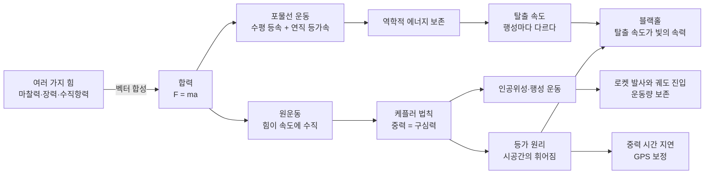

# 역학과 에너지 1. 시공간과 운동 — 던진 공에서 블랙홀까지, 중력으로 잇는 운동
<!-- prev: m1-05, 1-1, 3-3, 3-4, phy-1, phy-3 -->
<!-- next: mech-2, astro-1 -->

> [!NOTE]
> **성취기준**
> - **[12역학01-01]** 물체에 작용하는 여러 가지 힘의 합력을 구하여 물체의 운동을 정량적으로 예측할 수 있다.
> - **[12역학01-02]** 뉴턴 운동 법칙을 이용하여 물체의 포물선 운동을 정량적으로 설명하고, 포물선 운동에서의 역학적 에너지를 구할 수 있다.
> - **[12역학01-03]** 물체에 작용하는 힘의 방향에 따라 물체의 운동 방향이 변할 수 있음을 원운동 등 다양한 예를 들어 설명할 수 있다.
> - **[12역학01-04]** 케플러 법칙으로부터 중력의 존재가 밝혀지는 과학사적 배경을 이해하고, 중력을 이용하여 인공위성과 행성의 운동을 분석하고 설명할 수 있다.
> - **[12역학01-05]** 역학적 에너지 보존을 이용하여 행성에 따라 탈출 속도가 다름을 이해하고, 운동량 보존을 이용하여 우주선이 발사되어 궤도에 오르는 원리를 설명할 수 있다.
> - **[12역학01-06]** 등가 원리와 시공간의 휘어짐으로 인해 블랙홀과 중력 시간 지연이 나타남을 이해하고, 일반 상대론에 흥미를 느낄 수 있다.

**학습 목표**

1. 평면 위에서 물체에 작용하는 마찰력, 장력, 수직항력 등을 벡터로 합성하여 합력을 구하고, 뉴턴 운동 법칙으로 물체의 가속도와 운동을 예측할 수 있다.
2. 포물선 운동을 수평 방향의 등속 운동과 연직 방향의 등가속도 운동으로 나누어 분석하고, 운동 중 역학적 에너지가 보존됨을 계산으로 확인할 수 있다.
3. 힘의 방향이 속도와 이루는 각에 따라 속력과 운동 방향이 어떻게 바뀌는지 설명하고, 등속 원운동에서 구심력의 역할을 사례로 설명할 수 있다.
4. 케플러 법칙에서 만유인력 법칙이 이끌려 나온 과정을 이해하고, 중력을 구심력으로 하여 인공위성과 행성의 원운동을 정량적으로 분석할 수 있다.
5. 역학적 에너지 보존으로 탈출 속도를 구해 행성마다 다른 까닭과 대기 구성의 차이를 설명하고, 로켓이 궤도에 오르는 원리를 운동량 보존으로 설명할 수 있다.
6. 등가 원리와 시공간의 휘어짐으로 블랙홀과 중력 시간 지연을 설명하고, GPS 시간 보정과 같은 활용 사례를 찾을 수 있다.

**이 단원의 학습 사다리**

| 단계 | 무엇을 하나? |
|---|---|
| STEP 1. 이전 학습 다시 보기 | 중학교 「힘의 작용」, 통합과학 「중력과 운동」, 물리학 「힘과 에너지」에서 배운 힘·운동·에너지를 꺼내 본다 |
| STEP 2. 기초 다지기 | 벡터와 성분 분해, 자유 물체 그림, 뉴턴 운동 법칙, 일–에너지 정리, 각속도를 디딤돌로 놓는다 |
| STEP 3. 핵심 개념 | 합력 → 포물선 운동 → 원운동 → 케플러와 만유인력 → 탈출 속도와 로켓 → 등가 원리와 블랙홀 |
| STEP 4. 오개념 바로잡기 | "구심력이라는 힘이 따로 있다?", "우주 정거장에는 중력이 없다?" 같은 착각을 바로잡는다 |
| STEP 5. 대학으로 한 걸음 더 | 일반물리학·고전역학의 타원 궤도와 각운동량, 일반 상대론의 시공간 기하학 맛보기 |
| STEP 6. 생활·산업·진로 | 놀이기구 설계, 위성 궤도와 발사체, GPS, 스포츠 탄도 분석 |

---

## 🗺️ 단원 들어가기

농구 선수가 던진 공은 매끄러운 곡선을 그리며 림으로 빨려 들어간다. 롤러코스터는 거꾸로 뒤집힌 고리(루프)의 꼭대기를 지나면서도 승객을 떨어뜨리지 않는다. 지상 약 400 km 높이의 국제 우주 정거장은 초속 약 7.7 km로 지구를 돌며, 그 안의 우주인은 둥둥 떠다닌다. 그리고 스마트폰 지도 앱이 정확한 위치를 알려 주기 위해서는, 하늘 위 GPS 위성의 시계가 땅 위의 시계보다 **하루에 약 100만분의 38초씩 빨리 간다**는 사실을 반영해야 한다.

공, 롤러코스터, 우주 정거장, 위성 시계 — 서로 아무 관계 없어 보이는 이 장면들은 모두 **힘과 운동**, 그리고 그중에서도 **중력**이라는 하나의 줄로 이어져 있다. 이 단원에서는 평면 위의 힘을 더하는 것에서 출발하여, 던진 물체의 곡선 운동과 도는 운동을 거쳐, 행성과 인공위성의 운동, 지구를 탈출하는 속도, 마침내 중력이 시간과 공간을 휘게 하는 일반 상대론의 세계까지 한 걸음씩 올라가 본다.

---

## STEP 1. 🔙 이전 학습 다시 보기

### 연계 개념표

| 이전 단원·성취기준 | 그때 배운 것 | 이 단원에서 확장되는 것 |
|---|---|---|
| 중1 「힘의 작용」 [9과05-01], [9과05-02] | 힘을 화살표로 나타내고, 중력·탄성력·마찰력·부력의 크기와 방향을 구별하였다 | 장력, 수직항력까지 포함한 여러 힘을 **2차원 평면의 벡터로 합성**한다 |
| 중1 「힘의 작용」 [9과05-03] | 알짜힘이 0이 아니면 운동 상태가 변한다 | 알짜힘의 방향이 속도와 **나란하면 속력이**, **수직이면 방향이** 변한다 |
| 중3 「운동과 에너지」 [9과19-02]~[9과19-04] | 자유 낙하에서 속력이 일정하게 증가하고, 역학적 에너지가 보존된다 | 비스듬히 던진 물체에서도 역학적 에너지 보존을 **2차원으로 확인**한다 |
| 통합과학1 「중력과 운동」 [10통과1-03-03] | 낙하 운동과 지구 주위의 원운동은 모두 지구 중심 방향의 가속도 운동이다 | 수평으로 던진 운동을 일반화하고, **원운동의 구심 가속도 $v^2/r$** 을 정량적으로 다룬다 |
| 통합과학1 「운동량과 충격량」 [10통과1-03-04] | 충격량 = 운동량의 변화량 | 로켓이 가스를 내뿜어 가속하는 원리를 **운동량 보존**으로 설명한다 |
| 통합과학1 「시간과 공간」 [10통과1-01-01] | 원자시계와 GPS로 시간과 길이를 잰다 | 중력이 **시간의 흐름 자체를 바꾼다**는 것과 GPS 시간 보정의 이유를 배운다 |
| 물리학 「힘과 에너지」 [12물리01-02]~[12물리01-04] | 뉴턴 운동 법칙, 운동량 보존, 일과 에너지, 지표 근처의 위치 에너지 $mgh$ | 지구에서 멀리 떨어진 곳까지 쓸 수 있는 **중력 위치 에너지 $-GMm/r$** 로 탈출 속도를 구한다 |
| 물리학 「빛과 물질」 [12물리03-06] | 광속 불변으로부터 시간 팽창, 길이 수축이 나타난다(특수 상대론) | 가속과 중력을 같은 것으로 보는 **등가 원리**로 일반 상대론에 들어선다 |

### 준비 운동 (사전 진단)

**Q1.** 동쪽으로 3 N, 북쪽으로 4 N의 힘이 한 물체에 동시에 작용한다. 두 힘의 합력의 크기는? (① 1 N ② 5 N ③ 7 N ④ 12 N)

**Q2.** 수평한 책상 끝에서 공 A는 수평으로 굴러 떨어지고, 같은 순간 같은 높이에서 공 B는 가만히 놓아 떨어뜨린다. 공기 저항을 무시할 때 바닥에 먼저 닿는 공은?

**Q3.** 일정한 속력으로 원형 트랙을 도는 자동차의 가속도는 0이다. (O / X)

**Q4.** 높이 5 m에서 가만히 놓은 공이 바닥에 닿기 직전의 속력은? (중력 가속도는 $10\ \mathrm{m/s^2}$, 공기 저항 무시)

정답 및 해설

**Q1. ②** — 두 힘이 서로 수직이므로 피타고라스 정리로 $\sqrt{3^2+4^2} = 5\ \mathrm{N}$이다. 단순히 더한 7 N이 아니다. 힘은 방향이 있는 양(벡터)이기 때문이다.

**Q2. 동시에 닿는다.** — 연직 방향으로는 두 공 모두 처음 속도가 0이고 같은 중력 가속도를 받는다. 수평 방향의 운동은 연직 방향의 운동에 영향을 주지 않는다(통합과학 「중력과 운동」).

**Q3. X** — 속력은 일정해도 **운동 방향이 계속 바뀌므로** 속도가 변한다. 따라서 가속도가 있으며, 그 방향은 원의 중심을 향한다.

**Q4.** $10\ \mathrm{m/s}$ — 역학적 에너지 보존 $mgh = \frac{1}{2}mv^2$에서 $v = \sqrt{2gh} = \sqrt{2\times10\times5} = 10\ \mathrm{m/s}$이다.

---

## STEP 2. 🧱 기초 다지기

### 디딤돌 1. 벡터와 스칼라, 그리고 성분 분해

크기만 있는 양을 **스칼라(scalar)**, 크기와 방향을 함께 가진 양을 **벡터(vector)** 라고 한다.

| 스칼라 | 벡터 |
|---|---|
| 질량, 시간, 거리, 속력, 에너지, 일, 온도 | 변위, 속도, 가속도, 힘, 운동량 |

평면 위의 벡터는 서로 수직인 두 방향(보통 $x$축과 $y$축)의 **성분(component)** 으로 나눌 수 있다. 크기가 $F$이고 $x$축과 각 $\theta$를 이루는 힘은 다음과 같이 나뉜다.

$$
F_x = F\cos\theta, \qquad F_y = F\sin\theta, \qquad F = \sqrt{F_x^2 + F_y^2}
$$

| 각 $\theta$ | $0^\circ$ | $30^\circ$ | $37^\circ$ | $45^\circ$ | $53^\circ$ | $60^\circ$ | $90^\circ$ |
|---|---|---|---|---|---|---|---|
| $\cos\theta$ | 1 | 약 0.87 | 약 0.8 | 약 0.71 | 약 0.6 | 0.5 | 0 |
| $\sin\theta$ | 0 | 0.5 | 약 0.6 | 약 0.71 | 약 0.8 | 약 0.87 | 1 |

> [!TIP]
> 💡 **비유** — 벡터를 성분으로 나누는 것은 "북동쪽으로 100 m 걸어라"를 "동쪽으로 약 71 m, 북쪽으로 약 71 m 걸어라"로 바꿔 말하는 것과 같다. 바둑판 모양의 도시에서는 길이 동서·남북으로만 나 있으므로, 이렇게 나누어 말해야 실제로 걸어갈 수 있다. 물리 문제도 서로 수직인 두 방향으로 나누면 각각을 1차원 문제로 풀 수 있다.

벡터의 합은 **성분끼리 더해서** 구한다($F_{\text{합},x} = F_{1x}+F_{2x}$, $F_{\text{합},y} = F_{1y}+F_{2y}$). 이것이 '평행사변형법'으로 화살표를 그려 합하는 것과 같은 결과를 준다.

<!-- fig:mech-1-vector-components -->

### 디딤돌 2. 자유 물체 그림 그리기

한 물체만 따로 떼어 그리고, 그 물체가 **받는** 힘만 화살표로 모두 그린 그림을 **자유 물체 그림(free-body diagram)** 이라 한다. 역학 문제의 절반은 이 그림을 바르게 그리면 풀린다.

1. 물체 하나를 점(또는 상자)으로 그리고, **멀리서 작용하는 힘**인 중력 $mg$(연직 아래)를 먼저 그린다.
2. **닿아서 작용하는 힘**을 하나씩 찾는다: 바닥·빗면이면 수직항력과 마찰력, 줄이면 장력, 용수철이면 탄성력. 물체가 남에게 **주는** 힘은 그리지 않는다.
3. 운동(가속도) 방향을 한 축으로, 그에 수직인 방향을 다른 축으로 잡는다.

### 디딤돌 3. 뉴턴 운동 법칙 세 가지

| 법칙 | 내용 | 식 |
|---|---|---|
| 제1법칙(관성 법칙) | 알짜힘이 0이면 정지 또는 등속 직선 운동을 유지한다 | $\vec{F}_{\text{알짜}} = 0 \Rightarrow \vec{v}$ 일정 |
| 제2법칙(가속도 법칙) | 가속도는 알짜힘에 비례하고 질량에 반비례하며, **방향은 알짜힘의 방향**이다 | $\vec{F}_{\text{알짜}} = m\vec{a}$ |
| 제3법칙(작용 반작용 법칙) | A가 B에 힘을 주면 B도 A에 크기가 같고 방향이 반대인 힘을 준다 | $\vec{F}_{\text{AB}} = -\vec{F}_{\text{BA}}$ |

제2법칙은 벡터 식이므로 $x$, $y$ 성분별로 따로 쓸 수 있다: $F_x = ma_x$, $F_y = ma_y$. 이것이 이 단원 전체의 계산 도구이다.

### 디딤돌 4. 일, 운동 에너지, 위치 에너지

- **일(work)**: 힘과 그 방향으로 이동한 거리의 곱. 힘과 이동 방향이 각 $\theta$를 이루면 $W = Fs\cos\theta$. 힘이 이동 방향에 **수직이면 일은 0**이다.
- **일–운동 에너지 정리**: 알짜힘이 한 일 = 운동 에너지의 변화량, $W_{\text{알짜}} = \Delta\left(\frac{1}{2}mv^2\right)$.
- **역학적 에너지 보존**: 중력·탄성력처럼 위치 에너지를 정의할 수 있는 힘만 일을 하면 $E = \frac{1}{2}mv^2 + U$가 일정하다. 지표 근처에서 $U = mgh$.

> [!IMPORTANT]
> "힘이 운동 방향에 수직이면 일을 하지 않는다"는 사실은 STEP 3의 원운동에서 핵심이 된다. 등속 원운동에서 구심력은 늘 속도에 수직이므로 일을 하지 않고, 그래서 **속력(운동 에너지)은 그대로인 채 방향만** 바뀐다.

### 디딤돌 5. 원운동을 기술하는 양

- **주기(period)** $T$: 한 바퀴 도는 데 걸리는 시간. **진동수** $f = 1/T$.
- **각속도(angular velocity)** $\omega$: 1초 동안 회전한 각. 각은 **라디안(rad)** 으로 잰다(한 바퀴 $= 2\pi\ \mathrm{rad}$).

$$
\omega = \frac{2\pi}{T}, \qquad v = r\omega = \frac{2\pi r}{T}
$$

예를 들어 반지름 10 m인 놀이기구가 20초에 한 바퀴 돌면 $v \approx 3.1\ \mathrm{m/s}$이다.

---

## STEP 3. 📘 핵심 개념

### ① 여러 가지 힘의 합력으로 운동 예측하기

#### (1) 이 단원에서 다루는 힘들

| 힘 | 방향 | 크기를 정하는 것 | 생활 속 예 |
|---|---|---|---|
| **중력(gravitational force)** · 무게 | 연직 아래(지구 중심) | $mg$ | 모든 물체 |
| **수직항력(normal force)** | 접촉면에 수직, 면에서 물체 쪽으로 | 다른 힘과 운동 상태로 결정(정해진 공식이 없다) | 책상이 책을 떠받치는 힘 |
| **마찰력(friction)** | 접촉면에 나란, 미끄러짐(또는 미끄러지려는 움직임)의 반대 | 운동 마찰력 $f_k = \mu_k N$, 정지 마찰력 최댓값 $f_{s,\max} = \mu_s N$ | 브레이크, 걷기 |
| **장력(tension)** | 줄을 따라 물체에서 멀어지는 방향(줄이 당긴다) | 다른 힘과 운동 상태로 결정 | 엘리베이터 케이블, 그네 줄 |
| **탄성력(elastic force)** | 변형을 되돌리는 방향 | $F = kx$ ($k$: 용수철 상수) | 트램펄린, 자동차 현가장치 |

여기서 $\mu$는 **마찰 계수(coefficient of friction)** 로, 두 면의 재질과 상태에 따라 정해지는 값이다. 보통 정지 마찰 계수가 운동 마찰 계수보다 크다. 무거운 가구를 밀 때 처음 움직이게 하기가 가장 힘들고, 일단 미끄러지면 조금 쉬워지는 이유이다.

> [!WARNING]
> 수직항력이 항상 $mg$인 것은 아니다. 빗면 위에서는 $mg\cos\theta$, 엘리베이터가 위로 가속할 때는 $mg$보다 크다. 수직항력은 "물체가 면을 뚫고 들어가지 않게 할 만큼" 생기는 힘이므로, 상황마다 운동 법칙으로 구해야 한다.

#### (2) 합력 구하기의 순서

1. 자유 물체 그림을 그린다.
2. 축을 정한다. 빗면 문제는 **빗면에 나란한 방향**과 **수직인 방향**을 축으로 잡으면 편하다.
3. 모든 힘을 두 축의 성분으로 나눈다.
4. 각 축에서 성분을 더한다. 움직이지 않는 방향(예: 빗면에 수직)은 합이 0이다.
5. $F_x = ma_x$로 가속도를 구하고, 등가속도 운동 식으로 이후 운동을 예측한다.

<!-- fig:mech-1-incline-forces -->

#### 예제 1 — 두 사람이 끄는 썰매

얼음판 위의 질량 50 kg 썰매를 두 사람이 줄로 끈다. 한 사람은 동쪽으로 60 N, 다른 사람은 북쪽으로 80 N으로 당긴다. 얼음과의 마찰은 무시한다. 썰매의 가속도의 크기와 방향은?

**풀이** 두 힘이 수직이므로 합력의 크기는 $F = \sqrt{60^2 + 80^2} = 100\ \mathrm{N}$이고, 방향은 동쪽에서 북쪽으로 $\tan\theta = 80/60$, 즉 약 $53^\circ$ 방향이다. 가속도는 $a = F/m = 100/50 = 2\ \mathrm{m/s^2}$이고, 방향은 **합력의 방향**(동쪽에서 북쪽으로 약 $53^\circ$)이다.

#### 예제 2 — 빗면을 미끄러져 내려가는 상자

경사각 $30^\circ$인 빗면에 질량 2 kg인 상자를 놓았더니 미끄러져 내려간다. 운동 마찰 계수는 0.2이다. 상자의 가속도와, 정지 상태에서 출발하여 2초 동안 미끄러진 거리를 구하시오. (중력 가속도 $g = 10\ \mathrm{m/s^2}$, $\cos30^\circ \approx 0.87$)

**풀이** 빗면 방향(아래쪽을 +)과 빗면에 수직인 방향으로 축을 잡는다.

| 힘 | 빗면 방향 성분 | 빗면 수직 성분 |
|---|---|---|
| 중력 $mg = 20\ \mathrm{N}$ | $+mg\sin30^\circ = +10\ \mathrm{N}$ | $-mg\cos30^\circ \approx -17.4\ \mathrm{N}$ |
| 수직항력 $N$ | 0 | $+N$ |
| 운동 마찰력 $\mu_k N$ | $-\mu_k N$ | 0 |

빗면 수직 방향으로는 움직이지 않으므로 $N = mg\cos30^\circ \approx 17.4\ \mathrm{N}$, 마찰력은 $0.2\times17.4 \approx 3.5\ \mathrm{N}$이다. 빗면 방향 알짜힘은 $10 - 3.5 = 6.5\ \mathrm{N}$이므로 $a = 6.5/2 \approx 3.3\ \mathrm{m/s^2}$이고, 2초 동안 미끄러진 거리는 $s = \frac{1}{2}at^2 \approx \frac{1}{2}\times3.3\times2^2 \approx 6.5\ \mathrm{m}$이다.

(식으로 정리하면 $a = g(\sin\theta - \mu_k\cos\theta)$로 질량과 관계없다.)

#### 예제 3 — 간판을 매단 두 줄의 장력

무게 100 N인 간판을 두 줄로 매달았다. 두 줄은 좌우 대칭이며 각각 수평면과 $30^\circ$를 이룬다. 줄 하나의 장력은?

**풀이** 간판이 정지해 있으므로 합력은 0이다. 수평 성분은 좌우가 서로 상쇄되고, 연직 성분의 합이 무게와 같아야 한다: $2T\sin30^\circ = 100$이므로 $T = \dfrac{100}{2\times0.5} = 100\ \mathrm{N}$.

줄 하나가 간판 무게 전체만큼의 힘을 받는다! 줄을 더 수평에 가깝게 팽팽히 당길수록($\theta \to 0$) $\sin\theta$가 작아져 장력이 매우 커진다. 빨랫줄을 아무리 세게 당겨도 완전히 수평으로 만들 수 없는 이유이다.

> [!TIP]
> 💡 **요령** — 힘의 합성 문제에서 "움직이지 않는 방향"과 "가속하는 방향"을 먼저 찾자. 움직이지 않는 방향의 식에서 수직항력이나 장력을 구하고, 가속하는 방향의 식에서 가속도를 구한다. 놀이터 미끄럼틀, 스키 활강, 짐을 끄는 수레가 모두 같은 순서로 풀린다.

#### ✔ 바로 확인

1. (O/X) 수평한 바닥에 놓인 물체가 받는 수직항력의 크기는 언제나 물체의 무게 $mg$와 같다.
2. 크기가 10 N인 힘이 수평면과 $60^\circ$를 이룬다. 이 힘의 수평 성분과 연직 성분의 크기는? ($\cos60^\circ = 0.5$, $\sin60^\circ \approx 0.87$)
3. 빈칸: 마찰이 없는 경사각 $\theta$인 빗면에서 미끄러져 내려가는 물체의 가속도의 크기는 (    )이다.
4. 무게 50 N인 상자를 수평 바닥에 놓고 연직 위로 20 N의 힘으로 당겼지만 상자는 뜨지 않았다. 바닥이 상자를 떠받치는 수직항력은? (① 20 N ② 30 N ③ 50 N ④ 70 N)

정답

1. X — 수평 바닥이라도 물체를 위로 당기거나 위에서 누르면, 또는 엘리베이터처럼 바닥이 연직으로 가속하면 달라진다. 수직항력은 운동 상태로부터 구해야 한다.
2. 수평 성분 5 N, 연직 성분 약 8.7 N — $F\cos\theta$, $F\sin\theta$로 나눈다.
3. $g\sin\theta$ — 빗면 방향 알짜힘이 중력의 빗면 성분 $mg\sin\theta$뿐이다.
4. ② — 연직 방향 합력이 0이므로 $N + 20 = 50$, $N = 30\ \mathrm{N}$이다.

### ② 포물선 운동과 역학적 에너지

#### (1) 운동을 두 방향으로 나누기

공기 저항을 무시하면, 던져진 물체가 받는 힘은 **중력 하나뿐**이다. 중력은 연직 아래 방향이므로

- **수평 방향**: 힘이 없다 → $a_x = 0$ → **등속 운동**
- **연직 방향**: 중력만 → $a_y = -g$ → **등가속도 운동**

처음 속력 $v_0$, 수평면과 각 $\theta$로 던졌다면 처음 속도 성분은 $v_{0x} = v_0\cos\theta$, $v_{0y} = v_0\sin\theta$이고, 시간 $t$일 때

$$
\begin{aligned}
x &= v_0\cos\theta\; t, & v_x &= v_0\cos\theta \\
y &= v_0\sin\theta\; t - \tfrac{1}{2}gt^2, & v_y &= v_0\sin\theta - gt
\end{aligned}
$$

두 식에서 $t$를 없애면 $y$는 $x$의 이차 함수가 된다. 그래서 궤적이 **포물선(parabola)** 이다. 이 운동을 **포물선 운동(projectile motion)** 이라 한다.

#### (2) 포물선 운동의 주요 값 (같은 높이로 떨어지는 경우)

| 구하는 값 | 조건 | 결과 |
|---|---|---|
| 최고점 도달 시간 | $v_y = 0$ | $t_{\text{top}} = \dfrac{v_0\sin\theta}{g}$ |
| 최고점 높이 | $t = t_{\text{top}}$ | $H = \dfrac{v_0^2\sin^2\theta}{2g}$ |
| 체공 시간 | $y = 0$ | $t_{\text{total}} = 2t_{\text{top}}$ |
| 수평 도달 거리 | $x = v_{0x}\,t_{\text{total}}$ | $R = \dfrac{v_0^2\sin2\theta}{g}$ |

$\sin2\theta$는 $\theta = 45^\circ$일 때 최댓값 1을 가진다. 따라서 공기 저항이 없고 같은 높이로 떨어질 때 **$45^\circ$로 던지면 가장 멀리 간다.** 또 $30^\circ$와 $60^\circ$처럼 합이 $90^\circ$인 두 각으로 던지면 도달 거리가 같다(높이와 체공 시간은 다르다).

<!-- sim:projectile-angle -->

#### (3) 포물선 운동에서의 역학적 에너지

중력은 위치 에너지가 정의되는 힘이므로, 공기 저항이 없으면 포물선 운동 내내 역학적 에너지가 보존된다.

$$
\frac{1}{2}mv^2 + mgy = \frac{1}{2}mv_0^2 \quad (\text{출발점 } y = 0)
$$

속력을 성분으로 쓰면 $v^2 = v_x^2 + v_y^2$이고, $v_x$는 변하지 않는다. 그러므로 **최고점에서도 운동 에너지는 0이 아니라 $\frac{1}{2}mv_x^2$** 이다. 위로 던진 공(수직 던지기)과 달리 비스듬히 던진 공은 최고점에서도 수평으로 움직이고 있기 때문이다.

#### 예제 4 — 비스듬히 찬 축구공

질량 0.5 kg인 축구공을 수평면과 $30^\circ$ 방향으로 20 m/s의 속력으로 찼다. 공기 저항은 무시하고 $g = 10\ \mathrm{m/s^2}$이다.
(1) 최고점 높이와 수평 도달 거리 (2) 최고점에서의 운동 에너지와 위치 에너지 (3) 역학적 에너지가 보존됨을 확인하시오. ($\sqrt3 \approx 1.73$)

**풀이**
(1) $v_{0x} = 20\cos30^\circ = 10\sqrt3 \approx 17.3\ \mathrm{m/s}$, $v_{0y} = 20\sin30^\circ = 10\ \mathrm{m/s}$
- 최고점 도달 시간 $t = 10/10 = 1\ \mathrm{s}$, 높이 $H = 10^2/(2\times10) = 5\ \mathrm{m}$
- 체공 시간 2 s, 도달 거리 $R = 17.3\times2 \approx 34.6\ \mathrm{m}$

(2) 최고점에서 $v = v_x = 10\sqrt3\ \mathrm{m/s}$이므로
- 운동 에너지 $\frac{1}{2}\times0.5\times(10\sqrt3)^2 = \frac{1}{2}\times0.5\times300 = 75\ \mathrm{J}$
- 위치 에너지 $mgH = 0.5\times10\times5 = 25\ \mathrm{J}$

(3) 처음 역학적 에너지 $= \frac{1}{2}\times0.5\times20^2 = 100\ \mathrm{J}$, 최고점 $= 75 + 25 = 100\ \mathrm{J}$. 보존된다.

#### 예제 5 — 절벽에서 수평으로 던진 돌

높이 20 m인 절벽 위에서 돌을 수평으로 15 m/s로 던졌다. $g = 10\ \mathrm{m/s^2}$일 때 (1) 떨어지는 데 걸린 시간 (2) 수평 거리 (3) 바닥에 닿는 순간의 속력을 운동 법칙과 에너지 보존 두 가지 방법으로 구하시오.

**풀이**
(1) 연직 방향: $20 = \frac{1}{2}\times10\times t^2 \Rightarrow t = 2\ \mathrm{s}$
(2) 수평 방향: $x = 15\times2 = 30\ \mathrm{m}$
(3) 운동 법칙: $v_x = 15$, $v_y = 10\times2 = 20$이므로 $v = \sqrt{15^2+20^2} = 25\ \mathrm{m/s}$
에너지 보존: $\frac{1}{2}v^2 = \frac{1}{2}v_0^2 + gh \Rightarrow v^2 = 225 + 400 = 625 \Rightarrow v = 25\ \mathrm{m/s}$

두 방법의 답이 같다. 에너지 방법은 **속력**만 알려 주지만, 경로를 몰라도 되므로 훨씬 빠르다. 운동 법칙 방법은 **방향과 시간**까지 알려 준다.

> [!NOTE]
> **현실의 포물선** 실제 공은 공기 저항을 받아 최고점을 지난 뒤 더 가파르게 떨어지고, 도달 거리가 이론값보다 짧다. 공의 회전은 궤적을 휘게도 한다(축구의 '바나나킥'). 이때는 역학적 에너지 일부가 공기의 운동과 열로 바뀌어 보존되지 않는다. 그래서 투포환이나 멀리뛰기의 최적 각은 $45^\circ$보다 약간 작다(던지는 높이, 공기 저항, 사람 몸의 구조가 함께 작용한다).

#### ✔ 바로 확인

1. (O/X) 공기 저항이 없을 때 비스듬히 던진 공의 수평 방향 속도는 운동 내내 일정하다.
2. 공을 수평면과 $30^\circ$ 방향으로 20 m/s로 던졌다. 처음 속도의 연직 성분은?
3. 빈칸: 같은 속력으로 같은 높이에 떨어지도록 던질 때, $15^\circ$로 던진 공과 수평 도달 거리가 같은 각은 (    )$^\circ$이다.
4. (O/X) 비스듬히 던진 공의 운동 에너지는 최고점에서 0이 된다.

정답

1. O — 수평 방향으로는 힘이 작용하지 않는다.
2. 10 m/s — $v_0\sin30^\circ = 20\times0.5$
3. 75 — 두 각의 합이 $90^\circ$이면 $\sin2\theta$가 같다.
4. X — 최고점에서도 수평 속도가 남아 운동 에너지 $\frac{1}{2}mv_x^2$을 가진다.

### ③ 힘의 방향이 운동의 방향을 바꾼다 — 원운동

#### (1) 힘을 속도에 나란한 성분과 수직인 성분으로 나누자

물체에 작용하는 알짜힘을 **속도에 나란한 성분**과 **속도에 수직인 성분**으로 나누어 보면, 각 성분의 역할이 분명해진다.

| 알짜힘과 속도의 관계 | 속력 | 운동 방향 | 예 |
|---|---|---|---|
| 같은 방향 | 증가 | 그대로 | 출발하는 자동차, 자유 낙하 |
| 반대 방향 | 감소 | 그대로 | 브레이크를 밟은 자동차 |
| 수직 | 그대로 | 힘 쪽으로 휜다 | 등속 원운동 |
| 비스듬함 | 변함 | 변함 | 포물선 운동, 진자 운동 |

포물선 운동에서 공이 올라갈 때는 중력이 속도와 둔각을 이루어 속력이 줄면서 방향이 아래로 휘고, 내려갈 때는 예각을 이루어 속력이 늘면서 방향이 휜다. 최고점에서는 중력이 속도에 정확히 수직이다.

<!-- fig:mech-1-force-velocity-angle -->

#### (2) 등속 원운동과 구심력

반지름 $r$인 원을 일정한 속력 $v$로 도는 물체는 속도의 방향이 계속 바뀐다. 짧은 시간 동안 속도가 변한 방향을 그려 보면 항상 **원의 중심**을 향한다. 이 가속도를 **구심 가속도(centripetal acceleration)** 라 한다.

$$
a_c = \frac{v^2}{r} = r\omega^2 \qquad (\text{방향: 원의 중심})
$$

뉴턴 운동 제2법칙에 따라 이 가속도를 만들려면 중심 방향으로 크기 $F_c = mv^2/r$인 알짜힘이 필요하다. 이 중심 방향의 알짜힘을 **구심력(centripetal force)** 이라 부른다.

> [!IMPORTANT]
> **구심력은 새로운 종류의 힘이 아니다.** 중력, 장력, 마찰력, 수직항력 등 실제로 작용하는 힘들의 **합력 중 중심 방향 성분**에 붙인 이름이다. 그래서 원운동 문제의 자유 물체 그림에 '구심력' 화살표를 따로 그리면 안 된다. "무엇이 구심력 역할을 하는가?"를 묻는 것이 올바른 질문이다.

| 원운동 | 구심력 역할을 하는 힘 |
|---|---|
| 줄에 매달아 수평으로 돌리는 공 | 줄의 장력 |
| 평평한 커브 길을 도는 자동차 | 타이어와 도로 사이의 정지 마찰력 |
| 경사진 커브(뱅크) 길, 사이클 경기장 | 수직항력의 수평 성분(+마찰력) |
| 회전 그네(회전목마식 그네) | 줄 장력의 수평 성분 |
| 지구 주위를 도는 달·인공위성 | 지구의 중력 |
| 세탁기 탈수통 벽에 붙은 빨래 | 통 벽의 수직항력 |

<!-- fig:mech-1-centripetal-examples -->

#### (3) 구심력이 사라지면?

돌리던 줄이 끊어지면 공은 바깥으로 날아가는 것이 아니라, 끊어진 순간의 속도 방향, 즉 **원의 접선 방향**으로 곧게 날아간다(관성). 탈수통의 구멍으로 빠져나가는 물방울, 해머던지기에서 손을 놓은 해머가 모두 그렇다. '원심력'에 의해 바깥으로 밀려나는 것처럼 느끼는 것은, 함께 도는 사람이 관성 때문에 직진하려는 몸이 안쪽으로 끌려가는 것을 반대로 느끼는 것이다.

<!-- fig:mech-1-circular-motion -->

#### 예제 6 — 커브 길의 최대 안전 속력

반지름 50 m인 평평한 커브 길에서 타이어와 도로 사이의 정지 마찰 계수가 0.8이다. 미끄러지지 않고 돌 수 있는 최대 속력은? ($g = 10\ \mathrm{m/s^2}$) 비가 와서 마찰 계수가 0.5로 줄면?

**풀이** 정지 마찰력이 구심력 역할을 한다. 최대 정지 마찰력 $\mu_s mg$가 필요한 구심력보다 커야 한다.

$$
\mu_s mg \ge m\frac{v^2}{r} \;\Rightarrow\; v_{\max} = \sqrt{\mu_s g r} = \sqrt{0.8\times10\times50} = 20\ \mathrm{m/s}\ (72\ \mathrm{km/h})
$$

비 오는 날: $v_{\max} = \sqrt{0.5\times10\times50} = \sqrt{250} \approx 15.8\ \mathrm{m/s}$ (약 57 km/h). 질량과 관계없이 정해진다는 점에 주목하자. 커브 길 속도 제한과 빗길 감속 안내의 물리적 근거이다.

#### 예제 7 — 롤러코스터 루프의 꼭대기

반지름 10 m인 원형 루프의 꼭대기를 롤러코스터가 지난다. 승객이 좌석에서 떨어지지 않으려면(레일이 차를 밀어 주는 힘이 0 이상) 꼭대기에서의 속력은 최소 얼마여야 하는가? ($g = 10\ \mathrm{m/s^2}$)

**풀이** 꼭대기에서 중심 방향은 아래이다. 중력 $mg$와 레일의 수직항력 $N$이 모두 아래를 향하므로

$$
mg + N = m\frac{v^2}{r}, \qquad N \ge 0 \;\Rightarrow\; v \ge \sqrt{gr} = \sqrt{10\times10} = 10\ \mathrm{m/s}
$$

이 속력에서는 중력만으로 구심력이 채워져 승객은 잠깐 '몸이 뜨는' 느낌을 받는다. 실제 롤러코스터는 안전을 위해 이보다 훨씬 빠르게 지나가며, 원 대신 꼭대기의 곡률 반지름이 작은 **물방울 모양(클로소이드 형태)** 루프를 써서 아래쪽에서 승객이 받는 힘을 줄인다.

> [!TIP]
> 💡 **비유** — 구심력은 '운전대'와 같다. 운전대를 돌려도 자동차의 속력계 바늘은 그대로이지만 차의 방향이 바뀐다. 액셀(나란한 힘)은 속력을, 운전대(수직인 힘)는 방향을 바꾼다. 실제로는 운전대가 바퀴 방향을 바꾸어 도로의 마찰력이 차를 안쪽으로 끌게 만든다.

#### ✔ 바로 확인

1. 짝짓기: (가) 알짜힘이 속도와 같은 방향 (나) 알짜힘이 속도에 수직 — ㄱ. 방향만 바뀐다 ㄴ. 속력만 바뀐다
2. 반지름 2 m인 원을 4 m/s의 일정한 속력으로 도는 물체의 구심 가속도의 크기는?
3. (O/X) 등속 원운동에서 구심력은 물체에 일을 하지 않는다.
4. 빈칸: 줄에 매단 공을 수평면에서 돌리다가 줄이 끊어지면 공은 원의 (    ) 방향으로 날아간다.

정답

1. (가) ㄴ, (나) ㄱ — 나란한 성분은 속력을, 수직인 성분은 방향을 바꾼다.
2. $8\ \mathrm{m/s^2}$ — $v^2/r = 16/2$
3. O — 구심력은 늘 속도에 수직이므로 $W = Fs\cos90^\circ = 0$이다.
4. 접선 — 끊어진 순간의 속도 방향으로 관성에 따라 직진한다.

### ④ 케플러 법칙에서 중력으로 — 인공위성과 행성의 운동

#### (1) 과학사: 관측 → 규칙 → 원인

| 인물 | 시기 | 한 일 |
|---|---|---|
| 코페르니쿠스 | 16세기 중엽 | 태양 중심설 제안(행성은 원 궤도를 돈다고 생각) |
| 티코 브라헤 | 16세기 후반 | 망원경 없이 행성 위치를 당시 최고 정밀도로 수십 년간 관측 |
| 케플러 | 1609년, 1619년 | 브라헤의 화성 관측 자료를 분석하여 행성 운동의 세 법칙 발표 |
| 뉴턴 | 1687년 「프린키피아」 | 운동 법칙과 만유인력 법칙으로 케플러 법칙을 설명 |

케플러의 세 법칙은 다음과 같다.

| 법칙 | 내용 | 물리적 의미(이 단원 수준) |
|---|---|---|
| 제1법칙(타원 궤도 법칙) | 행성은 태양을 한 초점으로 하는 타원 궤도를 돈다 | 태양계 행성의 궤도는 원에 매우 가깝다 |
| 제2법칙(면적 속도 일정 법칙) | 태양과 행성을 잇는 선은 같은 시간에 같은 넓이를 쓸고 지나간다 | 태양에 가까울 때 빠르고, 멀 때 느리다 |
| 제3법칙(조화 법칙) | 공전 주기의 제곱은 궤도 긴반지름의 세제곱에 비례한다 ($T^2 \propto a^3$) | 멀리 있는 행성일수록 느리게 돈다 |

<!-- fig:mech-1-kepler-laws -->

케플러는 행성이 **어떻게** 움직이는지를 정확히 기술했지만, **왜** 그렇게 움직이는지는 설명하지 못했다. 뉴턴은 "행성이 원(에 가까운) 궤도를 돌려면 태양을 향하는 구심력이 필요하다. 그 힘은 어떤 모양이어야 케플러 제3법칙이 나오는가?"라고 질문하였다.

#### (2) 원 궤도에서 제3법칙으로부터 중력의 모양 찾기

행성이 반지름 $r$인 원 궤도를 주기 $T$로 돈다고 하자. 구심 가속도에 케플러 제3법칙 $T^2 = k\,r^3$($k$는 모든 행성에 같은 상수)을 넣으면

$$
a_c = \frac{v^2}{r} = \frac{(2\pi r/T)^2}{r} = \frac{4\pi^2 r}{T^2} = \frac{4\pi^2 r}{k r^3} = \frac{4\pi^2}{k}\cdot\frac{1}{r^2}
$$

즉, 행성이 받는 힘($ma_c$)은 **행성의 질량에 비례하고 거리의 제곱에 반비례**해야 한다. 작용 반작용 법칙에 따라 이 힘은 태양의 질량에도 비례해야 하므로, 뉴턴은 다음 **만유인력 법칙(law of universal gravitation)** 을 제안하였다.

$$
F = G\frac{Mm}{r^2}, \qquad G \approx 6.67\times10^{-11}\ \mathrm{N\cdot m^2/kg^2}
$$

뉴턴은 이 힘이 사과를 떨어뜨리는 힘과 **같은 힘**이라는 것을, 달의 구심 가속도가 지표의 중력 가속도보다 약 $60^2$배(지구–달 거리가 지구 반지름의 약 60배이므로) 작다는 계산으로 확인했다. 하늘과 땅의 운동이 하나의 법칙으로 이어진 순간이다.

> [!NOTE]
> 이 교재에서 인공위성과 천체의 운동은 **원운동에 한정하여** 정량적으로 다룬다. 타원 궤도의 정량적 분석은 STEP 5에서 맛보기로만 소개한다.

#### (3) 중력이 구심력일 때 — 궤도 속력과 주기

질량 $M$인 중심 천체 주위를 반지름 $r$인 원 궤도로 도는 질량 $m$인 위성에 대해 "중력 = 구심력"을 쓰면

$$
G\frac{Mm}{r^2} = m\frac{v^2}{r} \;\Rightarrow\; v = \sqrt{\frac{GM}{r}}, \qquad T^2 = \frac{4\pi^2}{GM}r^3
$$

- 위성의 질량 $m$이 약분된다. 같은 궤도라면 무거운 위성과 가벼운 위성이 같은 속력으로 돈다.
- 케플러 제3법칙의 비례 상수 $k = 4\pi^2/GM$은 **중심 천체의 질량**으로 정해진다. 거꾸로 위성(또는 행성)의 $T$와 $r$을 재면 중심 천체의 질량을 알 수 있다.

#### 예제 8 — 지구 공전으로 태양의 질량 구하기

지구는 태양 주위를 반지름 약 $1.5\times10^{11}\ \mathrm{m}$인 원 궤도로 1년(약 $3.16\times10^{7}\ \mathrm{s}$)에 한 바퀴 돈다고 하자. 태양의 질량을 구하시오.

**풀이**

$$
M = \frac{4\pi^2 r^3}{GT^2} = \frac{4\pi^2\times(1.5\times10^{11})^3}{6.67\times10^{-11}\times(3.16\times10^{7})^2} \approx 2.0\times10^{30}\ \mathrm{kg}
$$

지구 질량(약 $6.0\times10^{24}\ \mathrm{kg}$)의 약 33만 배이다. 저울에 올릴 수 없는 태양의 질량을 시계와 자로 잰 셈이다.

#### (4) 행성 자료로 케플러 제3법칙 확인하기

천문단위(AU, 지구–태양 평균 거리)와 년을 단위로 쓰면, 태양계 행성은 $T^2/a^3 \approx 1$을 만족한다.

| 행성 | 궤도 긴반지름 $a$ (AU) | 공전 주기 $T$ (년) | $T^2/a^3$ |
|---|---|---|---|
| 수성 | 0.387 | 0.241 | 약 1.00 |
| 금성 | 0.723 | 0.615 | 약 1.00 |
| 지구 | 1.000 | 1.000 | 1.00 |
| 화성 | 1.524 | 1.881 | 약 1.00 |
| 목성 | 5.203 | 11.86 | 약 1.00 |
| 토성 | 9.537 | 29.46 | 약 1.00 |

#### (5) 인공위성의 궤도

| 위성 종류 | 고도(대략) | 궤도 속력(대략) | 주기(대략) | 쓰임 |
|---|---|---|---|---|
| 저궤도(국제 우주 정거장 등) | 약 400 km | 약 7.7 km/s | 약 92분 | 유인 우주 활동, 지구 관측 |
| 중궤도(GPS 위성) | 약 20,200 km | 약 3.9 km/s | 약 12시간 | 위성 항법 |
| 정지 궤도 | 약 36,000 km | 약 3.1 km/s | 약 24시간(지구 자전과 같음) | 통신·방송·기상 위성 |

높이 올라갈수록 궤도 속력은 느려지고 주기는 길어진다. **정지 궤도 위성(geostationary satellite)** 은 적도 위에서 지구 자전과 같은 방향, 같은 주기로 돌기 때문에 땅에서 보면 하늘의 한 점에 멈춰 있는 것처럼 보인다. 천리안 위성 같은 기상 위성이 같은 지역을 계속 지켜볼 수 있는 이유이다.

<!-- fig:mech-1-satellite-orbits -->

#### 예제 9 — 국제 우주 정거장의 속력과 주기

국제 우주 정거장이 지표에서 400 km 높이의 원 궤도를 돈다고 하자. 지구 반지름은 $6.37\times10^{6}\ \mathrm{m}$, $GM_{\text{지구}} = 3.99\times10^{14}\ \mathrm{m^3/s^2}$이다. 궤도 속력과 주기는?

**풀이** $r = 6.37\times10^{6} + 0.40\times10^{6} = 6.77\times10^{6}\ \mathrm{m}$

$$
v = \sqrt{\frac{3.99\times10^{14}}{6.77\times10^{6}}} \approx 7.7\times10^{3}\ \mathrm{m/s}, \qquad T = \frac{2\pi r}{v} \approx 5.5\times10^{3}\ \mathrm{s} \approx 92\ \text{분}
$$

하루에 지구를 약 15바퀴 반 돈다. 우주인은 하루에 해돋이를 열다섯 번 넘게 본다.

> [!TIP]
> 💡 **비유** — 우주 정거장이 떠 있는 이유는 중력이 없어서가 아니라 **옆으로 너무 빨리 달리고 있어서 계속 떨어지는데도 땅에 닿지 않기 때문**이다. 통합과학에서 본 '뉴턴의 대포'를 떠올리자. 지표에서 중력 가속도는 약 $9.8\ \mathrm{m/s^2}$이고, 400 km 높이에서도 약 $8.7\ \mathrm{m/s^2}$로 별로 줄지 않는다. 우주인이 떠 있는 것처럼 보이는 것은 정거장과 우주인이 **함께 똑같이 떨어지고 있기** 때문이다.

#### ✔ 바로 확인

1. 빈칸: 케플러 제2법칙에 따르면 행성은 태양에 가까울 때 더 (빠르게 / 느리게) 움직인다.
2. 두 물체 사이의 거리가 2배가 되면 만유인력의 크기는 몇 배가 되는가?
3. (O/X) 같은 원 궤도를 도는 두 인공위성 중 질량이 큰 위성이 더 빠르게 돈다.
4. 정지 궤도 위성의 공전 주기는 대략 얼마인가?

정답

1. 빠르게 — 같은 시간에 같은 넓이를 쓸려면 가까울 때 더 많이 움직여야 한다.
2. $\frac{1}{4}$배 — 거리의 제곱에 반비례한다.
3. X — $v = \sqrt{GM/r}$에서 위성의 질량이 약분된다.
4. 약 24시간 — 지구 자전 주기와 같아야 하늘의 한 점에 멈춰 보인다.

### ⑤ 탈출 속도와 우주선의 발사

#### (1) 지표에서 멀리 떨어진 곳의 중력 위치 에너지

지표 근처에서는 $U = mgh$를 썼다. 그러나 중력은 거리의 제곱에 반비례하여 약해지므로, 우주로 멀리 나가는 운동에서는 이 식을 쓸 수 없다. 중력에 의한 위치 에너지를 **무한히 먼 곳을 기준(0)** 으로 잡으면 다음과 같이 쓸 수 있다(유도는 적분이 필요하므로 STEP 5에서 다룬다).

$$
U(r) = -G\frac{Mm}{r}
$$

- 위치 에너지가 **음수**인 것은 기준을 무한히 먼 곳으로 잡았기 때문이다. 지구에 붙잡혀 있는 물체는 무한히 먼 곳보다 에너지가 낮다.
- 중심에서 멀어질수록 $U$가 커진다(0에 가까워진다). 위로 올라갈수록 위치 에너지가 커진다는 $mgh$의 성질과 같다.
- 지표 근처에서 높이 $h$만큼 올라갈 때의 변화량은 근사적으로 $mgh$가 된다($g = GM/R^2$).

#### (2) 탈출 속도의 유도

지표에서 물체를 위로 던져 **다시 돌아오지 않고 무한히 멀리** 가게 하는 데 필요한 최소 속력을 **탈출 속도(escape velocity)** 라 한다. 공기 저항을 무시하고 역학적 에너지 보존을 쓰면, 무한히 먼 곳에 겨우 도착(속력 0)할 때 역학적 에너지는 $0 + 0 = 0$이므로

$$
\frac{1}{2}mv_{\text{탈출}}^2 - G\frac{Mm}{R} = 0 \;\Rightarrow\; v_{\text{탈출}} = \sqrt{\frac{2GM}{R}}
$$

- 탈출 속도는 던지는 물체의 질량과 관계없고, **천체의 질량 $M$과 반지름 $R$** 로 정해진다.
- 지표 바로 위 원 궤도의 속력 $\sqrt{GM/R}$(약 7.9 km/s)의 $\sqrt2$배이다.
- 던지는 방향과도 관계없다(에너지는 방향이 없는 스칼라이므로). 다만 대기를 오래 지나지 않는 방향이 유리하다.

#### 예제 10 — 지구와 달의 탈출 속도

$GM_{\text{지구}} = 3.99\times10^{14}\ \mathrm{m^3/s^2}$, $R_{\text{지구}} = 6.37\times10^{6}\ \mathrm{m}$, $GM_{\text{달}} = 4.90\times10^{12}\ \mathrm{m^3/s^2}$, $R_{\text{달}} = 1.74\times10^{6}\ \mathrm{m}$일 때 두 천체의 탈출 속도를 구하시오.

**풀이**

$$
v_{\text{지구}} = \sqrt{\frac{2\times3.99\times10^{14}}{6.37\times10^{6}}} \approx 1.12\times10^{4}\ \mathrm{m/s}, \qquad v_{\text{달}} = \sqrt{\frac{2\times4.90\times10^{12}}{1.74\times10^{6}}} \approx 2.4\times10^{3}\ \mathrm{m/s}
$$

지구는 약 11.2 km/s, 달은 약 2.4 km/s로 약 5분의 1이다. 달에서 출발하는 로켓이 훨씬 작아도 되는 이유이다.

#### (3) 행성마다 다른 탈출 속도와 대기

| 천체 | 탈출 속도(약) | 대기의 특징 |
|---|---|---|
| 달 | 2.4 km/s | 대기가 거의 없다 |
| 화성 | 5.0 km/s | 이산화 탄소 위주의 매우 옅은 대기 |
| 금성 | 10.4 km/s | 이산화 탄소 위주의 매우 두꺼운 대기 |
| 지구 | 11.2 km/s | 질소·산소 위주. 수소·헬륨은 거의 남아 있지 않다 |
| 목성 | 약 60 km/s | 수소·헬륨 위주의 거대한 대기 |

기체 분자는 온도에 따라 정해지는 평균 속력 근처에서 제각각 다른 속력으로 움직이며, 그중 일부는 평균보다 훨씬 빠르다. 같은 온도라면 **가벼운 분자일수록 평균 속력이 빠르다.** 탈출 속도가 작은 천체에서는 대기 윗부분의 빠른 분자가 오랜 세월에 걸쳐 조금씩 우주로 빠져나가 대기가 얇아지고, 특히 가벼운 수소와 헬륨은 지구에서도 대부분 빠져나갔다. 반면 탈출 속도가 매우 크고 온도가 낮은 목성은 가장 가벼운 수소까지 붙잡아 두고 있다. (이 내용은 **정성적으로만** 이해하면 된다. 대기 구성에는 태양에서 오는 입자의 영향, 자기장, 화학 반응 등도 함께 작용한다.)

#### (4) 우주선이 발사되어 궤도에 오르는 원리 (정성적 이해)

**① 로켓은 무엇을 밀어내는가?** 로켓은 연료를 태워 생긴 뜨거운 기체를 노즐 뒤로 빠르게 뿜어낸다. 로켓과 기체를 하나의 계로 보면 외부 힘(중력·공기 저항)을 잠시 무시할 때 **계 전체의 운동량이 보존**되므로, 기체가 뒤쪽으로 운동량을 가져가는 만큼 로켓은 앞쪽으로 같은 크기의 운동량을 얻는다. 작용 반작용으로 보면, 로켓이 기체를 뒤로 밀고 기체가 로켓을 앞으로 민다. 따라서 로켓은 **밀어낼 공기가 없는 우주에서도** 가속할 수 있다.

**② 다단 로켓** 연료를 다 쓴 빈 연료통과 엔진을 계속 달고 가면, 그 질량까지 가속해야 하므로 손해이다. 그래서 1단을 다 쓰면 떼어 버리고 2단 엔진을 켜는 **다단 로켓**을 쓴다. 떼어 낼 때마다 가속해야 할 질량이 줄어 같은 연료로 더 큰 속도를 얻는다.

**③ 궤도에 오르는 과정** 궤도에 오르려면 '높이'보다 '옆으로의 속력'이 더 중요하다.

| 단계 | 하는 일 | 이유 |
|---|---|---|
| 수직 상승 | 처음에는 곧게 위로 오른다 | 공기가 짙은 아래층을 빨리 벗어나 공기 저항을 줄인다 |
| 기울이기 | 점점 기울어 수평 방향으로 비행한다 | 중력이 진행 방향을 자연스럽게 휘게 한다 |
| 수평 가속 | 목표 고도에서 수평 속력을 원 궤도 속력까지 높인다 | 저궤도라면 약 7.8 km/s 안팎의 수평 속력이 있어야 "떨어지면서 땅에 닿지 않는" 원운동이 된다 |
| 엔진 정지 | 궤도에 진입한 뒤 엔진을 끈다 | 이후에는 중력만으로(구심력으로) 궤도를 돈다 |

또 지구는 서쪽에서 동쪽으로 자전하므로, **동쪽으로 발사**하면 지표가 이미 가진 속력(적도에서 약 0.46 km/s)을 공짜로 얻을 수 있다. 발사장을 적도 가까이 두는 것이 유리한 까닭이다.

> [!WARNING]
> 이 성취기준에서 우주선의 발사와 궤도 진입은 **정량적으로 계산하지 않고** 뉴턴 운동 법칙과 운동량 보존 법칙으로 **정성적으로** 설명한다. 로켓의 속도 변화를 구하는 식은 STEP 5에 소개만 한다.

#### ✔ 바로 확인

1. (O/X) 무거운 물체일수록 지구를 탈출하는 데 필요한 탈출 속도가 크다.
2. 지표 바로 위 원 궤도의 속력이 약 7.9 km/s이다. 지구의 탈출 속도는 약 몇 km/s인가?
3. 빈칸: 로켓이 밀어낼 공기가 없는 우주에서도 가속할 수 있는 것은 로켓과 분출 기체 전체의 (    )이 보존되기 때문이다.
4. 로켓을 동쪽으로 발사하는 것이 유리한 까닭은? (① 동쪽 하늘의 공기가 옅어서 ② 지구 자전에 의한 속력을 얻어서 ③ 동쪽의 중력이 약해서)

정답

1. X — $v_{\text{탈출}} = \sqrt{2GM/R}$에는 던지는 물체의 질량이 없다.
2. 약 11.2 km/s — 원 궤도 속력의 $\sqrt2$배이다.
3. 운동량 — 기체가 뒤로 가져간 운동량만큼 로켓이 앞으로 운동량을 얻는다.
4. ② — 지표가 이미 동쪽으로 움직이고 있다(적도에서 약 0.46 km/s).

### ⑥ 등가 원리와 시공간의 휘어짐 — 블랙홀과 중력 시간 지연

#### (1) 두 가지 질량, 하나의 값

질량은 두 가지 서로 다른 역할을 한다.

| 구분 | 뜻 | 나오는 식 |
|---|---|---|
| **관성 질량(inertial mass)** | 가속되기 어려운 정도(관성의 크기) | $F = m_{\text{관성}}\,a$ |
| **중력 질량(gravitational mass)** | 중력을 받는 정도(무게를 정하는 양) | $F = G\dfrac{M m_{\text{중력}}}{r^2}$ |

두 질량이 같다면 낙하 가속도는 $a = GM/r^2$이 되어 물체의 질량과 관계없어진다. 갈릴레이 이후 정밀한 실험들은 모든 물체가 같은 가속도로 떨어진다는 것, 즉 **관성 질량과 중력 질량이 매우 높은 정밀도로 같다**는 것을 확인해 왔다. 뉴턴 역학에서 이것은 '우연한 일치'였지만, 아인슈타인은 여기에 깊은 의미가 있다고 보았다.

#### (2) 아인슈타인의 엘리베이터

창문 없는 엘리베이터 안을 생각해 보자.

| 상황 | 안에 있는 사람이 느끼는 것 |
|---|---|
| 지구 표면에 정지한 엘리베이터 | 바닥으로 눌리고, 놓은 공이 $9.8\ \mathrm{m/s^2}$로 떨어진다 |
| 중력이 없는 우주에서 위로 $9.8\ \mathrm{m/s^2}$로 가속하는 엘리베이터 | 똑같이 바닥으로 눌리고, 놓은 공이 $9.8\ \mathrm{m/s^2}$로 '떨어진다' |
| 줄이 끊어져 자유 낙하하는 엘리베이터 | 몸이 둥둥 떠 있고, 놓은 공도 그 자리에 떠 있다 |
| 중력이 없는 우주에 떠 있는 엘리베이터 | 똑같이 몸과 공이 떠 있다 |

안에서 어떤 역학 실험을 해도 "중력 때문인지, 가속 때문인지" 구별할 수 없다. 아인슈타인은 이를 더 넓혀 **"작은 공간에서 중력의 효과와 가속 운동의 효과는 어떤 실험으로도 구별할 수 없다"** 고 하였다. 이것이 **등가 원리(equivalence principle)** 이다.

<!-- fig:mech-1-equivalence-elevator -->

#### (3) 등가 원리가 예언하는 것: 빛이 휜다

가속하는 엘리베이터의 한쪽 벽에서 반대쪽 벽으로 빛을 수평으로 쏘면, 빛이 건너가는 동안 엘리베이터가 위로 가속하므로 안에서 보면 빛이 **아래로 휘어진** 경로를 그린다. 등가 원리에 따르면 중력 속에서도 똑같은 일이 일어나야 한다. 즉, **빛도 중력에 의해 휜다.** 이 예언은 1919년 개기 일식 때 태양 근처를 지나는 별빛의 위치가 조금 어긋나 보이는 관측으로 처음 확인되었고, 오늘날에는 먼 은하의 빛이 앞쪽 은하단에 의해 휘어 여러 개의 상이나 고리로 보이는 **중력 렌즈** 현상으로 흔히 관측된다.

<!-- fig:mech-1-light-bending -->

#### (4) 시공간의 휘어짐

질량이 없는 빛까지 휘게 만든다면, 중력을 "질량끼리 당기는 힘"으로만 보기는 어렵다. 아인슈타인은 1915년 **일반 상대성 이론(general relativity)** 에서 새로운 그림을 내놓았다.

- 질량(과 에너지)은 주변의 **시간과 공간, 즉 시공간(spacetime)을 휘게** 한다.
- 물체와 빛은 휘어진 시공간에서 가능한 한 '곧은' 경로를 따라 움직인다. 그 경로가 우리 눈에는 휘어진 궤도, 즉 중력에 의한 운동으로 보인다.

> [!TIP]
> 💡 **비유와 그 한계** — 팽팽한 고무막 가운데에 볼링공을 올려 두면 막이 움푹 들어간다. 그 위로 구슬을 굴리면 구슬이 볼링공 주위를 휘돌아 간다. 질량이 시공간을 휘게 하고 그 휘어짐이 운동을 바꾼다는 것을 보여 주는 좋은 비유이다. 다만 이 비유는 '아래로 당기는 지구의 중력'을 빌려 쓰고 있고, 공간만 보여 줄 뿐 **시간의 휘어짐**은 보여 주지 못한다. 실제 일반 상대론에서는 시간의 휘어짐(아래의 중력 시간 지연)이 지구 근처 물체의 낙하를 설명하는 데 더 중요한 역할을 한다.

#### (5) 블랙홀: 빛조차 탈출할 수 없는 곳

⑤에서 구한 탈출 속도 $v_{\text{탈출}} = \sqrt{2GM/R}$을 다시 보자. 질량 $M$은 그대로인데 반지름 $R$이 작아지면 탈출 속도는 커진다. 탈출 속도가 빛의 속력 $c$와 같아지는 반지름을 구하면

$$
\sqrt{\frac{2GM}{R}} = c \;\Rightarrow\; R_{\text{S}} = \frac{2GM}{c^2}
$$

이 반지름보다 작게 압축된 천체에서는 빛조차 빠져나올 수 없다. 이런 천체를 **블랙홀(black hole)** 이라 하고, 빛이 빠져나올 수 없는 경계를 **사건의 지평선(event horizon)**, 그 반지름 $R_{\text{S}}$를 **슈바르츠실트 반지름(Schwarzschild radius)** 이라 한다.

> [!NOTE]
> 위의 계산은 뉴턴 역학의 탈출 속도를 빌린 **기초적인 설명**이다. 빛은 질량이 없으므로 운동 에너지 $\frac{1}{2}mv^2$를 그대로 쓸 수 없고, 엄밀한 결과는 일반 상대론으로 얻어야 한다. 그런데 신기하게도 일반 상대론으로 정확히 구한 사건의 지평선 반지름이 이 값과 똑같다.

#### 예제 11 — 태양과 지구가 블랙홀이 되려면

태양의 질량을 $2.0\times10^{30}\ \mathrm{kg}$, 지구의 질량을 $6.0\times10^{24}\ \mathrm{kg}$이라 할 때 각각의 슈바르츠실트 반지름을 구하시오. ($G = 6.67\times10^{-11}\ \mathrm{N\cdot m^2/kg^2}$, $c = 3.0\times10^{8}\ \mathrm{m/s}$)

**풀이**

$$
R_{\text{태양}} = \frac{2\times6.67\times10^{-11}\times2.0\times10^{30}}{(3.0\times10^{8})^2} \approx 3.0\times10^{3}\ \mathrm{m}, \qquad R_{\text{지구}} \approx 8.9\times10^{-3}\ \mathrm{m}
$$

반지름 약 70만 km인 태양을 반지름 약 3 km로, 지구를 반지름 약 9 mm(구슬 크기)로 압축해야 블랙홀이 된다. 실제 블랙홀은 태양보다 훨씬 무거운 별이 일생의 마지막에 스스로의 중력으로 무너질 때 만들어지는 것으로 생각된다. 은하 중심에는 태양 질량의 수백만~수십억 배에 이르는 거대 블랙홀이 있으며, 2019년에는 국제 공동 연구진이 전 세계 전파 망원경을 연결하여 거대 블랙홀 주변의 빛나는 고리 모양 영상을 처음 공개하였다.

#### (6) 중력 시간 지연과 GPS

일반 상대론에 따르면 시공간의 휘어짐은 시간에도 나타난다. **중력이 강한 곳(중력 위치 에너지가 낮은 곳)일수록 시간이 느리게 간다.** 이를 **중력 시간 지연(gravitational time dilation)** 이라 한다.

등가 원리로 그 이유를 엿볼 수 있다. 위로 가속하는 긴 우주선의 꼭대기에서 바닥으로 일정한 간격의 빛 신호를 보내면, 신호가 내려오는 동안 바닥이 신호를 마중 나가듯 빨라지므로 바닥에서는 신호가 더 촘촘하게(진동수가 높게) 도착한다. 바닥의 시계로는 꼭대기의 시계가 빨리 가는 것으로 보인다. 등가 원리에 따라 중력 속에서도 마찬가지이다: **높은 곳의 시계가 낮은 곳의 시계보다 빨리 간다.**

이 효과는 지구 근처에서는 매우 작지만, 정밀한 원자시계로는 측정할 수 있으며 실제 기술에서 무시할 수 없다.

| GPS 위성 시계에 작용하는 효과 | 지상 시계와 비교한 하루 차이(약) | 원인 |
|---|---|---|
| 중력 시간 지연(일반 상대론) | $+45\ \mu\mathrm{s}$ (빨리 감) | 위성이 지상보다 중력이 약한 높은 곳에 있다 |
| 운동에 의한 시간 팽창(특수 상대론) | $-7\ \mu\mathrm{s}$ (느리게 감) | 위성이 초속 약 3.9 km로 움직인다 |
| 합계 | $+38\ \mu\mathrm{s}$ (빨리 감) | 일반 상대론 효과가 더 크다 |

($1\ \mu\mathrm{s} = 10^{-6}\ \mathrm{s}$) GPS 수신기는 위성 신호가 도착하는 데 걸린 시간에 빛의 속력을 곱해 위성까지의 거리를 구한다. 그래서 GPS 위성의 시계는 이 차이를 미리 고려하여 보정된다.

<!-- sim:light-clock -->

#### 예제 12 — 보정하지 않으면 생기는 오차

위성 시계가 하루에 $38\ \mu\mathrm{s}$씩 앞서는 것을 보정하지 않았다면, 하루 뒤 위성까지의 거리 계산에 생기는 오차는 대략 얼마인가? ($c = 3.0\times10^{8}\ \mathrm{m/s}$)

**풀이** 거리 오차 $\approx c\,\Delta t = 3.0\times10^{8}\times38\times10^{-6} \approx 1.1\times10^{4}\ \mathrm{m}$

하루에 약 11 km씩 오차가 쌓인다. 내비게이션이 엉뚱한 동네를 가리키게 될 것이다. 상대성 이론은 먼 우주의 이야기가 아니라 우리 손안의 스마트폰에서도 작동하는 이론이다.

> [!IMPORTANT]
> **이 소절의 연결 고리**: 관성 질량 = 중력 질량 → 등가 원리(중력 ≈ 가속) → 빛이 휜다, 높은 곳의 시계가 빨리 간다 → 중력은 시공간의 휘어짐 → 탈출 속도가 $c$인 극단적 휘어짐 = 블랙홀, 약한 휘어짐의 실용적 효과 = GPS 시간 보정.

#### ✔ 바로 확인

1. 빈칸: 등가 원리의 바탕은 관성 질량과 (    ) 질량이 같다는 사실이다.
2. (O/X) 등가 원리에 따르면, 자유 낙하하는 엘리베이터 안의 실험만으로는 중력이 없는 우주에 떠 있는 엘리베이터와 구별할 수 없다.
3. 질량이 $M$인 천체의 슈바르츠실트 반지름이 3 km이다. 질량이 $2M$인 천체의 슈바르츠실트 반지름은?
4. (O/X) GPS 위성의 시계는 중력 시간 지연 때문에 지상의 시계보다 느리게 간다.

정답

1. 중력 — 그래서 모든 물체가 같은 가속도로 떨어진다.
2. O — 둘 다 몸과 물체가 함께 떠 있다.
3. 6 km — $R_{\text{S}} = 2GM/c^2$은 질량에 비례한다.
4. X — 위성은 중력이 약한 높은 곳에 있으므로 중력 시간 지연 효과로는 **빨리** 간다.

---

## STEP 4. ⚠️ 오개념 바로잡기

| 흔한 오개념 | 올바른 개념 | 왜 그럴까? |
|---|---|---|
| 두 힘의 합력의 크기는 두 힘의 크기를 더한 것이다 | 합력은 **벡터 합**이며, 크기는 두 힘 사이의 각에 따라 차이에서 합까지 달라진다 | 3 N과 4 N이 수직이면 합력은 5 N이다. 같은 방향일 때만 7 N이 된다 |
| 포물선 운동의 최고점에서 속도와 가속도가 모두 0이다 | 최고점에서 **연직 속도만 0**이고 수평 속도는 그대로이며, 가속도는 여전히 $g$(아래)이다 | 중력은 운동 내내 일정하게 작용한다. 가속도가 0이면 공은 최고점에 머물러야 한다 |
| 원운동하는 물체에는 구심력이라는 특별한 힘이 하나 더 작용한다 | 구심력은 장력·마찰력·중력 등 **실제 힘들의 합력 중 중심 방향 성분**의 이름이다 | 자유 물체 그림에는 실제 상호작용만 그린다. 구심력을 따로 더하면 힘을 두 번 세는 것이다 |
| 줄이 끊어지면 원운동하던 물체는 원의 바깥쪽(중심 반대쪽)으로 날아간다 | 끊어진 순간의 속도 방향인 **접선 방향**으로 곧게 날아간다 | 구심력이 사라지면 알짜힘이 0(또는 중력만)이므로 관성에 따라 직진한다 |
| 우주 정거장 안이 무중력인 것은 우주에 중력이 없기 때문이다 | 정거장 높이에서도 중력 가속도는 지표의 약 90 %이다. 정거장과 우주인이 **함께 자유 낙하**하고 있어서 떠 보인다 | 중력이 없다면 정거장은 원운동하지 못하고 직진해 버린다 |
| 탈출 속도로 쏘려면 위쪽(연직)으로 쏘아야만 한다 | 탈출 속도는 **에너지 조건**이므로 방향과 관계없다(공기 저항 무시) | 운동 에너지는 스칼라이다. 실제 발사에서는 지구 자전과 공기 저항 때문에 동쪽으로 기울여 쏜다 |
| 블랙홀은 주변의 모든 것을 진공청소기처럼 빨아들인다 | 사건의 지평선에서 충분히 멀면, 같은 질량의 별과 **똑같은 중력**을 미친다 | 멀리서의 중력은 $GM/r^2$로 질량과 거리로만 정해진다. 태양이 같은 질량의 블랙홀로 바뀌어도 지구 궤도는 그대로이다 |

---

## STEP 5. 🎓 다음 단계로 한 걸음 더

> [!CAUTION]
> 이 절은 **고등학교 '역학과 에너지' 교육과정 범위 밖의 심화 내용**으로 평가 대상이 아니다. 이 단원의 개념이 대학의 일반물리학·고전역학·천체역학·일반 상대론에서 어떻게 이어지는지 맛보기로 보여 주기 위한 내용이다.

### 대학 전공 과목과의 연결

| 대학 과목 | 이어지는 내용 |
|---|---|
| 일반물리학 | 미적분으로 쓰는 운동 법칙, 벡터의 내적·외적, 일–에너지 정리, 회전 운동과 각운동량, 만유인력과 위치 에너지의 적분 |
| 고전역학(해석역학) | 라그랑주·해밀턴 역학, 중심력 문제와 타원 궤도, 회전 좌표계의 관성력(원심력·코리올리 힘) |
| 천체역학·궤도역학 | 궤도 6요소, 호만 전이 궤도, 섭동, 인공위성 궤도 설계 |
| 일반 상대론(물리학과 고학년) | 텐서와 휘어진 시공간의 기하학, 아인슈타인 장 방정식, 블랙홀, 중력파, 우주론 |

### ① 위치 에너지 $-GMm/r$은 어디서 왔을까?

중력이 거리에 따라 변하므로, 무한히 먼 곳에서 거리 $r$까지 물체를 옮길 때 중력이 한 일은 **적분**으로 구한다. 중력의 지름 방향 성분을 $F(r') = -GMm/r'^2$(중심 방향이므로 음수)이라 하면

$$
U(r) = -\int_{\infty}^{r} F(r')\,dr' = -\int_{\infty}^{r} \left(-\frac{GMm}{r'^2}\right) dr' = -\frac{GMm}{r}
$$

일반물리학에서는 "보존력 $\vec{F}$에 대해 $\vec{F} = -\nabla U$"라는 관계를 배우고, 모든 위치 에너지를 같은 방법으로 다룬다.

### ② 타원 궤도와 각운동량 보존

케플러 제2법칙(면적 속도 일정)은 사실 **각운동량 보존** $L = mvr_\perp = $ 일정의 다른 표현이다. 중력은 항상 태양을 향하는 **중심력**이라 돌림힘을 만들지 않기 때문이다. 대학 고전역학에서는 에너지 보존과 각운동량 보존을 함께 써서 궤도의 모양을 구하고, 역학적 에너지 $E$에 따라 궤도가 나뉜다는 것을 보인다.

| 역학적 에너지 $E$ | 궤도 모양 |
|---|---|
| $E < 0$ | 원 또는 타원(붙잡힌 궤도) |
| $E = 0$ | 포물선(정확히 탈출 속도) |
| $E > 0$ | 쌍곡선(탈출 속도보다 빠름) |

이 단원의 '포물선 운동'은 지표 근처에서 중력을 일정하다고 본 근사이고, 실제로는 지구 중심을 한 초점으로 하는 아주 길쭉한 타원의 일부라는 것도 여기서 알게 된다.

### ③ 로켓 방정식과 궤도 전이

질량이 줄어드는 로켓에 운동량 보존을 미분 형태로 적용하면 **치올콥스키 로켓 방정식** $\Delta v = v_{\text{e}}\ln(m_0/m_f)$를 얻는다. 궤도역학에서는 낮은 원 궤도에서 높은 원 궤도로 옮길 때 두 번의 짧은 가속으로 타원 궤도를 거치는 **호만 전이 궤도**처럼 연료를 가장 적게 쓰는 경로를 계산한다. 달·행성 탐사선은 행성 곁을 스쳐 지나며 속도를 얻는 **스윙바이(중력 도움)** 도 이용한다.

### ④ 중력 시간 지연을 식으로

약한 중력장에서 높이가 다른 두 시계의 빠르기 차이는 근사적으로 중력 위치 에너지 차이를 $mc^2$로 나눈 값과 같다.

$$
\frac{\Delta t_{\text{높은 곳}} - \Delta t_{\text{낮은 곳}}}{\Delta t} \approx \frac{GM}{c^2}\left(\frac{1}{R} - \frac{1}{r}\right) \quad \xrightarrow{\ \text{지표 근처}\ } \quad \frac{gh}{c^2}
$$

GPS 위성($r \approx 2.66\times10^{7}\ \mathrm{m}$)에 넣으면 약 $5.3\times10^{-10}$, 하루(86 400 s)로 곱하면 약 $46\ \mu\mathrm{s}$로 STEP 3 표의 값과 맞는다. 지표 근처 1 m 높이 차이에서는 약 $10^{-16}$으로, 최신 광격자 시계는 이 정도의 차이까지 측정할 수 있을 만큼 정밀해지고 있다고 알려져 있다.

### 지금 vs 다음 단계

| 구분 | 고등학교 역학과 에너지 | 대학 일반물리학·고전역학·일반 상대론 |
|---|---|---|
| 힘의 합성 | 2차원 평면, 삼각비로 성분 분해 | 3차원 벡터, 내적·외적, 좌표 변환 |
| 운동 기술 | 등가속도 운동 식 | 미분 방정식 $m\ddot{\vec{r}} = \vec{F}$ |
| 천체 운동 | 원 궤도에 한정, 중력 = 구심력 | 타원·포물선·쌍곡선 궤도, 각운동량 보존, 섭동 |
| 우주선 발사 | 운동량 보존으로 정성적 설명 | 로켓 방정식, 궤도 전이 계산 |
| 중력의 정체 | 등가 원리, 시공간 휘어짐을 기초적으로 이해 | 휘어진 시공간의 기하학(텐서), 장 방정식 |
| 블랙홀 | 탈출 속도 = $c$인 천체 | 사건의 지평선, 시공간 특이점, 블랙홀 열역학 |

---

## STEP 6. 🏭 생활·산업·진로 연결

### 사례 1. 놀이기구 설계 — 힘을 계산해 '안전한 짜릿함'을 만든다

- **원리** 롤러코스터는 처음 끌어올린 높이의 위치 에너지를 운동 에너지로 바꾸며 달리고(역학적 에너지 전환), 루프와 커브에서는 레일의 수직항력과 중력이 구심력 역할을 한다(예제 7). 회전 그네는 줄 장력의 수평 성분이 구심력이 된다.
- **어디에 쓰이나** 설계자는 승객이 받는 힘을 몸무게의 몇 배인지('G'로 표현)로 계산하여 사람이 견딜 수 있는 범위 안에 두고, 루프 모양과 커브의 기울기를 정한다. 공기 저항과 마찰로 줄어드는 에너지를 고려하여 각 언덕의 높이를 점점 낮게 설계한다.

### 사례 2. 인공위성과 발사체 — 궤도를 고르고, 궤도에 올린다

- **원리** 원 궤도 속력 $v = \sqrt{GM/r}$와 케플러 제3법칙으로 목적에 맞는 고도를 정한다. 지구 관측 위성은 해상도를 위해 저궤도를, 통신·기상 위성은 정지 궤도를 택한다. 발사체는 운동량 보존(가스 분출)으로 가속하고, 다단 분리로 효율을 높인다.
- **어디에 쓰이나** 우리나라는 한국형 발사체 누리호를 독자 개발하여 실용 위성을 궤도에 올리는 데 성공하였고, 다목적 실용 위성(아리랑), 정지 궤도 기상 위성(천리안) 등을 운영하고 있다. 달 궤도선 다누리는 달 주위를 돌며 관측을 수행하였다.

### 사례 3. 위성 항법(GPS) — 상대성 이론이 들어 있는 기술

- **원리** 수신기는 여러 위성에서 온 신호의 도착 시간 차이로 위치를 계산한다. 위성 시계는 중력 시간 지연(빨라짐)과 운동에 의한 시간 팽창(느려짐)을 합한 하루 약 $38\ \mu\mathrm{s}$의 차이를 보정한다.
- **어디에 쓰이나** 내비게이션, 항공기·선박 항법, 측량, 통신망과 금융 거래의 시각 동기화, 자율 주행, 정밀 농업. 우리나라도 한반도 주변에서 쓰는 위성 항법 시스템 개발을 추진하고 있다.

### 사례 4. 스포츠 탄도 분석

- **원리** 포물선 운동 식에 공기 저항과 회전 효과를 더해 공의 궤적을 예측한다.
- **어디에 쓰이나** 야구 중계의 투구·타구 추적 시스템은 여러 대의 카메라나 레이더로 공의 위치를 재고 발사 속도·각도를 계산한다. 골프·양궁·스키점프 선수의 훈련, 공의 표면 무늬 설계에도 쓰인다.

### 관련 진로와 학과

| 진로 | 하는 일 | 관련 학과 |
|---|---|---|
| 항공우주 엔지니어 | 발사체·위성 설계, 궤도 계산, 비행 제어 | 항공우주공학, 기계공학 |
| 기계·자동차 엔지니어 | 차량 동역학, 커브·제동 안전 설계, 놀이기구 구조 설계 | 기계공학, 자동차공학 |
| 위성 항법·측위 연구원 | 위성 신호 처리, 시각 동기화, 정밀 측위 | 전자공학, 공간정보공학, 물리학 |
| 천체물리학자 | 행성·블랙홀·중력파 연구, 관측 자료 분석 | 물리학, 천문우주학 |
| 스포츠 데이터 분석가 | 동작·궤적 분석, 장비 성능 평가 | 스포츠과학, 기계공학, 데이터과학 |

---

## 🔬 탐구 활동

### 활동 A. 포물선 운동 동영상을 분석하여 역학적 에너지 보존 확인하기

**목표** 비스듬히 던진 공의 동영상에서 위치–시간 자료를 얻어, 수평·연직 운동을 분석하고 역학적 에너지가 보존되는지 확인한다.

**준비물** 스마트폰(초당 60프레임 이상 촬영), 삼각대, 질량을 잰 공(테니스공 등), 1 m 기준 막대, 동영상 분석 앱 또는 프로그램, 스프레드시트

**과정**
1. 배경이 단순한 벽 앞에 기준 막대를 세우고, 스마트폰을 공의 운동 평면에 수직이 되도록 삼각대에 고정한다.
2. 공을 비스듬히 던지는 장면을 촬영한다(화면 안에서 포물선 전체가 보이도록).
3. 분석 프로그램에서 기준 막대로 길이를 보정하고, 프레임마다 공의 위치 $(x, y)$를 찍는다.
4. 시간–$x$ 그래프와 시간–$y$ 그래프를 그리고, 각각 직선·포물선에 가까운지 확인한다.
5. 이웃한 프레임 사이 위치 변화로 속도 성분을 구하고, 각 시점의 운동 에너지 $\frac{1}{2}mv^2$, 위치 에너지 $mgy$, 그 합을 계산한다.

**결과 기록**

| 시간(s) | $x$ (m) | $y$ (m) | $v_x$ (m/s) | $v_y$ (m/s) | 운동 에너지(J) | 위치 에너지(J) | 역학적 에너지(J) |
|---|---|---|---|---|---|---|---|
| | | | | | | | |
| | | | | | | | |
| | | | | | | | |

**생각해 보기**
1. $v_x$가 거의 일정했는가? 그렇지 않다면 원인은 무엇일까?
2. 시간–$v_y$ 그래프의 기울기로 중력 가속도를 구해 $9.8\ \mathrm{m/s^2}$와 비교해 보자.
3. 역학적 에너지가 시간이 지남에 따라 조금씩 줄었다면 그 에너지는 어디로 갔을까? 탁구공과 골프공처럼 밀도가 다른 공으로 비교해 보자.

> [!WARNING]
> **안전 수칙** 공을 던지는 방향에 사람이 없는지 확인하고, 단단한 공은 쓰지 않는다. 스마트폰과 삼각대는 공이 날아가는 경로 밖에 둔다.

### 활동 B. 행성 관측 데이터로 케플러 제3법칙 확인하기

**목표** 공개된 행성·위성 자료를 이용해 $T^2 \propto r^3$를 확인하고, 중심 천체의 질량을 구한다.

**준비물** 천문 기관이 공개한 행성·위성 궤도 자료, 스프레드시트(로그 그래프 기능)

**과정**
1. 태양계 행성의 궤도 긴반지름과 공전 주기를 표로 정리한다(STEP 3 ④의 표 참고).
2. 가로축 $\log a$, 세로축 $\log T$인 그래프를 그리고 기울기를 구한다. 기울기가 1.5에 가까우면 $T \propto a^{1.5}$, 즉 $T^2 \propto a^3$이다.
3. 목성의 큰 위성 4개(갈릴레이 위성)의 궤도 반지름과 주기로 같은 그래프를 그리고, $T^2/r^3$ 값으로 목성의 질량을 구한다.
4. 같은 방법으로 지구 주위를 도는 달과 인공위성 자료로 지구의 질량을 구한다.

**결과 기록**

| 중심 천체 | 도는 천체 | 궤도 반지름(m) | 주기(s) | $T^2/r^3$ ($\mathrm{s^2/m^3}$) | 구한 중심 천체 질량(kg) |
|---|---|---|---|---|---|
| 태양 | | | | | |
| 목성 | | | | | |
| 지구 | | | | | |

**생각해 보기** 중심 천체가 다르면 $T^2/r^3$ 값이 왜 달라지는가? 또 케플러 시대에는 이 계산으로 행성의 질량을 구할 수 없었다. 무엇이 더 알려져야 했을까? (힌트: $G$의 값은 18세기 말 캐번디시의 실험으로 처음 측정되었다.)

---

## ✅ 개념 확인 문제

### 기본

**1.** 수평한 바닥에 놓인 질량 4 kg인 상자를 수평면과 $37^\circ$ 위쪽 방향으로 20 N의 힘으로 끈다. 바닥과의 마찰은 무시한다. 상자의 가속도의 크기는? ($\cos37^\circ = 0.8$, $\sin37^\circ = 0.6$)

정답 및 해설

**정답** $4\ \mathrm{m/s^2}$

끄는 힘의 수평 성분은 $20\times0.8 = 16\ \mathrm{N}$이다. 연직 성분($12\ \mathrm{N}$)은 수직항력을 줄일 뿐 상자를 들어 올리지 못한다(무게 약 40 N). 마찰이 없으므로 $a = 16/4 = 4\ \mathrm{m/s^2}$이다.

**2.** 공기 저항을 무시할 때, 비스듬히 던진 공의 운동에 대한 설명으로 옳은 것을 **모두** 고르시오.
ㄱ. 공의 가속도는 운동 내내 일정하다.
ㄴ. 최고점에서 공의 속력은 0이다.
ㄷ. 같은 높이를 지날 때 올라갈 때와 내려올 때의 속력은 같다.

정답 및 해설

**정답 ㄱ, ㄷ**

ㄱ. 받는 힘이 중력뿐이므로 가속도는 항상 연직 아래로 $g$이다.
ㄴ. 최고점에서 연직 속도만 0이고 수평 속도는 남아 있으므로 속력은 0이 아니다.
ㄷ. 역학적 에너지 보존에 따라 같은 높이(같은 위치 에너지)에서는 운동 에너지가 같으므로 속력이 같다.

**3.** 질량 0.2 kg인 공을 길이 0.5 m인 줄에 매달아 수평면에서 등속 원운동시킨다. 공의 속력이 3 m/s일 때 공의 구심 가속도와 구심력의 크기를 구하시오. (중력의 영향은 무시한다.)

정답 및 해설

**정답** 구심 가속도 $18\ \mathrm{m/s^2}$, 구심력 $3.6\ \mathrm{N}$

$a_c = v^2/r = 9/0.5 = 18\ \mathrm{m/s^2}$, $F_c = ma_c = 0.2\times18 = 3.6\ \mathrm{N}$이다. 이 구심력 역할을 하는 실제 힘은 줄의 장력이다.

**4.** 빈칸에 알맞은 말을 쓰시오.
"작은 공간 안에서는 중력의 효과와 ( ㄱ ) 운동의 효과를 구별할 수 없다. 이를 ( ㄴ ) 원리라 한다. 이에 따르면 중력이 강한 곳일수록 시간이 ( ㄷ ) 간다."

정답 및 해설

**정답** ㄱ: 가속, ㄴ: 등가, ㄷ: 느리게

### 응용

**5.** 지구 주위를 원 궤도로 도는 두 인공위성 A, B가 있다. B의 궤도 반지름은 A의 4배이다. A에 대한 B의 (1) 궤도 속력의 비 (2) 공전 주기의 비를 구하시오.

정답 및 해설

**정답** (1) $v_B : v_A = 1 : 2$ (B는 A의 $\frac{1}{2}$배) (2) $T_B : T_A = 8 : 1$ (B는 A의 8배)

(1) $v = \sqrt{GM/r}$이므로 반지름이 4배이면 속력은 $1/\sqrt4 = 1/2$배이다.
(2) $T \propto r^{3/2}$이므로 $4^{3/2} = 8$배이다. (확인: $T = 2\pi r/v$에서 $4 \div \frac{1}{2} = 8$배)

**6.** 반지름이 지구와 같고 질량이 지구의 4배인 가상의 행성 X가 있다. 행성 X의 탈출 속도는 지구의 몇 배인가? 또 행성 X와 지구의 온도가 같다면, 두 행성 중 수소 같은 가벼운 기체를 대기로 붙잡아 두기에 더 유리한 것은 어느 쪽인지 이유와 함께 쓰시오.

정답 및 해설

**정답** 2배, 행성 X가 유리하다.

$v_{\text{탈출}} = \sqrt{2GM/R}$에서 $R$이 같고 $M$이 4배이므로 $\sqrt4 = 2$배이다. 같은 온도에서 기체 분자의 속력 분포는 같으므로, 탈출 속도가 큰 행성 X에서는 탈출 속도를 넘는 분자의 비율이 훨씬 작다. 따라서 가벼운 기체도 오래 붙잡아 둘 수 있다.

**7.** 다음은 우주 정거장 안의 우주인이 둥둥 떠 있는 까닭에 대한 학생들의 의견이다. 옳은 의견을 말한 학생을 **모두** 고르시오.
- 민서: 정거장이 있는 곳은 지구에서 멀어서 중력이 거의 0이야.
- 도윤: 정거장과 우주인이 똑같이 지구를 향해 자유 낙하하고 있어서 서로에 대해 떠 있어 보여.
- 하린: 등가 원리에 따르면, 자유 낙하하는 정거장 안은 중력이 없는 우주 공간에 떠 있는 정거장 안과 구별할 수 없어.

정답 및 해설

**정답** 도윤, 하린

약 400 km 높이에서 중력 가속도는 지표의 약 90 %이므로 민서의 말은 틀렸다. 중력은 정거장의 원운동에 필요한 구심력을 공급하고 있으며, 정거장과 우주인이 같은 가속도로 떨어지므로 서로 힘을 주고받지 않는다(도윤). 이것은 등가 원리의 '자유 낙하하는 엘리베이터'와 같은 상황이다(하린).

### 융합·서술형

**8. [과학사 연계]** "케플러는 행성이 어떻게 움직이는지를 밝혔고, 뉴턴은 왜 그렇게 움직이는지를 밝혔다." 이 말의 의미를 (1) 케플러 제3법칙 (2) 원운동의 구심 가속도 (3) 만유인력 법칙을 연결하여 서술하시오.

정답 및 해설

**예시 답안**
케플러는 브라헤의 관측 자료에서 공전 주기의 제곱이 궤도 반지름의 세제곱에 비례한다는 규칙($T^2 \propto r^3$)을 찾았지만, 그 원인은 설명하지 못했다. 뉴턴은 행성이 원에 가까운 궤도를 돌려면 태양 방향의 구심 가속도 $a_c = 4\pi^2 r/T^2$이 필요하다는 데서 출발하여, 여기에 케플러 제3법칙을 넣으면 $a_c \propto 1/r^2$이 됨을 보였다. 이로부터 태양이 행성을 거리의 제곱에 반비례하는 힘으로 당긴다는 결론을 얻었고, 이를 사과의 낙하와 달의 운동에도 적용하여 만유인력 법칙 $F = GMm/r^2$으로 일반화하였다. 즉 관측 규칙(어떻게)을 운동 법칙과 힘(왜)으로 설명한 것이다.

**채점 포인트** ① 케플러 제3법칙의 내용 ② 구심 가속도에 대입하여 역제곱 관계 도출 ③ 하늘과 땅의 운동을 같은 힘으로 통합했다는 의미

**9. [기술·사회 연계]** GPS 위성의 원자시계는 지상의 시계와 비교해 하루에 약 $45\ \mu\mathrm{s}$ 빨라지는 효과와 약 $7\ \mu\mathrm{s}$ 느려지는 효과를 함께 받는다. (1) 각 효과의 원인을 설명하고, (2) 보정하지 않을 때 위치 정보에 어떤 문제가 생기는지 계산 근거와 함께 서술하시오. ($c = 3.0\times10^{8}\ \mathrm{m/s}$)

정답 및 해설

**예시 답안**
(1) 빨라지는 효과는 일반 상대론의 중력 시간 지연 때문이다. 위성은 지표보다 중력이 약한(중력 위치 에너지가 높은) 곳에 있으므로 지상보다 시간이 빨리 간다. 느려지는 효과는 특수 상대론의 시간 팽창 때문이다. 위성이 초속 약 3.9 km로 움직이므로 지상에서 보면 위성의 시간이 느리게 간다.
(2) 두 효과를 합하면 하루에 약 $38\ \mu\mathrm{s}$ 빨라진다. GPS는 신호 도착 시간에 빛의 속력을 곱해 거리를 구하므로, 거리 오차는 약 $3.0\times10^{8}\times38\times10^{-6} \approx 1.1\times10^{4}\ \mathrm{m}$, 즉 하루에 약 11 km씩 쌓여 내비게이션을 쓸 수 없게 된다.

**채점 포인트** ① 중력 시간 지연(높은 곳이 빨리 감) ② 운동에 의한 시간 팽창 ③ 시간 오차 × 빛의 속력 = 거리 오차 계산

### 실력 다지기

**10.** 마찰이 있는 수평면에 놓인 질량 5 kg인 상자를 수평면과 $37^\circ$ 위쪽 방향으로 50 N의 힘으로 끈다. 운동 마찰 계수는 0.5이고 $g = 10\ \mathrm{m/s^2}$, $\cos37^\circ = 0.8$, $\sin37^\circ = 0.6$이다. (1) 상자의 가속도를 구하시오. (2) 같은 크기의 힘으로 **수평 방향**으로 끌 때의 가속도와 비교하고, 차이가 나는 까닭을 설명하시오.

정답 및 해설

**정답** (1) $6\ \mathrm{m/s^2}$ (2) 수평으로 끌면 $5\ \mathrm{m/s^2}$. 비스듬히 끌 때가 더 크다.

(1) 끄는 힘의 수평 성분 $50\times0.8 = 40\ \mathrm{N}$, 연직 성분 $50\times0.6 = 30\ \mathrm{N}$. 연직 방향은 평형이므로 $N = 50 - 30 = 20\ \mathrm{N}$, 마찰력 $0.5\times20 = 10\ \mathrm{N}$. $a = (40 - 10)/5 = 6\ \mathrm{m/s^2}$.
(2) 수평으로 끌면 $N = 50\ \mathrm{N}$, 마찰력 25 N이므로 $a = (50 - 25)/5 = 5\ \mathrm{m/s^2}$. 비스듬히 끌면 앞으로 미는 성분은 10 N 줄지만, 연직 성분이 수직항력을 줄여 마찰력이 15 N 줄어든다. 수직항력이 늘 $mg$인 것은 아니라는 점이 핵심이다.

**11.** 높이 45 m인 건물 옥상에서 공을 수평으로 던졌더니 건물 벽에서 60 m 떨어진 곳에 떨어졌다. 공기 저항은 무시하고 $g = 10\ \mathrm{m/s^2}$이다. (1) 공을 던진 속력 (2) 바닥에 닿기 직전 속도의 수평 성분과 연직 성분, 그리고 속도가 수평면과 이루는 각 $\theta$의 $\tan\theta$ 값 (3) 바닥에 닿기 직전의 속력을 에너지 보존으로 구하시오.

정답 및 해설

**정답** (1) 20 m/s (2) 수평 20 m/s, 연직 30 m/s, $\tan\theta = 1.5$ (3) 약 36 m/s

(1) 연직 방향: $45 = \frac{1}{2}\times10\times t^2$이므로 $t = 3\ \mathrm{s}$. 수평 방향: $v_0 = 60/3 = 20\ \mathrm{m/s}$.
(2) $v_x = 20\ \mathrm{m/s}$(그대로), $v_y = gt = 30\ \mathrm{m/s}$, $\tan\theta = 30/20 = 1.5$.
(3) $v^2 = v_0^2 + 2gh = 400 + 900 = 1300$이므로 $v \approx 36\ \mathrm{m/s}$. (2)의 성분으로 구한 $\sqrt{20^2 + 30^2}$과 같다.

**12.** 회전 그네의 줄 길이가 5 m이고, 그네가 일정한 속력으로 돌 때 줄이 연직선과 $37^\circ$를 이룬다. $g = 10\ \mathrm{m/s^2}$, $\sin37^\circ = 0.6$, $\cos37^\circ = 0.8$, $\pi \approx 3.14$이다. (1) 그네가 그리는 원의 반지름 (2) 그네의 속력 (3) 한 바퀴 도는 데 걸리는 시간을 구하시오. (4) 몸무게가 2배인 사람이 타면 같은 속력에서 줄의 각이 어떻게 되는지 설명하시오.

정답 및 해설

**정답** (1) 3 m (2) 약 4.7 m/s (3) 약 4.0 s (4) 각은 그대로이다.

(1) $r = L\sin37^\circ = 5\times0.6 = 3\ \mathrm{m}$
(2) 연직: $T\cos\theta = mg$, 수평: $T\sin\theta = mv^2/r$. 두 식을 나누면 $\tan\theta = \dfrac{v^2}{rg}$, $v^2 = 3\times10\times0.75 = 22.5$이므로 $v \approx 4.7\ \mathrm{m/s}$.
(3) $T = 2\pi r/v \approx 2\times3.14\times3/4.74 \approx 4.0\ \mathrm{s}$
(4) $\tan\theta = v^2/(rg)$에 질량이 없으므로 각은 같다. 장력만 질량에 비례하여 2배가 된다.

**13. [자료 해석]** 다음은 목성의 두 위성의 궤도 자료이다(원 궤도로 본다).

| 위성 | 궤도 반지름 (m) | 공전 주기 (일) |
|---|---|---|
| 이오 | $4.22\times10^{8}$ | 1.77 |
| 유로파 | $6.71\times10^{8}$ | ? |

(1) 이오의 자료로 목성의 질량을 구하시오. ($G = 6.67\times10^{-11}\ \mathrm{N\cdot m^2/kg^2}$, 1일 $= 8.64\times10^{4}\ \mathrm{s}$) (2) 케플러 제3법칙을 이용해 유로파의 공전 주기를 예측하시오.

정답 및 해설

**정답** (1) 약 $1.9\times10^{27}\ \mathrm{kg}$ (2) 약 3.55일

(1) $T = 1.77\times8.64\times10^{4} \approx 1.53\times10^{5}\ \mathrm{s}$. 중력 = 구심력에서 $M = \dfrac{4\pi^2r^3}{GT^2} = \dfrac{4\pi^2\times(4.22\times10^{8})^3}{6.67\times10^{-11}\times(1.53\times10^{5})^2} \approx 1.9\times10^{27}\ \mathrm{kg}$ (지구의 약 300배).
(2) 같은 중심 천체이므로 $T^2 \propto r^3$: $T_{\text{유로파}} = 1.77\times\left(\dfrac{6.71}{4.22}\right)^{3/2} \approx 1.77\times2.0 \approx 3.55$일. (실제 관측값도 약 3.55일이다.)

### 도전

**14.** 마찰이 없는 롤러코스터 레일이 높이 $h$인 출발점에서 내려와 반지름 10 m인 원형 루프로 이어진다. 차는 출발점에서 정지 상태로 출발하고 $g = 10\ \mathrm{m/s^2}$이다.
(1) 차가 루프 꼭대기를 레일에서 떨어지지 않고 지나가기 위한 $h$의 최솟값을 구하시오.
(2) $h = 30\ \mathrm{m}$일 때, 질량 60 kg인 승객이 루프의 가장 낮은 점과 꼭대기에서 좌석으로부터 받는 수직항력을 각각 구하시오.
(3) (2)의 결과를 바탕으로, 실제 롤러코스터가 원 대신 꼭대기가 좁은 물방울 모양 루프를 쓰는 까닭을 설명하시오.

정답 및 해설

**정답** (1) 25 m (2) 가장 낮은 점 4200 N(몸무게의 7배), 꼭대기 600 N(몸무게와 같음) (3) 해설 참고

(1) 꼭대기에서 $v^2 \ge gr = 100$이어야 한다(예제 7). 역학적 에너지 보존: $mgh = mg(2r) + \frac{1}{2}mv^2$이므로 $h \ge 2r + \dfrac{r}{2} = 2.5r = 25\ \mathrm{m}$.
(2) 가장 낮은 점: $v^2 = 2gh = 600$. 중심(위) 방향 알짜힘 $N - mg = mv^2/r$이므로 $N = 600 + 60\times600/10 = 4200\ \mathrm{N}$.
꼭대기(높이 20 m): $v^2 = 2g(30 - 20) = 200$. 중심(아래) 방향 $N + mg = mv^2/r = 60\times200/10 = 1200$이므로 $N = 600\ \mathrm{N}$.
(3) 원형 루프에서는 꼭대기를 안전하게 지날 만큼 높이 출발하면 바닥에서 몸무게의 7배나 되는 힘을 받는다. 바닥 쪽 곡률 반지름을 크게 하면 $mv^2/r$이 작아져 수직항력이 줄고, 꼭대기 쪽 반지름을 작게 하면 느린 속력에서도 $v^2 \ge gr$을 만족한다. 그래서 출발 높이를 낮추고 승객이 받는 힘을 줄일 수 있다.

**채점 포인트** ① 꼭대기 조건 $v^2 \ge gr$과 에너지 보존의 결합 ② 각 지점에서 중심 방향을 옳게 잡은 운동 방정식 ③ 곡률 반지름과 수직항력의 관계로 설계 이유 설명

**15.** 탐사선이 새로운 행성 X를 발견하였다. 행성 X 주위를 원 궤도로 도는 위성의 궤도 반지름은 $2.0\times10^{8}\ \mathrm{m}$, 공전 주기는 $2.0\times10^{5}\ \mathrm{s}$이고, 행성 X의 반지름은 $2.0\times10^{7}\ \mathrm{m}$이다. ($\pi^2 \approx 9.87$)
(1) 행성 X의 $GM$ 값을 구하시오.
(2) 행성 X 표면에서의 탈출 속도를 구하시오.
(3) 행성 X 표면 바로 위를 도는 원 궤도의 속력을 구하고, (2)와의 비를 확인하시오.
(4) 행성 X의 대기 윗부분 온도가 지구와 비슷하다면, 수소 같은 가벼운 기체가 지구보다 많이 남아 있을지 근거를 들어 예측하시오.

정답 및 해설

**정답** (1) 약 $7.9\times10^{15}\ \mathrm{m^3/s^2}$ (2) 약 28 km/s (3) 약 20 km/s, 비는 $\sqrt2$ (4) 더 많이 남아 있을 것이다.

(1) 중력 = 구심력에서 $GM = \dfrac{4\pi^2r^3}{T^2} = \dfrac{4\times9.87\times(2.0\times10^{8})^3}{(2.0\times10^{5})^2} \approx 7.9\times10^{15}\ \mathrm{m^3/s^2}$
(2) $v_{\text{탈출}} = \sqrt{2GM/R} = \sqrt{\dfrac{2\times7.9\times10^{15}}{2.0\times10^{7}}} \approx 2.8\times10^{4}\ \mathrm{m/s}$
(3) $v = \sqrt{GM/R} \approx 2.0\times10^{4}\ \mathrm{m/s}$이고, $28/20 \approx 1.4 \approx \sqrt2$이다.
(4) 탈출 속도(약 28 km/s)가 지구(11.2 km/s)의 2배를 넘는다. 같은 온도에서는 기체 분자의 속력 분포가 같으므로, 탈출 속도를 넘는 빠른 분자의 비율이 지구보다 훨씬 작다. 따라서 가벼운 수소·헬륨도 오래 붙잡아 두어 대기에 많이 남아 있을 것이다(정성적 예측).

**채점 포인트** ① 위성 자료로 중심 천체의 $GM$ 구하기 ② 탈출 속도와 원 궤도 속력의 $\sqrt2$ 관계 ③ 탈출 속도와 분자 속력 분포로 대기 구성 추론

**16.** 지구 표면에서 위쪽으로 $2\ \mathrm{m/s^2}$의 가속도로 가속하는 엘리베이터 안에 질량 50 kg인 학생이 체중계 위에 서 있다. $g = 10\ \mathrm{m/s^2}$이다.
(1) 체중계의 눈금(체중계가 학생을 떠받치는 힘)은 몇 N인가?
(2) 학생이 바닥에서 1.8 m 높이에서 공을 가만히 놓았다. 엘리베이터 안에서 보았을 때 공이 바닥에 닿는 데 걸리는 시간은?
(3) 창문이 없다면 학생은 "나는 중력 가속도가 $12\ \mathrm{m/s^2}$인 행성 표면에 정지해 있다"는 가설과 (1), (2)의 실험 결과를 구별할 수 있는가? 등가 원리를 이용하여 설명하시오.

정답 및 해설

**정답** (1) 600 N (2) 약 0.55 s (3) 구별할 수 없다.

(1) 위쪽을 +로 하면 $N - mg = ma$이므로 $N = 50\times(10 + 2) = 600\ \mathrm{N}$.
(2) 엘리베이터 바닥이 위로 가속하므로, 안에서 보면 공은 $g + a = 12\ \mathrm{m/s^2}$로 떨어지는 것처럼 보인다. $1.8 = \frac{1}{2}\times12\times t^2$이므로 $t = \sqrt{0.3} \approx 0.55\ \mathrm{s}$.
(3) 중력 가속도가 $12\ \mathrm{m/s^2}$인 행성 표면에 정지해 있어도 체중계 눈금은 $50\times12 = 600\ \mathrm{N}$, 공의 낙하 시간도 0.55 s로 같다. 등가 원리에 따르면 작은 공간 안의 어떤 실험으로도 중력의 효과와 가속 운동의 효과를 구별할 수 없으므로, 두 가설은 이 실험들로 구별되지 않는다.

**채점 포인트** ① 가속 좌표계의 겉보기 무게 $m(g + a)$ ② 안에서 본 겉보기 낙하 가속도 ③ 등가 원리로 두 상황이 구별되지 않음을 설명

---

## 📝 한눈에 정리

### 핵심 요약

- 힘은 벡터이므로 **성분별로 더해** 합력을 구하고, $F_x = ma_x$, $F_y = ma_y$로 운동을 예측한다. 수직항력·장력은 운동 상태로부터 구한다.
- **포물선 운동** = 수평 등속 운동 + 연직 등가속도 운동. 공기 저항이 없으면 역학적 에너지가 보존되며, 최고점에서도 수평 속도에 해당하는 운동 에너지가 남는다.
- 알짜힘이 속도에 **나란하면 속력**, **수직이면 방향**이 바뀐다. 등속 원운동의 구심 가속도는 $v^2/r$이고, 구심력은 실제 힘들의 합력 중 중심 방향 성분이다.
- 케플러 제3법칙과 구심 가속도로부터 **역제곱 법칙의 만유인력**이 이끌려 나왔다. 원 궤도에서 중력 = 구심력이면 $v = \sqrt{GM/r}$, $T^2 = (4\pi^2/GM)r^3$.
- 중력 위치 에너지 $U = -GMm/r$과 역학적 에너지 보존으로 **탈출 속도 $v = \sqrt{2GM/R}$** 를 얻는다. 탈출 속도의 차이는 행성 대기 구성의 차이로 이어진다.
- 로켓은 기체를 뒤로 뿜어 **운동량 보존**으로 가속하며, 다단 분리와 수평 가속을 거쳐 궤도에 오른다.
- **등가 원리**: 중력과 가속은 구별할 수 없다 → 빛이 휘고, 중력이 강한 곳의 시간이 느리게 간다 → 중력은 **시공간의 휘어짐**이다.
- 탈출 속도가 빛의 속력이 되는 천체가 **블랙홀**($R_{\text{S}} = 2GM/c^2$)이고, 중력 시간 지연은 **GPS 시간 보정**에 실제로 쓰인다.

### 핵심 용어

| 용어 | 뜻 |
|---|---|
| 벡터의 성분 | 벡터를 서로 수직인 두 방향으로 나눈 각각의 크기 |
| 수직항력 | 접촉면이 물체를 면에 수직으로 떠받치는 힘 |
| 장력 | 줄이 물체를 당기는 힘 |
| 포물선 운동 | 수평 등속, 연직 등가속도 운동이 합쳐진 던진 물체의 운동 |
| 구심 가속도·구심력 | 원운동에서 중심을 향하는 가속도 $v^2/r$과, 그것을 만드는 알짜힘 |
| 케플러 법칙 | 타원 궤도, 면적 속도 일정, $T^2 \propto a^3$의 행성 운동 세 법칙 |
| 만유인력 법칙 | 두 물체가 질량의 곱에 비례하고 거리 제곱에 반비례하는 힘으로 당긴다는 법칙 |
| 정지 궤도 | 지구 자전 주기와 같은 주기로 적도 위를 도는, 지상에서 정지해 보이는 궤도 |
| 탈출 속도 | 천체의 중력을 벗어나 무한히 멀리 가는 데 필요한 최소 속력 $\sqrt{2GM/R}$ |
| 등가 원리 | 작은 공간에서 중력의 효과와 가속 운동의 효과를 구별할 수 없다는 원리 |
| 블랙홀·사건의 지평선 | 빛조차 빠져나올 수 없는 천체와, 그 탈출 불가능 영역의 경계 |
| 중력 시간 지연 | 중력이 강한 곳일수록 시간이 느리게 가는 현상 |

### 다음 단원으로

이 단원에서 물체의 운동을 **역학적 에너지**로 분석했지만, 현실의 공은 공기 저항으로, 자동차는 브레이크의 마찰로 역학적 에너지를 잃는다. 사라진 것처럼 보이는 그 에너지는 **열**이 되어 남아 있다. 다음 단원 「열과 에너지」에서는 열이 이동하고 기체를 팽창시키며 일을 하는 과정을 열역학 법칙으로 다루고, 왜 열은 저절로 뜨거운 곳에서 차가운 곳으로만 흐르는지 엔트로피로 설명한다. 또한 행성과 위성의 운동은 「우주탐사와 행성계」에서 실제 탐사 자료와 함께 더 넓게 만난다.
