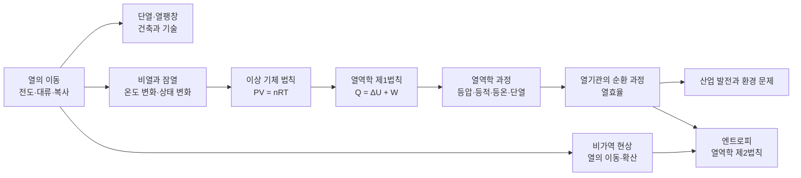
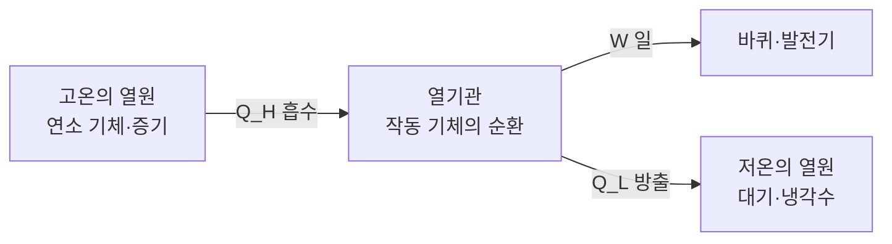

# 역학과 에너지 2. 열과 에너지 — 단열재에서 엔진, 그리고 되돌릴 수 없는 변화까지
<!-- prev: m1-03, m1-04, m1-06, 5-6, phy-1, mech-1 -->
<!-- next: matter-1, matter-3 -->

> [!NOTE]
> **성취기준**
> - **[12역학02-01]** 건축을 포함한 다양한 열에너지 관련 기술에 단열, 열팽창 등이 활용된 예를 조사함으로써 과학의 유용성에 대한 가치를 인식할 수 있다.
> - **[12역학02-02]** 열에 의한 물질의 상태 변화를 이해하고, 이상 기체의 온도, 압력, 부피의 관계를 설명할 수 있다.
> - **[12역학02-03]** 계에 가해진 열이 계의 내부 에너지를 변화시키거나 외부에 일을 할 수 있음을 이해하고, 일상생활 속의 예를 찾음으로써 흥미를 느낄 수 있다.
> - **[12역학02-04]** 다양한 열기관에서의 순환 과정과 열효율을 설명하고, 열기관의 개발과 활용이 인류 공동체에 미친 영향을 산업발전과 환경 측면에서 평가할 수 있다.
> - **[12역학02-05]** 열의 이동, 기체의 확산과 같은 비가역 현상을 엔트로피를 이용하여 설명할 수 있다.

**학습 목표**

1. 고체와 유체에서 열이 전도·대류·복사로 전달되는 과정을 설명하고, 건축물의 단열과 열팽창 대책 등 실제 기술에 활용된 사례를 조사할 수 있다.
2. 비열과 잠열을 이용하여 물질의 온도 변화와 상태 변화에 필요한 열을 정량적으로 구할 수 있다.
3. 이상 기체의 압력, 부피, 온도의 관계를 이상 기체 법칙으로 설명하고 생활 속 열 현상에 적용할 수 있다.
4. 등압·등적·등온 과정에서 기체에 가해진 열, 기체가 한 일, 내부 에너지 변화의 관계를 열역학 제1법칙으로 설명할 수 있다.
5. 여러 열기관의 순환 과정과 열효율의 의미를 설명하고, 열기관이 산업 발전과 환경에 미친 영향을 평가할 수 있다.
6. 열의 이동과 기체의 확산이 되돌릴 수 없는 현상인 까닭을 엔트로피(경우의 수)로 설명할 수 있다.

**이 단원의 학습 사다리**

| 단계 | 무엇을 하나? |
|---|---|
| STEP 1. 이전 학습 다시 보기 | 중학교 「열」, 「기체의 성질」, 통합과학 「에너지 효율과 신재생 에너지」, 물리학 「힘과 에너지」를 꺼내 본다 |
| STEP 2. 기초 다지기 | 절대 온도, 열·온도·내부 에너지의 구별, 압력과 몰, 기체가 하는 일 $P\Delta V$ |
| STEP 3. 핵심 개념 | 열의 이동과 단열·열팽창 → 비열과 잠열 → 이상 기체 법칙 → 열역학 제1법칙 → 열기관 → 엔트로피 |
| STEP 4. 오개념 바로잡기 | "금속은 원래 차갑다?", "열효율 100 % 엔진도 언젠가는?" 같은 착각을 바로잡는다 |
| STEP 5. 대학으로 한 걸음 더 | 열역학·통계역학의 카르노 효율, $\Delta S = Q/T$, 볼츠만 엔트로피 맛보기 |
| STEP 6. 생활·산업·진로 | 제로 에너지 건축, 발전소의 효율 높이기, 히트 펌프, 전자 기기 냉각 |

---

## 🗺️ 단원 들어가기

한겨울, 같은 온도로 난방을 하는데도 어떤 집은 따뜻하고 어떤 집은 외풍이 숭숭 든다. 여름날 철길 이음매에는 일부러 틈을 남겨 두고, 긴 다리의 끝부분에는 톱니 모양의 이음 장치가 있다. 자전거 타이어에 바람을 넣으면 펌프가 뜨거워지고, 스프레이를 오래 뿌리면 통이 차가워진다. 자동차 엔진은 연료가 내는 열의 일부만 바퀴를 돌리는 데 쓰고 나머지는 라디에이터와 배기가스로 내다 버린다. 그리고 뜨거운 커피는 저절로 식지만, 식은 커피가 주변의 열을 모아 저절로 다시 뜨거워지는 일은 결코 일어나지 않는다.

이 모든 장면에는 **열**이라는 에너지가 있다. 열은 어떻게 이동하고, 물질을 어떻게 바꾸며, 어떻게 일로 바뀌는가? 그리고 왜 열이 관여하는 변화에는 정해진 **방향**이 있는가? 이 단원에서는 에너지 보존(열역학 제1법칙)과 변화의 방향(열역학 제2법칙)이라는 두 기둥으로 열 현상을 정리한다.

---

## STEP 1. 🔙 이전 학습 다시 보기

### 연계 개념표

| 이전 단원·성취기준 | 그때 배운 것 | 이 단원에서 확장되는 것 |
|---|---|---|
| 중1 「열」 [9과03-01], [9과03-02] | 온도는 입자 운동의 활발한 정도이며, 열평형이 일어나고, 열은 전도·대류·복사로 전달된다 | 고체뿐 아니라 **유체**에서의 열전달을 비교하고, 건축물의 **단열 설계**에 적용한다 |
| 중1 「열」 [9과03-03] | 물질마다 비열과 열팽창 정도가 다르다 | $Q = cm\Delta T$, $\Delta L = \alpha L\Delta T$로 **정량적으로** 계산한다 |
| 중1 「물질의 상태 변화」 [9과04-04] | 상태 변화 때 열에너지를 흡수하거나 방출한다 | 상태 변화에 드는 열을 **잠열**로 계산하고, 그동안 온도가 일정한 까닭을 설명한다 |
| 중1 「기체의 성질」 [9과06-01]~[9과06-03] | 기체의 압력과 부피(보일 법칙), 온도와 부피(샤를 법칙)의 관계를 입자 모형으로 해석한다 | 두 법칙을 묶어 **이상 기체 법칙 $PV = nRT$** 로 통합한다 |
| 통합과학2 「에너지 효율과 신재생 에너지」 [10통과2-02-06] | 에너지 총량은 보존되지만, 사용 과정에서 열이 발생하여 효율이 낮아진다 | 열을 일로 바꾸는 **열기관의 효율**에 한계가 있는 이유를 열역학 제2법칙으로 설명한다 |
| 물리학 「힘과 에너지」 [12물리01-05], [12물리01-06] | 역학적 에너지가 열로 전환되어도 총량은 보존되고, 열을 역학적 에너지로 바꾸는 효율은 정성적으로 한계가 있다 | 열역학 과정을 **명시적으로** 다루어 열·일·내부 에너지의 관계를 식으로 세운다 |
| 역학과 에너지 「시공간과 운동」 | 역학적 에너지 보존, 일 = 힘 × 이동 거리 | 피스톤을 미는 기체가 하는 일 $W = P\Delta V$ |

### 준비 운동 (사전 진단)

**Q1.** 같은 온도의 나무 의자와 쇠 의자에 앉으면 쇠 의자가 더 차갑게 느껴진다. 그 까닭으로 옳은 것은?
① 쇠 의자의 온도가 더 낮기 때문에 ② 쇠가 열을 더 빨리 전달하기 때문에 ③ 쇠가 차가움을 더 많이 품고 있기 때문에

**Q2.** 냄비에 담긴 물이 끓는 동안 계속 가열하면 물의 온도는 어떻게 되는가? (1기압)

**Q3.** 일정한 압력에서 기체의 온도를 $10^\circ\mathrm{C}$에서 $20^\circ\mathrm{C}$로 올리면 부피가 2배가 된다. (O / X)

**Q4.** 마찰이 있는 바닥에서 미끄러지던 상자가 멈추었다. 상자가 가지고 있던 운동 에너지는 사라졌는가?

정답 및 해설

**Q1. ②** — 두 의자의 온도는 같다. 쇠는 열전도가 잘 되어 피부의 열을 빨리 빼앗아 가므로 피부 온도가 빨리 내려가 더 차갑게 느낀다. '차가움'이라는 것이 이동하는 것이 아니다.

**Q2.** 약 $100^\circ\mathrm{C}$로 **일정**하다. 가해 준 열은 온도를 올리지 않고 액체를 기체로 바꾸는 데(입자 사이의 인력을 끊는 데) 쓰인다.

**Q3. X** — 샤를 법칙의 부피는 **절대 온도**에 비례한다. $283\ \mathrm{K} \to 293\ \mathrm{K}$이므로 부피는 약 1.04배가 될 뿐이다.

**Q4.** 사라지지 않았다. 마찰에 의해 상자와 바닥의 **내부 에너지(열)** 로 바뀌었다. 에너지 총량은 보존된다(물리학 「힘과 에너지」).

---

## STEP 2. 🧱 기초 다지기

### 디딤돌 1. 절대 온도

기체를 식히면 부피(또는 압력)가 일정하게 줄어드는데, 이 직선을 연장하면 약 $-273^\circ\mathrm{C}$에서 0이 된다. 이 온도를 0으로 잡은 온도 눈금이 **절대 온도(absolute temperature)** 이며, 단위는 **켈빈(K)** 이다.

$$
T(\mathrm{K}) = t(^\circ\mathrm{C}) + 273
$$

눈금 간격은 섭씨와 같으므로 **온도 차이** $\Delta T$는 K와 $^\circ\mathrm{C}$가 같다. 그러나 기체 법칙처럼 온도 **자체**에 비례하는 식에는 반드시 절대 온도를 넣어야 한다.

<!-- fig:mech-2-absolute-zero -->

### 디딤돌 2. 온도, 열, 내부 에너지는 다르다

| 양 | 뜻 | 비유(통장) |
|---|---|---|
| **내부 에너지(internal energy)** $U$ | 물체를 이루는 입자들의 운동 에너지와 입자 사이의 위치 에너지의 총합 | 통장에 들어 있는 잔고 |
| **열(heat)** $Q$ | 온도 차이 때문에 이동하는 에너지 | 들어오거나 나간 '이체 금액' |
| **일(work)** $W$ | 힘이 작용하여 물체를 이동시키며 전달되는 에너지 | 현금으로 주고받은 금액 |
| **온도(temperature)** $T$ | 입자들의 평균 운동 에너지의 척도 | 잔고를 사람 수로 나눈 '1인당 평균' |

> [!TIP]
> 💡 **비유** — "이 물체는 열을 많이 가지고 있다"는 말은 "이 통장은 이체를 많이 가지고 있다"처럼 어색하다. 물체가 가진 것은 **내부 에너지**이고, 열과 일은 내부 에너지를 바꾸는 두 가지 **전달 방식**이다. 욕조 물(질량이 크고 온도가 낮음)의 내부 에너지가 촛불(온도는 높지만 질량이 작음)보다 훨씬 클 수 있다.

### 디딤돌 3. 압력과 몰

- **압력(pressure)**: 단위 넓이에 수직으로 작용하는 힘, $P = F/A$. 단위 $\mathrm{Pa} = \mathrm{N/m^2}$. 1기압(atm) $\approx 1.01\times10^{5}\ \mathrm{Pa}$.
- 기체의 압력은 수많은 분자가 벽에 부딪히며 주는 충격량의 평균 효과이다(통합과학 「운동량과 충격량」의 충격량 개념이 여기서 쓰인다).
- **몰(mol)**: 입자 약 $6.02\times10^{23}$개(아보가드로수)의 묶음. 기체의 '양'을 개수로 센다.

### 디딤돌 4. 기체가 하는 일 $W = P\Delta V$

단면적 $A$인 실린더 속 기체가 일정한 압력 $P$로 피스톤을 거리 $\Delta x$만큼 밀어낸다면

$$
W = F\Delta x = (PA)\Delta x = P\Delta V
$$

- 기체가 팽창하면($\Delta V > 0$) 기체가 외부에 **양(+)의 일**을 한다.
- 기체가 압축되면($\Delta V < 0$) 외부가 기체에 일을 해 준다(기체가 한 일은 음수).
- 압력이 변하는 경우에도 **압력–부피($P$–$V$) 그래프 아래 넓이**가 기체가 한 일이다. (속도–시간 그래프 아래 넓이가 이동 거리였던 것과 같은 아이디어이다.)

<!-- fig:mech-2-gas-work -->

---

## STEP 3. 📘 핵심 개념

### ① 열의 이동과 단열·열팽창의 활용

#### (1) 고체와 유체에서의 열전달

| 방식 | 원리 | 주로 일어나는 곳 | 예 |
|---|---|---|---|
| **전도(conduction)** | 이웃한 입자끼리 충돌하며 운동 에너지를 전달한다. 금속에서는 자유 전자가 크게 기여한다 | 고체(유체에서도 일어나지만 느리다) | 프라이팬 손잡이가 뜨거워짐, 겨울철 콘크리트 벽을 통한 열손실 |
| **대류(convection)** | 데워진 유체가 팽창하여 밀도가 작아지면 위로, 차가운 유체는 아래로 움직이며 열을 실어 나른다 | 액체, 기체 | 난방기 위 공기의 상승, 바다와 육지 사이의 해륙풍 |
| **복사(radiation)** | 물체가 온도에 따라 전자기파(주로 적외선)를 방출·흡수한다. 매질이 필요 없다 | 모든 물체, 진공에서도 | 태양열, 난로 앞의 따뜻함, 열화상 카메라 |

실제 열손실은 세 방식이 함께 일어난다. 예를 들어 겨울철 창문에서는 실내 공기의 대류 → 유리를 통한 전도 → 바깥 공기의 대류, 그리고 유리를 통한 복사가 함께 열을 빼낸다.

<!-- fig:mech-2-window-heat-loss -->

#### (2) 전도에서 열이 흐르는 빠르기

두께 $d$, 넓이 $A$인 벽의 양쪽 온도 차이가 $\Delta T$일 때, 1초 동안 벽을 통해 흐르는 열(열류) $H$는 다음과 같이 비례한다.

$$
H = \frac{Q}{t} = k\frac{A\,\Delta T}{d}
$$

$k$는 물질의 **열전도율(thermal conductivity)** 이다. 넓을수록, 온도 차이가 클수록, 얇을수록, 열전도율이 클수록 열이 빨리 흐른다.

| 물질 | 열전도율(약, $\mathrm{W/(m\cdot K)}$) | 쓰임 |
|---|---|---|
| 구리 | 400 | 냄비 바닥, 전자 기기 방열판 |
| 알루미늄 | 240 | 방열판, 열교환기 |
| 콘크리트 | 1 | 건물 벽체(단열재 필요) |
| 유리 | 1 | 창문(이중·삼중으로 사용) |
| 물 | 0.6 | — |
| 나무 | 0.1~0.2 | 냄비 손잡이, 목조 건축 |
| 발포 폴리스타이렌(스티로폼) | 0.03~0.04 | 건물 단열재, 아이스박스 |
| 정지한 공기 | 0.025 | 단열재 속 기포, 이중창 사이 공기층 |

#### 예제 1 — 단열재 한 장의 힘

넓이 $10\ \mathrm{m^2}$, 두께 0.1 m인 벽의 안팎 온도 차이가 $20\ \mathrm{K}$이다. 벽이 콘크리트($k \approx 1$)일 때와, 같은 두께의 스티로폼 단열재($k \approx 0.04$)일 때 1초 동안 빠져나가는 열을 비교하시오.

**풀이**
- 콘크리트: $H = 1\times\dfrac{10\times20}{0.1} = 2000\ \mathrm{W}$
- 스티로폼: $H = 0.04\times\dfrac{10\times20}{0.1} = 80\ \mathrm{W}$

열손실이 25분의 1로 줄어든다. 단열재가 좋은 까닭은 **움직이지 못하게 갇힌 작은 공기 방울**이 많기 때문이다. 공기는 열전도율이 매우 작고, 기포에 갇혀 있으면 대류도 거의 일어나지 못한다.

#### (3) 건축물의 단열 기술

| 기술 | 막는 열전달 | 원리 |
|---|---|---|
| 외벽·지붕 단열재(스티로폼, 미네랄울, 우레탄 폼 등) | 전도, 대류 | 갇힌 공기층으로 열전도율을 낮춘다 |
| 이중창·삼중창(유리 사이 공기나 아르곤 기체) | 전도, 대류 | 열전도율이 작은 기체층을 얇게 가두어 대류도 억제한다 |
| 로이(Low-E) 유리 | 복사 | 유리 표면의 얇은 금속 산화물 막이 적외선을 반사하여 실내 열이 빠져나가는 것을 줄인다 |
| 단열 문틀·기밀 시공 | 대류(틈새 바람) | 틈을 막아 공기가 드나들며 열을 실어 나르는 것을 막는다 |
| 열교(熱橋) 차단재 | 전도 | 철골·발코니 등 열이 잘 새는 '다리' 부분을 끊어 준다 |
| 온돌·바닥 난방 | (활용) 전도·대류·복사 | 데운 바닥이 몸에 직접 전도하고, 바닥 근처의 데워진 공기가 대류로 방 전체를 데우며, 적외선 복사도 한다 |

> [!NOTE]
> 전통 한옥의 두꺼운 흙벽과 초가지붕, 겹으로 바른 창호지 역시 공기층과 열전도율이 작은 재료를 이용한 단열 기술이다. 반대로 여름에는 대청마루의 바람길로 대류를 활발하게 하여 열을 내보냈다.

#### (4) 열팽창과 그 활용

대부분의 물질은 온도가 올라가면 입자의 진동이 커져 입자 사이 평균 거리가 늘어나므로 팽창한다. 길이 $L$인 고체의 온도가 $\Delta T$만큼 변하면 길이 변화는

$$
\Delta L = \alpha L \Delta T
$$

이며, $\alpha$를 **선팽창 계수(coefficient of linear expansion)** 라 한다. 강철은 약 $1.2\times10^{-5}\ \mathrm{K^{-1}}$, 알루미늄은 약 $2.3\times10^{-5}\ \mathrm{K^{-1}}$이다.

| 사례 | 열팽창을 어떻게 다루나? |
|---|---|
| 철로 이음매의 틈, 다리의 신축 이음 장치 | 여름철 팽창으로 휘거나 부서지지 않도록 늘어날 공간을 남긴다 |
| 철근 콘크리트 | 철근과 콘크리트의 선팽창 계수가 거의 같아서 온도가 바뀌어도 둘이 잘 떨어지지 않는다 |
| 바이메탈 온도 스위치 | 팽창 정도가 다른 두 금속을 붙이면 온도에 따라 휘어 전기 회로를 끊거나 잇는다 |
| 내열 유리 그릇 | 선팽창 계수가 작은 유리를 써서 급히 데우거나 식혀도 깨지지 않게 한다 |
| 송전선 | 여름에는 늘어져 처지고 겨울에는 팽팽해지므로 계절을 고려해 설치한다 |
| 유리병의 금속 뚜껑 | 뜨거운 물에 담그면 금속 뚜껑이 유리보다 더 팽창하여 쉽게 열린다 |

<!-- fig:mech-2-bimetal -->

#### 예제 2 — 여름철 철로

길이 25 m인 강철 레일의 온도가 겨울 $-5^\circ\mathrm{C}$에서 여름 $35^\circ\mathrm{C}$로 변한다. 레일은 얼마나 늘어나는가? ($\alpha = 1.2\times10^{-5}\ \mathrm{K^{-1}}$)

**풀이** $\Delta L = 1.2\times10^{-5}\times25\times40 = 1.2\times10^{-2}\ \mathrm{m} = 12\ \mathrm{mm}$

1 cm 남짓이지만, 레일이 이 길이만큼 늘어날 곳이 없으면 큰 힘이 생겨 레일이 휠 수 있다. 오늘날 고속 철도는 긴 레일을 용접해 이음매를 없애는 대신, 레일을 단단히 고정하여 늘어나려는 힘을 견디게 하고 설치 온도를 관리한다.

> [!TIP]
> 💡 **비유** — 열팽창은 '사람들이 춤을 추기 시작한 운동장'과 같다. 가만히 서 있던 사람들(입자)이 신나게 움직이기 시작하면 서로 부딪히지 않으려고 간격을 넓힌다. 온도가 높을수록 춤이 격렬해지고 차지하는 자리도 커진다.

#### ✔ 바로 확인

1. 짝짓기: (가) 프라이팬 손잡이가 뜨거워진다 (나) 난방기 위의 공기가 올라간다 (다) 햇볕을 쬐면 따뜻하다 — ㄱ. 전도 ㄴ. 대류 ㄷ. 복사
2. (O/X) 복사는 매질이 없는 진공에서도 열을 전달할 수 있다.
3. 다른 조건은 그대로 두고 벽의 두께만 2배로 하면, 벽을 통해 1초 동안 흐르는 열은 몇 배가 되는가?
4. 빈칸: 바이메탈은 (    ) 계수가 서로 다른 두 금속을 붙여, 온도에 따라 휘게 만든 장치이다.

정답

1. (가) ㄱ, (나) ㄴ, (다) ㄷ
2. O — 전자기파(주로 적외선)로 전달되므로 매질이 필요 없다.
3. $\frac{1}{2}$배 — $H = kA\Delta T/d$로 두께에 반비례한다.
4. 선팽창 — 더 많이 늘어나는 금속이 바깥쪽이 되도록 휜다.

### ② 열에 의한 온도 변화와 상태 변화 — 비열과 잠열

#### (1) 비열: 온도를 바꾸는 데 필요한 열

질량 $m$인 물질의 온도를 $\Delta T$만큼 높이는 데 필요한 열은

$$
Q = cm\Delta T
$$

이다. $c$는 물질 1 kg의 온도를 1 K 높이는 데 필요한 열로, **비열(specific heat)** 이라 한다. 물체 전체의 온도를 1 K 높이는 데 필요한 열 $C = cm$은 **열용량(heat capacity)** 이다.

| 물질 | 비열(약, $\mathrm{J/(kg\cdot K)}$) |
|---|---|
| 물 | 4200 |
| 얼음 | 2100 |
| 식용유 | 2000 |
| 알루미늄 | 900 |
| 모래·흙(마른 것) | 800 |
| 철 | 450 |
| 구리 | 390 |

물의 비열이 유난히 크다. 그래서 바다는 육지보다 천천히 데워지고 천천히 식으며(해안 지방의 온화한 기후, 해륙풍), 물은 난방수·냉각수·찜질 팩에 널리 쓰인다.

#### 예제 3 — 뜨거운 물과 찬물 섞기

$80^\circ\mathrm{C}$ 물 0.2 kg과 $20^\circ\mathrm{C}$ 물 0.3 kg을 단열 용기에 섞었다. 열평형 온도는?

**풀이** 뜨거운 물이 잃은 열 = 찬물이 얻은 열(에너지 보존)

$$
0.2\times c\times(80 - T) = 0.3\times c\times(T - 20) \;\Rightarrow\; 16 - 0.2T = 0.3T - 6 \;\Rightarrow\; T = 44^\circ\mathrm{C}
$$

#### (2) 잠열: 온도는 그대로, 상태만 바꾸는 열

얼음을 일정하게 가열하면 온도가 오르다가 $0^\circ\mathrm{C}$에서 멈추고, 다 녹은 뒤 다시 오르다가 $100^\circ\mathrm{C}$에서 또 멈춘다. 멈춘 동안 들어간 열은 입자의 평균 운동 에너지(온도)를 높이지 않고, **입자 사이의 인력을 이겨 배열을 바꾸는 데(입자 사이 위치 에너지를 높이는 데)** 쓰인다. 상태 변화에 필요한 열을 **잠열(latent heat)** 이라 하고, 1 kg당 값을 $L$로 쓴다.

$$
Q = mL
$$

| 구간 | 일어나는 일 | 필요한 열 |
|---|---|---|
| 얼음의 온도 상승 | 고체 입자의 진동이 커진다 | $c_{\text{얼음}}m\Delta T$ |
| $0^\circ\mathrm{C}$ 융해 | 규칙적 배열이 무너진다(온도 일정) | $mL_{\text{융해}}$, $L_{\text{융해}} \approx 3.34\times10^{5}\ \mathrm{J/kg}$ |
| 물의 온도 상승 | 액체 입자의 운동이 활발해진다 | $c_{\text{물}}m\Delta T$ |
| $100^\circ\mathrm{C}$ 기화 | 입자들이 서로에게서 완전히 떨어져 나간다(온도 일정) | $mL_{\text{기화}}$, $L_{\text{기화}} \approx 2.26\times10^{6}\ \mathrm{J/kg}$ |

<!-- fig:mech-2-heating-curve -->

기화열은 융해열보다 약 7배 크고, 물 1 kg을 $0^\circ\mathrm{C}$에서 $100^\circ\mathrm{C}$까지 데우는 열(약 $4.2\times10^{5}\ \mathrm{J}$)의 5배가 넘는다. 액체에서 기체가 될 때는 입자 사이의 인력을 거의 완전히 끊어야 하기 때문이다. 거꾸로 수증기가 물이 될 때(액화) 같은 양의 열을 내놓는다. $100^\circ\mathrm{C}$ 수증기에 데는 것이 $100^\circ\mathrm{C}$ 물에 데는 것보다 훨씬 위험한 까닭이다.

#### 예제 4 — 얼음을 물로

$-10^\circ\mathrm{C}$ 얼음 0.5 kg을 $20^\circ\mathrm{C}$ 물로 만드는 데 필요한 열은? ($c_{\text{얼음}} = 2100$, $c_{\text{물}} = 4200\ \mathrm{J/(kg\cdot K)}$, $L_{\text{융해}} = 3.34\times10^{5}\ \mathrm{J/kg}$)

**풀이**
- 얼음 $-10 \to 0^\circ\mathrm{C}$: $2100\times0.5\times10 = 10\,500\ \mathrm{J}$
- 융해: $0.5\times3.34\times10^{5} = 167\,000\ \mathrm{J}$
- 물 $0 \to 20^\circ\mathrm{C}$: $4200\times0.5\times20 = 42\,000\ \mathrm{J}$
- 합계: $219\,500\ \mathrm{J} \approx 2.2\times10^{5}\ \mathrm{J}$

융해에 드는 열이 전체의 약 4분의 3을 차지한다. 얼음이 음료를 차갑게 하는 데 탁월한 것은 녹으면서 많은 열을 흡수하기 때문이다.

| 생활 속 잠열 | 원리 |
|---|---|
| 땀이 증발하며 체온을 낮춘다 | 증발(기화)할 때 피부에서 열을 흡수한다 |
| 에어컨·냉장고의 냉매 | 실내 쪽에서 기화하며 열을 흡수하고, 실외 쪽에서 액화하며 열을 버린다 |
| 과일 농장의 서리 방지 살수 | 물이 얼면서 내놓는 응고열로 과일 온도가 $0^\circ\mathrm{C}$ 아래로 내려가지 않게 한다 |
| 축열재(상변화 물질) | 녹고 어는 동안 일정한 온도에서 많은 열을 저장·방출하여 실내 온도를 안정시킨다 |

#### ✔ 바로 확인

1. 물 1 kg의 온도를 10 K 높이는 데 필요한 열은? (물의 비열 $4200\ \mathrm{J/(kg\cdot K)}$)
2. (O/X) 1기압에서 얼음이 녹는 동안에는 계속 가열해도 온도가 $0^\circ\mathrm{C}$로 일정하다.
3. 질량이 같은 물과 철에 같은 양의 열을 가했다. 온도가 더 많이 올라가는 것은? (① 물 ② 철 ③ 같다)
4. 빈칸: $100^\circ\mathrm{C}$ 수증기 1 kg이 같은 온도의 물로 액화할 때 내놓는 열은 약 (    ) J이다.

정답

1. $4.2\times10^{4}\ \mathrm{J}$ — $Q = cm\Delta T = 4200\times1\times10$
2. O — 가한 열은 잠열로 쓰여 입자 배열을 바꾼다.
3. ② — 철의 비열(약 450)이 물(4200)보다 훨씬 작다.
4. $2.26\times10^{6}$ — 기화열과 같은 양의 열을 내놓는다.

### ③ 이상 기체의 온도, 압력, 부피의 관계

#### (1) 보일 법칙과 샤를 법칙을 하나로

중학교에서 배운 두 법칙을 절대 온도로 다시 쓰자.

| 법칙 | 일정한 것 | 관계 | 입자 모형 해석 |
|---|---|---|---|
| 보일 법칙 | 온도, 기체의 양 | $PV$ = 일정 | 부피가 줄면 분자가 벽에 더 자주 부딪힌다 |
| 샤를 법칙 | 압력, 기체의 양 | $V \propto T$ | 온도가 오르면 분자가 빨라져, 압력을 유지하려면 부피가 커져야 한다 |
| (게이뤼삭 법칙) | 부피, 기체의 양 | $P \propto T$ | 온도가 오르면 분자가 더 세게, 더 자주 부딪힌다 |
| 아보가드로 법칙 | 온도, 압력 | $V \propto n$ | 같은 조건에서 같은 부피에는 같은 수의 분자가 있다 |

이들을 모두 합치면 하나의 식이 된다.

$$
PV = nRT, \qquad R \approx 8.31\ \mathrm{J/(mol\cdot K)}
$$

이것이 **이상 기체 법칙(ideal gas law)** 이고, 이 식을 정확히 따르는 가상의 기체를 **이상 기체(ideal gas)** 라 한다. 이상 기체는 분자 자체의 부피와 분자 사이의 인력을 무시한 모형이다. 실제 기체도 압력이 너무 높지 않고 온도가 너무 낮지 않으면(액화되기 쉬운 조건이 아니면) 이 식을 잘 따른다.

같은 기체가 상태 1에서 상태 2로 바뀌면 $n$이 일정하므로 다음 식이 편리하다.

$$
\frac{P_1V_1}{T_1} = \frac{P_2V_2}{T_2}
$$

#### 예제 5 — 달리고 난 뒤의 타이어

출발 전 타이어 속 공기의 압력(절대 압력)이 2.5기압, 온도가 $27^\circ\mathrm{C}$였다. 고속 도로를 달린 뒤 타이어 속 공기의 온도가 $57^\circ\mathrm{C}$가 되었다. 부피가 변하지 않는다면 압력은?

**풀이** $V$ 일정: $\dfrac{P_2}{P_1} = \dfrac{T_2}{T_1} = \dfrac{330}{300} = 1.1 \Rightarrow P_2 = 2.75$기압

섭씨 온도로 계산하면 $57/27 \approx 2.1$배라는 엉뚱한 답이 나온다. 타이어 공기압은 차가울 때(운행 전) 재는 것이 원칙인 이유도 여기에 있다.

#### 예제 6 — 기체 1몰의 부피

$0^\circ\mathrm{C}$, 1기압($1.013\times10^{5}\ \mathrm{Pa}$)에서 이상 기체 1 mol의 부피는?

**풀이** $V = \dfrac{nRT}{P} = \dfrac{1\times8.31\times273}{1.013\times10^{5}} \approx 2.24\times10^{-2}\ \mathrm{m^3} = 22.4\ \mathrm{L}$

어떤 기체든 같은 온도·압력이면 1 mol의 부피가 같다는 것은 이상 기체 법칙에 기체의 종류가 들어 있지 않다는 뜻이다.

#### (2) 생활 속 이상 기체 법칙

| 현상 | 일정한 것 | 설명 |
|---|---|---|
| 열기구가 뜬다 | 압력(대기압) | 풍선 속 공기를 $20^\circ\mathrm{C}$에서 $100^\circ\mathrm{C}$로 데우면 같은 부피 속 분자 수가 $293/373 \approx 0.79$배로 줄어 공기가 약 21 % 가벼워진다 |
| 높은 산에서 과자 봉지가 부푼다 | 온도(대략) | 바깥 압력이 낮아져 봉지 속 기체의 부피가 커진다 |
| 잠수 후 숨을 참고 떠오르면 위험하다 | 온도(대략) | 수심 10 m(약 2기압)에서 채운 폐 속 공기는 수면(1기압)에서 부피가 약 2배가 되려 한다 |
| 겨울 아침 타이어 공기압 경고등 | 부피(대략) | 기온이 내려가 타이어 속 압력이 낮아진다 |

> [!WARNING]
> 스프레이 캔·부탄가스 통을 불 가까이 두거나 여름철 차 안에 두면 안 된다. 부피가 일정한 용기 속 기체의 압력은 절대 온도에 비례하여 높아지고, 용기가 터질 수 있다.

#### ✔ 바로 확인

1. $27^\circ\mathrm{C}$는 절대 온도로 몇 K인가?
2. 온도가 일정할 때 기체의 부피를 절반으로 줄이면 압력은 몇 배가 되는가?
3. (O/X) 같은 온도·같은 압력에서 이상 기체 1 mol의 부피는 기체의 종류에 따라 다르다.
4. 부피가 일정한 용기 속 기체의 온도가 300 K에서 450 K가 되면 압력은 몇 배가 되는가?

정답

1. 300 K — $27 + 273$
2. 2배 — 보일 법칙 $PV$ = 일정
3. X — $PV = nRT$에 기체의 종류가 들어 있지 않다.
4. 1.5배 — 부피가 일정하면 $P \propto T$(절대 온도)

### ④ 열역학 제1법칙 — 열은 내부 에너지를 바꾸거나 일을 한다

#### (1) 이상 기체의 내부 에너지

이상 기체는 분자 사이의 인력을 무시하므로 내부 에너지는 분자들의 운동 에너지의 합뿐이다. 따라서 **이상 기체의 내부 에너지는 온도만으로 정해진다.** 헬륨, 네온처럼 원자 하나로 된 단원자 이상 기체의 경우

$$
U = \frac{3}{2}nRT, \qquad \Delta U = \frac{3}{2}nR\Delta T
$$

온도가 오르면 내부 에너지가 늘고, 온도가 일정하면 내부 에너지도 일정하다.

#### (2) 열역학 제1법칙

기체(계)에 열 $Q$가 들어오면, 그 에너지는 사라지지 않고 **내부 에너지를 늘리거나($\Delta U$), 외부에 일을 하는 데($W$)** 쓰인다.

$$
Q = \Delta U + W
$$

| 기호 | (+)일 때 | (−)일 때 |
|---|---|---|
| $Q$ | 계가 열을 흡수 | 계가 열을 방출 |
| $\Delta U$ | 내부 에너지 증가(이상 기체: 온도 상승) | 내부 에너지 감소(온도 하강) |
| $W$ | 계가 외부에 일을 함(팽창) | 외부가 계에 일을 함(압축) |

이것이 **열역학 제1법칙(first law of thermodynamics)** 이며, 열까지 포함한 **에너지 보존 법칙**의 다른 표현이다. 줄(Joule)이 추가 낙하하며 물속 날개를 돌려 물의 온도가 오르는 것을 측정하여, 일과 열이 같은 에너지임을 보인 것이 이 법칙의 실험적 바탕이 되었다.

> [!TIP]
> 💡 **비유** — 용돈(열 $Q$)을 받으면, 일부는 저금하고(내부 에너지 증가 $\Delta U$), 일부는 쓴다(일 $W$). 받은 돈 = 저금한 돈 + 쓴 돈. 돈이 어디선가 생기거나 사라지지 않듯, 에너지도 그렇다.

#### (3) 여러 가지 열역학 과정

| 과정 | 조건 | $W$ | $\Delta U$ | 제1법칙 | $P$–$V$ 그래프 |
|---|---|---|---|---|---|
| **등적 과정(isochoric)** | 부피 일정 | 0 | $Q$ | $Q = \Delta U$ | 세로축에 나란한 직선(넓이 0) |
| **등압 과정(isobaric)** | 압력 일정 | $P\Delta V$ | $\frac{3}{2}nR\Delta T$ | $Q = \Delta U + P\Delta V$ | 가로축에 나란한 직선(아래 넓이 = 일) |
| **등온 과정(isothermal)** | 온도 일정 | 그래프 아래 넓이 | 0 | $Q = W$ | 쌍곡선 모양 곡선($PV$ = 일정) |
| **단열 과정(adiabatic)** | 열 출입 없음 | 그래프 아래 넓이 | $-W$ | $0 = \Delta U + W$ | 등온선보다 가파른 곡선 |

<!-- sim:pv-diagram -->

#### 예제 7 — 같은 온도를 올리는데 왜 열이 다를까?

단원자 이상 기체 1 mol이 $1.0\times10^{5}\ \mathrm{Pa}$의 일정한 압력에서 팽창하여 부피가 $2.0\times10^{-3}\ \mathrm{m^3}$ 늘었다. ($R = 8.31\ \mathrm{J/(mol\cdot K)}$)
(1) 기체가 한 일 (2) 온도 변화 (3) 내부 에너지 변화 (4) 흡수한 열을 구하시오. (5) 같은 기체를 부피가 일정한 상태에서 같은 온도만큼 올리려면 열이 얼마나 필요한가?

**풀이**
(1) $W = P\Delta V = 1.0\times10^{5}\times2.0\times10^{-3} = 200\ \mathrm{J}$
(2) $PV = nRT$에서 $P\Delta V = nR\Delta T$이므로 $\Delta T = \dfrac{200}{1\times8.31} \approx 24\ \mathrm{K}$
(3) $\Delta U = \frac{3}{2}nR\Delta T = \frac{3}{2}\times200 = 300\ \mathrm{J}$
(4) $Q = \Delta U + W = 300 + 200 = 500\ \mathrm{J}$
(5) 등적 과정에서는 $W = 0$이므로 $Q = \Delta U = 300\ \mathrm{J}$

같은 온도를 올리는 데 등압 과정은 500 J, 등적 과정은 300 J이 필요하다. 등압 과정에서는 들어온 열의 일부(200 J)가 피스톤을 밀어내는 일로 '빠져나가기' 때문이다.

#### 예제 8 — 등온 팽창

이상 기체가 온도를 일정하게 유지하며 팽창하는 동안 외부에 150 J의 일을 했다. 기체가 흡수한 열과 내부 에너지 변화는?

**풀이** 등온이므로 $\Delta U = 0$. $Q = \Delta U + W = 0 + 150 = 150\ \mathrm{J}$. 흡수한 열이 **모두** 일로 바뀌었다. (단, 이것은 한 번의 팽창일 뿐이다. 계속 일을 하려면 기체를 다시 압축해 처음 상태로 되돌려야 하고, 이 점이 ⑤의 열기관에서 중요해진다.)

#### (4) 생활 속 열역학 제1법칙

| 현상 | 과정 | 설명 |
|---|---|---|
| 자전거 펌프가 뜨거워진다 | 단열 압축(빠른 압축) | 외부가 기체에 일을 해 주어($W < 0$) 내부 에너지와 온도가 올라간다 |
| 스프레이를 오래 뿌리면 통이 차가워진다 | 단열 팽창에 가깝다 | 기체가 팽창하며 일을 하고, 액체가 기화하며 열을 흡수해 온도가 내려간다 |
| 산을 오르는 공기에서 구름이 생긴다 | 단열 팽창 | 높이 올라가 압력이 낮아지면 공기가 팽창하며 일을 해 온도가 내려가고, 수증기가 응결한다 |
| 디젤 기관의 점화 | 단열 압축 | 공기를 강하게 압축하면 온도가 연료의 발화점을 넘어 점화 플러그 없이 불이 붙는다 |
| 압력솥 뚜껑을 덮고 가열 | 등적 과정에 가깝다 | 들어간 열이 일을 하지 않고 모두 내부 에너지(온도·압력)를 높인다 |

#### ✔ 바로 확인

1. 기체가 열 100 J을 흡수하면서 외부에 40 J의 일을 했다. 내부 에너지 변화는?
2. 짝짓기: (가) 등적 과정 (나) 등온 과정 (다) 단열 과정 — ㄱ. $Q = 0$ ㄴ. $W = 0$ ㄷ. $\Delta U = 0$(이상 기체)
3. (O/X) 이상 기체의 내부 에너지는 온도만으로 정해진다.
4. 자전거 펌프로 공기를 빠르게 압축하면 펌프 속 공기의 온도는 어떻게 되는가?

정답

1. 60 J 증가 — $\Delta U = Q - W = 100 - 40$
2. (가) ㄴ, (나) ㄷ, (다) ㄱ
3. O — 분자 사이 인력을 무시하므로 내부 에너지는 분자 운동 에너지의 합뿐이다.
4. 올라간다 — 단열 압축에 가까워 $Q \approx 0$, 외부가 일을 해 주어 $\Delta U > 0$이다.

### ⑤ 열기관의 순환 과정과 열효율

#### (1) 열기관이란?

**열기관(heat engine)** 은 고온의 열원에서 열을 받아 그 일부를 일로 바꾸고, 나머지를 저온의 열원(주변 공기, 냉각수)에 버리는 장치이다. 계속 일을 하려면 작동 기체가 팽창한 뒤 다시 압축되어 **처음 상태로 돌아오는 순환 과정(cycle)** 을 반복해야 한다.

한 순환을 마치면 작동 기체는 처음 상태로 돌아오므로 $\Delta U = 0$이다. 제1법칙에 따라

$$
W = Q_H - Q_L
$$

이고, $P$–$V$ 그래프에서 **순환 경로가 둘러싼 넓이**가 한 순환 동안 한 일이다.

#### (2) 열효율

$$
e = \frac{W}{Q_H} = \frac{Q_H - Q_L}{Q_H} = 1 - \frac{Q_L}{Q_H}
$$

예를 들어 연료에서 1000 J의 열을 받아 300 J의 일을 하는 엔진은 열효율이 30 %이며, 나머지 700 J은 배기가스와 냉각수로 버려진다. **$Q_L$이 0이 될 수 없으므로 열효율은 항상 1(100 %)보다 작다.** 그 이유는 ⑥에서 엔트로피로 설명한다.

> [!NOTE]
> 이 성취기준에서는 열기관의 열 현상을 **복잡하게 계산하는 것보다** 순환 과정의 의미, 열효율의 뜻, 효율을 높이려는 인류의 노력과 사회적 영향을 이해하는 데 초점을 둔다.

#### (3) 여러 가지 열기관

| 열기관 | 순환 과정의 핵심 | 열효율(대략) | 쓰임 |
|---|---|---|---|
| 초기 증기 기관(18세기) | 보일러의 증기로 피스톤을 움직이고, 증기를 식혀 다시 물로 만든다 | 몇 % 이하 | 탄광 배수, 방직 공장, 증기 기관차 |
| 증기 터빈(화력·원자력 발전) | 물 → 고압 증기 → 터빈 회전 → 복수기에서 물로 응결 → 펌프로 보일러에 | 약 30~45 % | 발전소 |
| 가솔린 기관(오토 기관) | 흡입 → 압축 → 점화·폭발(팽창) → 배기의 4행정 | 약 25~35 % | 승용차, 오토바이 |
| 디젤 기관 | 공기만 강하게 압축해 고온으로 만든 뒤 연료를 분사해 자연 점화 | 약 30~45 % | 트럭, 선박, 발전기 |
| 가스 터빈·제트 기관 | 공기 압축 → 연소 → 고온 기체가 터빈을 돌리고 뒤로 분출 | 약 30~40 % | 항공기, 발전소 |
| 복합 화력 발전 | 가스 터빈의 뜨거운 배기가스로 다시 증기 터빈을 돌린다 | 약 50~60 % | 발전소 |

가솔린 기관의 4행정을 열역학 과정으로 보면, 압축 행정은 단열 압축에 가깝고(기체 온도 상승), 점화 순간은 부피가 거의 변하지 않는 동안 열이 들어오는 등적 가열에 가깝고, 폭발 행정은 단열 팽창에 가깝다(기체가 피스톤에 큰 일을 함). 배기 행정에서 남은 열을 바깥으로 버린다.

<!-- fig:mech-2-otto-cycle -->

#### (4) 열기관이 인류 공동체에 미친 영향

| 측면 | 긍정적 영향 | 부정적 영향과 과제 |
|---|---|---|
| 산업 | 18세기 증기 기관의 개량은 공장의 기계화와 대량 생산을 이끌며 산업 혁명의 원동력이 되었다 | 화석 연료에 크게 의존하는 산업 구조가 만들어졌다 |
| 교통·물류 | 증기 기관차·증기선, 이후 내연 기관 자동차와 항공기로 이동과 무역의 범위가 넓어졌다 | 교통 혼잡, 소음, 배기가스로 인한 도시 대기 오염 |
| 전력 | 화력·원자력 발전소의 증기 터빈이 현대 문명의 전기를 만든다 | 버려지는 열(온배수 등)과 발전 과정의 환경 영향 |
| 환경 | — | 화석 연료 연소로 배출된 이산화 탄소가 온실 효과를 강화하여 **지구 온난화**와 기후 변화의 주요 원인이 되었다. 질소 산화물·미세 먼지도 배출된다 |

열효율을 높이는 노력은 같은 일을 하는 데 연료를 덜 쓰는 것이므로 곧 온실 기체 배출을 줄이는 노력이다. 복합 화력 발전, 버려지는 열로 난방까지 하는 **열병합 발전**, 엔진과 전동기를 함께 쓰는 하이브리드 자동차, 그리고 열기관을 거치지 않고 전기를 만드는 태양광·풍력 발전과 전기 자동차로의 전환이 모두 이 흐름 위에 있다(통합과학 「에너지 효율과 신재생 에너지」).

#### (5) 열기관을 거꾸로 — 냉장고와 히트 펌프

외부에서 일을 해 주면 열을 **저온에서 고온으로** 옮길 수 있다. 냉장고와 에어컨은 실내(저온)의 열을 흡수하여 실외(고온)로 버리고, **히트 펌프(heat pump)** 는 같은 원리로 차가운 바깥 공기나 땅속의 열을 실내로 옮겨 난방을 한다. 히트 펌프는 투입한 전기 에너지보다 더 많은 열을 실내에 전달할 수 있는데, 이는 에너지를 만들어 내는 것이 아니라 바깥의 열을 '퍼 나르는' 것이기 때문에 제1법칙에 어긋나지 않는다.

#### ✔ 바로 확인

1. 고온의 열원에서 500 J을 흡수하여 150 J의 일을 하는 열기관의 열효율과 버리는 열은?
2. (O/X) 열기관의 작동 기체가 한 순환을 마치면 내부 에너지 변화는 0이다.
3. 빈칸: $P$–$V$ 그래프에서 순환 경로가 둘러싼 넓이는 한 순환 동안 기체가 한 (    )이다.
4. 히트 펌프가 투입한 전기 에너지보다 많은 열을 실내로 보낼 수 있는 까닭은? (① 에너지를 새로 만들어서 ② 바깥의 열을 실내로 옮기기 때문에 ③ 열효율이 100 %를 넘어서)

정답

1. 열효율 30 %, 버리는 열 350 J — $e = 150/500$, $Q_L = Q_H - W$
2. O — 처음 상태로 돌아오므로 온도도 같다.
3. 일 — $W = Q_H - Q_L$
4. ② — 열을 퍼 나르는 것이므로 제1법칙에 어긋나지 않는다.

### ⑥ 되돌릴 수 없는 변화와 엔트로피

#### (1) 가역 현상과 비가역 현상

| 비가역 현상(저절로 한쪽으로만 일어난다) | 반대 방향은? |
|---|---|
| 뜨거운 커피가 식어 주변과 온도가 같아진다 | 미지근한 커피가 주변의 열을 모아 저절로 뜨거워지지 않는다 |
| 향수 뚜껑을 열면 향기가 방 전체로 퍼진다(확산) | 퍼진 향기 분자가 저절로 병 속으로 다시 모이지 않는다 |
| 잉크 한 방울이 물에 퍼진다 | 퍼진 잉크가 저절로 한 방울로 모이지 않는다 |
| 미끄러지던 상자가 마찰로 멈추며 열이 난다 | 바닥의 열이 모여 상자를 저절로 다시 밀어내지 않는다 |

거꾸로 진행하는 동영상을 보면 우리는 금방 "이상하다"고 알아챈다. 이렇게 저절로는 한쪽 방향으로만 일어나는 변화를 **비가역 현상(irreversible process)** 이라 한다. 반대 방향의 변화도 에너지 보존(제1법칙)에는 전혀 어긋나지 않는다는 점이 중요하다. 그러므로 변화의 방향을 정하는 **또 하나의 법칙**이 필요하다.

#### (2) 경우의 수로 보는 확산

칸막이로 나뉜 상자의 왼쪽에 기체 분자 4개(A, B, C, D)가 있다가 칸막이를 치웠다고 하자. 분자 하나하나는 왼쪽(L)과 오른쪽(R) 어디에나 있을 수 있으므로 가능한 배치는 $2^4 = 16$가지이고, 각각이 일어날 가능성은 같다.

| 분포 (왼쪽 : 오른쪽) | 4 : 0 | 3 : 1 | 2 : 2 | 1 : 3 | 0 : 4 |
|---|---|---|---|---|---|
| 그렇게 되는 배치의 수 | 1 | 4 | 6 | 4 | 1 |
| 확률 | $\frac{1}{16}$ | $\frac{4}{16}$ | $\frac{6}{16}$ | $\frac{4}{16}$ | $\frac{1}{16}$ |

분자가 4개일 때는 모두 왼쪽에 모여 있을 확률이 $1/16$로 꽤 크다. 그러나 분자 수가 늘면 상황이 극적으로 바뀐다.

<!-- fig:mech-2-microstates -->

#### 예제 9 — 모두 한쪽에 모일 확률

상자 속 기체 분자 100개가 모두 왼쪽 절반에 모여 있을 확률은? 실제 기체 1 mol이라면?

**풀이** 분자 하나가 왼쪽에 있을 확률은 $\frac{1}{2}$이므로 $\left(\frac{1}{2}\right)^{100} \approx 7.9\times10^{-31}$. 1초에 한 번씩 배치를 바꾼다 해도 우주의 나이(약 $4\times10^{17}$초)보다 훨씬 긴 시간 동안 한 번도 볼 수 없는 확률이다. 1 mol(약 $6\times10^{23}$개)이라면 $\left(\frac{1}{2}\right)^{6\times10^{23}}$로, 사실상 0이다.

분자들이 고르게 퍼진 상태는 **그렇게 되는 배치의 수(경우의 수)가 압도적으로 많은 상태**이다. 확산이 한쪽으로만 일어나는 것은 어떤 힘이 분자를 밀어서가 아니라, 분자들이 제멋대로 움직이다 보면 경우의 수가 많은 상태에 있을 가능성이 압도적으로 크기 때문이다.

#### (3) 엔트로피와 열역학 제2법칙

거시적으로 같은 상태(예: '왼쪽 2개, 오른쪽 2개')를 만드는 미시적 배치의 수가 많을수록 큰 값을 갖는 물리량을 **엔트로피(entropy)** $S$라 한다. 엔트로피는 계가 '얼마나 많은 방식으로 존재할 수 있는가'의 척도이다.

> [!IMPORTANT]
> **열역학 제2법칙(second law of thermodynamics)**: 외부와 고립된 계에서 자연적으로 일어나는 변화는 **엔트로피가 증가하는 방향**으로 진행한다. (엔트로피가 변하지 않는 이상적인 경우가 가역 과정이다.)

이 법칙으로 비가역 현상을 설명할 수 있다.

| 현상 | 엔트로피로 설명하기 |
|---|---|
| 기체의 확산 | 분자가 넓은 공간에 퍼지면 가능한 배치의 수가 늘어 엔트로피가 증가한다 |
| 열의 이동(고온 → 저온) | 고온 물체의 에너지가 저온 물체로 넘어가 에너지가 두 물체에 고르게 퍼질 때, 에너지를 나누어 가지는 방식의 수가 가장 많다. 그래서 열은 고온에서 저온으로 흐르고 열평형에서 멈춘다 |
| 마찰열 | 상자 전체가 한 방향으로 움직이던 질서 있는 운동 에너지가 수많은 입자의 무질서한 운동으로 흩어지면 경우의 수가 크게 늘어난다 |
| 열효율 100 % 불가능 | 열(무질서한 에너지)을 모두 일(질서 있는 에너지)로 바꾸면 엔트로피가 줄어든다. 그래서 반드시 열의 일부를 저온 열원에 버려 그쪽의 엔트로피를 높여야 한다 |

마지막 줄이 "열을 모두 일로 바꾸는 순환 열기관은 만들 수 없다"는 제2법칙의 또 다른 표현이다. 에너지 보존은 지키지만 열효율이 100 %인 기관, 즉 **제2종 영구 기관**이 불가능한 이유이다(물리학 「힘과 에너지」에서 정성적으로 논증한 내용을 엔트로피로 다시 본 것이다).

> [!TIP]
> 💡 **비유** — 새 카드 한 벌을 섞으면 순서가 뒤죽박죽이 된다. 아무리 더 섞어도 새것처럼 정렬되는 일은 거의 일어나지 않는다. 정렬된 순서는 딱 한 가지(또는 몇 가지)인데, 뒤섞인 순서는 셀 수 없이 많기 때문이다. 섞는 것이 '비가역'인 것은 금지되어서가 아니라 **확률적으로 압도적**이기 때문이다.

#### (4) 냉장고는 제2법칙을 어기는가?

냉장고 안은 열을 빼앗겨 엔트로피가 줄어든다. 그러나 냉장고는 전기 에너지로 일을 하고, 뒤쪽에서 실내로 더 많은 열을 버린다. 냉장고 안 + 냉장고 + 부엌 전체를 하나의 고립계로 보면 엔트로피는 증가한다. 생명체가 질서 있는 몸을 유지하는 것도 음식(에너지)을 섭취하고 열과 노폐물을 내보내 **주변의 엔트로피를 더 크게 늘리기** 때문에 가능하다. 엔트로피는 국소적으로 줄어들 수 있지만, 전체로는 늘어난다.

#### ✔ 바로 확인

1. (O/X) 뜨거운 커피가 주변의 열을 모아 저절로 더 뜨거워지지 않는 것은 그 변화가 에너지 보존 법칙에 어긋나기 때문이다.
2. 칸막이를 치운 상자 속 분자 3개가 왼쪽·오른쪽에 놓일 수 있는 배치는 모두 몇 가지인가?
3. 빈칸: 고립계에서 자연적으로 일어나는 변화는 엔트로피가 (    )하는 방향으로 진행한다.
4. (O/X) 냉장고 안의 엔트로피가 줄어드는 것은 열역학 제2법칙을 어기는 현상이다.

정답

1. X — 에너지 보존에는 어긋나지 않는다. 경우의 수가 압도적으로 적은 쪽이라 일어나지 않는다(제2법칙).
2. 8가지 — $2^3$
3. 증가
4. X — 뒤쪽으로 버리는 열 때문에 냉장고와 부엌 전체의 엔트로피는 증가한다.

---

## STEP 4. ⚠️ 오개념 바로잡기

| 흔한 오개념 | 올바른 개념 | 왜 그럴까? |
|---|---|---|
| 열은 물체가 가지고 있는 에너지이다 | 물체가 가진 것은 **내부 에너지**이고, 열은 온도 차이로 **이동하는** 에너지이다 | 같은 온도 상승을 열로도 일로도(마찰, 압축) 만들 수 있으므로 "열을 얼마나 가졌는지"는 정할 수 없다 |
| 쇠붙이는 원래 나무보다 차갑다 | 같은 곳에 오래 있었다면 **온도는 같다.** 쇠가 피부의 열을 빨리 전도해 차갑게 느껴질 뿐이다 | 열평형 상태의 물체들은 온도가 같다. 감각은 온도가 아니라 열이 흐르는 빠르기를 느낀다 |
| 물이 끓는 동안 계속 가열하면 온도도 계속 오른다 | 상태 변화 동안 온도는 **일정**하고, 열은 잠열로 쓰인다 | 열이 입자의 평균 운동 에너지 대신 입자 사이의 위치 에너지를 높인다 |
| 기체의 온도가 $10^\circ\mathrm{C}$에서 $20^\circ\mathrm{C}$가 되면 부피가 2배가 된다 | 부피와 압력은 **절대 온도**에 비례한다($283\ \mathrm{K} \to 293\ \mathrm{K}$, 약 1.04배) | 섭씨 0도는 물의 어는점일 뿐, 분자 운동이 0인 온도가 아니다 |
| 단열 과정에서는 온도가 변하지 않는다 | 단열은 **열의 출입이 없다**는 뜻이며, 일을 주고받으면 온도가 변한다 | 단열 압축(자전거 펌프)은 온도가 오르고, 단열 팽창(구름 생성)은 온도가 내려간다 |
| 기술이 발전하면 열효율 100 % 엔진도 만들 수 있다 | 순환하는 열기관은 반드시 열의 일부를 저온 열원에 버려야 하므로 **100 %는 불가능**하다 | 열역학 제2법칙(엔트로피 증가)은 기술 수준이 아니라 자연법칙의 한계이다 |
| 엔트로피는 언제나 증가하므로 어떤 물체의 엔트로피도 줄어들 수 없다 | **고립계 전체**의 엔트로피가 증가한다. 냉장고 안처럼 일부는 줄어들 수 있다 | 줄어든 만큼보다 더 많이 주변의 엔트로피가 늘어난다 |

---

## STEP 5. 🎓 다음 단계로 한 걸음 더

> [!CAUTION]
> 이 절은 **고등학교 '역학과 에너지' 교육과정 범위 밖의 심화 내용**으로 평가 대상이 아니다. 이 단원의 개념이 대학의 열역학·통계역학·열전달에서 어떻게 이어지는지 맛보기로 보여 주기 위한 내용이다.

### 대학 전공 과목과의 연결

| 대학 과목 | 이어지는 내용 |
|---|---|
| 일반물리학 | 기체 분자 운동론, 열역학 법칙, 카르노 기관, 엔트로피 $\Delta S = Q/T$ |
| 열역학(물리·화학·기계공학) | 상태 함수, 엔탈피·자유 에너지, 실제 사이클(오토·디젤·랭킨·브레이턴) 해석 |
| 통계역학 | 볼츠만 엔트로피 $S = k\ln W$, 맥스웰–볼츠만 속력 분포, 분배 함수 |
| 열전달(기계·건축공학) | 전도의 미분 방정식, 대류 열전달 계수, 복사의 슈테판–볼츠만 법칙, 건물 에너지 해석 |
| 물리화학 | 화학 반응의 자발성과 깁스 자유 에너지(화학 쪽에서는 「화학 변화의 자발성」에서 먼저 만난다) |

### ① 카르노 기관 — 열효율의 최대 한계

프랑스의 카르노는 19세기 초, 등온 과정 2개와 단열 과정 2개로 이루어진 이상적인 가역 순환을 생각하였다. 이 **카르노 기관**의 열효율은 두 열원의 절대 온도만으로 정해지며, 같은 두 열원 사이에서 작동하는 어떤 열기관도 이보다 효율이 높을 수 없다.

$$
e_{\text{카르노}} = 1 - \frac{T_L}{T_H}
$$

예를 들어 $T_H = 800\ \mathrm{K}$, $T_L = 300\ \mathrm{K}$이면 최대 효율은 62.5 %이다. 발전소가 증기 온도를 높이려 하고(고온 고압 보일러), 복합 화력이 가스 터빈의 매우 뜨거운 연소 기체를 쓰는 까닭이 이 식에 들어 있다.

### ② 엔트로피를 식으로

- **클라우지우스의 정의**: 온도 $T$에서 가역적으로 들어온 열 $Q$에 대해 $\Delta S = Q/T$.
  고온 $T_H$ 물체에서 저온 $T_L$ 물체로 열 $Q$가 흐르면 $\Delta S = -\dfrac{Q}{T_H} + \dfrac{Q}{T_L} > 0$ ($T_H > T_L$이므로). 반대 방향이면 음수가 되므로 일어나지 않는다.
- **볼츠만의 정의**: $S = k_B\ln W$ ($W$: 미시 상태의 수, $k_B \approx 1.38\times10^{-23}\ \mathrm{J/K}$). STEP 3 ⑥에서 센 '경우의 수'가 바로 $W$이다. 볼츠만의 묘비에 이 식이 새겨져 있다고 전해진다.

### ③ 등온 과정과 단열 과정의 일

등온 팽창에서 기체가 한 일은 $P$–$V$ 곡선 아래 넓이를 적분하여 $W = nRT\ln(V_2/V_1)$이 되고, 단열 과정에서는 $PV^{\gamma}$ = 일정($\gamma$: 비열비, 단원자 이상 기체는 $5/3$)이 성립한다. 이 두 식이 있으면 카르노 효율을 직접 유도할 수 있다.

### 지금 vs 다음 단계

| 구분 | 고등학교 역학과 에너지 | 대학 열역학·통계역학 |
|---|---|---|
| 열전달 | 전도·대류·복사의 원리와 단열 사례, $H = kA\Delta T/d$ | 열전도 방정식, 대류 계수, 복사의 $T^4$ 법칙, 건물 에너지 시뮬레이션 |
| 기체 | 이상 기체 법칙 $PV = nRT$ | 실제 기체(판데르발스 식), 분자 운동론, 속력 분포 |
| 제1법칙 | 등압·등적·등온 과정의 기초 | 상태 함수, 엔탈피, 열용량 $C_P$, $C_V$ |
| 열기관 | 순환 과정·열효율의 의미, 사회적 영향 | 오토·디젤·랭킨 사이클의 정량 해석, 카르노 정리 |
| 엔트로피 | 경우의 수로 비가역 현상을 정성적으로 설명 | $\Delta S = \int dQ/T$, $S = k_B\ln W$, 자유 에너지 |

---

## STEP 6. 🏭 생활·산업·진로 연결

### 사례 1. 제로 에너지 건축과 패시브 하우스

- **원리** 두꺼운 외단열, 삼중 유리창, 기밀 시공, 열교 차단으로 열손실을 극도로 줄이고(전도·대류·복사 차단), 남향 창으로 겨울 햇빛을 받아들이며, 나가는 공기의 열을 들어오는 공기에 넘겨주는 **열 회수 환기 장치**를 쓴다.
- **어디에 쓰이나** 우리나라도 일정 규모 이상의 공공 건축물부터 단계적으로 제로 에너지 건축물 인증을 의무화하는 등 건물 에너지 기준을 강화해 왔다. 건물 부문은 국가 에너지 사용과 온실 기체 배출에서 큰 비중을 차지하므로, 단열은 기후 대응 기술이다.

### 사례 2. 발전소의 효율 높이기

- **원리** 열효율 $e = W/Q_H$를 높이려면 고온 열원의 온도를 높이고, 버리는 열을 줄이거나 다시 쓴다.
- **어디에 쓰이나** 가스 터빈과 증기 터빈을 이은 복합 화력 발전, 발전하고 남은 열을 지역 난방에 공급하는 열병합 발전(신도시 지역 난방 등), 고온·고압 증기를 쓰는 초초임계압 화력 발전이 있다.

### 사례 3. 히트 펌프와 냉방

- **원리** 냉매가 증발(열 흡수)과 응축(열 방출)을 반복하는 순환 과정으로 열을 저온에서 고온으로 옮긴다. 외부에서 일(전기)을 해 주므로 제2법칙에 어긋나지 않는다.
- **어디에 쓰이나** 에어컨, 냉장고, 히트 펌프식 보일러와 건조기, 전기 자동차의 실내 난방. 땅속 온도가 연중 비교적 일정한 것을 이용하는 지열 히트 펌프도 있다.

### 사례 4. 전자 기기와 데이터 센터의 열 관리

- **원리** 반도체 칩은 작동할 때 열이 나며 온도가 너무 높으면 성능이 떨어지거나 고장 난다. 열전도율이 큰 구리·알루미늄 방열판(전도), 팬(강제 대류), 액체가 증발·응축하며 열을 나르는 히트 파이프(잠열)를 함께 쓴다.
- **어디에 쓰이나** 스마트폰, 노트북, 전기 자동차 배터리, 대규모 데이터 센터의 냉각 설계.

### 관련 진로와 학과

| 진로 | 하는 일 | 관련 학과 |
|---|---|---|
| 건축 설비·에너지 엔지니어 | 단열·냉난방·환기 설계, 건물 에너지 해석 | 건축공학, 기계공학(열유체), 건축설비 |
| 발전 플랜트 엔지니어 | 터빈·보일러 설계와 운전, 효율 개선 | 기계공학, 원자력공학, 에너지공학 |
| 자동차·항공 추진 엔지니어 | 엔진·가스 터빈·배터리 열관리 설계 | 기계공학, 자동차공학, 항공우주공학 |
| 냉동 공조 엔지니어 | 히트 펌프·냉동기 개발 | 기계공학, 냉동공조공학 |
| 기후·에너지 정책 연구원 | 에너지 효율 정책, 온실 기체 감축 평가 | 환경공학, 에너지정책학, 대기과학 |

---

## 🔬 탐구 활동

### 활동 A. 단열재의 종류에 따른 보온·보냉 효과 비교하고 나만의 보냉 상자 설계하기

**목표** 여러 단열재의 보냉 효과를 비교하고, 열전달 세 방식을 모두 고려하여 가장 오래 얼음을 지키는 상자를 설계한다.

**준비물** 같은 크기의 작은 종이 상자 여러 개, 단열재(스티로폼판, 신문지, 뽁뽁이(에어캡), 솜, 알루미늄 포일, 골판지), 같은 질량의 얼음 조각, 온도 센서(또는 디지털 온도계), 전자저울, 테이프

**과정**
1. 모둠별로 단열 전략을 세운다. (예: 공기층 만들기 → 전도·대류 차단, 포일로 감싸기 → 복사 차단, 틈새 막기 → 공기 흐름 차단)
2. 상자를 같은 두께의 단열재로 감싸되, 모둠마다 재료와 배치를 달리한다. 단열재 없는 상자를 하나 두어 비교 기준으로 삼는다.
3. 같은 질량의 얼음을 넣고 상자 안 온도 센서를 켠 뒤 같은 장소에 둔다.
4. 30분마다 상자 안 온도를 기록하고, 2시간 뒤 남은 얼음의 질량을 잰다.
5. 녹은 얼음의 질량에 융해열을 곱해 상자 안으로 들어온 열을 어림한다.

**결과 기록**

| 상자 | 단열 전략 | 30분 온도(°C) | 60분 | 90분 | 120분 | 남은 얼음(g) | 들어온 열 어림(J) |
|---|---|---|---|---|---|---|---|
| 기준(없음) | | | | | | | |
| 1모둠 | | | | | | | |
| 2모둠 | | | | | | | |

**생각해 보기**
1. 가장 효과가 좋았던 상자는 전도·대류·복사 중 무엇을 가장 잘 막았는가?
2. 이 결과를 건물 외벽이나 창문 설계에 적용한다면 어떤 제안을 할 수 있을까?

> [!WARNING]
> **안전 수칙** 커터 칼로 스티로폼을 자를 때는 칼날 방향에 손이 없게 하고, 드라이아이스는 쓰지 않는다(밀폐 용기 안에서 기화하면 압력이 높아져 위험하다).

### 활동 B. 센서를 이용하여 기체의 압력, 부피, 온도 관계 분석하기

**목표** 압력 센서와 온도 센서로 기체의 상태 변화를 측정하여 $PV/T$가 일정한지 확인한다.

**준비물** 압력 센서가 연결된 주사기(눈금 있는 것), 온도 센서, 플라스크(고무마개와 연결관), 수조, 뜨거운 물과 얼음물, 데이터 기록 장치

**과정**
1. (온도 일정) 주사기 피스톤을 천천히 밀고 당기며 부피와 압력을 기록하고 $P$–$V$, $P$–$\frac{1}{V}$ 그래프를 그린다.
2. (부피 일정) 플라스크를 얼음물, 상온의 물, 뜨거운 물에 차례로 담가 압력과 온도를 기록하고 $P$–$T(\mathrm{K})$ 그래프를 그린다.
3. 2의 그래프를 연장하여 압력이 0이 되는 온도를 어림하고 $-273^\circ\mathrm{C}$와 비교한다.

**결과 기록**

| 측정 | 부피(mL) | 압력(kPa) | 온도(K) | $PV/T$ |
|---|---|---|---|---|
| 1 | | | | |
| 2 | | | | |
| 3 | | | | |

**생각해 보기** 피스톤을 아주 빠르게 압축하면 온도 센서 값이 잠깐 올라간다. 열역학 제1법칙으로 그 이유를 설명해 보자.

> [!WARNING]
> **안전 수칙** 뜨거운 물을 다룰 때는 장갑을 끼고, 밀폐된 플라스크를 지나치게 가열하지 않는다.

---

## ✅ 개념 확인 문제

### 기본

**1.** 겨울철 건물 단열에 대한 설명으로 옳은 것을 **모두** 고르시오.
ㄱ. 단열재 속에 갇힌 공기층은 전도와 대류를 함께 줄인다.
ㄴ. 로이 유리의 금속 산화물 막은 주로 적외선 복사를 반사하여 열손실을 줄인다.
ㄷ. 같은 단열재라면 두께를 2배로 하면 빠져나가는 열이 2배가 된다.

정답 및 해설

**정답 ㄱ, ㄴ**

ㄷ. 전도로 흐르는 열은 두께에 반비례하므로($H = kA\Delta T/d$) 두께를 2배로 하면 열손실이 절반이 된다.

**2.** $20^\circ\mathrm{C}$ 물 2 kg을 $70^\circ\mathrm{C}$로 데우는 데 필요한 열은? (물의 비열 $4200\ \mathrm{J/(kg\cdot K)}$)

정답 및 해설

**정답** $4.2\times10^{5}\ \mathrm{J}$

$Q = cm\Delta T = 4200\times2\times50 = 420\,000\ \mathrm{J}$

**3.** 부피가 일정한 용기 속 이상 기체의 온도가 $27^\circ\mathrm{C}$에서 $327^\circ\mathrm{C}$로 올랐다. 나중 압력은 처음 압력의 몇 배인가?

정답 및 해설

**정답** 2배

$P \propto T$(절대 온도)이므로 $\dfrac{P_2}{P_1} = \dfrac{600\ \mathrm{K}}{300\ \mathrm{K}} = 2$이다. 섭씨로 계산한 $327/27$이 아니다.

**4.** 빈칸에 알맞은 말을 쓰시오.
"기체가 열을 흡수하지도 방출하지도 않으면서 팽창하는 과정을 ( ㄱ ) 과정이라 한다. 이때 기체는 외부에 일을 하므로 내부 에너지가 ( ㄴ )하고, 이상 기체의 온도는 ( ㄷ )."

정답 및 해설

**정답** ㄱ: 단열, ㄴ: 감소, ㄷ: 내려간다

$Q = 0$이므로 $\Delta U = -W < 0$이다.

### 응용

**5.** 단원자 이상 기체 2 mol을 부피가 일정한 상태에서 가열하였더니 온도가 10 K 올라갔다. 기체가 흡수한 열과 기체가 한 일을 구하시오. ($R = 8.31\ \mathrm{J/(mol\cdot K)}$)

정답 및 해설

**정답** 흡수한 열 약 $249\ \mathrm{J}$, 한 일 0

등적 과정이므로 $W = 0$, $Q = \Delta U = \frac{3}{2}nR\Delta T = \frac{3}{2}\times2\times8.31\times10 \approx 249\ \mathrm{J}$이다.

**6.** 이상 기체가 일정한 압력 $2.0\times10^{5}\ \mathrm{Pa}$에서 부피가 $1.0\times10^{-3}\ \mathrm{m^3}$에서 $3.0\times10^{-3}\ \mathrm{m^3}$로 팽창하면서 1000 J의 열을 흡수하였다. 기체가 한 일과 내부 에너지 변화를 구하시오.

정답 및 해설

**정답** 한 일 $400\ \mathrm{J}$, 내부 에너지 $600\ \mathrm{J}$ 증가

$W = P\Delta V = 2.0\times10^{5}\times2.0\times10^{-3} = 400\ \mathrm{J}$, $\Delta U = Q - W = 1000 - 400 = 600\ \mathrm{J}$이다.

**7.** 칸막이로 나뉜 상자의 왼쪽에만 기체 분자 6개가 있다가 칸막이를 치웠다. (1) 가능한 배치의 총수 (2) 6개가 모두 왼쪽에 있을 확률 (3) 왼쪽과 오른쪽에 3개씩 있게 되는 배치의 수를 구하고, 이를 이용해 확산이 비가역 현상인 이유를 쓰시오.

정답 및 해설

**정답** (1) 64 (2) $\frac{1}{64}$ (3) 20

(1) $2^6 = 64$ (2) 모두 왼쪽인 배치는 1가지이므로 $\frac{1}{64}$ (3) 6개 중 왼쪽에 있을 3개를 고르는 경우의 수 $_6\mathrm{C}_3 = 20$
고르게 퍼진 상태(3 : 3)는 한쪽에 모인 상태(6 : 0)보다 경우의 수가 20배 많다. 분자 수가 실제 기체처럼 엄청나게 많아지면 그 차이가 상상할 수 없을 만큼 커져, 퍼진 상태에서 저절로 한쪽으로 모이는 일은 사실상 일어나지 않는다. 즉 엔트로피가 증가하는 방향으로만 변화가 일어난다.

**8.** 가솔린 기관의 4행정 중 (가) 압축 행정과 (나) 폭발(팽창) 행정에서 기체의 상태 변화를 열역학 제1법칙으로 각각 설명하시오. (두 행정 모두 매우 빨리 일어나 열 출입이 거의 없다고 본다.)

정답 및 해설

**예시 답안**
(가) 단열 압축에 가깝다. $Q \approx 0$이고 피스톤이 기체에 일을 해 주므로($W < 0$) $\Delta U = -W > 0$, 기체의 내부 에너지와 온도가 올라간다.
(나) 단열 팽창에 가깝다. 연소로 뜨거워진 고압 기체가 피스톤을 밀며 외부에 일을 하므로($W > 0$) $\Delta U = -W < 0$, 기체의 온도가 내려간다. 이 행정에서 기관이 바퀴를 돌리는 일을 얻는다.

### 융합·서술형

**9. [환경 연계]** 다음 주장을 열역학 제1법칙과 제2법칙을 이용하여 평가하시오.
"에너지는 보존되므로 우리가 에너지를 아무리 많이 써도 에너지 위기는 오지 않는다. 화석 연료 발전소의 효율이 낮은 것은 기술이 부족하기 때문이니, 언젠가는 효율 100 %의 발전소가 나올 것이다."

정답 및 해설

**예시 답안**
제1법칙에 따라 에너지 총량은 보존되는 것이 맞다. 그러나 에너지를 쓰면 대부분 결국 주변의 낮은 온도의 열로 흩어지고, 제2법칙에 따라 이렇게 흩어진 열(엔트로피가 큰 에너지)을 다시 모아 일로 바꾸기는 매우 어렵다. 즉 **쓸모 있는 형태의 에너지**가 줄어드는 것이므로 에너지 위기는 실제로 존재한다. 또 화력 발전소는 열을 일로 바꾸는 열기관이므로 반드시 열의 일부를 저온 열원에 버려야 하여 효율 100 %는 원리적으로 불가능하다. 효율을 높이려는 노력(복합 화력, 열병합 발전)은 연료 사용과 이산화 탄소 배출을 줄여 지구 온난화 대응에 기여하지만, 근본적으로는 열기관을 거치지 않는 신재생 에너지와 에너지 절약을 함께 추구해야 한다.

**채점 포인트** ① 제1법칙: 총량 보존은 옳음 ② 제2법칙: 쓸모 있는 에너지의 감소, 열효율 100 % 불가능 ③ 환경(온실 기체)과 연결한 대안 제시

**10. [건축 연계]** 우리나라 전통 온돌은 아궁이에서 불을 때 그 뜨거운 연기가 방바닥 아래 구들장을 지나 굴뚝으로 빠져나가게 한 난방 방식이다. (1) 온돌에서 열이 방 안 사람에게 전달되는 과정을 전도·대류·복사로 나누어 설명하고, (2) 구들장으로 두꺼운 돌을 쓰면 불을 꺼도 오랫동안 따뜻한 까닭을 비열·열용량으로 설명하시오.

정답 및 해설

**예시 답안**
(1) 뜨거운 연기가 구들 아래 고래(통로)를 흐르며 열을 실어 나르고(대류), 연기의 열이 구들장을 거쳐 방바닥 표면까지 전달된다(전도). 바닥에 앉거나 누운 사람은 바닥과의 접촉으로 직접 열을 받고(전도), 바닥 근처의 데워진 공기가 위로 올라가며 방 전체를 데우며(대류), 데워진 바닥이 적외선을 내어 몸을 데운다(복사).
(2) 두꺼운 돌은 질량이 커서 열용량($C = cm$)이 크다. 같은 온도 차이로 식으려면 많은 열을 내놓아야 하므로($Q = cm\Delta T$) 온도가 천천히 내려가, 불을 끈 뒤에도 오랫동안 열을 방출한다.

**채점 포인트** ① 세 가지 열전달 방식의 구분 ② 열용량이 크면 같은 열 방출에도 온도 변화가 작음

### 실력 다지기

**11.** 단열 컵에 담긴 $20^\circ\mathrm{C}$ 물 0.2 kg에 $0^\circ\mathrm{C}$ 얼음 0.02 kg을 넣었다. 얼음이 모두 녹은 뒤 열평형 온도는 약 몇 $^\circ\mathrm{C}$인가? (물의 비열 $4200\ \mathrm{J/(kg\cdot K)}$, 융해열 $3.34\times10^{5}\ \mathrm{J/kg}$, 컵과 주변으로의 열 출입은 무시)

정답 및 해설

**정답** 약 $11^\circ\mathrm{C}$

얼음이 녹는 데 드는 열: $0.02\times3.34\times10^{5} = 6680\ \mathrm{J}$. 녹은 물(0.02 kg)은 다시 $0^\circ\mathrm{C}$에서 $T$까지 데워진다. 에너지 보존(뜨거운 물이 잃은 열 = 얼음이 얻은 열):

$$
0.2\times4200\times(20 - T) = 6680 + 0.02\times4200\times(T - 0) \;\Rightarrow\; 16\,800 - 840T = 6680 + 84T \;\Rightarrow\; T \approx 11^\circ\mathrm{C}
$$

잠열을 빼먹고 $0^\circ\mathrm{C}$ 물 0.02 kg을 섞은 것처럼 계산하면 약 $18^\circ\mathrm{C}$가 나온다. 얼음이 음료를 차갑게 하는 효과의 대부분은 녹는 데 드는 잠열에서 온다.

**12. [그래프 해석]** 단원자 이상 기체가 다음 네 과정으로 이루어진 순환을 한다. ($1\ \mathrm{L} = 1.0\times10^{-3}\ \mathrm{m^3}$)

| 과정 | 처음 상태 (압력, 부피) | 나중 상태 (압력, 부피) |
|---|---|---|
| A → B | $2.0\times10^{5}\ \mathrm{Pa}$, 1.0 L | $2.0\times10^{5}\ \mathrm{Pa}$, 3.0 L |
| B → C | $2.0\times10^{5}\ \mathrm{Pa}$, 3.0 L | $1.0\times10^{5}\ \mathrm{Pa}$, 3.0 L |
| C → D | $1.0\times10^{5}\ \mathrm{Pa}$, 3.0 L | $1.0\times10^{5}\ \mathrm{Pa}$, 1.0 L |
| D → A | $1.0\times10^{5}\ \mathrm{Pa}$, 1.0 L | $2.0\times10^{5}\ \mathrm{Pa}$, 1.0 L |

(1) 각 과정이 등압·등적 중 무엇인지 쓰고, 한 순환 동안 기체가 한 알짜 일을 구하시오. (2) A → B 과정에서 기체의 내부 에너지 변화와 흡수한 열을 구하시오. (단원자 이상 기체에서 $\Delta U = \frac{3}{2}nR\Delta T = \frac{3}{2}\Delta(PV)$) (3) 이 순환에서 열을 흡수하는 과정을 모두 고르시오.

정답 및 해설

**정답** (1) A→B 등압, B→C 등적, C→D 등압, D→A 등적 / 알짜 일 200 J (2) $\Delta U = 600\ \mathrm{J}$, $Q = 1000\ \mathrm{J}$ (3) A→B, D→A

(1) 등압 팽창 A→B: $W = 2.0\times10^{5}\times2.0\times10^{-3} = 400\ \mathrm{J}$. 등압 압축 C→D: $W = 1.0\times10^{5}\times(-2.0\times10^{-3}) = -200\ \mathrm{J}$. 등적 과정의 일은 0. 알짜 일 $= 400 - 200 = 200\ \mathrm{J}$로, $P$–$V$ 그래프에서 직사각형의 넓이($1.0\times10^{5}\ \mathrm{Pa}\times2.0\times10^{-3}\ \mathrm{m^3}$)와 같다.
(2) $PV$가 $200\ \mathrm{J}$에서 $600\ \mathrm{J}$이 되므로 $\Delta U = \frac{3}{2}\times400 = 600\ \mathrm{J}$, $Q = \Delta U + W = 600 + 400 = 1000\ \mathrm{J}$.
(3) 각 과정의 $PV$ 변화로 온도 변화를 보면 B→C($600 \to 300$), C→D($300 \to 100$)는 온도가 내려가며 열을 방출하고($Q < 0$), D→A($100 \to 200$)는 $W = 0$이고 $\Delta U = 150\ \mathrm{J} > 0$이므로 열을 흡수한다.

**13.** 길이 500 m인 강철 다리가 있다. 이 지역의 기온은 겨울 최저 $-15^\circ\mathrm{C}$에서 여름 최고 $40^\circ\mathrm{C}$까지 변한다. (1) 다리의 길이는 최대 얼마나 변하는가? ($\alpha_{\text{강철}} = 1.2\times10^{-5}\ \mathrm{K^{-1}}$) (2) 겨울에 다리를 완공하면서 신축 이음 장치의 틈을 거의 0으로 만들었다면 어떤 문제가 생길지 설명하시오. (3) 철근 콘크리트에서 철근 대신 선팽창 계수가 콘크리트의 2배인 금속을 쓰면 어떤 문제가 생길지 예측하시오.

정답 및 해설

**정답** (1) 약 0.33 m (2), (3) 해설 참고

(1) $\Delta L = \alpha L\Delta T = 1.2\times10^{-5}\times500\times55 \approx 0.33\ \mathrm{m}$ (33 cm)
(2) 겨울에는 다리가 가장 짧은 상태이므로, 여름에 늘어날 약 33 cm를 받아 줄 틈이 없다. 늘어나려는 다리가 양쪽 끝을 세게 밀어 다리나 받침이 휘거나 부서질 수 있다. 틈은 설치할 때의 기온을 고려해 정해야 한다.
(3) 온도가 변할 때마다 금속은 콘크리트보다 2배 많이 늘거나 줄어든다. 두 재료 사이에 미끄러지려는 힘이 반복되어 경계가 벌어지거나 콘크리트에 금이 가고, 철근이 콘크리트를 붙잡아 주는 효과가 약해진다. 실제 철근과 콘크리트는 선팽창 계수가 거의 같아 이런 문제가 적다.

**14.** 같은 처음 상태(압력 $P_0$, 부피 $V_0$)의 이상 기체를 (가) 등온 과정 (나) 단열 과정으로 각각 부피 $2V_0$까지 천천히 팽창시켰다. (1) 두 과정의 나중 압력 중 어느 쪽이 더 낮은지 열역학 제1법칙으로 설명하시오. (2) 두 과정 중 기체가 외부에 한 일이 더 큰 쪽을 $P$–$V$ 그래프의 넓이로 판단하시오.

정답 및 해설

**정답** (1) 단열 과정의 나중 압력이 더 낮다. (2) 등온 과정의 일이 더 크다.

(1) 등온 팽창에서는 온도가 일정하므로 나중 압력이 $P_0/2$이다. 단열 팽창에서는 $Q = 0$이므로 $\Delta U = -W < 0$, 기체의 온도가 내려간다. 같은 부피 $2V_0$에서 온도가 더 낮으므로 $P = nRT/V$에 따라 압력도 $P_0/2$보다 낮다. 그래서 단열선이 등온선보다 가파르다.
(2) 같은 부피 구간에서 단열 곡선은 처음 점 이후 늘 등온 곡선 아래에 있으므로, 그래프 아래 넓이(한 일)는 등온 과정이 더 크다. 등온 과정에서는 흡수한 열로 일을 하고, 단열 과정에서는 내부 에너지만 써서 일을 하기 때문이다.

### 도전

**15.** 칸막이를 치운 상자 속 기체 분자가 왼쪽과 오른쪽 중 어디에 있을 확률도 $\frac{1}{2}$이라고 하자.

| 분자 수 $N$ | 정확히 반반일 확률 | 왼쪽에 40 %~60 %가 있을 확률 |
|---|---|---|
| 4 | 0.375 | 0.375 |
| 10 | 약 0.246 | 약 0.656 |
| 100 | 약 0.080 | 약 0.965 |

한 학생이 이 표를 보고 "분자 수가 많아질수록 정확히 반반이 될 확률이 줄어드니까, 실제 기체는 고르게 퍼지지 않는다"고 주장하였다.
(1) $N = 10$일 때 정확히 반반(5 : 5)이 되는 배치의 수와 확률을 구해 표의 값을 확인하시오.
(2) 학생의 주장에서 잘못된 점을 표의 마지막 열을 근거로 지적하시오.
(3) 분자 수가 $6\times10^{23}$개 정도일 때 기체가 사실상 '고르게 퍼진 상태'로만 관측되는 까닭과, 이것이 열역학 제2법칙과 어떻게 연결되는지 서술하시오.

정답 및 해설

**정답** (1) 252가지, $252/1024 \approx 0.246$ (2), (3) 해설 참고

(1) 10개 중 왼쪽에 있을 5개를 고르는 경우의 수 $_{10}\mathrm{C}_5 = 252$, 전체 배치 수 $2^{10} = 1024$이므로 확률은 약 0.246이다.
(2) 분자 수가 많아지면 가능한 분포의 종류가 늘어 '정확히' 반반인 한 가지 분포의 확률은 줄어든다. 그러나 반반에 **가까운** 분포(40 %~60 %)의 확률은 0.375 → 0.656 → 0.965로 오히려 1에 가까워진다. 즉 분자가 많을수록 '거의 고르게 퍼진 상태'에 있을 가능성이 압도적이 된다. 학생은 '정확히 반반'과 '고르게 퍼짐'을 혼동하였다.
(3) 분자 수가 엄청나게 많으면 고르게 퍼진 상태(와 그 근처)를 만드는 배치의 수가 한쪽에 치우친 상태보다 비교할 수 없을 만큼 많아, 치우친 상태가 관측될 확률은 사실상 0이 된다. 경우의 수가 많은 상태일수록 엔트로피가 크므로, 기체가 퍼지는 변화는 엔트로피가 증가하는 방향이고 그 반대는 일어나지 않는다. 이것이 열역학 제2법칙이 '확률적으로 압도적인 법칙'이라는 의미이다.

**채점 포인트** ① 조합으로 경우의 수와 확률 계산 ② '정확히 반반'과 '반반 근처'의 구별 ③ 경우의 수–엔트로피–제2법칙의 연결

**16. [건축 연계]** 넓이 $10\ \mathrm{m^2}$인 외벽의 안팎 온도 차이가 20 K이다. (가) 두께 0.20 m인 콘크리트($k = 1\ \mathrm{W/(m\cdot K)}$)만으로 된 벽과 (나) 같은 콘크리트 바깥에 두께 0.05 m인 스티로폼($k = 0.04\ \mathrm{W/(m\cdot K)}$)을 붙인 벽이 있다. 열이 벽에 수직으로만 흐르고, 일정한 상태에 이르렀다고 하자.
(1) (가) 벽을 통해 1초 동안 빠져나가는 열을 구하시오.
(2) (나)에서는 같은 열류 $H$가 콘크리트층과 스티로폼층을 차례로 지나가고, 두 층에 걸린 온도 차이의 합이 20 K이다. 이를 이용해 $H$를 구하시오.
(3) (나)에서 각 층에 걸린 온도 차이를 구하고, 단열재가 얇은데도 효과가 큰 까닭을 설명하시오.

정답 및 해설

**정답** (1) 1000 W (2) 약 138 W (3) 콘크리트 약 2.8 K, 스티로폼 약 17.2 K

(1) $H = kA\Delta T/d = 1\times10\times20/0.20 = 1000\ \mathrm{W}$
(2) 각 층에서 $\Delta T_1 = \dfrac{Hd_1}{k_1A}$, $\Delta T_2 = \dfrac{Hd_2}{k_2A}$이고 $\Delta T_1 + \Delta T_2 = 20$이므로

$$
H = \frac{A\,\Delta T}{d_1/k_1 + d_2/k_2} = \frac{10\times20}{0.20/1 + 0.05/0.04} = \frac{200}{1.45} \approx 138\ \mathrm{W}
$$

(3) $\Delta T_1 = 138\times0.20/(1\times10) \approx 2.8\ \mathrm{K}$, $\Delta T_2 = 138\times0.05/(0.04\times10) \approx 17.2\ \mathrm{K}$. 열전도율이 매우 작은 스티로폼은 5 cm만으로도 콘크리트 20 cm보다 열의 흐름을 6배 이상 강하게 막아(0.05/0.04 = 1.25 대 0.20/1 = 0.20), 온도 차이의 대부분이 단열재에 걸린다. 그 결과 열손실이 약 7분의 1로 줄어든다.

**채점 포인트** ① 단일층 열류 계산 ② 같은 열류가 두 층을 지난다는 조건으로 식 세우기 ③ 온도 차이의 분배와 열전도율의 관계 해석

**17.** 열기구의 풍선 부피가 $2000\ \mathrm{m^3}$이고, 바깥 공기의 온도는 $20^\circ\mathrm{C}$, 밀도는 $1.2\ \mathrm{kg/m^3}$이다. 풍선 아래쪽은 열려 있어 풍선 속 공기의 압력은 바깥 대기압과 같다.
(1) 풍선 속 공기를 $100^\circ\mathrm{C}$로 데우면 풍선 속 공기의 질량은 몇 kg인가?
(2) 풍선이 받는 부력은 풍선이 밀어낸 바깥 공기의 무게와 같다. 풍선 속 공기를 제외하고 열기구(풍선 천, 바구니, 사람)가 가질 수 있는 최대 질량은 몇 kg인가?
(3) 열기구의 나머지 질량이 600 kg이라면 풍선 속 공기를 최소 몇 $^\circ\mathrm{C}$까지 데워야 떠오르는가?

정답 및 해설

**정답** (1) 약 1885 kg (2) 약 515 kg (3) 약 $118^\circ\mathrm{C}$

(1) 압력과 부피가 같으면 $PV = nRT$에서 기체의 양(질량)은 절대 온도에 반비례한다. 바깥과 같은 온도라면 $1.2\times2000 = 2400\ \mathrm{kg}$이므로 $2400\times\dfrac{293}{373} \approx 1885\ \mathrm{kg}$.
(2) 부력 = 밀어낸 공기 2400 kg의 무게. 떠오르려면 (속 공기 + 나머지) 질량 ≤ 2400 kg이므로 나머지 질량은 최대 $2400 - 1885 \approx 515\ \mathrm{kg}$.
(3) $2400\times\dfrac{293}{T} + 600 \le 2400$에서 $\dfrac{293}{T} \le 0.75$, $T \ge 391\ \mathrm{K}$, 즉 약 $118^\circ\mathrm{C}$ 이상이다.

**채점 포인트** ① 등압·등적에서 기체의 양이 절대 온도에 반비례함을 이용 ② 부력 조건 세우기 ③ 절대 온도로 계산하여 섭씨로 변환

---

## 📝 한눈에 정리

### 핵심 요약

- 열은 **전도·대류·복사**로 이동한다. 전도의 빠르기는 $H = kA\Delta T/d$이며, 단열재는 갇힌 공기층으로 전도와 대류를, 로이 유리는 복사를 줄인다.
- 열팽창 $\Delta L = \alpha L\Delta T$는 철로 이음매, 신축 이음, 바이메탈, 철근 콘크리트 등 기술 설계에 고려된다.
- 온도 변화의 열 $Q = cm\Delta T$(비열), 상태 변화의 열 $Q = mL$(잠열). 상태 변화 동안 온도는 일정하다.
- **이상 기체 법칙** $PV = nRT$(절대 온도). 보일·샤를 법칙을 하나로 묶은 식이다.
- **열역학 제1법칙** $Q = \Delta U + W$는 열을 포함한 에너지 보존 법칙이다. 이상 기체의 내부 에너지는 온도로만 정해진다($\frac{3}{2}nRT$, 단원자).
- 등적($W = 0$), 등압($W = P\Delta V$), 등온($\Delta U = 0$), 단열($Q = 0$) 과정에서 열·일·내부 에너지의 관계가 달라진다.
- 열기관은 순환 과정으로 열의 일부를 일로 바꾸며 열효율은 $e = W/Q_H = 1 - Q_L/Q_H < 1$이다. 열기관은 산업 혁명과 현대 문명을 이끌었지만 화석 연료 사용으로 지구 온난화를 가져왔다.
- **엔트로피**는 미시적 배치의 수(경우의 수)의 척도이며, 고립계에서는 엔트로피가 증가하는 방향으로만 변화가 일어난다(**열역학 제2법칙**). 열의 이동, 확산이 비가역인 이유이다.

### 핵심 용어

| 용어 | 뜻 |
|---|---|
| 절대 온도 | 약 $-273^\circ\mathrm{C}$를 0으로 하는 온도 눈금, 단위 K |
| 내부 에너지 | 물체를 이루는 입자들의 운동 에너지와 위치 에너지의 총합 |
| 열전도율 | 물질이 열을 전도하는 정도를 나타내는 고유한 값 |
| 선팽창 계수 | 온도 1 K 변화당 길이가 변하는 비율 |
| 비열·열용량 | 1 kg의 온도를 1 K 올리는 데 필요한 열 / 물체 전체의 온도를 1 K 올리는 데 필요한 열 |
| 잠열 | 온도 변화 없이 상태 변화에만 쓰이는 열 |
| 이상 기체 | 분자의 부피와 분자 사이 인력을 무시하여 $PV = nRT$를 정확히 따르는 기체 모형 |
| 열역학 제1법칙 | $Q = \Delta U + W$, 열을 포함한 에너지 보존 법칙 |
| 단열 과정 | 계와 외부 사이에 열의 출입이 없는 과정 |
| 열기관·열효율 | 열을 일로 바꾸는 순환 장치 / 흡수한 열 중 일로 바뀐 비율 |
| 비가역 현상 | 저절로는 한쪽 방향으로만 일어나는 변화 |
| 엔트로피·열역학 제2법칙 | 미시 상태 수의 척도 / 고립계의 엔트로피는 증가하는 방향으로 변한다는 법칙 |

### 다음 단원으로

이 단원에서 열은 수많은 입자의 무질서한 진동과 충돌로 전달되었다. 그런데 입자들이 용수철처럼 이어져 **질서 있게** 진동을 이웃에 넘겨주면, 에너지는 물질을 따라 먼 곳까지 일정한 모양으로 전달된다. 이것이 다음 단원 「탄성파와 소리」의 주제인 파동이다. 또한 이상 기체 법칙과 엔트로피는 화학의 눈으로 「물질의 세 가지 상태」와 「화학 변화의 자발성」에서 다시 만난다.
