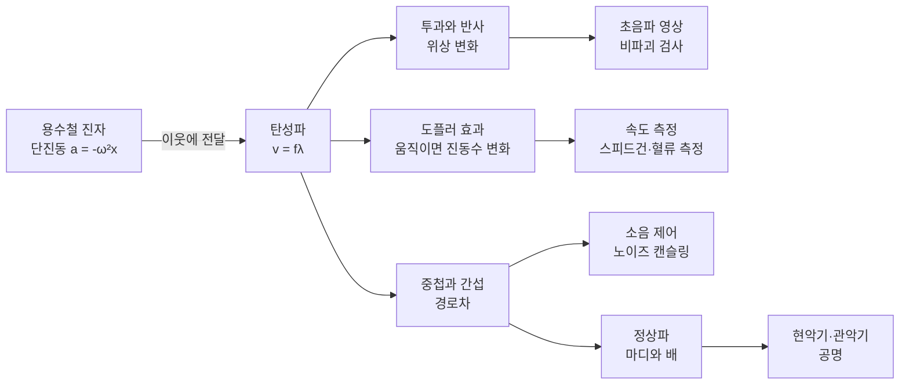

# 역학과 에너지 3. 탄성파와 소리 — 용수철의 떨림에서 초음파와 악기까지
<!-- prev: m1-05, m2-03, phy-1, phy-3, mech-1 -->
<!-- next: emq-2, esys-1, astro-2 -->

> [!NOTE]
> **성취기준**
> - **[12역학03-01]** 용수철 진자를 통해 단진동을 이해하고, 가속도와 변위 사이의 관계를 설명할 수 있다.
> - **[12역학03-02]** 탄성파의 진행, 투과, 반사를 이해하고, 탄성파가 활용되는 예를 찾음으로써 과학의 유용성을 인식할 수 있다.
> - **[12역학03-03]** 도플러 효과를 이해하고 물체의 속도 측정 등 다양한 장치에 이용됨을 설명할 수 있다.
> - **[12역학03-04]** 음향 장치 또는 실내외 공간에서의 소음 제어에 음파의 간섭이 활용됨을 이해하고, 실생활에 사용되는 사례를 조사할 수 있다.
> - **[12역학03-05]** 현악기, 관악기 등에서 소리를 내는 원리를 정상파를 이용하여 설명할 수 있다.

**학습 목표**

1. 용수철 진자의 운동을 분석하여 단진동에서 가속도가 변위에 비례하고 방향이 반대임($a = -\omega^2 x$)을 설명하고, 주기를 구할 수 있다.
2. 탄성체가 연속적으로 이어진 모형으로 탄성파의 진행을 설명하고, 파장·진동수·진행 속력의 관계를 이용할 수 있다.
3. 탄성파가 매질의 경계면에서 투과·반사될 때의 위상 변화를 설명하고, 초음파 영상·비파괴 검사 등 활용 사례를 찾을 수 있다.
4. 파원이나 관찰자가 움직일 때 진동수가 달라지는 도플러 효과를 정량적으로 설명하고, 속도 측정 장치에 이용되는 원리를 설명할 수 있다.
5. 두 파원에서 나온 음파의 간섭 조건을 경로차로 설명하고, 소음 제어와 음향 장치에 활용되는 사례를 조사할 수 있다.
6. 현과 관에서 생기는 정상파의 파장을 길이로부터 정량적으로 구하고, 악기가 소리를 내는 원리를 설명할 수 있다.

**이 단원의 학습 사다리**

| 단계 | 무엇을 하나? |
|---|---|
| STEP 1. 이전 학습 다시 보기 | 중학교 「빛과 파동」, 물리학 「힘과 에너지」, 「빛과 물질」에서 배운 탄성력·파동·간섭을 꺼내 본다 |
| STEP 2. 기초 다지기 | 복원력, 원운동의 그림자, 주기·진동수·각진동수, 파동의 용어와 위상 |
| STEP 3. 핵심 개념 | 단진동 → 탄성파의 진행 → 투과와 반사 → 도플러 효과 → 간섭과 소음 제어 → 정상파와 악기 |
| STEP 4. 오개념 바로잡기 | "파동이 지나가면 매질도 함께 간다?", "높은 소리가 더 빨리 간다?" 같은 착각을 바로잡는다 |
| STEP 5. 대학으로 한 걸음 더 | 일반물리학·진동학·음향학의 파동 방정식, 반사율, 푸리에 분석 맛보기 |
| STEP 6. 생활·산업·진로 | 의료 초음파, 비파괴 검사, 노이즈 캔슬링, 공연장 음향과 악기 제작 |

---

## 🗺️ 단원 들어가기

임신한 엄마의 배 위에 젤을 바르고 탐촉자를 대면, 화면에 아기의 모습이 나타난다. 빛도 X선도 쓰지 않았는데 어떻게 몸속을 '볼' 수 있을까? 구급차가 다가올 때와 멀어질 때 사이렌 소리의 높이가 달라지고, 경찰의 속도 측정기는 달리는 차를 한 번 '비추기'만 해도 속력을 읽어 낸다. 노이즈 캔슬링 이어폰은 소리를 더해서 소리를 지우고, 같은 기타 줄을 손가락으로 누르는 위치만 바꾸어 여러 음을 낸다.

이 모든 장면의 출발점은 놀랍게도 **용수철에 매달린 추의 떨림**이다. 하나의 용수철 진자가 떨리는 규칙(단진동)을 이해하고, 수많은 용수철이 줄지어 이어진 매질을 따라 그 떨림이 전달되는 것(탄성파)을 이해하면, 반사·투과·도플러 효과·간섭·정상파가 하나의 이야기로 이어진다.

---

## STEP 1. 🔙 이전 학습 다시 보기

### 연계 개념표

| 이전 단원·성취기준 | 그때 배운 것 | 이 단원에서 확장되는 것 |
|---|---|---|
| 중1 「힘의 작용」 [9과05-02] | 탄성력은 변형된 물체가 원래 모양으로 돌아가려는 힘이다 | 탄성력 $F = -kx$를 **복원력**으로 하는 진동, 즉 **단진동**을 분석한다 |
| 중2 「빛과 파동」 [9과10-04] | 파동은 진동이 전달되는 현상이고, 소리는 진폭(크기)·진동수(높이)·파형(음색)으로 표현한다 | 파동을 파장·진동수·**진행 속력**으로 기술하고, 반사·투과·간섭·정상파로 확장한다 |
| 물리학 「힘과 에너지」 [12물리01-04] | 탄성력에 의한 위치 에너지 $\frac{1}{2}kx^2$과 역학적 에너지 보존 | 단진동하는 동안 운동 에너지와 탄성 위치 에너지가 주기적으로 바뀌는 과정을 본다 |
| 물리학 「빛과 물질」 [12물리03-01] | 빛의 중첩과 간섭으로 빛의 파동성을 확인한다 | 같은 간섭 원리를 **음파**에 적용하여 소음 제어와 음향 장치를 설명한다 |
| 역학과 에너지 「시공간과 운동」 | 뉴턴 운동 법칙, 등속 원운동의 각속도 $\omega$와 구심 가속도 $r\omega^2$ | 등속 원운동의 '그림자'가 단진동이라는 것을 이용해 $a = -\omega^2 x$를 얻는다 |

### 준비 운동 (사전 진단)

**Q1.** 용수철을 2 cm 늘이는 데 4 N이 필요했다. 같은 용수철을 5 cm 늘이려면 몇 N이 필요한가?

**Q2.** 파도가 칠 때 바다 위에 떠 있는 공은 파도와 함께 해변으로 밀려온다. (O / X, 바람과 해류는 무시)

**Q3.** 진동수 170 Hz인 소리가 공기 중에서 340 m/s로 진행한다. 이 소리의 파장은?

**Q4.** 소리가 공기에서 물로 들어갈 때 변하지 **않는** 것은? (① 속력 ② 파장 ③ 진동수)

정답 및 해설

**Q1.** 10 N — 탄성력은 늘어난 길이에 비례한다(훅 법칙). 2 cm에 4 N이면 1 cm에 2 N이다.

**Q2. X** — 파동이 지나가도 매질(물)은 제자리 근처에서 위아래(실제로는 작은 원 모양)로 진동할 뿐이다. 전달되는 것은 **에너지와 진동의 모양**이다.

**Q3.** 2 m — $\lambda = v/f = 340/170 = 2\ \mathrm{m}$

**Q4. ③** — 진동수는 파원이 정한다. 경계면에서 진동이 그대로 넘겨지므로 진동수는 변하지 않고, 매질에 따라 속력이 바뀌어 파장이 달라진다.

---

## STEP 2. 🧱 기초 다지기

### 디딤돌 1. 복원력 — 늘 제자리로 끌어당기는 힘

용수철 상수 $k$인 용수철에 매단 물체가 평형 위치에서 $x$만큼 벗어나면 용수철은 다음 힘을 작용한다.

$$
F = -kx
$$

음(−)의 부호는 힘이 **변위와 반대 방향**, 즉 언제나 평형 위치를 향한다는 뜻이다. 이처럼 평형 위치로 되돌리는 힘을 **복원력(restoring force)** 이라 한다. 오른쪽으로 당기면 왼쪽으로, 왼쪽으로 밀면 오른쪽으로 힘이 작용한다.

> [!TIP]
> 💡 **비유** — 복원력은 '목줄을 맨 강아지의 목줄'과 같다. 강아지가 기둥에서 멀어질수록 목줄이 세게 당긴다. 다만 진짜 용수철은 기둥(평형 위치)을 지나쳐 반대편으로 넘어가 버린다. 평형 위치에서 가장 빠르기 때문이다(관성).

### 디딤돌 2. 등속 원운동의 그림자

반지름 $A$인 원을 각속도 $\omega$로 도는 점에 옆에서 빛을 비추면, 벽에 비친 그림자는 $-A$와 $+A$ 사이를 왕복한다. 「시공간과 운동」에서 배운 것처럼 원운동하는 점의 가속도는 크기 $A\omega^2$, 방향은 원의 중심이다. 그 그림자(한 축의 성분)를 쓰면

| 양 | 원운동하는 점의 한 성분(그림자) |
|---|---|
| 변위 | $x = A\cos\omega t$ |
| 속도 | $v = -A\omega\sin\omega t$ |
| 가속도 | $a = -A\omega^2\cos\omega t = -\omega^2 x$ |

그림자의 가속도는 **변위에 비례하고 방향이 반대**이다. 이것이 STEP 3 ①에서 용수철 진자가 따르는 바로 그 관계이다.

<!-- fig:mech-3-shm-shadow -->

### 디딤돌 3. 주기, 진동수, 각진동수

- **주기** $T$: 한 번 왕복하는 데 걸리는 시간(s). **진동수** $f = 1/T$: 1초 동안 왕복하는 횟수(Hz).
- **각진동수(angular frequency)** $\omega = 2\pi f = 2\pi/T$ (rad/s): 원운동의 각속도에 해당한다.
- **진폭(amplitude)** $A$: 평형 위치에서 가장 멀리 벗어난 거리.

### 디딤돌 4. 파동의 용어와 위상

| 용어 | 뜻 |
|---|---|
| 마루·골 | 횡파에서 가장 높이 올라간 곳·가장 낮게 내려간 곳 |
| 파장 $\lambda$ | 이웃한 마루와 마루(또는 같은 진동 상태인 두 점) 사이의 거리 |
| 진행 속력 $v$ | 파동의 모양(예: 마루)이 1초 동안 이동하는 거리 |
| 위상(phase) | 매질의 한 점이 한 번의 진동 중 '어느 단계'에 있는지. 마루와 골은 위상이 반대(반 주기, $\pi$ 차이) |

한 주기 $T$ 동안 파동은 정확히 한 파장 $\lambda$만큼 진행하므로

$$
v = \frac{\lambda}{T} = f\lambda
$$

---

## STEP 3. 📘 핵심 개념

### ① 용수철 진자와 단진동

#### (1) 가속도는 변위에 비례하고 방향이 반대이다

마찰 없는 수평면에서 질량 $m$인 물체를 용수철에 매달아 진동시키자. 물체가 받는 알짜힘은 탄성력뿐이므로 뉴턴 운동 제2법칙에 의해

$$
ma = -kx \;\Rightarrow\; a = -\frac{k}{m}x
$$

가속도가 변위에 비례하고 방향이 반대인 운동을 **단진동(simple harmonic motion)** 이라 한다. 디딤돌 2의 원운동 그림자 $a = -\omega^2 x$와 비교하면

$$
\omega = \sqrt{\frac{k}{m}}, \qquad T = 2\pi\sqrt{\frac{m}{k}}
$$

| 위치 | 변위 | 속력 | 가속도(힘)의 크기 | 운동 에너지 | 탄성 위치 에너지 |
|---|---|---|---|---|---|
| 양 끝($x = \pm A$) | 최대 | 0 | 최대($\omega^2 A$) | 0 | 최대 $\frac{1}{2}kA^2$ |
| 평형 위치($x = 0$) | 0 | 최대($\omega A$) | 0 | 최대 $\frac{1}{2}kA^2$ | 0 |

- 주기는 **질량과 용수철 상수로만** 정해지고 **진폭과 관계없다**(등시성). 크게 흔들든 작게 흔들든 한 번 왕복하는 시간이 같다.
- 무거울수록(관성이 클수록) 느리게, 용수철이 단단할수록(복원력이 클수록) 빠르게 진동한다.
- 마찰이 없으면 역학적 에너지 $\frac{1}{2}mv^2 + \frac{1}{2}kx^2 = \frac{1}{2}kA^2$이 보존된다.
- 연직으로 매단 용수철 진자도 **새로운 평형 위치**(중력과 탄성력이 평형인 위치)를 중심으로 같은 주기로 단진동한다.

<!-- fig:mech-3-spring-oscillator -->

#### 예제 1 — 용수철 진자의 분석

용수철 상수 20 N/m인 용수철에 질량 0.2 kg인 물체를 매달아, 평형 위치에서 5 cm 당겼다가 놓았다. (1) 주기 (2) 놓는 순간(변위 5 cm인 끝점)의 가속도 (3) 최대 속력 (4) 역학적 에너지를 구하시오. ($\pi \approx 3.14$)

**풀이**
(1) $\omega = \sqrt{20/0.2} = 10\ \mathrm{rad/s}$, $T = 2\pi/\omega \approx 0.63\ \mathrm{s}$
(2) $a = -\omega^2 x = -100\times0.05 = -5\ \mathrm{m/s^2}$ (크기 $5\ \mathrm{m/s^2}$, 평형 위치 방향)
(3) $v_{\max} = \omega A = 10\times0.05 = 0.5\ \mathrm{m/s}$
(4) $E = \frac{1}{2}kA^2 = \frac{1}{2}\times20\times0.05^2 = 0.025\ \mathrm{J}$ (확인: $\frac{1}{2}mv_{\max}^2 = \frac{1}{2}\times0.2\times0.25 = 0.025\ \mathrm{J}$)

#### 예제 2 — 질량을 4배로

예제 1에서 물체의 질량을 0.8 kg으로 바꾸면 주기는?

**풀이** $T \propto \sqrt{m}$이므로 $\sqrt4 = 2$배, 약 $1.26\ \mathrm{s}$이다. 진폭을 바꾸는 것은 주기에 영향을 주지 않는다.

| 생활 속 단진동 | 복원력 |
|---|---|
| 자동차 현가장치(서스펜션) | 코일 용수철의 탄성력. 충격 흡수기가 진동을 빨리 줄인다 |
| 진자 시계 | 중력의 접선 성분(작은 각에서 단진동, $T = 2\pi\sqrt{L/g}$) |
| 기타 줄·소리굽쇠·스피커 진동판 | 팽팽한 줄과 금속의 탄성 |
| 분자 속 원자의 진동 | 화학 결합을 용수철처럼 볼 수 있다 |

<!-- fig:mech-3-pendulum -->

#### ✔ 바로 확인

1. (O/X) 용수철 진자의 속력은 진동의 양 끝에서 가장 크다.
2. 용수철 상수 40 N/m인 용수철에 질량 0.1 kg인 물체를 매달았다. 단진동의 각진동수는?
3. 빈칸: 단진동에서 가속도는 변위에 (    )하고, 방향은 변위와 (    )이다.
4. 용수철은 그대로 두고 물체의 질량을 $\frac{1}{4}$로 줄이면 주기는 몇 배가 되는가?

정답

1. X — 양 끝에서는 속력이 0이고 가속도가 최대이다. 속력은 평형 위치에서 최대이다.
2. 20 rad/s — $\omega = \sqrt{k/m} = \sqrt{400}$
3. 비례, 반대 — $a = -\omega^2 x$
4. $\frac{1}{2}$배 — $T = 2\pi\sqrt{m/k}$이므로 $\sqrt{1/4}$배

### ② 탄성파의 진행 — 용수철이 이어진 매질

#### (1) 탄성체의 연속적 결합 모형

공 여러 개를 용수철로 줄줄이 이어 놓고 맨 앞 공을 한 번 흔들면, 그 공이 옆 용수철을 늘이고 줄여 다음 공을 흔들고, 그 공이 다시 다음 공을 흔든다. 각 공은 제자리 근처에서 단진동할 뿐이지만, **진동 상태가 조금씩 늦게 이웃으로 전달**되면서 파동의 모양이 앞으로 진행한다. 고체·액체·기체는 모두 입자들이 탄성적인 힘으로 이어진 이런 '공–용수철 사슬'로 볼 수 있고, 매질의 탄성을 통해 전달되는 파동을 **탄성파(elastic wave)** 라 한다. 소리(음파), 지진파, 초음파가 모두 탄성파이다.

| 구분 | **횡파(transverse wave)** | **종파(longitudinal wave)** |
|---|---|---|
| 매질의 진동 방향 | 진행 방향에 수직 | 진행 방향에 나란 |
| 모양 | 마루와 골 | 촘촘한 곳(밀)과 성긴 곳(소) |
| 전달되는 매질 | 주로 고체(모양을 되돌리는 탄성이 필요) | 고체, 액체, 기체 |
| 예 | 줄의 파동, 지진의 S파 | 소리, 지진의 P파, 초음파 |

<!-- fig:mech-3-ball-spring-wave -->

공기와 물은 '밀어 누르는' 변형에는 되돌아가려 하지만 '옆으로 비트는' 변형에는 되돌아가지 않는다. 그래서 유체 속에서는 종파만 진행한다. 지진의 S파(횡파)가 지구 외핵을 통과하지 못한다는 관측은 외핵이 액체 상태라는 증거가 되었다.

#### (2) 진행 속력은 매질이 정한다

탄성파의 속력은 **되돌리는 힘이 셀수록(탄성이 클수록) 빠르고, 매질이 무거울수록(관성이 클수록) 느리다.** 단진동에서 $k$가 크면 빨리, $m$이 크면 느리게 진동했던 것과 같은 이유이다. 팽팽하게 당긴 가벼운 줄일수록 파동이 빠르다.

| 매질 | 음파의 속력(약) |
|---|---|
| 공기($0^\circ\mathrm{C}$) | 331 m/s |
| 공기($20^\circ\mathrm{C}$) | 343 m/s |
| 물 | 1480 m/s |
| 바닷물 | 1500 m/s |
| 인체 연부 조직(평균) | 1540 m/s |
| 강철 | 5900 m/s |

공기 중 소리의 속력은 온도가 $1^\circ\mathrm{C}$ 오를 때 약 0.6 m/s씩 빨라진다($v \approx 331 + 0.6t$). 분자가 빨리 움직일수록 진동을 빨리 넘겨주기 때문이다. 소리의 속력은 **진동수와 관계없다.** 높은 음과 낮은 음이 같은 속력으로 오기 때문에 멀리서 들어도 음악이 뒤섞이지 않는다.

#### 예제 3 — 번개와 천둥

번개가 보이고 3초 뒤 천둥소리가 들렸다. 기온은 $20^\circ\mathrm{C}$이다. 번개까지의 거리는? (빛이 오는 시간은 무시)

**풀이** $d = vt = 343\times3 \approx 1.0\times10^{3}\ \mathrm{m}$. 약 1 km이다. "3초에 약 1 km"로 기억해 두면 편리하다.

#### 예제 4 — 초음파의 파장

의료 초음파 장치가 진동수 5 MHz의 초음파를 인체 연부 조직(1540 m/s)에 보낸다. 조직 속에서 초음파의 파장은?

**풀이** $\lambda = v/f = 1540/(5\times10^{6}) \approx 3.1\times10^{-4}\ \mathrm{m} \approx 0.3\ \mathrm{mm}$

파장이 짧을수록 작은 구조를 구별할 수 있다. 사람이 듣는 소리(약 20 Hz~20 kHz)는 공기 중 파장이 수 cm~수십 m라 작은 장기를 볼 수 없지만, MHz 초음파는 mm 이하의 파장으로 몸속을 자세히 '본다'. 대신 진동수가 높을수록 조직에서 더 빨리 약해져 깊이 들어가기 어렵다.

#### ✔ 바로 확인

1. 짝짓기: (가) 소리 (나) 지진의 S파 (다) 기타 줄의 파동 — ㄱ. 횡파 ㄴ. 종파
2. 진동수 500 Hz, 파장 0.68 m인 음파의 진행 속력은?
3. (O/X) 같은 공기 속에서 진동수가 큰 소리일수록 더 빠르게 진행한다.
4. 빈칸: 공기나 물 같은 유체 속에서는 (    )파만 진행한다.

정답

1. (가) ㄴ, (나) ㄱ, (다) ㄱ
2. 340 m/s — $v = f\lambda = 500\times0.68$
3. X — 속력은 매질이 정하며 진동수와 관계없다.
4. 종 — 유체는 옆으로 비트는 변형을 되돌리지 못한다.

### ③ 탄성파의 투과와 반사 — 경계면에서의 위상 변화

#### (1) 줄의 끝에서 일어나는 반사

| 경계 | 반사파의 위상 | 이유(공–용수철 모형) |
|---|---|---|
| **고정단**(벽에 묶인 끝) | **반대로 뒤집힌다**(마루 → 골, 위상이 $\pi$ 변함) | 끝점이 움직이지 못하므로 줄이 벽을 위로 당기면 벽이 줄을 아래로 당긴다(작용 반작용) |
| **자유단**(고리가 막대를 따라 자유롭게 움직이는 끝) | **그대로**(마루 → 마루) | 끝점이 자유롭게 크게 흔들렸다가 되돌아오며 같은 모양의 펄스를 보낸다 |

<!-- fig:mech-3-fixed-free-reflection -->

#### (2) 두 매질의 경계면: 일부는 투과, 일부는 반사

가는 줄(가벼운 매질)과 굵은 줄(무거운 매질)을 이어 놓고 펄스를 보내면, 경계면에서 일부는 넘어가고(투과) 일부는 되돌아온다(반사).

| 진행 방향 | 반사파 | 투과파 |
|---|---|---|
| 가벼운 줄 → 무거운 줄(속력 빠름 → 느림) | 위상이 **뒤집힌다**(고정단에 가까움) | 위상 그대로, 속력이 느려져 파장이 짧아진다 |
| 무거운 줄 → 가벼운 줄(속력 느림 → 빠름) | 위상 **그대로**(자유단에 가까움) | 위상 그대로, 속력이 빨라져 파장이 길어진다 |

- 경계면에서 **진동수는 변하지 않고**, 속력이 바뀌므로 파장이 $\lambda = v/f$에 따라 달라진다.
- **투과파의 위상은 뒤집히지 않는다.**
- 두 매질의 성질 차이가 클수록 반사가 강하고 투과가 약하다. 두 매질이 같으면 반사가 없다.

<!-- fig:mech-3-two-media-boundary -->

음파에서는 매질의 밀도와 음속을 곱한 **음향 임피던스(acoustic impedance)** $Z = \rho v$가 '파동이 느끼는 매질의 무거움' 역할을 한다. 두 매질의 $Z$ 차이가 클수록 경계면에서 많이 반사된다. 음파의 반사에서 매질 진동(변위)의 위상이 뒤집히는 것은 속력이 느린 쪽이 아니라 **$Z$가 큰 매질 쪽** 경계에서 반사될 때이다. 예를 들어 공기에서 물로 갈 때는 음속이 빨라지지만 $Z$가 훨씬 커지므로 반사파의 위상이 뒤집힌다(줄에서는 무거운 줄이 느리면서 $Z$도 크므로 위 표의 규칙과 같아진다).

| 매질 | 음향 임피던스(약, $\mathrm{kg/(m^2\cdot s)}$) |
|---|---|
| 공기 | $4\times10^{2}$ |
| 물 | $1.5\times10^{6}$ |
| 연부 조직 | $1.6\times10^{6}$ |
| 뼈 | $7\times10^{6}$ |
| 강철 | $4.6\times10^{7}$ |

공기와 피부의 $Z$는 수천 배 차이가 나서 초음파가 거의 모두(99.9 % 정도) 반사되어 몸속으로 들어가지 못한다. 그래서 초음파 검사에서는 탐촉자와 피부 사이 공기를 없애기 위해 **젤**을 바른다. 반면 조직과 조직 사이는 $Z$ 차이가 작아 대부분 투과하고 일부만 반사되는데, 이 약한 반사(메아리)가 장기의 경계를 보여 준다.

#### (3) 반사를 이용해 거리 재기 — 초음파 영상과 비파괴 검사

파동을 보내고 반사되어 돌아오기까지의 시간 $t$를 재면, 반사면까지의 거리는

$$
d = \frac{vt}{2}
$$

(왕복이므로 2로 나눈다) 탐촉자가 여러 방향으로 초음파를 보내며 반사파의 도착 시간과 세기를 지도처럼 그리면 영상이 된다.

#### 예제 5 — 초음파 영상의 깊이

초음파를 보낸 뒤 $1.3\times10^{-4}\ \mathrm{s}$ 만에 메아리가 돌아왔다. 조직 속 음속이 1540 m/s일 때 반사한 경계면의 깊이는?

**풀이** $d = \dfrac{1540\times1.3\times10^{-4}}{2} \approx 0.10\ \mathrm{m} = 10\ \mathrm{cm}$

| 활용 | 원리 |
|---|---|
| 의료 초음파 영상 | 장기 경계면의 반사파 도착 시간과 세기로 영상을 만든다. 방사선 피폭이 없다 |
| 비파괴 검사 | 금속 용접부·배관·항공기 부품 속 균열(공기 틈)은 $Z$ 차이가 매우 커서 강한 반사파를 만든다. 부수지 않고 결함을 찾는다 |
| 소나·어군 탐지기 | 바닷속에서 음파를 보내 해저 지형, 잠수함, 물고기 떼의 거리를 잰다 |
| 탄성파 탐사·지진파 | 땅속 지층 경계에서 반사·굴절된 탄성파로 지하 구조와 자원을 찾고, 지구 내부 구조를 알아낸다 |

> [!TIP]
> 💡 **비유** — 어두운 동굴에서 손뼉을 치고 메아리가 돌아오는 시간을 세면 벽까지의 거리를 알 수 있다. 박쥐와 돌고래는 이 방법을 진화로 '발명'했고, 사람은 초음파 장치로 '공학적으로' 따라 했다.

#### ✔ 바로 확인

1. (O/X) 두 매질의 경계면을 지나간 투과파는 위상이 뒤집히지 않는다.
2. 가벼운 줄에서 무거운 줄로 진행하던 펄스가 경계에서 반사될 때 반사파의 위상은? (① 그대로 ② 뒤집힌다)
3. 물속(음속 1500 m/s)에서 보낸 음파가 0.02초 뒤에 메아리로 돌아왔다. 반사면까지의 거리는?
4. 빈칸: 초음파 검사에서 젤을 바르는 것은 탐촉자와 피부 사이의 공기층을 없애 경계면에서의 (    )를 줄이기 위해서이다.

정답

1. O
2. ② — 무거운 줄 쪽 경계는 고정단에 가깝다.
3. 15 m — $d = vt/2 = 1500\times0.02/2$
4. 반사 — 공기와 피부는 음향 임피던스 차이가 매우 커서 초음파가 거의 모두 반사된다.

### ④ 도플러 효과 — 움직이면 진동수가 달라진다

#### (1) 파원이 움직일 때

파원이 진동수 $f$로 음파를 내며 관찰자를 향해 속력 $v_s$로 다가온다고 하자. 파원은 한 주기 $T$ 동안 앞으로 $v_sT$만큼 이동하므로, 다음 마루를 앞 마루에 더 가까이에서 낸다. 그래서 앞쪽의 파장은 짧아진다.

$$
\lambda' = (v - v_s)T = \frac{v - v_s}{f}
$$

음파의 속력 $v$는 매질이 정하므로 그대로이고, 관찰자가 듣는 진동수는

$$
f' = \frac{v}{\lambda'} = f\,\frac{v}{v - v_s} \quad (\text{다가올 때}), \qquad f' = f\,\frac{v}{v + v_s} \quad (\text{멀어질 때})
$$

#### (2) 관찰자가 움직일 때

파원은 정지해 있고 관찰자가 속력 $v_o$로 파원을 향해 움직이면, 파장은 그대로이지만 관찰자가 마루를 더 자주 만난다.

$$
f' = f\,\frac{v + v_o}{v} \quad (\text{다가갈 때}), \qquad f' = f\,\frac{v - v_o}{v} \quad (\text{멀어질 때})
$$

두 경우를 합치면 $f' = f\,\dfrac{v \pm v_o}{v \mp v_s}$이고, 위쪽 부호가 **서로 가까워지는** 경우이다. 이처럼 파원이나 관찰자의 운동 때문에 관측되는 진동수가 달라지는 현상을 **도플러 효과(Doppler effect)** 라 한다. 가까워지면 진동수가 높아지고(높은 소리), 멀어지면 낮아진다.

<!-- sim:doppler -->

#### 예제 6 — 구급차 사이렌

진동수 700 Hz의 사이렌을 울리는 구급차가 20 m/s로 달린다. 음속이 340 m/s일 때 정지한 사람이 듣는 진동수는 (1) 구급차가 다가올 때 (2) 멀어질 때 각각 얼마인가?

**풀이**
(1) $f' = 700\times\dfrac{340}{340 - 20} = 700\times\dfrac{340}{320} \approx 744\ \mathrm{Hz}$
(2) $f' = 700\times\dfrac{340}{340 + 20} \approx 661\ \mathrm{Hz}$

구급차가 일정한 속력으로 다가오는 동안에는 744 Hz로 **일정하게** 높은 소리가 들리다가, 옆을 지나는 순간 661 Hz로 뚝 떨어진다(듣는 사람이 구급차의 진행 경로에 가까이 있을 때). 다가올수록 점점 높아지는 것이 아니다(점점 커질 뿐이다).

#### (3) 반사파의 도플러 효과로 속도 재기

정지한 장치가 진동수 $f$의 파동을 보내고, 장치를 향해 속력 $u$로 다가오는 물체에서 반사된 파동을 받는 경우를 생각하자.

1. 물체는 '다가가는 관찰자'로서 $f_1 = f\,\dfrac{v + u}{v}$를 받는다.
2. 물체는 이 진동수로 반사하는 '다가오는 파원'이 되어, 장치는 $f_2 = f_1\dfrac{v}{v - u} = f\,\dfrac{v + u}{v - u}$를 받는다.

$u$가 $v$보다 훨씬 작으면 진동수 변화는 근사적으로 $\Delta f \approx \dfrac{2u}{v}f$이다. 장치가 $\Delta f$를 재면 물체의 속력 $u$를 알 수 있다.

#### 예제 7 — 음파로 다가오는 장난감 자동차의 속력 재기

정지한 음파 송수신기가 2000 Hz의 소리를 보내고, 10 m/s로 다가오는 장난감 자동차에서 반사된 소리를 받는다. 음속 340 m/s일 때 받는 진동수는?

**풀이** $f_2 = 2000\times\dfrac{340 + 10}{340 - 10} = 2000\times\dfrac{350}{330} \approx 2121\ \mathrm{Hz}$
(근사식 $\Delta f \approx 2\times10\times2000/340 \approx 118\ \mathrm{Hz}$도 실제 차이 약 121 Hz와 비슷하다.)

| 장치 | 쓰는 파동 | 재는 것 |
|---|---|---|
| 교통 단속 속도 측정기(스피드건) | 전파(마이크로파) 또는 레이저 | 차량의 속력 |
| 도플러 초음파(혈류 검사) | 초음파 | 혈관 속 혈액이 흐르는 속력과 방향 |
| 기상 레이더 | 전파 | 빗방울의 움직임으로 바람의 속력과 방향 |
| 야구·테니스 구속 측정 | 전파 | 공의 속력 |
| 천체 관측 | 빛 | 별·은하가 다가오거나 멀어지는 속력(시선속도) |

전자기파는 매질이 필요 없어 식의 모양은 조금 다르지만(STEP 5), "가까워지면 진동수가 높아지고, 진동수 변화로 속력을 잰다"는 원리는 같다.

#### ✔ 바로 확인

1. (O/X) 음원이 관찰자에게 다가오면 관찰자 쪽 음파의 파장이 짧아진다.
2. 진동수 1000 Hz인 음원이 정지한 관찰자로부터 34 m/s로 멀어진다. 음속이 340 m/s일 때 관찰자가 듣는 진동수는?
3. 빈칸: 파원과 관찰자가 서로 가까워지면 관측되는 진동수가 (    )진다.
4. 도플러 효과를 이용하지 **않는** 것은? (① 스피드건 ② 도플러 초음파 혈류 검사 ③ 어군 탐지기로 물고기 떼의 깊이 재기 ④ 기상 레이더로 바람 재기)

정답

1. O — 음원이 한 주기 동안 앞으로 나아가며 다음 마루를 내기 때문이다.
2. 약 909 Hz — $1000\times\dfrac{340}{340 + 34}$
3. 높아
4. ③ — 반사파가 돌아오는 시간으로 거리를 잰다.

### ⑤ 음파의 간섭과 소음 제어

#### (1) 중첩과 간섭

두 파동이 만나면 각 지점의 변위는 두 파동의 변위를 더한 것이 되고(**중첩 원리**), 만난 뒤에는 각자 원래 모양대로 진행한다. 진동수가 같고 위상 관계가 일정한 두 파원에서 나온 파동이 중첩되면 어떤 곳은 늘 강해지고 어떤 곳은 늘 약해지는 무늬가 **일정하게 지속**된다. 이것이 **간섭(interference)** 이다.

| 구분 | 만나는 두 파동 | 결과 | 경로차 조건(두 파원의 위상이 같을 때) |
|---|---|---|---|
| **보강 간섭** | 마루와 마루, 골과 골(같은 위상) | 진폭이 커진다 | $\lvert d_1 - d_2 \rvert = m\lambda$ ($m = 0, 1, 2, \dots$) |
| **상쇄 간섭** | 마루와 골(반대 위상) | 진폭이 작아진다(같으면 0) | $\lvert d_1 - d_2 \rvert = \left(m + \frac{1}{2}\right)\lambda$ |

<!-- fig:mech-3-two-speaker-interference -->

#### 예제 8 — 두 스피커 사이에서

같은 신호(680 Hz, 같은 위상)를 내는 두 스피커 A, B가 있다. 한 학생이 A에서 3.00 m, B에서 3.25 m 떨어진 곳에 서 있다. 음속이 340 m/s일 때 이 학생에게 소리는 크게 들리는가, 작게 들리는가?

**풀이** $\lambda = 340/680 = 0.50\ \mathrm{m}$, 경로차 $= 0.25\ \mathrm{m} = \frac{1}{2}\lambda$이므로 **상쇄 간섭**이 일어나 작게 들린다. 학생이 옆으로 걸어가면 크고 작은 곳이 번갈아 나타난다.

> [!IMPORTANT]
> 상쇄 간섭은 에너지를 없애는 것이 아니다. 어떤 곳에서 약해진 만큼 다른 곳에서 강해지거나, 음원(스피커)이 내보내는 에너지 자체가 달라진다. 에너지는 **재분배**될 뿐이다.

#### (2) 간섭을 이용한 소음 제어와 음향 장치

| 활용 | 원리 |
|---|---|
| 능동 소음 제어(노이즈 캔슬링 이어폰·헤드폰) | 마이크가 바깥 소음을 받아, 회로가 **위상이 반대인** 소리를 만들어 스피커로 내보낸다. 귀 안에서 상쇄 간섭이 일어난다. 엔진 소리처럼 일정하고 낮은 소리에 특히 효과가 좋다 |
| 자동차·항공기 실내 소음 제어 | 실내 스피커로 엔진·도로 소음과 반대 위상의 소리를 내어 승객 주변 소음을 줄인다 |
| 간섭형 소음기(머플러)·덕트 소음기 | 배기관 속에서 소리를 두 갈래 길로 나누어 경로차가 반 파장이 되게 한 뒤 다시 합쳐 특정 진동수의 소음을 줄인다 |
| 공연장·강당의 음향 설계 | 벽·천장 반사파와 직접 오는 소리가 간섭하여 소리가 지나치게 크거나 작은 자리가 생기지 않도록 반사판의 모양과 흡음재 위치를 정한다 |
| 스피커 배열(라인 어레이) | 여러 스피커의 소리를 원하는 방향에서 보강 간섭하도록 배치하여 객석 쪽으로 소리를 증폭하고 무대 뒤로는 줄인다 |
| 방음벽·흡음재 | 주로 반사와 흡수로 소음을 줄인다(간섭이 주된 원리는 아니다). 흡음재의 작은 구멍 속에서 음파 에너지가 열로 바뀐다 |

<!-- fig:mech-3-noise-cancelling -->

소리의 세기는 보통 **데시벨(dB)** 로 나타낸다. 소리의 세기가 10배가 될 때마다 10 dB씩, 2배가 되면 약 3 dB 커진다. 상쇄 간섭으로 소음의 진폭을 절반으로 줄이면 세기(진폭의 제곱에 비례)는 4분의 1이 되어 약 6 dB 줄어든다.

> [!TIP]
> 💡 **비유** — 그네를 미는 두 사람이 박자를 맞추면(같은 위상) 그네가 크게 흔들리고, 정확히 엇박자로 밀면(반대 위상) 서로 방해해 그네가 거의 움직이지 않는다. 노이즈 캔슬링은 소음이라는 사람에게 일부러 '엇박자 짝'을 붙여 주는 기술이다.

#### ✔ 바로 확인

1. 같은 위상의 두 스피커에서 경로차가 $1.5\lambda$인 지점에서는 보강 간섭과 상쇄 간섭 중 무엇이 일어나는가?
2. (O/X) 상쇄 간섭이 일어나면 그 지점의 소리 에너지는 사라져 없어진다.
3. 빈칸: 노이즈 캔슬링 헤드폰은 소음과 진폭이 같고 위상이 (    )인 소리를 만들어 낸다.
4. 소음의 진폭을 절반으로 줄이면 소리의 세기는 몇 배가 되는가?

정답

1. 상쇄 간섭 — 반 파장의 홀수배이다.
2. X — 에너지는 다른 곳으로 재분배될 뿐이다.
3. 반대
4. $\frac{1}{4}$배 — 세기는 진폭의 제곱에 비례한다(약 6 dB 감소).

### ⑥ 정상파와 악기

#### (1) 정상파: 제자리에서 진동하는 파동

진폭과 진동수가 같은 두 파동이 서로 반대 방향으로 진행하며 중첩되면, 파형이 어느 쪽으로도 진행하지 않고 제자리에서 진동하는 것처럼 보인다. 이를 **정상파(standing wave)** 라 한다. 양 끝이 고정된 줄에서는 끝에서 반사된 파동이 들어오는 파동과 겹쳐 정상파가 저절로 생긴다.

- **마디(node)**: 전혀 진동하지 않는 점. **배(antinode)**: 가장 크게 진동하는 점.
- 이웃한 마디와 마디(또는 배와 배) 사이 거리는 $\lambda/2$, 마디와 배 사이는 $\lambda/4$이다.
- 고정단은 반드시 마디, 자유단(열린 관의 끝)은 배가 된다.

#### (2) 양 끝이 고정된 줄 — 현악기

길이 $L$인 줄의 양 끝이 마디이므로, 줄에는 반 파장이 정수 개 들어가야 한다.

$$
L = n\frac{\lambda_n}{2} \;\Rightarrow\; \lambda_n = \frac{2L}{n}, \qquad f_n = \frac{v}{\lambda_n} = n\frac{v}{2L} \quad (n = 1, 2, 3, \dots)
$$

가장 낮은 $f_1$을 **기본 진동수(fundamental frequency)**, 그 정수배를 **배음(harmonics)** 이라 한다. 실제 줄은 기본 진동과 여러 배음이 섞여 진동하고, 섞이는 비율이 악기마다 달라 같은 음높이라도 **음색**이 다르다.

| 악기에서 하는 일 | 바뀌는 것 | 음높이 |
|---|---|---|
| 손가락으로 줄을 눌러 진동하는 길이를 줄인다(기타 프렛, 바이올린) | $L$ 감소 → $\lambda$ 감소 | 높아진다 |
| 줄감개로 줄을 더 팽팽하게 조인다(조율) | 장력 증가 → $v$ 증가 | 높아진다 |
| 굵고 무거운 줄을 쓴다(저음 줄) | 단위 길이당 질량 증가 → $v$ 감소 | 낮아진다 |
| 가야금의 안족(줄 받침)을 옮긴다 | $L$ 변화 | 높낮이 조절 |

#### 예제 9 — 기타 줄

기타의 한 줄에서 진동하는 부분의 길이가 0.65 m이고 기본 진동수가 110 Hz이다. (1) 줄에서 파동의 속력 (2) 이 줄의 3배음의 진동수 (3) 줄의 가운데(프렛)를 눌러 길이를 절반으로 하면 기본 진동수는?

**풀이**
(1) $\lambda_1 = 2L = 1.3\ \mathrm{m}$, $v = f_1\lambda_1 = 110\times1.3 = 143\ \mathrm{m/s}$
(2) $f_3 = 3f_1 = 330\ \mathrm{Hz}$
(3) $L$이 절반이면 $f_1$이 2배인 220 Hz, 즉 **한 옥타브** 높은 음이다.

줄에서 생긴 정상파의 진동수가 공기를 진동시켜 같은 진동수의 소리가 된다. 줄 속 파동의 속력(143 m/s)과 공기 속 소리의 속력(343 m/s)이 다르므로 **파장은 다르지만 진동수는 같다.**

#### (3) 공기 기둥의 정상파 — 관악기

관 속 공기 기둥에도 음파의 정상파가 생긴다. 막힌 끝에서는 공기가 움직일 수 없으므로 공기 진동의 **마디**, 열린 끝에서는 공기가 자유롭게 드나들므로 **배**가 된다.

| 관의 종류 | 끝의 조건 | 정상파 조건 | 진동수 | 나오는 배음 | 악기 예 |
|---|---|---|---|---|---|
| **열린 관**(양 끝 열림) | 배–배 | $L = n\dfrac{\lambda}{2}$ | $f_n = n\dfrac{v}{2L}$ | 모든 정수배 | 플루트, 대금, 단소 |
| **닫힌 관**(한쪽 끝 막힘) | 마디–배 | $L = (2n-1)\dfrac{\lambda}{4}$ | $f_n = (2n-1)\dfrac{v}{4L}$ | 홀수배만 | 팬파이프, (근사적으로) 클라리넷 |

관악기는 손가락으로 구멍을 열고 닫아 공기 기둥의 유효 길이를 바꾸어 음높이를 조절한다. 트롬본은 슬라이드로 관 길이를 직접 바꾼다.

<!-- sim:standing-wave -->

#### 예제 10 — 같은 길이, 다른 관

길이 0.50 m인 열린 관과 닫힌 관의 기본 진동수를 각각 구하시오. (음속 340 m/s, 관 끝의 보정은 무시)

**풀이**
- 열린 관: $f_1 = \dfrac{340}{2\times0.50} = 340\ \mathrm{Hz}$
- 닫힌 관: $f_1 = \dfrac{340}{4\times0.50} = 170\ \mathrm{Hz}$

같은 길이라도 한쪽을 막으면 한 옥타브 낮은 소리가 난다. 빈 병 입구를 불면 낮은 '부우' 소리가 나는 것도 닫힌 관의 공명이다. 병에 물을 채우면 공기 기둥이 짧아져 소리가 높아진다.

#### (4) 공명 — 정상파가 소리를 키운다

물체에는 정상파가 생길 수 있는 고유한 진동수(**고유 진동수**)가 있다. 외부에서 고유 진동수와 같은 진동수로 진동을 가하면 진폭이 크게 커지는데, 이를 **공명(resonance)** 이라 한다.

- 기타·바이올린의 **울림통**은 줄의 진동을 넓은 판과 통 속 공기에 전달하여 공명시켜 큰 소리를 낸다. 줄만으로는 공기를 거의 움직이지 못한다.
- 관악기는 입술이나 리드(얇은 판)가 내는 여러 진동수 중 공기 기둥의 고유 진동수와 맞는 소리만 크게 키운다.
- 공명은 위험할 수도 있다. 다리나 건물이 바람이나 지진의 진동수에 공명하지 않도록 설계하고, 고층 건물에는 흔들림을 줄이는 진동 제어 장치(동조 질량 감쇠기 등)를 설치하기도 한다.

#### 예제 11 — 공명관으로 음속 재기

진동수 512 Hz인 소리굽쇠를 물을 채운 유리관(닫힌 관) 입구에서 울리며 물 높이를 내렸더니, 수면이 관 입구에서 16.0 cm일 때 첫 번째, 49.2 cm일 때 두 번째로 소리가 크게 울렸다. 음속은?

**풀이** 이웃한 두 공명 위치의 차이는 반 파장이다(관 끝의 보정이 상쇄된다).

$$
\frac{\lambda}{2} = 49.2 - 16.0 = 33.2\ \mathrm{cm} \;\Rightarrow\; \lambda = 0.664\ \mathrm{m}, \qquad v = f\lambda = 512\times0.664 \approx 340\ \mathrm{m/s}
$$

첫 공명 위치(16.0 cm)가 $\lambda/4 = 16.6\ \mathrm{cm}$보다 조금 짧은 것은 열린 끝의 '배'가 실제로는 관 입구보다 약간 바깥에 생기기 때문이다.

#### ✔ 바로 확인

1. 양 끝이 고정된 길이 $L$인 줄의 기본 진동의 파장은?
2. 기본 진동수가 200 Hz인 줄에서 나는 두 번째 배음(2배음)의 진동수는?
3. (O/X) 한쪽 끝이 막힌 닫힌 관에서는 기본 진동수의 짝수배인 소리도 공명한다.
4. 길이 0.85 m인 열린 관의 기본 진동수는? (음속 340 m/s, 관 끝의 보정 무시)

정답

1. $2L$ — 양 끝이 마디이므로 반 파장 하나가 들어간다.
2. 400 Hz — $f_n = nf_1$
3. X — 닫힌 관은 홀수배만 생긴다.
4. 200 Hz — $f_1 = v/2L = 340/1.7$

---

## STEP 4. ⚠️ 오개념 바로잡기

| 흔한 오개념 | 올바른 개념 | 왜 그럴까? |
|---|---|---|
| 파동이 지나가면 매질도 파동과 함께 이동한다 | 매질은 **제자리 근처에서 진동**하고, 에너지와 진동 상태만 전달된다 | 공–용수철 모형에서 각 공은 단진동만 하고 이웃에 진동을 넘겨줄 뿐이다 |
| 용수철 진자를 크게 흔들면 주기가 길어진다 | 단진동의 주기 $2\pi\sqrt{m/k}$는 **진폭과 관계없다** | 진폭이 크면 이동 거리도 길지만 복원력과 속력도 같은 비율로 커진다 |
| 높은 소리(진동수가 큰 소리)가 더 빨리 전달된다 | 소리의 속력은 **매질(종류, 온도)이 정하며** 진동수와 관계없다 | 진동수가 크면 파장이 짧아질 뿐이다($v = f\lambda$) |
| 구급차가 다가올수록 사이렌 소리가 점점 높아진다 | 일정한 속력으로 다가오는 동안 진동수는 **일정하게 높고**, 지나치는 순간 낮아진다 | 도플러 효과는 거리가 아니라 **상대 속도**에 따라 정해진다. 가까워지며 커지는 것은 소리의 세기이다 |
| 경계면에서 반사되는 파동은 항상 위상이 뒤집힌다 | 줄에서는 무거운(느린) 줄 쪽 경계에서 반사될 때(고정단 쪽)만 뒤집히고, 가벼운(빠른) 줄 쪽에서는 그대로이다(음파에서는 음향 임피던스가 큰 쪽에서 뒤집힌다). **투과파는 뒤집히지 않는다** | 끝점이 붙잡혀 있는지(고정단), 자유로운지(자유단)에 따라 반사파의 모양이 달라진다 |
| 노이즈 캔슬링은 소리 에너지를 없애 버린다 | 상쇄 간섭은 에너지를 **재분배**할 뿐이며 에너지 보존은 지켜진다 | 귀 근처에서 약해진 대신 다른 곳의 세기나 스피커가 하는 일이 달라진다 |
| 정상파는 진행하지 않으므로 에너지와 관계없다 | 정상파는 반대로 진행하는 두 파동의 중첩이며, 배에서는 에너지가 운동 에너지와 위치 에너지 사이를 오간다 | 마디를 넘어 에너지가 흘러가지 않을 뿐, 진동 에너지는 저장되어 있다(악기의 소리 에너지원) |

---

## STEP 5. 🎓 다음 단계로 한 걸음 더

> [!CAUTION]
> 이 절은 **고등학교 '역학과 에너지' 교육과정 범위 밖의 심화 내용**으로 평가 대상이 아니다. 이 단원의 개념이 대학의 일반물리학·진동학·음향학·신호 처리에서 어떻게 이어지는지 맛보기로 보여 주기 위한 내용이다.

### 대학 전공 과목과의 연결

| 대학 과목 | 이어지는 내용 |
|---|---|
| 일반물리학 | 단진동의 미분 방정식, 감쇠 진동·강제 진동과 공명 곡선, 파동 방정식, 줄과 음파의 속력 공식 |
| 진동학(기계·건축·토목공학) | 다자유도계의 고유 진동 모드, 진동 절연과 제어, 구조물의 내진 설계 |
| 음향학 | 음향 임피던스와 반사·투과율, 실내 음향(잔향 시간), 소음 공학, 악기 음향학 |
| 신호 처리·전자공학 | 푸리에 분석(소리를 진동수 성분으로 분해), 디지털 필터, 능동 소음 제어 알고리즘 |
| 의공학·지구물리학 | 초음파 영상 원리와 도플러 혈류 측정, 지진파 단층 촬영 |

### ① 단진동과 파동을 미분 방정식으로

단진동은 $m\dfrac{d^2x}{dt^2} = -kx$의 해 $x = A\cos(\omega t + \phi)$이다. 공–용수철 사슬에서 공 사이 간격을 0으로 줄이는 극한을 취하면 **파동 방정식** $\dfrac{\partial^2 y}{\partial t^2} = v^2\dfrac{\partial^2 y}{\partial x^2}$가 나오고, 줄에서는 $v = \sqrt{F_T/\mu}$($F_T$: 장력, $\mu$: 단위 길이당 질량), 기체에서는 $v = \sqrt{\gamma P/\rho}$가 얻어진다. STEP 3에서 "탄성이 크면 빠르고 무거우면 느리다"고 한 말이 정확한 식이 된다.

### ② 경계면의 반사율

수직으로 입사하는 음파의 세기 반사율은 $R = \left(\dfrac{Z_2 - Z_1}{Z_2 + Z_1}\right)^2$이다. 공기–조직은 $R \approx 0.999$, 물–조직은 $R \approx 0.001$로, STEP 3의 젤 이야기가 숫자로 확인된다. 반사파의 진폭 비 $\frac{Z_2 - Z_1}{Z_2 + Z_1}$이 음수가 되는 경우가 바로 '위상이 뒤집히는 반사'이다.

### ③ 푸리에 분석과 음색

어떤 주기적인 소리도 기본 진동수와 배음의 사인파들의 합으로 나타낼 수 있다(푸리에 급수). 스마트폰의 스펙트럼 분석 앱이 보여 주는 막대그래프가 바로 이 성분들이다. 닫힌 관 악기 소리에 홀수 배음이 두드러지는 것도 스펙트럼으로 확인할 수 있다.

### ④ 빛의 도플러 효과

빛은 매질이 없으므로 상대론적 도플러 식 $f' = f\sqrt{\dfrac{1 + \beta}{1 - \beta}}$ ($\beta = u/c$, 가까워질 때)을 쓴다. 멀어지는 은하의 빛이 붉은 쪽으로 치우치는 **적색 편이**는 우주 팽창의 핵심 증거이다.

### 지금 vs 다음 단계

| 구분 | 고등학교 역학과 에너지 | 대학 일반물리학·음향학·진동학 |
|---|---|---|
| 진동 | 용수철 진자의 단진동, $a = -\omega^2x$, $T = 2\pi\sqrt{m/k}$ | 감쇠·강제 진동, 공명 곡선, 다자유도계 |
| 파동의 진행 | 탄성체 연결 모형, $v = f\lambda$, 매질과 속력의 정성적 관계 | 파동 방정식, $v = \sqrt{F_T/\mu}$, 분산 |
| 반사·투과 | 위상 변화의 규칙, 음향 임피던스의 의미 | 반사·투과 계수의 정량 계산 |
| 도플러 효과 | 음파의 도플러 식, 반사파로 속도 측정 | 상대론적 도플러, 도플러 영상 신호 처리 |
| 간섭·정상파 | 경로차 조건, 현과 관의 정상파 | 푸리에 분석, 실내 음향 모드, 악기 음향학 |

---

## STEP 6. 🏭 생활·산업·진로 연결

### 사례 1. 의료 초음파 영상

- **원리** 압전 소자로 된 탐촉자가 수 MHz의 초음파 펄스를 보내고, 장기 경계면에서 반사된 메아리의 도착 시간($d = vt/2$)과 세기로 영상을 만든다. 도플러 모드는 혈액에서 반사된 초음파의 진동수 변화로 혈류 속력을 색으로 보여 준다.
- **어디에 쓰이나** 태아 검진, 심장·간·갑상샘 검사, 혈관 검사. 방사선을 쓰지 않아 반복 검사에 유리하다.

### 사례 2. 비파괴 검사

- **원리** 금속 속 균열은 공기 틈이므로 음향 임피던스 차이가 매우 커서 초음파를 강하게 반사한다.
- **어디에 쓰이나** 항공기 날개·엔진 부품, 선박과 교량의 용접부, 발전소 배관, 철도 레일 검사. 부품을 부수지 않고 안전을 확인한다.

### 사례 3. 노이즈 캔슬링과 실내 음향

- **원리** 마이크–연산 회로–스피커가 실시간으로 반대 위상의 소리를 만들어 상쇄 간섭을 일으킨다. 공연장에서는 반사판·흡음재 배치로 간섭과 잔향을 조절한다.
- **어디에 쓰이나** 무선 이어폰, 항공기 조종사 헤드셋, 자동차 실내, 콘서트홀·녹음실 설계.

### 사례 4. 악기 제작과 음향 기기

- **원리** 줄의 길이·장력·굵기와 관의 길이로 정상파의 진동수를 정하고, 울림통의 공명으로 소리를 키운다.
- **어디에 쓰이나** 현악기·관악기 제작과 조율, 스피커 인클로저(통) 설계, 전자 악기의 소리 합성.

### 관련 진로와 학과

| 진로 | 하는 일 | 관련 학과 |
|---|---|---|
| 음향 엔지니어 | 공연장·녹음실 음향 설계, 소음·진동 저감 | 기계공학, 건축공학, 음향공학 |
| 의공학 연구원·초음파 장비 개발자 | 초음파 탐촉자와 영상 처리 기술 개발 | 의공학, 전자공학, 물리학 |
| 비파괴 검사 기술자 | 산업 설비·구조물의 결함 검사 | 기계공학, 재료공학, 원자력공학 |
| 오디오·신호 처리 엔지니어 | 노이즈 캔슬링·음성 인식 알고리즘 개발 | 전자공학, 컴퓨터공학 |
| 지구물리학자·탄성파 탐사 연구원 | 지진파 분석, 지하 구조·자원 탐사 | 지구환경과학, 지질학, 물리학 |
| 악기 제작자·음악 기술자 | 악기 설계·제작과 조율 | 음악학, 음향학, 공예 |

---

## 🔬 탐구 활동

### 활동 A. 파동 용수철로 종파와 횡파를 만들고 진행 속력 측정하기

**목표** 파동 용수철(긴 코일 용수철)로 종파와 횡파를 만들어 진행 모습을 관찰하고, 속력을 측정하여 용수철의 당긴 정도에 따라 비교한다. 고정단 반사에서 위상이 뒤집히는 것도 확인한다.

**준비물** 파동 용수철, 줄자, 스톱워치(또는 스마트폰 동영상), 색 테이프

**과정**
1. 두 사람이 바닥에서 파동 용수철을 5 m 정도로 늘여 잡는다. 중간 고리에 색 테이프를 붙인다.
2. 한쪽 끝을 옆으로 한 번 빠르게 흔들어 **횡파 펄스**를, 앞뒤로 한 번 밀어 **종파 펄스**를 만든다. 색 테이프의 움직임 방향을 관찰한다.
3. 펄스가 반대쪽 끝까지 갔다가 돌아오는 시간을 동영상으로 재어 속력($v = 2L/t$)을 구한다.
4. 용수철을 7 m로 더 늘인 상태에서 3을 반복한다.
5. 반대쪽 사람이 끝을 단단히 잡고(고정단) 있을 때 되돌아온 횡파 펄스가 처음과 같은 쪽인지 반대쪽인지 관찰한다.

**결과 기록**

| 늘인 길이(m) | 파동 종류 | 왕복 시간(s) | 진행 속력(m/s) | 반사파의 위상 |
|---|---|---|---|---|
| 5 | 횡파 | | | |
| 5 | 종파 | | | |
| 7 | 횡파 | | | |
| 7 | 종파 | | | |

**생각해 보기**
1. 용수철을 더 팽팽하게 늘였을 때 속력은 어떻게 변했는가? 공–용수철 모형으로 설명해 보자.
2. 펄스를 크게 만들든 작게 만들든 속력이 같았는가? 그 이유는?

> [!WARNING]
> **안전 수칙** 늘인 파동 용수철을 갑자기 놓으면 튕겨 나가 다칠 수 있다. 끝낼 때는 두 사람이 천천히 가까이 다가가 줄인다.

### 활동 B. 스마트폰을 활용하여 도플러 효과 측정하기

**목표** 움직이는 음원의 진동수 변화를 스마트폰 소리 분석 앱으로 측정하고, 도플러 식으로 음원의 속력을 구한다.

**준비물** 스마트폰 2대(음원용: 일정한 진동수 발생 앱, 측정용: 진동수 스펙트럼 분석 앱), 줄자, 스톱워치, 안전한 넓은 공간(체육관 등)

**과정**
1. 음원 스마트폰에서 2000 Hz 정도의 일정한 소리를 낸다. 정지 상태에서 측정용 스마트폰으로 진동수 $f$를 확인한다.
2. 음원을 든 사람이 일정한 속력으로 측정용 스마트폰을 향해 걸어오거나 달려와 지나간다. 다가올 때 $f_{\text{가까이}}$와 멀어질 때 $f_{\text{멀리}}$를 기록한다.
3. 일정 구간(예: 10 m)을 지나는 데 걸린 시간을 재어 실제 속력을 구한다.
4. $f_{\text{가까이}} = f\dfrac{v}{v - v_s}$를 $v_s$에 대해 풀어 도플러 효과로 구한 속력과 실제 속력을 비교한다.

**결과 기록**

| 회 | 정지 진동수 $f$ (Hz) | 다가올 때(Hz) | 멀어질 때(Hz) | 도플러로 구한 속력(m/s) | 실제 속력(m/s) |
|---|---|---|---|---|---|
| 1 | | | | | |
| 2 | | | | | |
| 3 | | | | | |

**생각해 보기** 걷는 속력(약 1~2 m/s)에서는 진동수 변화가 몇 Hz 정도일까? 측정 오차를 줄이려면 음원의 진동수를 높이는 것과 낮추는 것 중 어느 쪽이 유리할까?

> [!WARNING]
> **안전 수칙** 달리는 사람의 경로에 장애물과 다른 사람이 없게 하고, 스마트폰을 떨어뜨리지 않도록 손목 줄을 쓴다. 소리 크기는 귀에 부담이 없을 정도로 조절한다.

---

## ✅ 개념 확인 문제

### 기본

**1.** 용수철 진자에 대한 설명으로 옳은 것을 **모두** 고르시오. (마찰 무시)
ㄱ. 물체의 가속도는 평형 위치에서 최대이다.
ㄴ. 가속도의 방향은 항상 평형 위치를 향한다.
ㄷ. 진폭을 2배로 해도 주기는 같다.

정답 및 해설

**정답 ㄴ, ㄷ**

ㄱ. $a = -\omega^2 x$이므로 가속도는 변위가 최대인 양 끝에서 최대이고 평형 위치에서 0이다(평형 위치에서는 속력이 최대). ㄴ. 음의 부호가 변위와 반대 방향, 즉 평형 위치 방향을 뜻한다. ㄷ. 주기 $2\pi\sqrt{m/k}$는 진폭과 무관하다.

**2.** 용수철 상수 50 N/m인 용수철에 질량 0.5 kg인 물체를 매달아 단진동시켰다. 각진동수와 주기를 구하시오. ($\pi \approx 3.14$)

정답 및 해설

**정답** 각진동수 $10\ \mathrm{rad/s}$, 주기 약 $0.63\ \mathrm{s}$

$\omega = \sqrt{50/0.5} = 10\ \mathrm{rad/s}$, $T = 2\pi/10 \approx 0.63\ \mathrm{s}$

**3.** 바닷물 속 음속이 1500 m/s일 때, 배에서 수직 아래로 보낸 음파가 해저에서 반사되어 4.0초 뒤 돌아왔다. 바다의 깊이는?

정답 및 해설

**정답** $3.0\times10^{3}\ \mathrm{m}$

$d = vt/2 = 1500\times4.0/2 = 3000\ \mathrm{m}$

**4.** 빈칸에 알맞은 말을 쓰시오.
"줄의 고정단에서 반사된 파동은 위상이 ( ㄱ ). 소리가 공기에서 물로 투과할 때 ( ㄴ )은/는 변하지 않고 속력이 커지므로 파장이 ( ㄷ )진다."

정답 및 해설

**정답** ㄱ: 반대로 뒤집힌다(π만큼 변한다), ㄴ: 진동수, ㄷ: 길어

### 응용

**5.** 진동수 500 Hz의 소리를 내는 음원이 정지한 관찰자를 향해 34 m/s로 다가온다. 음속이 340 m/s일 때 관찰자가 듣는 소리의 (1) 파장 (2) 진동수를 구하시오.

정답 및 해설

**정답** (1) $0.612\ \mathrm{m}$ (2) 약 $556\ \mathrm{Hz}$

(1) $\lambda' = \dfrac{v - v_s}{f} = \dfrac{340 - 34}{500} = 0.612\ \mathrm{m}$ (2) $f' = \dfrac{v}{\lambda'} = \dfrac{340}{0.612} \approx 556\ \mathrm{Hz}$ (또는 $500\times\frac{340}{306}$)

**6.** 같은 위상으로 같은 진동수의 소리를 내는 두 스피커가 있다. 음속이 340 m/s일 때, 두 스피커로부터의 경로차가 1.0 m인 지점에서 상쇄 간섭이 일어나는 진동수 중 가장 낮은 것은? 또 그다음으로 낮은 것은?

정답 및 해설

**정답** 170 Hz, 510 Hz

상쇄 조건 $1.0 = \left(m + \frac{1}{2}\right)\lambda$. $m = 0$이면 $\lambda = 2.0\ \mathrm{m}$, $f = 340/2.0 = 170\ \mathrm{Hz}$. $m = 1$이면 $\lambda = 2/3\ \mathrm{m}$, $f = 510\ \mathrm{Hz}$이다.

**7.** 길이 0.85 m인 닫힌 관(한쪽 끝 막힘)에서 나올 수 있는 가장 낮은 진동수 두 개를 구하시오. (음속 340 m/s, 관 끝의 보정 무시) 또 같은 길이의 열린 관에서 나올 수 있는 가장 낮은 진동수 두 개와 비교하시오.

정답 및 해설

**정답** 닫힌 관 100 Hz, 300 Hz / 열린 관 200 Hz, 400 Hz

닫힌 관: $f_n = (2n-1)\dfrac{v}{4L}$, $\dfrac{340}{4\times0.85} = 100\ \mathrm{Hz}$이므로 100 Hz, 300 Hz(홀수배만).
열린 관: $f_n = n\dfrac{v}{2L}$, $\dfrac{340}{2\times0.85} = 200\ \mathrm{Hz}$이므로 200 Hz, 400 Hz(모든 정수배).

**8.** 바이올린 연주자가 줄을 조율할 때 줄감개를 돌려 줄을 더 팽팽하게 하면 음이 높아진다. 그 이유를 정상파의 파장과 진행 속력을 이용하여 설명하시오.

정답 및 해설

**예시 답안**
양 끝이 고정된 줄의 기본 진동 파장은 $\lambda_1 = 2L$로, 줄의 길이로만 정해지므로 조율해도 변하지 않는다. 줄을 팽팽하게 하면 복원력이 커져 줄을 따라 진행하는 파동의 속력 $v$가 커진다. 따라서 $f_1 = v/\lambda_1 = v/2L$이 커져 음이 높아진다.

### 융합·서술형

**9. [의료 연계]** 초음파 검사를 할 때 탐촉자와 피부 사이에 젤을 바르는 이유와, 혈관 속 혈류 속력을 측정할 수 있는 원리를 (1) 경계면의 반사·투과 (2) 도플러 효과를 이용하여 서술하시오.

정답 및 해설

**예시 답안**
(1) 공기와 인체 조직은 음향 임피던스(밀도 × 음속)의 차이가 매우 커서, 탐촉자와 피부 사이에 공기층이 있으면 초음파가 경계면에서 거의 모두 반사되어 몸속으로 투과하지 못한다. 조직과 성질이 비슷한 젤로 공기층을 없애면 초음파가 몸속으로 잘 투과하고, 장기 경계면에서 반사된 약한 메아리를 받아 영상을 만들 수 있다.
(2) 움직이는 혈액(적혈구)에서 반사된 초음파는 도플러 효과로 진동수가 달라진다. 혈액이 탐촉자 쪽으로 흐르면 반사파의 진동수가 높아지고, 멀어지면 낮아진다. 진동수 변화량이 혈류 속력에 비례하므로($\Delta f \approx 2uf/v$) 이를 측정해 혈류의 속력과 방향을 알 수 있다.

**채점 포인트** ① 임피던스 차이와 반사·투과의 관계 ② 젤의 역할 ③ 반사파 도플러 효과와 속력의 관계

**10. [생활·공학 연계]** 비행기를 자주 타는 사람이 "노이즈 캔슬링 헤드폰을 쓰면 엔진의 낮은 '웅' 소리는 거의 사라지는데, 옆 사람의 말소리는 여전히 잘 들린다."라고 했다. (1) 노이즈 캔슬링의 원리를 간섭으로 설명하고, (2) 낮고 일정한 소음이 높고 빠르게 변하는 소리보다 지우기 쉬운 이유를 추론하여 서술하시오.

정답 및 해설

**예시 답안**
(1) 헤드폰의 마이크가 바깥 소음을 받아들이면, 회로가 그 소음과 진폭이 같고 위상이 반대인 소리를 만들어 스피커로 낸다. 귀 안에서 두 소리가 중첩되어 상쇄 간섭이 일어나므로 소음이 줄어든다.
(2) 상쇄 간섭이 일어나려면 귀에 도달하는 순간 두 소리의 위상이 정확히 반대여야 한다. 낮은 소리는 주기가 길고 파장이 길어, 측정과 계산에 걸리는 짧은 시간 지연이나 귀 안 위치의 작은 차이가 주기에 비해 작으므로 반대 위상을 맞추기 쉽다. 엔진 소리처럼 일정한 소리는 미리 예측할 수도 있다. 반면 말소리처럼 높고 빠르게 변하는 소리는 주기가 짧아 작은 시간 지연에도 위상이 크게 어긋나 상쇄되기 어렵다. (그래서 높은 소리는 이어 패드의 차음, 즉 반사·흡수로 주로 막는다.)

**채점 포인트** ① 반대 위상의 소리와 상쇄 간섭 ② 진동수(주기·파장)와 위상 맞추기의 어려움 관계 ③ 일정한 소음의 예측 가능성

### 실력 다지기

**11.** 천장에 매단 용수철에 질량 0.5 kg인 추를 걸었더니 용수철이 10 cm 늘어난 위치에서 정지하였다. 이 위치에서 추를 4 cm 더 아래로 당겼다가 놓았다. ($g = 10\ \mathrm{m/s^2}$, $\pi \approx 3.14$, 공기 저항 무시)
(1) 용수철 상수 (2) 단진동의 주기 (3) 추의 가속도의 최댓값과 그때의 위치를 구하시오.

정답 및 해설

**정답** (1) 50 N/m (2) 약 0.63 s (3) $4\ \mathrm{m/s^2}$, 가장 낮은 점과 가장 높은 점(평형 위치에서 4 cm 떨어진 곳)

(1) 평형에서 $kx_0 = mg$이므로 $k = 0.5\times10/0.10 = 50\ \mathrm{N/m}$.
(2) $T = 2\pi\sqrt{m/k} = 2\pi\sqrt{0.5/50} = 2\pi\times0.1 \approx 0.63\ \mathrm{s}$. 연직 용수철 진자도 새 평형 위치를 중심으로 같은 주기로 진동한다.
(3) 진폭 $A = 0.04\ \mathrm{m}$, $\omega^2 = k/m = 100$이므로 $a_{\max} = \omega^2A = 4\ \mathrm{m/s^2}$. 변위가 가장 큰 양 끝에서 최대이며, 방향은 평형 위치 쪽이다(가장 낮은 점에서는 위쪽).

**12. [지구과학 연계]** 지진이 일어나면 P파(종파)와 S파(횡파)가 함께 출발한다. 어느 관측소에서 P파가 도착하고 10초 뒤 S파가 도착하였다. 땅속에서 P파의 속력은 6.0 km/s, S파의 속력은 3.5 km/s라고 하자. (1) 진원까지의 거리를 구하시오. (2) P파가 S파보다 빠른 까닭을 탄성파의 속력을 정하는 요인으로 설명하시오. (3) 지구 반대편 관측소에 P파는 도착하지만 S파는 도착하지 않는 지역이 생기는 까닭을 쓰시오.

정답 및 해설

**정답** (1) 84 km (2), (3) 해설 참고

(1) 거리를 $d$라 하면 $\dfrac{d}{3.5} - \dfrac{d}{6.0} = 10$, $d\left(\dfrac{1}{3.5} - \dfrac{1}{6.0}\right) = 10$이므로 $d = 84\ \mathrm{km}$.
(2) 탄성파의 속력은 매질이 변형을 되돌리는 힘(탄성)이 클수록 빠르다. 같은 암석이라도 밀어 누르는 변형(종파)을 되돌리는 힘이 옆으로 비트는 변형(횡파)을 되돌리는 힘보다 크기 때문에 P파가 더 빠르다.
(3) S파는 횡파여서 비트는 변형을 되돌리지 못하는 액체를 지나가지 못한다. 지구 외핵이 액체이므로 S파는 외핵을 통과하지 못하고, 그 뒤쪽 지역에는 S파가 도착하지 않는다.

**13. [의료 연계]** 도플러 초음파 장치가 진동수 5.0 MHz의 초음파를 보내고, 탐촉자 쪽으로 0.30 m/s로 흐르는 혈액에서 반사된 초음파를 받는다. 조직 속 음속은 1540 m/s이고, 혈액은 초음파 진행 방향과 나란하게 흐른다고 하자. (1) 받는 초음파의 진동수 변화를 근사식으로 구하시오. (2) 혈액이 탐촉자에서 멀어지는 방향으로 흐르면 측정 결과는 어떻게 달라지는가? (3) 이 진동수 변화가 사람이 들을 수 있는 범위인지 판단하시오.

정답 및 해설

**정답** (1) 약 1.9 kHz (높아짐) (2) 같은 크기만큼 낮아진다. (3) 들을 수 있는 범위(약 20 Hz~20 kHz)이다.

(1) 반사파의 도플러 효과에서 $\Delta f \approx \dfrac{2u}{v}f = \dfrac{2\times0.30}{1540}\times5.0\times10^{6} \approx 1.9\times10^{3}\ \mathrm{Hz}$. (정확한 식 $f\dfrac{v + u}{v - u}$로 계산해도 약 1950 Hz 차이로 거의 같다.)
(2) 멀어지면 반사파의 진동수가 약 1.9 kHz **낮아진다.** 진동수가 높아졌는지 낮아졌는지로 혈류의 방향을, 변화량으로 속력을 안다.
(3) 진동수 차이 약 1.9 kHz는 가청 범위이므로, 실제 장치는 이 차이를 소리로 들려주기도 한다(혈류 소리).

**14.** 진동수 500 Hz인 소리굽쇠를 물을 채운 공명관(닫힌 관) 입구에서 울리며 수면을 내렸더니, 수면이 입구에서 17.0 cm일 때와 51.0 cm일 때 소리가 크게 울렸다. (1) 이 공기 속 음속을 구하시오. (2) 공기 중 음속이 $v \approx 331 + 0.6t$ (m/s, $t$는 섭씨 온도)를 따른다면 실험실의 기온은 약 몇 $^\circ\mathrm{C}$인가? (3) 수면을 더 내릴 때 세 번째로 크게 울리는 수면의 위치를 예측하시오.

정답 및 해설

**정답** (1) 340 m/s (2) 약 $15^\circ\mathrm{C}$ (3) 입구에서 약 85.0 cm

(1) 이웃한 공명 위치의 차이가 반 파장이므로 $\lambda/2 = 51.0 - 17.0 = 34.0\ \mathrm{cm}$, $\lambda = 0.680\ \mathrm{m}$, $v = f\lambda = 500\times0.680 = 340\ \mathrm{m/s}$.
(2) $340 = 331 + 0.6t$이므로 $t = 15^\circ\mathrm{C}$.
(3) 공명 위치는 반 파장(34.0 cm)마다 나타나므로 $51.0 + 34.0 = 85.0\ \mathrm{cm}$이다.

### 도전

**15.** 일정한 진동수로 경적을 울리는 자동차가 정지한 관찰자 옆을 일정한 속력으로 지나갔다. 관찰자가 측정한 경적의 진동수는 다가올 때 550 Hz, 멀어질 때 450 Hz였다. 음속은 340 m/s이고 바람은 없다.
(1) 자동차의 속력을 구하시오.
(2) 경적의 원래 진동수를 구하시오.
(3) 같은 자동차가 2배 빠르게 지나간다면 다가올 때와 멀어질 때 진동수의 차이는 2배보다 큰지 작은지 판단하시오.

정답 및 해설

**정답** (1) 34 m/s (2) 495 Hz (3) 2배보다 크다.

(1) $f_1 = f\dfrac{v}{v - v_s}$, $f_2 = f\dfrac{v}{v + v_s}$를 나누면 $\dfrac{f_1}{f_2} = \dfrac{v + v_s}{v - v_s} = \dfrac{550}{450}$. 정리하면 $v_s = v\dfrac{f_1 - f_2}{f_1 + f_2} = 340\times\dfrac{100}{1000} = 34\ \mathrm{m/s}$.
(2) $f = f_1\dfrac{v - v_s}{v} = 550\times\dfrac{306}{340} = 495\ \mathrm{Hz}$.
(3) $v_s = 68\ \mathrm{m/s}$이면 $f_1 = 495\times\dfrac{340}{272} \approx 619\ \mathrm{Hz}$, $f_2 = 495\times\dfrac{340}{408} \approx 413\ \mathrm{Hz}$로 차이가 약 206 Hz이다. 처음 차이 100 Hz의 2배(200 Hz)보다 약간 크다. 다가올 때의 식 분모 $v - v_s$가 속력이 커질수록 빠르게 작아지기 때문이다.

**채점 포인트** ① 두 식의 비로 미지수 $f$를 없애는 전략 ② 원래 진동수 계산 ③ 도플러 식이 속력에 비례하지 않음을 계산으로 확인

**16. [실험 결과 해석]** 두 스피커를 1.0 m 간격으로 놓고 같은 신호(680 Hz)를 연결하였다. 음속은 340 m/s이다. 학생이 두 스피커로부터의 경로차가 0.25 m인 지점 P에 서 보니 예상과 달리 소리가 **크게** 들렸고, 두 스피커에서 같은 거리에 있는 중앙의 점 O에서는 오히려 소리가 **작게** 들렸다.
(1) 두 스피커가 같은 위상이라면 P와 O에서 각각 어떤 간섭이 일어나야 하는지 쓰시오.
(2) 관측 결과를 설명할 수 있는 가설을 세우고, 그 가설로 P와 O의 결과를 모두 설명하시오.
(3) 가설이 맞다면, 신호의 진동수를 높여 갈 때 P에서 다시 소리가 가장 작아지는 가장 낮은 진동수를 구하시오.

정답 및 해설

**정답** (1) P: 상쇄, O: 보강 (2) 두 스피커 중 하나의 연결선 극성이 반대여서 두 스피커가 반대 위상으로 진동한다. (3) 1360 Hz

(1) $\lambda = 340/680 = 0.50\ \mathrm{m}$. P의 경로차 0.25 m $= \lambda/2$이므로 상쇄, O의 경로차 0이므로 보강 간섭이 일어나야 한다.
(2) 두 스피커가 반대 위상(반 주기 어긋남)으로 소리를 내면, 경로차가 0인 O에서는 마루와 골이 만나 상쇄되고, 경로차가 $\lambda/2$인 P에서는 경로차로 생긴 반 주기 차이가 처음의 반 주기 차이를 메워 같은 위상으로 만나 보강된다. 즉 보강·상쇄 조건이 서로 뒤바뀐다. (확인 방법: 한 스피커의 연결선을 바꾸어 다시 측정한다.)
(3) 반대 위상일 때 상쇄 조건은 경로차 $= m\lambda$ ($m = 0, 1, 2, \dots$). P의 경로차 0.25 m에서 $m = 0$은 불가능하므로 $m = 1$: $\lambda = 0.25\ \mathrm{m}$, $f = 340/0.25 = 1360\ \mathrm{Hz}$.

**채점 포인트** ① 같은 위상일 때의 경로차 조건 적용 ② 파원의 위상 차이가 간섭 조건을 바꾼다는 가설 ③ 바뀐 조건으로 진동수 계산

**17.** 기타 줄 하나의 진동하는 길이가 0.65 m이고 기본 진동수가 196 Hz이다. 음속은 340 m/s이다.
(1) 줄을 따라 진행하는 파동의 속력을 구하시오.
(2) 줄감개로 장력을 조절하여 기본 진동수를 220 Hz로 높이려면 줄 속 파동의 속력을 몇 배로 해야 하는가?
(3) 220 Hz로 조율한 줄의 소리가, 한쪽 끝이 막힌 관을 기본 진동으로 공명시키려면 관의 길이는 얼마여야 하는가? (관 끝의 보정 무시)
(4) (3)에서 줄 위 정상파의 파장과 관 속 음파의 파장을 비교하고, 두 파장이 다른데도 공명이 일어나는 까닭을 설명하시오.

정답 및 해설

**정답** (1) 약 255 m/s (2) 약 1.12배 (3) 약 0.39 m (4) 해설 참고

(1) $\lambda_1 = 2L = 1.30\ \mathrm{m}$, $v = f_1\lambda_1 = 196\times1.30 \approx 255\ \mathrm{m/s}$.
(2) 길이(파장 $2L$)는 그대로이므로 $f \propto v$: $220/196 \approx 1.12$배.
(3) 공기 속 파장 $\lambda = 340/220 \approx 1.55\ \mathrm{m}$. 닫힌 관의 기본 진동은 $L = \lambda/4 \approx 0.39\ \mathrm{m}$.
(4) 줄 위 파장은 1.30 m, 공기 속 파장은 약 1.55 m로 다르다. 파동이 다른 매질로 전달될 때 매질마다 속력이 달라 파장은 달라지지만 진동수는 그대로이다. 공명은 **진동수**가 관의 고유 진동수와 같을 때 일어나므로, 파장이 달라도 공명한다.

**채점 포인트** ① 줄의 정상파에서 속력 계산 ② 장력 조절은 파장이 아닌 속력을 바꿈 ③ 닫힌 관의 $\lambda/4$ 조건 ④ 매질이 바뀌어도 진동수는 같고 공명은 진동수로 정해짐

---

## 📝 한눈에 정리

### 핵심 요약

- 용수철 진자는 복원력 $F = -kx$로 **단진동**하며, 가속도는 변위에 비례하고 방향이 반대이다($a = -\omega^2 x$, $\omega = \sqrt{k/m}$). 주기 $T = 2\pi\sqrt{m/k}$는 진폭과 무관하다.
- 탄성체가 연속적으로 이어진 매질에서 진동이 이웃으로 전달되는 것이 **탄성파**이다. $v = f\lambda$이며, 속력은 매질의 탄성과 관성이 정한다. 유체 속에서는 종파만 진행한다.
- 고정단(줄에서는 무거운 줄 쪽, 음파에서는 음향 임피던스가 큰 쪽) 반사는 위상이 뒤집히고, 자유단(가벼운 줄 쪽, 임피던스가 작은 쪽) 반사는 그대로이다. 투과파는 뒤집히지 않으며, 경계면에서 진동수는 변하지 않는다.
- 음향 임피던스 차이가 클수록 반사가 강하다. 반사파의 왕복 시간($d = vt/2$)으로 **초음파 영상, 비파괴 검사, 소나**가 작동한다.
- **도플러 효과** $f' = f\,\dfrac{v \pm v_o}{v \mp v_s}$(위쪽 부호: 가까워질 때). 반사파의 진동수 변화로 차량·혈류·바람의 속력을 잰다.
- 경로차가 $m\lambda$이면 보강, $(m + \frac{1}{2})\lambda$이면 상쇄 간섭이다. 반대 위상의 소리로 소음을 지우는 **능동 소음 제어**, 음향 설계에 쓰인다.
- **정상파**: 줄(양 끝 고정)·열린 관은 $f_n = nv/2L$, 닫힌 관은 $f_n = (2n-1)v/4L$. 길이·장력·굵기로 음높이를 바꾸고, 울림통의 **공명**으로 소리를 키운다.

### 핵심 용어

| 용어 | 뜻 |
|---|---|
| 복원력 | 변위와 반대 방향으로 평형 위치를 향해 작용하는 힘 |
| 단진동 | 가속도가 변위에 비례하고 방향이 반대인 왕복 운동 |
| 탄성파 | 매질의 탄성을 통해 진동이 전달되는 파동(음파, 지진파, 초음파) |
| 횡파·종파 | 매질의 진동 방향이 진행 방향에 수직인 파동 / 나란한 파동 |
| 고정단·자유단 반사 | 위상이 뒤집히는 반사 / 위상이 그대로인 반사 |
| 음향 임피던스 | 밀도 × 음속. 차이가 클수록 경계면에서 많이 반사된다 |
| 도플러 효과 | 파원이나 관찰자의 운동 때문에 관측 진동수가 달라지는 현상 |
| 보강·상쇄 간섭 | 같은 위상으로 만나 진폭이 커지는 간섭 / 반대 위상으로 만나 작아지는 간섭 |
| 능동 소음 제어 | 반대 위상의 소리를 만들어 상쇄 간섭으로 소음을 줄이는 기술 |
| 정상파·마디·배 | 제자리에서 진동하는 파동 / 진동하지 않는 점 / 가장 크게 진동하는 점 |
| 기본 진동수·배음 | 정상파의 가장 낮은 진동수 / 그 정수배의 진동수 |
| 공명 | 고유 진동수와 같은 진동수의 자극을 받아 진폭이 크게 커지는 현상 |

### 다음 단원으로

이 단원에서 다룬 반사·간섭·도플러 효과는 매질이 필요 없는 파동인 **빛**에서도 똑같이 나타난다. 「빛과 정보 통신」에서는 빛의 간섭과 회절이 홀로그램과 정밀 기술에 쓰이는 모습을 본다. 땅속을 지나는 탄성파는 「지구 탄생과 생동하는 지구」에서 지구 내부를 들여다보는 도구가 되고, 별빛의 도플러 효과는 「태양과 별의 관측」에서 별의 시선속도를 재는 방법으로 다시 만난다.
