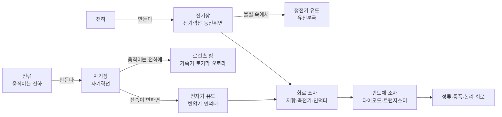

# 전자기와 양자 1. 전자기적 상호작용 — 장(場)이 힘을 전하고 회로가 세상을 움직인다
<!-- prev: m2-07, 2-6, 5-5, phy-2, phy-3 -->
<!-- next: emq-2, emq-3 -->

> [!NOTE]
> **성취기준**
> - **[12전자01-01]** 전하 주위의 전기장을 정량적으로 구하고, 전기력선과 등전위면으로부터 전기장의 세기와 방향을 추리할 수 있다.
> - **[12전자01-02]** 정전기 유도와 유전분극을 설명하고, 일상생활에서 적용되는 예를 찾을 수 있다.
> - **[12전자01-03]** 자기력선을 이용하여 전류가 흐르는 도선 주위의 자기장의 세기와 방향을 추리할 수 있다.
> - **[12전자01-04]** 로런츠 힘이 발생하는 조건을 알고, 로런츠 힘과 관련된 현상과 기술을 설명할 수 있다.
> - **[12전자01-05]** 자기선속의 변화로 전자기 유도를 이해하고, 변압기, 인덕터 등 전자기 유도의 활용 기술을 설명할 수 있다.
> - **[12전자01-06]** 저항, 축전기, 인덕터를 활용하는 장치를 찾아 에너지 관점에서 정성적으로 설명할 수 있다.
> - **[12전자01-07]** 다이오드, 트랜지스터 등 반도체 소자를 활용하는 전자회로를 분석하고, 현대 문명에서 반도체의 중요성을 인식할 수 있다.

**학습 목표**

1. 점전하 주위의 전기장과 전위를 계산하고, 이미 그려진 전기력선·등전위면 그림에서 전기장의 세기와 방향을 읽어 낼 수 있다.
2. 정전기 유도(도체)와 유전분극(절연체)을 구분하여 설명하고, 생활 속 예를 들 수 있다.
3. 직선 전류 주위의 자기장을 자기력선 그림과 비례 관계로 추리하고, 로런츠 힘이 생기는 조건과 그 응용(입자 가속기, 토카막, 밴앨런대)을 설명할 수 있다.
4. 자기선속의 변화로 유도 기전력을 구하고, 변압기와 인덕터의 작동을 설명할 수 있다.
5. 저항·축전기·인덕터가 들어간 장치를 에너지의 전환과 저장 관점에서 설명할 수 있다.
6. 다이오드와 트랜지스터를 이용한 정류·증폭·논리 회로를 분석하고, 반도체가 현대 문명에서 갖는 의미를 말할 수 있다.

**이 단원의 학습 사다리**

| 단계 | 무엇을 하나? |
|---|---|
| STEP 1. 이전 학습 다시 보기 | 중2 「전기와 자기」, 통합과학 「발전기와 전기 에너지」, 물리학 「전기와 자기」를 꺼내 본다 |
| STEP 2. 기초 다지기 | 벡터의 합, 역제곱 법칙, '단위 전하당' 사고, 오른손 규칙, 선속(flux)의 뜻 |
| STEP 3. 핵심 개념 | 전기장·등전위면 → 유전분극 → 전류의 자기장 → 로런츠 힘 → 전자기 유도 → R·C·L의 에너지 → 반도체 회로 |
| STEP 4. 오개념 바로잡기 | "전기력선은 전하가 움직이는 길이다?" 같은 착각을 바로잡는다 |
| STEP 5. 다음 단계로 | 대학 전자기학(가우스 법칙, 맥스웰 방정식), 회로 이론, 반도체 공학 |
| STEP 6. 생활·산업·진로 | 무선 충전, 전력망, MRI·핵융합, 반도체 산업 |

---

## 🗺️ 단원 들어가기

스마트폰을 충전 패드에 올려놓기만 하면 전선이 없는데도 배터리가 찬다. 놀이공원의 자이로드롭은 마지막 순간 아무것도 닿지 않았는데 부드럽게 멈춘다. 북극 하늘에는 초록빛 오로라가 커튼처럼 흔들리고, 손톱만 한 칩 안에서는 수백억 개의 스위치가 1초에 수십억 번씩 켜졌다 꺼진다.

이 모든 장면에는 공통점이 있다. **전하와 전류가 주변 공간에 '장(field)'을 만들고, 그 장이 다른 전하와 전류에 힘을 전한다**는 것이다. 멀리 떨어진 두 전하가 서로를 '직접' 잡아당기는 것이 아니라, 한 전하가 공간의 성질을 바꾸어 놓고 다른 전하가 그 자리에서 힘을 받는다. 이 단원에서는 장이라는 눈으로 전기와 자기를 다시 보고, 그 지식이 어떻게 변압기·인덕터·트랜지스터 같은 기술로 이어지는지 따라가 본다.

---

## STEP 1. 🔙 이전 학습 다시 보기

### 연계 개념표

| 이전 단원·성취기준 | 그때 배운 것 | 이 단원에서 확장되는 것 |
|---|---|---|
| 중2 「전기와 자기」 [9과14-01] | 마찰 전기, 정전기 유도를 전기력과 원자 모형으로 설명 | 도체의 정전기 유도와 절연체의 **유전분극**을 구분 |
| 중2 「전기와 자기」 [9과14-02, 03] | 전류·전압·저항의 관계(옴의 법칙), 소비 전력 | 저항·축전기·인덕터를 **에너지의 전환·저장** 관점에서 비교 |
| 중2 「전기와 자기」 [9과14-04] | 전류가 흐르는 코일 주위의 자기장, 자기장 속 코일이 받는 힘(전동기) | 직선 도선의 자기장 세기 $B \propto I/r$, 움직이는 전하가 받는 **로런츠 힘** |
| 통합과학1 「물질의 전기적 성질과 소재」 [10통과1-02-06] | 도체·부도체·반도체, 불순물로 전기적 성질 조절 | 다이오드·트랜지스터를 **회로 소자**로 활용 |
| 통합과학2 「발전기와 전기 에너지」 [10통과2-02-05] | 코일 속 자기장이 변하면 전류가 유도됨(정성적) | 자기선속의 변화율로 **유도 기전력을 계산**, 변압기·인덕터 |
| 물리학 「전기와 자기」 [12물리02-01, 03, 05, 06] | 전기장과 전위차(정성적), 축전기의 에너지 저장, 스피커·전동기, 전자기 유도 기술 | 전기장을 **정량적으로** 구하고 전기력선·등전위면을 해석 |
| 물리학 「빛과 물질」 [12물리03-05] | 에너지띠, p-n 접합과 다이오드의 원리 | 다이오드·트랜지스터로 만드는 **정류·증폭·논리 회로** |

### 준비 운동 (사전 진단)

**Q1.** 대전되지 않은 금속 캔에 (−)로 대전된 풍선을 가까이 가져가면 캔이 풍선 쪽으로 굴러온다. 캔 전체의 전하량은 0인데 왜 끌려올까?

**Q2.** 저항 $10\ \Omega$에 $2\ \mathrm{A}$가 흐를 때 저항 양 끝의 전압과 소비 전력은?

**Q3.** 나침반 바늘을 전류가 흐르는 도선 바로 아래에 두면 바늘이 돌아간다. 전류의 방향을 반대로 하면 어떻게 될까?

**Q4.** 코일에 자석을 넣은 채 가만히 두면 검류계 바늘은 어떻게 될까?

정답 및 해설

**Q1.** 풍선의 (−)전하가 캔의 자유 전자를 먼 쪽으로 밀어내어 가까운 쪽은 (+), 먼 쪽은 (−)가 된다(정전기 유도). 가까운 (+)와 풍선 사이의 인력이 먼 (−)와의 척력보다 크므로 캔이 끌려온다.

**Q2.** $V = IR = 2 \times 10 = 20\ \mathrm{V}$, $P = VI = 20 \times 2 = 40\ \mathrm{W}$

**Q3.** 나침반 바늘이 처음과 반대 방향으로 돌아간다. 전류의 방향이 바뀌면 자기장의 방향도 바뀐다.

**Q4.** 바늘이 움직이지 않는다(0을 가리킨다). 전류는 코일을 지나는 자기장이 **변할 때만** 유도된다.

---

## STEP 2. 🧱 기초 다지기

### ① 벡터는 화살표끼리 더한다

전기장, 자기장, 힘은 모두 크기와 방향이 있는 **벡터(vector)** 이다. 두 전하가 한 지점에 만드는 전기장은 각 전하가 만든 전기장 화살표를 이어 붙여(또는 평행사변형으로) 더한다. 이것을 **중첩 원리(superposition principle)** 라 한다.

- 같은 직선 위: 방향을 (+), (−) 부호로 정하고 그냥 더한다.
- 서로 수직: 피타고라스 정리로 크기를 구한다. 예) $3$과 $4$를 수직으로 더하면 $5$.

### ② 역제곱 법칙 — 거리가 2배면 세기는 4분의 1

쿨롱 법칙은 두 점전하 사이의 전기력이 거리의 제곱에 반비례한다고 말한다.

$$
F = k\frac{q_1 q_2}{r^2}, \qquad k \approx 9.0\times10^{9}\ \mathrm{N\cdot m^2/C^2}
$$

전구 하나에서 퍼져 나가는 빛이 거리가 2배가 되면 넓이 4배의 구면에 퍼져 밝기가 $\frac{1}{4}$이 되는 것과 같은 기하학적 이유이다. 만유인력도 같은 꼴이다(통합과학1 「중력과 운동」).

### ③ '단위 ○○당'으로 생각하기

물리학에서는 '시험 대상'에 따라 달라지는 양을 나누어서, **공간 자체의 성질**만 남긴다.

| 양 | 정의 | 뜻 |
|---|---|---|
| 전기장 $E$ | $E = F/q$ | 그 자리에 놓인 $+1\ \mathrm{C}$이 받는 힘 (단위 $\mathrm{N/C} = \mathrm{V/m}$) |
| 전위 $V$ | $V = U/q$ | 그 자리에 놓인 $+1\ \mathrm{C}$이 갖는 전기 퍼텐셜 에너지 (단위 $\mathrm{V} = \mathrm{J/C}$) |
| 중력장 $g$ | $g = F/m$ | 그 자리에 놓인 $1\ \mathrm{kg}$이 받는 힘 (단위 $\mathrm{N/kg}$) |

> [!TIP]
> 💡 **비유** — 전위는 '전기적인 높이', 전기장은 '전기적인 비탈의 기울기'이다. 물이 높은 곳에서 낮은 곳으로 흐르듯, (+)전하는 전위가 높은 곳에서 낮은 곳으로 힘을 받는다. 등고선 지도에서 등고선이 촘촘한 곳이 가파른 것처럼, **등전위면이 촘촘한 곳이 전기장이 센 곳**이다.

### ④ 오른손 규칙 두 가지

| 규칙 | 손 모양 | 알 수 있는 것 |
|---|---|---|
| 앙페르 법칙(오른나사 법칙) | 엄지 = 전류 방향, 감아쥔 네 손가락 = 자기장 방향 | 직선 전류 주위 자기장의 회전 방향 |
| 힘의 방향(오른손 손바닥) | 네 손가락 = 자기장, 엄지 = (+)전하의 속도(전류), 손바닥이 미는 방향 = 힘 | 로런츠 힘, 도선이 받는 힘의 방향 |

전자처럼 (−)전하는 같은 속도라도 힘의 방향이 **반대**이다.

### ⑤ 선속(flux) — '얼마나 많이 꿰뚫는가'

창문으로 들어오는 바람의 양은 바람의 세기, 창문의 넓이, 그리고 바람이 창문에 얼마나 **정면으로** 부는지에 따라 달라진다. 자기장도 마찬가지로, 어떤 면을 수직으로 꿰뚫는 자기장의 양을 **자기선속(magnetic flux)** $\Phi$라 한다.

$$
\Phi = BA\cos\theta \qquad (\text{단위: } \mathrm{Wb} = \mathrm{T\cdot m^2})
$$

($\theta$는 면에 수직인 방향과 자기장이 이루는 각) 면이 자기장에 수직이면 $\Phi = BA$, 나란하면 $\Phi = 0$이다. 자기력선으로 그리면 **면을 꿰뚫는 자기력선의 개수**에 비례한다.

---

## STEP 3. 📘 핵심 개념

### ① 전하가 만드는 전기장과 전위 — 정량적으로 구하기 [12전자01-01]

#### 장은 상호작용의 매개물이다

전하 $Q$가 있으면 그 주위 공간에는 **전기장(electric field)** 이 생긴다. 다른 전하 $q$는 $Q$를 직접 '느끼는' 것이 아니라, 자기가 놓인 자리의 전기장 $E$를 느끼고 $F = qE$의 힘을 받는다. 즉 **전하 → 장 → 다른 전하**의 순서로 상호작용이 전달된다. 태양이 갑자기 사라져도 지구가 그 사실을 약 8분 뒤에야 '알게' 되는 것처럼, 장의 변화도 빛의 속력으로 퍼져 나간다(이 생각은 「빛과 정보 통신」의 전자기파로 이어진다).

#### 점전하의 전기장과 전위

쿨롱 법칙을 시험 전하 $q$로 나누면 점전하 $Q$가 거리 $r$인 곳에 만드는 전기장의 세기를 얻는다.

$$
E = k\frac{Q}{r^2}, \qquad V = k\frac{Q}{r}
$$

- 방향: $Q > 0$이면 바깥으로 뻗어 나가는 방향, $Q < 0$이면 전하를 향하는 방향.
- 전위 $V$는 방향이 없는 **스칼라**이다. 무한히 먼 곳을 $V = 0$으로 정한다. (+)전하 근처는 전위가 높고, (−)전하 근처는 전위가 낮다(음수).
- 여러 전하가 있으면 전기장은 **벡터 합**, 전위는 **그냥 더한다**(부호 포함).

| 거리 $r$ | 전기장 $E$ | 전위 $V$ |
|---|---|---|
| $r_0$ | $E_0$ | $V_0$ |
| $2r_0$ | $E_0/4$ | $V_0/2$ |
| $3r_0$ | $E_0/9$ | $V_0/3$ |

#### 예제 1 — 점전하의 전기장과 전위

$+2.0\ \mu\mathrm{C}$의 점전하로부터 $0.30\ \mathrm{m}$ 떨어진 점 P에서 (1) 전기장의 세기, (2) 전위, (3) P에 놓인 $-1.0\ \mathrm{nC}$의 전하가 받는 힘을 구하시오. ($k = 9.0\times10^9\ \mathrm{N\cdot m^2/C^2}$)

**풀이**
(1) $E = \dfrac{9.0\times10^9 \times 2.0\times10^{-6}}{(0.30)^2} = 2.0\times10^5\ \mathrm{N/C}$, 방향은 전하에서 멀어지는 쪽.
(2) $V = \dfrac{9.0\times10^9 \times 2.0\times10^{-6}}{0.30} = 6.0\times10^4\ \mathrm{V}$
(3) $F = qE = 1.0\times10^{-9}\times2.0\times10^5 = 2.0\times10^{-4}\ \mathrm{N}$. 전하가 (−)이므로 힘은 전기장과 **반대**, 즉 $+2.0\ \mu\mathrm{C}$ 쪽으로 끌려간다.

#### 예제 2 — 중첩: 전기장이 0인 곳 찾기

그림과 같이 $x = 0$에 $+4\ \mu\mathrm{C}$, $x = 3\ \mathrm{m}$에 $-1\ \mu\mathrm{C}$이 있다. $x$축 위에서 전기장이 0인 지점은?

<!-- fig:emq-1-q-axis-charges -->

**풀이** 두 전하 사이($0 < x < 3$)에서는 두 전기장이 모두 $+x$ 방향이므로 상쇄되지 않는다. 크기가 큰 전하($+4$) 왼쪽에서는 언제나 큰 전하의 전기장이 이긴다. 따라서 **작은 전하 바깥쪽**($x > 3$)에서 찾는다.

$$
k\frac{4}{x^2} = k\frac{1}{(x-3)^2} \;\Rightarrow\; \frac{2}{x} = \frac{1}{x-3} \;\Rightarrow\; x = 6\ \mathrm{m}
$$

#### 전기력선과 등전위면 읽기

교육과정은 전기력선과 등전위면을 **직접 그리는 방법보다 이미 그려진 그림을 해석**하는 데 초점을 둔다. 그림을 보면 다음 규칙으로 정보를 읽어 낸다.

| 그림에서 보이는 것 | 읽어 낼 수 있는 정보 |
|---|---|
| 전기력선의 접선 방향 | 그 점에서 전기장(+전하가 받는 힘)의 방향 |
| 전기력선의 간격(촘촘함) | 전기장의 세기. 촘촘할수록 세다 |
| 전기력선이 나가는 전하 / 들어가는 전하 | (+)전하 / (−)전하 |
| 전하에 연결된 전기력선의 개수 비 | 전하량의 크기 비 |
| 등전위면(선) | 전위가 같은 점을 이은 면. 전기력선과 항상 **수직** |
| 등전위면의 간격 | 같은 전위차 간격일 때, 촘촘할수록 전기장이 세다 |
| 전기력선을 따라가는 방향 | 전위가 **낮아지는** 방향 |

등전위면을 따라 전하를 옮기면 전기력이 하는 일이 0이다. 전기력이 등전위면에 수직이기 때문이다. 전기장의 세기는 등전위면 간격 $d$와 전위차 $\Delta V$로 어림할 수 있다.

$$
E \approx \frac{\Delta V}{d}
$$

**대표적인 그림 해석**

| 전하 배치 | 전기력선 모양 | 등전위면 모양 |
|---|---|---|
| 점전하 하나 | 사방으로 뻗는 직선 | 전하를 중심으로 하는 동심 구면 |
| 크기가 같은 (+)와 (−) | (+)에서 나와 휘어져 (−)로 들어감. 가운데가 촘촘 | 두 전하 사이 수직이등분면은 $V = 0$인 평면 |
| 크기가 같은 (+)와 (+) | 서로 밀어내듯 휘어짐. 가운데 한 점은 전기력선이 없음($E = 0$) | 두 전하를 감싸는 '땅콩' 모양 |
| 나란한 두 금속판(+, −) | 판 사이에 간격이 일정한 평행 직선 | 판과 나란한 평면이 같은 간격으로 늘어섬 → **균일한 전기장** |

<!-- sim:field-potential -->

#### 예제 3 — 등전위선 지도 읽기

그림과 같이 $10\ \mathrm{V}$ 간격으로 그린 등전위선이 영역 A에서는 $2\ \mathrm{cm}$, 영역 B에서는 $5\ \mathrm{cm}$ 간격으로 그려져 있다. (1) 각 영역의 전기장 세기를 어림하고, (2) $+2\ \mathrm{C}$의 전하를 $40\ \mathrm{V}$ 등전위선에서 $10\ \mathrm{V}$ 등전위선으로 옮길 때 전기력이 한 일을 구하시오.

<!-- fig:emq-1-q-equipotential -->

**풀이**
(1) A: $E \approx 10/0.02 = 500\ \mathrm{V/m}$, B: $E \approx 10/0.05 = 200\ \mathrm{V/m}$. 간격이 좁은 A가 더 세다.
(2) 전기력이 한 일 $W = q(V_{\text{처음}} - V_{\text{나중}}) = 2\times(40-10) = 60\ \mathrm{J}$. 경로와 상관없이 처음과 끝의 전위만으로 정해진다.

> [!IMPORTANT]
> 전기장은 **힘**(벡터)의 지도, 전위는 **에너지**(스칼라)의 지도이다. 전기력선은 등전위면을 수직으로 꿰뚫으며 '내리막' 방향을 가리킨다.

#### ✔ 바로 확인

1. (O/X) 전위는 방향이 있는 벡터이므로, 여러 전하가 만드는 전위는 화살표를 이어 붙여 더한다.
2. 빈칸: 점전하로부터의 거리가 3배가 되면 전기장의 세기는 (    )배, 전위는 (    )배가 된다.
3. $10\ \mathrm{V}$ 간격으로 그린 등전위선 사이의 거리가 $1\ \mathrm{cm}$인 곳에서 전기장의 세기는 약 몇 $\mathrm{V/m}$인가?
4. (O/X) 전기력선을 따라가면 전위가 점점 높아진다.

정답

1. X — 전위는 방향이 없는 스칼라이므로 부호를 포함해 그냥 더한다. 화살표로 더하는 것은 전기장이다.
2. $\frac{1}{9}$, $\frac{1}{3}$ — $E \propto 1/r^2$, $V \propto 1/r$이다.
3. $1000\ \mathrm{V/m}$ — $E \approx \Delta V/d = 10/0.01$
4. X — 전기력선은 전위가 **낮아지는** '내리막' 방향을 가리킨다.

### ② 정전기 유도와 유전분극 — 물질은 전기장에 어떻게 반응하는가 [12전자01-02]

물질을 전기장 속에 넣으면 물질 안의 전하가 재배치된다. 그 방식은 물질이 **자유 전자를 가졌는지**에 따라 다르다.

#### 도체의 정전기 유도

금속 같은 **도체(conductor)** 에는 원자에 묶이지 않은 자유 전자가 있다. 외부 전기장이 걸리면 자유 전자가 전기장 반대 방향으로 이동하여 한쪽 끝은 (−), 다른 쪽 끝은 (+)를 띤다. 이를 **정전기 유도(electrostatic induction)** 라 한다.

- 전자는 도체 내부의 전기장이 **0**이 될 때까지 움직인다. 도체 표면에 쌓인 전하가 만드는 전기장이 외부 전기장을 정확히 상쇄하기 때문이다.
- 그래서 정전기 평형 상태의 도체 내부는 전기장이 0이고, 도체 전체가 하나의 등전위체가 된다. 전하는 표면에만 분포한다.

**정전기 차폐(electrostatic shielding)**: 금속 상자 안은 외부 전기장이 들어오지 않는다. 엘리베이터 안에서 휴대전화가 잘 끊기는 것, 전자레인지 문의 금속망, 전자 회로를 감싸는 금속 차폐 덮개가 모두 이 원리이다. 낙뢰 때 자동차 안이 비교적 안전한 이유 중 하나도 금속 차체가 전하를 바깥 표면으로 흘려보내기 때문이다.

#### 절연체의 유전분극

유리, 플라스틱, 종이 같은 **절연체(부도체, insulator)** 에는 자유 전자가 거의 없다. 대신 전기장이 걸리면 각 원자·분자 안에서 전자구름이 약간 한쪽으로 치우치거나, 원래 극성을 띤 분자(물 분자 등)가 전기장 방향으로 회전하여 정렬한다. 이렇게 물질 내부에 작은 전기 쌍극자가 줄지어 생기는 현상을 **유전분극(dielectric polarization)** 이라 하고, 이런 물질을 **유전체(dielectric)** 라 한다.

| 구분 | 정전기 유도 (도체) | 유전분극 (절연체) |
|---|---|---|
| 움직이는 것 | 자유 전자가 **물체 전체를** 이동 | 전자구름이 원자·분자 **안에서** 살짝 치우침, 극성 분자 회전 |
| 결과 | 양 끝에 (+), (−) 전하가 크게 분리 | 표면에 약한 (+), (−) 전하가 나타남 |
| 내부 전기장 | 0이 된다 | 0은 아니고, **약해진다** |
| 떼어 내면 | 반으로 자르면 각각 대전된 채 분리 가능 | 반으로 잘라도 각각 중성(분극은 전기장이 사라지면 원래대로) |
| 예 | 검전기, 정전기 차폐, 피뢰침 | 축전기 속 유전체, 문지른 빗에 끌리는 종잇조각, 전자레인지 |

<!-- fig:emq-1-induction-polarization -->

> [!TIP]
> 💡 **비유** — 도체는 '빈자리가 많은 교실'이라 학생(전자)들이 교실 한쪽 끝으로 몰려갈 수 있다. 절연체는 '자리에 안전벨트를 맨 교실'이라, 학생들이 자리에서 몸만 한쪽으로 기울일 수 있다. 몸을 기울인 학생이 줄지어 있으면 교실 맨 앞과 맨 뒤에 약한 치우침이 나타난다.

#### 유전분극의 쓰임새

| 사례 | 원리 |
|---|---|
| 축전기 속 유전체 | 유전체가 분극되면 판 사이 전기장이 약해져, 같은 전압에서 더 많은 전하를 저장할 수 있다 |
| 정전기 청소포·먼지떨이 | 대전된 섬유가 먼지를 분극시켜 끌어당긴다 |
| 랩(식품 포장 비닐)이 그릇에 달라붙음 | 벗겨 낼 때 대전된 랩이 그릇 표면을 분극시킨다 |
| 전자레인지 | 빠르게 방향이 바뀌는 전기장에 물 분자가 계속 회전하려 하며 열이 생긴다 |
| 레이저 프린터·복사기 | 감광 드럼의 대전 영역에 토너 가루가 정전기력으로 달라붙는다 |
| 터치스크린(정전 용량 방식) | 손가락(전도성 물체)이 다가오면 화면 전극의 전기장 분포와 저장 전하가 달라져 위치를 감지한다 |

#### 예제 4 — 정전기 유도와 유전분극 구별

(−)로 대전된 막대를 (가) 절연 받침 위의 금속 공, (나) 실에 매단 작은 스타이로폼 공에 각각 가까이 가져갔다. 두 공 모두 막대 쪽으로 끌려왔다. 각각의 이유를 설명하고, 어느 쪽이 더 강하게 끌리는지 추리하시오.

**풀이** (가) 금속 공의 자유 전자가 먼 쪽으로 밀려나 가까운 쪽이 (+)가 된다(정전기 유도). (나) 스타이로폼 분자들이 분극되어 가까운 쪽 표면에 약한 (+)가 나타난다(유전분극). 두 경우 모두 가까운 쪽 (+)와의 인력이 먼 쪽 (−)와의 척력보다 커서 끌려온다. 전하가 실제로 이동하는 금속 공 쪽이 분리된 전하량이 커서 일반적으로 더 강하게 끌린다.

#### ✔ 바로 확인

1. 짝짓기: (가) 도체 (나) 절연체 — ㄱ. 자유 전자가 물체 전체를 가로질러 이동한다 ㄴ. 원자·분자 안에서 전하가 살짝 치우친다
2. (O/X) 정전기 평형 상태에 있는 도체의 내부 전기장은 0이다.
3. 빈칸: 금속 상자 안으로 외부 전기장이 들어오지 못하는 현상을 (    )라 한다.
4. 유전분극된 플라스틱 막대를 전기장 속에서 반으로 자른 뒤 전기장을 없애면, 두 조각은 각각 어떤 전기적 상태인가?

정답

1. (가)–ㄱ, (나)–ㄴ
2. O — 표면에 쌓인 전하가 외부 전기장을 정확히 상쇄할 때까지 전자가 움직인다.
3. 정전기 차폐 — 엘리베이터 속 휴대전화, 전자레인지 문의 금속망이 예이다.
4. 둘 다 중성 — 전하가 분자 안에서만 치우쳤을 뿐 물체 사이를 이동하지 않았다.

### ③ 전류가 만드는 자기장 — 자기력선으로 추리하기 [12전자01-03]

전기장이 전하에서 생기듯, **자기장(magnetic field)** 은 **움직이는 전하, 즉 전류**에서 생긴다. 막대자석의 자기장도 결국 원자 속 전자들의 운동(스핀과 궤도 운동)에서 나온다(물리학 「전기와 자기」의 자성체).

#### 자기력선 그림 읽기

| 그림에서 보이는 것 | 읽어 낼 수 있는 정보 |
|---|---|
| 자기력선의 접선 방향 | 그 점에서 나침반 N극이 가리키는 방향 = 자기장 방향 |
| 자기력선의 간격 | 촘촘할수록 자기장이 세다 |
| 자기력선의 모양 | 항상 **닫힌 고리**이다(시작점·끝점이 없다) |
| 자기력선끼리 | 서로 교차하지 않는다 |

전기력선은 (+)전하에서 시작해 (−)전하에서 끝나지만, **자기력선은 시작과 끝이 없는 고리**라는 점이 가장 큰 차이이다. 자석을 아무리 잘게 잘라도 N극만 따로 얻을 수 없는 이유와 연결된다.

#### 직선 전류 주위의 자기장

긴 직선 도선에 전류 $I$가 흐르면 자기력선은 도선을 중심으로 하는 **동심원**을 그린다. 방향은 오른손 엄지를 전류 방향으로 했을 때 감아쥔 네 손가락 방향이다. 동심원의 간격은 도선에서 멀어질수록 넓어진다. 즉 자기장의 세기는 전류에 비례하고 거리에 반비례한다.

$$
B \propto \frac{I}{r}
$$

(교육과정은 이 관계를 자기력선 그림으로 **추리**하는 수준에서 다룬다. 비례 상수까지 넣은 식은 STEP 5에서 맛본다.)

| 전류 $I$ | 거리 $r$ | 자기장 $B$ |
|---|---|---|
| $I_0$ | $r_0$ | $B_0$ |
| $2I_0$ | $r_0$ | $2B_0$ |
| $I_0$ | $2r_0$ | $B_0/2$ |
| $2I_0$ | $2r_0$ | $B_0$ |

#### 원형 도선과 솔레노이드

| 전류 모양 | 자기력선 모양 | 특징 |
|---|---|---|
| 원형 도선 | 고리 중심을 수직으로 꿰뚫는 자기력선, 바깥은 휘어져 되돌아옴 | 중심에서 자기장 세기는 전류에 비례, 반지름에 반비례 |
| 솔레노이드(촘촘한 코일) | 내부는 축에 나란한 **간격이 일정한 평행선**, 외부는 막대자석과 비슷 | 내부 자기장이 균일. 단위 길이당 감은 수와 전류에 비례 |

솔레노이드 안에 철심을 넣으면 철심이 자화되어 자기장이 수백~수천 배 세진다. 이것이 **전자석**이다.

<!-- fig:emq-1-wire-field -->

#### 예제 5 — 비례 관계로 도선 주위 자기장 추리하기

긴 직선 도선에 전류가 흐를 때, 도선에서 $5\ \mathrm{cm}$ 떨어진 점 P의 자기장 세기가 $4\times10^{-5}\ \mathrm{T}$였다. (1) 전류를 그대로 두고 도선에서 $10\ \mathrm{cm}$, $20\ \mathrm{cm}$ 떨어진 곳의 자기장 세기는? (2) 전류만 3배로 하면 P의 자기장 세기는? (3) 이 값을 지구 자기장(약 $5\times10^{-5}\ \mathrm{T}$)과 비교하시오.

**풀이**
(1) $B \propto 1/r$이므로 $10\ \mathrm{cm}$에서 $2\times10^{-5}\ \mathrm{T}$, $20\ \mathrm{cm}$에서 $1\times10^{-5}\ \mathrm{T}$. 자기력선 그림에서는 도선에서 멀어질수록 동심원 간격이 넓어지는 것으로 나타난다.
(2) $B \propto I$이므로 $1.2\times10^{-4}\ \mathrm{T}$. 같은 거리에서 자기력선이 더 촘촘하게 그려진다.
(3) P의 자기장은 지구 자기장과 비슷한 크기이다. 그래서 도선 근처의 나침반은 지구 자기장과 도선 자기장의 **벡터 합** 방향을 가리키며 뚜렷하게 돌아간다(외르스테드의 실험).

#### ✔ 바로 확인

1. (O/X) 자기력선은 N극에서 시작해 S극에서 끝나는, 시작과 끝이 있는 선이다.
2. 긴 직선 도선에서 거리 $r$인 곳의 자기장이 $B$이다. 전류를 2배로, 거리를 4배로 하면 자기장은 몇 $B$인가?
3. 빈칸: 솔레노이드 내부의 자기력선은 간격이 일정한 평행선이므로 내부 자기장은 (    )하다.
4. 그림(직선 전류)처럼 전류가 종이면에서 나오는 방향으로 흐를 때, 위에서 본 자기력선은 시계 방향인가, 시계 반대 방향인가?

정답

1. X — 자기력선은 시작과 끝이 없는 닫힌 고리이다.
2. $\frac{1}{2}B$ — $B \propto I/r$이므로 $\frac{2}{4} = \frac{1}{2}$배
3. 균일
4. 시계 반대 방향 — 오른손 엄지를 종이면에서 나오는 쪽으로 하면 네 손가락이 시계 반대 방향으로 감긴다.

### ④ 로런츠 힘 — 움직이는 전하가 자기장에서 받는 힘 [12전자01-04]

#### 로런츠 힘이 생기는 조건

전하 $q$가 자기장 $B$ 속에서 속도 $v$로 움직이면 힘을 받는다. 이를 **로런츠 힘(Lorentz force)** 이라 한다.

$$
F = qvB\sin\theta
$$

($\theta$는 속도와 자기장 사이의 각) 이 식에서 로런츠 힘이 생기는 조건이 바로 보인다.

| 조건 | 결과 |
|---|---|
| 전하가 없다 ($q = 0$, 예: 중성자) | 힘 없음 |
| 전하가 정지해 있다 ($v = 0$) | 힘 없음 — 자기장은 정지 전하에 힘을 주지 않는다 |
| 자기장과 나란히 움직인다 ($\theta = 0^\circ$ 또는 $180^\circ$) | 힘 없음 |
| 자기장에 수직으로 움직인다 ($\theta = 90^\circ$) | 힘이 최대 $F = qvB$ |

힘의 방향은 **속도와 자기장 모두에 수직**이다. 그래서 로런츠 힘은 입자의 속력을 바꾸지 못하고 **방향만** 바꾼다. 힘이 운동 방향에 수직이므로 일을 하지 않기 때문이다.

#### 자기장 속의 원운동

자기장에 수직으로 들어온 전하는 크기가 일정하고 방향이 늘 수직인 힘을 받으므로 **등속 원운동**을 한다. 로런츠 힘이 구심력 역할을 한다.

$$
qvB = \frac{mv^2}{r} \;\Rightarrow\; r = \frac{mv}{qB}
$$

- 빠르고 무거운 입자일수록 크게 돈다. 자기장이 셀수록 작게 돈다.
- 질량이 다른 입자는 다른 반지름으로 돌므로 질량을 구별할 수 있다 → **질량 분석기**.
- 자기장에 비스듬히 들어오면 '원운동 + 자기장 방향 등속 운동'이 합쳐져 **나선 운동**을 한다.

<!-- sim:charge-in-field -->

#### 도선이 받는 힘

전류는 움직이는 전하의 흐름이므로, 자기장 속 도선은 수많은 전하가 받는 로런츠 힘의 합을 받는다.

$$
F = BIL\sin\theta
$$

중학교에서 배운 전동기, 물리학의 스피커가 바로 이 힘을 이용한다. 나란한 두 도선은 서로의 자기장 속에 있으므로, **같은 방향 전류끼리는 끌어당기고 반대 방향 전류끼리는 밀어낸다.**

<!-- fig:emq-1-wire-force -->

#### 예제 6 — 양성자의 원운동

양성자(질량 $1.67\times10^{-27}\ \mathrm{kg}$, 전하량 $1.6\times10^{-19}\ \mathrm{C}$)가 $1.0\times10^6\ \mathrm{m/s}$의 속력으로 $0.50\ \mathrm{T}$의 균일한 자기장에 수직으로 들어왔다. (1) 로런츠 힘의 크기, (2) 원운동 반지름을 구하시오.

**풀이**
(1) $F = qvB = 1.6\times10^{-19}\times1.0\times10^6\times0.50 = 8.0\times10^{-14}\ \mathrm{N}$
(2) $r = \dfrac{mv}{qB} = \dfrac{1.67\times10^{-27}\times1.0\times10^6}{1.6\times10^{-19}\times0.50} \approx 2.1\times10^{-2}\ \mathrm{m}$ (약 $2.1\ \mathrm{cm}$)

#### 로런츠 힘과 관련된 현상과 기술

| 현상·기술 | 로런츠 힘이 하는 일 |
|---|---|
| 전동기, 스피커 | 자기장 속 도선(코일)이 받는 힘으로 회전·진동 |
| 원형 입자 가속기(사이클로트론, 싱크로트론) | 자기장으로 하전 입자의 경로를 원형으로 휘게 하여 여러 번 가속. 에너지가 커질수록 자기장을 세게 하여 같은 궤도를 유지 |
| 질량 분석기 | 같은 속력의 이온이 질량에 따라 다른 반지름으로 돌아 분리됨 |
| 토카막(핵융합 장치) | 1억 °C 이상의 플라스마 속 이온과 전자가 자기력선을 감고 나선 운동하므로, 도넛 모양 자기장으로 플라스마를 벽에 닿지 않게 가둔다 |
| 밴앨런대, 오로라 | 태양풍의 하전 입자가 지구 자기장에 붙잡혀 자기력선을 감고 나선 운동하며 남북을 오간다(밴앨런대). 일부가 극지방 대기로 들어와 공기 분자와 충돌해 빛을 낸다(오로라) |
| 홀 센서 | 도체·반도체 속을 흐르는 전하가 자기장에 의해 한쪽으로 쏠려 전압이 생김 → 자기장 측정, 스마트폰 전자 나침반, 휠 회전수 감지 |

> [!TIP]
> 💡 **비유** — 지구 자기장은 하전 입자에게 '보이지 않는 그물'이다. 입자는 자기력선을 가로질러 들어오기 어렵고 자기력선을 따라 미끄러지듯 움직인다. 그래서 오로라는 자기력선이 땅으로 모여드는 **극지방**에서 주로 보인다.

#### ✔ 바로 확인

1. (O/X) 로런츠 힘은 하전 입자의 속력을 점점 크게 만들 수 있다.
2. 같은 자기장에 수직으로 들어온 같은 입자의 속력이 2배가 되면 원운동 반지름은 몇 배가 되는가?
3. 고르기: 같은 방향으로 전류가 흐르는 나란한 두 도선은 서로 (끌어당긴다 / 밀어낸다).
4. 세기 $0.20\ \mathrm{T}$인 자기장에 수직으로 놓인 길이 $0.50\ \mathrm{m}$ 도선에 $3.0\ \mathrm{A}$가 흐른다. 도선이 받는 힘의 크기는?

정답

1. X — 힘이 속도에 수직이어서 일을 하지 않으므로 속력은 그대로이고 방향만 바뀐다.
2. 2배 — $r = mv/qB$에서 $r \propto v$
3. 끌어당긴다 — 반대 방향 전류끼리는 밀어낸다.
4. $0.30\ \mathrm{N}$ — $F = BIL = 0.20\times3.0\times0.50$

### ⑤ 전자기 유도 — 자기선속이 변하면 기전력이 생긴다 [12전자01-05]

#### 패러데이 법칙과 렌츠 법칙

코일을 지나는 **자기선속이 시간에 따라 변하면** 코일에 **유도 기전력(induced electromotive force)** 이 생긴다. $N$번 감은 코일에서 유도 기전력의 크기는 다음과 같다.

$$
\varepsilon = -N\frac{\Delta\Phi}{\Delta t}
$$

- **패러데이 법칙**: 기전력의 크기는 자기선속의 **변화율**에 비례한다. 자기장이 아무리 세도 변하지 않으면 기전력은 0이다.
- **렌츠 법칙**(식의 − 부호): 유도 전류는 **자기선속의 변화를 방해하는 방향**으로 흐른다. 자석을 가까이 하면 밀어내고, 멀리하면 붙잡는 방향이다.

$\Phi = BA\cos\theta$이므로 선속은 세 가지 방법으로 바꿀 수 있다.

| 무엇을 바꾸나 | 예 |
|---|---|
| 자기장 $B$ | 자석을 코일에 넣었다 뺀다, 옆 코일의 전류를 바꾼다(변압기) |
| 넓이 $A$ | 자기장 속에서 도선 막대를 미끄러뜨려 회로 넓이를 바꾼다 |
| 각 $\theta$ | 자기장 속에서 코일을 회전시킨다(발전기) |

> [!TIP]
> 💡 **비유** — 렌츠 법칙은 '자연의 관성'이다. 코일은 지금 꿰뚫고 있는 자기선속을 그대로 유지하고 싶어 한다. 만약 유도 전류가 변화를 **돕는** 방향이었다면, 자석을 살짝만 밀어도 저절로 끝없이 빨려 들어가며 에너지가 공짜로 생겨날 것이다. 렌츠 법칙은 **에너지 보존**의 다른 얼굴이다.

<!-- fig:emq-1-lenz-law -->

#### 예제 7 — 유도 기전력 계산

단면적 $0.010\ \mathrm{m^2}$, 감은 수 100회인 코일을 수직으로 꿰뚫는 자기장이 $0.1$초 동안 $0$에서 $0.50\ \mathrm{T}$로 일정하게 증가했다. (1) 유도 기전력의 크기는? (2) 코일의 저항이 $10\ \Omega$이면 유도 전류의 크기는?

**풀이**
(1) $\Delta\Phi = \Delta B\times A = 0.50\times0.010 = 5.0\times10^{-3}\ \mathrm{Wb}$
$\varepsilon = N\dfrac{\Delta\Phi}{\Delta t} = 100\times\dfrac{5.0\times10^{-3}}{0.1} = 5.0\ \mathrm{V}$
(2) $I = \varepsilon/R = 5.0/10 = 0.50\ \mathrm{A}$. 방향은 증가하는 자기장을 줄이는(반대 방향 자기장을 만드는) 쪽이다.

#### 맴돌이 전류와 자기 브레이크

금속판처럼 넓은 도체가 자기장 속을 움직이면 판 안의 여러 작은 고리에서 선속이 변해 소용돌이 모양의 **맴돌이 전류(eddy current)** 가 생긴다. 렌츠 법칙에 따라 이 전류는 운동을 방해하는 힘을 만든다. 마찰 없이 운동 에너지를 열로 바꾸는 **자기 브레이크(전자기 제동)** 가 이 원리이다. 자이로드롭이나 일부 롤러코스터의 제동 구간, 고속 열차의 와전류 제동, 인덕션 레인지(빠르게 변하는 자기장으로 냄비 바닥에 맴돌이 전류를 만들어 가열)가 그 예이다.

#### 변압기 — 상호 유도

철심 하나에 두 코일을 감고 1차 코일에 **교류**를 흘리면, 1차 코일이 만든 변하는 자기선속이 철심을 따라 2차 코일을 지나며 2차 코일에 기전력을 유도한다(**상호 유도**). 두 코일을 지나는 선속의 변화율이 같으므로, 전압은 감은 수에 비례한다.

$$
\frac{V_1}{V_2} = \frac{N_1}{N_2}, \qquad V_1I_1 = V_2I_2 \ (\text{이상적인 변압기})
$$

- 감은 수가 많은 쪽 전압이 높다. 전압을 높이면 전류는 그만큼 줄어든다(에너지 보존).
- **직류**를 넣으면 선속이 변하지 않으므로 2차 코일에 전압이 생기지 않는다.
- 발전소 → 송전탑(초고압으로 높여 송전 손실 감소) → 주상 변압기(낮춤) → 가정 $220\ \mathrm{V}$ → 충전기 안의 소형 변압기(더 낮춤).

<!-- fig:emq-1-transformer -->

#### 예제 8 — 변압기

1차 코일 1100회, 2차 코일 50회인 이상적인 변압기의 1차 코일에 $220\ \mathrm{V}$ 교류를 연결했다. (1) 2차 전압은? (2) 2차 코일에 $2.0\ \mathrm{A}$가 흐를 때 1차 코일의 전류는?

**풀이**
(1) $V_2 = V_1\dfrac{N_2}{N_1} = 220\times\dfrac{50}{1100} = 10\ \mathrm{V}$
(2) $I_1 = \dfrac{V_2I_2}{V_1} = \dfrac{10\times2.0}{220} \approx 0.091\ \mathrm{A}$

#### 인덕터 — 자체 유도

코일 하나에 흐르는 전류가 변하면, 그 코일이 만든 자기선속도 변하므로 **자기 자신에게** 기전력이 유도된다. 이것이 **자체 유도(self-induction)** 이고, 이 성질을 이용하려고 만든 코일을 **인덕터(inductor)** 라 한다.

- 렌츠 법칙에 따라 인덕터는 **전류의 변화를 방해**한다. 전류가 늘어나려 하면 반대 기전력으로 막고, 줄어들려 하면 그 방향으로 기전력을 만들어 유지하려 한다.
- 자체 유도의 정도를 **자체 인덕턴스(self-inductance)** $L$로 나타낸다(단위 H, 헨리). 유도 기전력은 $\varepsilon = -L\dfrac{\Delta I}{\Delta t}$이다.
- 스위치를 갑자기 끄면 $\Delta t$가 매우 작아 큰 기전력이 생겨 스위치 사이에 불꽃이 튈 수 있다. 자동차 엔진의 **점화 코일**은 이 큰 전압을 일부러 이용해 점화 플러그에 불꽃을 만든다.

> [!TIP]
> 💡 **비유** — 인덕터는 전류의 '관성'이다. 무거운 수레가 갑자기 출발하기도, 갑자기 멈추기도 어렵듯이, 인덕터가 있는 회로의 전류는 서서히 늘고 서서히 준다.

#### ✔ 바로 확인

1. (O/X) 코일 속에 강한 자석을 넣고 가만히 두면 큰 유도 기전력이 계속 생긴다.
2. 빈칸: 유도 전류는 자기선속의 변화를 방해하는 방향으로 흐른다. 이것을 (    ) 법칙이라 한다.
3. 감은 수 50회인 코일을 지나는 자기선속이 $0.2$초 동안 $0.010\ \mathrm{Wb}$만큼 일정하게 늘었다. 유도 기전력의 크기는?
4. 1차와 2차 코일의 감은 수 비가 $10 : 1$인 이상적인 변압기의 1차 코일에 $220\ \mathrm{V}$ 교류를 걸면 2차 전압은? 같은 크기의 직류를 걸면?

정답

1. X — 선속이 **변할 때만** 기전력이 생긴다. 가만히 두면 0이다.
2. 렌츠
3. $2.5\ \mathrm{V}$ — $\varepsilon = N\Delta\Phi/\Delta t = 50\times0.010/0.2$
4. 교류: $22\ \mathrm{V}$, 직류: 0 — 직류는 선속이 변하지 않아 2차 코일에 기전력이 생기지 않는다.

### ⑥ 저항·축전기·인덕터 — 에너지의 관점에서 보기 [12전자01-06]

세 소자는 모두 전기 에너지를 다루지만, 그 에너지를 **어떻게 처리하는지**가 다르다. 이 성취기준은 정성적으로 다룬다.

| 소자 | 에너지를 어떻게 다루나 | 에너지가 머무는 곳 | 회로에서의 성질 |
|---|---|---|---|
| 저항(resistor) | 전기 에너지를 **열(빛)로 전환**하여 내보낸다. 되돌려 받을 수 없다 | 없음(소모) | 전류를 제한하고 전압을 나눈다 |
| 축전기(capacitor) | 판에 전하를 모아 **전기장에 에너지를 저장**했다가 내놓는다 | 두 판 사이의 전기장 | 전압의 급변을 막는다. 직류는 충전 후 차단, 교류는 통과(진동수가 높을수록 잘 통과) |
| 인덕터(inductor) | 전류가 만든 **자기장에 에너지를 저장**했다가 내놓는다 | 코일 안팎의 자기장 | 전류의 급변을 막는다. 직류는 잘 통과, 교류는 방해(진동수가 높을수록 더 방해) |

축전기와 인덕터는 이상적으로는 에너지를 **소모하지 않고 저장·반환**한다. 실제 소자에는 작은 저항이 있어 일부가 열로 빠져나간다.

> [!TIP]
> 💡 **비유** — 저항은 '물레방아 대신 브레이크 패드'처럼 흐름의 에너지를 열로 빼앗는다. 축전기는 '물탱크'로, 물(전하)을 채워 수압(전압)을 쌓았다가 한꺼번에 내보낸다. 인덕터는 '무거운 물레방아 바퀴'로, 한번 돌기 시작하면 흐름을 계속 밀어 주려 한다.

#### 장치 속의 R·C·L 찾기

| 장치 | 쓰인 소자 | 에너지 관점의 설명 |
|---|---|---|
| 전기 히터, 헤어드라이어 열선, 토스터 | 저항 | 전기 에너지 → 열에너지 |
| 전기 퓨즈 | 저항 | 과전류 시 열로 녹아 회로를 끊는다 |
| 카메라 플래시 | 축전기 | 건전지로 천천히 충전 → 순간적으로 방전하여 큰 전력으로 빛 에너지 방출 |
| 자동 심장 충격기(AED, 제세동기) | 축전기 | 충전한 전기 에너지를 짧은 시간에 심장에 전달 |
| 정전 순간 데이터 보존, 전원 회로의 평활 | 축전기 | 저장한 에너지로 전압이 갑자기 떨어지는 것을 메운다 |
| 슈퍼커패시터(버스·트램 회생 제동) | 축전기 | 제동 시 생긴 전기 에너지를 빠르게 저장했다가 출발 때 사용 |
| 점화 코일 | 인덕터 | 자기장에 모은 에너지를 스위치를 끄는 순간 높은 전압으로 내보냄 |
| 전원 장치의 초크 코일, 노이즈 필터 | 인덕터 | 전류의 급변·고주파 잡음을 막고 직류를 통과시킨다 |
| 무선 충전 패드 | 인덕터(코일) 두 개 | 송신 코일의 변하는 자기장 에너지가 수신 코일로 전달 |
| 라디오 튜너, 스피커의 크로스오버 필터 | 축전기 + 인덕터 | 전기장 ↔ 자기장 에너지가 주고받으며 특정 진동수에서 진동(공진)하여 원하는 신호만 골라낸다 |

#### 예제 9 — 같은 전지, 다른 결과

전지, 스위치, 전구로 된 회로에 (가) 저항, (나) 충분히 큰 축전기, (다) 철심을 넣은 큰 인덕터를 각각 전구와 직렬로 연결했다. 스위치를 닫는 순간부터 전구의 밝기 변화를 에너지 관점에서 정성적으로 설명하시오.

**풀이**
(가) 저항: 닫자마자 일정한 밝기로 켜진다. 저항과 전구 모두 전기 에너지를 계속 열과 빛으로 바꾼다.
(나) 축전기: 닫는 순간 밝게 켜졌다가 점점 어두워져 꺼진다. 처음에는 전하가 축전기로 쉽게 흘러들지만, 충전될수록 축전기의 전압이 전지 전압에 가까워져 전류가 줄어든다. 전지의 에너지 일부는 축전기의 전기장에 저장된다.
(다) 인덕터: 닫는 순간 어둡다가 점점 밝아져 일정해진다. 인덕터가 전류의 증가를 방해하기 때문이며, 그동안 전지의 에너지 일부는 인덕터의 자기장에 저장된다.

<!-- fig:emq-1-rcl-bulb -->

#### ✔ 바로 확인

1. 짝짓기: (가) 저항 (나) 축전기 (다) 인덕터 — ㄱ. 자기장에 에너지를 저장 ㄴ. 전기 에너지를 열로 전환 ㄷ. 전기장에 에너지를 저장
2. 고르기: 카메라 플래시가 건전지로 천천히 모아 두었다가 순간적으로 큰 빛을 내는 데 쓰는 소자는? (저항 / 축전기 / 인덕터)
3. (O/X) 전지에 축전기와 전구를 직렬로 연결하고 충분한 시간이 지나면 전구는 꺼진다.
4. 그림(전구 밝기 변화)에서 스위치를 닫는 순간 가장 어두운 것은 (가)~(다) 중 어느 것인가?

정답

1. (가)–ㄴ, (나)–ㄷ, (다)–ㄱ
2. 축전기
3. O — 축전기의 전압이 전지 전압과 같아지면 전류가 더 흐르지 않는다.
4. (다) 인덕터 — 전류의 증가를 방해하므로 처음에 어둡다가 점점 밝아진다.

### ⑦ 반도체 소자와 전자회로 — 정류·증폭·논리 [12전자01-07]

이 성취기준은 반도체 내부의 미시적 원리(물리학 「빛과 물질」의 에너지띠, p-n 접합)보다 **소자를 회로에서 어떻게 쓰는지**에 초점을 둔다.

#### 다이오드 — 한 방향으로만 흐르게 하는 밸브

**다이오드(diode)** 는 p형과 n형 반도체를 붙인 소자로, 전류를 **한쪽 방향으로만** 흐르게 한다.

| 연결 | 이름 | 결과 |
|---|---|---|
| p쪽(애노드)에 높은 전압 | 순방향 바이어스 | 약 $0.6 \sim 0.7\ \mathrm{V}$(실리콘) 이상에서 전류가 잘 흐른다 |
| n쪽(캐소드)에 높은 전압 | 역방향 바이어스 | 전류가 거의 흐르지 않는다 |

회로 기호는 삼각형 화살표와 세로 막대로, **화살표 방향이 전류가 흐르는 방향**이다.

**정류(rectification)**: 교류를 직류로 바꾸는 일이다. 스마트폰 충전기 안에서 가정용 교류가 직류로 바뀐다.

| 정류 회로 | 구성 | 출력 모양 |
|---|---|---|
| 반파 정류 | 다이오드 1개 | 교류의 (+) 반주기만 통과, (−) 반주기는 0 → 띄엄띄엄한 맥류 |
| 전파 정류(브리지 정류) | 다이오드 4개를 마름모꼴로 연결 | (−) 반주기도 뒤집어 (+)로 → 모든 반주기에 같은 방향 전류 |
| 평활 | 전파 정류 뒤에 축전기를 병렬 연결 | 축전기가 전압이 높을 때 충전, 낮을 때 방전하여 출렁임을 메움 → 거의 일정한 직류 |

<!-- fig:emq-1-rectifier -->

**발광 다이오드(LED)** 는 순방향 전류가 흐를 때 빛을 내는 다이오드이다. 반도체 재료에 따라 빛의 색이 달라진다(「빛과 정보 통신」에서 빛과 물질의 상호작용으로 다시 만난다).

#### 트랜지스터 — 작은 신호로 큰 전류를 조절하는 밸브

**트랜지스터(transistor)** 는 세 단자를 가진 반도체 소자이다. 쌍극성 접합 트랜지스터(BJT)의 경우 **베이스(B), 컬렉터(C), 이미터(E)** 가 있고, **베이스로 들어가는 작은 전류가 컬렉터–이미터 사이의 큰 전류를 조절**한다.

$$
I_C = \beta I_B, \qquad I_E = I_B + I_C
$$

($\beta$: 전류 증폭률, 보통 수십~수백)

트랜지스터는 쓰는 방식에 따라 두 가지 역할을 한다.

| 역할 | 동작 | 쓰임 |
|---|---|---|
| 증폭기 | 베이스 전류의 작은 변화가 컬렉터 전류의 큰 변화로 그대로 '닮은꼴'로 나타남 | 마이크 신호 → 스피커, 라디오, 센서 신호 증폭 |
| 스위치 | 베이스 전류가 없으면 차단(OFF), 충분하면 포화되어 완전히 켜짐(ON) | 디지털 회로의 0과 1, 모터·LED 제어 |

<!-- fig:emq-1-transistor-logic -->

> [!IMPORTANT]
> 트랜지스터가 '증폭'한다고 해서 에너지를 만들어 내는 것은 아니다. 커진 출력 신호의 에너지는 **전원(전지)** 에서 온다. 트랜지스터는 작은 신호의 '모양'에 맞추어 전원의 큰 에너지를 흘려보내는 **밸브** 역할을 할 뿐이다. 수도꼭지를 살짝 돌리는 손의 힘으로 큰 물줄기를 조절하는 것과 같다.

#### 예제 10 — 트랜지스터 증폭

$\beta = 100$인 트랜지스터의 베이스 전류가 $20\ \mu\mathrm{A}$에서 $30\ \mu\mathrm{A}$로 변했다. (1) 컬렉터 전류는 얼마에서 얼마로 변하는가? (2) 컬렉터에 $1\ \mathrm{k\Omega}$ 저항이 연결되어 있다면 저항 양 끝 전압의 변화량은?

**풀이**
(1) $I_C = 100\times20\ \mu\mathrm{A} = 2.0\ \mathrm{mA}$ → $100\times30\ \mu\mathrm{A} = 3.0\ \mathrm{mA}$
(2) $\Delta V = R\Delta I_C = 1000\times(3.0-2.0)\times10^{-3} = 1.0\ \mathrm{V}$. 베이스 쪽의 $10\ \mu\mathrm{A}$ 변화가 $1\ \mathrm{V}$의 전압 변화로 커졌다.

#### 기초 논리회로 — 스위치로 계산하기

트랜지스터를 스위치로 쓰면 '전압 높음 = 1, 낮음 = 0'으로 논리 연산을 할 수 있다. 통합과학1 「정보와 신호: 아날로그에서 디지털로」에서 본 0과 1이 실제로 처리되는 곳이 바로 여기이다.

| 논리 게이트 | 스위치(트랜지스터) 연결 | 출력이 1이 되는 조건 |
|---|---|---|
| NOT | 트랜지스터 1개. 입력이 1이면 켜져서 출력을 0으로 끌어내림 | 입력이 0일 때 |
| AND | 두 스위치를 **직렬** 연결 | 두 입력이 모두 1일 때 |
| OR | 두 스위치를 **병렬** 연결 | 입력 중 하나라도 1일 때 |

**진리표**

| A | B | A AND B | A OR B | NOT A |
|---|---|---|---|---|
| 0 | 0 | 0 | 0 | 1 |
| 0 | 1 | 0 | 1 | 1 |
| 1 | 0 | 0 | 1 | 0 |
| 1 | 1 | 1 | 1 | 0 |

#### 예제 11 — 논리회로 분석

자동차의 경고음은 "시동이 켜져 있고(A = 1) 안전벨트를 매지 않았을 때(B = 0)" 울린다. 경고음 출력 Y를 A, B와 게이트로 나타내고 진리표를 완성하시오.

**풀이** Y = A AND (NOT B).

| A | B | NOT B | Y |
|---|---|---|---|
| 0 | 0 | 1 | 0 |
| 0 | 1 | 0 | 0 |
| 1 | 0 | 1 | **1** |
| 1 | 1 | 0 | 0 |

#### 현대 문명에서 반도체의 중요성

- 컴퓨터의 CPU, 메모리는 수십억~수백억 개의 트랜지스터 스위치로 이루어진 거대한 논리회로이다.
- 트랜지스터를 작게 만들수록 같은 넓이에 더 많이 넣을 수 있고, 더 빠르고 전력을 덜 쓴다. 그러나 수 나노미터 수준으로 작아지면 전자가 절연막을 '뚫고' 새어 나가는 문제가 생긴다(「양자와 미시세계」의 터널 효과).
- 전기차·신재생 에너지의 전력 변환 장치(인버터), 스마트폰 충전기, 의료 기기, 통신 장비, 인공지능 연산까지 반도체 없이 작동하는 현대 기술은 거의 없다. 그래서 반도체는 국가 경제와 안보에서도 핵심 산업으로 다루어진다.

#### ✔ 바로 확인

1. 그림(정류 출력)의 반파 정류에서 교류의 (−) 반주기 동안 출력 전압은 얼마인가?
2. 전류 증폭률 $\beta = 200$인 트랜지스터의 베이스 전류가 $10\ \mu\mathrm{A}$이면 컬렉터 전류는?
3. (O/X) 트랜지스터는 신호를 증폭할 때 커진 에너지를 스스로 만들어 낸다.
4. 입력이 A = 1, B = 0일 때 AND 게이트와 OR 게이트의 출력은 각각 무엇인가?

정답

1. 0 — 다이오드가 역방향이 되어 전류가 흐르지 않는다.
2. $2.0\ \mathrm{mA}$ — $I_C = \beta I_B = 200\times10\ \mu\mathrm{A}$
3. X — 커진 출력의 에너지는 전원(전지)에서 온다. 트랜지스터는 밸브 역할만 한다.
4. AND: 0, OR: 1 — 직렬 스위치 중 하나가 열려 있으면 꺼지고, 병렬 스위치는 하나만 닫혀도 켜진다.

---

## STEP 4. ⚠️ 오개념 바로잡기

| 흔한 오개념 | 올바른 개념 | 왜 그럴까? |
|---|---|---|
| 전기력선은 전하가 실제로 움직이는 길이다 | 전기력선은 각 점에서 **힘의 방향**을 이은 선이다. 처음 속도가 있거나 선이 휘어 있으면 전하는 선을 벗어난다 | 힘의 방향과 운동 방향은 다르다. 원운동하는 물체도 힘은 중심을, 운동은 접선 방향을 향한다 |
| 전기장이 0인 곳은 전위도 0이다 | 같은 크기의 두 (+)전하 가운데는 $E = 0$이지만 $V > 0$이다 | 전기장은 전위의 '기울기'이다. 평평한 산꼭대기는 기울기가 0이어도 높이는 0이 아니다 |
| 절연체는 전기장에 아무 반응도 하지 않는다 | 절연체도 **유전분극**되어 표면에 전하가 나타나고 내부 전기장을 약하게 한다 | 자유 전자는 없지만 원자·분자 속 전하가 치우치거나 극성 분자가 회전한다 |
| 자기장 속에 있는 전하는 항상 힘을 받는다 | 전하가 **움직이고**, 그 운동이 자기장과 **나란하지 않을 때만** 힘을 받는다 | $F = qvB\sin\theta$에서 $v = 0$이나 $\theta = 0$이면 힘이 0이다 |
| 로런츠 힘은 입자를 빠르게 한다 | 자기장의 로런츠 힘은 속력을 바꾸지 않고 **방향만** 바꾼다 | 힘이 늘 속도에 수직이므로 일을 하지 않는다. 가속기에서 속력을 올리는 것은 **전기장**이다 |
| 자기장이 세면 유도 전류도 크다 | 유도 기전력은 자기선속의 **변화율**에 비례한다 | 아주 센 자석도 코일 속에 가만히 있으면 전류가 유도되지 않는다 |
| 변압기로 전압을 높이면 에너지도 늘어난다 | 이상적 변압기에서 전력은 같다. 전압이 높아지면 **전류는 줄어든다** | 에너지 보존 법칙. 실제로는 열 손실이 있어 출력이 입력보다 조금 작다 |
| 트랜지스터는 약한 신호에 에너지를 더해 준다 | 출력 에너지는 **전원**에서 온다. 트랜지스터는 작은 신호로 큰 전류를 조절하는 밸브이다 | 전원을 빼면 증폭이 일어나지 않는다 |

---

## STEP 5. 🎓 다음 단계로 한 걸음 더

> [!CAUTION]
> 이 절은 **고등학교 교육과정 범위 밖의 심화 내용**으로 평가 대상이 아니다. 이 단원의 개념이 대학 전공 과목에서 어떻게 확장되는지 맛보기로 보여 주기 위한 내용이다.

### 대학 전공 과목과의 연결

| 대학 과목 | 이어지는 내용 |
|---|---|
| 일반물리학·전자기학 | 가우스 법칙, 앙페르 법칙, 패러데이 법칙을 적분·미분 형태로, 맥스웰 방정식 |
| 회로이론·전기회로 | RC·RL·RLC 회로의 과도 응답, 교류의 임피던스, 공진 |
| 전자회로 | 다이오드·트랜지스터(BJT, MOSFET)의 바이어스와 증폭 회로 설계, 연산 증폭기 |
| 디지털 논리 설계 | 불 대수, 조합·순차 논리회로, 플립플롭과 메모리 |
| 반도체 공학·고체물리 | 에너지띠, 운반자 농도, p-n 접합의 정량적 이론, 트랜지스터 미세화 |
| 플라스마 물리·핵융합 공학 | 자기장 속 하전 입자 운동, 토카막의 자기 가둠 |

### ① 가우스 법칙 — 전기력선을 '세는' 법칙

이 단원에서 "전기력선의 개수는 전하량에 비례한다"고 했다. 이것을 정확한 수식으로 쓴 것이 **가우스 법칙**이다. 임의의 닫힌 곡면을 뚫고 나가는 전기선속은 그 안에 든 전하량에 비례한다.

$$
\oint \vec{E}\cdot d\vec{A} = \frac{Q_{\text{안}}}{\varepsilon_0}
$$

점전하를 둘러싼 구면에 적용하면 $E\cdot4\pi r^2 = Q/\varepsilon_0$에서 바로 $E = \dfrac{1}{4\pi\varepsilon_0}\dfrac{Q}{r^2}$, 즉 쿨롱 법칙이 나온다. $k = \dfrac{1}{4\pi\varepsilon_0}$의 정체가 여기서 드러난다. 같은 방법으로 무한히 긴 직선 도선의 자기장을 앙페르 법칙 $\oint \vec{B}\cdot d\vec{l} = \mu_0 I$로 구하면 $B = \dfrac{\mu_0 I}{2\pi r}$을 얻는다. 진공의 투자율 $\mu_0 = 4\pi\times10^{-7}\ \mathrm{T\cdot m/A}$를 넣으면 $B = 2\times10^{-7}\,\dfrac{I}{r}$이고, 예를 들어 $10\ \mathrm{A}$가 흐르는 도선에서 $5\ \mathrm{cm}$ 떨어진 곳은 $B = 2\times10^{-7}\times\dfrac{10}{0.05} = 4\times10^{-5}\ \mathrm{T}$로 지구 자기장과 비슷하다.

### ② 맥스웰 방정식 — 전기와 자기의 통일

대학 전자기학의 정점은 네 개의 **맥스웰 방정식**이다. 이 단원에서 배운 '전하가 전기장을 만든다', '자기력선은 닫혀 있다', '변하는 자기장이 전기장을 만든다(전자기 유도)', '전류가 자기장을 만든다'가 각각 하나씩이다. 맥스웰은 여기에 '**변하는 전기장도 자기장을 만든다**'는 항을 더했고, 그 결과 전기장과 자기장이 서로를 만들며 공간을 퍼져 나가는 **전자기파**가 존재하며 그 속력이 빛의 속력과 같다는 것을 이끌어 냈다. 빛이 전자기파라는 이 결론이 다음 단원 「빛과 정보 통신」의 출발점이다.

### ③ R·C·L 회로를 정량적으로

이 단원에서 정성적으로 본 에너지 저장은 대학에서 다음 식으로 다룬다.

$$
U_C = \frac{1}{2}CV^2, \qquad U_L = \frac{1}{2}LI^2
$$

축전기를 저항을 통해 충전하면 전압이 $V(t) = V_0(1 - e^{-t/RC})$처럼 지수 함수로 변하고, $RC$를 **시간 상수**라 한다. 축전기와 인덕터를 함께 연결하면 진동수 $f = \dfrac{1}{2\pi\sqrt{LC}}$에서 전기장 에너지와 자기장 에너지가 번갈아 바뀌는 **전기 진동**이 일어나는데, 라디오 튜너가 방송을 고르는 원리이다. 교류 회로에서는 이를 복소수 **임피던스**로 한꺼번에 다룬다.

### ④ MOSFET과 무어의 법칙

오늘날 칩 속 트랜지스터는 대부분 BJT가 아닌 **MOSFET**(금속–산화막–반도체 전계 효과 트랜지스터)이다. 게이트에 건 전압이 만드는 **전기장**이 얇은 절연막(유전체) 너머의 반도체에 전자의 통로(채널)를 열고 닫는다. 이 단원의 전기장, 유전분극, 반도체 소자가 한 소자 안에서 모두 만나는 셈이다. 칩 속 트랜지스터 수가 대략 2년마다 두 배씩 늘어난다는 경험적 관찰을 **무어의 법칙**이라 부르는데, 미세화의 물리적 한계(누설 전류, 발열, 터널 효과) 때문에 3차원 구조, 새로운 소재 등 다양한 방법이 연구되고 있다.

### 고등학교 vs 대학교

| 구분 | 고등학교 전자기와 양자 | 대학교 전자기학·전자공학 |
|---|---|---|
| 전기장 | 점전하, 중첩, 그림 해석 | 가우스 법칙, 연속 전하 분포의 적분 |
| 자기장 | 직선 도선 $B \propto I/r$, 자기력선 해석 | 비오–사바르 법칙, 앙페르 법칙 |
| 전자기 유도 | $\varepsilon = -N\Delta\Phi/\Delta t$ | 미분형 $\nabla\times\vec{E} = -\partial\vec{B}/\partial t$, 맥스웰 방정식 |
| 회로 소자 | R·C·L의 에너지 역할을 정성적으로 | 미분 방정식, 과도 응답, 임피던스와 공진 |
| 반도체 | 정류·증폭·논리 회로의 동작 | 소자 물리, 회로 설계, 집적 회로 공정 |
| 관련 전공 | — | 물리학, 전기공학, 전자공학, 반도체공학, 원자핵공학 |

---

## STEP 6. 🏭 생활·산업·진로 연결

### 사례 1. 무선 충전과 비접촉 교통카드

- **원리** 충전 패드의 송신 코일에 교류가 흐르면 변하는 자기장이 생기고, 스마트폰 안의 수신 코일을 지나는 자기선속이 변해 유도 기전력이 생긴다(상호 유도). 수신된 교류는 다이오드 정류 회로를 거쳐 직류로 바뀌어 배터리를 충전한다.
- **어디에 쓰이나** 스마트폰·무선 이어폰 충전, 전동 칫솔, 교통카드(단말기의 자기장이 카드 안 코일에 전력을 공급하고 정보를 주고받는다), 전기차 무선 충전 연구.

### 사례 2. 전력망 — 변압기와 전력 반도체

- **원리** 송전 전력 $P = VI$가 같을 때 전압을 높이면 전류가 줄어 전선의 열 손실($I^2R$)이 크게 준다. 그래서 발전소에서 변압기로 수십만 볼트까지 높여 보내고, 도시 근처에서 단계적으로 낮춘다.
- **어디에 쓰이나** 태양광·풍력 발전의 직류·불규칙한 교류를 전력망의 교류로 바꾸는 **인버터**, 전기차의 모터 구동 장치에는 대전력 트랜지스터와 다이오드가 쓰인다. 이를 **전력 반도체**라 부른다.

### 사례 3. 하전 입자를 다루는 거대 과학 — 가속기, MRI, 핵융합

- **입자 가속기** 전기장으로 가속하고 자기장(로런츠 힘)으로 경로를 휜다. 우리나라에도 포항의 방사광 가속기처럼 빛을 만들어 물질 구조를 연구하는 시설과 의료용 양성자·중입자 치료 시설이 있다.
- **MRI** 초전도 전자석이 만드는 강한 자기장과 코일이 감지하는 유도 신호로 몸속을 영상화한다.
- **토카막** 플라스마를 자기장으로 가두는 핵융합 실험 장치로, 우리나라의 KSTAR와 국제 공동 프로젝트 ITER가 대표적이다. 별의 에너지원인 핵융합은 「양자와 미시세계」에서 다시 다룬다.

### 사례 4. 반도체 — 모래에서 칩까지

- **원리** 규소(실리콘) 결정에 불순물을 넣어 p형, n형을 만들고, 이를 조합해 다이오드와 트랜지스터를 수십억 개씩 새긴다. 정전기 유도·유전분극(MOSFET 게이트), 정류·증폭·논리 연산이 모두 이 안에서 일어난다.
- **어디에 쓰이나** 메모리, CPU, 이미지 센서, 전력 반도체 등. 우리나라는 메모리 반도체 분야에서 세계적인 생산국이다.

### 관련 진로와 학과

| 진로 | 하는 일 | 관련 학과 |
|---|---|---|
| 전기 엔지니어 | 발전·송배전 설비, 변압기, 전력 변환 장치 설계 | 전기공학과, 전기에너지공학과 |
| 전자·회로 설계 엔지니어 | 아날로그·디지털 회로, 무선 충전, 센서 회로 설계 | 전자공학과, 전자전기공학부 |
| 반도체 공정·소자 엔지니어 | 트랜지스터 미세화, 메모리·시스템 반도체 개발 | 반도체공학과, 재료공학과, 물리학과 |
| 가속기·핵융합 연구원 | 가속기 자석·플라스마 가둠 장치 연구 | 물리학과, 원자핵공학과 |
| 의공학 엔지니어 | MRI, 제세동기 등 의료 기기 개발 | 의공학과, 전자공학과 |

---

## 🔬 탐구 활동

### 활동 A. 도체판과 자석을 이용하여 자기 브레이크 탐색하기

**목표** 맴돌이 전류에 의한 자기 브레이크 현상을 관찰하고, 자기선속의 변화와 렌츠 법칙으로 설명한다.

**준비물** 네오디뮴 자석(원통형), 같은 크기의 자석 모양 비자성 금속 조각(대조군), 알루미늄 관과 구리 관(길이 약 50 cm), 같은 지름의 플라스틱 관, 알루미늄 판, 슬릿(홈)을 여러 개 낸 알루미늄 판, 스톱워치 또는 스마트폰 영상 촬영

**과정**
1. 플라스틱 관, 알루미늄 관, 구리 관에 네오디뮴 자석을 각각 떨어뜨려 관을 빠져나오는 시간을 잰다(3회 반복).
2. 같은 관에 비자성 금속 조각을 떨어뜨려 시간을 잰다.
3. 경사지게 놓은 알루미늄 판과 슬릿을 낸 알루미늄 판 위로 자석을 미끄러뜨려 내려오는 시간을 비교한다.
4. 알루미늄 판을 실에 매달아 진자처럼 흔들고, 판이 강한 자석 사이를 지나가게 하여 진폭이 줄어드는 모습을 관찰한다.

**결과 기록**

| 조건 | 1회(s) | 2회(s) | 3회(s) | 평균(s) |
|---|---|---|---|---|
| 자석 + 플라스틱 관 | | | | |
| 자석 + 알루미늄 관 | | | | |
| 자석 + 구리 관 | | | | |
| 비자성 금속 + 알루미늄 관 | | | | |
| 자석 + 알루미늄 판(경사면) | | | | |
| 자석 + 슬릿 낸 알루미늄 판 | | | | |

**생각해 보기**
1. 자석이 떨어질 때 관의 각 부분을 지나는 자기선속은 어떻게 변하는가? 유도 전류는 자석의 운동에 어떤 힘을 주는가?
2. 알루미늄 관과 구리 관의 결과가 다른 이유를 전기 저항과 관련지어 설명해 보자.
3. 슬릿을 낸 판에서 제동 효과가 약해지는 이유를 맴돌이 전류의 경로로 설명해 보자.
4. 자석이 잃은 역학적 에너지는 어디로 갔는가? 자이로드롭·고속 열차의 제동에 이 원리를 쓰는 장점은 무엇인가?

> [!WARNING]
> **안전 수칙** 네오디뮴 자석은 매우 강해서 서로 달라붙을 때 손가락이 끼거나 자석이 깨져 파편이 튈 수 있다. 자석을 서로 멀리 두고, 스마트폰·카드·시계·심박 조율기 근처에 가져가지 않는다.

### 활동 B. 트랜지스터를 이용하여 스피커 소리 증폭하기

**목표** 트랜지스터가 작은 신호로 큰 전류를 조절하여 소리를 증폭함을 회로로 확인한다.

**준비물** NPN 트랜지스터(범용), 저항(베이스용 수십 $\mathrm{k\Omega}$, 컬렉터용 수백 $\Omega$), 축전기(신호 연결용 수 $\mu\mathrm{F}$), 소형 스피커(8 $\Omega$, 저항과 직렬로 연결), 9 V 전지, 브레드보드, 스마트폰(음원)과 이어폰 단자 케이블, 멀티미터

**과정**
1. 스마트폰 음원 신호선을 스피커에 직접 연결하여 소리 크기를 확인한다(볼륨은 작게).
2. 교사가 제시한 회로도대로 이미터 접지 증폭 회로를 브레드보드에 구성한다. 음원 신호는 축전기를 거쳐 베이스로, 스피커는 컬렉터 쪽에 연결한다.
3. 같은 볼륨에서 소리 크기를 비교한다.
4. 멀티미터로 신호가 없을 때의 베이스 전류와 컬렉터 전류를 측정하여 비를 구한다.
5. 전지를 빼고 같은 음원을 재생했을 때 어떻게 되는지 확인한다.

**결과 기록**

| 측정 항목 | 값 |
|---|---|
| 베이스 전류 $I_B$ | |
| 컬렉터 전류 $I_C$ | |
| $I_C / I_B$ | |
| 직접 연결 vs 증폭 회로의 소리 크기 비교 | |

**생각해 보기**
1. 증폭된 소리의 에너지는 어디에서 왔는가? 5번 과정의 결과로 근거를 대 보자.
2. 신호를 베이스에 연결할 때 축전기를 거치게 한 이유를 축전기의 성질(직류 차단, 교류 통과)로 설명해 보자.
3. 볼륨을 지나치게 키웠을 때 소리가 찌그러지는 이유를 트랜지스터의 '스위치(포화·차단)' 동작과 관련지어 추리해 보자.

> [!WARNING]
> **안전 수칙** 전원은 9 V 이하의 전지만 사용하고, 가정용 콘센트에 연결하지 않는다. 트랜지스터와 저항이 뜨거워지면 즉시 전원을 분리한다. 스피커를 귀에 대고 큰 소리를 내지 않는다.

---

## ✅ 개념 확인 문제

### 기본

**1.** $-3.0\ \mu\mathrm{C}$의 점전하로부터 $0.10\ \mathrm{m}$ 떨어진 곳에서 전기장의 세기와 방향, 그리고 전위를 구하시오. ($k = 9.0\times10^9\ \mathrm{N\cdot m^2/C^2}$)

정답 및 해설

**정답** $E = 2.7\times10^6\ \mathrm{N/C}$(점전하를 향하는 방향), $V = -2.7\times10^5\ \mathrm{V}$

$E = kQ/r^2 = 9.0\times10^9\times3.0\times10^{-6}/0.010 = 2.7\times10^6\ \mathrm{N/C}$. (−)전하이므로 전기장은 전하를 향한다.
$V = kQ/r = 9.0\times10^9\times(-3.0\times10^{-6})/0.10 = -2.7\times10^5\ \mathrm{V}$

**2.** 전기력선과 등전위면에 대한 설명으로 옳은 것을 **모두** 고르시오.
ㄱ. 전기력선과 등전위면은 항상 수직으로 만난다.
ㄴ. 같은 전위차 간격으로 그린 등전위면이 촘촘한 곳일수록 전기장이 약하다.
ㄷ. 전기력선을 따라가면 전위가 낮아진다.
ㄹ. 등전위면을 따라 전하를 옮길 때 전기력이 하는 일은 0이다.

정답 및 해설

**정답 ㄱ, ㄷ, ㄹ**

ㄴ. 등전위면이 촘촘하면 짧은 거리에서 전위가 크게 변하므로 전기장이 **세다**($E \approx \Delta V/d$).

**3.** 다음 현상을 정전기 유도(도체)와 유전분극(절연체) 중 무엇으로 설명하는 것이 알맞은지 쓰시오.
(가) 플라스틱 빗을 머리카락에 문지른 뒤 작은 종잇조각에 가져가면 종잇조각이 달라붙는다.
(나) 검전기 금속판에 대전체를 가까이 하면 금속박이 벌어진다.
(다) 전자레인지에서 음식 속 물 분자가 회전하며 열이 난다.

정답 및 해설

**정답** (가) 유전분극 (나) 정전기 유도 (다) 유전분극

(가) 종이는 절연체로, 분자들이 분극되어 빗 가까운 쪽에 반대 전하가 나타난다. (나) 금속 속 자유 전자가 이동해 금속박에 같은 종류의 전하가 모여 서로 밀어낸다. (다) 극성 분자인 물이 방향이 바뀌는 전기장을 따라 회전하려는 현상이다.

**4.** 긴 직선 도선에 전류 $I$가 흐를 때, 도선에서 거리 $r$인 곳의 자기장 세기가 $B$였다. 전류를 $3I$로, 거리를 $\dfrac{r}{2}$로 바꾸면 자기장의 세기는 몇 $B$인가?

정답 및 해설

**정답** $6B$

$B \propto I/r$이므로 $\dfrac{3}{1/2} = 6$배가 된다.

**5.** 다음 중 로런츠 힘을 받지 **않는** 것을 모두 고르시오. (모두 같은 균일한 자기장 속에 있다.)
ㄱ. 자기장에 수직으로 움직이는 전자
ㄴ. 자기장과 나란한 방향으로 움직이는 양성자
ㄷ. 자기장에 수직으로 움직이는 중성자
ㄹ. 정지해 있는 알파 입자

정답 및 해설

**정답 ㄴ, ㄷ, ㄹ**

ㄴ. $\theta = 0^\circ$이므로 $\sin\theta = 0$. ㄷ. 전하가 없다. ㄹ. 속도가 0이다. ㄱ만 힘을 받는다.

### 응용

**6.** 감은 수 200회, 단면적 $5.0\times10^{-3}\ \mathrm{m^2}$인 코일을 수직으로 지나는 자기장이 $0.02$초 동안 $0.40\ \mathrm{T}$에서 $0.10\ \mathrm{T}$로 일정하게 줄었다. (1) 유도 기전력의 크기를 구하고, (2) 유도 전류가 만드는 자기장의 방향은 원래 자기장과 같은지 반대인지 쓰시오.

정답 및 해설

**정답** (1) $15\ \mathrm{V}$ (2) 원래 자기장과 **같은** 방향

(1) $\Delta\Phi = (0.40-0.10)\times5.0\times10^{-3} = 1.5\times10^{-3}\ \mathrm{Wb}$, $\varepsilon = 200\times1.5\times10^{-3}/0.02 = 15\ \mathrm{V}$
(2) 선속이 **줄어들고** 있으므로, 렌츠 법칙에 따라 유도 전류는 줄어드는 것을 메우는 방향, 즉 원래 자기장과 같은 방향의 자기장을 만든다.

**7.** 같은 속력으로 균일한 자기장에 수직으로 들어온 양성자와 알파 입자(양성자 2개 + 중성자 2개, 질량은 양성자의 약 4배, 전하량은 2배)의 원운동 반지름의 비 $r_{\text{양성자}} : r_{\text{알파}}$를 구하시오.

정답 및 해설

**정답** $1 : 2$

$r = \dfrac{mv}{qB}$에서 알파 입자는 $\dfrac{4m}{2q} = 2\dfrac{m}{q}$이므로 반지름이 양성자의 2배이다. 두 입자 모두 (+)전하이므로 도는 방향은 같다.

**8.** 휴대전화 충전기의 변압기가 $220\ \mathrm{V}$를 $5.5\ \mathrm{V}$로 낮춘다. 1차 코일의 감은 수가 2000회라면 2차 코일의 감은 수는? 또 2차 쪽에서 $2.0\ \mathrm{A}$를 쓸 때, 이상적인 변압기라면 1차 쪽 전류는?

정답 및 해설

**정답** 50회, $0.050\ \mathrm{A}$

$N_2 = N_1\dfrac{V_2}{V_1} = 2000\times\dfrac{5.5}{220} = 50$회. 전력 보존 $V_1I_1 = V_2I_2$에서 $I_1 = \dfrac{5.5\times2.0}{220} = 0.050\ \mathrm{A}$.

**9.** 전류 증폭률이 $\beta = 150$인 트랜지스터의 베이스 전류가 $40\ \mu\mathrm{A}$일 때 (1) 컬렉터 전류, (2) 이미터 전류를 구하시오.

정답 및 해설

**정답** (1) $6.0\ \mathrm{mA}$ (2) $6.04\ \mathrm{mA}$

(1) $I_C = \beta I_B = 150\times40\ \mu\mathrm{A} = 6000\ \mu\mathrm{A} = 6.0\ \mathrm{mA}$
(2) $I_E = I_B + I_C = 0.040 + 6.0 = 6.04\ \mathrm{mA}$

### 융합·서술형

**10. [기술 연계]** 스마트폰 충전기 안에는 "변압기 → 다이오드 4개(브리지) → 큰 축전기" 순서의 회로가 들어 있다(실제로는 더 복잡한 스위칭 방식이 많이 쓰이지만 기본 아이디어는 같다). 가정용 교류 $220\ \mathrm{V}$가 배터리 충전용의 낮고 일정한 직류가 되기까지 각 부분이 하는 일을 이 단원의 개념으로 서술하시오.

정답 및 해설

**예시 답안**
① 변압기: 1차 코일의 교류가 만든 변하는 자기선속이 철심을 따라 2차 코일을 지나며 상호 유도로 기전력을 만든다. 2차 코일의 감은 수를 적게 하여 전압을 낮춘다(전류는 커질 수 있다).
② 브리지 정류 회로: 다이오드는 한 방향으로만 전류를 흐르게 하므로, 4개를 마름모꼴로 연결하면 교류의 두 반주기 모두 부하에 같은 방향 전류가 흐르는 맥류가 된다(전파 정류).
③ 축전기: 맥류의 전압이 높을 때 전기장에 에너지를 저장하고 낮을 때 내보내어 전압의 출렁임을 메운다(평활). 그 결과 거의 일정한 직류가 된다.

**채점 포인트** ① 변압기의 상호 유도와 감은 수 비 ② 다이오드의 한 방향 전도와 정류 ③ 축전기의 에너지 저장·방출에 의한 평활

**11. [과학·사회 연계]** 핵융합 발전을 위한 토카막 장치에서는 약 1억 °C 이상의 플라스마를 어떤 물질 벽에도 닿지 않게 가두어야 한다. (1) 자기장이 플라스마를 가둘 수 있는 이유를 로런츠 힘으로 설명하고, (2) 지구 주위의 밴앨런대와 공통점을 쓰시오.

정답 및 해설

**예시 답안**
(1) 플라스마는 전자와 원자핵이 분리된 하전 입자들의 모임이다. 하전 입자는 자기장 속에서 운동 방향에 수직인 로런츠 힘을 받아 자기력선 주위를 감고 도는 나선 운동을 하므로, 자기력선을 가로질러 멀리 벗어나기 어렵다. 토카막은 도넛 모양의 닫힌 자기력선을 만들어 입자들이 그 안을 계속 돌게 하여 벽에 닿지 않게 한다.
(2) 밴앨런대도 태양풍 등에서 온 하전 입자가 지구 자기장의 로런츠 힘에 붙잡혀 자기력선을 따라 나선 운동하며 일정 영역에 갇혀 있는 구조이다. 둘 다 **자기장이 하전 입자를 붙잡아 두는 '자기 그릇'** 이라는 점이 같다.

**채점 포인트** ① 하전 입자 ② 로런츠 힘 → 나선(원) 운동 ③ 자기력선을 따라 갇힘 ④ 밴앨런대와의 공통점

### 실력 다지기

**12.** 그림과 같이 점 P를 원점으로 할 때, $x = -0.30\ \mathrm{m}$인 곳에 $+4.0\ \mu\mathrm{C}$, $y = -0.30\ \mathrm{m}$인 곳에 $+3.0\ \mu\mathrm{C}$의 점전하가 있다. (1) P에서 전기장의 세기와 방향, (2) P의 전위를 구하시오. ($k = 9.0\times10^9\ \mathrm{N\cdot m^2/C^2}$)

<!-- fig:emq-1-q-two-charges -->

정답 및 해설

**정답** (1) $5.0\times10^5\ \mathrm{N/C}$, $+x$축에서 $+y$ 쪽으로 약 $37^\circ$ 기울어진 방향 (2) $2.1\times10^5\ \mathrm{V}$

(1) $+4.0\ \mu\mathrm{C}$이 만드는 전기장: $E_1 = \dfrac{9.0\times10^9\times4.0\times10^{-6}}{(0.30)^2} = 4.0\times10^5\ \mathrm{N/C}$, 전하에서 멀어지는 $+x$ 방향.
$+3.0\ \mu\mathrm{C}$이 만드는 전기장: $E_2 = 3.0\times10^5\ \mathrm{N/C}$, $+y$ 방향.
두 전기장은 서로 수직이므로 $E = \sqrt{(4.0)^2 + (3.0)^2}\times10^5 = 5.0\times10^5\ \mathrm{N/C}$. 방향은 $\tan\theta = 3/4$에서 $+x$축과 약 $37^\circ$.

<!-- fig:emq-1-q-two-charges-sol -->

(2) 전위는 스칼라이므로 그냥 더한다. $V = k\dfrac{4.0\times10^{-6} + 3.0\times10^{-6}}{0.30} = 2.1\times10^5\ \mathrm{V}$

**채점 포인트** ① 전기장은 벡터 합(피타고라스) ② 전위는 스칼라 합 — 두 양을 더하는 방법이 다름을 구별

**13.** 어떤 전기장 속에서 $x$축을 따라 전위를 측정했더니 다음과 같았다.

| $x$ (cm) | 0 | 1 | 2 | 3 | 4 | 5 |
|---|---|---|---|---|---|---|
| 전위 (V) | 100 | 80 | 60 | 50 | 40 | 30 |

(1) $0 \sim 2\ \mathrm{cm}$ 구간과 $2 \sim 5\ \mathrm{cm}$ 구간의 전기장 세기를 각각 구하고, 등전위선을 $10\ \mathrm{V}$ 간격으로 그린다면 어느 구간에서 더 촘촘한지 쓰시오. (2) 전기장의 방향은 $+x$와 $-x$ 중 어느 쪽인가? (3) 전자를 $x = 0$에서 $x = 5\ \mathrm{cm}$까지 옮길 때 전기력이 전자에 한 일은 몇 eV인가?

정답 및 해설

**정답** (1) $2000\ \mathrm{V/m}$, $1000\ \mathrm{V/m}$, $0 \sim 2\ \mathrm{cm}$ 구간이 2배 촘촘하다 (2) $+x$ 방향 (3) $-70\ \mathrm{eV}$

(1) $0 \sim 2\ \mathrm{cm}$: $E \approx \dfrac{40\ \mathrm{V}}{0.02\ \mathrm{m}} = 2000\ \mathrm{V/m}$, $2 \sim 5\ \mathrm{cm}$: $E \approx \dfrac{30\ \mathrm{V}}{0.03\ \mathrm{m}} = 1000\ \mathrm{V/m}$. $10\ \mathrm{V}$ 간격 등전위선은 앞 구간에서 $0.5\ \mathrm{cm}$, 뒤 구간에서 $1\ \mathrm{cm}$마다 그려진다.
(2) 전기장은 전위가 낮아지는 쪽을 향하므로 $+x$ 방향이다.
(3) $W = q(V_{\text{처음}} - V_{\text{나중}}) = (-e)(100 - 30) = -70\ \mathrm{eV}$. 전자는 (−)전하라서 전기장 반대 방향($-x$)으로 힘을 받으므로, $+x$ 쪽으로 옮기면 전기력은 음(−)의 일을 한다. 외부에서 $70\ \mathrm{eV}$의 일을 해 주어야 한다.

**채점 포인트** ① $E \approx \Delta V/d$ 적용 ② 전위가 낮아지는 방향 = 전기장 방향 ③ 전하의 부호를 넣어 일의 부호 판단

**14.** 그림과 같이 속력이 모두 $2.0\times10^5\ \mathrm{m/s}$인 ${}^{12}\mathrm{C^+}$ 이온(질량 $12\ \mathrm{u}$)과 ${}^{13}\mathrm{C^+}$ 이온(질량 $13\ \mathrm{u}$)이 세기 $0.50\ \mathrm{T}$의 균일한 자기장에 수직으로 들어와 반원을 그린 뒤 검출판에 닿는다. 자기장은 종이면에 들어가는 방향이고 이온은 오른쪽으로 들어온다. (1) 이온은 위와 아래 중 어느 쪽으로 휘는가? (2) 두 이온이 검출판에 닿는 지점 사이의 거리는 약 몇 mm인가? ($1\ \mathrm{u} = 1.66\times10^{-27}\ \mathrm{kg}$, 이온의 전하량 $1.6\times10^{-19}\ \mathrm{C}$)

<!-- fig:emq-1-q-mass-spec -->

정답 및 해설

**정답** (1) 위쪽 (2) 약 $8.3\ \mathrm{mm}$

(1) 네 손가락을 자기장(종이면에 들어가는 방향), 엄지를 (+)이온의 속도(오른쪽)로 하면 손바닥이 미는 방향은 위쪽이다. 이 힘이 구심력이 되어 위쪽으로 휘며 반원을 그린다.
(2) $r = \dfrac{mv}{qB}$이므로
$r_{12} = \dfrac{12\times1.66\times10^{-27}\times2.0\times10^5}{1.6\times10^{-19}\times0.50} \approx 0.0498\ \mathrm{m}$, $r_{13} = \dfrac{13}{12}r_{12} \approx 0.0540\ \mathrm{m}$
반원을 돈 뒤 들어온 곳에서 지름 $2r$만큼 떨어진 곳에 닿으므로 거리 차는 $2(r_{13} - r_{12}) \approx 2\times0.0042 = 0.0083\ \mathrm{m} \approx 8.3\ \mathrm{mm}$이다. 이렇게 질량이 1 u만 달라도 떨어진 곳에 닿아 구별된다(질량 분석기).

**15.** 세기 $0.50\ \mathrm{T}$의 균일한 자기장이 수평면에 수직으로 걸려 있고, 그 안에 나란한 두 금속 레일이 $0.40\ \mathrm{m}$ 간격으로 놓여 레일 한쪽 끝이 $2.0\ \Omega$의 저항으로 연결되어 있다. 레일 위의 도체 막대를 $5.0\ \mathrm{m/s}$의 일정한 속력으로 저항에서 멀어지게 끌어당긴다(레일과 막대의 저항, 마찰은 무시). (1) 1초 동안 회로가 감싸는 넓이의 변화와 유도 기전력을 구하시오. (2) 유도 전류와, 전류가 흐르는 막대가 자기장에서 받는 힘의 크기를 구하고 그 힘의 방향을 렌츠 법칙으로 설명하시오. (3) 막대를 끄는 손이 1초에 하는 일과 저항에서 1초에 발생하는 열을 비교하시오.

정답 및 해설

**정답** (1) $2.0\ \mathrm{m^2}$, $1.0\ \mathrm{V}$ (2) $0.50\ \mathrm{A}$, $0.10\ \mathrm{N}$, 막대의 운동을 방해하는 방향 (3) 둘 다 $0.50\ \mathrm{J}$로 같다

(1) 1초 동안 막대는 $5.0\ \mathrm{m}$ 움직이므로 넓이가 $0.40\times5.0 = 2.0\ \mathrm{m^2}$ 늘어난다. $\varepsilon = \dfrac{\Delta\Phi}{\Delta t} = \dfrac{B\Delta A}{\Delta t} = \dfrac{0.50\times2.0}{1} = 1.0\ \mathrm{V}$
(2) $I = \varepsilon/R = 1.0/2.0 = 0.50\ \mathrm{A}$, $F = BIL = 0.50\times0.50\times0.40 = 0.10\ \mathrm{N}$. 유도 전류는 선속이 늘어나는 것을 방해하는 방향으로 흐르고, 그 전류가 받는 힘은 막대가 회로를 넓히는 운동을 방해한다(저항 쪽으로 끌어당긴다).
(3) 막대를 일정한 속력으로 움직이려면 손이 $0.10\ \mathrm{N}$의 힘으로 끌어야 하므로 1초에 하는 일은 $0.10\times5.0 = 0.50\ \mathrm{J}$. 저항의 발열은 $VI = 1.0\times0.50 = 0.50\ \mathrm{J}$. 손이 한 일이 전기 에너지를 거쳐 모두 열이 된다(에너지 보존).

**채점 포인트** ① 넓이 변화로 선속 변화 계산 ② $F = BIL$과 렌츠 법칙에 의한 방향 ③ 역학적 일 = 전기 에너지(열)

### 도전

**16.** 이온 빔에서 특정한 속력의 이온만 골라내는 장치를 설계하려 한다. 간격 $1.0\ \mathrm{cm}$인 나란한 두 금속판에 $200\ \mathrm{V}$를 걸어 판 사이에 균일한 전기장을 만들고, 같은 영역에 세기 $0.10\ \mathrm{T}$의 균일한 자기장을 전기장과 수직으로 걸었다. 이온은 두 장에 모두 수직으로 들어온다.
(1) 휘지 않고 곧게 통과하는 이온의 속력을 구하시오. 이 속력은 이온의 질량이나 전하량에 따라 달라지는가?
(2) 이보다 빠른 이온은 어느 힘 쪽으로 휘는가?
(3) 곧게 통과한 양성자와 알파 입자(질량은 양성자의 4배, 전하량은 2배)가 그 뒤 세기 $0.10\ \mathrm{T}$의 자기장만 있는 영역에 수직으로 들어가 원운동할 때 각각의 반지름을 구하시오. (양성자 질량 $1.67\times10^{-27}\ \mathrm{kg}$, $e = 1.6\times10^{-19}\ \mathrm{C}$)

정답 및 해설

**정답** (1) $2.0\times10^5\ \mathrm{m/s}$, 질량·전하량과 관계없다 (2) 자기력(로런츠 힘) 쪽 (3) 양성자 약 $2.1\ \mathrm{cm}$, 알파 입자 약 $4.2\ \mathrm{cm}$

(1) 판 사이 전기장 $E \approx \Delta V/d = 200/0.010 = 2.0\times10^4\ \mathrm{V/m}$. 전기력 $qE$와 로런츠 힘 $qvB$가 반대 방향으로 크기가 같으면 알짜힘이 0이라 곧게 나아간다. $qE = qvB$에서 $v = E/B = 2.0\times10^4/0.10 = 2.0\times10^5\ \mathrm{m/s}$. 양변의 $q$가 약분되므로 질량과 전하량에 관계없이 속력만으로 정해진다.
(2) 전기력은 속력과 관계없지만 로런츠 힘은 속력에 비례하므로, 더 빠른 이온은 로런츠 힘이 전기력보다 커서 로런츠 힘 쪽으로 휜다(느린 이온은 전기력 쪽으로 휜다).
(3) $r = \dfrac{mv}{qB}$: 양성자 $r = \dfrac{1.67\times10^{-27}\times2.0\times10^5}{1.6\times10^{-19}\times0.10} \approx 2.1\times10^{-2}\ \mathrm{m}$. 알파 입자는 $\dfrac{m}{q}$가 2배이므로 $r \approx 4.2\times10^{-2}\ \mathrm{m}$.

**채점 포인트** ① 등전위면 간격으로 $E$ 구하기 ② 두 힘의 평형 조건 $qE = qvB$와 $q$의 약분 ③ 속력에 따른 두 힘의 크기 비교 ④ $r = mv/qB$로 질량 대 전하량 비 구별

**17.** 발전소에서 $1.0\times10^5\ \mathrm{W}$의 전력을 저항이 $5.0\ \Omega$인 송전선으로 마을에 보낸다.
(1) $1000\ \mathrm{V}$로 보낼 때와, 이상적인 변압기로 전압을 높여 $10000\ \mathrm{V}$로 보낼 때 송전선에 흐르는 전류와 송전선에서 열로 잃는 전력을 각각 구하시오.
(2) (1)에서 전압을 높이는 변압기의 1차 코일이 200회라면 2차 코일은 몇 회인가?
(3) 어떤 학생이 "송전선에 직류를 흘리고 변압기로 전압을 높이면 된다"라고 말했다. 이 계획의 문제점을 이 단원의 개념으로 지적하시오.

정답 및 해설

**정답** (1) $1000\ \mathrm{V}$: $100\ \mathrm{A}$, $5.0\times10^4\ \mathrm{W}$ / $10000\ \mathrm{V}$: $10\ \mathrm{A}$, $500\ \mathrm{W}$ (2) 2000회 (3) 직류는 변압기로 전압을 바꿀 수 없다

(1) $P = VI$에서 $I = P/V$. $1000\ \mathrm{V}$이면 $I = 100\ \mathrm{A}$, 송전선의 발열 $P_{\text{손실}} = I^2R = 100^2\times5.0 = 5.0\times10^4\ \mathrm{W}$로 보낸 전력의 절반을 잃는다. $10000\ \mathrm{V}$이면 $I = 10\ \mathrm{A}$, $P_{\text{손실}} = 10^2\times5.0 = 500\ \mathrm{W}$(0.5%)이다. 전압을 10배 높이면 전류는 $\frac{1}{10}$, 손실은 $\frac{1}{100}$이 된다.
(2) $N_2 = N_1\dfrac{V_2}{V_1} = 200\times10 = 2000$회
(3) 변압기는 1차 코일의 전류가 **변하면서** 만드는 자기선속의 변화로 2차 코일에 기전력을 유도한다(상호 유도). 직류는 선속이 변하지 않으므로 2차 코일에 전압이 생기지 않는다. 따라서 변압기를 쓰려면 교류로 보내야 한다.

**채점 포인트** ① $I = P/V$와 $P_{\text{손실}} = I^2R$(옴의 법칙과 전력 식의 결합) ② 전압비 = 감은 수 비 ③ 상호 유도에는 선속의 변화가 필요함

---

## 📝 한눈에 정리

### 핵심 요약

- 전하는 주위에 **전기장**을 만들고, 다른 전하는 그 장에서 $F = qE$의 힘을 받는다. 점전하: $E = kQ/r^2$, $V = kQ/r$.
- **전기력선**은 전기장의 방향과 세기(촘촘함)를, **등전위면**은 전위가 같은 점을 나타내며 서로 수직이다. $E \approx \Delta V/d$.
- 도체에서는 자유 전자가 이동하는 **정전기 유도**가, 절연체에서는 원자·분자 속 전하가 치우치는 **유전분극**이 일어난다.
- 전류 주위의 **자기력선**은 닫힌 고리이며, 직선 전류의 자기장은 $B \propto I/r$ (전류에 비례, 거리에 반비례).
- **로런츠 힘** $F = qvB\sin\theta$는 움직이는 전하에만, 자기장과 나란하지 않을 때만 작용하며 속력은 그대로 두고 방향만 바꾼다 → 가속기, 질량 분석기, 토카막, 밴앨런대·오로라.
- **전자기 유도**: $\varepsilon = -N\Delta\Phi/\Delta t$. 유도 전류는 선속 변화를 방해한다(렌츠 법칙) → 변압기(상호 유도), 인덕터(자체 유도), 자기 브레이크.
- 저항은 전기 에너지를 열로 **소모**하고, 축전기는 **전기장**에, 인덕터는 **자기장**에 에너지를 **저장**한다.
- **다이오드**는 정류, **트랜지스터**는 증폭과 스위치(논리 게이트)에 쓰이며, 이들이 모인 반도체 칩이 현대 문명의 기반이다.

### 핵심 용어

| 용어 | 뜻 |
|---|---|
| 전기장 | 단위 양전하가 받는 전기력. 전하가 만들고 다른 전하에 힘을 전하는 매개 |
| 전위 | 단위 양전하가 갖는 전기 퍼텐셜 에너지. 단위 V |
| 등전위면 | 전위가 같은 점들을 이은 면. 전기력선에 수직 |
| 정전기 유도 | 도체의 자유 전자가 이동하여 양 끝에 전하가 분리되는 현상 |
| 유전분극 | 절연체 내부 원자·분자의 전하가 치우치거나 정렬하여 표면에 전하가 나타나는 현상 |
| 자기력선 | 자기장의 방향과 세기를 나타낸 닫힌 곡선 |
| 로런츠 힘 | 자기장 속에서 움직이는 전하가 받는 힘 |
| 자기선속 | 어떤 면을 수직으로 꿰뚫는 자기장의 양. $\Phi = BA\cos\theta$ |
| 유도 기전력 | 자기선속이 변할 때 회로에 생기는 기전력 |
| 인덕터 | 자체 유도를 이용해 전류 변화를 방해하고 자기장에 에너지를 저장하는 코일 |
| 정류 | 다이오드를 이용해 교류를 한 방향의 전류로 바꾸는 일 |
| 트랜지스터 | 작은 입력 전류(전압)로 큰 전류를 조절하는 반도체 소자. 증폭·스위치 |

### 다음 단원으로

전하가 진동하면 전기장이 변하고, 변하는 전기장은 자기장을, 변하는 자기장은 다시 전기장을 만든다. 이렇게 서로를 만들며 공간을 퍼져 나가는 것이 바로 **빛(전자기파)** 이다. 다음 단원 「빛과 정보 통신」에서는 빛이 간섭·회절·편광하는 파동의 모습과, 물질과 만나 전자를 튀어나오게 하는 입자의 모습을 살펴보고, 그 성질이 카메라·디스플레이·광통신에 어떻게 쓰이는지 탐구한다.
