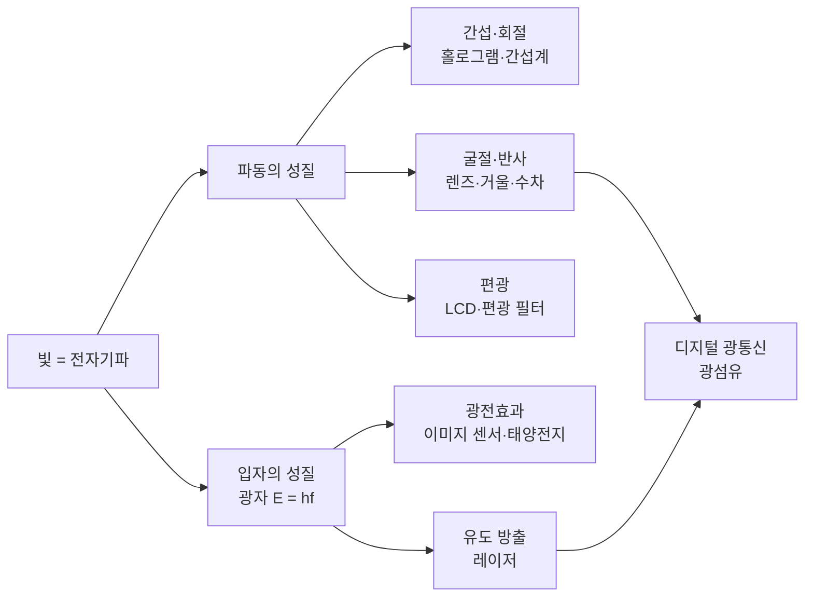

# 전자기와 양자 2. 빛과 정보 통신 — 파동으로 새기고 광자로 읽는 정보
<!-- prev: m2-03, 1-4, 2-1, phy-3, mech-3, emq-1 -->
<!-- next: emq-3 -->

> [!NOTE]
> **성취기준**
> - **[12전자02-01]** 빛의 간섭과 회절을 알고, 홀로그램 등 현대의 정밀 기술에 활용되는 예를 찾을 수 있다.
> - **[12전자02-02]** 렌즈와 거울을 이용한 광학 기기의 원리와 수차를 설명할 수 있다.
> - **[12전자02-03]** 편광의 원리를 이해하고, 이를 활용한 디지털 정보 기술의 사례를 조사할 수 있다.
> - **[12전자02-04]** 광전효과에서 빛과 물질이 상호작용하는 방식을 알고, 디지털 영상 정보, 광센서, 태양전지 등 광전효과와 관련된 다양한 기술을 조사할 수 있다.
> - **[12전자02-05]** 레이저의 특징과 빛이 증폭되는 원리를 알고, 레이저가 디지털 광통신 등 여러 영역에서 활용됨을 조사하여 현대 문명에서 레이저의 중요성을 인식할 수 있다.

**학습 목표**

1. 이중 슬릿 간섭과 반사에 의한 위상 변화를 포함한 얇은 막의 간섭을 설명하고 계산할 수 있으며, 회절과 분해능을 정성적으로 설명할 수 있다.
2. 홀로그램, 간섭계 등 간섭을 이용한 정밀 기술의 원리를 말할 수 있다.
3. 렌즈·거울·프리즘이 카메라, 망원경, 현미경에서 하는 역할과 수차가 생기는 이유를 정성적으로 설명할 수 있다.
4. 편광의 원리와 편광판을 지나는 빛의 변화를 정성적으로 설명하고, 액정 디스플레이 등 편광을 이용한 기술을 조사할 수 있다.
5. 광전효과를 광자 개념으로 설명하고, 이미지 센서·광센서·태양전지의 원리와 연결할 수 있다.
6. 유도 방출에 의한 빛의 증폭 원리와 레이저의 특징을 설명하고, 광통신 등 레이저의 활용을 조사할 수 있다.

**이 단원의 학습 사다리**

| 단계 | 무엇을 하나? |
|---|---|
| STEP 1. 이전 학습 다시 보기 | 중2 「빛과 파동」, 통합과학 「정보와 신호」, 물리학 「빛과 물질」을 꺼내 본다 |
| STEP 2. 기초 다지기 | 파동의 기본량, 위상, 중첩, 굴절률과 전반사, 전자기파 스펙트럼, 전자볼트 |
| STEP 3. 핵심 개념 | 간섭·회절·홀로그램 → 광학 기기와 수차 → 편광 → 광전효과 → 레이저와 광통신 |
| STEP 4. 오개념 바로잡기 | "밝은 빛을 비추면 광전자가 더 빨리 튀어나온다?" 같은 착각을 바로잡는다 |
| STEP 5. 다음 단계로 | 대학 광학(회절 이론, 렌즈 공식, 수차 이론), 광전자공학, 양자광학 |
| STEP 6. 생활·산업·진로 | 스마트폰 카메라, 디스플레이, 광통신망, 레이저 가공·의료 |

---

## 🗺️ 단원 들어가기

비눗방울 표면에는 무지개색 무늬가 일렁이고, 지폐의 홀로그램은 보는 각도에 따라 그림이 바뀐다. 편광 선글라스를 끼고 스마트폰 화면을 보며 고개를 돌리면 화면이 어두워진다. 그리고 지금 이 순간에도 바다 밑 광섬유 속에서는 레이저 빛이 1초에 수십억 번 깜빡이며 대륙 사이로 동영상과 메시지를 나르고 있다.

빛은 때로는 **파동**처럼 간섭하고 회절하며 편광되고, 때로는 **알갱이(광자)** 처럼 물질과 하나씩 에너지를 주고받는다. 이 단원에서는 빛의 두 얼굴을 차례로 살펴보고, 그 성질이 어떻게 사진을 찍고, 화면을 밝히고, 정보를 실어 나르는 기술이 되는지 따라가 본다.

---

## STEP 1. 🔙 이전 학습 다시 보기

### 연계 개념표

| 이전 단원·성취기준 | 그때 배운 것 | 이 단원에서 확장되는 것 |
|---|---|---|
| 중2 「빛과 파동」 [9과10-01, 02] | 빛의 반사·굴절, 평면거울의 상, 거울과 렌즈의 종류와 상의 특징(정성적) | 렌즈·거울·프리즘의 조합으로 만드는 **광학 기기**와 **수차** |
| 중2 「빛과 파동」 [9과10-03, 04] | 빛의 합성과 영상 장치의 색 표현, 파동의 진폭·진동수·파장 | 파동의 **위상**과 **중첩**, 디스플레이의 편광 |
| 통합과학1 「정보와 신호: 아날로그에서 디지털로」 [10통과1-01-04] | 센서가 신호를 전기 신호로 바꾸고 디지털 정보로 변환 | 이미지 센서·광센서의 **광전효과**, 빛으로 0과 1을 보내는 **광통신** |
| 통합과학1 「빛의 스펙트럼과 우주 초기 원소」 [10통과1-02-01] | 원소마다 고유한 선스펙트럼(흡수·방출) | 흡수·방출에 **유도 방출**을 더해 레이저의 원리로 |
| 물리학 「빛과 물질」 [12물리03-01~03] | 빛의 간섭(파동성), 볼록렌즈의 광선 추적, 빛과 물질의 이중성 | 반사에 의한 위상 변화를 포함한 **얇은 막 간섭**, 광학 기기, 광전효과의 정량적 분석 |
| 역학과 에너지 「탄성파와 소리」 [12역학03-02, 04] | 경계면에서 반사될 때의 위상 변화, 소리의 간섭 | 같은 원리를 **빛**에 적용 |
| 전자기와 양자 「전자기적 상호작용」 [12전자01-07] | 다이오드, LED, 반도체 소자 | 광다이오드·태양전지·반도체 레이저 |

### 준비 운동 (사전 진단)

**Q1.** 진동수 $5.0\times10^{14}\ \mathrm{Hz}$인 빛의 진공 중 파장은? ($c = 3.0\times10^8\ \mathrm{m/s}$)

**Q2.** 볼록렌즈로 햇빛을 모으면 한 점에 모인다. 이 점을 무엇이라 하는가? 오목거울도 같은 일을 할 수 있을까?

**Q3.** 두 파동이 만나 마루와 마루가 겹치면 어떻게 되는가? 마루와 골이 겹치면?

**Q4.** 수소 기체가 내는 선스펙트럼이 몇 개의 밝은 선으로만 나타나는 이유를 한 문장으로 쓰시오.

정답 및 해설

**Q1.** $\lambda = c/f = 3.0\times10^8 / 5.0\times10^{14} = 6.0\times10^{-7}\ \mathrm{m} = 600\ \mathrm{nm}$ (주황빛)

**Q2.** 초점. 오목거울도 평행 광선을 반사하여 한 점(초점)에 모은다.

**Q3.** 마루+마루는 진폭이 커지는 **보강 간섭**, 마루+골은 서로 상쇄되는 **상쇄 간섭**이 일어난다.

**Q4.** 원자 속 전자의 에너지 준위가 띄엄띄엄(양자화)하여, 준위 사이 에너지 차에 해당하는 특정 진동수의 빛만 방출되기 때문이다.

---

## STEP 2. 🧱 기초 다지기

### ① 파동의 기본량과 빛의 속력

| 양 | 기호 | 뜻 |
|---|---|---|
| 파장 | $\lambda$ | 마루에서 다음 마루까지 거리 |
| 진동수 | $f$ | 1초 동안 진동하는 횟수 (Hz) |
| 속력 | $v = f\lambda$ | 진공에서 빛은 $c \approx 3.0\times10^8\ \mathrm{m/s}$ |

빛은 전기장과 자기장이 서로 수직으로 진동하며 나아가는 **전자기파**로, 진동 방향이 진행 방향에 수직인 **횡파**이다. 매질이 없어도 전달된다.

### ② 위상 — 파동이 '어디쯤' 와 있는가

**위상(phase)** 은 파동이 한 주기 중 어느 단계에 있는지를 나타낸다. 마루끼리는 위상이 같고, 마루와 골은 위상이 반대(반 파장, $180^\circ$ 차이)이다. 두 파동이 같은 위상으로 만나면 보강, 반대 위상으로 만나면 상쇄된다.

> [!TIP]
> 💡 **비유** — 두 사람이 줄넘기 줄을 양쪽에서 흔들 때 박자가 맞으면(같은 위상) 줄이 크게 출렁이고, 박자가 정확히 엇갈리면(반대 위상) 줄이 거의 움직이지 않는다.

### ③ 경로차와 간섭 조건

두 파원에서 같은 위상으로 출발한 빛이 한 점에 도착할 때, 이동 거리의 차이(**경로차**)가

$$
\text{경로차} = m\lambda \;\Rightarrow\; \text{보강}, \qquad \text{경로차} = \left(m+\tfrac{1}{2}\right)\lambda \;\Rightarrow\; \text{상쇄} \qquad (m = 0, 1, 2, \ldots)
$$

간섭 무늬가 안정되게 보이려면 두 빛의 위상 관계가 시간에 따라 일정해야 한다. 이런 빛을 **결맞는(coherent)** 빛이라 한다. 전구 두 개로는 간섭 무늬가 보이지 않고, 한 빛을 둘로 나누거나 레이저를 써야 하는 이유이다.

### ④ 굴절률과 전반사

**굴절률(refractive index)** $n = c/v$는 매질 속에서 빛이 진공보다 몇 배 느린지를 나타낸다(공기 ≈ 1.00, 물 ≈ 1.33, 유리 ≈ 1.5). 매질 속에서는 진동수는 그대로이고 파장이 $\lambda/n$으로 짧아진다.

굴절 법칙(스넬 법칙): $n_1\sin\theta_1 = n_2\sin\theta_2$

굴절률이 큰 매질에서 작은 매질로 갈 때, 입사각이 **임계각** $\theta_c$ ($\sin\theta_c = n_2/n_1$)보다 크면 빛이 모두 반사된다. 이것이 **전반사(total internal reflection)** 이며, 광섬유와 쌍안경 프리즘의 원리이다.

### ⑤ 전자기파 스펙트럼과 전자볼트

| 영역 | 파장(대략) | 예 |
|---|---|---|
| 전파 | mm 이상 | 방송, 휴대전화, 와이파이 |
| 적외선 | 약 700 nm ~ 1 mm | 리모컨, 열화상, 광통신(약 1.3~1.6 μm) |
| 가시광선 | 약 400 ~ 700 nm | 눈으로 보는 빛(보라 → 빨강) |
| 자외선 | 약 10 ~ 400 nm | 살균, 반도체 노광 |
| X선, 감마선 | 그보다 짧음 | 의료 영상, 방사선 치료 |

원자 수준의 에너지는 **전자볼트(eV)** 단위가 편리하다. $1\ \mathrm{eV} = 1.6\times10^{-19}\ \mathrm{J}$(전자 하나가 $1\ \mathrm{V}$의 전위차를 지날 때 얻는 에너지). 빛 알갱이 하나의 에너지를 계산할 때 쓰는 요령이 있다.

$$
E = hf = \frac{hc}{\lambda}, \qquad hc \approx 1240\ \mathrm{eV\cdot nm}
$$

예) $\lambda = 620\ \mathrm{nm}$ → $E = 1240/620 = 2.0\ \mathrm{eV}$.

---

## STEP 3. 📘 핵심 개념

### ① 빛의 간섭과 회절, 그리고 홀로그램 [12전자02-01]

#### 이중 슬릿 간섭 — 빛이 파동이라는 증거

1801년 무렵 영(Young)은 하나의 빛을 두 개의 좁은 틈(슬릿)에 통과시켜 스크린에 밝고 어두운 줄무늬가 번갈아 나타나는 것을 보였다. 슬릿 간격을 $d$, 슬릿과 스크린 사이 거리를 $L$이라 하면($L \gg d$), 이웃한 밝은 무늬 사이의 간격은 다음과 같다.

$$
\Delta x = \frac{L\lambda}{d}
$$

| 바꾸는 것 | 무늬 간격 $\Delta x$ |
|---|---|
| 파장을 길게(파랑 → 빨강) | 넓어진다 |
| 슬릿 간격 $d$를 좁게 | 넓어진다 |
| 스크린을 멀리($L$ 증가) | 넓어진다 |
| 장치 전체를 물속에 넣음 | 파장이 $\lambda/n$으로 짧아져 좁아진다 |

<!-- fig:emq-2-double-slit -->

#### 예제 1 — 이중 슬릿 무늬 간격

파장 $600\ \mathrm{nm}$인 빛을 간격 $0.20\ \mathrm{mm}$인 이중 슬릿에 비추고, $1.0\ \mathrm{m}$ 떨어진 스크린에서 무늬를 관찰했다. 이웃한 밝은 무늬 사이 간격은?

**풀이** $\Delta x = \dfrac{L\lambda}{d} = \dfrac{1.0\times600\times10^{-9}}{0.20\times10^{-3}} = 3.0\times10^{-3}\ \mathrm{m} = 3.0\ \mathrm{mm}$

#### 반사에 의한 위상 변화

줄의 끝을 벽에 고정하면 반사된 파동이 뒤집혀 돌아오고(고정단), 끝이 자유로우면 뒤집히지 않는다(자유단). 빛도 같다.

| 반사 상황 | 반사파의 위상 | 예 |
|---|---|---|
| 굴절률이 **작은** 매질 → **큰** 매질 경계에서 반사 | **반대로 바뀐다**(반 파장 어긋남) | 공기 → 비누막 표면, 공기 → 유리 |
| 굴절률이 **큰** 매질 → **작은** 매질 경계에서 반사 | 변하지 않는다 | 비누막 → 뒤쪽 공기, 유리 → 공기 |

#### 얇은 막의 간섭

두께 $t$, 굴절률 $n$인 얇은 막에 빛이 거의 수직으로 비치면, 막의 **윗면**에서 반사된 빛과 **아랫면**에서 반사된 빛이 겹친다. 아랫면 빛은 막 속을 왕복하므로 경로차는 약 $2nt$이다(막 속 파장이 $\lambda/n$이므로 $n$을 곱한다). 여기에 반사에 의한 위상 변화를 함께 따진다.

| 두 반사 중 위상이 바뀌는 횟수 | 보강 조건 | 상쇄 조건 | 예 |
|---|---|---|---|
| 한 번(윗면만) | $2nt = \left(m+\frac{1}{2}\right)\lambda$ | $2nt = m\lambda$ | 공기 중 비누막, 물 위의 기름막 |
| 두 번 또는 0번 | $2nt = m\lambda$ | $2nt = \left(m+\frac{1}{2}\right)\lambda$ | 유리 위 반사 방지 코팅 |

막의 두께가 장소마다 다르면 보강되는 색이 달라져 무지개색 무늬가 생긴다. 세워 둔 비누막은 중력 때문에 위가 얇고 아래가 두꺼워져 **가로 줄무늬**가 나타나며, 시간이 지나 맨 위가 아주 얇아지면($t \to 0$) 경로차는 0이지만 한 번의 위상 반전 때문에 상쇄되어 **검게** 보인다.

<!-- fig:emq-2-thin-film -->

#### 예제 2 — 비누막의 색

굴절률 1.33인 비누막에 파장 $532\ \mathrm{nm}$의 초록빛을 수직으로 비춘다. 반사광이 가장 밝게 보이는 막의 최소 두께는?

**풀이** 윗면(공기 → 막)에서만 위상이 반전되므로 보강 조건은 $2nt = \left(m+\frac{1}{2}\right)\lambda$이다. 최소 두께는 $m = 0$일 때

$$
t = \frac{\lambda}{4n} = \frac{532}{4\times1.33} = 100\ \mathrm{nm}
$$

#### 예제 3 — 안경의 반사 방지 코팅

굴절률 1.5인 유리 렌즈 위에 굴절률 1.38인 얇은 막을 입혀 파장 $550\ \mathrm{nm}$ 빛의 반사를 줄이려 한다. 필요한 최소 두께는?

**풀이** 공기 → 막(1.00 → 1.38), 막 → 유리(1.38 → 1.5) 두 경계 모두 작은 곳에서 큰 곳으로의 반사이므로 **두 번 모두** 위상이 반전되어 서로 효과가 상쇄된다. 따라서 상쇄 조건은 $2nt = \frac{1}{2}\lambda$ ($m = 0$)이고

$$
t = \frac{\lambda}{4n} = \frac{550}{4\times1.38} \approx 100\ \mathrm{nm}
$$

반사가 줄어든 만큼 더 많은 빛이 렌즈를 통과한다. 코팅된 안경알이 보랏빛·초록빛을 약하게 띠는 것은 다른 파장은 완전히 상쇄되지 않기 때문이다.

> [!TIP]
> 💡 두 예제의 답이 모두 $\lambda/4n$인 것은 우연이 아니다. 반사 횟수에 따른 위상 반전과 경로차를 **함께** 따져야 보강인지 상쇄인지가 결정된다. "경로차만 보고 판단하면 정반대 답이 나올 수 있다"는 것이 얇은 막 간섭의 핵심이다.

#### 회절 — 빛이 틈을 지나며 퍼지는 현상

빛이 좁은 틈이나 장애물 가장자리를 지날 때 그림자 영역으로 돌아 들어가 퍼지는 현상을 **회절(diffraction)** 이라 한다. 이 단원에서는 회절을 정성적으로만 다룬다.

- 틈의 크기가 파장에 가까울수록, 그리고 파장이 길수록 더 크게 퍼진다.
- 소리(파장 수십 cm~수 m)는 문틈으로 잘 돌아 들어오지만, 빛(파장 수백 nm)은 보통 크기의 문에서는 거의 회절하지 않아 그림자가 뚜렷하다.
- CD 표면이나 회절격자(수많은 평행 홈)에 빛을 비추면 각 홈에서 회절한 빛이 서로 간섭하여 색깔별로 다른 방향으로 갈라진다 → **분광기**.

#### 분해능 — 두 점을 구별하는 능력

회절 때문에 렌즈를 지난 한 점의 빛은 완벽한 점이 아니라 작은 원형 얼룩으로 맺힌다. 두 점이 너무 가까우면 두 얼룩이 겹쳐 하나로 보인다. 가까운 두 점을 구별하는 능력을 **분해능(resolving power)** 이라 한다.

| 분해능을 높이려면 | 이유 |
|---|---|
| 렌즈·거울의 지름(구경)을 크게 | 입구가 넓을수록 회절에 의한 퍼짐이 작다 → 대형 망원경 |
| 짧은 파장을 사용 | 파장이 짧을수록 회절이 작다 → 청색 레이저 광디스크, 자외선 노광, 전자 현미경 |

<!-- fig:emq-2-diffraction-resolution -->

분해능의 차이는 같은 천체를 서로 다른 망원경으로 찍은 사진에서 뚜렷하게 드러난다.

<!-- photo:emq-2-telescope-resolution-galaxy -->

#### 예제 4 — 광디스크의 저장 용량

CD는 약 $780\ \mathrm{nm}$, DVD는 약 $650\ \mathrm{nm}$, 블루레이는 약 $405\ \mathrm{nm}$의 레이저를 쓴다. 블루레이가 같은 크기의 디스크에 더 많은 정보를 담을 수 있는 이유를 회절과 분해능으로 설명하시오.

**풀이** 파장이 짧을수록 렌즈로 모은 빛 점(얼룩)이 작아지므로, 디스크에 더 작은 홈을 더 촘촘히 새기고 읽을 수 있다. 같은 넓이에 더 많은 0과 1을 기록할 수 있어 용량이 커진다.

#### 홀로그램과 간섭을 이용한 정밀 기술

일반 사진은 빛의 **세기(밝기)** 만 기록하지만, **홀로그램(hologram)** 은 빛의 **위상**까지 기록한다.

1. 레이저 빛을 둘로 나눈다. 하나는 물체에 비춘 뒤 반사되어 필름으로 가고(물체파), 다른 하나는 곧바로 필름으로 간다(기준파).
2. 두 빛이 필름에서 간섭하여 아주 미세한 간섭 무늬가 기록된다. 이 무늬에 물체에서 온 빛의 세기와 위상 정보가 모두 담긴다.
3. 기록된 필름에 기준파와 같은 빛을 비추면 무늬가 회절격자처럼 빛을 회절시켜, 원래 물체에서 오던 빛을 재현한다. 보는 위치를 바꾸면 물체의 옆면이 보이는 **입체상**이 나타난다.

| 기술 | 간섭·회절의 역할 |
|---|---|
| 지폐·신용카드의 위조 방지 홀로그램 | 미세 간섭 무늬를 정밀하게 복제하기 어렵다 |
| 간섭계(마이컬슨 간섭계 등) | 빛을 둘로 나눠 다른 길로 보낸 뒤 다시 합쳐, 경로 길이의 아주 작은 변화를 무늬 변화로 측정 |
| 중력파 검출기(LIGO 등) | 수 km 길이 팔의 간섭계로 원자핵보다 훨씬 작은 길이 변화를 감지 |
| 반도체 웨이퍼·광학 부품 검사 | 표면의 미세한 굴곡과 막 두께를 간섭 무늬로 측정 |
| 홀로그래픽 디스플레이·AR 안경 | 회절 소자로 빛의 방향을 제어해 눈앞에 영상을 띄움 |

#### ✔ 바로 확인

1. 이중 슬릿 실험에서 다른 조건은 그대로 두고 슬릿 간격만 2배로 하면 이웃한 밝은 무늬 사이 간격은 몇 배가 되는가?
2. (O/X) 굴절률이 작은 매질에서 큰 매질로 가는 경계에서 반사된 빛은 위상이 반대로 바뀐다.
3. 빈칸: 세워 둔 비누막의 맨 위가 아주 얇아지면 반사광이 (    ) 보인다.
4. 고르기: 분해능을 높이는 방법을 모두 고르시오. ㄱ. 렌즈의 구경을 크게 한다 ㄴ. 파장이 긴 빛을 쓴다 ㄷ. 파장이 짧은 빛을 쓴다

정답

1. $\frac{1}{2}$배 — $\Delta x = L\lambda/d$이므로 $d$에 반비례한다.
2. O — 줄의 고정단 반사와 같다. 큰 곳에서 작은 곳으로의 반사는 위상이 그대로이다.
3. 검게 — 경로차는 0이지만 윗면 반사에서만 위상이 반전되어 두 반사광이 상쇄된다.
4. ㄱ, ㄷ — 구경이 클수록, 파장이 짧을수록 회절에 의한 얼룩이 작다.

### ② 렌즈와 거울로 만드는 광학 기기, 그리고 수차 [12전자02-02]

광학 기기는 정성적 원리 위주로 다룬다. 핵심은 **렌즈와 거울이 빛을 굴절·반사시켜 한 점에서 나온 빛을 다시 한 점에 모아 상을 만든다**는 것이다.

#### 렌즈·거울·프리즘의 기본 역할

| 광학 소자 | 빛에 하는 일 | 광학 기기에서의 역할 |
|---|---|---|
| 볼록렌즈 | 굴절로 평행광을 초점에 모음 | 실상 만들기(카메라·대물렌즈), 확대해 보기(접안렌즈·돋보기) |
| 오목렌즈 | 굴절로 빛을 퍼뜨림 | 근시 교정, 다른 렌즈와 조합해 상 보정 |
| 오목거울 | 반사로 평행광을 초점에 모음 | 반사 망원경의 주경, 전조등·손전등 반사판 |
| 볼록거울 | 반사로 넓은 범위를 작게 보여 줌 | 자동차 사이드미러, 도로 반사경 |
| 프리즘 | 굴절로 색을 나누거나(분산), 전반사로 빛의 방향을 바꿈 | 분광기, 쌍안경·잠망경의 상 뒤집기, 카메라의 잠망경식 망원 렌즈 |

<!-- sim:lens-image -->

#### 카메라

| 부품 | 하는 일 | 눈과 비교 |
|---|---|---|
| 렌즈(여러 장의 조합) | 물체의 실상을 이미지 센서에 맺음 | 수정체 |
| 초점 조절 | 렌즈와 센서 사이 거리를 바꿈 | 수정체 두께를 바꿈 |
| 조리개 | 들어오는 빛의 양과 선명한 범위(심도) 조절 | 홍채·동공 |
| 이미지 센서 | 빛을 전기 신호로 바꿈(광전효과, ③ 참고) | 망막 |

#### 망원경과 현미경

| 기기 | 구성 | 원리 |
|---|---|---|
| 굴절 망원경 | 초점거리가 긴 대물렌즈 + 짧은 접안렌즈 | 대물렌즈가 먼 물체의 실상을 만들고, 접안렌즈로 그 상을 확대해 본다 |
| 반사 망원경 | 큰 오목거울(주경) + 접안렌즈(또는 센서) | 거울로 빛을 모은다. 큰 거울은 큰 렌즈보다 만들기·지지하기 쉽고, 색에 따른 초점 차이가 없어 대형 천체 망원경은 대부분 반사식이다 |
| 광학 현미경 | 초점거리가 짧은 대물렌즈 + 접안렌즈 | 가까운 작은 물체의 확대된 실상을 대물렌즈가 만들고, 접안렌즈가 다시 확대한다 |

#### 수차 — 상이 완벽하지 않은 이유

실제 렌즈와 거울은 한 점에서 나온 빛을 정확히 한 점에 모으지 못한다. 이렇게 상이 흐려지거나 일그러지는 현상을 **수차(aberration)** 라 한다. 대표적인 두 가지 원인을 정성적으로 살펴보자.

| 원인 | 무엇이 일어나나 | 줄이는 방법 |
|---|---|---|
| 렌즈·거울 면의 **모양** | 둥근 면으로 만든 렌즈에서는 가장자리를 지난 빛이 중심 근처를 지난 빛보다 렌즈에 더 가까운 곳에 모인다. 초점이 한 점이 아니라 퍼져서 상이 흐려진다 | 조리개로 가장자리 빛을 가린다, 가장자리 곡률을 조절한 렌즈(비구면 렌즈)·포물면 거울을 쓴다, 여러 장의 렌즈를 조합한다 |
| 빛의 **색(파장)** | 유리의 굴절률은 파장마다 조금씩 달라서(파랑이 빨강보다 더 크게 꺾임, 프리즘의 분산과 같은 원리) 색마다 초점 위치가 다르다. 물체 가장자리에 무지갯빛 테두리가 생긴다 | 굴절 성질이 다른 유리로 만든 볼록·오목렌즈를 붙여 쓴다, 렌즈 대신 거울을 쓴다(반사는 색에 따라 달라지지 않는다) |

스마트폰 카메라 하나에 렌즈가 여러 장 겹쳐 들어 있는 것도, 천체 망원경이 대부분 반사식인 것도 수차를 줄이기 위해서이다.

<!-- fig:emq-2-aberration -->

#### 예제 5 — 조리개와 상의 선명도

같은 카메라로 조리개를 크게 열고 찍은 사진은 밝지만 가장자리가 약간 흐리고, 조리개를 좁히면 어둡지만 더 선명하다. 그 이유를 수차로 설명하시오. 조리개를 너무 좁게 하면 다시 흐려지는 이유도 추리하시오.

**풀이** 조리개를 넓히면 렌즈 가장자리를 지나는 빛까지 들어와, 면의 모양 때문에 초점이 어긋나는 수차가 커진다. 조리개를 좁히면 렌즈 중심 부분의 빛만 쓰므로 수차가 줄어 선명해지지만 빛의 양은 줄어든다. 너무 좁히면 작은 구멍에서 빛이 **회절**하여 퍼지므로 오히려 다시 흐려진다(분해능 저하).

#### ✔ 바로 확인

1. 짝짓기: (가) 볼록렌즈 (나) 오목거울 (다) 볼록거울 — ㄱ. 반사 망원경의 주경 ㄴ. 자동차 사이드미러 ㄷ. 돋보기
2. 빈칸: 굴절 망원경에서 먼 물체의 실상을 만드는 렌즈는 (    )렌즈, 그 상을 확대해 보는 렌즈는 (    )렌즈이다.
3. (O/X) 거울은 빛의 색에 따라 초점 위치가 달라지는 문제가 생기지 않는다.
4. 그림(수차)의 (가)에서 렌즈 가장자리를 지난 빛은 중심 근처를 지난 빛보다 렌즈에 더 가까운 곳과 먼 곳 중 어디에 모이는가?

정답

1. (가)–ㄷ, (나)–ㄱ, (다)–ㄴ
2. 대물, 접안
3. O — 반사 법칙은 파장에 관계없으므로 모든 색이 같은 곳에 모인다.
4. 더 가까운 곳 — 그래서 초점이 한 점이 되지 못하고 상이 흐려진다.

### ③ 편광 — 빛의 진동 방향 [12전자02-03]

#### 편광이란

빛은 진행 방향에 수직으로 전기장이 진동하는 횡파이다. 햇빛이나 전구 빛은 진동 방향이 모든 방향으로 뒤섞여 있다(**비편광**). 진동 방향이 한 방향으로 정해진 빛을 **편광(polarized light)**, 특히 한 평면에서만 진동하는 빛을 **선편광**이라 한다. 종파인 소리에는 편광이 없다. 그래서 편광은 빛이 **횡파**라는 증거이다.

**편광판(polarizer)** 은 특정 방향(투과축)으로 진동하는 성분만 통과시킨다.

> [!TIP]
> 💡 **비유** — 세로로 좁은 틈이 난 울타리 사이로 줄을 넣고 흔든다고 하자. 위아래로 흔든 파동은 틈을 지나가지만, 좌우로 흔든 파동은 막힌다. 비스듬히 흔들면 위아래 성분만 지나가 진폭이 작아진다. 편광판은 빛의 '세로 울타리'이다.

<!-- sim:em-wave -->

#### 편광판 두 장 — 투과량의 정성적 변화

비편광인 빛이 첫 번째 편광판을 지나면 선편광이 되고 밝기는 약 절반이 된다. 그 뒤에 두 번째 편광판(검광판)을 놓고 돌려 보면:

| 두 편광판 투과축 사이 각 | 투과하는 빛 |
|---|---|
| $0^\circ$ (나란함) | 가장 밝다(첫 판을 지난 빛이 거의 다 통과) |
| $0^\circ$에서 $90^\circ$로 점점 증가 | 점점 어두워진다 |
| $90^\circ$ (수직) | 거의 통과하지 못해 어둡다 |
| $90^\circ$에서 $180^\circ$로 | 다시 밝아진다 |

#### 자연에서 생기는 편광

| 현상 | 설명 | 활용 |
|---|---|---|
| 반사에 의한 편광 | 수면·유리·도로 등에서 비스듬히 반사된 빛은 수면에 나란한(수평) 방향의 진동이 많다 | 투과축이 세로인 **편광 선글라스**로 눈부심(반사광)을 줄인다. 낚시할 때 물속이 잘 보인다 |
| 산란에 의한 편광 | 하늘의 산란광은 태양과 이루는 각에 따라 부분적으로 편광된다 | 카메라 편광 필터로 하늘을 더 짙푸르게, 반사를 줄여 찍는다. 일부 곤충은 하늘의 편광으로 방향을 찾는다 |

수면의 반사광이 편광되어 있다는 것은 편광 필터를 끼운 카메라로 확인할 수 있다.

<!-- photo:emq-2-polarizing-filter-river -->

#### 편광을 이용한 디지털 정보 기술

**액정 디스플레이(LCD)** 의 화소 하나는 다음 순서로 빛을 켜고 끈다.

1. 백라이트의 비편광 빛이 첫 번째 편광판을 지나 선편광이 된다.
2. 액정 층을 지난다. 전압을 걸지 않으면 액정 분자 배열이 빛의 편광 방향을 $90^\circ$ 돌려 준다.
3. 첫 판과 투과축이 수직인 두 번째 편광판에 도착한다. 편광 방향이 돌아간 빛은 **통과**(밝음).
4. 전압을 걸면 액정 분자가 전기장 방향으로 정렬하여 편광을 돌리지 못하므로 두 번째 편광판에서 **막힌다**(어두움). 중간 전압이면 일부만 돌려 중간 밝기가 된다.
5. 화소마다 빨강·초록·파랑 색 필터를 두고, 각 밝기를 디지털 값으로 조절하여 색을 만든다.

<!-- fig:emq-2-lcd-pixel -->

| 기술 | 편광의 역할 |
|---|---|
| LCD(모니터, 노트북, 계산기) | 두 편광판 사이 액정이 편광 방향을 바꾸어 화소의 밝기를 조절 |
| OLED 화면의 반사 방지 필름 | 바깥에서 들어온 빛이 화면에 반사되어 나가지 못하게 편광 필름을 사용 → 햇빛 아래에서도 검은색이 검게 보임 |
| 3D 영화관 안경 | 왼쪽·오른쪽 눈 영상을 서로 다른 편광으로 비추고, 안경의 좌우 편광판이 각각 하나씩만 통과시킨다 |
| 광통신의 편광 다중화 | 서로 수직인 두 편광에 각각 다른 신호를 실어 광섬유 하나로 정보량을 늘린다 |
| 광탄성 검사 | 투명 플라스틱 부품에 힘이 걸린 부분이 편광 상태를 바꾸어, 두 편광판 사이에서 색 무늬로 보인다 |

#### 예제 6 — 편광 선글라스로 화면 보기

편광 선글라스를 끼고 LCD 스마트폰 화면을 보며 화면을 천천히 $90^\circ$ 돌렸더니 화면이 점점 어두워졌다가 거의 검게 되었다. 같은 실험을 종이에 인쇄된 사진으로 하면 밝기가 변하지 않는다. 두 결과의 차이를 설명하시오.

**풀이** LCD 화면에서 나오는 빛은 맨 앞 편광판을 지난 **선편광**이므로, 선글라스의 투과축과 화면 편광 방향 사이 각이 커질수록 투과량이 줄고 수직일 때 거의 막힌다. 종이에서 반사·산란된 빛은 대부분 **비편광**이므로 선글라스를 어느 방향으로 돌려도 비슷한 양이 통과한다.

#### ✔ 바로 확인

1. (O/X) 소리도 편광판을 이용해 편광시킬 수 있다.
2. 비편광인 빛이 편광판 한 장을 지나면 밝기는 처음의 약 몇 배가 되는가?
3. 두 편광판의 투과축 사이 각을 $0^\circ$에서 $90^\circ$까지 천천히 늘리면 통과하는 빛의 밝기는 어떻게 변하는가?
4. LCD 화소의 액정에 전압을 걸면 그 화소는 밝아지는가, 어두워지는가?

정답

1. X — 소리는 종파라서 편광이 없다. 편광은 빛이 횡파라는 증거이다.
2. 약 $\frac{1}{2}$배
3. 점점 어두워져 $90^\circ$에서 거의 통과하지 못한다.
4. 어두워진다 — 액정이 늘어서 편광 방향을 돌리지 못하므로 두 번째 편광판에서 막힌다.

### ④ 광전효과 — 빛과 물질이 에너지를 주고받는 방식 [12전자02-04]

#### 빛과 물질의 기본 상호작용: 흡수와 방출

원자나 고체 속 전자는 정해진 에너지 상태에 있다. 빛과 물질은 다음 방식으로 상호작용한다.

- **흡수**: 전자가 빛 에너지를 받아 더 높은 에너지 상태로 올라간다.
- **방출**: 높은 상태의 전자가 낮은 상태로 내려오며 그 에너지 차만큼의 빛을 내보낸다.

광전효과는 흡수의, LED와 레이저는 방출의 대표적인 예이다.

#### 광전효과의 실험 사실

금속 표면에 빛을 비추면 전자가 튀어나오는 현상을 **광전효과(photoelectric effect)**, 튀어나온 전자를 **광전자**라 한다. 실험 결과는 빛을 파동으로만 보면 설명하기 어렵다.

| 실험 사실 | 파동 이론으로 예상한 것 | 실제 결과 |
|---|---|---|
| 진동수가 어떤 값(**문턱 진동수**) 이하인 빛 | 아주 밝게 오래 비추면 에너지가 쌓여 전자가 나올 것 | 아무리 밝게 비춰도 전자가 나오지 않는다 |
| 문턱 진동수 이상인 빛 | 약한 빛이면 에너지가 쌓이는 데 시간이 걸릴 것 | 아무리 약해도 **즉시** 나온다 |
| 빛을 더 밝게 | 전자의 운동 에너지가 커질 것 | 광전자의 **수**(광전류)만 늘고 최대 운동 에너지는 같다 |
| 진동수를 더 크게 | 관계없을 것 | 광전자의 최대 운동 에너지가 커진다 |

#### 아인슈타인의 광양자설

1905년 아인슈타인은 빛이 $E = hf$의 에너지를 가진 알갱이, 즉 **광자(photon)** 의 흐름이라고 제안했다($h \approx 6.63\times10^{-34}\ \mathrm{J\cdot s}$, 플랑크 상수). 전자는 광자 **하나**를 통째로 흡수하며, 그 에너지에서 금속을 빠져나오는 데 필요한 최소 에너지인 **일함수(work function)** $W$를 빼고 남은 것이 운동 에너지가 된다.

$$
E_{k,\max} = hf - W, \qquad hf_0 = W \ (\text{문턱 진동수})
$$

- 빛의 **밝기** = 1초에 도착하는 광자의 **수** → 광전자의 수를 결정.
- 빛의 **진동수** = 광자 **하나의 에너지** → 광전자의 최대 운동 에너지를 결정.
- 광전자가 반대 방향 전압을 이기지 못하게 하는 최소 전압(**정지 전압**) $V_s$는 $eV_s = E_{k,\max}$로 측정한다.

<!-- fig:emq-2-photoelectric-graph -->

> [!TIP]
> 💡 **비유** — 높이 2 m 담장 너머로 공을 넘겨야 한다고 하자. 1 m밖에 못 던지는 아이가 100명 와서 동시에 던져도(밝은 빛, 낮은 진동수) 하나도 넘어가지 않는다. 3 m를 던지는 아이는 혼자라도(약한 빛, 높은 진동수) 바로 넘긴다. 담장 높이가 일함수, 각자 던지는 힘이 광자 하나의 에너지이다.

#### 예제 7 — 광전자의 에너지

일함수가 $2.0\ \mathrm{eV}$인 금속에 파장 $400\ \mathrm{nm}$인 빛을 비춘다. (1) 광자 하나의 에너지, (2) 광전자의 최대 운동 에너지와 정지 전압, (3) 광전자가 나오는 빛의 최대 파장(문턱 파장)을 구하시오. ($hc = 1240\ \mathrm{eV\cdot nm}$)

**풀이**
(1) $E = 1240/400 = 3.1\ \mathrm{eV}$
(2) $E_{k,\max} = 3.1 - 2.0 = 1.1\ \mathrm{eV}$, 정지 전압 $V_s = 1.1\ \mathrm{V}$
(3) $\lambda_0 = hc/W = 1240/2.0 = 620\ \mathrm{nm}$. 이보다 파장이 긴 빛(빨간빛 등)은 아무리 밝아도 전자를 떼어 내지 못한다.

#### 예제 8 — 레이저 포인터가 내보내는 광자의 수

출력 $1.0\ \mathrm{mW}$, 파장 $650\ \mathrm{nm}$인 레이저 포인터가 1초에 내보내는 광자의 수는? ($1\ \mathrm{eV} = 1.6\times10^{-19}\ \mathrm{J}$)

**풀이** 광자 하나의 에너지 $E = 1240/650 \approx 1.91\ \mathrm{eV} \approx 3.05\times10^{-19}\ \mathrm{J}$
$N = \dfrac{1.0\times10^{-3}\ \mathrm{J/s}}{3.05\times10^{-19}\ \mathrm{J}} \approx 3.3\times10^{15}$ 개/초. 이렇게 엄청난 수의 광자가 흐르기 때문에 일상에서는 빛이 알갱이라는 것을 느끼기 어렵다.

#### 광전효과와 관련된 기술

반도체에서는 빛을 흡수한 전자가 물질 밖으로 튀어나오지는 않지만, 원자에 묶인 상태에서 자유롭게 움직일 수 있는 상태(전도띠)로 올라가 전류에 기여한다. 이를 **내부 광전효과**라 하며, 대부분의 광센서는 이 방식이다. 광자 하나가 전자 하나를 움직인다는 핵심은 같다.

| 기술 | 광전효과의 역할 | 정보·에너지로 |
|---|---|---|
| 이미지 센서(CCD, CMOS) | 수백만 개의 화소마다 광다이오드가 빛을 받아 광자 수에 비례하는 전자를 모은다 | 전하량을 측정해 숫자로 바꾼다 → **디지털 영상 정보**. 색 필터로 빨강·초록·파랑을 나눈다 |
| 광다이오드·포토트랜지스터 | 빛이 비치면 전류가 흐른다 | 리모컨 수신부, 스마트폰 조도·근접 센서, 자동문, 광통신 수신기 |
| 광전자 증배관 | 광전자 하나를 여러 단계에서 증폭해 큰 전류로 | 극히 약한 빛 측정, 의료 영상, 중성미자 검출 실험 |
| 태양전지 | p-n 접합에서 빛이 만든 전자와 양공을 접합의 전기장이 양쪽으로 갈라 놓아 전압이 생긴다 | 빛 에너지 → 전기 에너지 |
| 엑스선 디지털 영상 | 엑스선을 가시광선으로 바꾼 뒤 광센서로 검출 | 필름 없는 의료 영상 |

#### 예제 9 — 태양전지와 빛의 색

어떤 태양전지 재료는 광자 에너지가 약 $1.1\ \mathrm{eV}$ 이상이어야 전자를 움직일 수 있다. (1) 이 재료가 이용할 수 있는 빛의 최대 파장은? (2) 파장 $500\ \mathrm{nm}$인 광자를 흡수하면 남는 에너지는 대부분 어떻게 되는가?

**풀이** (1) $\lambda = 1240/1.1 \approx 1130\ \mathrm{nm}$(근적외선). (2) $500\ \mathrm{nm}$ 광자의 에너지는 $2.48\ \mathrm{eV}$이므로 약 $1.4\ \mathrm{eV}$가 남는데, 이 대부분은 전기 에너지가 되지 못하고 열로 사라진다. 태양전지 효율에 한계가 있는 이유 중 하나이다.

#### ✔ 바로 확인

1. (O/X) 빛을 더 밝게 비추면 광전자의 최대 운동 에너지가 커진다.
2. 일함수가 $2.5\ \mathrm{eV}$인 금속에 에너지 $3.5\ \mathrm{eV}$인 광자를 비추면 광전자의 최대 운동 에너지와 정지 전압은?
3. 일함수가 $3.1\ \mathrm{eV}$인 금속에서 광전자가 나오는 빛의 최대 파장(문턱 파장)은? ($hc = 1240\ \mathrm{eV\cdot nm}$)
4. 그림(광전효과 그래프)에서 두 직선의 기울기는 무엇을 뜻하며, 금속을 바꾸면 기울기는 어떻게 되는가?

정답

1. X — 밝기는 광자의 수를 늘려 광전자의 수만 늘린다.
2. $1.0\ \mathrm{eV}$, $1.0\ \mathrm{V}$ — $E_{k,\max} = hf - W = 3.5 - 2.5$
3. $400\ \mathrm{nm}$ — $\lambda_0 = 1240/3.1$
4. 플랑크 상수 $h$ — 금속에 관계없이 같고, 문턱 진동수(가로축 절편)만 달라진다.

### ⑤ 레이저 — 빛을 증폭하는 원리와 광통신 [12전자02-05]

#### 세 가지 상호작용: 흡수, 자발 방출, 유도 방출

| 과정 | 일어나는 일 | 나온 빛 |
|---|---|---|
| 흡수 | 광자가 낮은 상태의 원자에 흡수되어 원자가 들뜬다 | (사라짐) |
| 자발 방출 | 들뜬 원자가 스스로 아무 때나 광자를 낸다 | 방향·위상이 제각각 → 전구, 형광등, LED |
| **유도 방출** | 들뜬 원자에 에너지가 꼭 맞는 광자가 지나가면, 원자가 그 광자와 **진동수·위상·방향·편광이 같은** 광자를 하나 더 내놓는다 | 광자 1개 → 2개 → 4개 … **증폭** |

**레이저(LASER)** 는 Light Amplification by Stimulated Emission of Radiation, 즉 **유도 방출에 의한 빛의 증폭**의 머리글자이다.

<!-- fig:emq-2-stimulated-emission -->

#### 빛이 증폭되기 위한 조건

1. **밀도 반전(population inversion)**: 보통은 낮은 상태의 원자가 훨씬 많아 광자가 지나가면 흡수가 더 많이 일어난다. 외부에서 에너지를 넣어(빛, 전류 등으로 **펌핑**) 들뜬 상태의 원자를 낮은 상태보다 많게 만들어야 유도 방출이 흡수보다 우세해진다. 이를 위해 들뜬 상태에 비교적 오래 머무는 준위(준안정 상태)를 이용한다.
2. **공진기(resonator)**: 양 끝에 거울을 두어 빛이 수없이 왕복하며 계속 유도 방출을 일으키게 한다. 한쪽 거울은 빛의 일부만 통과시켜 레이저 빔이 나온다.

> [!TIP]
> 💡 **비유** — 경기장 관중의 '파도타기' 응원을 떠올려 보자. 대부분 일어설 준비가 된 관중(밀도 반전) 사이로 한 명이 일어서면 옆 사람들이 똑같은 박자로 따라 일어서며 거대한 파도가 된다(유도 방출에 의한 증폭). 관중이 다 앉아서 쉬고 있으면 파도는 금방 사그라든다.

#### 레이저의 특징

| 특징 | 뜻 | 활용 |
|---|---|---|
| 단색성 | 파장 범위가 매우 좁다 | 분광 분석, 광통신의 파장별 채널 나누기 |
| 결맞음(가간섭성) | 위상이 잘 맞추어져 있다 | 홀로그램, 간섭계, 정밀 측정 |
| 직진성(지향성) | 거의 퍼지지 않고 곧게 나아간다 | 거리 측정, 레이저 포인터, 지구–달 거리 측정 |
| 높은 에너지 밀도 | 작은 점에 강하게 모을 수 있다 | 절단·용접, 의료 수술, 미세 가공 |

레이저의 직진성은 밤하늘로 쏘아 올린 레이저 빔에서 한눈에 보인다.

<!-- photo:emq-2-laser-guide-star -->

#### 예제 10 — 헬륨–네온 레이저

헬륨–네온 레이저의 빨간빛 파장은 약 $632.8\ \mathrm{nm}$이다. 이 빛을 내는 네온 원자의 두 에너지 준위 사이 에너지 차는 약 몇 eV인가?

**풀이** $\Delta E = hc/\lambda = 1240/632.8 \approx 1.96\ \mathrm{eV}$. 유도 방출된 광자의 에너지는 두 준위의 에너지 차와 같다.

#### 디지털 광통신 — 빛으로 0과 1을 보낸다

1. **송신**: 전기 신호(디지털 0과 1)에 맞추어 반도체 레이저를 매우 빠르게 켜고 끄거나 세기·위상을 바꾼다.
2. **전송**: 빛은 머리카락 굵기 정도의 **광섬유** 속을 지난다. 광섬유는 굴절률이 큰 **코어**를 굴절률이 조금 작은 **클래딩**이 감싼 구조로, 빛이 경계에서 **전반사**를 반복하며 갇혀 나아간다. 손실이 적은 적외선(약 $1.55\ \mu\mathrm{m}$ 부근 등)을 주로 쓰고, 먼 거리에서는 광증폭기로 신호를 키운다.
3. **수신**: 광다이오드가 빛의 깜빡임을 다시 전기 신호로 바꾼다(광전효과).

<!-- fig:emq-2-fiber -->

| 비교 | 구리선(전기 신호) | 광섬유(빛 신호) |
|---|---|---|
| 전송 용량 | 상대적으로 작다 | 매우 크다(진동수가 높고 파장 다중화 가능) |
| 손실 | 거리에 따라 크다 | 작아서 먼 거리 전송에 유리 |
| 전자기 잡음 | 영향을 받는다 | 거의 받지 않는다 |
| 무게·재료 | 무겁고 구리 사용 | 가볍고 유리(규소 산화물) 사용 |

레이저가 광통신에 쓰이는 이유는 **단색성**(파장 다중화, 분산에 의한 신호 퍼짐 감소), **직진성**(가는 코어에 효율적으로 넣음), **빠른 변조**(반도체 레이저는 전류로 매우 빨리 켜고 끌 수 있음) 때문이다.

#### 예제 11 — 광섬유의 임계각

코어의 굴절률이 1.48, 클래딩의 굴절률이 1.46인 광섬유에서 코어–클래딩 경계의 임계각은 약 몇 도인가? 이 값이 의미하는 바는?

**풀이** $\sin\theta_c = \dfrac{1.46}{1.48} \approx 0.986$ → $\theta_c \approx 80.6^\circ$. 경계면에 $80.6^\circ$보다 큰 각(즉 축에 거의 나란하게)으로 들어온 빛만 전반사되어 갇힌다. 굴절률 차를 작게 하면 빛이 지나는 경로가 비슷해져 신호가 덜 퍼진다.

#### 레이저의 여러 활용과 안전

| 분야 | 예 |
|---|---|
| 정보 | 광통신, 광디스크, 바코드 스캐너, 레이저 프린터 |
| 산업 | 금속 절단·용접, 반도체 미세 가공, 3D 프린팅, 자율주행 라이다(LiDAR) |
| 의료 | 시력 교정 수술, 피부 치료, 수술용 레이저 메스 |
| 과학 | 중력파 검출, 원자시계, 원자 냉각, 핵융합 연구 |

> [!WARNING]
> 레이저 빛은 직진성과 에너지 밀도가 높아 눈의 수정체가 망막의 한 점에 모으면 **영구적인 시력 손상**을 줄 수 있다. 빔이나 거울·유리에서 반사된 빛을 직접 보지 않고, 사람이나 비행기·차량을 향해 비추지 않는다. 학교 실험에서는 출력이 낮은 등급의 레이저만 교사의 지도 아래 사용한다.

#### ✔ 바로 확인

1. 빈칸: LASER의 S는 (    ) 방출(Stimulated Emission)을 뜻한다.
2. (O/X) 유도 방출로 나온 광자는 원래 광자와 진동수·위상·방향이 같다.
3. 빈칸: 빛을 증폭하려면 들뜬 상태의 원자 수를 낮은 상태보다 많게 만들어야 한다. 이를 (    )이라 한다.
4. 광섬유에서 빛을 코어 안에 가두는 현상은 무엇이며, 코어와 클래딩 중 굴절률이 큰 쪽은?

정답

1. 유도
2. O — 그래서 빛이 같은 모습으로 계속 불어나 증폭된다.
3. 밀도 반전
4. 전반사, 코어 — 굴절률이 큰 곳에서 작은 곳으로 갈 때만 전반사가 일어난다.

---

## STEP 4. ⚠️ 오개념 바로잡기

| 흔한 오개념 | 올바른 개념 | 왜 그럴까? |
|---|---|---|
| 얇은 막의 간섭은 경로차만 보면 된다 | 반사할 때 **위상이 반전되는지**도 함께 따져야 한다 | 굴절률이 작은 곳에서 큰 곳으로의 반사는 반 파장 어긋남을 추가한다. 세워 둔 비누막 꼭대기가 검게 보이는 이유이다 |
| 회절은 슬릿이 넓을수록 크게 일어난다 | 틈이 **좁을수록**(파장에 가까울수록) 크게 퍼진다 | 넓은 문으로는 빛이 거의 퍼지지 않아 그림자가 뚜렷하다 |
| 수차는 렌즈를 잘못 만들어서 생기는 불량이다 | 둥근 면의 모양과 색에 따른 굴절률 차이 때문에 **정상적인 렌즈에도** 생긴다 | 그래서 여러 렌즈를 조합하거나 거울·비구면 렌즈로 보정한다 |
| 편광판 두 장을 겹치면 항상 깜깜해진다 | 투과축이 나란하면 밝고, 수직일 때만 거의 깜깜하다 | 투과량은 두 투과축 사이 각에 따라 연속적으로 변한다 |
| 밝은 빛을 비추면 광전자가 더 빠르게 튀어나온다 | 밝기는 광전자의 **수**를, 진동수는 광전자의 **최대 운동 에너지**를 결정한다 | 전자 하나는 광자 하나를 흡수하며, 광자 하나의 에너지는 $hf$로 정해진다 |
| 레이저는 아주 센 전구이다 | 레이저는 **유도 방출**로 증폭되어 단색성·결맞음·직진성을 가진 빛이다 | 전구는 자발 방출로 방향·위상이 제각각인 빛을 낸다. 출력이 1 mW인 레이저도 눈에는 위험할 수 있다 |
| 광섬유 속 빛은 직선으로만 간다 | 코어와 클래딩 경계에서 **전반사**를 반복하며 휘어진 섬유를 따라간다 | 굴절률이 큰 코어에서 작은 클래딩으로 가는 빛이 임계각보다 큰 각으로 부딪히기 때문이다 |

---

## STEP 5. 🎓 다음 단계로 한 걸음 더

> [!CAUTION]
> 이 절은 **고등학교 교육과정 범위 밖의 심화 내용**으로 평가 대상이 아니다. 이 단원의 개념이 대학 전공 과목에서 어떻게 확장되는지 맛보기로 보여 주기 위한 내용이다.

### 대학 전공 과목과의 연결

| 대학 과목 | 이어지는 내용 |
|---|---|
| 광학(파동 광학·기하 광학) | 회절 이론, 분해능의 정량적 기준, 결상 공식과 행렬 광학, 수차 이론 |
| 전자기학 | 맥스웰 방정식에서 전자기파 유도, 경계면의 반사·투과(프레넬 식) |
| 광전자공학·포토닉스 | 반도체 레이저, 광검출기, 광섬유 통신 시스템, 광집적회로 |
| 양자광학·레이저 물리 | 유도 방출의 양자론, 레이저 이득과 공진기, 광자 통계 |
| 디스플레이·영상 공학 | 액정의 광학, OLED, 이미지 센서 설계, 영상 신호 처리 |

### ① 회절과 분해능을 식으로

폭 $a$인 단일 슬릿에서는 $a\sin\theta = m\lambda$ ($m = \pm1, \pm2, \ldots$) 방향에서 어두운 무늬가 생긴다. 지름 $D$인 원형 구멍(렌즈)을 지난 빛이 만드는 얼룩의 각 반지름은 $\theta \approx 1.22\lambda/D$이며, 두 점이 이보다 가까우면 구별할 수 없다는 것이 **레일리 기준**이다. "구경이 크고 파장이 짧을수록 분해능이 좋다"는 이 단원의 정성적 결론이 그대로 식에 들어 있다.

### ② 렌즈 공식과 수차의 이름

대학 광학에서는 물체 거리 $a$, 상 거리 $b$, 초점거리 $f$ 사이의 **결상 공식** $\dfrac{1}{a} + \dfrac{1}{b} = \dfrac{1}{f}$와 렌즈 제작자 공식을 쓰고, 여러 렌즈의 조합을 행렬로 계산한다. 이 단원에서 본 두 가지 수차에는 이름이 있다. 둥근 면 때문에 가장자리 빛과 중심 빛의 초점이 다른 것을 **구면수차(spherical aberration)**, 파장마다 굴절률이 달라 초점이 다른 것을 **색수차(chromatic aberration)** 라 한다. 이 밖에도 코마, 비점수차, 상면 만곡, 왜곡 등이 있고, 렌즈 설계자는 컴퓨터로 수많은 광선을 추적하며 이를 최소화한다.

### ③ 편광판 투과량 — 말뤼스 법칙

선편광된 빛(세기 $I_0$)이 투과축과 각 $\theta$를 이루는 편광판을 지나면 세기는

$$
I = I_0\cos^2\theta
$$

가 된다(**말뤼스 법칙**). 수직으로 놓인 두 편광판 사이에 $45^\circ$ 기울인 세 번째 판을 끼우면, 첫 번째 판을 지나 선편광된 빛의 세기를 $I_0$이라 할 때 $I_0\cos^2 45^\circ\cos^2 45^\circ = I_0/4$가 통과한다는 것도 계산할 수 있다.

### ④ 레이저와 광자 — 양자광학으로

유도 방출은 아인슈타인이 1917년 무렵 빛의 흡수와 방출을 통계적으로 다루며 이론적으로 예측했고, 실제 레이저는 1960년에 처음 만들어졌다. 대학에서는 레이저의 이득, 공진기의 모드, 레이저 빛의 광자 통계를 다루며, 광자 하나하나를 다루는 **양자광학**은 다음 단원 「양자와 미시세계」의 양자암호통신으로 이어진다.

### 고등학교 vs 대학교

| 구분 | 고등학교 전자기와 양자 | 대학교 광학·광전자공학 |
|---|---|---|
| 간섭 | 이중 슬릿, 위상 변화를 포함한 얇은 막 | 다중 빔 간섭, 간섭계 설계, 결맞음 이론 |
| 회절·분해능 | 정성적 | 프라운호퍼·프레넬 회절, 레일리 기준 |
| 광학 기기·수차 | 정성적 원리 | 결상 공식, 광선 추적, 수차의 종류와 보정 설계 |
| 편광 | 투과량 변화를 정성적으로 | 말뤼스 법칙, 존스 벡터, 복굴절 |
| 광전효과·레이저 | $E_k = hf - W$, 유도 방출과 밀도 반전 | 반도체 광소자 물리, 레이저 이득 이론 |
| 관련 전공 | — | 물리학, 광공학, 전자공학, 정보통신공학, 디스플레이공학 |

---

## STEP 6. 🏭 생활·산업·진로 연결

### 사례 1. 스마트폰 카메라 — 광학 기기와 광전효과의 만남

- **원리** 여러 장의 비구면 플라스틱 렌즈가 수차를 줄이며 상을 맺고, CMOS 이미지 센서의 수천만 개 화소가 광자를 전자로 바꾸어 디지털 값으로 만든다. 렌즈 표면에는 반사 방지 코팅(얇은 막 간섭)이 입혀져 있다.
- **어디에 쓰이나** 스마트폰, 자동차 카메라, 의료 내시경, 위성 관측 카메라.

### 사례 2. 디스플레이 산업 — 편광과 빛의 방출

- **원리** LCD는 편광판과 액정으로 빛을 조절하고, OLED는 유기물이 스스로 빛을 낸다(방출). OLED도 바깥 빛의 반사를 막기 위해 편광 필름을 쓰는 경우가 많다.
- **어디에 쓰이나** TV, 모니터, 스마트폰, 차량용 계기판, 가상·증강 현실 기기. 우리나라는 디스플레이 분야에서도 주요 생산국이다.

### 사례 3. 광통신망 — 인터넷의 혈관

- **원리** 반도체 레이저의 디지털 신호가 광섬유 속을 전반사하며 나아가고, 광다이오드가 이를 받는다. 대륙 사이에는 바다 밑에 광케이블(해저 케이블)이 깔려 있어 국제 인터넷 데이터의 대부분을 나른다.
- **어디에 쓰이나** 가정의 광인터넷, 이동통신 기지국 연결, 데이터센터 내부 연결.

### 사례 4. 레이저 가공과 반도체 노광

- **원리** 레이저의 높은 에너지 밀도로 금속을 자르고 용접하며, 짧은 파장의 빛(자외선)으로 반도체 웨이퍼에 미세 회로를 새긴다(물리학 「빛과 물질」의 포토리소그래피). 짧은 파장일수록 회절이 작아 더 미세한 회로를 그릴 수 있다.
- **어디에 쓰이나** 자동차·조선 산업, 스마트폰 부품 가공, 반도체 제조.

### 관련 진로와 학과

| 진로 | 하는 일 | 관련 학과 |
|---|---|---|
| 광학 설계 엔지니어 | 카메라·현미경·망원경 렌즈 설계, 수차 보정 | 광공학과, 물리학과 |
| 디스플레이 엔지니어 | LCD·OLED 패널, 편광 필름 개발 | 디스플레이공학과, 전자공학과, 화학공학과 |
| 광통신 엔지니어 | 광섬유망 설계, 레이저·광검출기 개발 | 정보통신공학과, 전자공학과 |
| 이미지 센서·반도체 엔지니어 | CMOS 센서, 노광 공정 개발 | 반도체공학과, 전자공학과 |
| 레이저 응용 연구원 | 레이저 가공·의료·측정 장비 개발 | 물리학과, 기계공학과, 의공학과 |

---

## 🔬 탐구 활동

### 활동 A. 세워진 비누막에 의한 빛의 간섭 양상 관찰하고 설명하기

**목표** 세워진 비누막에서 나타나는 간섭무늬를 관찰하고, 막의 두께 변화와 반사에 의한 위상 변화로 설명한다.

**준비물** 비눗물(주방 세제 + 물 + 약간의 글리세린), 철사로 만든 고리 틀(지름 약 10 cm), 검은 도화지, 백색 LED 광원, 빨간색·파란색 셀로판지(또는 단색 LED), 스마트폰 카메라

**과정**
1. 검은 도화지를 배경으로 두고, 고리 틀에 비누막을 만들어 세운다.
2. 비누막에 백색 광원을 비스듬히 비추고, 반사된 빛을 관찰·촬영한다.
3. 시간에 따라 줄무늬의 간격과 색이 어떻게 변하는지 30초 간격으로 기록한다.
4. 광원 앞에 빨간색, 파란색 셀로판지를 대고 줄무늬 간격을 비교한다.
5. 막의 맨 위가 검게 변하는 순간을 관찰하고, 곧 막이 터지는지 확인한다.

**결과 기록**

| 시간 | 줄무늬 모양·간격 | 맨 위 부분의 색 | 비고 |
|---|---|---|---|
| 0초 | | | |
| 30초 | | | |
| 60초 | | | |
| 빨간빛 | | | |
| 파란빛 | | | |

**생각해 보기**
1. 줄무늬가 가로 방향으로 생기는 이유를 막의 두께 분포로 설명해 보자.
2. 빨간빛과 파란빛 중 줄무늬 간격이 더 넓은 것은? 그 이유는?
3. 막의 맨 위가 검게 보이는 이유를 '반사에 의한 위상 변화'로 설명해 보자.
4. 이 원리를 이용해 반도체 공장에서 얇은 막의 두께를 측정하는 방법을 제안해 보자.

> [!WARNING]
> **안전 수칙** 비눗물이 눈에 들어가지 않게 하고, 바닥에 떨어진 비눗물은 미끄러지지 않도록 바로 닦는다. 광원이 뜨거우면 손으로 만지지 않는다.

### 활동 B. 센서와 편광판을 이용하여 다양한 디스플레이에서 나오는 빛의 편광 상태 조사하기

**목표** 편광판을 돌리며 디스플레이에서 나오는 빛의 세기 변화를 측정하여 편광 상태를 비교한다.

**준비물** 편광판(각도 눈금을 표시한 원형 틀에 부착), 조도 센서(또는 스마트폰 조도 센서 앱, 광센서 데이터 수집 장치), 다양한 디스플레이(LCD 모니터, OLED 스마트폰, 전자책 단말기 등), 종이에 인쇄된 흰 면(대조군), 각도기

**과정**
1. 각 디스플레이에 흰 화면을 띄우고 밝기를 같게 맞춘다.
2. 화면 앞에 편광판을, 그 뒤에 조도 센서를 둔다.
3. 편광판을 $0^\circ$에서 $180^\circ$까지 $15^\circ$씩 돌리며 센서 값을 기록한다.
4. 인쇄된 흰 종이에 대해서도 같은 측정을 한다.
5. 각도–세기 그래프를 그려 비교한다.

**결과 기록**

| 편광판 각도 | LCD 모니터 | OLED 스마트폰 | 전자책 단말기 | 흰 종이 |
|---|---|---|---|---|
| $0^\circ$ | | | | |
| $45^\circ$ | | | | |
| $90^\circ$ | | | | |
| $135^\circ$ | | | | |
| $180^\circ$ | | | | |

**생각해 보기**
1. 어떤 디스플레이에서 세기가 크게 변했는가? 그 빛은 어떤 편광 상태라고 추리할 수 있는가?
2. 흰 종이의 결과는 어떤가? 그 이유는?
3. 세기가 가장 작아지는 각도에서 편광판의 투과축과 디스플레이 빛의 편광 방향은 어떤 관계인가?
4. 편광 선글라스를 낀 운전자가 차량 계기판 화면을 볼 때 생길 수 있는 문제와 해결 방법을 제안해 보자.

> [!WARNING]
> **안전 수칙** 화면을 오래 가까이 들여다보지 않도록 측정은 센서로 하고, 디스플레이 표면을 날카로운 물체로 누르지 않는다. 레이저를 광원으로 쓰는 경우 빔을 눈 높이에 두지 않는다.

---

## ✅ 개념 확인 문제

### 기본

**1.** 이중 슬릿 간섭 실험에서 다음과 같이 바꿀 때 이웃한 밝은 무늬 사이 간격은 어떻게 되는지 쓰시오.
(1) 슬릿 간격을 절반으로 줄인다. (2) 빨간빛 대신 파란빛을 쓴다. (3) 스크린까지 거리를 2배로 늘린다.

정답 및 해설

**정답** (1) 2배로 넓어진다 (2) 좁아진다 (3) 2배로 넓어진다

$\Delta x = L\lambda/d$이므로 $d$에 반비례, $\lambda$와 $L$에 비례한다. 파란빛은 빨간빛보다 파장이 짧다.

**2.** 굴절률 1.5인 유리 위에 굴절률 1.38인 반사 방지 막을 입혔다. 공기–막 경계와 막–유리 경계에서 반사할 때 각각 위상이 반전되는지 쓰고, 이 경우 반사광의 상쇄 조건을 쓰시오.

정답 및 해설

**정답** 두 경계 모두 위상 반전, 상쇄 조건 $2nt = \left(m+\frac{1}{2}\right)\lambda$

공기(1.00) → 막(1.38), 막(1.38) → 유리(1.5) 모두 굴절률이 작은 곳에서 큰 곳으로의 반사이다. 두 번 반전되면 효과가 상쇄되므로 경로차 $2nt$만으로 판단하며, 반 파장의 홀수 배일 때 상쇄된다.

**3.** 광전효과에 대한 설명으로 옳은 것을 **모두** 고르시오.
ㄱ. 문턱 진동수보다 진동수가 작은 빛은 아무리 밝게 비춰도 광전자가 나오지 않는다.
ㄴ. 빛을 더 밝게 하면 광전자의 최대 운동 에너지가 커진다.
ㄷ. 진동수가 큰 빛을 비출수록 광전자의 최대 운동 에너지가 크다.
ㄹ. 일함수는 금속의 종류에 따라 다르다.

정답 및 해설

**정답 ㄱ, ㄷ, ㄹ**

ㄴ. 밝기는 광자의 수를 늘려 광전자의 수(광전류)를 늘릴 뿐, 광자 하나의 에너지는 그대로이므로 최대 운동 에너지는 변하지 않는다.

**4.** 파장 $500\ \mathrm{nm}$인 초록빛 광자 하나의 에너지는 약 몇 eV인가? ($hc = 1240\ \mathrm{eV\cdot nm}$)

정답 및 해설

**정답** 약 $2.48\ \mathrm{eV}$

$E = 1240/500 = 2.48\ \mathrm{eV}$

**5.** 레이저의 특징과 그 활용을 바르게 짝지으시오.
(가) 단색성 (나) 결맞음 (다) 직진성 (라) 높은 에너지 밀도
ㄱ. 금속 절단 ㄴ. 홀로그램 촬영 ㄷ. 지구–달 거리 측정 ㄹ. 광섬유에서 파장별 채널 나누기

정답 및 해설

**정답** (가)–ㄹ, (나)–ㄴ, (다)–ㄷ, (라)–ㄱ

### 응용

**6.** 물(굴절률 1.33) 위에 굴절률 1.45, 두께 $300\ \mathrm{nm}$인 기름막이 떠 있다. 햇빛을 수직으로 비출 때 가시광선(400~700 nm) 중 반사광에서 가장 강하게 보강되는 빛의 파장을 구하시오.

정답 및 해설

**정답** 약 $580\ \mathrm{nm}$ (노란빛)

공기 → 기름(1.00 → 1.45)에서는 위상이 반전되고, 기름 → 물(1.45 → 1.33)에서는 반전되지 않는다. 한 번만 반전되므로 보강 조건은 $2nt = \left(m+\frac{1}{2}\right)\lambda$이다. $2nt = 2\times1.45\times300 = 870\ \mathrm{nm}$.
$m = 0$: $\lambda = 1740\ \mathrm{nm}$, $m = 1$: $\lambda = 580\ \mathrm{nm}$, $m = 2$: $\lambda = 348\ \mathrm{nm}$. 가시광선 범위에 드는 것은 $580\ \mathrm{nm}$뿐이다.

**7.** 일함수가 $2.3\ \mathrm{eV}$인 금속에 파장 $300\ \mathrm{nm}$인 자외선을 비춘다. (1) 광전자의 최대 운동 에너지를 구하시오. (2) 같은 파장의 빛을 2배 밝게 비추면 최대 운동 에너지와 광전류는 각각 어떻게 되는가?

정답 및 해설

**정답** (1) 약 $1.83\ \mathrm{eV}$ (2) 최대 운동 에너지는 그대로, 광전류는 약 2배

(1) $E = 1240/300 \approx 4.13\ \mathrm{eV}$, $E_{k,\max} = 4.13 - 2.3 \approx 1.83\ \mathrm{eV}$
(2) 광자 하나의 에너지는 같으므로 최대 운동 에너지는 변하지 않고, 1초에 도착하는 광자 수가 2배가 되어 광전자 수(광전류)도 약 2배가 된다.

**8.** 그림 (가)와 같이 투과축이 서로 수직인 편광판 A, B를 겹쳐 놓았더니 빛이 거의 통과하지 못했다. 그런데 그림 (나)와 같이 A와 B 사이에 투과축이 $45^\circ$ 기울어진 편광판 C를 끼워 넣었더니 빛이 일부 통과했다. 편광판을 하나 **더 넣었는데** 오히려 빛이 통과하게 된 이유를 정성적으로 설명하시오.

<!-- fig:emq-2-q-polarizers -->

정답 및 해설

**예시 답안** A를 지난 빛은 A의 투과축 방향으로 진동하는 선편광이다. 이 빛이 B에 바로 가면 진동 방향이 B의 투과축에 수직이라 막힌다. C를 끼우면 A를 지난 빛 중 C 방향 성분이 통과하여 **C 방향의 선편광**이 된다. 이 빛은 B의 투과축과 $45^\circ$를 이루므로 그중 B 방향 성분이 다시 통과한다. 편광판은 빛을 '거르는' 동시에 통과한 빛의 진동 방향을 자기 투과축 방향으로 **바꾸기** 때문이다.

**9.** 대형 천체 망원경이 대부분 렌즈 대신 오목거울을 사용하는 이유를 수차와 분해능의 관점에서 두 가지 이상 쓰시오.

정답 및 해설

**예시 답안**
① 렌즈는 빛의 색(파장)에 따라 굴절률이 달라 색마다 초점이 다른 수차가 생기지만, 반사는 파장에 관계없이 같은 법칙을 따르므로 이런 수차가 없다.
② 분해능을 높이려면 구경이 커야 하는데, 큰 렌즈는 무겁고 가장자리만 지지할 수 있어 처지며 내부에 기포 없는 큰 유리를 만들기 어렵다. 거울은 뒷면 전체를 받칠 수 있고 표면만 정밀하게 가공하면 된다.
③ 거울 면을 포물면 등으로 가공하면 면의 모양 때문에 생기는 수차도 줄일 수 있다.

### 융합·서술형

**10. [기술 연계]** LCD 화면의 한 화소에서 "백라이트 → 편광판 1 → 액정 → 색 필터 → 편광판 2" 순서로 빛이 지나간다. (1) 화소가 밝게 켜지는 경우와 꺼지는 경우를 편광의 원리로 설명하고, (2) 편광 선글라스를 끼고 LCD 화면을 볼 때 특정 각도에서 화면이 어둡게 보이는 이유를 쓰시오.

정답 및 해설

**예시 답안**
(1) 백라이트 빛은 편광판 1을 지나 선편광이 된다. 전압을 걸지 않으면 액정이 편광 방향을 $90^\circ$ 돌려 주므로, 투과축이 편광판 1과 수직인 편광판 2를 통과하여 화소가 밝다. 전압을 걸면 액정 분자가 전기장 방향으로 정렬하여 편광 방향을 돌리지 못하므로 편광판 2에서 막혀 어둡다. 중간 전압으로 회전 정도를 조절하면 중간 밝기를 디지털 값에 맞추어 표현할 수 있다.
(2) 화면에서 나오는 빛은 편광판 2를 지난 선편광이다. 선글라스의 투과축이 이 편광 방향과 수직에 가까워지면 빛이 거의 통과하지 못하므로 어둡게 보인다.

**채점 포인트** ① 편광판이 선편광을 만듦 ② 액정의 편광 회전과 전압에 의한 제어 ③ 두 편광판의 투과축 관계 ④ 선글라스와 화면 편광의 각

**11. [정보 통신 연계]** 디지털 광통신에서 "반도체 레이저 → 광섬유 → 광다이오드"의 각 단계에서 일어나는 물리 현상을 이 단원에서 배운 개념(유도 방출, 전반사, 광전효과)으로 서술하고, 구리선에 비해 광통신이 대용량·장거리 통신에 유리한 이유를 두 가지 쓰시오.

정답 및 해설

**예시 답안**
- 반도체 레이저: 전류로 밀도 반전을 만들고, 유도 방출로 증폭된 단색·결맞는 빛을 낸다. 전기 신호의 0과 1에 맞춰 빠르게 켜고 끈다.
- 광섬유: 굴절률이 큰 코어와 작은 클래딩 경계에서 임계각보다 큰 각으로 입사한 빛이 전반사를 반복하며 손실 없이 갇혀 나아간다.
- 광다이오드: 도착한 광자가 반도체 속 전자를 움직여(광전효과) 빛의 깜빡임이 전류 신호로 바뀐다.
- 유리한 이유: ① 빛의 진동수가 매우 높고 파장별로 여러 채널을 동시에 보낼 수 있어 전송 용량이 크다. ② 손실이 작아 먼 거리를 보낼 수 있고, 전자기 잡음의 영향을 거의 받지 않는다.

### 실력 다지기

**12.** 파장을 모르는 단색광을 간격 $0.25\ \mathrm{mm}$인 이중 슬릿에 비추고 $1.2\ \mathrm{m}$ 떨어진 스크린을 보았더니, 그림과 같이 연속한 밝은 무늬 6개의 양 끝 사이 거리가 $12.0\ \mathrm{mm}$였다. (1) 빛의 파장을 구하시오. (2) 장치 전체를 굴절률 1.33인 물속에 넣으면 무늬 간격은 몇 mm가 되는가?

<!-- fig:emq-2-q-fringes -->

정답 및 해설

**정답** (1) $500\ \mathrm{nm}$ (2) 약 $1.8\ \mathrm{mm}$

(1) 밝은 무늬 6개 사이에는 간격이 5개 있으므로 $\Delta x = 12.0/5 = 2.4\ \mathrm{mm}$. $\Delta x = \dfrac{L\lambda}{d}$에서 $\lambda = \dfrac{\Delta x\, d}{L} = \dfrac{2.4\times10^{-3}\times0.25\times10^{-3}}{1.2} = 5.0\times10^{-7}\ \mathrm{m} = 500\ \mathrm{nm}$
(2) 물속에서 파장이 $\lambda/n$으로 짧아지므로 무늬 간격도 $\dfrac{2.4}{1.33} \approx 1.8\ \mathrm{mm}$로 좁아진다.

**채점 포인트** ① 무늬 6개 = 간격 5개 ② 식을 변형해 파장 계산 ③ 매질 속 파장 감소

**13.** 반도체 공장에서는 실리콘 웨이퍼(굴절률 약 4) 위에 입힌 산화막(굴절률 1.46)의 두께를 반사광의 색으로 확인한다. 어떤 웨이퍼에 흰빛을 수직으로 비추었더니 반사광이 파장 $584\ \mathrm{nm}$에서 가장 밝았고, 이 조건을 만족하는 두께 중 가장 얇은 막이었다. (1) 두 경계에서 반사할 때 위상 반전이 각각 일어나는지 쓰고, 막의 두께를 구하시오. (2) 한 학생이 "위쪽 경계에서만 위상이 반전된다"고 잘못 판단했다면 몇 nm로 계산했겠는가?

정답 및 해설

**정답** (1) 두 경계 모두 반전, $200\ \mathrm{nm}$ (2) $100\ \mathrm{nm}$

(1) 공기(1.00) → 산화막(1.46), 산화막(1.46) → 실리콘(약 4) 모두 굴절률이 작은 곳에서 큰 곳으로의 반사이므로 두 번 모두 위상이 반전되어 효과가 상쇄된다. 따라서 보강 조건은 $2nt = m\lambda$이고, 가장 얇은 막은 $m = 1$일 때 $t = \dfrac{\lambda}{2n} = \dfrac{584}{2\times1.46} = 200\ \mathrm{nm}$이다.
(2) 한 번만 반전된다고 보면 보강 조건을 $2nt = \left(m+\frac{1}{2}\right)\lambda$로 쓰게 되어 $t = \dfrac{\lambda}{4n} = 100\ \mathrm{nm}$라는 틀린 값을 얻는다. 반사에 의한 위상 변화를 빠뜨리면 두께가 절반으로 잘못 계산된다.

**채점 포인트** ① 두 경계의 굴절률 비교 ② 위상 반전 횟수에 맞는 보강 조건 선택 ③ 최소 두께($m = 1$, $m = 0$이면 두께 0)

**14.** 편광판을 돌리며 두 화면 X, Y와 흰 종이에서 나오는 빛의 세기를 조도 센서로 측정했다(상댓값).

| 편광판 각도 | $0^\circ$ | $45^\circ$ | $90^\circ$ | $135^\circ$ | $180^\circ$ |
|---|---|---|---|---|---|
| 화면 X | 100 | 52 | 3 | 50 | 99 |
| 화면 Y | 61 | 60 | 61 | 60 | 61 |
| 흰 종이 | 40 | 41 | 40 | 40 | 41 |

(1) 선편광된 빛을 내는 것은 무엇인지 쓰고 근거를 대시오. (2) 화면 X의 빛의 편광 방향은 편광판 각도가 몇 도일 때의 투과축과 나란한가? (3) 편광 선글라스(투과축 세로)를 낀 운전자가 화면 X를 볼 때 화면이 거의 안 보인다면, 화면 X의 편광 방향은 어느 쪽인가?

정답 및 해설

**정답** (1) 화면 X (2) $0^\circ$(또는 $180^\circ$) (3) 가로 방향

(1) 화면 X는 각도에 따라 세기가 최대 100에서 거의 0까지 크게 변하고 $180^\circ$마다 되풀이되므로 한 방향으로 진동하는 선편광이다. 화면 Y와 흰 종이는 각도에 관계없이 세기가 거의 일정하므로 비편광(또는 그에 가까운 빛)이다.
(2) 투과량이 가장 큰 $0^\circ$(와 $180^\circ$)에서 투과축과 편광 방향이 나란하다. $90^\circ$에서는 수직이라 거의 막힌다.
(3) 투과축이 세로인 선글라스에서 거의 막힌다면 빛의 진동 방향은 세로와 수직인 가로 방향이다.

**채점 포인트** ① 각도에 따른 세기 변화의 유무로 편광 판단 ② 최대·최소 각도와 투과축의 관계

**15.** 어떤 금속에 파장이 다른 두 빛을 비추고 정지 전압을 측정했다.

| 빛의 파장 | $350\ \mathrm{nm}$ | $450\ \mathrm{nm}$ |
|---|---|---|
| 정지 전압 | $1.24\ \mathrm{V}$ | $0.46\ \mathrm{V}$ |

(1) 각 측정에서 금속의 일함수를 구하여 두 값이 같은지 확인하시오. (2) 문턱 파장을 구하시오. (3) 이 금속에 파장 $600\ \mathrm{nm}$의 빛을 아주 강하게 비추면 어떻게 되는가? ($hc = 1240\ \mathrm{eV\cdot nm}$)

정답 및 해설

**정답** (1) 둘 다 약 $2.3\ \mathrm{eV}$ (2) 약 $540\ \mathrm{nm}$ (3) 광전자가 나오지 않는다

(1) $350\ \mathrm{nm}$: $hf = 1240/350 \approx 3.54\ \mathrm{eV}$, $E_{k,\max} = eV_s = 1.24\ \mathrm{eV}$이므로 $W = 3.54 - 1.24 = 2.30\ \mathrm{eV}$.
$450\ \mathrm{nm}$: $hf = 1240/450 \approx 2.76\ \mathrm{eV}$, $W = 2.76 - 0.46 = 2.30\ \mathrm{eV}$. 두 값이 같으므로 일함수는 금속 고유의 값이다.
(2) $\lambda_0 = hc/W = 1240/2.3 \approx 539\ \mathrm{nm}$
(3) $600\ \mathrm{nm}$ 광자의 에너지는 $1240/600 \approx 2.07\ \mathrm{eV}$로 일함수보다 작다. 광자 하나가 전자 하나에 에너지를 주므로 아무리 밝게(광자를 많이) 비춰도 전자가 나오지 않는다.

<!-- fig:emq-2-q-photo-graph -->

**채점 포인트** ① $eV_s = E_{k,\max}$ ② $W = hf - E_{k,\max}$ ③ 문턱 파장과 밝기 무관

### 도전

**16.** 코어의 굴절률이 1.50, 클래딩의 굴절률이 1.47인 광섬유가 있다. 그림과 같이 공기 중에서 광섬유의 끝면(축에 수직인 평면)에 축과 각 $\alpha$를 이루며 빛이 들어간다.
(1) 코어–클래딩 경계의 임계각을 구하시오.
(2) 끝면에서 굴절한 빛이 코어 속에서 축과 이루는 각을 $\beta$라 할 때, 빛이 경계에서 전반사되려면 $\beta$는 몇 도 이하여야 하는가?
(3) 광섬유에 갇힐 수 있는 빛의 최대 입사각 $\alpha$를 구하시오.
(4) 클래딩을 벗겨 코어 바깥이 공기(굴절률 1.00)가 되면 임계각은 어떻게 변하는가? 그런데도 실제 광섬유에 클래딩을 두는 까닭을 한 가지 쓰시오.

<!-- fig:emq-2-q-fiber-entry -->

정답 및 해설

**정답** (1) 약 $78.5^\circ$ (2) 약 $11.5^\circ$ 이하 (3) 약 $17^\circ$ (4) 약 $41.8^\circ$로 작아진다(더 잘 갇힌다). 까닭은 해설 참고

(1) $\sin\theta_c = \dfrac{1.47}{1.50} = 0.98$ → $\theta_c \approx 78.5^\circ$
(2) 경계면은 축과 나란하므로 경계면에 대한 입사각은 $90^\circ - \beta$이다. 전반사 조건 $90^\circ - \beta \geq 78.5^\circ$에서 $\beta \leq 11.5^\circ$.
(3) 끝면에서 스넬 법칙: $1.00\times\sin\alpha = 1.50\times\sin\beta$. $\beta = 11.5^\circ$이면 $\sin\beta \approx 0.199$이므로 $\sin\alpha \approx 1.50\times0.199 \approx 0.30$ → $\alpha \approx 17^\circ$. 이보다 비스듬히 들어온 빛은 경계에서 일부가 빠져나가 결국 사라진다.
(4) $\sin\theta_c = 1.00/1.50$ → $\theta_c \approx 41.8^\circ$로 작아져 더 넓은 각의 빛도 갇힌다. 그러나 코어 표면이 그대로 드러나면 먼지·흠집이나 다른 물체가 닿은 곳에서 전반사가 깨져 빛이 새고, 광섬유를 지지·보호하기도 어렵다. 또 굴절률 차가 크면 여러 각으로 갇힌 빛의 경로 길이 차가 커져 신호가 퍼지므로, 굴절률이 조금 작은 클래딩으로 감싼다.

**채점 포인트** ① 임계각 계산 ② 경계면 입사각 = $90^\circ - \beta$ 관계 파악 ③ 끝면 굴절에 스넬 법칙 적용 ④ 클래딩의 역할(보호, 신호 퍼짐 감소) 중 하나

**17.** 굴절률 1.45, 두께 $250\ \mathrm{nm}$인 기름막을 그림과 같이 (가) 물(굴절률 1.33) 위와 (나) 유리판(굴절률 1.52) 위에 각각 만들고 흰빛을 수직으로 비추었다. 한 학생은 "막의 물질과 두께가 같으니 반사광의 색도 같을 것"이라고 예상했다.
(1) (가)와 (나)에서 가시광선(400~700 nm) 중 반사광이 가장 강하게 보강되는 파장과 가장 약해지는 파장을 각각 구하시오.
(2) 학생의 예상을 평가하고, 결과가 달라지는 까닭을 설명하시오.

<!-- fig:emq-2-q-oil-films -->

정답 및 해설

**정답** (1) (가) 보강 약 $483\ \mathrm{nm}$, 가시광선 안에서 완전히 상쇄되는 파장 없음 / (나) 약 $483\ \mathrm{nm}$가 상쇄, 가시광선 안에서 보강 조건을 정확히 만족하는 파장 없음 (2) 틀린 예상이다

경로차 $2nt = 2\times1.45\times250 = 725\ \mathrm{nm}$
(1) (가) 공기 → 기름(1.00 → 1.45)에서는 반전, 기름 → 물(1.45 → 1.33)에서는 반전되지 않는다. 한 번만 반전되므로 보강: $725 = \left(m+\frac{1}{2}\right)\lambda$ → $\lambda = 1450, 483, 290\ \mathrm{nm}, \ldots$ 가시광선에서는 $483\ \mathrm{nm}$(청록). 상쇄: $725 = m\lambda$ → $725, 362.5\ \mathrm{nm}, \ldots$ 가시광선 안에는 없다.
(나) 공기 → 기름, 기름 → 유리(1.45 → 1.52) 모두 반전되어 상쇄된다. 보강: $725 = m\lambda$ → 가시광선 안에 없음(725 nm는 범위 바로 밖). 상쇄: $725 = \left(m+\frac{1}{2}\right)\lambda$ → $483\ \mathrm{nm}$가 상쇄된다.
(2) 두께와 물질이 같아 경로차는 같지만, 아래 물질의 굴절률이 기름보다 작은지 큰지에 따라 아랫면 반사의 위상 반전 여부가 달라진다. 그래서 (가)에서 가장 밝게 보강되던 $483\ \mathrm{nm}$가 (나)에서는 오히려 상쇄되어, 두 막의 반사광 색은 서로 보색에 가깝게 달라진다.

**채점 포인트** ① 경로차 계산 ② 각 경계의 위상 반전 판단 ③ 조건에 맞는 보강·상쇄 파장 찾기 ④ 아래 매질의 굴절률이 결과를 바꾼다는 결론

---

## 📝 한눈에 정리

### 핵심 요약

- 이중 슬릿 간섭 무늬 간격은 $\Delta x = L\lambda/d$이다. 간섭 무늬는 빛이 **파동**이라는 증거이다.
- 굴절률이 작은 곳에서 큰 곳으로 반사할 때 **위상이 반전**된다. 얇은 막 간섭은 경로차 $2nt$와 위상 반전을 함께 따진다(비누막, 기름막, 반사 방지 코팅).
- 틈이 좁고 파장이 길수록 **회절**이 크다. 구경이 크고 파장이 짧을수록 **분해능**이 좋다. 홀로그램은 간섭 무늬로 빛의 위상까지 기록한다.
- 카메라·망원경·현미경은 렌즈·거울·프리즘으로 상을 만든다. 면의 모양과 색에 따른 굴절률 차이 때문에 **수차**가 생기며, 렌즈 조합·거울로 줄인다.
- **편광**은 빛이 횡파라는 증거이다. 편광판 두 장의 투과량은 투과축 사이 각에 따라 변하며, LCD·3D 안경·편광 선글라스에 쓰인다.
- **광전효과**: $E_{k,\max} = hf - W$. 밝기는 광전자 수, 진동수는 광전자 에너지를 결정한다 → 이미지 센서, 광센서, 태양전지.
- **레이저**는 밀도 반전과 공진기에서 일어나는 **유도 방출**로 빛을 증폭한다. 단색성·결맞음·직진성·높은 에너지 밀도를 가진다.
- **디지털 광통신**: 레이저(송신) → 광섬유 전반사(전송) → 광다이오드(수신).

### 핵심 용어

| 용어 | 뜻 |
|---|---|
| 간섭 | 두 빛이 겹쳐 보강·상쇄되는 현상 |
| 결맞음 | 두 빛의 위상 관계가 시간에 따라 일정한 성질 |
| 회절 | 빛이 좁은 틈이나 장애물 가장자리에서 퍼져 나가는 현상 |
| 분해능 | 가까운 두 점을 구별하는 광학 기기의 능력 |
| 홀로그램 | 물체파와 기준파의 간섭 무늬로 빛의 세기와 위상을 기록한 것 |
| 수차 | 렌즈·거울이 한 점의 빛을 한 점에 모으지 못해 상이 흐려지거나 색이 번지는 현상 |
| 편광 | 빛의 진동 방향이 한 방향으로 정해진 상태 |
| 광자 | 에너지 $hf$를 가진 빛의 알갱이 |
| 일함수 | 금속에서 전자 하나를 떼어 내는 데 필요한 최소 에너지 |
| 유도 방출 | 들뜬 원자가 지나가는 광자와 똑같은 광자를 방출하는 현상 |
| 밀도 반전 | 들뜬 상태의 원자 수가 낮은 상태보다 많아진 상태 |
| 전반사 | 굴절률이 큰 매질에서 작은 매질로 갈 때 임계각보다 큰 입사각의 빛이 모두 반사되는 현상 |

### 다음 단원으로

이 단원에서 빛은 간섭할 때는 파동, 광전효과에서는 알갱이처럼 행동했다. 그렇다면 광자를 **하나씩** 이중 슬릿에 보내면 어떻게 될까? 놀랍게도 전자 같은 물질 입자도 간섭무늬를 만든다. 다음 단원 「양자와 미시세계」에서는 입자–파동 이중성, 중첩과 측정, 터널 효과, 불확정성 원리로 미시세계의 기묘한 규칙을 탐구하고, 별빛의 스펙트럼으로 별의 성분과 핵융합을 읽어 낸다.
