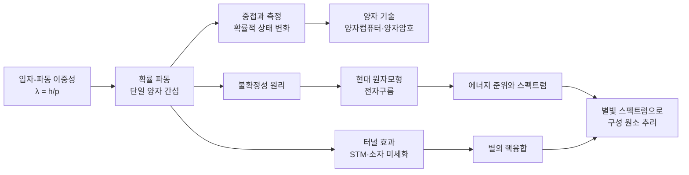

# 전자기와 양자 3. 양자와 미시세계 — 확률로 춤추는 입자, 별빛에 새겨진 원소
<!-- prev: 2-1, 2-2, 5-4, phy-3, emq-1, emq-2 -->
<!-- next: astro-2 -->

> [!NOTE]
> **성취기준**
> - **[12전자03-01]** 단일 양자 수준의 이중 슬릿 실험을 통해서 입자-파동 이중성을 확인하고, 단일 양자의 분포에 대한 실험 결과를 확률 파동의 간섭을 토대로 해석할 수 있다.
> - **[12전자03-02]** 중첩과 측정을 통한 확률적 상태 변화를 이해하고, 이를 이용한 양자컴퓨터, 양자암호통신 등의 양자 기술이 일상생활과 미래 사회에 미칠 영향을 인식할 수 있다.
> - **[12전자03-03]** 터널 효과를 설명하고, 관련된 현상과 기술을 조사하여 발표할 수 있다.
> - **[12전자03-04]** 현대의 원자모형을 불확정성 원리와 확률을 기반으로 설명하고, 보어의 원자모형과 비교할 수 있다.
> - **[12전자03-05]** 별에서 핵융합에 의해 에너지가 생성되고 빛이 방출되는 원리를 알고, 별빛의 스펙트럼에 기반하여 별의 구성 원소를 추리할 수 있다.

**학습 목표**

1. 드브로이 관계식으로 물질파의 파장이 운동량에 반비례함을 이해하고, 전자·광자를 하나씩 보내는 이중 슬릿 실험의 결과를 확률 파동의 간섭으로 해석할 수 있다.
2. 중첩 상태가 측정에 의해 확률적으로 하나의 결과로 정해짐을 이해하고, 양자컴퓨터·양자암호통신이 사회에 미칠 영향을 토론할 수 있다.
3. 고전적으로 불가능한 터널 효과를 확률로 설명하고, 주사 터널링 현미경·소자 미세화 문제 등 관련 현상과 기술을 조사할 수 있다.
4. 불확정성 원리와 확률로 현대의 원자모형을 설명하고, 보어 원자모형과 비교할 수 있다.
5. 별의 중심에서 수소 핵융합으로 에너지가 생성되는 원리와, 별빛의 흡수 스펙트럼으로 구성 원소를 추리하는 방법을 설명할 수 있다.

**이 단원의 학습 사다리**

| 단계 | 무엇을 하나? |
|---|---|
| STEP 1. 이전 학습 다시 보기 | 통합과학 「빛의 스펙트럼과 우주 초기 원소」·「태양 에너지와 에너지 전환」, 물리학 「빛과 물질」, 「빛과 정보 통신」을 꺼내 본다 |
| STEP 2. 기초 다지기 | 운동량, 파동의 간섭 복습, 확률의 기초, 질량–에너지 등가, 매우 작은 수 다루기 |
| STEP 3. 핵심 개념 | 입자–파동 이중성 → 중첩과 측정·양자 기술 → 터널 효과 → 불확정성 원리와 원자모형 → 별의 핵융합과 스펙트럼 |
| STEP 4. 오개념 바로잡기 | "전자는 원자핵 주위를 정해진 궤도로 돈다?" 같은 착각을 바로잡는다 |
| STEP 5. 다음 단계로 | 대학 양자역학(슈뢰딩거 방정식, 오비탈), 양자정보과학, 핵·천체물리학 |
| STEP 6. 생활·산업·진로 | 양자컴퓨터·양자암호, 반도체 미세화, 주사 터널링 현미경, 핵융합 에너지 |

---

## 🗺️ 단원 들어가기

전자 하나를 두 개의 틈이 난 벽을 향해 쏜다. 전자는 알갱이이니 둘 중 **한 틈**으로 지나가 스크린의 **한 점**에 부딪힐 것이다. 실제로 그렇다. 스크린에는 점 하나가 찍힌다. 그런데 전자를 하나씩, 수천 개를 보내고 나서 점들을 모아 보면 스크린에는 놀랍게도 **간섭무늬**가 나타난다. 하나씩 보냈으니 서로 간섭할 상대도 없었는데 말이다.

미시세계에서 입자는 파동처럼 퍼지고, 여러 상태가 동시에 겹쳐 있으며, 넘을 수 없는 벽을 뚫고 지나간다. 이 기묘한 규칙은 양자컴퓨터와 양자암호 같은 미래 기술의 토대가 되고, 밤하늘의 별이 수십억 년 동안 빛나는 비밀을 풀어 주기도 한다. 이 단원에서는 그 기묘함을 마음껏 상상하며 감상해 보자.

---

## STEP 1. 🔙 이전 학습 다시 보기

### 연계 개념표

| 이전 단원·성취기준 | 그때 배운 것 | 이 단원에서 확장되는 것 |
|---|---|---|
| 통합과학1 「빛의 스펙트럼과 우주 초기 원소」 [10통과1-02-01] | 원소마다 고유한 선스펙트럼, 별빛 스펙트럼으로 우주의 구성 원소 추론 | 흡수선이 생기는 원리를 **에너지 준위**로 설명하고 별의 구성 원소 추리 |
| 통합과학1 「별의 진화와 원소의 생성」 [10통과1-02-02] | 별 내부 핵융합으로 탄소·산소 등이 생성(정성적) | 핵융합이 일어나는 조건과 **터널 효과**의 역할 |
| 통합과학2 「태양 에너지와 에너지 전환」 [10통과2-02-04] | 수소 핵융합에서 질량 일부가 에너지로 바뀜(정성적) | 질량 결손과 $E = mc^2$로 에너지 계산, 별빛이 방출되는 과정 |
| 물리학 「빛과 물질」 [12물리03-03] | 빛과 물질의 이중성, 전자 현미경 | 드브로이 관계식으로 물질파 파장 비교, 단일 양자 이중 슬릿과 **확률 파동** |
| 물리학 「빛과 물질」 [12물리03-04] | 수소 선스펙트럼과 보어 원자모형, 보어 모형의 한계 | **불확정성 원리**와 확률에 기반한 현대 원자모형 |
| 전자기와 양자 「빛과 정보 통신」 [12전자02-03~05] | 편광, 광자 $E = hf$, 흡수·방출·유도 방출 | 광자 하나의 편광 측정 → **중첩과 측정**, 양자암호통신 |
| 전자기와 양자 「전자기적 상호작용」 [12전자01-07] | 트랜지스터와 반도체 칩, 미세화 | 미세화에 따른 **터널 효과** 문제 |

### 준비 운동 (사전 진단)

**Q1.** 광자 하나의 에너지가 $E = hf$일 때, 빛이 밝아진다는 것은 광자에 대해 무엇이 늘어난다는 뜻인가?

**Q2.** 보어 원자모형에서 수소 원자의 전자가 $n = 3$에서 $n = 2$로 전이하면 빛을 흡수하는가, 방출하는가?

**Q3.** 동전을 던져 앞면이 나올 확률이 $\frac{1}{2}$일 때, 1000번 던지면 앞면은 대략 몇 번 나올까? 다음 한 번의 결과를 미리 확실히 알 수 있는가?

**Q4.** 태양의 에너지는 무엇이 무엇으로 바뀌는 반응에서 나오는가?

정답 및 해설

**Q1.** 1초 동안 도착하는 **광자의 수**가 늘어난다. 광자 하나의 에너지는 진동수로 정해진다.

**Q2.** 방출한다. 높은 준위에서 낮은 준위로 내려오며 에너지 차만큼의 광자를 내보낸다(발머 계열의 빨간 선).

**Q3.** 약 500번. 그러나 다음 한 번의 결과는 확실히 알 수 없다. 많이 반복했을 때의 **분포**만 예측할 수 있다. 이 단원의 '확률'은 이런 의미이다.

**Q4.** 수소 원자핵 4개가 헬륨 원자핵 1개로 바뀌는 **핵융합** 반응에서, 줄어든 질량이 에너지로 바뀐다.

---

## STEP 2. 🧱 기초 다지기

### ① 운동량과 운동 에너지

운동량 $p = mv$, 운동 에너지 $E_k = \dfrac{1}{2}mv^2$이다. 두 식을 합치면

$$
p = \sqrt{2mE_k}
$$

전하 $e$인 전자가 전위차 $V$로 가속되면 $E_k = eV$이므로 $p = \sqrt{2meV}$이다. 광자는 질량이 없지만 운동량 $p = \dfrac{E}{c} = \dfrac{h}{\lambda}$를 가진다.

### ② 파동의 간섭 다시 보기

「빛과 정보 통신」의 이중 슬릿에서 두 슬릿을 지난 파동이 **같은 위상으로 만나면 보강, 반대 위상이면 상쇄**되었다. 스크린의 밝기는 파동 **진폭의 제곱**에 비례한다. 진폭이 2배인 곳은 4배 밝다. 이 '진폭을 먼저 더하고 나중에 제곱한다'는 순서가 양자역학의 확률 계산에서도 그대로 쓰인다.

### ③ 확률은 '많이 했을 때의 비율'

| 개념 | 뜻 | 예 |
|---|---|---|
| 확률 | 같은 조건에서 여러 번 반복할 때 어떤 결과가 나오는 비율 | 주사위 3이 나올 확률 $\frac{1}{6}$ |
| 분포 | 결과마다 확률이 어떻게 퍼져 있는지 | 많은 사람의 키 분포 |
| 확률의 합 | 가능한 모든 결과의 확률을 더하면 1 | 앞면 $\frac{1}{2}$ + 뒷면 $\frac{1}{2}$ = 1 |

> [!TIP]
> 💡 **비유** — 일기예보의 "비 올 확률 30%"는 '오늘 하늘의 30%에서만 비가 온다'는 뜻이 아니라, '오늘 같은 조건의 날을 많이 모으면 그중 약 30%의 날에 비가 왔다'는 뜻이다. 양자역학의 확률도 '같게 준비한 입자를 많이 측정했을 때의 비율'이다.

### ④ 질량–에너지 등가

아인슈타인의 특수 상대성 이론에 따르면 질량은 에너지의 한 형태이다.

$$
E = mc^2
$$

$c^2 = 9\times10^{16}\ \mathrm{m^2/s^2}$이 매우 크므로 아주 작은 질량도 막대한 에너지에 해당한다. 원자핵 수준에서는 **원자 질량 단위** $1\ \mathrm{u} \approx 1.66\times10^{-27}\ \mathrm{kg}$와 $1\ \mathrm{u}$의 에너지 $\approx 931.5\ \mathrm{MeV}$를 쓰면 편리하다.

### ⑤ 매우 작은 수 감각 익히기

| 양 | 값 |
|---|---|
| 플랑크 상수 $h$ | $6.63\times10^{-34}\ \mathrm{J\cdot s}$ |
| 전자의 질량 $m_e$ | $9.11\times10^{-31}\ \mathrm{kg}$ |
| 양성자의 질량 $m_p$ | $1.67\times10^{-27}\ \mathrm{kg}$ (전자의 약 1836배) |
| 기본 전하 $e$ | $1.6\times10^{-19}\ \mathrm{C}$ |
| 원자의 크기 | 약 $10^{-10}\ \mathrm{m}$ (0.1 nm) |
| 원자핵의 크기 | 약 $10^{-15}\ \mathrm{m}$ |

$h$가 이렇게 작기 때문에 양자 효과는 일상 크기에서는 드러나지 않고, 원자 크기에서야 뚜렷해진다.

---

## STEP 3. 📘 핵심 개념

### ① 입자–파동 이중성과 확률 파동 [12전자03-01]

#### 드브로이의 물질파

빛이 파동이면서 입자(광자)라면, 거꾸로 전자 같은 입자도 파동의 성질을 가지지 않을까? 1924년 드브로이(de Broglie)는 운동량 $p$인 모든 입자가 다음 파장의 파동, 즉 **물질파(matter wave)** 를 가진다고 제안했다.

$$
\lambda = \frac{h}{p} = \frac{h}{mv}
$$

1927년 무렵 데이비슨과 거머 등은 니켈 결정에 전자를 쏘아 X선과 같은 **회절 무늬**가 생기는 것을 관찰하여 전자의 파동성을 확인했다. 오늘날 전자 현미경은 이 짧은 물질파를 이용한다(물리학 「빛과 물질」).

#### 예제 1 — 전자와 야구공의 물질파 파장 비교

교육과정은 드브로이 관계식을 바탕으로 이중성의 기묘함을 **정성적으로** 다룬다. 그래서 여기서는 파장의 값을 계산하기보다 $\lambda \propto 1/p$의 관계로 비교해 보자(값을 직접 계산하는 것은 STEP 5).

(1) 같은 속력으로 움직이는 전자와 야구공 중 물질파 파장이 긴 것은? (2) 전자의 속력을 2배로 하면 파장은 어떻게 되는가? (3) 실험에서 전자의 회절은 관찰되지만 야구공의 회절은 관찰되지 않는 이유는?

**풀이**
(1) $\lambda = h/mv$에서 속력이 같으면 파장은 질량에 반비례하므로, 질량이 훨씬 작은 **전자**의 파장이 비교할 수 없을 만큼 길다.
(2) 운동량이 2배가 되므로 파장은 $\frac{1}{2}$배로 짧아진다.
(3) 실험실에서 가속한 전자의 물질파 파장은 원자 간격(약 $0.1\ \mathrm{nm}$) 정도여서 결정의 원자 배열이 '틈' 역할을 하여 회절이 잘 일어난다. 야구공은 질량과 운동량이 매우 커서 파장이 원자핵보다도 훨씬 작으므로, 어떤 틈으로도 회절을 관찰할 수 없다. 야구공이 파동처럼 보이지 않는 이유이다.

#### 단일 양자 이중 슬릿 실험 — 하나씩 보내도 간섭한다

광자나 전자를 **한 번에 하나씩만** 이중 슬릿에 보내는 실험이 여러 차례 이루어졌다(전자를 하나씩 보내 간섭무늬가 쌓이는 과정을 기록한 실험은 1980년대 후반에 잘 알려졌다). 결과를 시간 순서로 보면 다음과 같다.

| 보낸 입자 수 | 스크린에 보이는 것 | 해석 |
|---|---|---|
| 1개 | 한 점 | 검출될 때는 **입자**처럼 한 곳에서 한 번에 검출된다 |
| 수십 개 | 무작위로 흩어진 점 | 각 입자가 어디에 도착할지는 **예측할 수 없다** |
| 수천 개 | 점이 많이 모인 띠와 거의 없는 띠가 보이기 시작 | 도착 위치의 **확률 분포**가 드러난다 |
| 수만 개 이상 | 뚜렷한 간섭무늬 | 분포가 두 슬릿을 지난 **파동의 간섭무늬**와 똑같다 |

이 결과는 다음과 같이 해석한다.

1. 각 입자에는 **확률 파동**(파동 함수)이 따라다닌다. 이 파동은 두 슬릿을 **모두** 지나 스크린에서 간섭한다.
2. 스크린의 어떤 점에서 입자가 검출될 확률은 그 점에서 확률 파동 **진폭의 제곱**에 비례한다.
3. 입자 하나가 검출되는 위치는 무작위이지만, 많은 입자의 분포는 확률 파동의 간섭무늬를 따른다.

> [!IMPORTANT]
> 간섭하는 것은 '입자끼리'가 아니라 **입자 하나의 확률 파동이 자기 자신과** 간섭하는 것이다. 그래서 하나씩 보내도 간섭무늬가 생긴다.

#### 어느 슬릿으로 지나갔는지 알아내면?

각 입자가 어느 슬릿을 지났는지 알아내는 장치를 설치하면 간섭무늬가 **사라지고**, 두 슬릿을 각각 지난 입자들이 만든 두 개의 띠만 남는다. 경로를 알아내는 측정이 두 경로의 확률 파동이 겹쳐 간섭할 가능성을 없애기 때문이다. 미시세계에서는 **관측 행위 자체가 결과에 영향을 준다.** 이 기묘함이 다음 소절의 '중첩과 측정'으로 이어진다.

| 실험 조건 | 스크린의 분포 |
|---|---|
| 고전적인 알갱이(작은 구슬)를 보냄 | 두 슬릿 뒤에 띠 두 개 |
| 물결파를 보냄 | 간섭무늬 |
| 전자·광자를 하나씩 보냄, 경로를 측정하지 않음 | 점이 쌓여 **간섭무늬** |
| 전자·광자를 하나씩 보냄, 경로를 측정함 | 띠 두 개(간섭무늬 사라짐) |

<!-- sim:double-slit-electron -->

> [!TIP]
> 💡 **비유** — 확률 파동은 '이 입자를 어디서 찾을 수 있을지'를 알려 주는 일종의 지도이다. 지도는 두 길을 모두 따라 그려져 있고, 두 길의 지도가 겹치는 곳에서 서로 보태지거나 지워진다. 실제로 입자를 찾아보는 순간(측정) 입자는 지도 위 어느 한 곳에서 발견되며, 지도가 진하게 칠해진 곳일수록 발견될 가능성이 크다.

#### ✔ 바로 확인

1. 같은 입자의 속력이 3배가 되면 물질파 파장은 몇 배가 되는가?
2. (O/X) 이중 슬릿을 지난 전자 하나는 스크린에 넓게 퍼진 흐릿한 무늬로 검출된다.
3. 빈칸: 스크린의 어떤 점에서 입자가 검출될 확률은 그 점에서 확률 파동의 (    )에 비례한다.
4. 전자가 어느 슬릿을 지났는지 측정하면서 전자를 많이 보내면 스크린의 분포는 어떻게 되는가?

정답

1. $\frac{1}{3}$배 — $\lambda = h/mv$에서 운동량이 3배가 된다.
2. X — 전자 하나는 스크린의 한 점에서 입자처럼 검출된다. 무늬는 많은 전자가 모여야 보인다.
3. 진폭의 제곱
4. 간섭무늬가 사라지고 두 슬릿 뒤에 띠 두 개만 생긴다.

### ② 중첩과 측정, 그리고 양자 기술 [12전자03-02]

#### 중첩 상태

양자 상태는 여러 가능한 상태가 **동시에 겹쳐 있는** 상태가 될 수 있다. 이를 **중첩(superposition)** 이라 한다. 이중 슬릿에서 입자의 상태는 '왼쪽 슬릿을 지나는 상태'와 '오른쪽 슬릿을 지나는 상태'의 중첩이었다.

광자의 편광으로 생각해 보자. 세로로 편광된 광자는 세로 편광판을 반드시 통과하고, 가로로 편광된 광자는 반드시 막힌다. 그렇다면 **$45^\circ$로 편광된 광자 하나**를 세로 편광판에 보내면 어떻게 될까? 광자는 쪼개지지 않으므로 '절반만 통과'할 수는 없다.

- 실험 결과: 광자는 **통과하거나 막히거나 둘 중 하나**이고, 어느 쪽일지는 미리 알 수 없다. 같은 광자를 많이 보내면 약 절반이 통과한다.
- 해석: $45^\circ$ 편광 상태는 '세로 편광'과 '가로 편광'이 같은 비율로 중첩된 상태이다.

#### 측정에 의한 확률적 상태 변화

중첩 상태를 측정하면 결과는 가능한 상태 **중 하나로 확률적으로** 정해지고, 측정 뒤 상태는 그 결과에 해당하는 상태로 **바뀐다**. 위의 예에서 세로 편광판을 통과한 광자는 이제 $45^\circ$가 아니라 **세로 편광** 상태이다. 다시 세로 편광판에 보내면 100% 통과한다.

| 단계 | 광자의 상태 | 세로 편광판 통과 확률 |
|---|---|---|
| 측정 전 | $45^\circ$ 편광 = 세로와 가로의 중첩 | 50% |
| 세로 편광판 통과 후 | 세로 편광 | 100% |
| 다시 $45^\circ$ 편광판에 보내면 | 세로 = $45^\circ$와 $135^\circ$의 중첩 | ($45^\circ$ 편광판 통과 확률) 50% |

「빛과 정보 통신」에서 수직인 두 편광판 사이에 $45^\circ$ 편광판을 끼우면 빛이 통과했던 것을 광자 하나하나의 중첩과 측정으로 다시 이해할 수 있다.

<!-- fig:emq-3-polarization-superposition -->

#### 예제 2 — 중첩 상태의 측정 결과 예측

어떤 양자 장치에서 똑같이 준비한 입자 1000개의 상태를 측정했더니 '상태 0'이 약 360번, '상태 1'이 약 640번 나왔다. (1) 이 입자가 측정에서 '상태 1'로 나올 확률은? (2) 1001번째 입자의 결과를 확실히 예측할 수 있는가? (3) 측정 결과가 '상태 1'이었던 입자를 곧바로 같은 방식으로 다시 측정하면?

**풀이** (1) 약 $640/1000 = 0.64$(64%). (2) 없다. 0일 확률 약 36%, 1일 확률 약 64%라는 것만 말할 수 있다. (3) 측정으로 상태가 '상태 1'로 바뀌었으므로 다시 측정하면 '상태 1'이 나온다.

#### 비트와 큐비트

| 구분 | 비트(bit) | 큐비트(qubit) |
|---|---|---|
| 상태 | 0 또는 1 중 하나 | 0과 1의 **중첩** 상태가 가능 |
| 읽으면 | 저장된 값이 그대로 나옴 | 0 또는 1이 **확률적으로** 나오고 상태가 바뀜 |
| $n$개가 표현하는 것 | $2^n$개 상태 중 **한 가지** | $2^n$개 상태의 중첩을 **한꺼번에** 다룸 |
| 물리적 구현 | 트랜지스터의 켜짐·꺼짐 | 광자의 편광, 초전도 회로, 이온, 원자 등 |

큐비트 10개는 $2^{10} = 1024$가지, 300개는 $2^{300} \approx 2\times10^{90}$가지 상태의 중첩을 다룰 수 있다. 관측 가능한 우주의 원자 수가 약 $10^{80}$개로 추정되는 것과 비교하면 엄청난 수이다. 다만 측정하면 하나의 결과만 얻으므로, 원하는 답이 나올 확률을 키우도록 간섭을 교묘하게 이용하는 **양자 알고리즘**이 필요하다. 그래서 양자컴퓨터는 모든 계산을 빠르게 하는 것이 아니라 **특정한 종류의 문제**에서 큰 이점을 가진다.

#### 양자 기술이 일상생활과 미래 사회에 미칠 영향

이 성취기준은 물리적 원리보다 **사회에 미치는 영향**을 중심으로 다룬다.

| 양자 기술 | 무엇이 가능해지나 | 사회에 미칠 수 있는 영향 |
|---|---|---|
| 양자컴퓨터 | 분자·신소재 시뮬레이션, 일부 최적화·검색 문제 | 신약·배터리·촉매 개발 기간 단축, 물류·금융 최적화 |
| 양자컴퓨터와 기존 암호 | 큰 수의 소인수분해 등 현재 공개 키 암호의 바탕이 되는 문제를 빠르게 풀 가능성 | 인터넷 금융·전자 서명의 보안 위협 → 양자컴퓨터로도 풀기 어렵게 설계한 **양자내성암호**로 전환 준비 |
| 양자암호통신(양자 키 분배) | 광자 하나하나에 암호 키를 실어 보냄. 도청자가 측정하면 중첩 상태가 바뀌어 **흔적이 남음** | 국가 기간망·금융·의료 정보의 보안 강화, 도청을 탐지할 수 있는 통신 |
| 양자 센서 | 원자의 양자 상태를 이용한 초정밀 시계·자기장·중력 측정 | 위성 없는 정밀 항법, 뇌 활동 측정, 지하 자원 탐사 |

**함께 생각할 문제**
- 양자 기술을 가진 국가·기업과 그렇지 못한 쪽 사이의 **기술 격차**와 안보 문제
- 지금 암호화된 정보를 저장해 두었다가 나중에 양자컴퓨터로 해독하는 위험 → 미리 대비해야 하는 이유
- 새로운 산업과 일자리가 생기는 반면, 막대한 연구 투자와 전문 인력 양성이 필요하다는 점
- 아직 오류가 많고 매우 낮은 온도 등 까다로운 조건이 필요해, 실용화 시기와 효과에 대한 **과장된 기대**를 경계하는 태도

#### 예제 3 — 도청을 알아차리는 원리

A가 B에게 광자를 하나씩 보내며, 광자마다 무작위로 '세로/가로' 또는 '$45^\circ$/$135^\circ$' 방식 중 하나로 편광을 정해 0, 1을 싣는다. 중간에서 도청자 E가 광자를 가로채 측정하고 다시 보내면 왜 들킬 수 있는지 정성적으로 설명하시오.

**풀이** E는 A가 어떤 방식으로 편광을 정했는지 모르므로, 절반 정도는 다른 방식으로 측정하게 된다. 다른 방식으로 측정하면 광자의 상태가 E의 측정 결과에 해당하는 편광으로 **바뀌어** 버린다. 그 광자를 B가 원래 방식으로 측정하면 원래 값과 다른 결과가 확률적으로 나온다. A와 B가 키의 일부를 공개해 비교하면 오류율이 비정상적으로 높아진 것을 보고 도청을 알아차린다. **측정이 상태를 바꾼다**는 양자 성질이 보안의 근거가 된다.

#### ✔ 바로 확인

1. $45^\circ$로 편광된 광자 1000개를 하나씩 세로 편광판에 보내면 약 몇 개가 통과하는가?
2. 그림(편광 광자의 측정)에서 세로 편광판을 통과한 광자를 다시 세로 편광판에 보내면 통과할 확률은?
3. (O/X) 큐비트 하나를 측정하면 0과 1이 동시에 읽힌다.
4. 큐비트 4개로 중첩시킬 수 있는 기본 상태는 모두 몇 가지인가?

정답

1. 약 500개 — 하나하나는 통과하거나 막히거나 둘 중 하나이고, 많이 보내면 절반쯤 통과한다.
2. 100% — 측정 뒤 상태가 세로 편광으로 바뀌었기 때문이다.
3. X — 측정하면 0 또는 1 중 하나가 확률적으로 나오고, 상태도 그 결과로 바뀐다.
4. 16가지 — $2^4 = 16$

### ③ 터널 효과 [12전자03-03]

#### 고전적으로는 불가능한 일

공을 언덕 아래에서 굴릴 때, 공의 운동 에너지가 언덕 꼭대기의 퍼텐셜 에너지보다 작으면 공은 결코 언덕을 넘지 못하고 되돌아온다. 이처럼 입자의 에너지보다 높은 에너지 장벽이 있는 영역은 고전적으로 **들어갈 수 없는 영역**이다.

#### 확률 파동은 장벽 안으로 스며든다

미시 입자의 확률 파동은 장벽에서 갑자기 0이 되지 않고, 장벽 안으로 들어가며 **급격히 줄어든다**. 장벽이 충분히 얇으면 반대편에 아주 작은 진폭이 남는다. 그 진폭의 제곱만큼의 확률로 입자가 장벽 **반대편에서 발견**된다. 이를 **터널 효과(tunneling effect)** 라 한다.

| 터널 확률을 좌우하는 것 | 터널 확률 |
|---|---|
| 장벽이 두꺼울수록 | 매우 급격히(지수 함수적으로) 작아진다 |
| 장벽이 높을수록(입자 에너지와의 차이가 클수록) | 작아진다 |
| 입자의 질량이 클수록 | 작아진다 → 전자처럼 가벼운 입자에서 잘 일어난다 |

터널 효과는 '장벽을 넘어가는' 것이 아니라 '에너지는 그대로인 채 장벽 반대편에 나타나는' 확률적 현상이다. 공이나 사람에게서 관찰되지 않는 것은 질량이 크고 장벽이 두꺼워 확률이 상상할 수 없을 만큼 작기 때문이다.

> [!TIP]
> 💡 **비유** — 두꺼운 벽 너머에서는 친구의 목소리가 들리지 않지만, 얇은 벽 너머로는 작게 새어 들린다. 소리 파동이 벽 속에서 약해지다가 벽이 얇으면 반대편까지 일부가 남기 때문이다. 미시 입자의 확률 파동도 장벽을 지나며 약해지지만, 장벽이 얇으면 반대편에 '발견될 가능성'이 조금 남는다. 다만 소리는 에너지가 일부 전달되는 것이고, 양자 터널링은 입자 **전체가** 반대편에서 확률적으로 발견된다는 점이 다르다.

<!-- sim:quantum-tunnel -->

#### 터널 효과와 관련된 현상과 기술

| 현상·기술 | 터널 효과가 하는 일 |
|---|---|
| 주사 터널링 현미경(STM) | 아주 뾰족한 탐침을 시료 표면에서 약 1 nm 이내로 가까이 하고 전압을 걸면, 전자가 진공 틈을 터널링하여 전류가 흐른다. 틈이 원자 하나 크기(약 0.1 nm)만큼만 변해도 전류가 대략 10배 가까이 변할 만큼 민감하여, 탐침으로 표면을 훑으며 **원자 하나하나의 배열**을 영상으로 얻는다. 탐침으로 원자를 옮겨 글자를 쓰는 것도 가능하다 |
| 반도체 소자 미세화 문제 | 트랜지스터의 절연막이 수 나노미터 수준으로 얇아지면 전자가 절연막을 터널링하여 **누설 전류**가 생기고, 전력 소모와 발열, 오작동이 늘어난다. 그래서 더 두꺼워도 성능이 좋은 새로운 절연 소재와 3차원 구조가 개발되고 있다 |
| 플래시 메모리(USB, SSD, 스마트폰 저장 장치) | 강한 전압을 걸어 전자를 얇은 절연막 너머의 저장 공간으로 터널링시켜 넣거나 빼내어 0과 1을 저장한다. 전원을 꺼도 전자가 갇혀 있어 정보가 유지된다 |
| 원자핵의 알파 붕괴 | 원자핵 속 알파 입자는 핵 바깥을 둘러싼 전기적 반발(쿨롱) 장벽을 넘을 에너지가 없지만, 터널링으로 확률적으로 빠져나온다. 방사성 원소의 반감기가 무작위 붕괴의 확률로 정해지는 이유와 연결된다 |
| 별의 핵융합 | 양성자끼리의 전기적 반발 장벽이 매우 높아 태양 중심 온도로도 고전적으로는 넘기 어렵지만, 터널링 덕분에 일정한 확률로 융합이 일어난다(⑤ 참고) |
| 터널 다이오드, 조셉슨 접합 | 터널링을 적극 이용하는 전자 소자. 조셉슨 접합은 초전도 큐비트의 핵심 부품이기도 하다 |

<!-- fig:emq-3-stm -->

#### 예제 4 — STM의 원리 추리

STM 탐침이 원자 위를 지날 때는 전류가 크고, 원자 사이 틈 위를 지날 때는 전류가 작다. (1) 그 이유를 터널 효과로 설명하고, (2) 탐침을 표면에 직접 닿게 하지 않는 이유를 쓰시오.

**풀이** (1) 원자 위에서는 탐침과 표면 사이 틈(장벽의 두께)이 얇아 전자의 터널 확률이 크고, 원자 사이에서는 틈이 조금 두꺼워 터널 확률이 급격히 작아진다. 전류 변화를 위치별로 기록하면 원자 배열 지도가 된다. (2) 닿으면 장벽이 없어 그냥 전류가 흐르므로 원자 크기의 높이 차이를 구별할 수 없고, 탐침과 시료가 손상된다. 터널 확률이 두께에 **매우 민감하다**는 점이 원자 수준의 분해능을 주는 핵심이다.

#### ✔ 바로 확인

1. (O/X) 터널링한 입자는 장벽을 지나면서 에너지가 줄어든다.
2. 고르기: 터널 확률이 커지는 경우를 모두 고르시오. ㄱ. 장벽을 얇게 한다 ㄴ. 장벽을 높게 한다 ㄷ. 질량이 더 작은 입자를 쓴다
3. 빈칸: 트랜지스터의 절연막이 수 나노미터로 얇아지면 전자가 터널링하여 (    ) 전류가 생긴다.
4. 다음 중 터널 효과와 관계가 **없는** 것은? ㄱ. 주사 터널링 현미경 ㄴ. 플래시 메모리 ㄷ. 광섬유 통신

정답

1. X — 에너지는 그대로인 채 장벽 반대편에서 확률적으로 발견된다.
2. ㄱ, ㄷ — 장벽이 두껍고 높을수록, 입자가 무거울수록 확률이 작아진다.
3. 누설
4. ㄷ — 광섬유는 전반사를 이용한다.

### ④ 불확정성 원리와 현대의 원자모형 [12전자03-04]

#### 보어 원자모형 다시 보기

물리학 「빛과 물질」에서 배운 보어 모형은 수소 원자의 전자가 **특정한 반지름의 원 궤도**에서만 돌고, 궤도마다 정해진 에너지를 가진다고 보았다.

$$
E_n = -\frac{13.6}{n^2}\ \mathrm{eV}, \qquad r_n \approx 0.053\,n^2\ \mathrm{nm} \qquad (n = 1, 2, 3, \ldots)
$$

전자가 높은 준위에서 낮은 준위로 전이하면 그 차이만큼의 에너지를 가진 광자를 방출한다: $hf = E_{\text{처음}} - E_{\text{나중}}$.

<!-- fig:emq-3-energy-levels -->

#### 예제 5 — 수소의 빨간 선

수소 원자의 전자가 $n = 3$에서 $n = 2$로 전이할 때 방출하는 빛의 파장은? ($hc = 1240\ \mathrm{eV\cdot nm}$)

**풀이** $\Delta E = 13.6\left(\dfrac{1}{2^2} - \dfrac{1}{3^2}\right) \approx 1.89\ \mathrm{eV}$, $\lambda = \dfrac{1240}{1.89} \approx 656\ \mathrm{nm}$(빨간빛). 태양과 별의 스펙트럼에서도 이 파장의 흡수선이 나타난다(⑤).

보어 모형은 수소 스펙트럼을 훌륭하게 설명했지만 **한계**가 있었다.

- 전자가 둘 이상인 원자의 스펙트럼을 정확히 설명하지 못한다.
- 스펙트럼선의 밝기 차이, 자기장 속에서 선이 갈라지는 현상 등을 설명하지 못한다.
- 원운동하는 전자가 왜 전자기파를 내며 에너지를 잃지 않는지 근본적인 이유를 주지 못한다.
- 무엇보다 전자의 위치와 속도를 동시에 정확히 정하는 '궤도'라는 개념이 불확정성 원리와 맞지 않는다.

#### 불확정성 원리

1927년 하이젠베르크(Heisenberg)는 입자의 **위치와 운동량을 동시에 정확하게 알 수 없다**는 **불확정성 원리(uncertainty principle)** 를 제시했다.

$$
\Delta x\,\Delta p \geq \frac{h}{4\pi}
$$

($\Delta x$: 위치의 불확정도, $\Delta p$: 운동량의 불확정도) 위치를 좁게 정할수록 운동량이 크게 퍼지고, 운동량을 정확히 정할수록 위치가 넓게 퍼진다. 이것은 측정 기술이 부족해서가 아니라 **입자가 파동의 성질을 가지기 때문에 생기는 자연의 근본 성질**이다. 한 점에 모인 파동을 만들려면 여러 파장(여러 운동량)의 파동을 겹쳐야 하기 때문이다.

> [!TIP]
> 💡 **비유** — 호수에 길게 이어진 물결은 파장(운동량)이 분명하지만 '어디에 있다'고 말하기 어렵다. 돌 하나를 던져 생긴 짧은 물결 묶음은 위치는 분명하지만 여러 파장이 섞여 있다. 파동은 '위치가 분명함'과 '파장이 분명함'을 동시에 가질 수 없다.

<!-- fig:emq-3-wave-packet -->

#### 예제 6 — 원자 속 전자에게 '궤도'가 있을 수 있을까?

(1) 전자가 원자 크기인 $\Delta x = 0.1\ \mathrm{nm}$ 범위 안에 있다고 할 때, 속도의 불확정도의 최솟값은? (2) 이 값을 보어 모형의 $n = 1$ 궤도 전자 속력(약 $2.2\times10^6\ \mathrm{m/s}$)과 비교하시오. (3) 질량 $0.15\ \mathrm{kg}$인 공의 위치를 $1\ \mathrm{mm}$ 이내로 정하면 속도의 불확정도는?

**풀이**
(1) $\Delta p \geq \dfrac{6.63\times10^{-34}}{4\pi\times1.0\times10^{-10}} \approx 5.3\times10^{-25}\ \mathrm{kg\cdot m/s}$, $\Delta v = \dfrac{\Delta p}{m_e} \approx \dfrac{5.3\times10^{-25}}{9.11\times10^{-31}} \approx 5.8\times10^5\ \mathrm{m/s}$
(2) 궤도 속력의 약 4분의 1에 이르는 큰 불확정도이다. 위치와 속도가 이만큼 흐릿하다면 '정해진 원 궤도를 정해진 속력으로 돈다'는 그림은 성립하지 않는다.
(3) $\Delta v \geq \dfrac{6.63\times10^{-34}}{4\pi\times1.0\times10^{-3}\times0.15} \approx 3.5\times10^{-31}\ \mathrm{m/s}$. 일상의 물체에서는 전혀 느낄 수 없다.

#### 현대의 원자모형 — 확률로 그리는 전자

현대의 원자모형에서는 전자의 정확한 경로(궤도)를 말하지 않는다. 대신 원자핵 주위에서 전자의 확률 파동이 만드는 **정상파 모양의 상태**를 생각하고, 각 위치에서 전자를 **발견할 확률**만 말할 수 있다. 이 확률 분포를 점의 밀도로 나타내면 원자핵 주위에 구름처럼 퍼진 모습이 되어 **전자구름(electron cloud)** 이라 부른다.

- 점이 촘촘한 곳 = 전자가 발견될 확률이 큰 곳. 원자에는 뚜렷한 '경계'가 없고 바깥으로 갈수록 확률이 옅어진다.
- 수소의 바닥상태에서 전자가 가장 발견되기 쉬운 거리는 보어 반지름(약 0.053 nm)과 거의 같지만, 그보다 가깝거나 먼 곳에서도 발견될 수 있다.
- 확률 파동이 원자핵 주위에서 안정된 정상파를 이루는 조건 때문에 **에너지는 여전히 띄엄띄엄(양자화)** 하다. 그래서 선스펙트럼은 그대로 설명된다.

| 비교 항목 | 보어의 원자모형 | 현대의 원자모형 |
|---|---|---|
| 전자의 모습 | 정해진 원 궤도를 도는 입자 | 확률 파동으로 기술되는 상태, 전자구름 |
| 전자의 위치 | 궤도 위의 특정 지점, 언제나 정해짐 | 확률 분포만 알 수 있음 |
| 바탕 원리 | 고전 역학 + 양자 조건(가정) | 입자–파동 이중성, 불확정성 원리, 확률 |
| 에너지 | 양자화(띄엄띄엄) | 양자화(띄엄띄엄) — 공통점 |
| 원자의 크기 | 궤도 반지름으로 딱 정해짐 | 경계가 흐릿한 확률 분포 |
| 설명 범위 | 수소(전자 1개) 스펙트럼 | 여러 전자 원자, 화학 결합, 고체의 성질까지 |

<!-- fig:emq-3-bohr-vs-cloud -->

> [!IMPORTANT]
> 현대 모형이 보어 모형을 완전히 버린 것은 아니다. **양자화된 에너지 준위**와 **준위 사이 전이로 빛을 흡수·방출한다**는 핵심은 그대로이다. 바뀐 것은 '전자가 어디에 있는가'를 **확률**로 말한다는 점이다.

#### ✔ 바로 확인

1. 보어 모형에서 수소 원자의 $n = 3$ 준위 에너지는 몇 eV인가? ($E_n = -13.6/n^2\ \mathrm{eV}$)
2. 그림(에너지 준위)에서 $4 \rightarrow 2$ 전이와 $3 \rightarrow 2$ 전이 중 방출하는 빛의 파장이 더 짧은 것은?
3. (O/X) 불확정성 원리는 측정 장비가 정밀하지 못해서 생기는 한계이다.
4. 전자의 위치 불확정도 $\Delta x$를 절반으로 줄이면 운동량 불확정도의 최솟값은 몇 배가 되는가?

정답

1. 약 $-1.51\ \mathrm{eV}$ — $-13.6/9$
2. $4 \rightarrow 2$ — 에너지 차가 더 커서($2.55\ \mathrm{eV} > 1.89\ \mathrm{eV}$) 파장이 짧다(486 nm).
3. X — 입자가 파동의 성질을 가지기 때문에 생기는 자연의 근본 성질이다.
4. 2배 — $\Delta x\,\Delta p \geq h/4\pi$

### ⑤ 별의 핵융합과 별빛의 스펙트럼 [12전자03-05]

#### 별의 중심에서 일어나는 수소 핵융합

태양 중심은 온도가 약 1500만 K, 밀도와 압력이 매우 높다. 이곳에서 수소 원자핵(양성자)들이 여러 단계를 거쳐 헬륨 원자핵이 된다(양성자–양성자 연쇄 반응).

$$
4\,{}^{1}_{1}\mathrm{H} \;\rightarrow\; {}^{4}_{2}\mathrm{He} + 2e^{+} + 2\nu + \text{에너지}
$$

($e^+$: 양전자, $\nu$: 중성미자) 반응 후 질량의 합이 처음보다 약간 줄어드는데, 이 **질량 결손** $\Delta m$이 $E = \Delta mc^2$의 에너지로 바뀐다.

#### 예제 7 — 수소 핵융합의 에너지

수소 원자 1개의 질량은 $1.007825\ \mathrm{u}$, 헬륨 원자 1개의 질량은 $4.002603\ \mathrm{u}$이다. 수소 원자 4개가 헬륨 원자 1개가 될 때 (1) 질량 결손, (2) 방출 에너지(MeV), (3) 처음 질량 중 에너지로 바뀐 비율을 구하시오. ($1\ \mathrm{u}$의 에너지 $= 931.5\ \mathrm{MeV}$, 원자 질량으로 계산하면 전자의 질량이 자동으로 처리된다.)

**풀이**
(1) $\Delta m = 4\times1.007825 - 4.002603 = 0.028697\ \mathrm{u}$
(2) $E = 0.028697\times931.5 \approx 26.7\ \mathrm{MeV}$
(3) $0.028697/4.0313 \approx 0.0071$, 약 0.7%. 화학 반응(연소)보다 같은 질량당 대략 천만 배 큰 에너지이다.

#### 예제 8 — 태양은 1초에 질량을 얼마나 잃을까?

태양이 1초에 내보내는 에너지(광도)는 약 $3.8\times10^{26}\ \mathrm{W}$이다. 이 에너지가 모두 핵융합의 질량 결손에서 온다면 태양은 1초에 질량을 얼마나 잃는가?

**풀이** $\Delta m = \dfrac{E}{c^2} = \dfrac{3.8\times10^{26}}{(3.0\times10^8)^2} \approx 4.2\times10^9\ \mathrm{kg}$. 1초에 약 400만 톤 이상의 질량이 에너지로 바뀐다. 그래도 태양의 질량(약 $2\times10^{30}\ \mathrm{kg}$)에 비하면 매우 작아 수십억 년 동안 빛날 수 있다.

#### 핵융합과 터널 효과

양성자는 모두 (+)전하를 띠므로 서로 밀어낸다. 핵력이 작용할 만큼 가까워지려면(약 $10^{-15}\ \mathrm{m}$) 이 전기적 반발 장벽을 넘어야 하는데, 태양 중심 온도의 평균 운동 에너지로는 고전적으로 거의 불가능하다. 그런데도 핵융합이 일어나는 것은 ③의 **터널 효과** 덕분이다. 터널 확률이 매우 작기 때문에 반응이 천천히 일어나고, 그 덕분에 태양은 한꺼번에 타 버리지 않고 오랫동안 안정적으로 빛난다. 별의 수명이라는 거대한 시간이 미시세계의 확률에 달려 있는 셈이다.

질량이 큰 별에서는 탄소·질소·산소가 촉매처럼 작용하는 다른 경로(CNO 순환)로 수소가 헬륨이 되고, 중심의 수소가 다 떨어지면 헬륨이 탄소·산소로 융합하는 등 더 무거운 원소가 차례로 만들어진다(통합과학1 「별의 진화와 원소의 생성」).

#### 별빛이 방출되기까지

1. 중심에서 핵융합으로 생긴 에너지는 감마선 광자와 입자의 운동 에너지로 나타난다.
2. 광자는 빽빽한 내부에서 흡수와 방출을 수없이 되풀이하며(복사층) 아주 천천히 바깥으로 나아가고, 바깥쪽에서는 뜨거운 기체가 직접 오르내리며(대류층) 에너지를 나른다. 중심에서 생긴 에너지가 표면까지 오는 데 매우 오랜 시간(수만 년 이상으로 추정)이 걸린다.
3. 표면(광구, 약 5800 K)에 이르면 뜨거운 기체가 온도에 맞는 **연속 스펙트럼**의 빛을 우주로 방출한다.

#### 별빛의 흡수 스펙트럼으로 구성 원소 추리하기

광구에서 나온 연속 스펙트럼의 빛은 바깥쪽의 상대적으로 온도가 낮은 대기를 지난다. 이때 대기 속 원자가 자기 **에너지 준위 차에 꼭 맞는 파장**의 빛만 흡수하므로, 스펙트럼에 검은 **흡수선**이 생긴다. 흡수선의 파장은 원소마다 고유하므로 **원소의 지문**이 된다.

| 원소 | 대표적인 흡수선 파장(약) | 비고 |
|---|---|---|
| 수소(H) | 656, 486, 434, 410 nm | 발머 계열. 보어 모형의 $n \geq 3 \rightarrow 2$ 전이와 같은 에너지 |
| 나트륨(Na) | 589.0, 589.6 nm | 가까이 붙은 두 선(노란빛) |
| 칼슘 이온($\mathrm{Ca^+}$) | 393, 397 nm | 태양 스펙트럼에서 매우 진한 보라색 영역의 두 선 |
| 헬륨(He) | 588, 447 nm 등 | 1868년 태양 스펙트럼에서 먼저 발견되어 '태양'을 뜻하는 이름이 붙었다 |
| 철(Fe) | 가시광선 영역에 매우 많은 선 | 태양 스펙트럼에서 가장 많은 흡수선을 차지하는 원소 중 하나 |

<!-- fig:emq-3-absorption-spectrum -->

**추리 방법**
1. 실험실에서 각 원소 기체의 방출(또는 흡수) 스펙트럼을 측정해 '지문 목록'을 만든다.
2. 별빛 스펙트럼의 흡수선 파장을 지문 목록과 비교한다. 한 원소의 여러 선이 **모두** 함께 나타나야 그 원소가 있다고 판단한다.
3. 선의 진하기와 온도에 따른 차이를 함께 분석하면 원소의 양도 추정할 수 있다. 이렇게 분석한 결과 대부분의 별은 질량의 약 4분의 3이 수소, 약 4분의 1이 헬륨이고, 나머지 무거운 원소는 몇 % 이하이다(통합과학1 「빛의 스펙트럼과 우주 초기 원소」).

#### 예제 9 — 별빛 스펙트럼 해석

어떤 별의 스펙트럼에서 파장 약 656, 589.0, 589.6, 486, 434 nm에 흡수선이 나타났다. (1) 이 별의 대기에 있는 원소를 추리하고, (2) 656 nm와 486 nm 흡수선은 수소 원자의 어떤 준위 사이 전이에 해당하는지 쓰시오.

**풀이** (1) 656, 486, 434 nm는 수소의 발머 계열 흡수선, 589.0과 589.6 nm 쌍은 나트륨의 흡수선이다. 따라서 대기에 **수소와 나트륨**이 있다. (2) 흡수이므로 $n = 2$ 준위의 전자가 각각 $n = 3$(656 nm), $n = 4$(486 nm)로 올라가는 전이이다. $13.6\left(\frac{1}{4} - \frac{1}{16}\right) = 2.55\ \mathrm{eV}$ → $\lambda = 1240/2.55 \approx 486\ \mathrm{nm}$로 확인된다.

#### ✔ 바로 확인

1. 빈칸: 핵융합 반응 뒤 질량의 합이 처음보다 줄어든 양을 (    )이라 하며, 이것이 $E = \Delta mc^2$의 에너지로 바뀐다.
2. $1.0\times10^{-6}\ \mathrm{kg}$의 질량이 모두 에너지로 바뀌면 몇 J인가? ($c = 3.0\times10^8\ \mathrm{m/s}$)
3. (O/X) 별빛의 흡수선은 광구보다 뜨거운 대기가 특정 파장의 빛을 내기 때문에 생긴다.
4. 그림(흡수 스펙트럼)처럼 별빛에서 $589.0\ \mathrm{nm}$와 $589.6\ \mathrm{nm}$의 가까이 붙은 두 흡수선이 보이면 대기에 어떤 원소가 있다고 추리하는가?

정답

1. 질량 결손
2. $9.0\times10^{10}\ \mathrm{J}$ — $1.0\times10^{-6}\times(3.0\times10^8)^2$
3. X — 상대적으로 차가운 대기의 원자가 광구에서 온 연속 스펙트럼 중 특정 파장을 흡수하여 생긴다.
4. 나트륨

---

## STEP 4. ⚠️ 오개념 바로잡기

| 흔한 오개념 | 올바른 개념 | 왜 그럴까? |
|---|---|---|
| 전자 이중 슬릿의 간섭무늬는 전자들끼리 부딪혀 생긴다 | 전자를 **하나씩** 보내도 간섭무늬가 생긴다. 각 전자의 확률 파동이 자기 자신과 간섭한다 | 한 번에 하나만 있는 상황에서도 점들이 모여 같은 무늬가 된다 |
| 확률 파동은 전자가 물결처럼 퍼져 있는 '물질'이다 | 확률 파동은 전자가 **어디서 발견될지의 확률**을 알려 주는 것이다. 전자는 검출될 때 언제나 한 점에서 통째로 발견된다 | 전자의 일부만 검출되는 일은 없다 |
| 중첩 상태란 입자가 사실은 한 상태에 있는데 우리가 모르는 것이다 | 중첩은 측정 전 여러 상태가 **실제로 겹쳐 있는** 상태이며, 측정이 결과를 확률적으로 정하고 상태를 바꾼다 | 몰라서 생기는 확률이라면 이중 슬릿에서 간섭이 생길 수 없다 |
| 양자컴퓨터는 모든 계산을 엄청나게 빠르게 한다 | 특정한 종류의 문제에서 큰 이점이 있고, 일상적인 계산은 기존 컴퓨터가 더 적합하다 | 측정하면 하나의 결과만 얻으므로, 간섭을 이용하는 특별한 알고리즘이 있어야 이점이 생긴다 |
| 터널 효과는 입자가 에너지를 빌려 장벽을 넘어가는 것이다 | 입자의 에너지는 그대로인 채 확률 파동이 장벽을 지나 **반대편에서 확률적으로 발견**된다 | 장벽 두께에 따라 확률이 지수 함수적으로 줄어든다 |
| 불확정성 원리는 측정 장비가 정밀하지 못해서 생긴다 | 입자가 파동의 성질을 가지기 때문에 생기는 **자연의 근본 한계**이다 | 위치가 분명한 파동은 여러 파장이 섞여 있어야 한다 |
| 전자는 원자핵 주위를 정해진 궤도로 돈다 | 현대 원자모형에서는 궤도 대신 전자를 발견할 **확률 분포(전자구름)** 로 나타낸다 | 불확정성 원리 때문에 위치와 속도를 동시에 정할 수 없다 |
| 별은 불처럼 연료가 타서(연소) 빛난다 | 별의 에너지는 **핵융합**에서 질량 결손이 에너지로 바뀌어 생긴다 | 연소라면 태양은 수천 년 정도밖에 빛날 수 없다 |

---

## STEP 5. 🎓 다음 단계로 한 걸음 더

> [!CAUTION]
> 이 절은 **고등학교 교육과정 범위 밖의 심화 내용**으로 평가 대상이 아니다. 이 단원의 개념이 대학 전공 과목에서 어떻게 확장되는지 맛보기로 보여 주기 위한 내용이다.

### 대학 전공 과목과의 연결

| 대학 과목 | 이어지는 내용 |
|---|---|
| 현대물리학 | 흑체 복사, 광전효과·콤프턴 효과, 드브로이 파, 보어 모형에서 양자역학으로 |
| 양자역학 | 슈뢰딩거 방정식, 파동 함수와 확률 해석, 퍼텐셜 장벽과 터널링, 수소 원자, 각운동량과 스핀 |
| 양자정보과학 | 큐비트와 블로흐 구, 얽힘, 양자 회로와 양자 알고리즘, 양자 키 분배 |
| 고체물리·반도체 공학 | 결정 속 전자의 에너지띠, 터널 소자, 나노 소자의 양자 효과 |
| 원자핵물리·천체물리학 | 핵력과 결합 에너지, 별 내부의 핵반응률, 항성 대기와 분광 분석 |

### ① 물질파 파장을 직접 계산해 보기

STEP 2의 $p = \sqrt{2mE_k}$와 $\lambda = h/p$를 쓰면 물질파의 파장을 값으로 구할 수 있다.

- $100\ \mathrm{V}$로 가속한 전자: $p = \sqrt{2\times9.11\times10^{-31}\times1.6\times10^{-19}\times100} \approx 5.4\times10^{-24}\ \mathrm{kg\cdot m/s}$, $\lambda = \dfrac{6.63\times10^{-34}}{5.4\times10^{-24}} \approx 1.2\times10^{-10}\ \mathrm{m} = 0.12\ \mathrm{nm}$. 원자 간격과 비슷하여 결정에서 회절이 잘 일어난다.
- $1000\ \mathrm{V}$로 가속한 전자: $p \approx 1.71\times10^{-23}\ \mathrm{kg\cdot m/s}$, $\lambda \approx 3.9\times10^{-11}\ \mathrm{m} \approx 0.039\ \mathrm{nm}$. 전압이 10배이면 파장은 $\frac{1}{\sqrt{10}}$배가 된다.
- $40\ \mathrm{m/s}$로 날아가는 질량 $0.15\ \mathrm{kg}$의 야구공: $\lambda = \dfrac{6.63\times10^{-34}}{0.15\times40} \approx 1.1\times10^{-34}\ \mathrm{m}$. 원자핵(약 $10^{-15}\ \mathrm{m}$)보다도 $10^{19}$배쯤 작다.

### ② 슈뢰딩거 방정식 — 확률 파동의 운동 법칙

대학 양자역학에서는 확률 파동을 **파동 함수** $\psi(x, t)$로 쓰고, 그 변화를 슈뢰딩거 방정식으로 계산한다.

$$
i\hbar\frac{\partial\psi}{\partial t} = -\frac{\hbar^2}{2m}\frac{\partial^2\psi}{\partial x^2} + U(x)\psi, \qquad \hbar = \frac{h}{2\pi}
$$

입자를 위치 $x$ 근처에서 발견할 확률은 $\lvert\psi\rvert^2$에 비례한다(보른의 확률 해석). 높이 $U_0$, 두께 $L$인 장벽을 에너지 $E$의 입자가 지날 터널 확률은 대략 $T \approx e^{-2\kappa L}$, $\kappa = \sqrt{2m(U_0 - E)}/\hbar$로 계산된다. 이 단원에서 "두꺼울수록, 높을수록, 무거울수록 급격히 작아진다"고 한 것이 이 식에 모두 들어 있다.

### ③ 오비탈과 양자수

수소 원자에 슈뢰딩거 방정식을 풀면 전자구름의 모양이 정확히 계산되는데, 이 해를 **오비탈(orbital)** 이라 한다. 오비탈은 주 양자수 $n$ 외에 각운동량과 방향을 나타내는 양자수로 구분되며, 구형·아령형 등 다양한 모양을 가진다. 여기에 전자의 **스핀**과 파울리 배타 원리를 더하면 주기율표의 구조와 화학 결합까지 설명할 수 있다(화학 계열 과목과 대학 물리화학으로 이어진다).

### ④ 얽힘과 양자 정보

두 입자가 서로 떨어져 있어도 하나를 측정하면 다른 하나의 결과가 즉시 연관되어 정해지는 **양자 얽힘(entanglement)** 은 중첩보다 더 기묘한 양자 현상이다. 얽힘은 양자컴퓨터 계산 능력의 핵심 자원이자 양자 통신·양자 순간이동(양자 상태 전송) 연구의 토대이며, 이를 실험으로 확인한 연구자들이 2022년 노벨 물리학상을 받았다.

### 고등학교 vs 대학교

| 구분 | 고등학교 전자기와 양자 | 대학교 양자역학·양자정보 |
|---|---|---|
| 이중성 | 드브로이 관계식, 단일 양자 간섭의 정성적 해석 | 파동 함수, 슈뢰딩거 방정식, 확률 진폭 계산 |
| 중첩과 측정 | 편광·큐비트의 확률적 측정, 사회적 영향 | 상태 벡터, 측정 연산자, 얽힘, 양자 알고리즘 |
| 터널 효과 | 정성적, 현상·기술 사례 | 장벽 투과 확률의 정량적 계산 |
| 원자모형 | 불확정성 원리와 전자구름, 보어 모형과 비교 | 수소 원자의 정확한 해, 오비탈과 양자수, 스핀 |
| 별의 핵융합 | 질량 결손과 흡수 스펙트럼 해석 | 핵반응률, 항성 구조 방정식, 정량 분광 분석 |
| 관련 전공 | — | 물리학, 양자정보공학, 반도체공학, 원자핵공학, 천문우주학 |

---

## STEP 6. 🏭 생활·산업·진로 연결

### 사례 1. 양자컴퓨터와 양자암호통신

- **원리** 큐비트의 중첩과 얽힘, 측정에 의한 상태 변화를 이용한다.
- **어디에 쓰이나** 신소재·신약 설계 시뮬레이션, 금융·물류 최적화 연구, 국가 기간망과 금융망의 양자 키 분배 시범 사업. 우리나라를 포함한 여러 나라가 양자 기술을 국가 전략 기술로 정해 투자하고 있으며, 기존 암호를 양자내성암호로 바꾸는 준비도 진행 중이다.

### 사례 2. 반도체 미세화와 터널 효과

- **원리** 트랜지스터가 작아질수록 절연막을 통한 터널 누설 전류가 커진다. 반대로 플래시 메모리는 터널 효과를 이용해 정보를 저장한다.
- **어디에 쓰이나** 스마트폰 프로세서, SSD와 메모리 반도체. 반도체 기업은 터널링을 '막아야 할 문제'이자 '이용할 원리'로 동시에 다룬다.

### 사례 3. 원자를 보고 옮기는 현미경

- **원리** 주사 터널링 현미경(STM)은 터널 전류로 원자를 보고, 비슷한 원리의 원자력 현미경(AFM)은 원자 사이의 힘으로 표면을 측정한다.
- **어디에 쓰이나** 나노 소재 연구, 반도체 표면 분석, 촉매 연구.

### 사례 4. 핵융합 에너지와 천체 분광학

- **원리** 별의 에너지원인 핵융합을 지상에서 재현하려는 연구(「전자기적 상호작용」의 토카막)와, 별빛 스펙트럼으로 원소와 온도를 읽는 천체 분광학.
- **어디에 쓰이나** 미래 에너지원 연구, 외계 행성 대기의 성분 분석, 우주의 화학적 진화 연구.

### 관련 진로와 학과

| 진로 | 하는 일 | 관련 학과 |
|---|---|---|
| 양자 정보 연구원·엔지니어 | 큐비트 소자, 양자 알고리즘, 양자 통신 시스템 개발 | 물리학과, 양자정보공학, 전자공학과, 컴퓨터공학과 |
| 보안·암호 전문가 | 양자내성암호, 양자 키 분배 적용 | 정보보호학과, 수학과, 컴퓨터공학과 |
| 반도체 소자 엔지니어 | 나노 소자의 터널 누설 해결, 메모리 개발 | 반도체공학과, 재료공학과, 전자공학과 |
| 나노 과학자 | STM·AFM으로 원자 수준 물질 연구 | 물리학과, 화학과, 나노공학과 |
| 핵융합·천체물리 연구원 | 핵융합 장치 연구, 별의 분광 관측과 분석 | 원자핵공학과, 천문우주학과, 물리학과 |

---

## 🔬 탐구 활동

### 활동 A. 전자의 이중 슬릿 실험에 대한 컴퓨터 모의실험하기

**목표** 전자를 하나씩 보내는 이중 슬릿 모의실험으로 입자–파동 이중성과 확률 파동의 간섭을 확인한다.

**준비물** 컴퓨터 또는 태블릿, 공개된 교육용 양자 간섭 시뮬레이션(전자를 하나씩 보내고 검출 위치를 점으로 표시하는 기능, 경로 측정 기능이 있는 것)

**과정**
1. 슬릿 간격과 전자의 속력(운동량)을 정하고 전자를 하나씩 보낸다. 10개, 100개, 1000개, 10000개일 때의 화면을 각각 캡처한다.
2. 전자의 속력을 바꾸어 같은 실험을 하고, 무늬 간격의 변화를 기록한다.
3. 슬릿 간격을 바꾸어 무늬 간격의 변화를 기록한다.
4. '경로 측정(검출기)' 기능을 켜고 같은 수의 전자를 보내 결과를 비교한다.

**결과 기록**

| 조건 | 전자 수 | 스크린 분포의 특징 | 무늬 간격 |
|---|---|---|---|
| 기본 조건 | 10 / 100 / 1000 / 10000 | | |
| 속력 2배 | 10000 | | |
| 슬릿 간격 2배 | 10000 | | |
| 경로 측정 켬 | 10000 | | |

**생각해 보기**
1. 전자 10개일 때와 10000개일 때의 화면을 비교하여, 전자의 '입자성'과 '파동성'이 각각 어디에서 드러나는지 설명해 보자.
2. 전자의 속력을 2배로 하면 무늬 간격이 어떻게 변하는가? 드브로이 관계식 $\lambda = h/mv$와 이중 슬릿 무늬 간격의 관계로 설명해 보자.
3. 경로를 측정하면 무늬가 사라지는 이유를 '측정에 의한 상태 변화'로 설명해 보자.
4. 실제 실험 대신 모의실험을 쓰는 이유와 모의실험의 한계는 무엇일까?

> [!NOTE]
> 교육과정은 양자 현상을 직접 실험하는 대신 컴퓨터 모의실험으로 탐구하도록 권한다. 모의실험은 양자역학의 계산 결과를 시각화한 것이며, 실제 실험에서도 같은 결과가 확인되었다는 점을 함께 기억하자.

### 활동 B. 스펙트럼 관찰을 통해 에너지 준위 확인하기

**목표** 기체 방전관의 선스펙트럼을 관찰하고 파장을 측정하여, 원자의 에너지 준위 차를 구하고 보어 모형의 예측과 비교한다.

**준비물** 수소·헬륨·네온 방전관과 전원 장치, 눈금이 있는 분광기(또는 회절격자 필름과 스마트폰 분광 앱), 백열전구(연속 스펙트럼 비교용), 태양 스펙트럼 자료 사진

**과정**
1. 백열전구의 스펙트럼을 관찰하고 연속 스펙트럼임을 확인한다.
2. 수소 방전관의 밝은 선들의 색과 파장을 읽어 기록한다.
3. 각 파장으로 광자의 에너지($E = 1240/\lambda$, eV)를 계산하고, 보어 모형의 $n \rightarrow 2$ 전이 에너지와 비교한다.
4. 헬륨, 네온 방전관도 관찰하여 원소마다 선의 위치가 다름을 확인한다.
5. 태양 스펙트럼 사진의 흡수선 위치를 2~4의 결과와 비교하여 태양 대기의 원소를 추리한다.

**결과 기록**

| 선의 색 | 측정 파장(nm) | 광자 에너지(eV) | 보어 모형 예측 전이 | 예측 파장(nm) |
|---|---|---|---|---|
| 빨강 | | | $3 \rightarrow 2$ | 656 |
| 청록 | | | $4 \rightarrow 2$ | 486 |
| 파랑 | | | $5 \rightarrow 2$ | 434 |
| 보라 | | | $6 \rightarrow 2$ | 410 |

**생각해 보기**
1. 측정 파장과 예측 파장의 차이가 생긴 원인(측정 오차)을 찾아보자.
2. 방출 스펙트럼의 밝은 선과 태양의 흡수선이 같은 위치에 나타나는 이유를 에너지 준위로 설명해 보자.
3. 헬륨이 지구보다 태양에서 먼저 발견된 이야기를 조사하고, 분광학이 '가 볼 수 없는 곳'을 연구하는 데 어떤 의미가 있는지 발표해 보자.

> [!WARNING]
> **안전 수칙** 방전관 전원 장치는 수천 볼트의 고전압을 사용하므로 작동 중 방전관과 단자를 절대 만지지 않는다. 방전관은 사용 중 뜨거워지므로 전원을 끄고 식은 뒤 교체한다. 분광기로 태양을 **직접** 보지 않는다.

---

## ✅ 개념 확인 문제

### 기본

**1.** 같은 속력으로 움직이는 전자와 양성자 중 드브로이 파장이 더 긴 것은 무엇이며, 약 몇 배인가? (양성자 질량은 전자의 약 1836배)

정답 및 해설

**정답** 전자, 약 1836배

$\lambda = h/mv$에서 속력이 같으면 파장은 질량에 반비례한다. 전자의 질량이 양성자의 약 $\frac{1}{1836}$이므로 파장은 약 1836배 길다.

**2.** 전자를 하나씩 이중 슬릿에 보내는 실험에 대한 설명으로 옳은 것을 **모두** 고르시오.
ㄱ. 전자 하나는 스크린의 한 점에서 검출된다.
ㄴ. 각 전자가 스크린의 어디에 도착할지 정확히 예측할 수 있다.
ㄷ. 많은 전자를 보내면 검출 위치의 분포가 간섭무늬를 이룬다.
ㄹ. 전자가 어느 슬릿을 지났는지 측정해도 간섭무늬는 그대로 나타난다.

정답 및 해설

**정답 ㄱ, ㄷ**

ㄴ. 개별 전자의 도착 위치는 확률적이어서 예측할 수 없고, 분포만 예측할 수 있다. ㄹ. 경로를 측정하면 두 경로의 확률 파동이 간섭할 수 없게 되어 간섭무늬가 사라진다.

**3.** 큐비트 3개로 중첩시킬 수 있는 기본 상태(000, 001, …)는 모두 몇 가지인가? 또 이 큐비트들을 측정하면 몇 가지 결과가 얻어지는가?

정답 및 해설

**정답** $2^3 = 8$가지, 측정하면 그중 **한 가지** 결과(예: 101)가 확률적으로 얻어진다.

**4.** 터널 효과에 대한 설명으로 옳으면 O, 틀리면 X를 쓰시오.
(1) 장벽이 두꺼울수록 터널 확률은 급격히 작아진다. (2) 질량이 큰 입자일수록 터널링이 잘 일어난다. (3) 터널링한 입자는 장벽을 지나며 에너지를 잃는다. (4) 주사 터널링 현미경은 터널 전류가 탐침과 표면 사이 거리에 매우 민감한 성질을 이용한다.

정답 및 해설

**정답** (1) O (2) X (3) X (4) O

(2) 질량이 클수록 터널 확률이 작다. (3) 터널링은 에너지가 그대로인 채 장벽 반대편에서 발견되는 현상이다.

**5.** 보어의 원자모형과 현대의 원자모형의 **공통점** 한 가지와 **차이점** 한 가지를 쓰시오.

정답 및 해설

**예시 답안**
- 공통점: 원자 속 전자의 에너지가 양자화되어 있고, 준위 사이 전이로 특정 파장의 빛을 흡수·방출한다.
- 차이점: 보어 모형은 전자가 정해진 원 궤도를 돈다고 보지만, 현대 모형은 불확정성 원리에 따라 궤도를 말할 수 없고 전자를 발견할 확률 분포(전자구름)로 나타낸다.

### 응용

**6.** 전자 현미경은 전압으로 전자를 가속하여 그 물질파를 빛 대신 사용한다. 가속 전압을 높이면 전자의 물질파 파장은 어떻게 변하는지 드브로이 관계식으로 설명하고, 전자 현미경에서 가속 전압을 높이는 이유를 쓰시오.

정답 및 해설

**정답** 파장이 짧아진다. 짧은 파장일수록 회절이 작아 분해능이 좋아지기 때문이다.

가속 전압을 높이면 전자가 얻는 운동 에너지가 커져 속력과 운동량 $p$가 커진다. $\lambda = h/p$이므로 물질파 파장은 짧아진다. 「빛과 정보 통신」에서 본 것처럼 파장이 짧을수록 회절에 의한 퍼짐이 작아 분해능이 좋아지므로, 더 작은 구조를 보기 위해 가속 전압을 높인다. (파장의 값을 계산하는 방법은 STEP 5 참고: $100\ \mathrm{V}$이면 약 $0.12\ \mathrm{nm}$, $1000\ \mathrm{V}$이면 약 $0.039\ \mathrm{nm}$)

**7.** 수소 원자의 전자가 $n = 4$에서 $n = 2$로 전이할 때 방출하는 빛의 (1) 광자 에너지와 (2) 파장을 구하고, (3) 무슨 색인지 쓰시오. ($E_n = -13.6/n^2\ \mathrm{eV}$, $hc = 1240\ \mathrm{eV\cdot nm}$)

정답 및 해설

**정답** (1) $2.55\ \mathrm{eV}$ (2) 약 $486\ \mathrm{nm}$ (3) 청록색

(1) $13.6\left(\frac{1}{4} - \frac{1}{16}\right) = 13.6\times\frac{3}{16} = 2.55\ \mathrm{eV}$
(2) $\lambda = 1240/2.55 \approx 486\ \mathrm{nm}$

**8.** 전자가 길이 $1.0\ \mathrm{nm}$인 작은 영역(양자점) 안에 갇혀 있다. 불확정성 원리 $\Delta x\Delta p \geq h/4\pi$를 이용하여 전자 속도의 불확정도 최솟값을 구하시오.

정답 및 해설

**정답** 약 $5.8\times10^4\ \mathrm{m/s}$

$\Delta p \geq \dfrac{6.63\times10^{-34}}{4\pi\times1.0\times10^{-9}} \approx 5.3\times10^{-26}\ \mathrm{kg\cdot m/s}$, $\Delta v = \Delta p/m_e \approx 5.8\times10^4\ \mathrm{m/s}$. 원자 크기(0.1 nm)일 때보다 영역이 10배 넓으므로 불확정도는 10분의 1이다.

**9.** 두 별 A, B의 스펙트럼을 비교했다. A에서는 656, 486, 434 nm의 흡수선이 진하게 나타났고, B에서는 이 선들 외에 393, 397 nm와 589.0, 589.6 nm의 흡수선도 나타났다. (1) 두 별의 대기에 공통으로 있는 원소와 B에만 확인되는 원소를 쓰시오. (2) 흡수선이 생기는 원리를 '광구'와 '대기'라는 말을 넣어 설명하시오.

정답 및 해설

**정답** (1) 공통: 수소, B에만 확인: 칼슘(이온)과 나트륨

(2) **예시 답안** 별의 광구에서 나온 연속 스펙트럼의 빛이 바깥쪽의 상대적으로 온도가 낮은 대기를 지날 때, 대기의 원자가 자신의 에너지 준위 차에 해당하는 특정 파장의 빛만 흡수하므로 그 파장에서 빛이 약해져 검은 흡수선이 생긴다. 흡수선의 파장은 원소마다 고유하므로 원소를 알아낼 수 있다.

### 융합·서술형

**10. [과학·사회 연계]** "양자컴퓨터가 실용화되면 현재의 인터넷 보안이 무너질 수 있으므로, 양자암호통신과 양자내성암호를 미리 준비해야 한다."라는 주장에 대해 (1) 양자컴퓨터가 기존 암호를 위협하는 이유와 (2) 양자암호통신이 도청을 알아챌 수 있는 이유를 중첩과 측정의 개념으로 설명하고, (3) 양자 기술이 미래 사회에 미칠 긍정적·부정적 영향을 하나씩 제시하시오.

정답 및 해설

**예시 답안**
(1) 현재 널리 쓰이는 공개 키 암호는 큰 수의 소인수분해처럼 기존 컴퓨터로 매우 오래 걸리는 문제에 안전성을 기대고 있다. 양자컴퓨터는 큐비트의 중첩과 간섭을 이용하는 알고리즘으로 이런 문제를 훨씬 빨리 풀 가능성이 있어 암호가 해독될 위험이 있다.
(2) 양자암호통신은 광자 하나하나의 편광 등 양자 상태에 키를 싣는다. 도청자가 광자를 측정하면 중첩 상태가 측정 결과로 바뀌어 원래 상태가 훼손되므로, 송신자와 수신자가 키의 일부를 비교했을 때 오류율이 높아져 도청 사실을 알아챌 수 있다.
(3) 긍정적: 신약·신소재 개발 가속, 해킹을 탐지할 수 있는 안전한 통신. 부정적: 기존 암호 체계의 위협, 기술을 가진 쪽과 그렇지 않은 쪽의 격차와 안보 문제, 막대한 투자 부담.

**채점 포인트** ① 중첩과 간섭을 이용한 계산 ② 측정에 의한 상태 변화로 도청 탐지 ③ 긍정·부정 영향의 구체적 제시

**11. [천체·에너지 연계]** 태양의 광도는 약 $3.8\times10^{26}\ \mathrm{W}$이다. (1) 태양이 1초에 잃는 질량을 구하고, (2) 수소 핵융합 1회(수소 4개 → 헬륨 1개)마다 약 $26.7\ \mathrm{MeV}$($\approx 4.3\times10^{-12}\ \mathrm{J}$)가 나온다면 1초에 일어나는 핵융합 횟수를 구하시오. (3) 태양 중심의 온도로는 양성자들이 전기적 반발을 고전적으로 이기기 어려운데도 핵융합이 일어나는 이유를 쓰시오.

정답 및 해설

**정답** (1) 약 $4.2\times10^9\ \mathrm{kg}$ (2) 약 $8.8\times10^{37}$회 (3) 터널 효과

(1) $\Delta m = E/c^2 = 3.8\times10^{26}/(3.0\times10^8)^2 \approx 4.2\times10^9\ \mathrm{kg}$
(2) $N = \dfrac{3.8\times10^{26}}{4.3\times10^{-12}} \approx 8.8\times10^{37}$회
(3) 양성자의 확률 파동이 전기적 반발 장벽을 지나 반대편(핵력이 작용하는 거리)에서 발견될 확률이 0이 아니므로, 터널 효과로 일정한 확률로 융합이 일어난다. 이 확률이 작아 반응이 천천히 일어나므로 태양은 오랫동안 안정적으로 빛난다.

### 실력 다지기

**12.** 전자를 이중 슬릿에 하나씩 보내 간섭무늬를 얻었다. 이웃한 밝은 무늬 사이 간격은 빛의 경우와 같이 $\Delta x = \dfrac{L\lambda}{d}$를 따르며, $\lambda$는 전자의 물질파 파장이다. (1) 전자의 속력을 2배로 하면 무늬 간격은 몇 배가 되는가? (2) 전자 대신 같은 **속력**의 양성자를 보내면 무늬 간격은 전자일 때의 약 몇 배인가? (3) 전자와 같은 **운동 에너지**의 양성자를 보내면 약 몇 배인가? (양성자 질량은 전자의 약 1836배)

정답 및 해설

**정답** (1) $\frac{1}{2}$배 (2) 약 $\frac{1}{1836}$배 (3) 약 $\frac{1}{43}$배

(1) 속력이 2배면 운동량 $p = mv$가 2배, $\lambda = h/p$는 $\frac{1}{2}$배이다. $\Delta x \propto \lambda$이므로 무늬 간격도 $\frac{1}{2}$배.
(2) 속력이 같으면 $\lambda \propto 1/m$이므로 $\frac{1}{1836}$배. 무늬가 너무 촘촘해 사실상 구별하기 어렵다.
(3) $p = \sqrt{2mE_k}$이므로 운동 에너지가 같으면 $p \propto \sqrt{m}$, $\lambda \propto 1/\sqrt{m}$. $\sqrt{1836} \approx 42.8$이므로 약 $\frac{1}{43}$배.

**채점 포인트** ① $\lambda = h/p$와 $\Delta x \propto \lambda$의 연결 ② 같은 속력·같은 운동 에너지 조건의 구별($p = \sqrt{2mE_k}$)

**13.** 많은 수소 원자가 모두 $n = 4$ 상태로 들떠 있다가 더 낮은 준위로 내려온다(한 번에 또는 여러 단계로). (1) 관찰될 수 있는 방출선은 모두 몇 가지인가? (2) 그중 가시광선 영역의 선은 어떤 전이인지 쓰시오. (3) 파장이 가장 긴 선의 전이와 파장을 구하시오. ($E_n = -13.6/n^2\ \mathrm{eV}$, $hc = 1240\ \mathrm{eV\cdot nm}$)

정답 및 해설

**정답** (1) 6가지 (2) $4 \rightarrow 2$(486 nm), $3 \rightarrow 2$(656 nm) (3) $4 \rightarrow 3$, 약 $1876\ \mathrm{nm}$(적외선)

(1) 네 준위 중 두 개를 고르는 경우: $4 \rightarrow 3$, $4 \rightarrow 2$, $4 \rightarrow 1$, $3 \rightarrow 2$, $3 \rightarrow 1$, $2 \rightarrow 1$의 6가지.
(2) $n = 2$로 끝나는 전이 중 $4 \rightarrow 2$($2.55\ \mathrm{eV}$, 486 nm)와 $3 \rightarrow 2$($1.89\ \mathrm{eV}$, 656 nm)가 가시광선이다. $n = 1$로 끝나는 전이는 $10.2\ \mathrm{eV}$ 이상이라 자외선이다.
(3) 에너지 차가 가장 작은 전이가 파장이 가장 길다. $4 \rightarrow 3$: $\Delta E = 13.6\left(\dfrac{1}{9} - \dfrac{1}{16}\right) \approx 0.661\ \mathrm{eV}$, $\lambda = 1240/0.661 \approx 1876\ \mathrm{nm}$

**14.** 바닥상태($n = 1$)의 수소 원자들에 광자 에너지가 (가) $2.55\ \mathrm{eV}$ (나) $12.09\ \mathrm{eV}$ (다) $13.0\ \mathrm{eV}$ (라) $14.0\ \mathrm{eV}$인 빛을 각각 비추었다. (1) 각 광자가 흡수되는지, 흡수된다면 원자가 어떻게 되는지 쓰시오. (2) 이를 바탕으로, 표면 온도가 낮아 수소 원자가 거의 모두 바닥상태에 있는 별에서 발머 계열 흡수선(656, 486 nm 등)이 약하게 나타나는 까닭을 설명하시오.

정답 및 해설

**정답** (1) (가) 흡수되지 않음 (나) 흡수, $n = 3$으로 들뜸 (다) 흡수되지 않음 (라) 흡수, 이온화 (2) 해설 참고

(1) 바닥상태에서 올라갈 수 있는 에너지 차는 $1 \rightarrow 2$: $10.2\ \mathrm{eV}$, $1 \rightarrow 3$: $13.6\left(1 - \frac{1}{9}\right) \approx 12.09\ \mathrm{eV}$, $1 \rightarrow 4$: $12.75\ \mathrm{eV}$, …, 전자가 떨어져 나가려면 $13.6\ \mathrm{eV}$이다.
(가) $2.55\ \mathrm{eV}$는 어떤 준위 차와도 맞지 않아 흡수되지 않는다($2 \rightarrow 4$의 에너지이지만 원자가 $n = 2$에 있지 않다).
(나) $12.09\ \mathrm{eV}$는 $1 \rightarrow 3$과 꼭 맞아 흡수되고 원자는 $n = 3$으로 들뜬다.
(다) $13.0\ \mathrm{eV}$는 준위 차와 맞지 않고 $13.6\ \mathrm{eV}$보다 작아 흡수되지 않는다.
(라) $14.0\ \mathrm{eV}$는 $13.6\ \mathrm{eV}$보다 크므로 전자가 떨어져 나가고(이온화), 남는 약 $0.4\ \mathrm{eV}$는 전자의 운동 에너지가 된다.
(2) 발머 흡수선은 $n = 2$에 있는 전자가 $n = 3, 4, \ldots$로 올라갈 때 생긴다. 온도가 낮아 $n = 2$에 있는 원자가 거의 없으면, 수소가 많아도 이 파장의 빛을 흡수할 원자가 적어 흡수선이 약하다. 흡수선의 세기는 원소의 양뿐 아니라 온도에도 달려 있다.

**채점 포인트** ① 준위 차와 꼭 맞을 때만 흡수 ② 이온화 에너지보다 크면 이온화 ③ 발머선은 $n = 2$에서 출발함을 근거로 설명

**15.** (1) 원자 크기($\Delta x = 1.0\times10^{-10}\ \mathrm{m}$) 안에 있는 전자와 (2) 원자핵 크기($\Delta x = 1.0\times10^{-15}\ \mathrm{m}$) 안에 있는 양성자의 속도 불확정도 최솟값을 각각 구하고, 어느 쪽이 약 몇 배 큰지 비교하시오. ($h = 6.63\times10^{-34}\ \mathrm{J\cdot s}$, $m_e = 9.11\times10^{-31}\ \mathrm{kg}$, $m_p = 1.67\times10^{-27}\ \mathrm{kg}$)

정답 및 해설

**정답** (1) 약 $5.8\times10^5\ \mathrm{m/s}$ (2) 약 $3.2\times10^7\ \mathrm{m/s}$, 양성자 쪽이 약 55배 크다

$\Delta v \geq \dfrac{h}{4\pi m\,\Delta x}$
(1) $\Delta v \geq \dfrac{6.63\times10^{-34}}{4\pi\times9.11\times10^{-31}\times1.0\times10^{-10}} \approx 5.8\times10^5\ \mathrm{m/s}$
(2) $\Delta v \geq \dfrac{6.63\times10^{-34}}{4\pi\times1.67\times10^{-27}\times1.0\times10^{-15}} \approx 3.2\times10^7\ \mathrm{m/s}$
양성자는 전자보다 약 1836배 무겁지만 갇힌 영역이 $10^5$배 좁아서, $\dfrac{1.0\times10^5}{1836} \approx 55$배 더 큰 속도 불확정도를 가진다. 원자핵 속 입자는 빛의 속력의 약 10%에 이르는 속도의 퍼짐을 가질 만큼 격렬하게 움직인다.

**채점 포인트** ① 불확정성 원리로 $\Delta v$ 계산 ② 질량과 $\Delta x$가 함께 결과를 정함을 비교

### 도전

**16.** 양자암호통신에서 A는 광자마다 '세로/가로' 방식(+) 또는 '$45^\circ$/$135^\circ$' 방식(×)을 무작위로 골라 0이나 1을 싣고, B도 광자마다 + 또는 ×를 무작위로 골라 측정한다. 나중에 두 사람이 고른 방식만 공개하여 **방식이 같았던 광자만** 키로 남긴다. 같은 방식으로 측정하면 결과는 언제나 A가 실은 값과 같고, 다른 방식으로 측정하면 두 결과가 각각 50% 확률로 나온다(예: $45^\circ$ 편광 광자를 + 방식으로 측정).
(1) 도청자가 없을 때, 남긴 키에서 A와 B의 값이 다른 비율(오류율)은?
(2) 도청자 E가 모든 광자를 가로채 무작위 방식으로 측정한 뒤 자기 측정 결과대로 새 광자를 만들어 B에게 보낸다. 남긴 키의 오류율을 구하시오.
(3) E가 전체 광자의 40%만 가로챈다면 오류율은? A와 B는 이 결과를 어떻게 이용할 수 있는가?

정답 및 해설

**정답** (1) 0% (2) 25% (3) 10%, 키 일부를 공개해 비교한 오류율이 0%보다 뚜렷이 높으면 도청을 알아차리고 그 키를 버린다

(1) 남긴 광자는 A와 B의 방식이 같으므로 B는 언제나 A가 실은 값을 얻는다. 오류율 0%.
(2) 남긴 광자 하나를 따라가 보자. E가 A와 같은 방식을 고를 확률은 $\frac{1}{2}$이고, 이때 E는 값을 그대로 얻고 같은 상태의 광자를 보내므로 B의 결과도 맞는다. E가 다른 방식을 고를 확률도 $\frac{1}{2}$인데, 이때 측정으로 광자의 상태가 E의 방식 쪽으로 **바뀌어** 버린다. 이 광자를 B가 A의 방식으로 측정하면 다시 50% 확률로 틀린 값이 나온다. 따라서 오류율 $= \frac{1}{2}\times\frac{1}{2} = \frac{1}{4} = 25\%$.
(3) 가로챈 광자에서만 25%의 오류가 생기므로 $0.40\times25\% = 10\%$. A와 B가 키의 일부를 공개해 비교했을 때 오류율이 장비 잡음 수준보다 뚜렷이 높으면 누군가 측정했다는 증거이므로 그 키를 버리고 다시 만든다. 측정이 상태를 바꾸는 한 E는 흔적을 남기지 않고 엿볼 수 없다.

**채점 포인트** ① 방식이 같을 때와 다를 때의 측정 결과 구분 ② 측정에 의한 상태 변화 반영 ③ 확률의 곱으로 25% 도출 ④ 오류율 비교로 도청 탐지

**17.** 어떤 별의 스펙트럼에서 다음 파장(nm)에 흡수선이 관찰되었다.

> 393.4, 396.8, 410.2, 434.0, 447.1, 486.1, 589.0, 589.6, 656.3

(1) 본문의 '지문 목록'과 비교하여 대기에 있다고 확실히 말할 수 있는 원소를 모두 쓰시오.
(2) 한 학생은 447.1 nm 선이 있으니 헬륨도 확실히 있다고 주장했다. 이 주장을 평가하고, 결론을 내리려면 무엇을 더 확인해야 하는지 쓰시오.
(3) 410.2 nm 선은 수소 원자의 어떤 준위 사이 전이인지 에너지를 계산하여 확인하시오. ($E_n = -13.6/n^2\ \mathrm{eV}$, $hc = 1240\ \mathrm{eV\cdot nm}$)

정답 및 해설

**정답** (1) 수소, 나트륨, 칼슘(이온) (2) 근거가 부족하다 (3) $n = 2 \leftrightarrow 6$

(1) 410.2, 434.0, 486.1, 656.3 nm는 수소의 발머 계열 네 선이 모두 함께 나타났다. 589.0과 589.6 nm 쌍은 나트륨, 393.4와 396.8 nm 쌍은 칼슘 이온의 선이다.
(2) 원소가 있다고 판단하려면 그 원소의 여러 선이 **모두** 함께 나타나야 한다. 헬륨의 대표 선은 447 nm와 588 nm인데, 관찰된 588 nm 근처의 선은 589.0, 589.6 nm로 나트륨 쌍과 정확히 일치하고 588 nm 선은 따로 보이지 않는다. 선 하나만으로는 다른 원소의 선과 우연히 겹쳤을 가능성을 배제할 수 없으므로, 588 nm 부근을 더 높은 분해능으로 관측하거나 헬륨의 다른 선들이 함께 있는지 확인해야 한다.
(3) $410.2\ \mathrm{nm}$ 광자의 에너지는 $1240/410.2 \approx 3.02\ \mathrm{eV}$. $n = 2$에서 출발하는 흡수라면 $13.6\left(\dfrac{1}{4} - \dfrac{1}{n^2}\right) = 3.02$ → $\dfrac{1}{n^2} \approx 0.028$ → $n^2 \approx 36$, $n = 6$. 실제로 $13.6\left(\frac{1}{4} - \frac{1}{36}\right) \approx 3.02\ \mathrm{eV}$로 일치한다.

**채점 포인트** ① 지문 목록과의 대조 ② '여러 선이 모두 함께'라는 판단 기준 적용과 겹침 가능성 지적 ③ 추가 관측 제안 ④ 에너지 계산으로 준위 확인

---

## 📝 한눈에 정리

### 핵심 요약

- 모든 입자는 **물질파**를 가진다: $\lambda = h/p$. 전자의 파장은 원자 크기 정도라 회절·간섭이 관찰되고, 일상 물체의 파장은 너무 작아 관찰되지 않는다.
- 전자·광자를 **하나씩** 보내도 점들이 쌓여 간섭무늬가 된다. 각 입자의 **확률 파동**이 자기 자신과 간섭하며, 검출 확률은 진폭의 제곱에 비례한다.
- **중첩** 상태를 측정하면 결과가 확률적으로 하나로 정해지고 상태가 바뀐다 → 큐비트, 양자컴퓨터, 측정이 흔적을 남기는 **양자암호통신**.
- 양자 기술은 신약·신소재 개발, 보안 체계, 기술 격차 등 사회 전반에 큰 영향을 줄 것으로 예상된다.
- **터널 효과**: 고전적으로 넘을 수 없는 장벽 반대편에서 입자가 확률적으로 발견된다. 장벽이 얇고 낮고 입자가 가벼울수록 잘 일어난다 → STM, 플래시 메모리, 소자 미세화의 누설 전류, 알파 붕괴, 별의 핵융합.
- **불확정성 원리** $\Delta x\Delta p \geq h/4\pi$ 때문에 전자의 궤도를 말할 수 없다. 현대 원자모형은 전자를 **확률 분포(전자구름)** 로 나타내며, 에너지 양자화는 보어 모형과 같다.
- 별 중심의 **수소 핵융합**에서 질량 결손(약 0.7%)이 $E = mc^2$의 에너지로 바뀌어 별이 빛난다.
- 별빛의 **흡수선**은 대기 원자의 에너지 준위 차에 해당하는 파장에 생기므로, 실험실 스펙트럼과 비교해 별의 구성 원소를 추리한다.

### 핵심 용어

| 용어 | 뜻 |
|---|---|
| 입자–파동 이중성 | 빛과 물질이 입자의 성질과 파동의 성질을 함께 가지는 것 |
| 물질파(드브로이 파) | 운동량 $p$인 입자가 가지는 파장 $h/p$의 파동 |
| 확률 파동 | 입자가 어디서 발견될지의 확률을 알려 주는 파동. 진폭의 제곱이 확률에 비례 |
| 중첩 | 여러 가능한 양자 상태가 동시에 겹쳐 있는 상태 |
| 측정 | 중첩 상태에서 하나의 결과를 확률적으로 얻고 상태를 그 결과로 바꾸는 과정 |
| 큐비트 | 0과 1의 중첩 상태를 가질 수 있는 양자 정보의 기본 단위 |
| 양자암호통신 | 양자 상태에 암호 키를 실어 보내 도청을 탐지할 수 있게 한 통신 |
| 터널 효과 | 입자가 자기 에너지보다 높은 장벽을 확률적으로 통과하는 현상 |
| 불확정성 원리 | 위치와 운동량을 동시에 정확히 알 수 없다는 원리 |
| 전자구름 | 원자핵 주위에서 전자를 발견할 확률 분포를 점의 밀도로 나타낸 것 |
| 질량 결손 | 핵반응 뒤 줄어든 질량. $E = \Delta mc^2$의 에너지로 바뀐다 |
| 흡수 스펙트럼 | 연속 스펙트럼에 특정 파장의 검은 흡수선이 나타난 스펙트럼 |

### 다음 단원으로

이 단원에서는 별빛 한 줄기에서 원소를 읽어 내고, 별이 빛나는 이유를 미시세계의 확률로 설명했다. 이 생각은 진로 선택 「태양과 별의 관측」에서 태양의 광구와 대기를 다양한 파장으로 관측하는 일로 이어진다. 또 대학에서는 양자역학, 양자정보과학, 반도체 공학, 천체물리학으로 이어져 전자기와 양자에서 본 '거시세계에서 미시세계로'의 이야기를 더 깊이 펼치게 된다.
