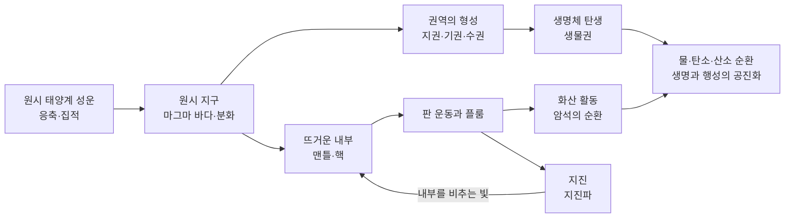

# 지구시스템과학 1. 지구 탄생과 생동하는 지구 — 46억 년 동안 한 번도 멈추지 않은 행성
<!-- prev: m2-02, 2-5, 3-1, 3-2, 4-1, earth-2 -->
<!-- next: astro-1, mech-3 -->

> [!NOTE]
> **성취기준**
> - **[12지시01-01]** 지구의 탄생 이후 지구 대기, 원시 바다, 생명체 탄생 등의 과정을 통한 지구시스템 각 권역의 형성 과정을 추론할 수 있다.
> - **[12지시01-02]** 지구시스템이 진화해온 역사에서 물, 탄소, 산소의 순환 과정을 통해 지권, 수권, 기권이 변화해 왔음을 추적할 수 있다.
> - **[12지시01-03]** 판구조론의 발달사와 관련지어 판을 움직이는 맨틀의 상부 운동과 플룸에 의한 구조 운동을 구분할 수 있다.
> - **[12지시01-04]** 암석의 순환 과정에서 화산 활동의 역할과 화산 활동으로 생성되는 암석의 특성을 추론할 수 있다.
> - **[12지시01-05]** 지진파의 종류와 특성을 이해하고, 지진파를 이용하여 지구 내부구조를 알아내는 과정을 탐구할 수 있다.

**학습 목표**

1. 원시 태양계 성운에서 응축·집적·분화를 거쳐 지구가 탄생하고, 원시 대기·원시 바다·생명체가 차례로 등장하며 각 권역이 형성된 과정을 추론할 수 있다.
2. 산소(남세균과 호상철광층), 탄소(얼음덩어리 지구와 석회암), 물(풍화·침식·퇴적과 지형)의 순환을 따라 생명과 행성이 함께 진화해 왔음을 추적할 수 있다.
3. 판구조론의 발달사를 관측 기기의 발달과 관련지어 설명하고, 판을 움직이는 능동적인 힘과 맨틀–핵 경계에서 올라오는 플룸 운동을 구분할 수 있다.
4. 마그마의 성질에 따라 화산체의 모양과 분출물이 달라지는 까닭을 설명하고, 화산암과 심성암의 조직 차이를 냉각 속도로 추론할 수 있다.
5. P파·S파·표면파의 특성을 비교하고, 지진파의 굴절·반사·그림자대와 지진파 단층 촬영으로 지구 내부구조를 알아내는 과정을 탐구할 수 있다.

**이 단원의 학습 사다리**

| 단계 | 무엇을 하나? |
|---|---|
| STEP 1. 이전 학습 다시 보기 | 지권의 층상 구조, Si–O 사면체, 판구조론, 지질시대, 화성암을 다시 꺼낸다 |
| STEP 2. 기초 다지기 | 밀도와 분화, 상태 변화와 응축, 파동의 굴절, 46억 년을 1년으로 줄인 달력 |
| STEP 3. 핵심 개념 | 지구의 탄생 → 권역의 형성 → 물·탄소·산소의 순환과 공진화 → 판구조론과 플룸 → 화산 활동과 화성암 → 지진파와 지구 내부 |
| STEP 4. 오개념 바로잡기 | "맨틀은 액체이다?", "판은 맨틀 대류에 실려 떠다닌다?" 같은 착각을 바로잡는다 |
| STEP 5. 대학 전공으로 | 방사성 연대로 잰 지구의 나이, 편광현미경의 광학, 지진파 역산, 초대륙 순환 |
| STEP 6. 생활·산업·진로 | 지진 조기경보, 자원 탐사, 화산 감시, 비교행성학 |

---

## 🗺️ 단원 들어가기

지구, 금성, 화성은 같은 원시 태양계 성운에서 같은 재료로 비슷한 시기에 태어났다. 그런데 46억 년이 지난 지금 금성은 두꺼운 이산화 탄소 대기 아래 납도 녹는 뜨거운 행성이 되었고, 화성은 얇은 대기 아래 얼어붙은 사막이 되었다. 오직 지구만 바다가 출렁이고, 판이 움직이고, 화산이 새 땅을 만들고, 생명이 대기의 성분까지 바꾸어 왔다. **무엇이 지구를 '생동하는' 행성으로 만들었을까?**

이 단원에서는 지구의 탄생부터 시작해 권역이 하나씩 만들어지는 과정을 따라가고, 물·탄소·산소가 권역 사이를 돌며 지구를 바꾸어 온 역사를 추적한다. 그리고 지금도 움직이는 지구의 속, 곧 판과 플룸, 화산, 지진파가 알려 주는 지구 내부의 모습을 살펴본다.

---

## STEP 1. 🔙 이전 학습 다시 보기

### 연계 개념표

| 이전 단원·성취기준 | 그때 배운 것 | 이 단원에서 확장되는 것 |
|---|---|---|
| 중2 「지권의 변화」 [9과09-01] | 지권의 층상 구조(지각·맨틀·외핵·내핵)의 이름과 상태 | 그 층상 구조를 **지진파로 어떻게 알아냈는지**, 층이 **어떻게 생겼는지(분화)** |
| 중2 「지권의 변화」 [9과09-03], [9과09-05] | 화성암·퇴적암·변성암과 암석의 순환, 대륙이동설과 판의 경계 | 암석의 순환에서 **화산 활동의 역할**, 판구조론의 **발달사** |
| 통합과학1 「별의 진화와 원소의 생성」 [10통과1-02-02] | 별 내부 핵융합과 초신성에서 태양계의 재료가 되는 원소가 만들어짐 | 그 재료가 **응축·집적**하여 행성이 되는 과정 |
| 통합과학1 「지각과 생명체 구성 물질의 규칙성」 [10통과1-02-05] | 규산염 광물은 Si–O 사면체가 연결되어 만들어진다 | 사면체 연결 방식에 따른 **규산염 광물의 성질**과 화성암 |
| 통합과학1 「지구시스템의 구성과 상호작용」 [10통과1-03-01] | 권역의 성층 구조, 물과 탄소의 순환 | 권역이 **처음 만들어진 과정**과 지질시대 동안의 **순환의 역사** |
| 통합과학1 「판구조론과 지권의 변화」 [10통과1-03-02] | 판의 경계, 맨틀 대류, 지진과 화산 | 판을 움직이는 **능동적인 힘**, **플룸**과 열점 |
| 통합과학2 「지질시대의 환경 변화와 생물다양성」 [10통과2-01-01] | 지질시대의 구분, 대멸종과 생물다양성 | 선캄브리아 시대의 **대산화 사건**, **얼음덩어리 지구** |
| 지구과학 「지구의 역사와 한반도의 암석」 [12지구02-03], [12지구02-04] | 변동대에서 마그마 생성, 화성암의 분류, 암석의 순환 | 마그마 성질에 따른 **화산체 모양**, 화산암·심성암의 **조직 관찰** |

### 준비 운동 (사전 진단)

**Q1.** 지구 내부의 층 중 액체 상태인 층은 어디인가?

**Q2.** 현무암과 반려암은 성분이 비슷한데 광물 알갱이 크기가 다르다. 그 까닭은?

**Q3.** 판의 경계 중 해령과 해구는 각각 어떤 경계인가?

**Q4.** 지구 대기에 산소가 많아진 것은 지구가 탄생할 때부터였다. (O / X)

정답 및 해설

**Q1. 외핵** — 지각·맨틀·내핵은 고체이고 외핵만 액체이다. 맨틀은 고체이지만 아주 오랜 시간 동안 천천히 흐를 수 있다.

**Q2.** 현무암은 지표 부근에서 **빨리 식어** 알갱이가 작고, 반려암은 땅속 깊은 곳에서 **천천히 식어** 알갱이가 크다.

**Q3.** 해령은 판이 서로 멀어지는 **발산형 경계**, 해구는 한 판이 다른 판 아래로 들어가는 **수렴형 경계(섭입대)** 이다.

**Q4. X** — 초기 대기에는 산소 기체가 거의 없었다. 광합성을 하는 생물(남세균)이 나타난 뒤 오랜 시간에 걸쳐 산소가 쌓였다.

---

## STEP 2. 🧱 기초 다지기

### ① 밀도 차이가 층을 만든다 — 분화의 원리

물과 기름, 모래를 병에 넣고 흔든 뒤 두면 **무거운(밀도가 큰) 것은 아래로, 가벼운 것은 위로** 가라앉고 뜬다. 이렇게 섞여 있던 물질이 밀도에 따라 층으로 나뉘는 것을 **분화(differentiation)** 라고 한다. 분화가 일어나려면 물질이 **움직일 수 있어야** 한다. 즉, 녹아 있거나 흐를 수 있어야 한다. 원시 지구가 마그마 바다로 덮였던 시기가 바로 분화가 활발했던 때이다.

| 물질 | 대략의 밀도($\mathrm{g/cm^3}$) | 지구에서의 위치 |
|---|---|---|
| 철·니켈 금속 | 약 8(지표 압력) ~ 13(내핵 압력) | 핵 |
| 감람석이 많은 암석(맨틀 암석) | 약 3.3 | 상부 맨틀 |
| 현무암(해양 지각) | 약 3.0 | 해양 지각 |
| 화강암(대륙 지각) | 약 2.7 | 대륙 지각 |

> [!TIP]
> 💡 **비유** — 분화는 '흔든 드레싱 병'이 가만히 놓였을 때 층이 나뉘는 것과 같다. 다만 지구에서는 무거운 철이 맨틀을 뚫고 가라앉으면서 엄청난 **중력 위치 에너지**를 열로 바꾸었다. 분화 자체가 지구를 더 뜨겁게 만든 셈이다.

### ② 온도와 상태 변화 — 응축 온도의 차이

수증기는 식으면 물방울로 **응축(condensation)** 한다. 원시 태양계 성운의 기체도 식으면서 고체 알갱이로 응축했다. 물질마다 응축하는 온도가 달라서, 태양에 가까운 뜨거운 곳에서는 **녹는점이 높은 금속과 규산염**만 고체가 되고, 먼 곳에서는 **물·메테인·암모니아 얼음**까지 고체가 되었다.

| 물질 | 고체로 응축하는 대략의 온도 |
|---|---|
| 철·니켈 금속, 규산염 광물 | 약 1,300 K 이상 |
| 물 얼음 | 약 150 K 이하 |
| 메테인·암모니아 얼음 | 그보다 더 낮은 온도 |

### ③ 에너지는 형태를 바꿀 뿐 사라지지 않는다

미행성이 지구에 충돌하면 **운동 에너지**가 열에너지로 바뀌고, 철이 핵으로 가라앉으면 **중력 위치 에너지**가 열로 바뀐다. 또 암석 속의 우라늄, 토륨, 칼륨 같은 **방사성 원소**는 붕괴하며 지금도 열을 낸다. 지구 내부가 지금도 뜨거운 이유는 이 세 가지 열이 아직 다 빠져나가지 못했기 때문이다.

### ④ 파동은 매질이 바뀌면 꺾이고 튄다

중학교에서 빛이 공기에서 물로 들어갈 때 꺾이는 **굴절**과 경계에서 되돌아오는 **반사**를 배웠다. 지진파도 파동이므로 **속력이 다른 층의 경계에서 굴절하고 반사한다.** 파동은 속력이 느린 쪽으로 꺾이며, 깊이에 따라 속력이 점점 빨라지는 곳에서는 경로가 아래로 볼록한 곡선(내려가다가 점점 휘어 다시 지표 쪽으로 올라오는 모양)이 된다.

$$
\frac{\sin i}{\sin r} = \frac{v_1}{v_2}
$$

($i$: 입사각, $r$: 굴절각, $v_1, v_2$: 두 매질에서의 속력) 이 관계는 STEP 3에서 지각의 두께를 구할 때 다시 쓴다.

### ⑤ 46억 년을 1년 달력으로

긴 시간을 실감하기 위해 지구의 역사 46억 년을 1년(365일)으로 줄여 보자. 하루는 약 1260만 년, 1시간은 약 52만 년에 해당한다.

| 사건 | 실제 시기(약) | 1년 달력에서 |
|---|---|---|
| 지구 탄생 | 46억 년 전 | 1월 1일 |
| 가장 오래된 광물(지르콘)에 물의 흔적 | 44억 년 전 | 1월 중순 |
| 생명체의 흔적(스트로마톨라이트) | 35억 년 전 | 3월 말 |
| 대기 중 산소 급증(대산화 사건) | 24억 년 전 | 6월 하순 |
| 얼음덩어리 지구 | 7억~6억 년 전 | 11월 초~중순 |
| 생물의 육상 진출 | 약 5억~4억 년 전 | 11월 하순 |
| 공룡 멸종 | 6600만 년 전 | 12월 26일 |
| 현생 인류 등장 | 약 30만 년 전 | 12월 31일 밤 11시 25분 무렵 |

---

## STEP 3. 📘 핵심 개념

### ① 원시 태양계 성운에서 지구로 — 응축, 집적, 분화 [12지시01-01]

약 46억 년 전, 우리 은하의 거대한 기체·먼지 구름 일부가 중력으로 수축하기 시작했다. 수축하면서 회전이 빨라지고 납작한 원반이 되었는데, 이것이 **원시 태양계 성운(solar nebula)** 이다. 중심부에는 원시 태양이 자리 잡고, 원반에서 행성들이 만들어졌다.

| 단계 | 일어난 일 | 결과 |
|---|---|---|
| **응축(condensation)** | 원반이 식으면서 기체가 고체 알갱이로 변함. 태양 가까이는 금속·규산염만, 멀리는 얼음까지 응축 | 안쪽: 암석질 재료, 바깥쪽: 얼음이 섞인 많은 재료 |
| **집적(accretion)** | 알갱이가 부딪쳐 달라붙어 수 km 크기의 **미행성(planetesimal)** 이 되고, 미행성끼리 충돌·병합 | 원시 행성으로 성장 |
| **분화(differentiation)** | 충돌열·방사성 열로 원시 지구가 녹아 무거운 철은 가라앉고 가벼운 규산염은 떠오름 | 핵–맨틀–지각의 층상 구조 |

물 얼음이 응축하기 시작하는 경계를 **설선(snow line)** 이라고 한다. 설선 안쪽의 지구형 행성은 재료가 적고 작은 암석 행성이 되었고, 설선 바깥의 목성형 행성은 얼음까지 재료로 써서 큰 핵을 만든 뒤 주변의 수소·헬륨 기체를 끌어모아 거대해졌다. 중학교 「태양계」에서 배운 **지구형 행성과 목성형 행성의 차이**가 여기서 시작된다.

#### 예제 1 — 충돌 한 번이 만드는 열

원시 지구에 미행성이 약 11 km/s(지구의 탈출 속도 정도)로 충돌했다. 충돌체 1 kg이 가진 운동 에너지를 구하고, 이 에너지가 모두 충돌체 자신을 데우는 데 쓰인다면 온도가 얼마나 오를지 어림하시오. (암석의 비열은 약 $1000\ \mathrm{J/(kg\cdot K)}$로 가정한다.)

**풀이**

$$
E_k = \frac{1}{2}mv^2 = \frac{1}{2}\times1\times(1.1\times10^4)^2 \approx 6.1\times10^7\ \mathrm{J}
$$

$$
\Delta T = \frac{E_k}{mc} = \frac{6.1\times10^7}{1\times1000} \approx 6\times10^4\ \mathrm{K}
$$

실제로는 에너지가 주변으로 퍼지고 일부는 우주로 빠져나가므로 이렇게까지 오르지는 않는다. 그러나 암석이 녹는 온도(약 1,500 K)보다 훨씬 큰 값이므로, 충돌이 잦았던 원시 지구 표면이 **녹아 마그마 바다**가 되었다는 추론이 자연스럽다.

> [!NOTE]
> 지구가 거의 다 자랐을 무렵(약 45억 년 전) 화성만 한 천체가 비스듬히 충돌하여 튀어나간 물질이 모여 **달**이 되었다는 **거대 충돌설**이 가장 널리 받아들여지는 가설이다. 이 충돌로 지구는 다시 한번 크게 녹았을 것으로 생각된다.

### ② 마그마 바다와 지권의 형성 [12지시01-01]

충돌열, 철이 가라앉으며 낸 열, 방사성 원소의 붕괴열로 원시 지구의 바깥 수백 km 이상이 녹은 상태를 **마그마 바다(magma ocean)** 라고 한다. 마그마 바다에서 일어난 일을 순서대로 보자.

1. **핵의 형성**: 무거운 철·니켈이 가라앉아 중심에 모여 핵이 되었다. 철과 잘 섞이는 원소(니켈, 금, 백금 등)도 함께 핵으로 끌려갔다.
2. **맨틀의 형성**: 남은 규산염 마그마가 맨틀이 되었다. 마그마가 식으면서 감람석처럼 녹는점이 높은 광물이 먼저 결정으로 굳었다.
3. **원시 지각의 형성**: 충돌이 줄어들고 표면이 식자 마그마 바다의 윗부분이 굳어 **최초의 화성암 지각**이 생겼다. 이 지각은 운석 충돌과 맨틀의 대류로 여러 번 깨지고 다시 만들어졌다.

| 증거 | 무엇을 알려 주나 |
|---|---|
| 지구의 평균 밀도(약 $5.5\ \mathrm{g/cm^3}$)가 지각 암석(약 $2.7\ \mathrm{g/cm^3}$)의 두 배 | 내부에 훨씬 무거운 물질(철)이 모여 있다 |
| 철질 운석과 석질 운석 | 분화된 소천체가 깨진 조각 → 지구 내부도 금속 핵과 규산염 맨틀로 나뉘었을 것 |
| 지구 자기장 | 액체 금속 외핵이 움직이며 자기장을 만든다 |
| 가장 오래된 광물(약 44억 년 된 지르콘) | 이미 그때 굳은 지각이 있었다 |

#### 예제 2 — 지구의 평균 밀도

지구의 질량은 $5.97\times10^{24}\ \mathrm{kg}$, 반지름은 $6.37\times10^{6}\ \mathrm{m}$이다. 지구의 평균 밀도를 구하고, 지표 암석의 밀도($2700\ \mathrm{kg/m^3}$)와 비교하여 무엇을 추론할 수 있는지 쓰시오.

**풀이**

$$
V = \frac{4}{3}\pi R^3 = \frac{4}{3}\pi(6.37\times10^6)^3 \approx 1.08\times10^{21}\ \mathrm{m^3}
$$

$$
\rho = \frac{M}{V} = \frac{5.97\times10^{24}}{1.08\times10^{21}} \approx 5.5\times10^3\ \mathrm{kg/m^3}
$$

평균 밀도가 지표 암석의 약 2배이므로 지구 내부, 특히 중심부에 밀도가 매우 큰 물질이 있다. 이는 분화로 철이 핵에 모였다는 추론과 맞는다.

### ③ 원시 대기, 원시 바다, 그리고 생명 — 권역이 차례로 생기다 [12지시01-01]

**(1) 원시 대기** 원시 태양계 성운에서 끌어온 수소·헬륨은 가벼워서 쉽게 빠져나갔다. 이후 마그마 바다와 화산에서 암석 속 기체가 빠져나오는 **탈기체(degassing)** 로 **수증기($\mathrm{H_2O}$), 이산화 탄소($\mathrm{CO_2}$), 질소($\mathrm{N_2}$)** 가 주성분인 원시 대기가 만들어졌다. 혜성과 얼음 미행성도 물을 일부 보탰다고 생각된다. 이때 대기에는 **산소 기체($\mathrm{O_2}$)가 거의 없었다.**

**(2) 원시 바다** 표면이 식어 대기 중 수증기가 응결하자 오랫동안 비가 내려 낮은 곳에 물이 고였다. 약 44억 년 된 지르콘 광물의 산소 동위 원소 조성은 이미 그 무렵 **액체 물**이 지각과 반응했음을 시사한다. 바다가 생기자 대기의 $\mathrm{CO_2}$가 바닷물에 녹고, 바닷물 속 칼슘 이온과 만나 **탄산염 광물**로 가라앉기 시작했다. 대기의 $\mathrm{CO_2}$가 줄면서 지구는 금성처럼 뜨거워지지 않을 수 있었다.

**(3) 생명체의 탄생** 바다는 강한 자외선을 막아 주고, 물질을 녹여 반응시키는 무대가 되었다. 적어도 약 35억 년 전에는 미생물이 층층이 쌓아 만든 **스트로마톨라이트(stromatolite)** 가 나타났다. 생명체가 나타나면서 **생물권**이 생기고, 이후 지구시스템은 생명과 함께 변해 가기 시작한다.

| 권역 | 형성 과정 | 핵심 재료와 에너지 |
|---|---|---|
| 지권 | 마그마 바다의 분화 → 핵·맨틀·원시 지각 | 충돌열, 중력 위치 에너지, 방사성 붕괴열 |
| 기권 | 수소·헬륨 손실 → 탈기체로 $\mathrm{H_2O}$, $\mathrm{CO_2}$, $\mathrm{N_2}$ 대기 | 화산 활동, 미행성·혜성 |
| 수권 | 수증기 응결 → 비 → 원시 바다, $\mathrm{CO_2}$ 용해 | 지표 냉각 |
| 생물권 | 바다에서 최초의 생명체 → 스트로마톨라이트 | 바다의 화학 에너지, 태양 에너지 |

<!-- fig:esys-1-earth-formation -->

#### 지구는 왜 역동적인 행성이 되었나 — 다른 고체 행성과 비교

| 비교 항목 | 수성·달 | 화성 | 금성 | 지구 |
|---|---|---|---|---|
| 크기와 내부 열 | 작아서 일찍 식음 | 지구의 약 절반 반지름, 내부가 상당히 식음 | 지구와 비슷 | 커서 내부 열을 오래 간직 |
| 판 운동 | 없음 | 과거 화산 활동은 있었으나 판 운동 증거 없음 | 판 운동 없음(덮개처럼 한 판) | 활발한 판 운동 |
| 액체 물 | 없음 | 과거에 흐른 흔적, 지금은 얼음 | 너무 뜨거워 없음 | 바다가 표면의 약 70 % |
| 대기 | 거의 없음 | 얇은 $\mathrm{CO_2}$ 대기 | 두꺼운 $\mathrm{CO_2}$ 대기(약 90기압) | $\mathrm{N_2}$·$\mathrm{O_2}$ 대기 |
| 자기장 | 수성은 약함, 달은 없음 | 지금은 전 지구 자기장 없음 | 거의 없음 | 강한 자기장 |

지구가 역동적인 이유는 **알맞은 크기(내부 열을 오래 간직) + 알맞은 거리(액체 물) + 물과 판 운동이 함께 작동하는 탄소 순환**이 겹쳤기 때문이다. 물은 암석의 녹는점을 낮추고 암석을 약하게 만들어 판 운동을 돕고, 판 운동은 탄소를 지구 내부와 대기 사이에서 순환시켜 기후를 안정하게 유지한다.

> [!TIP]
> 💡 **비유** — 금성은 '불이 꺼지지 않는 난로에 뚜껑을 덮은 방', 화성은 '불이 꺼져 버린 작은 난로', 지구는 '적당한 크기의 난로와 물이 순환하는 온수 장치를 함께 갖춘 집'에 비유할 수 있다.

### ④ 산소의 순환 — 남세균과 호상철광층 [12지시01-02]

약 30억~27억 년 전 무렵, 바다의 **남세균(cyanobacteria)** 이 물을 분해하여 산소를 내놓는 광합성을 시작했다(시작 시기는 연구에 따라 다르다). 그런데 산소는 곧바로 대기에 쌓이지 않았다. 당시 바닷물에는 화산 활동과 해저 열수에서 공급된 **철 이온($\mathrm{Fe^{2+}}$)** 이 많이 녹아 있었고, 산소는 먼저 이 철과 반응했다.

$$
\mathrm{4Fe^{2+} + O_2 + 4H_2O \rightarrow 2Fe_2O_3 + 8H^+}
$$

녹지 않는 산화 철($\mathrm{Fe_2O_3}$)은 바다 밑에 가라앉아 쌓였다. 산화 철이 많은 붉은 층과 규질(처트)이 많은 회색 층이 번갈아 쌓인 이 암석이 **호상철광층(banded iron formation, BIF)** 이다. 호상철광층은 주로 약 25억~18억 년 전에 많이 만들어졌으며, 오늘날 세계 철광석의 주요 공급원이다.

| 시기(약) | 산소에 일어난 일 | 권역의 변화 |
|---|---|---|
| 30억~24억 년 전 | 남세균이 만든 산소가 바닷물의 $\mathrm{Fe^{2+}}$와 반응 | 수권: 철 이온 감소 / 지권: 호상철광층 퇴적 |
| 약 24억 년 전 | 바다의 철이 줄고 산소가 대기로 빠져나와 쌓임(**대산화 사건**) | 기권: $\mathrm{O_2}$ 증가 / 지권: 육지에 붉은 산화 퇴적층 |
| 그 이후 | 성층권에 **오존층** 형성, 자외선 차단 | 생물권: 산소 호흡 생물, 다세포 생물 |
| 고생대(약 5억~4억 년 전) | 오존층이 충분해지고 대기 $\mathrm{O_2}$ 증가 | 생물권: 식물과 동물의 **육상 진출** |

> [!IMPORTANT]
> 생물이 대기 성분을 바꾸고(산소 증가), 바뀐 환경이 다시 생물의 진화 방향을 바꾸었다(산소 호흡, 육상 진출). 이렇게 **생명과 행성이 서로 영향을 주고받으며 함께 변해 온 것**을 **공진화(coevolution)** 라고 한다.

#### 예제 3 — 붉은 줄무늬 해석하기

어떤 호상철광층 단면에서 붉은 산화 철 층과 회색 처트 층이 수 mm~수 cm 두께로 반복된다. 이 줄무늬로 당시 바다 환경에 대해 추론할 수 있는 것을 두 가지 쓰시오.

**풀이**
① 바닷물에 녹아 있던 철 이온을 산화시킬 **산소가 공급되었다** — 광합성 생물이 존재했다.
② 산화 철이 쌓이는 시기와 적게 쌓이는 시기가 **번갈아 나타났다** — 산소 공급량이나 철 공급량이 계절·주기적으로 변했다고 추론할 수 있다(정확한 원인은 연구가 계속되고 있다).

### ⑤ 탄소의 순환 — 얼음덩어리 지구와 석회암 [12지시01-02]

탄소는 기권($\mathrm{CO_2}$), 수권(탄산 이온), 생물권(유기물), 지권(석회암·화석 연료) 사이를 순환한다. 지질학적 시간 규모에서 가장 중요한 흐름은 **규산염 암석의 풍화와 탄산염 퇴적**이다.

$$
\mathrm{CaSiO_3 + CO_2 \rightarrow CaCO_3 + SiO_2}
$$

빗물에 녹은 $\mathrm{CO_2}$가 규산염 암석을 풍화시키고, 녹아 나온 칼슘 이온은 바다로 흘러가 생물의 껍데기나 침전물인 탄산 칼슘(**석회암**)으로 쌓인다. 결과적으로 **대기의 $\mathrm{CO_2}$가 지권으로 옮겨 간다.** 반대로 섭입대와 화산 활동은 지권의 탄소를 다시 $\mathrm{CO_2}$로 대기에 돌려보낸다.

이 순환은 지구의 **온도 조절 장치** 역할을 한다.

#### 얼음덩어리 지구(눈덩이 지구)

원생누대 후기(약 7억~6억 년 전)에는 적도 부근에서 만들어진 빙하 퇴적물이 발견된다. 이를 바탕으로 지구 전체가 얼음으로 덮였다는 **얼음덩어리 지구(snowball Earth)** 가설이 제안되었다.

| 단계 | 일어난 일 | 탄소·권역과의 관계 |
|---|---|---|
| ① 냉각 시작 | 초대륙이 갈라지며 습한 저위도 육지가 늘어 풍화가 활발 | 대기 $\mathrm{CO_2}$ 감소 |
| ② 얼음 확장 | 얼음이 햇빛을 반사(반사율 증가) → 더 추워짐 → 얼음이 더 넓어짐 | 되먹임으로 전 지구 결빙 |
| ③ 결빙 상태 | 육지가 얼어 풍화가 거의 멈춤. 화산은 계속 $\mathrm{CO_2}$ 방출 | 대기 $\mathrm{CO_2}$가 수백만 년 동안 쌓임 |
| ④ 해빙 | 쌓인 $\mathrm{CO_2}$의 강한 온실효과로 얼음이 녹음 | 급격한 온난화 |
| ⑤ 덮개 탄산염암 | 고온에서 풍화가 폭발적으로 일어나 빙하 퇴적층 바로 위에 두꺼운 탄산염암이 쌓임 | 대기 $\mathrm{CO_2}$ → 석회암(지권) |

얼음덩어리 지구가 끝난 뒤 다세포 생물(에디아카라 생물군)이 번성하고, 이어서 고생대 캄브리아기에 생물이 폭발적으로 다양해졌다. 극단적인 기후 변화가 생물 진화의 계기가 되었다는 점에서 이것도 공진화의 한 장면이다.

#### 예제 4 — 얼음덩어리 지구는 왜 영원히 얼어 있지 않았나?

지구 전체가 얼음으로 덮이면 햇빛을 대부분 반사하므로 계속 추울 것 같다. 그런데도 얼음덩어리 지구가 끝날 수 있었던 까닭을 탄소 순환으로 설명하시오.

**풀이** 얼음이 육지를 덮으면 규산염 풍화(대기 $\mathrm{CO_2}$를 없애는 과정)가 거의 멈춘다. 그러나 판 운동에 따른 화산 활동은 얼음과 관계없이 계속 $\mathrm{CO_2}$를 내보낸다. **들어오는 $\mathrm{CO_2}$는 있고 나가는 $\mathrm{CO_2}$는 없으므로** 대기 $\mathrm{CO_2}$가 계속 쌓여 온실효과가 커지고, 마침내 얼음을 녹일 만큼 따뜻해진다. 즉, **판 운동(지권)이 기권의 온도를 되돌려 놓았다.**

### ⑥ 물의 순환 — 풍화, 침식, 퇴적과 지형 [12지시01-02]

물은 태양 에너지로 증발하고 중력으로 흘러내리며 지표를 깎고 나르고 쌓는다. 지구의 지형 대부분이 물이 만든 작품이다.

| 작용 | 물의 역할 | 대표 지형·암석 |
|---|---|---|
| **풍화(weathering)** | 물이 얼고 녹으며 암석을 쪼갬(기계적 풍화), $\mathrm{CO_2}$가 녹은 빗물이 장석·석회암을 녹임(화학적 풍화) | 토양, 석회 동굴, 카르스트 지형 |
| **침식(erosion)** | 흐르는 물·빙하·파도가 깎아 냄 | V자곡(하천), U자곡(빙하), 해식 절벽 |
| **운반·퇴적(deposition)** | 물의 속력이 줄면 큰 알갱이부터 쌓임 | 선상지, 삼각주, 사주·사빈, 퇴적암(역암·사암·이암) |

물은 판 운동과도 이어진다. 섭입하는 해양판에서 빠져나온 물은 맨틀 암석의 **녹는점을 낮추어** 마그마를 만들고, 그 마그마가 화산을 이루며 새 대륙 지각을 만든다. 물이 없었다면 지구의 대륙 지각은 지금처럼 넓지 않았을 것이다.

#### 생명과 행성의 공진화 한눈에 보기

| 순환 | 생명이 지구에 준 영향 | 지구가 생명에 준 영향 |
|---|---|---|
| 산소 | 광합성으로 대기 $\mathrm{O_2}$ 증가, 호상철광층·오존층 형성 | 산소 호흡 생물, 자외선 차단으로 육상 진출 |
| 탄소 | 생물이 껍데기(석회암)와 유기물로 탄소를 땅에 묻음 | 얼음덩어리 지구 같은 기후 변화가 진화를 재촉 |
| 물 | 식물 뿌리가 토양을 붙잡고 풍화를 빠르게 함 | 액체 물이 생명의 무대, 풍화가 바다에 영양염 공급 |

### ⑦ 판구조론의 발달사 — 관측 기기가 이론을 만들다 [12지시01-03]

판구조론은 한 사람의 생각이 아니라 **새로운 관측 기기가 새로운 증거를 내놓을 때마다** 한 걸음씩 다듬어진 이론이다.

| 시기 | 이론·발견 | 결정적 증거와 관측 기기 |
|---|---|---|
| 1910년대 | **대륙 이동설**(베게너): 대륙들이 한때 하나(판게아)였다 | 해안선 모양, 화석·지질 구조·빙하 흔적의 연속 — 원동력을 설명하지 못해 외면받음 |
| 1920~1930년대 | **맨틀 대류설**(홈스): 맨틀이 대류하며 대륙을 움직인다 | 방사성 원소의 열 — 당시에는 관측 증거가 부족 |
| 1950년대 | 해저 지형과 고지자기 연구 | **음향 측심기**로 해령·해구 지형 확인, **자력계**로 고지자기 측정 |
| 1960년대 초 | **해저 확장설**(헤스, 디츠): 해령에서 새 해양 지각이 생겨 양쪽으로 퍼진다 | 해령 축 대칭의 **고지자기 줄무늬**, 해령에서 멀어질수록 해양 지각의 나이 증가 |
| 1960년대 중후반 | **판구조론**: 지구 표면은 여러 개의 단단한 판으로 이루어지고 판끼리 상대 운동한다 | 전 세계 **표준 지진 관측망**으로 본 지진대 분포와 섭입대의 경사진 진원 분포, 변환 단층 |
| 1990년대 이후 | **플룸 구조론**: 맨틀 전체 규모의 상승류·하강류 | **지진파 단층 촬영**(컴퓨터와 대량의 지진 자료) |
| 오늘날 | 판의 움직임을 직접 측정 | **GPS** 위성으로 판의 속도를 연간 mm 단위로 측정 |

> [!TIP]
> 💡 **판구조론을 이끈 질문의 변화** — "대륙이 움직이나?"(대륙 이동설) → "바다 밑은 어떻게 생겼나?"(해저 확장설) → "지구 표면 전체가 어떻게 움직이나?"(판구조론) → "맨틀 전체는 어떻게 움직이나?"(플룸 구조론). 관측 범위가 대륙 → 해저 → 지구 표면 → 지구 내부로 넓어졌다.

### ⑧ 판을 움직이는 힘과 플룸 [12지시01-03]

#### (1) 판을 움직이는 능동적인 힘

예전에는 "맨틀 대류가 컨베이어 벨트처럼 판을 싣고 다닌다"라고 설명했다. 그러나 오늘날에는 **판 자신의 무게(중력)가 만드는 힘**이 판을 움직이는 주된 힘으로 본다. 판은 수동적인 짐이 아니라 맨틀 대류의 **윗부분 그 자체**이며, 판이 가라앉고 미끄러지는 운동이 상부 맨틀의 흐름을 이끈다.

| 힘 | 작용 장소 | 원리 | 크기 |
|---|---|---|---|
| **섭입하는 판이 당기는 힘**(slab pull) | 해구(섭입대) | 해령에서 멀어지며 식어 무거워진 해양판이 맨틀 속으로 가라앉으며 판 전체를 끌어당김 | 가장 큰 것으로 평가 |
| **해령에서 미는 힘**(ridge push) | 해령 | 뜨거워 높이 솟은 해령의 판이 중력에 의해 양옆의 낮은 쪽으로 미끄러짐 | 섭입 판 당기는 힘보다 작음 |
| 판 아래 맨틀의 끌림·저항 | 판의 밑면 | 판과 맨틀 사이의 상대 운동에 따른 마찰 | 판의 운동을 돕거나 방해 |
| 섭입대 저항, 변환 단층 마찰 | 판의 경계 | 판끼리의 마찰 | 운동을 방해 |

**증거** 섭입대를 길게 가진 판(태평양판, 나스카판 등)은 연간 수 cm~10 cm 정도로 빠르게 움직이고, 섭입대가 거의 없는 판(유라시아판, 아프리카판)은 느리게 움직인다. 판의 속도가 섭입대의 길이와 관련된다는 것은 **섭입하는 판이 당기는 힘**이 중요하다는 강력한 증거이다.

<!-- fig:esys-1-plate-map -->

#### (2) 플룸 — 맨틀 깊은 곳의 기둥 모양 흐름

**플룸(plume)** 은 맨틀 속에서 기둥 모양으로 상승하거나 하강하는 큰 물질 흐름이다.

| 구분 | 판 운동에 따른 상부 맨틀 운동 | 플룸 운동 |
|---|---|---|
| 깊이 | 주로 상부 맨틀(약 660 km보다 얕은 곳) | **맨틀–핵 경계(약 2900 km)** 부근에서 지표 가까이까지 |
| 모양 | 판의 생성(해령)과 소멸(섭입대)에 맞춘 넓은 판 모양의 흐름 | 좁은 기둥(머리가 버섯처럼 넓어짐) |
| 위치 | 판의 경계와 일치 | 판의 경계와 **관계없이** 나타날 수 있음 |
| 대표 현상 | 해령의 화산 활동, 섭입대의 지진·화산 | **열점(hot spot)** 화산(하와이), 대규모 현무암 분출 |
| 하강류 | 섭입하는 판 | 섭입한 판이 상부·하부 맨틀 경계에 쌓였다가 무거워져 맨틀–핵 경계로 떨어지는 **차가운 플룸** |

**뜨거운 플룸(hot plume)** 은 맨틀–핵 경계에서 데워진 물질이 상승하는 흐름이다. 지표에 닿아 압력이 낮아지면 맨틀 물질이 부분적으로 녹아 마그마가 생기고, 판 한가운데에도 화산이 생긴다. 이렇게 판 아래에 고정된 채 마그마를 공급하는 곳이 **열점**이다.

<!-- fig:esys-1-plate-forces-plume -->

#### 예제 5 — 열점으로 판의 속도 구하기

판 위의 화산섬은 열점 위에서 생긴 뒤 판을 따라 열점에서 멀어진다. 어느 열점 화산섬 줄에서 지금 분화하는 섬(나이 0)으로부터 북서쪽으로 480 km 떨어진 섬의 나이가 500만 년이었다. (자료는 계산을 위해 단순화한 값이다.)
(1) 판의 평균 이동 속도를 cm/년으로 구하시오. (2) 판은 어느 방향으로 움직이는가?

**풀이**
(1) $v = \dfrac{480\ \mathrm{km}}{5.0\times10^6\ \text{년}} = \dfrac{4.8\times10^7\ \mathrm{cm}}{5.0\times10^6\ \text{년}} = 9.6\ \mathrm{cm/년}$
(2) 오래된 섬일수록 북서쪽에 있으므로 판은 열점에 대해 **북서쪽**으로 움직인다.

> [!NOTE]
> 실제 하와이–엠퍼러 해산열은 약 4700만 년 전 무렵에 꺾여 있다. 이 꺾임은 태평양판의 이동 방향이 바뀌었기 때문으로 오랫동안 해석되었지만, 최근에는 열점 자체도 조금 움직였을 가능성이 함께 논의되고 있다. 과학 이론이 새로운 자료로 계속 다듬어지는 좋은 예이다.

### ⑨ 화산 활동과 암석의 순환 [12지시01-04]

#### (1) 마그마의 성질이 화산의 모양을 정한다

마그마는 이산화 규소($\mathrm{SiO_2}$) 함량에 따라 성질이 크게 달라진다. $\mathrm{SiO_2}$가 많을수록 Si–O 사면체들이 서로 연결되어 **점성(끈끈함)** 이 커지고, 기체가 빠져나가기 어려워진다.

| 구분 | 현무암질 마그마 | 안산암질 마그마 | 유문암질 마그마 |
|---|---|---|---|
| $\mathrm{SiO_2}$ 함량 | 약 52 % 이하 | 약 52~63 % | 약 63 % 이상 |
| 온도 | 높음(약 1,000~1,200 °C) | 중간 | 낮음(약 800 °C 안팎) |
| 점성 | 작음(잘 흐름) | 중간 | 큼(잘 흐르지 않음) |
| 휘발성 기체 | 쉽게 빠져나감 | 중간 | 갇혀 있다가 한꺼번에 터짐 |
| 분출 양상 | 조용한 용암 분출 | 폭발과 용암 분출이 번갈아 | 격렬한 폭발 |
| 화산체 모양 | **순상 화산**(방패 모양, 경사 완만), 용암 대지 | **성층 화산**(용암과 화산 쇄설물이 번갈아 쌓인 원뿔) | 종상 화산(용암 돔), 폭발 후 칼데라 |
| 주로 생기는 곳 | 해령, 열점 | 섭입대 | 섭입대, 대륙 지각 |
| 예 | 하와이 마우나로아, 제주도의 넓은 용암 대지 | 일본 후지산, 백두산의 원뿔 부분 | 경사가 급한 용암 돔 |

> [!NOTE]
> 한라산은 완만한 순상 화산체 위에 점성이 큰 용암이 만든 가파른 정상부가 얹힌 모양이고, 제주도 곳곳에는 작은 **오름(기생 화산)** 이 흩어져 있다. 백두산은 성층 화산이며, 큰 분화 뒤 꼭대기가 무너져 생긴 칼데라에 물이 고여 천지가 되었다. 하나의 화산에서도 시기에 따라 마그마의 성질이 달라질 수 있다.

<!-- fig:esys-1-volcano-types -->

#### (2) 화산 분출물

| 분출물 | 종류 | 지구시스템에 미치는 영향 |
|---|---|---|
| 용암(lava) | 현무암질 용암은 얇게 멀리, 유문암질 용암은 두껍게 짧게 흐름 | 새로운 지각과 지형(용암 대지, 주상 절리) 생성 |
| 화산 쇄설물 | 화산재, 화산력, 화산탄, 부석 | 쌓여 응회암이 됨, 항공 운항 방해, 토양을 비옥하게 함 |
| 화산 가스 | 수증기, $\mathrm{CO_2}$, $\mathrm{SO_2}$ 등 | $\mathrm{CO_2}$는 장기적 온실효과, $\mathrm{SO_2}$는 성층권 에어로졸로 단기적 냉각 |

#### (3) 암석의 순환에서 화산 활동의 역할

중학교에서 배운 암석의 순환(화성암 → 퇴적암 → 변성암 → 마그마 → 화성암)에서 화산 활동은 다음 세 가지 역할을 한다.

1. **새 암석의 공급**: 맨틀에서 올라온 마그마가 굳어 새로운 지각(특히 해양 지각 전체)을 만든다. 순환의 '출발점'이다.
2. **물질의 재순환**: 섭입대에서 가라앉은 해양 지각과 퇴적물의 일부가 다시 녹아 화산으로 나온다. 순환의 '연결 고리'이다.
3. **권역 사이의 물질 이동**: 지권 속의 물과 탄소를 기체로 대기에 돌려보낸다(⑤의 탄소 순환과 연결). 지권과 기권을 잇는 '통로'이다.

#### 예제 6 — 마그마 자료로 화산 예측하기

세 화산 A, B, C에서 채취한 화산암의 $\mathrm{SiO_2}$ 함량이 각각 48 %, 58 %, 72 %였다.
(1) 점성이 가장 큰 마그마에서 생긴 것은? (2) 경사가 가장 완만한 화산체를 이룰 가능성이 큰 것은? (3) 화산재를 동반한 폭발적 분출의 위험이 가장 큰 것은?

**풀이** (1) C — $\mathrm{SiO_2}$가 많을수록 점성이 크다. (2) A — 현무암질 마그마는 잘 흘러 넓게 퍼지므로 순상 화산을 이룬다. (3) C — 점성이 커서 기체가 갇혀 있다가 한꺼번에 터진다.

### ⑩ 화산암과 심성암, 그리고 규산염 광물 [12지시01-04]

#### (1) 냉각 속도가 조직을 결정한다

마그마가 천천히 식으면 원자들이 결정 자리를 찾아 들어갈 시간이 충분하여 **큰 결정**이 자란다. 빨리 식으면 작은 결정이 많이 생기거나, 결정이 될 틈도 없이 굳어 **유리질**이 된다.

| 조직 | 생기는 환경 | 특징 | 예 |
|---|---|---|---|
| **유리질 조직** | 용암이 물이나 공기에 닿아 매우 급히 식음 | 결정이 거의 없음, 깨진 면이 매끈함 | 흑요석 |
| **세립질 조직** | 지표 부근에서 빨리 식음 | 결정이 작아 맨눈으로 구별하기 어려움 | 현무암, 유문암 |
| **반상 조직** | 땅속에서 천천히 식다가(큰 결정 = **반정**) 지표로 올라와 빨리 식음(작은 결정·유리 = **석기**) | 큰 결정이 작은 알갱이 바탕에 박혀 있음 | 반상 안산암, 일부 현무암 |
| **조립질(등립질) 조직** | 땅속 깊은 곳에서 매우 천천히 식음 | 비슷한 크기의 큰 결정들이 맞물림 | 화강암, 반려암 |

화산암(분출암)은 유리질·세립질·반상 조직을, 심성암(관입암)은 조립질 조직을 주로 보인다. **편광현미경**으로 얇게 간 암석 박편을 보면, 화산암에서는 반정과 미세한 석기(또는 유리)가, 심성암에서는 서로 맞물린 큰 광물 알갱이들이 뚜렷이 구별된다.

#### (2) 규산염 광물의 성질 — 사면체 연결 방식의 차이

통합과학에서 배운 **Si–O 사면체**(규소 1개를 산소 4개가 둘러싼 구조)가 어떻게 연결되느냐에 따라 화성암을 이루는 규산염 광물의 성질이 달라진다.

| 연결 구조 | 대표 광물 | 쪼개짐 | 결정이 생기는 온도 | 색·밀도 |
|---|---|---|---|---|
| 독립형(사면체가 따로 떨어짐) | 감람석 | 없음 | 가장 높음 | 유색, 밀도 큼 |
| 단사슬 구조 | 휘석 | 2방향(거의 직각) | 높음 | 유색 |
| 복사슬 구조 | 각섬석 | 2방향(약 60°와 120°) | 중간 | 유색 |
| 판상 구조 | 흑운모, 백운모 | 1방향(얇은 판으로 벗겨짐) | 낮음 | 흑운모 유색, 백운모 무색 |
| 망상 구조(3차원 그물) | 장석, 석영 | 장석 2방향, 석영 없음 | 가장 낮음(석영) | 무색, 밀도 작음 |

- 사면체가 **더 많이 연결될수록** 대체로 결정이 생기는 온도가 낮아지고, 철·마그네슘이 적어 색이 밝고 밀도가 작아진다.
- 그래서 현무암·반려암(감람석·휘석·Ca가 많은 사장석)은 어둡고 무거우며, 유문암·화강암(석영·정장석·Na가 많은 사장석·흑운모)은 밝고 가볍다.
- 쪼개짐은 결합이 약한 방향을 따라 생긴다. 판상 구조인 운모가 한 방향으로 얇게 벗겨지는 까닭은 판과 판 사이의 결합이 약하기 때문이다.

> [!TIP]
> 💡 **비유** — Si–O 사면체를 레고 블록이라 하면, 감람석은 블록을 하나씩 흩어 놓고 철·마그네슘이라는 접착제로 붙인 것, 석영은 모든 블록을 사방으로 끼워 맞춘 단단한 3차원 구조물이다. 연결 방식이 달라지면 같은 블록으로도 전혀 다른 성질의 구조물이 된다.

#### 예제 7 — 반상 조직이 들려주는 이야기

어떤 안산암에서 길이 5 mm 정도의 사장석 결정이 아주 작은 알갱이 바탕에 박혀 있었다. 이 암석이 겪은 냉각 과정을 두 단계로 설명하시오.

**풀이** ① 마그마가 땅속 마그마 방에 머무는 동안 **천천히 식어** 사장석이 크게 자랐다(반정). ② 그 뒤 분화로 지표에 나와 **빨리 식으면서** 남은 마그마가 작은 결정과 유리로 굳었다(석기). 반상 조직은 냉각 속도가 **두 번** 달랐다는 기록이다.

### ⑪ 지진파의 종류와 특성 [12지시01-05]

지진이 일어나면 진원에서 에너지가 파동으로 퍼져 나가는데, 이것이 **지진파(seismic wave)** 이다. 지진파는 지구 내부를 통과하는 **실체파**와 지표를 따라 전파되는 **표면파**로 나뉜다.

| 구분 | P파(Primary) | S파(Secondary) | 표면파(러브파·레일리파) |
|---|---|---|---|
| 전파 경로 | 지구 내부 | 지구 내부 | 지표 부근 |
| 진동 방향 | 진행 방향과 **나란함**(종파, 밀고 당김) | 진행 방향과 **수직**(횡파, 흔들림) | 수평으로 좌우 흔들림(러브파), 땅이 굴러가듯 타원 운동(레일리파) |
| 속력(지각 기준, 약) | 6 km/s(가장 빠름) | 3.5 km/s | S파보다 조금 느림 |
| 통과 매질 | 고체·액체·기체 | **고체만** | 지표 부근 |
| 진폭과 피해 | 작음 | P파보다 큼 | **가장 큼**(피해가 가장 큼) |

S파가 액체를 통과하지 못하는 이유는 액체가 **모양 변화(전단)에 저항하지 못하기** 때문이다. 횡파는 매질의 한 부분이 옆으로 밀릴 때 원래대로 되돌아가려는 힘이 있어야 전달되는데, 액체에는 그 힘이 없다. 지진파의 속력은 매질의 단단한 정도가 클수록, 밀도가 작을수록 빠르다. 그래서 같은 깊이라도 **차갑고 단단한 곳에서는 빠르고, 뜨겁고 무른 곳에서는 느리다.**

#### PS시로 진원 거리 구하기

P파와 S파는 진원에서 동시에 출발하지만 속력이 달라 관측소에 도착하는 시간 차이(**PS시**)가 생긴다. 진원 거리를 $d$라 하면

$$
\Delta t = \frac{d}{v_S} - \frac{d}{v_P} \quad\Rightarrow\quad d = \frac{v_P\,v_S}{v_P - v_S}\,\Delta t
$$

PS시가 길수록 진원이 멀다. 관측소 세 곳 이상에서 각각 진원 거리를 구해 원을 그리면, 세 원이 겹치는 곳이 진앙이다.

<!-- fig:esys-1-epicenter-map -->

#### 예제 8

$v_P = 6.0\ \mathrm{km/s}$, $v_S = 3.5\ \mathrm{km/s}$인 지역에서 어느 관측소의 PS시가 10초였다. 진원 거리를 구하시오.

**풀이**

$$
d = \frac{6.0\times3.5}{6.0-3.5}\times10 = 8.4\times10 = 84\ \mathrm{km}
$$

> [!TIP]
> 💡 **비유** — 번개가 번쩍인 뒤 천둥이 들릴 때까지의 시간으로 번개까지 거리를 어림하는 것과 같은 원리이다. 빠른 신호(빛, P파)와 느린 신호(소리, S파)의 도착 시간 차이가 거리를 알려 준다.

### ⑫ 지진파로 지구 내부를 보다 [12지시01-05]

#### (1) 불연속면과 그림자대

지진파의 속력이 갑자기 바뀌는 경계를 **불연속면**이라 한다. 전 세계 관측소의 지진파 도착 시간을 모아 분석하면 지구 내부의 층 구조를 알 수 있다.

| 불연속면 | 깊이(약) | 발견 | 근거 | 의미 |
|---|---|---|---|---|
| **모호로비치치 불연속면(모호면)** | 대륙 30~70 km, 해양 5~10 km | 1909년 모호로비치치 | 진앙 거리가 일정 거리 이상이면 더 깊은 곳을 돌아온 파가 직접 온 파보다 먼저 도착 | 지각과 맨틀의 경계 |
| **구텐베르크 불연속면** | 약 2900 km | 1914년 구텐베르크 | P파 속도 급감, S파 사라짐, 그림자대 | 맨틀과 외핵의 경계(고체 → 액체) |
| **레만 불연속면** | 약 5100 km | 1936년 레만 | P파 그림자대 안쪽에서 약한 P파가 관측됨 | 외핵과 내핵의 경계(액체 → 고체) |

**그림자대(shadow zone)** 는 지진파가 도달하지 않는 지역이다.
- **P파 그림자대**: 진앙에서 각거리 약 103°~142° 사이. P파가 외핵에 들어갈 때 속도가 크게 줄어 안쪽으로 크게 굴절하기 때문이다.
- **S파 그림자대**: 각거리 약 103° 이상 전체. S파가 액체인 외핵을 통과하지 못하기 때문이다. → **외핵이 액체**라는 결정적 증거
- 내핵이 고체라는 것은 P파 그림자대 안에 약하게 도착하는 P파(내핵에서 굴절·반사된 파)와 그 속도 분석으로 알아냈다.

| 층 | 깊이(약, km) | 상태 | 주요 물질 |
|---|---|---|---|
| 지각 | 0 ~ 5~70 | 고체 | 규산염 암석(화강암질·현무암질) |
| 맨틀 | ~ 2900 | 고체(오랜 시간에는 천천히 흐름) | 감람석 등 철·마그네슘 규산염 |
| 외핵 | 2900 ~ 5100 | **액체** | 철·니켈 + 가벼운 원소 |
| 내핵 | 5100 ~ 6371 | **고체** | 철·니켈 |

<!-- sim:seismic-waves -->

#### (2) 지진파 자료로 지각의 두께 구하기

진원 가까이에서는 지각만 통과한 **직접파**가 먼저 도착하지만, 어느 거리를 넘으면 모호면까지 내려가 맨틀 꼭대기를 따라 빠르게 달린 뒤 다시 올라온 **굴절파**가 먼저 도착한다. 맨틀에서 더 빠르게 달리는 이득이 내려갔다 올라오는 손해보다 커지기 때문이다. 두 파가 동시에 도착하는 거리를 **교차 거리** $x_c$라 하면, 지각의 P파 속도 $v_1$, 맨틀 최상부의 P파 속도 $v_2$로 지각 두께 $h$를 다음과 같이 구할 수 있다.

$$
h = \frac{x_c}{2}\sqrt{\frac{v_2 - v_1}{v_2 + v_1}}
$$

이 식은 굴절파가 모호면에 **임계각**($\sin\theta_c = v_1/v_2$)으로 입사하여 모호면을 따라 진행한다는 것과, 교차 거리에서 두 파의 도착 시간이 같다는 조건에서 유도된다.

<!-- fig:esys-1-travel-time -->

#### 예제 9 — 지각의 두께

어느 지역에서 지각의 P파 속도가 6.0 km/s, 맨틀 최상부의 P파 속도가 8.0 km/s이고, 주시 곡선(거리–도착 시간 그래프)에서 읽은 교차 거리가 150 km였다. 지각의 두께를 구하시오.

**풀이**

$$
h = \frac{150}{2}\sqrt{\frac{8.0-6.0}{8.0+6.0}} = 75\times\sqrt{\frac{1}{7}} \approx 75\times0.378 \approx 28\ \mathrm{km}
$$

우리나라 지각의 두께는 대체로 약 30~35 km로 알려져 있어 이와 비슷한 크기이다.

#### (3) 지진파 단층 촬영 — 맨틀을 3차원으로 보다

병원의 CT가 여러 방향에서 X선을 쏘아 몸속 단면을 재구성하듯, **지진파 단층 촬영(seismic tomography)** 은 수많은 지진과 관측소 사이를 지나는 지진파의 도착 시간을 모아 지구 내부의 **속도 분포를 3차원으로** 재구성한다.

| 지진파 속도 | 해석 | 대표 위치 |
|---|---|---|
| 평균보다 **빠름** | 주변보다 **차갑고 단단함** | 섭입하는 판, 아시아 아래 맨틀에 쌓인 차가운 물질(차가운 플룸) |
| 평균보다 **느림** | 주변보다 **뜨겁고 무름** | 해령 아래, 남태평양과 아프리카 아래 맨틀 깊은 곳의 거대한 저속도 영역(뜨거운 플룸) |

지진파 단층 촬영은 ⑧에서 배운 **차가운 플룸과 뜨거운 플룸을 실제로 보여 준 증거**이다. 섭입한 판이 상부·하부 맨틀 경계 부근에 수평으로 쌓여 있는 모습, 하와이 아래로 이어지는 느린 영역 등이 확인되었다.

#### (4) 한반도의 지진

우리나라는 유라시아판 **내부**에 있어 판의 경계에 있는 일본보다 지진이 적지만, 지진이 없는 곳은 아니다. 판의 경계에서 전달된 힘이 판 내부의 오래된 단층에 쌓였다가 풀리며 지진이 일어난다. 계기 관측 이후 가장 큰 지진은 2016년 경주 지진(규모 5.8)이며, 2017년 포항 지진(규모 5.4)도 큰 피해를 냈다. 기상청 지진 목록을 보면 지진은 경상도 남동부의 단층대 주변, 서해와 동해의 일부 해역 등에 상대적으로 많이 분포한다. 판 내부 지진은 발생 간격이 길어 짧은 관측 기록만으로 위험을 판단하기 어려우므로, 역사 기록(조선왕조실록 등의 지진 기록)과 단층 조사 자료를 함께 쓴다.

---

## STEP 4. ⚠️ 오개념 바로잡기

| 흔한 오개념 | 올바른 개념 | 왜 그럴까? |
|---|---|---|
| 맨틀은 녹은 마그마로 되어 있다 | 맨틀은 **고체**이다. 다만 아주 긴 시간 동안 천천히 흐를 수 있다 | S파가 맨틀을 통과한다. 마그마는 일부 지역에서 부분 용융으로 소량 생길 뿐이다 |
| 판은 맨틀 대류라는 컨베이어 벨트에 실려 수동적으로 움직인다 | 판의 운동은 주로 **섭입하는 판이 당기는 힘, 해령에서 미는 힘** 같은 판 자체의 무게가 만드는 힘으로 일어난다 | 섭입대가 긴 판일수록 빠르다는 관측. 판은 대류의 윗부분 그 자체이다 |
| 열점 화산은 판의 경계에서만 생긴다 | 열점은 맨틀 깊은 곳에서 올라오는 **플룸**이 만들며 판 한가운데에도 생긴다 | 하와이는 태평양판 한가운데에 있다 |
| 지구가 처음부터 지금과 같은 대기를 가졌다 | 원시 대기는 $\mathrm{H_2O}$, $\mathrm{CO_2}$, $\mathrm{N_2}$가 주성분이고 **산소가 거의 없었다** | 산소는 남세균의 광합성 이후 호상철광층 시기를 거쳐 쌓였다 |
| 지구 내부 구조는 땅을 깊이 파서 직접 확인했다 | 가장 깊은 시추공도 약 12 km에 불과하다. 내부 구조는 **지진파**로 알아냈다 | 지구 반지름(약 6371 km)의 0.2 %도 못 판 셈이다 |
| 내핵은 외핵보다 뜨거우니 액체여야 한다 | 내핵은 더 뜨겁지만 **압력이 훨씬 커서** 고체이다 | 압력이 크면 녹는점이 높아진다 |
| 화산암은 결정이 없다 | 화산암은 대부분 **작은 결정**으로 되어 있으며, 유리질은 특히 빨리 식은 경우이다 | 반상 조직처럼 큰 결정(반정)을 가진 화산암도 흔하다 |

---

## STEP 5. 🎓 다음 단계로 한 걸음 더

> [!CAUTION]
> 이 절은 **지구시스템과학 교육과정 범위 밖의 심화 내용**으로 평가 대상이 아니다. 대학의 지질학·지구물리학·지구화학으로 이 단원의 개념이 어떻게 이어지는지 맛보기로 보여 준다.

### 대학 전공 과목과의 연결

| 대학 과목 | 이어지는 내용 |
|---|---|
| 지구화학, 동위원소지질학 | 운석과 지구 암석의 방사성 동위 원소로 지구의 나이 결정, 대기·바다의 기원 추적 |
| 광물학, 광학광물학, 암석학 | 편광현미경으로 광물의 광학적 성질 판별, 마그마의 결정 분화, 상평형도 |
| 지구물리학, 지진학 | 지진파 방정식, 주시 곡선 역산, 지진파 단층 촬영, 지구 자기장(다이나모) |
| 지구조학, 지구역학 | 판에 작용하는 힘의 정량 분석, 맨틀 대류의 수치 모델, 초대륙 순환 |
| 지구시스템과학, 생지화학 | 장기 탄소 순환 모델, 산소 증가의 역사, 생명과 행성의 공진화 |

### ① 지구의 나이는 어떻게 쟀을까 — 방사성 동위 원소

지구 초기의 암석은 판 운동과 풍화로 대부분 사라져서, 지구의 나이는 같은 때 만들어진 **운석**으로 잰다. 우라늄이 납으로 붕괴하는 두 계열($^{238}\mathrm{U}\rightarrow{}^{206}\mathrm{Pb}$, $^{235}\mathrm{U}\rightarrow{}^{207}\mathrm{Pb}$)을 함께 쓰면 반감기가 다른 두 시계를 맞대어 나이를 정밀하게 구할 수 있다. 이 방법으로 태양계 최초의 고체 물질은 약 45억 6천만~45억 7천만 년 전에 만들어졌다고 계산된다. 방사성 붕괴의 기본식은 다음과 같다.

$$
N = N_0 e^{-\lambda t}, \qquad t = \frac{1}{\lambda}\ln\left(1 + \frac{D}{N}\right)
$$

($N$: 남은 모원소, $D$: 생긴 자원소, $\lambda$: 붕괴 상수)

### ② 편광현미경의 광학 — 왜 광물마다 다른 색으로 보일까

고등학교에서는 편광현미경으로 조직만 비교했다. 대학 **광학광물학**에서는 광물 결정 속에서 빛의 속도가 방향에 따라 달라지는 **복굴절**을 배운다. 직교 니콜에서 나타나는 간섭색, 재물대를 돌릴 때 어두워지는 소광 위치, 개방 니콜에서 색이 바뀌는 다색성 등을 측정해 광물을 감정한다. 이 기술은 암석의 생성 조건을 밝히고, 콘크리트 골재나 문화재 석재를 진단하는 데에도 쓰인다.

### ③ 지진파 역산과 지구 모형

지진학자는 수십만 개의 지진파 도착 시간 자료에서 "어떤 내부 구조였다면 이런 자료가 나올까?"를 거꾸로 계산한다. 이를 **역산(inversion)** 이라 한다. 결과로 얻은 대표적인 1차원 지구 모형(PREM 등)은 깊이별 밀도, P파·S파 속도를 표로 제시한다. 대학에서는 P파와 S파 속도를 매질의 탄성 상수로 나타내는 식을 배운다.

$$
v_P = \sqrt{\frac{K + \tfrac{4}{3}\mu}{\rho}}, \qquad v_S = \sqrt{\frac{\mu}{\rho}}
$$

($K$: 부피 탄성률, $\mu$: 전단 탄성률, $\rho$: 밀도) 액체는 $\mu = 0$이므로 $v_S = 0$, 즉 S파가 전달되지 않는다. STEP 3에서 말로 설명한 내용이 식 하나로 정리된다. 이 내용은 진로 선택 「역학과 에너지」의 탄성파 단원과도 이어진다.

### ④ 초대륙 순환(윌슨 주기)

대륙은 모였다 흩어지기를 되풀이해 왔다. 판게아 이전에도 로디니아(약 10억~7억 년 전) 같은 초대륙이 있었다고 추정된다. 초대륙 아래에는 열이 갇혀 뜨거운 플룸이 생기고, 그 플룸이 초대륙을 갈라놓는다는 가설이 연구되고 있다. 대륙의 분포는 해류·기후·생물 진화에 큰 영향을 주므로, 초대륙 순환은 지구시스템 전체의 리듬으로 연구된다.

### 지금 vs 다음 단계

| 구분 | 고등학교 지구시스템과학 | 대학 지질학·지구물리학·지구화학 |
|---|---|---|
| 지구의 탄생 | 응축·집적·분화를 단계로 설명 | 원시 행성 원반의 수치 모의실험, 동위 원소로 시간표 결정 |
| 권역의 진화 | 산소·탄소·물 순환의 사건 중심 | 상자 모형과 미분 방정식으로 순환량 계산 |
| 판과 플룸 | 힘의 종류와 운동의 구분 | 힘의 정량 분석, 맨틀 대류 수치 모델 |
| 화성암 | 조직 관찰과 마그마 성질 | 광학 감정, 상평형도, 미량 원소로 마그마 기원 추적 |
| 지진파 | 종류·특성, 교차 거리로 지각 두께 | 파동 방정식, 역산, 3차원 단층 촬영 |
| 관련 전공 | — | 지질학, 지구환경과학, 지구물리학, 해양지질학, 자원공학 |

---

## STEP 6. 🏭 생활·산업·진로 연결

### 사례 1. 지진 조기경보 — PS시를 실시간으로

- **원리** 진원 가까운 관측소가 먼저 도착한 **P파**를 감지하면, 컴퓨터가 몇 초 안에 진앙과 규모를 계산하여 피해를 주는 **S파와 표면파가 오기 전에** 경보를 보낸다. ⑪의 PS시 원리를 거꾸로 이용하는 셈이다.
- **어디에 쓰이나** 기상청은 지진 조기경보를 휴대전화 재난 문자 등으로 전달한다. 경보를 받은 몇 초 동안 고속 열차를 감속하고, 엘리베이터를 가까운 층에 멈추고, 공장의 정밀 공정을 안전 상태로 바꿀 수 있다.

### 사례 2. 지하 자원 탐사 — 인공 지진파로 땅속을 보다

- **원리** 작은 진동을 인공으로 일으키고 지층 경계에서 반사·굴절되어 돌아오는 파를 수많은 수진기로 기록한다(탄성파 탐사). ⑫에서 지진파로 모호면을 찾은 원리와 같다.
- **어디에 쓰이나** 석유·가스·지하수 탐사, 이산화 탄소 지중 저장소 선정, 터널·댐 건설 전 지반 조사에 쓰인다.

### 사례 3. 화산 감시와 화산재 예보

- **원리** 마그마가 올라오면 땅이 부풀고(GPS·위성 레이더로 측정), 작은 지진이 잦아지고, $\mathrm{SO_2}$ 같은 화산 가스가 늘어난다. ⑨에서 배운 마그마 성질을 알면 분출 양상을 예상할 수 있다.
- **어디에 쓰이나** 백두산처럼 과거에 큰 분화를 한 화산은 국내외 연구 기관이 함께 관측 자료를 분석한다. 화산재는 항공기 엔진을 멈출 수 있어 항공 운항 정보로도 쓰인다.

### 사례 4. 비교행성학 — 지구를 알면 다른 행성이 보인다

- **원리** 지구의 권역 형성 과정과 판 운동, 탄소 순환을 이해하면 화성·금성이 왜 다른 길을 걸었는지 비교할 수 있다.
- **어디에 쓰이나** 화성 탐사 로버의 지질 조사, 외계 행성의 생명 가능성 평가(진로 선택 「우주탐사와 행성계」로 연결).

### 관련 진로와 학과

| 진로 | 하는 일 | 관련 학과 |
|---|---|---|
| 지진학자·지진 관측 연구원 | 지진 분석, 조기경보 체계 개발, 단층 조사 | 지구환경과학, 지구물리학 |
| 자원 탐사 기술자 | 탄성파 탐사, 광물·에너지 자원 탐사 | 에너지자원공학, 지질학 |
| 화산학자 | 화산 감시, 분출 예측, 화산재 확산 분석 | 지질학, 지구시스템과학 |
| 행성과학자 | 행성 탐사 자료 분석, 행성 진화 연구 | 천문우주학, 지구과학, 지질학 |
| 지반·토목 기술자 | 지반 조사, 내진 설계 | 토목공학, 지질공학 |

---

## 🔬 탐구 활동 — 지진파 자료를 활용하여 지각의 두께 구하기

### 활동 A. 주시 곡선으로 모호면까지의 깊이 구하기

**목표** 여러 관측소에서 기록한 P파 첫 도착 시간을 그래프로 나타내고, 기울기와 교차 거리로 지각의 두께를 구한다.

**준비물** 모눈종이 또는 스프레드시트 프로그램, 계산기, 아래 자료

**자료** 어느 지역에서 인공 발파(진원 깊이 0으로 가정)를 한 뒤 관측소별 P파 첫 도착 시간을 기록했다.

| 진원 거리(km) | 20 | 40 | 60 | 80 | 100 | 120 | 140 | 160 | 180 | 200 | 220 | 240 |
|---|---|---|---|---|---|---|---|---|---|---|---|---|
| 첫 도착 시간(s) | 3.3 | 6.7 | 10.0 | 13.3 | 16.7 | 20.0 | 23.3 | 26.6 | 29.1 | 31.6 | 34.1 | 36.6 |

**과정**
1. 가로축을 진원 거리, 세로축을 도착 시간으로 하여 점을 찍는다.
2. 원점에서 시작하는 직선(직접파)과 그 뒤에 기울기가 더 작은 직선(굴절파)으로 나누어 각각 가장 잘 맞는 직선을 긋는다.
3. 두 직선의 기울기의 역수로 $v_1$(지각), $v_2$(맨틀 최상부)를 구한다.
4. 두 직선이 만나는 점의 가로 좌표(교차 거리 $x_c$)를 읽는다.
5. $h = \dfrac{x_c}{2}\sqrt{\dfrac{v_2-v_1}{v_2+v_1}}$로 지각의 두께를 계산한다.

**결과 기록**

| 항목 | 값 |
|---|---|
| 직접파 기울기(s/km) → $v_1$(km/s) | |
| 굴절파 기울기(s/km) → $v_2$(km/s) | |
| 교차 거리 $x_c$(km) | |
| 지각의 두께 $h$(km) | |

예상 결과

직접파 기울기 약 $1/6$ s/km → $v_1 \approx 6.0$ km/s, 굴절파 기울기 약 $1/8$ s/km → $v_2 \approx 8.0$ km/s, 교차 거리 약 159 km, 지각의 두께 약 30 km. (굴절파 직선을 연장하면 세로축과 약 6.6 s에서 만난다.)

**생각해 보기**
1. 교차 거리보다 가까운 관측소에서는 왜 굴절파가 먼저 도착하지 않을까?
2. 지각이 더 두꺼운 산악 지역에서는 교차 거리가 어떻게 달라질까?
3. 자료의 도착 시간이 0.1초 단위로 반올림되어 있다. 이 오차가 결과에 미치는 영향을 어떻게 줄일 수 있을까?

### 활동 B. 편광현미경으로 화산암과 심성암의 조직 비교·관찰하기

**목표** 현무암(또는 안산암)과 화강암(또는 반려암) 박편을 관찰하여 냉각 속도에 따른 조직 차이를 비교한다.

**준비물** 편광현미경, 화산암·심성암 박편, 돋보기, 손 표본, 관찰 기록지

**과정**
1. 손 표본을 맨눈과 돋보기로 보고 알갱이 크기를 먼저 비교한다.
2. 편광현미경의 저배율로 화산암 박편을 보며 반정, 석기, 유리질 부분을 찾아 스케치한다.
3. 심성암 박편을 같은 배율로 보며 광물 알갱이들이 맞물린 모습을 스케치한다.
4. 직교 니콜 상태로 바꾸면 알갱이 경계가 뚜렷해지므로 알갱이 크기를 어림한다(색이 나타나는 원리는 다루지 않는다).

**결과 기록**

| 암석 | 가장 큰 결정 크기(약, mm) | 바탕 알갱이 크기 | 유리질 유무 | 조직 이름 | 추론한 냉각 환경 |
|---|---|---|---|---|---|
| 화산암 | | | | | |
| 심성암 | | | | | |

**생각해 보기**
1. 반상 조직을 보이는 화산암은 냉각 속도가 어떻게 달랐을까?
2. 같은 현무암질 마그마로 만들어진 현무암과 반려암의 조직이 다른 까닭은?

> [!WARNING]
> **안전 수칙** 박편은 얇은 유리판이라 깨지기 쉬우므로 가장자리를 잡는다. 현미경의 대물렌즈를 내릴 때는 옆에서 보며 박편에 닿지 않게 한다. 광원을 직접 들여다보지 않는다.

---

## ✅ 개념 확인 문제

### 기본

**1.** 지구형 행성이 목성형 행성보다 작고 암석으로 이루어진 까닭으로 가장 적절한 것은?
① 태양에서 멀어 얼음까지 고체로 응축했기 때문이다.
② 설선 안쪽이라 금속과 규산염만 고체로 응축하여 재료가 적었기 때문이다.
③ 형성된 시기가 목성형 행성보다 훨씬 늦었기 때문이다.
④ 태양풍이 약해 수소와 헬륨을 많이 붙잡았기 때문이다.

정답 및 해설

**정답 ②**

설선 안쪽은 온도가 높아 녹는점이 높은 금속과 규산염만 고체가 되었다. 재료가 적어 작은 암석 행성이 되었다. ①과 ④는 목성형 행성에 해당하는 설명이고, ③은 근거가 없다.

**2.** 대기 중 산소 기체의 증가와 관련된 증거를 **모두** 고르시오.
ㄱ. 호상철광층 ㄴ. 육지의 붉은 산화 퇴적층 ㄷ. 적도 부근의 빙하 퇴적층 ㄹ. 오존층의 형성

정답 및 해설

**정답 ㄱ, ㄴ, ㄹ**

ㄱ은 바닷물의 철이 광합성으로 생긴 산소와 반응한 기록, ㄴ은 대기 산소가 육지의 철을 산화시킨 기록, ㄹ은 대기 산소가 쌓인 결과이다. ㄷ은 얼음덩어리 지구, 즉 탄소 순환과 관련된 증거이다.

**3.** 판을 움직이는 힘 중 가장 큰 것으로 평가되는 힘의 이름과, 그것을 뒷받침하는 관측 사실을 한 가지 쓰시오.

정답 및 해설

**정답** 섭입하는 판이 당기는 힘(slab pull). 섭입대를 길게 가진 판(태평양판 등)이 섭입대가 거의 없는 판(유라시아판 등)보다 빠르게 움직인다.

**4.** 화산암과 심성암을 편광현미경으로 관찰했을 때의 차이를 조직 이름을 넣어 설명하시오.

정답 및 해설

**정답** 화산암은 빨리 식어 결정이 작은 **세립질** 조직이나 유리질을 보이고, 큰 반정이 작은 석기에 박힌 **반상 조직**을 보이기도 한다. 심성암은 천천히 식어 큰 결정들이 맞물린 **조립질(등립질)** 조직을 보인다.

**5.** 외핵이 액체라는 가장 결정적인 지진파 증거를 쓰시오.

정답 및 해설

**정답** S파가 외핵을 통과하지 못하여 진앙에서 각거리 약 103° 이상에서 S파가 관측되지 않는다(S파 그림자대).

S파는 횡파로 고체만 통과한다. 액체는 전단(모양 변화)에 저항하지 못하므로 S파를 전달하지 못한다.

### 응용

**6.** P파 속도가 7.0 km/s, S파 속도가 4.0 km/s인 지역에서 어느 관측소의 PS시가 15초였다. 진원 거리를 구하시오.

정답 및 해설

**정답** 140 km

$d = \dfrac{v_P v_S}{v_P - v_S}\Delta t = \dfrac{7.0\times4.0}{3.0}\times15 = 140\ \mathrm{km}$

**7.** 표는 어느 열점 화산섬들의 나이와 현재 분화 중인 섬으로부터의 거리이다. (자료는 단순화한 값이다.)

| 섬 | P | Q | R |
|---|---|---|---|
| 나이(만 년) | 0 | 200 | 400 |
| 분화 중인 섬 P로부터 북서쪽 거리(km) | 0 | 160 | 320 |

(1) 판의 이동 속도(cm/년)와 방향을 구하시오. (2) 앞으로 새로운 화산섬은 P의 어느 쪽에 생길 가능성이 큰가?

정답 및 해설

**정답** (1) 8 cm/년, 북서쪽 (2) P의 남동쪽

(1) $v = \dfrac{320\ \mathrm{km}}{400\text{만 년}} = \dfrac{3.2\times10^7\ \mathrm{cm}}{4.0\times10^6\ \text{년}} = 8\ \mathrm{cm/년}$. 오래된 섬이 북서쪽에 있으므로 판은 북서쪽으로 움직인다.
(2) 열점은 거의 고정되어 있고 판이 북서쪽으로 움직이므로, 열점 위에 새로 올라오는 판의 부분은 지금 P의 **남동쪽**에 있는 부분이다.

**8.** 지각의 P파 속도가 6.0 km/s, 맨틀 최상부의 P파 속도가 8.0 km/s인 지역에서 교차 거리가 120 km였다. 이 지역의 지각 두께를 소수 첫째 자리까지 구하고, 예제 9의 지역(교차 거리 150 km)과 비교하시오.

정답 및 해설

**정답** 약 22.7 km, 예제 9의 지역(약 28 km)보다 얇다.

$h = \dfrac{120}{2}\sqrt{\dfrac{2.0}{14.0}} = 60\times0.378 \approx 22.7\ \mathrm{km}$. 속도가 같으면 지각 두께는 교차 거리에 비례하므로, 교차 거리가 짧을수록 지각이 얇다.

**9.** 화산 X는 경사가 완만한 방패 모양이고 용암이 넓게 흘러 있으며, 화산 Y는 경사가 급한 원뿔 모양이고 용암층과 화산재층이 번갈아 쌓여 있다. 옳은 것을 **모두** 고르시오.
ㄱ. X를 만든 마그마는 Y를 만든 마그마보다 $\mathrm{SiO_2}$ 함량이 적었을 것이다.
ㄴ. Y는 섭입대 부근에 있을 가능성이 크다.
ㄷ. X의 분출은 Y보다 폭발적이었을 것이다.

정답 및 해설

**정답 ㄱ, ㄴ**

X는 점성이 작은 현무암질 마그마가 만든 순상 화산, Y는 안산암질 마그마가 만든 성층 화산이다. ㄱ. 현무암질 마그마는 $\mathrm{SiO_2}$가 적다. ㄴ. 안산암질 마그마는 섭입대에서 많이 생긴다. ㄷ. 점성이 작은 마그마는 기체가 쉽게 빠져 조용히 분출하므로 X가 덜 폭발적이다. 틀렸다.

### 융합·서술형

**10. [비교행성학]** 지구와 화성은 모두 과거에 액체 물이 있었던 것으로 보이지만, 지금 화성에는 액체 바다가 없고 판 운동도 없다. 행성의 크기, 내부 열, 탄소 순환을 연결하여 두 행성이 다른 길을 걷게 된 까닭을 서술하시오.

정답 및 해설

**예시 답안**
화성은 지구보다 작아 내부 열이 빨리 식었다. 내부가 식자 화산 활동이 줄고 판 운동이 일어나지 않아, 지권에 묻힌 탄소를 다시 대기로 돌려보내는 통로가 약해졌다. 대기 $\mathrm{CO_2}$가 줄어 온실효과가 약해지고(또 작은 중력과 약해진 자기장 등으로 대기가 우주로 빠져나가) 기온과 기압이 낮아져 액체 물이 유지될 수 없었다. 지구는 커서 내부 열을 오래 간직하여 판 운동과 화산 활동이 계속되었고, 풍화(탄소 제거)와 화산(탄소 공급)이 균형을 이루는 탄소 순환이 기후를 안정시켜 바다를 유지했다.

**채점 포인트** ① 크기와 내부 열의 관계 ② 판 운동·화산이 탄소를 대기로 돌려보내는 역할 ③ 온실효과와 액체 물 유지의 연결

**11. [지구시스템·안전]** 한반도는 판의 경계에 있지 않은데도 규모 5 이상의 지진이 일어났다. (1) 판 내부에서 지진이 일어나는 까닭을 쓰고, (2) 관측 기록이 짧은 지역의 지진 발생 가능성을 평가하려면 어떤 자료를 함께 활용해야 하는지 두 가지 이상 제안하시오.

정답 및 해설

**예시 답안**
(1) 판의 경계에서 판끼리 밀고 당기는 힘이 판 내부까지 전달되어, 판 내부의 오래된 단층에 변형 에너지가 천천히 쌓였다가 한꺼번에 풀리면서 지진이 일어난다.
(2) ① 조선왕조실록 등 역사 문헌의 지진 기록 ② 활성 단층 조사(단층의 마지막 활동 시기와 이동량) ③ GPS로 측정한 지각 변형 속도 ④ 미소 지진의 분포 자료 등을 함께 분석한다. 판 내부 지진은 반복 주기가 길어 짧은 계기 관측만으로는 위험을 과소평가할 수 있기 때문이다.

---

## 📝 한눈에 정리

### 핵심 요약

- 지구는 원시 태양계 성운에서 **응축 → 집적(미행성) → 분화**를 거쳐 핵·맨틀·지각의 층상 구조를 갖추었다.
- 탈기체로 $\mathrm{H_2O}$·$\mathrm{CO_2}$·$\mathrm{N_2}$ 대기가 생기고, 수증기가 응결해 원시 바다가 되었으며, 바다에서 생명이 탄생해 생물권이 더해졌다.
- **산소**: 남세균의 광합성 → 호상철광층 → 대산화 사건 → 오존층 → 육상 진출. **탄소**: 풍화와 석회암 퇴적, 화산의 $\mathrm{CO_2}$ 공급이 기후를 조절하며 얼음덩어리 지구를 끝냈다. **물**: 풍화·침식·퇴적으로 지형을 만든다. 이것이 생명과 행성의 **공진화**이다.
- 판구조론은 대륙 이동설 → 맨틀 대류설 → 해저 확장설 → 판구조론 → 플룸 구조론으로, 관측 기기의 발달과 함께 다듬어졌다.
- 판은 주로 **섭입하는 판이 당기는 힘**과 **해령에서 미는 힘**으로 움직이며, 맨틀–핵 경계에서 오르는 **플룸**은 판 경계와 관계없이 **열점**을 만든다.
- $\mathrm{SiO_2}$가 많은 마그마일수록 점성이 커서 폭발적이고 가파른 화산을 만든다. 화산 활동은 암석 순환의 출발점이자 지권과 기권을 잇는 통로이다.
- 빨리 식은 화산암은 세립질·유리질·반상 조직, 천천히 식은 심성암은 조립질 조직을 보인다.
- P파(종파, 모든 상태 통과), S파(횡파, 고체만 통과), 표면파(피해 최대). 불연속면·그림자대·지진파 단층 촬영으로 지구 내부를 알아낸다.

### 핵심 용어

| 용어 | 뜻 |
|---|---|
| 미행성 | 원시 태양계 원반의 알갱이가 뭉쳐 생긴 수 km 이상의 작은 천체. 행성의 재료 |
| 마그마 바다 | 원시 지구 표면이 충돌열 등으로 깊이 녹아 있던 상태 |
| 탈기체 | 마그마와 화산에서 암석 속 기체가 빠져나오는 것 |
| 호상철광층 | 산화 철 층과 처트 층이 번갈아 쌓인 퇴적암. 광합성 산소의 증거 |
| 얼음덩어리 지구 | 지구 전체가 얼음으로 덮였다는 원생누대 후기의 기후 상태 가설 |
| 공진화 | 생명과 지구 환경이 서로 영향을 주고받으며 함께 변해 온 것 |
| 섭입하는 판이 당기는 힘 | 해구에서 가라앉는 무거운 해양판이 판 전체를 끌어당기는 힘 |
| 플룸 | 맨틀 속에서 기둥 모양으로 상승(뜨거운 플룸)하거나 하강(차가운 플룸)하는 흐름 |
| 열점 | 맨틀 깊은 곳에서 올라오는 플룸이 판 아래에서 마그마를 공급하는 고정된 지점 |
| 반상 조직 | 큰 결정(반정)이 작은 알갱이나 유리(석기) 바탕에 박힌 화산암의 조직 |
| 그림자대 | 지구 내부의 굴절이나 액체 외핵 때문에 지진파가 도달하지 않는 지역 |
| 지진파 단층 촬영 | 많은 지진파 자료로 지구 내부의 속도 분포를 3차원으로 재구성하는 기술 |

### 다음 단원으로

지권의 탄생과 움직임을 살펴보았다. 지권이 만든 바다 분지 위에서 **수권**은 어떻게 움직일까? 다음 단원 「해수의 운동」에서는 바람과 지구 자전, 달과 태양의 인력이 바닷물을 어떻게 움직이는지 힘의 균형으로 분석한다. 이 단원에서 본 '지진'은 다음 단원에서 **쓰나미**라는 바다의 파동으로 다시 만나게 된다.
