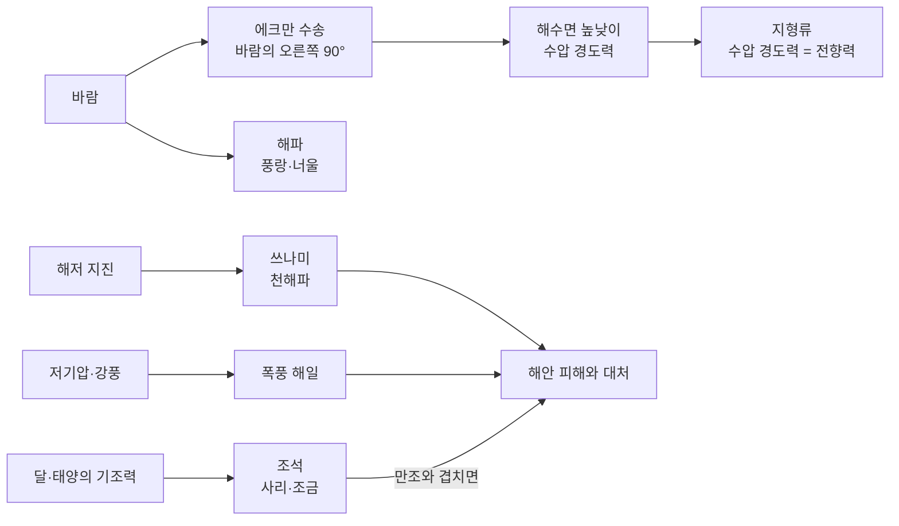

# 지구시스템과학 2. 해수의 운동 — 바람과 자전, 달이 함께 움직이는 바다
<!-- prev: m3-03, m2-03, 3-3, 5-3, earth-1, esys-1 -->
<!-- next: esys-3 -->

> [!NOTE]
> **성취기준**
> - **[12지시02-01]** 에크만 수송과 관련지어 지형류의 발생 원리를 설명할 수 있다.
> - **[12지시02-02]** 해파의 발생 과정을 이해하고, 천해파와 심해파의 차이점을 비교⋅설명할 수 있다.
> - **[12지시02-03]** 해일이 발생하는 여러 가지 원인을 이해하고, 피해 사례와 대처 방안을 제안할 수 있다.
> - **[12지시02-04]** 조석의 발생 과정을 이해하고 자료 해석을 통해 각 지역에서의 조석 양상을 설명할 수 있다.

**학습 목표**

1. 해수에 작용하는 수압 경도력과 전향력을 정량적으로 나타내고, 정역학 평형과 지형류 평형을 설명할 수 있다.
2. 바람이 일으키는 에크만 수송이 해수면의 높낮이를 만들고, 그 결과 지형류가 발생하는 과정을 설명할 수 있다.
3. 해파가 에너지를 전달하는 현상임을 이해하고, 심해파·천해파(그리고 전이파)의 물 입자 운동과 전파 속력을 비교할 수 있다.
4. 쓰나미와 폭풍 해일의 원인을 구분하고, 기압·만조·해안 지형에 따라 피해가 달라지는 까닭을 바탕으로 대처 방안을 제안할 수 있다.
5. 기조력과 평형 조석론으로 조석의 발생을 설명하고, 조석 자료를 해석하여 지역별 조석 양상을 비교할 수 있다.

**이 단원의 학습 사다리**

| 단계 | 무엇을 하나? |
|---|---|
| STEP 1. 이전 학습 다시 보기 | 표층 해류와 대기 대순환, 파동의 기본량, 중력과 원운동, 용승을 다시 꺼낸다 |
| STEP 2. 기초 다지기 | 수압, 힘의 평형, 회전하는 지구의 전향력, 파동의 속력, 구심력 |
| STEP 3. 핵심 개념 | 해수를 움직이는 힘 → 에크만 수송 → 지형류 → 해파 → 심해파·천해파 → 쓰나미·폭풍 해일 → 기조력과 조석 |
| STEP 4. 오개념 바로잡기 | "파도는 바닷물이 밀려오는 것이다?", "달 반대편에는 왜 밀물이?" 같은 착각을 바로잡는다 |
| STEP 5. 대학 전공으로 | 서안 강화, 군속도, 기조력의 식, 동적 조석론과 무조점 |
| STEP 6. 생활·산업·진로 | 쓰나미 경보, 해양 예보, 조력 발전, 항만·해안 공학 |

---

## 🗺️ 단원 들어가기

여름 바닷가에서 바람 한 점 없는 맑은 날인데도 갑자기 큰 파도가 밀려와 사람들을 놀라게 할 때가 있다. 수천 km 떨어진 태풍이 보낸 **너울**이다. 서해안 갯벌에서는 하루에 두 번 바다가 수 km나 물러났다가 다시 들어오는데, 동해안에서는 같은 날 해수면이 수십 cm밖에 오르내리지 않는다. 그리고 북태평양의 거대한 해류는 바람 방향과 나란히 흐르지 않고 비스듬히 흐른다.

**바다를 움직이는 것은 무엇이고, 같은 바다가 왜 이렇게 다르게 움직일까?** 이 단원에서는 바람, 지구의 자전, 중력, 그리고 달과 태양의 인력이 바닷물에 작용하는 방식을 힘의 균형으로 분석한다.

---

## STEP 1. 🔙 이전 학습 다시 보기

### 연계 개념표

| 이전 단원·성취기준 | 그때 배운 것 | 이 단원에서 확장되는 것 |
|---|---|---|
| 중3 「수권과 해수의 순환」 [9과18-02], [9과18-03] | 해수의 수온·염분 분포, 대기 대순환과 북태평양 아열대 순환의 해류 | 바람이 해류를 만드는 **역학적 원리**(에크만 수송, 지형류) |
| 중2 「빛과 파동」 [9과10-04] | 파동은 매질은 제자리에서 진동하고 에너지만 전달한다 | 해파에서 **물 입자의 원·타원 운동**과 파속의 수심 의존성 |
| 통합과학1 「중력과 운동」 [10통과1-03-03] | 중력, 지구 주위를 도는 원운동 | **기조력**: 거리에 따라 다른 인력의 차이 |
| 통합과학1 「지구시스템의 구성과 상호작용」 [10통과1-03-01] | 조력 에너지와 조석, 권역 사이의 에너지 흐름 | 조석의 **발생 과정**과 지역별 조석 양상 |
| 통합과학2 「지구온난화와 기후변화」 [10통과2-02-03] | 엘니뇨·라니냐에서 무역풍이 따뜻한 해수를 서쪽으로 이동시킴 | 바람이 해수를 움직이는 방향의 원리(에크만 수송) |
| 지구과학 「대기와 해양의 상호작용」 [12지구01-02], [12지구01-05] | 표층 순환과 심층 순환(정성적), 해수의 용승과 침강 | 표층 순환과 용승을 **힘의 균형으로 정량화** |
| 지구시스템과학 「지구 탄생과 생동하는 지구」 [12지시01-05] | 지진과 지진파 | 해저 지진이 일으키는 **쓰나미** |

### 준비 운동 (사전 진단)

**Q1.** 북태평양 아열대 순환을 이루는 해류 네 가지를 쓰고, 순환 방향(시계 방향 / 반시계 방향)을 쓰시오.

**Q2.** 바다에 떠 있는 공은 파도가 지나갈 때 파도와 함께 해안까지 밀려간다. (O / X)

**Q3.** 수심 10 m 아래로 내려갈 때마다 수압은 대략 몇 기압씩 커지는가?

**Q4.** 지구과학에서 배운 연안 용승은 바람과 해수의 어떤 관계 때문에 일어나는가?

정답 및 해설

**Q1.** 북태평양 해류, 캘리포니아 해류, 북적도 해류, 쿠로시오 해류. **시계 방향**으로 순환한다.

**Q2. X** — 공은 대부분 제자리에서 위아래(원 모양)로 움직인다. 파동은 에너지를 전달할 뿐 물을 통째로 실어 나르지 않는다. (다만 해안 가까이 부서지는 파도는 물을 실제로 옮긴다.)

**Q3. 약 1기압** — 해수의 밀도가 약 $1000\ \mathrm{kg/m^3}$이므로 $\rho g h \approx 1000\times9.8\times10 \approx 10^5\ \mathrm{Pa}$이다.

**Q4.** 해안과 나란히 부는 바람에 의해 표층 해수가 해안에서 먼 바다 쪽으로 이동하면, 그 빈자리를 채우려고 아래의 찬 해수가 올라온다. 이 단원에서 그 방향을 정하는 원리(에크만 수송)를 배운다.

---

## STEP 2. 🧱 기초 다지기

### ① 수압 — 위에 있는 물의 무게

깊이 $z$에서의 압력은 수면의 대기압 $P_0$에 그 위에 있는 물기둥의 무게를 더한 것이다.

$$
P = P_0 + \rho g z
$$

해수의 밀도는 약 $1025\ \mathrm{kg/m^3}$이다. 중요한 것은 **같은 깊이라도 해수면이 높은 곳 아래에서는 압력이 더 크다**는 점이다. 해수면이 높은 곳에서 낮은 곳으로 수평 방향의 압력 차이가 생기고, 이 압력 차이가 물을 미는 힘이 된다.

### ② 힘의 평형과 벡터의 합

물체(물 덩어리)에 작용하는 힘들의 합(알짜힘)이 0이면 물체는 정지하거나 **일정한 속도로 운동**한다. 해류처럼 오랫동안 거의 일정하게 흐르는 흐름은 여러 힘이 **평형**을 이룬 상태로 볼 수 있다. 힘은 크기와 방향을 가진 벡터이므로 화살표로 그려 더한다.

### ③ 회전하는 지구 위의 전향력

돌고 있는 회전목마 위에서 공을 맞은편 친구에게 굴리면, 회전목마 위의 사람에게는 공이 옆으로 휘어 가는 것처럼 보인다. 공에 실제로 옆으로 미는 힘이 작용한 것이 아니라, **관찰자가 회전하기 때문에** 생기는 겉보기 효과이다. 회전하는 지구 위에서 움직이는 물체에 나타나는 이 겉보기 힘을 **전향력(코리올리 힘, Coriolis force)** 이라고 한다.

| 성질 | 내용 |
|---|---|
| 방향 | 북반구에서는 운동 방향의 **오른쪽** 직각, 남반구에서는 **왼쪽** 직각 |
| 크기(단위 질량당) | $f v$, 여기서 $f = 2\Omega\sin\varphi$ (**전향 인자**, $\Omega = 7.29\times10^{-5}\ \mathrm{s^{-1}}$: 지구 자전 각속도, $\varphi$: 위도) |
| 위도와의 관계 | 적도에서 0, 극에서 최대 |
| 속력과의 관계 | 정지한 물체에는 작용하지 않음, 빠를수록 큼 |
| 하는 일 | 운동 방향에 수직이므로 속력은 바꾸지 않고 **방향만** 바꿈 |

| 위도 | 30° | 35° | 40° | 45° |
|---|---|---|---|---|
| $f\ (\times10^{-4}\ \mathrm{s^{-1}})$ | 0.73 | 0.84 | 0.94 | 1.03 |

### ④ 파동의 기본량

| 용어 | 뜻 |
|---|---|
| 마루, 골 | 파동의 가장 높은 곳, 가장 낮은 곳 |
| 파고 $H$ | 마루와 골의 높이 차(진폭의 2배) |
| 파장 $L$ | 마루와 마루 사이의 수평 거리 |
| 주기 $T$ | 한 지점을 마루가 지나간 뒤 다음 마루가 지나갈 때까지의 시간 |
| 전파 속력 $c$ | $c = \dfrac{L}{T}$ |

### ⑤ 원운동에는 구심력이 필요하다

통합과학 「중력과 운동」에서 배웠듯이 원운동을 하려면 원의 중심 쪽으로 향하는 힘(구심력)이 있어야 한다. 지구와 달은 서로의 인력으로 **공통 질량 중심**(지구 중심에서 약 4700 km, 지구 내부에 있다) 둘레를 함께 돈다. 이 사실이 STEP 3의 기조력을 이해하는 열쇠이다.

---

## STEP 3. 📘 핵심 개념

### ① 해수를 움직이는 힘과 정역학 평형 [12지시02-01]

해수에 작용하는 주요 힘은 다음과 같다.

| 힘 | 원인 | 방향 |
|---|---|---|
| 중력 | 지구의 인력 | 연직 아래 |
| **수압 경도력**(pressure gradient force) | 수압의 공간적 차이 | 압력이 높은 곳 → 낮은 곳 |
| **전향력** | 지구 자전 | 북반구에서 운동 방향의 오른쪽 |
| 마찰력 | 바람의 끌림(해수면), 해저와의 마찰, 물층 사이 마찰 | 상대 운동을 방해하거나 끌고 감 |

**정역학 평형(hydrostatic equilibrium)** 연직 방향으로는 아래로 당기는 **중력**과 아래쪽 압력이 더 커서 생기는 **위로 향하는 수압 경도력**이 균형을 이룬다. 그래서 해수는 위아래로는 거의 가속되지 않으며, 깊이에 따라 압력이 $\rho g z$만큼 커진다.

$$
\frac{\Delta P}{\Delta z} = \rho g \quad (\text{연직 방향의 정역학 평형})
$$

**수평 방향의 수압 경도력** 해수면이 기울어져 있으면 같은 깊이에서 수평 방향으로 압력 차이가 생긴다. 거리 $\Delta x$ 사이에서 해수면 높이 차가 $\Delta h$이면, 밀도가 일정할 때 같은 깊이에서의 압력 차는 $\Delta P = \rho g \Delta h$이다. 따라서 단위 질량에 작용하는 수평 수압 경도력은

$$
\frac{1}{\rho}\frac{\Delta P}{\Delta x} = g\frac{\Delta h}{\Delta x}
$$

이며, **해수면이 높은 쪽에서 낮은 쪽**으로 향한다. 이 힘은 깊이와 관계없이 같다(밀도가 일정한 경우).

#### 예제 1 — 해수면이 1 m 높으면

해수면 높이가 100 km 거리에서 1 m 차이 난다. ($\rho = 1025\ \mathrm{kg/m^3}$, $g = 9.8\ \mathrm{m/s^2}$)
(1) 같은 깊이에서 두 지점의 수압 차이는? (2) 단위 질량당 수평 수압 경도력은?

**풀이**
(1) $\Delta P = \rho g \Delta h = 1025\times9.8\times1 \approx 1.0\times10^4\ \mathrm{Pa}$ (약 0.1기압)
(2) $g\dfrac{\Delta h}{\Delta x} = 9.8\times\dfrac{1}{1.0\times10^5} = 9.8\times10^{-5}\ \mathrm{m/s^2}$

아주 작은 가속도 같지만, 하루 동안 다른 힘 없이 계속 작용하면 속도가 $9.8\times10^{-5}\times86400 \approx 8.5\ \mathrm{m/s}$나 붙는다. 그런데 실제 해류는 이렇게 빨라지지 않는다. 무엇이 이 힘과 균형을 이룰까? 답은 ③의 **전향력**이다.

### ② 에크만 수송 — 바람은 해수를 오른쪽으로 보낸다 [12지시02-01]

바람이 해수면 위를 불면 마찰로 표층 해수를 끌고 간다. 그런데 움직이기 시작한 해수에는 전향력이 작용하므로, 북반구에서 표층 해수는 바람 방향의 **오른쪽 약 45°** 방향으로 흐른다. 이 표층수가 바로 아래층을 끌고, 아래층은 다시 조금 더 오른쪽으로 휘며 더 느리게 흐른다. 깊이에 따라 흐름의 방향이 나선처럼 돌아가며 속력이 줄어드는 이 구조를 **에크만 나선(Ekman spiral)** 이라 하고, 바람의 영향이 미치는 층(대략 수십~100 m 깊이)을 **에크만 층**이라고 한다.

에크만 층 전체에서 움직인 해수의 양을 모두 더하면, 알짜 이동 방향은 **바람 방향의 직각 오른쪽**(북반구)이 된다. 이를 **에크만 수송(Ekman transport)** 이라고 한다.

| 깊이 | 북반구에서 흐름의 방향 | 속력 |
|---|---|---|
| 해수면 | 바람의 오른쪽 약 45° | 가장 빠름 |
| 에크만 층 중간 | 더 오른쪽으로 회전 | 느려짐 |
| 에크만 층 바닥 | 표층과 거의 반대 방향 | 매우 느림 |
| **층 전체의 평균(알짜)** | **바람의 오른쪽 90°** | — |

에크만 층 전체로 보면 해수에 작용하는 **바람의 마찰력**과 **전향력**이 균형을 이룬다. 바람이 미는 방향과 균형을 이루려면 전향력이 바람 반대 방향을 향해야 하고, 전향력은 운동 방향의 오른쪽 직각이므로 알짜 운동은 바람의 오른쪽 직각 방향이 된다. 해수면에 작용하는 바람의 응력을 $\tau$(단위 $\mathrm{N/m^2}$)라 하면, 단위 폭당 에크만 수송량은

$$
U_E = \frac{\tau}{\rho f}\quad(\mathrm{m^2/s})
$$

로 나타낼 수 있다. 바람이 강할수록, 위도가 낮을수록(전향력이 약할수록) 수송량이 크다.

> [!TIP]
> 💡 **비유** — 에크만 나선은 '카드 한 벌을 손바닥으로 밀 때' 맨 위 카드가 가장 많이 밀리고 아래 카드일수록 덜 밀리는 것과 비슷하다. 다만 지구에서는 한 장 한 장이 밀릴 때마다 전향력 때문에 조금씩 오른쪽으로 돌아간다.

#### 에크만 수송이 만드는 현상

| 상황(북반구) | 에크만 수송 | 결과 |
|---|---|---|
| 해안을 왼쪽에 두고 해안과 나란히 바람이 붐 | 해안에서 먼 바다 쪽 | 해안의 해수면이 낮아지고 아래의 찬물이 올라옴(**연안 용승**) |
| 해안을 오른쪽에 두고 바람이 붐 | 해안 쪽 | 해안에 해수가 쌓임(**침강**), 해수면 상승 |
| 적도에서 동풍(무역풍) | 적도 북쪽은 북쪽으로, 남쪽은 남쪽으로 | 적도에서 해수가 갈라짐(**적도 용승**) |
| 무역풍대(동풍)와 편서풍대(서풍) 사이 | 무역풍대는 북쪽, 편서풍대는 남쪽 → 위도 30° 부근으로 모임 | 아열대 해역 중앙의 **해수면이 높아짐**(약 1 m) |

#### 예제 2 — 동해안의 여름철 냉수대

여름철 우리나라 동해안에 남풍 계열의 바람이 계속 불면 해안 부근의 수온이 주변보다 크게 낮아지는 냉수대가 나타나곤 한다.
(1) 남풍이 불 때 에크만 수송의 방향은? (2) 냉수대가 생기는 까닭은? (3) 위도 30°에서 바람 응력이 $0.1\ \mathrm{N/m^2}$일 때 단위 폭당 에크만 수송량을 구하시오. ($\rho = 1025\ \mathrm{kg/m^3}$, $f = 7.29\times10^{-5}\ \mathrm{s^{-1}}$)

**풀이**
(1) 남풍은 남쪽에서 북쪽으로 부는 바람이다. 북쪽으로 향하는 바람의 오른쪽 직각은 **동쪽**이다.
(2) 동해안은 바다가 동쪽에 있으므로 표층 해수가 해안에서 먼 바다로 빠져나간다. 그 자리를 아래의 찬 해수가 올라와 채운다(**연안 용승**).
(3) $U_E = \dfrac{0.1}{1025\times7.29\times10^{-5}} \approx 1.3\ \mathrm{m^2/s}$. 해안선 1 km마다 1초에 약 $1300\ \mathrm{m^3}$의 해수가 먼 바다로 빠져나가는 셈이다.

### ③ 지형류 — 수압 경도력과 전향력의 균형 [12지시02-01]

②에서 본 것처럼 에크만 수송은 아열대 해역 가운데로 해수를 모아 해수면을 볼록하게 만든다. 그러면 해수면의 경사 때문에 ①의 수평 수압 경도력이 생겨, 해수는 해수면이 높은 중앙에서 낮은 바깥쪽으로 흐르기 시작한다. 그런데 흐르기 시작한 해수에는 전향력이 작용하여 흐름이 오른쪽으로 휜다. 결국 **수압 경도력과 전향력이 크기가 같고 방향이 반대**가 되면 해수는 해수면의 **등고선을 따라** 흐르게 된다. 이 흐름이 **지형류(geostrophic current)** 이다.

$$
f v = g\frac{\Delta h}{\Delta x} \quad\Rightarrow\quad v = \frac{g}{f}\frac{\Delta h}{\Delta x}
$$

| 성질 | 내용 |
|---|---|
| 균형 | 수평 수압 경도력 = 전향력(마찰은 무시, 에크만 층 아래) |
| 방향(북반구) | 흐름을 등지고 섰을 때 **오른쪽에 해수면이 높은 쪽**이 있다 |
| 속력 | 해수면 경사가 클수록, 위도가 낮을수록 빠름 |
| 적용 조건 | 적도 부근($f\approx0$)에서는 성립하지 않음 |
| 결과 | 북반구 아열대 순환에서는 해수면이 높은 중앙을 오른쪽에 두고 **시계 방향**으로 돎 |

> [!IMPORTANT]
> **에크만 수송과 지형류의 관계** — 바람은 에크만 수송으로 해수면의 높낮이를 **만들고**, 그 높낮이가 만든 수압 경도력과 전향력이 균형을 이루어 지형류가 **흐른다.** 중학교에서 "바람이 해류를 만든다"라고 배운 것의 실제 과정은 '바람 → 에크만 수송 → 해수면 경사 → 지형류'의 두 단계이다. 그래서 해류는 바람과 같은 방향이 아니라 해수면의 높낮이를 따라 흐른다.

#### 예제 3 — 쿠로시오 해류의 속력

위도 35°에서 쿠로시오 해류를 가로질러 100 km 사이에 해수면 높이가 1 m 차이 난다(남동쪽이 높다). ($g = 9.8\ \mathrm{m/s^2}$, $f = 8.4\times10^{-5}\ \mathrm{s^{-1}}$)
(1) 지형류의 속력을 구하시오. (2) 해류는 대략 어느 쪽으로 흐르는가?

**풀이**
(1) $v = \dfrac{9.8}{8.4\times10^{-5}}\times\dfrac{1}{1.0\times10^5} \approx 1.2\ \mathrm{m/s}$ (시속 약 4 km)
(2) 북반구에서는 흐름의 오른쪽에 높은 해수면이 있다. 높은 쪽(남동쪽)을 오른쪽에 두려면 **북동쪽**으로 흘러야 한다. 실제로 쿠로시오 해류는 일본 남쪽 해안을 따라 북동쪽으로 흐른다.

> [!TIP]
> 💡 **인공위성으로 해류를 잰다** — 인공위성 고도계는 해수면 높이를 cm 단위로 측정한다. 해수면 높이 지도에 지형류 식을 적용하면 바다 전체의 표층 해류를 날마다 계산할 수 있다.

### ④ 해파의 발생과 물 입자의 운동 [12지시02-02]

**해파(ocean wave)** 는 해수면이 주기적으로 오르내리며 **에너지를 전파하는 현상**이다. 해파가 지나갈 때 물 입자는 제자리 근처에서 원 또는 타원을 그리며 돌 뿐, 파도와 함께 멀리 이동하지 않는다.

| 원인 | 해파의 종류 | 주기 |
|---|---|---|
| 바람 | 풍랑, 너울 | 수 초 ~ 20초 정도 |
| 해저 지진·산사태·화산 | 쓰나미 | 수 분 ~ 1시간 정도 |
| 기압 변화와 강풍 | 폭풍 해일 | 수 시간 이상 |
| 달·태양의 기조력 | 조석(조석파) | 약 12시간·24시간 |

바람이 만드는 해파의 경우, 바람이 해수면을 마찰로 끌고 압력 차를 만들어 잔물결을 일으키고, 잔물결이 바람을 더 잘 받아 점점 커진다. 해파의 크기는 **풍속**, 바람이 부는 **시간(취송 시간)**, 바람이 바다 위를 불어 가는 **거리(취송 거리)** 가 클수록 커진다.

### ⑤ 심해파, 천해파, 그리고 전이파 [12지시02-02]

해파의 물 입자 운동은 수심 $h$와 파장 $L$의 비에 따라 달라진다.

| 구분 | 심해파(deep-water wave) | 전이파(중간 영역) | 천해파(shallow-water wave) |
|---|---|---|---|
| 조건 | $h > \dfrac{L}{2}$ | $\dfrac{L}{20} < h < \dfrac{L}{2}$ | $h < \dfrac{L}{20}$ |
| 물 입자 운동 | **원운동**, 깊어질수록 반지름이 급히 작아짐 | 아래로 갈수록 납작한 타원 | **타원 운동**, 바닥에서는 **수평 왕복 운동** |
| 해저의 영향 | 받지 않음(수심 $L/2$에서 운동이 해수면의 약 4 %) | 조금 받음 | 크게 받음 |
| 전파 속력 | $c = \sqrt{\dfrac{gL}{2\pi}} = \dfrac{gT}{2\pi}$ (**파장·주기**에 의존) | 파장과 수심 모두에 의존 | $c = \sqrt{gh}$ (**수심**에만 의존) |
| 예 | 먼 바다의 풍랑 | 연안에 들어오는 너울 | 해안 가까운 파도, 쓰나미, 조석파 |

> [!IMPORTANT]
> 심해파와 천해파는 "바다가 깊은가 얕은가"가 아니라 **"수심이 파장에 비해 깊은가 얕은가"** 로 나눈다. 파장이 수백 km인 쓰나미는 수심 4000 m인 대양 한가운데에서도 천해파이다.

#### 예제 4 — 같은 파도, 다른 바다

주기 8초인 해파가 먼 바다에서 생겼다. ($g = 9.8\ \mathrm{m/s^2}$)
(1) 심해파일 때 파속과 파장을 구하시오. (2) 수심 60 m인 곳에서 이 해파는 심해파인가? (3) 해파가 수심 3 m인 해안 가까이 왔을 때의 파속을 구하시오.

**풀이**
(1) $c = \dfrac{gT}{2\pi} = \dfrac{9.8\times8}{2\pi} \approx 12.5\ \mathrm{m/s}$, $L = cT \approx 12.5\times8 \approx 100\ \mathrm{m}$
(2) $L/2 = 50\ \mathrm{m} < 60\ \mathrm{m}$이므로 **심해파**이다.
(3) 수심 3 m는 파장보다 훨씬 얕으므로 천해파로 보고 $c = \sqrt{gh} = \sqrt{9.8\times3} \approx 5.4\ \mathrm{m/s}$. 해안에 다가오며 파속이 절반 이하로 줄었다.

### ⑥ 풍랑과 너울, 해안에서 일어나는 변화 [12지시02-02]

| 구분 | **풍랑**(wind wave) | **너울**(swell) |
|---|---|---|
| 위치 | 바람이 부는 해역 안 | 바람이 부는 해역을 벗어난 곳 |
| 모양 | 마루가 뾰족하고 불규칙 | 마루가 둥글고 규칙적 |
| 주기·파장 | 짧음 | 길다 |
| 특징 | 다양한 파장이 섞여 있음 | 긴 파장의 파가 빨리 달려 먼저 도착 |

심해파의 속력은 주기가 길수록 빠르다($c = gT/2\pi$). 그래서 태풍 해역에서 만들어진 여러 파 가운데 **주기가 긴 파가 먼저 멀리** 달려 나가 너울이 된다. 예를 들어 주기 15초 파는 약 23 m/s, 주기 8초 파는 약 12 m/s로 달린다. 그래서 맑은 날 바닷가에 갑자기 긴 주기의 너울이 밀려오면 먼 곳에 태풍이 있다는 신호일 수 있다.

#### 해안에 다가오는 해파의 변화

1. **파속과 파장 감소**: 수심이 얕아지면 해저의 영향을 받아 느려지고 파장이 짧아진다(주기는 그대로).
2. **파고 증가와 쇄파**: 에너지가 좁은 공간에 모여 파고가 높아지고, 마루가 골보다 빨리 움직여 앞으로 고꾸라지며 부서진다(**쇄파**). 대체로 파고가 수심과 비슷해질 즈음 부서진다.
3. **굴절**: 해안선에 비스듬히 들어온 파는 얕은 쪽이 먼저 느려져 해안선과 나란하게 꺾인다. 그 결과 **곶**(튀어나온 땅)에는 파의 에너지가 모여 침식이 활발하고, **만**(들어간 곳)에서는 에너지가 흩어져 모래가 쌓인다.

> [!WARNING]
> 쇄파대에서 해안으로 밀려온 물이 좁은 통로를 따라 먼 바다 쪽으로 빠르게 되돌아가는 흐름을 **이안류(rip current)** 라 한다. 이안류에 휩쓸리면 해안 쪽으로 거슬러 헤엄치지 말고 **해안과 나란한 방향으로 헤엄쳐 흐름을 벗어난 뒤** 해안으로 돌아와야 한다. 동해안의 너울성 파도도 바람이 약한 날에 갑자기 덮쳐 사고를 일으키므로 방파제나 갯바위에 올라가지 않는다.

### ⑦ 쓰나미 — 바다 밑이 움직여 생기는 해일 [12지시02-03]

**해일**은 해수면이 비정상적으로 높아져 바닷물이 육지로 넘쳐 들어오는 현상이다. 원인에 따라 **지진 해일(쓰나미)** 과 **폭풍 해일**로 나눈다.

**쓰나미(tsunami)** 는 해저 지진, 해저 산사태, 해저 화산 폭발 등으로 **해저면이나 해수 전체가 갑자기 들어 올려지거나 내려앉아** 생기는 매우 긴 파장의 해파이다. 특히 섭입대에서 일어나는 큰 역단층 지진이 해저면을 수 m 들어 올리면, 그 위의 해수 기둥 전체가 들려 쓰나미가 된다.

| 특징 | 내용 |
|---|---|
| 파장 | 수십 ~ 수백 km → 대양에서도 **천해파** |
| 파속 | $c = \sqrt{gh}$: 수심 4000 m에서 약 200 m/s(제트 여객기 정도) |
| 먼 바다의 파고 | 1 m 이하로 낮아 배 위에서는 잘 느끼지 못함 |
| 해안의 파고 | 수심이 얕아지면 느려지면서 에너지가 모여 수 m ~ 수십 m로 높아짐 |
| 해안의 모습 | 거대한 물의 벽처럼 수 분 ~ 수십 분 동안 계속 밀려들고, 여러 번 반복됨 |
| 전조 | 첫 파가 골이면 바닷물이 갑자기 크게 빠지는 현상이 먼저 나타나기도 함 |

#### 예제 5 — 쓰나미는 얼마나 빠르고, 왜 높아지나

(1) 평균 수심 4000 m인 대양에서 쓰나미의 속력을 m/s와 km/h로 구하시오. (2) 수심 10 m인 해안에서의 속력은? (3) 해안에서 파고가 높아지는 까닭을 설명하시오.

**풀이**
(1) $c = \sqrt{9.8\times4000} \approx 198\ \mathrm{m/s} \approx 713\ \mathrm{km/h}$
(2) $c = \sqrt{9.8\times10} \approx 9.9\ \mathrm{m/s}$
(3) 파의 앞부분이 얕은 곳에서 먼저 느려지는 동안 뒷부분은 여전히 빠르게 따라오므로 파가 압축되어 파장이 짧아진다. 같은 에너지가 더 짧은 파장, 더 얕은 물에 모이므로 **파고가 커진다.** 속력이 약 20분의 1로 줄어든 것이 물이 쌓이는 정도를 짐작하게 한다.

#### 예제 6 — 동해 건너편의 지진

동해 건너편 해역에서 지진으로 쓰나미가 생겼다. 우리나라 동해안까지 거리는 900 km, 경로의 평균 수심을 2000 m로 가정할 때 쓰나미가 도착하는 데 걸리는 시간을 어림하시오. (단순화한 값이다.)

**풀이** $c = \sqrt{9.8\times2000} = 140\ \mathrm{m/s}$, $t = \dfrac{9.0\times10^5}{140} \approx 6.4\times10^3\ \mathrm{s} \approx 1.8$시간

지진이 일어난 뒤 **두 시간 남짓**의 대피 시간이 있다는 뜻이다. 1983년과 1993년에 동해 건너편 일본 해역에서 일어난 지진의 쓰나미가 실제로 우리나라 동해안에 도달하여 피해를 주었다. 지진은 느끼지 못했는데 쓰나미가 찾아올 수 있으므로 경보 체계가 중요하다.

### ⑧ 폭풍 해일 — 저기압과 바람이 쌓아 올린 바다 [12지시02-03]

**폭풍 해일(storm surge)** 은 태풍이나 강한 저기압이 지나갈 때 해수면이 크게 높아지는 현상이다. 원인은 다음과 같이 겹쳐진다.

| 요인 | 원리 | 크기(대략) |
|---|---|---|
| **기압 효과**(흡상 효과) | 기압이 낮은 곳은 해수면을 누르는 힘이 약해 해수면이 솟아오름 | 기압 1 hPa 하강 → 해수면 약 1 cm 상승 |
| **바람 효과**(취송 효과) | 강한 바람이 해수를 해안 쪽으로 밀어 쌓음. 수심이 얕을수록 크게 쌓임 | 얕고 넓은 해안에서 수 m까지 |
| **만조와의 겹침** | 해일이 만조 때 오면 평소 가장 높은 해수면 위에 해일 높이가 더해짐 | 조차가 큰 해안일수록 시기에 따라 피해 차이가 큼 |
| **해안·해저 지형** | 깔때기처럼 좁아지는 만, 넓고 얕은 대륙붕에서 해수가 모여 높아짐 | 지형에 따라 크게 다름 |
| 높은 파도 | 높아진 해수면 위에 큰 풍랑이 더해져 방파제를 넘음 | — |

기압 효과는 정역학 평형으로 이해할 수 있다. 대기압이 $\Delta P$만큼 낮아지면, 그만큼의 압력을 해수 기둥이 대신해야 수심 아래에서 압력이 같아지므로

$$
\Delta h = \frac{\Delta P}{\rho g} = \frac{100\ \mathrm{Pa}}{1025\times9.8} \approx 0.01\ \mathrm{m} \quad(1\ \mathrm{hPa}\text{당})
$$

#### 예제 7 — 태풍이 오는 날의 해수면

중심 기압 960 hPa인 태풍이 다가오고 있다. 주변 기압은 1010 hPa이다.
(1) 기압 효과만으로 태풍 중심의 해수면은 얼마나 높아지는가? (2) 같은 태풍이라도 만조와 간조 중 언제 해안에 닿느냐에 따라 피해가 크게 달라지는 해안은 서해안과 동해안 중 어디인가?

**풀이**
(1) $\Delta P = 50\ \mathrm{hPa} = 5000\ \mathrm{Pa}$, $\Delta h = \dfrac{5000}{1025\times9.8} \approx 0.5\ \mathrm{m}$
(2) **서해안(그리고 남해안 서부)** — 조차가 수 m에 이르므로, 해일이 만조와 겹치면 간조 때보다 수 m 높은 해수면에서 해일이 더해진다. 조차가 수십 cm인 동해안은 차이가 작다.

### ⑨ 해일의 피해 사례와 대처 방안 [12지시02-03]

| 사례 | 원인 | 피해를 키운 요인 |
|---|---|---|
| 2004년 인도양 쓰나미 | 수마트라섬 앞바다의 규모 약 9.1 지진 | 경보 체계 부족, 해안 저지대 인구 밀집 → 여러 나라에서 20만 명 이상 희생 |
| 2011년 동일본 대지진 쓰나미 | 일본 동북부 앞바다의 규모 9.0 지진 | 예상을 넘는 높이의 쓰나미가 방조제를 넘음, 원자력 발전소 사고로 이어짐 |
| 1983년, 1993년 동해 쓰나미 | 동해 건너편 일본 해역의 지진 | 지진동을 느끼지 못한 우리나라 동해안 항구에 쓰나미가 도달해 인명·선박 피해 |
| 2003년 태풍 매미 | 강한 태풍의 저기압과 강풍 | 해일이 만조 무렵과 겹치고, 깊숙이 들어간 만(마산만) 안쪽으로 해수가 모여 해안 저지대 침수 |
| 2005년 허리케인 카트리나 | 강한 허리케인 | 해수면보다 낮은 도시 지형, 제방 붕괴로 뉴올리언스 대부분 침수 |

> [!NOTE]
> 기상 원인으로 생기는 해일 가운데에는 빠르게 이동하는 기압 변화가 바다의 파동과 공명하여 맑은 날에도 해수면이 갑자기 오르내리는 **기상 해일(meteotsunami)** 도 있다. 2007년 서해안에서 이런 기상 해일로 인명 피해가 난 적이 있다.

#### 대처 방안

| 단계 | 쓰나미 | 폭풍 해일 |
|---|---|---|
| 예측·감시 | 지진 관측망 + 해저 수압계·부이, 쓰나미 도달 시간 계산 | 태풍 진로·강도 예보 + 조석 예보 + 해일 수치 모델 |
| 경보·전달 | 지진 발생 후 수 분 안에 경보, 재난 문자 | 태풍 접근 1~2일 전 해일 특보 |
| 시설 | 방조제·방파제, 높은 곳의 대피 건물, 대피로 표지 | 방조제, 배수 펌프, 하수 역류 방지 시설, 해안 저지대 침수 대비 |
| 개인 행동 | 강한 흔들림이나 경보가 있으면 **즉시 높은 곳으로**. 바닷물이 갑자기 빠져도 구경하러 가지 않는다. 첫 파 뒤에도 여러 차례 오므로 경보 해제 전까지 돌아가지 않는다 | 해안 도로·방파제 접근 금지, 지하 공간 이용 자제, 만조 시각 확인 |
| 지역 계획 | 쓰나미 침수 예상도 작성, 대피 훈련 | 해일 위험 지도, 해안 개발 규제, 갯벌·습지 보전(완충 지대) |

### ⑩ 기조력 — 조석을 일으키는 힘 [12지시02-04]

**조석(tide)** 은 해수면이 하루에 한두 번 주기적으로 높아지고 낮아지는 현상이다. 해수면이 가장 높을 때를 **만조**, 가장 낮을 때를 **간조**, 그 높이 차이를 **조차**라고 한다.

조석을 일으키는 힘을 **기조력(tide-generating force)** 이라 한다. 기조력은 달(또는 태양)이 지구의 각 지점을 당기는 인력이 **지점마다 다르기 때문에** 생긴다.

1. 달의 인력은 거리가 가까울수록 크다. 그러므로 달을 향한 쪽의 해수는 지구 중심보다 **더 세게**, 반대쪽 해수는 지구 중심보다 **더 약하게** 당겨진다.
2. 지구 전체(지구 중심)는 달의 평균적인 인력으로 공통 질량 중심 둘레를 돈다. 지구 중심이 받는 인력을 기준으로 보면, 달 쪽 해수는 **달 쪽으로** 끌려 나가고, 반대쪽 해수는 지구 중심만큼 끌려가지 못해 **달 반대쪽으로** 처진다.
3. 그 결과 지구는 달을 향한 쪽과 그 반대쪽이 **동시에 부풀어 오른다.**

같은 내용을 공통 질량 중심 둘레의 회전으로 볼 수도 있다. 지구와 함께 도는 관점에서는 지구 어디에서나 같은 크기와 방향의 원심력이 작용하는데, 달 쪽에서는 인력이 원심력보다 크고, 반대쪽에서는 원심력이 인력보다 크다. 두 힘의 차이가 기조력이다.

| 위치 | 달의 인력 vs 지구 중심의 기준 | 기조력 방향 | 해수면 |
|---|---|---|---|
| 달을 향한 쪽 | 더 큼 | 달 쪽(위로) | 부풂(만조) |
| 달 반대쪽 | 더 작음 | 달 반대쪽(위로) | 부풂(만조) |
| 그 사이 90° 지점 | 비스듬한 방향 차이 | 지구 중심 쪽 | 낮아짐(간조) |

**태양도 기조력을 만든다.** 태양은 달보다 훨씬 무겁지만 훨씬 멀리 있어서, 지구 양쪽 끝이 받는 인력의 **차이**는 달보다 작다. 기조력은 인력 자체가 아니라 **인력의 차이**이므로 거리가 멀어지면 인력보다 훨씬 빠르게 약해진다. 그 결과 **달의 기조력은 태양의 약 2배**이다.

**평형 조석론(equilibrium tide theory)** 은 지구 전체가 깊은 바다로 덮여 있고 해수가 기조력에 즉시 반응한다고 가정하여, 해수면이 위의 두 부풂 모양으로 평형을 이룬다고 보는 이론이다. 지구가 자전하면서 한 지점은 하루에 두 번 부풂을 지나므로 **하루에 만조와 간조가 두 번씩** 나타난다.

달은 지구가 자전하는 방향으로 하루에 약 12°씩 공전하므로, 지구가 한 바퀴 돈 뒤 약 50분을 더 돌아야 달이 다시 같은 자리(남중)에 온다. 그래서 만조 사이의 간격은 약 **12시간 25분**이고, 만조 시각은 날마다 **약 50분씩 늦어진다.**

> [!TIP]
> 💡 **비유** — 마라톤 출발 신호 뒤 선두, 중간, 꼴찌 선수가 같은 방향으로 달리지만 속력이 달라 대열이 앞뒤로 늘어나는 것처럼, 달 쪽 해수는 지구 중심보다 앞서 끌려가고 반대쪽 해수는 뒤처진다. 대열이 늘어난 방향이 '부풂'이다.

### ⑪ 사리와 조금, 일조부등 [12지시02-04]

#### 사리와 조금

| 구분 | 달의 위상 | 달·태양·지구의 배치 | 기조력 | 조차 |
|---|---|---|---|---|
| **사리**(대조, spring tide) | 삭(그믐), 망(보름) | 일직선 | 달과 태양의 기조력이 **더해짐** | 최대 |
| **조금**(소조, neap tide) | 상현, 하현 | 직각 | 달과 태양의 기조력이 **서로 약화** | 최소 |

사리와 조금은 각각 약 15일(달의 위상 주기의 절반)마다 돌아온다. 실제 사리는 삭이나 망보다 하루이틀 늦게 나타나는 경우가 많은데, 바다가 기조력에 즉시 반응하지 못하기 때문이다.

#### 일조부등 — 하루 두 번의 만조 높이가 다른 까닭

달은 항상 적도 위에 있지 않고 적도의 북쪽이나 남쪽에 치우쳐 있다(달의 적위). 그러면 두 부풂이 적도에 대해 비스듬히 기울어져, 중위도의 한 지점은 하루 중 한 번은 부풂의 두꺼운 부분을, 한 번은 얇은 부분을 지나게 된다. 그래서 같은 날 두 번의 만조(또는 간조) 높이가 달라지는데, 이를 **일조부등(diurnal inequality)** 이라고 한다. 고위도에서는 하루에 만조가 한 번만 나타나기도 한다.

| 조석 유형 | 특징 | 예 |
|---|---|---|
| **반일주조** | 하루에 만조·간조가 두 번씩, 높이가 비슷 | 우리나라 서해안 대부분 |
| **혼합조** | 하루에 두 번씩이지만 높이 차이(일조부등)가 큼 | 많은 태평양 연안 |
| **일주조** | 하루에 만조·간조가 한 번씩 | 일부 연안 해역 |

### ⑫ 조석 자료 해석 — 각 지역의 조석 양상 [12지시02-04]

평형 조석론으로 조석의 주기와 사리·조금, 일조부등을 설명할 수 있다. 그러나 평형 조석론이 예상하는 조차는 1 m 안팎인데, 실제 조차는 지역에 따라 거의 0에서 10 m가 넘는 곳까지 다양하다. 실제 바다에는 대륙이 있고, 수심과 해안선 모양이 제각각이어서 조석이 **해안을 따라 전파되는 매우 긴 파동(조석파)** 처럼 움직이기 때문이다.

| 해역 | 대략의 조차 | 조차를 정하는 요인 |
|---|---|---|
| 우리나라 서해안 | 수 m, 인천 부근 사리 때 8 m 이상 | 넓고 얕은 대륙붕, 굴곡이 심한 해안선, 만 안쪽으로 갈수록 좁아지는 지형 → 조석파가 크게 증폭됨 |
| 남해안 | 서쪽 수 m → 동쪽으로 갈수록 작아짐 | 서해와 동해 사이의 전이 지역 |
| 동해안 | 수십 cm 정도 | 깊은 바다, 좁은 해협으로 조석파가 잘 들어오지 못함 |

#### 예제 8 — 조석표 읽기

다음은 어느 해안 관측소의 하루 조석 예보이다. (설명을 위한 가상의 자료이다.)

| 구분 | 시각 | 조위(m) |
|---|---|---|
| 만조 | 04:10 | 8.2 |
| 간조 | 10:35 | 0.9 |
| 만조 | 16:40 | 7.6 |
| 간조 | 23:00 | 1.3 |

(1) 만조와 만조 사이의 간격은? (2) 이 지역의 조석 유형과 그 근거는? (3) 오전과 오후의 조차를 각각 구하시오(앞의 만조와 뒤의 간조 차이). (4) 다음 날 첫 만조 시각을 어림하시오. (5) 이 관측소는 서해안과 동해안 중 어디에 있을 가능성이 큰가?

**풀이**
(1) 16:40 − 04:10 = **12시간 30분** (평형 조석론의 약 12시간 25분과 비슷하다)
(2) 하루에 만조와 간조가 두 번씩 나타나므로 **반일주조**이다. 다만 두 만조의 높이가 0.6 m 다르므로 약한 일조부등이 있다.
(3) 오전: $8.2 - 0.9 = 7.3\ \mathrm{m}$, 오후: $7.6 - 1.3 = 6.3\ \mathrm{m}$
(4) 만조 시각은 하루에 약 50분씩 늦어지므로 다음 날 **약 05:00 무렵**
(5) 조차가 7 m 안팎으로 매우 크므로 **서해안**이다.

> [!TIP]
> 💡 **실시간 자료로 확인하기** — 국립해양조사원은 전국 조위 관측소의 실시간 해수면 자료와 조석 예보를 공개한다. 서해안과 동해안 관측소의 자료를 같은 기간 그래프로 겹쳐 보면 조차와 유형의 차이가 한눈에 드러난다(탐구 활동 B).

---

## STEP 4. ⚠️ 오개념 바로잡기

| 흔한 오개념 | 올바른 개념 | 왜 그럴까? |
|---|---|---|
| 해류는 바람이 부는 방향으로 흐른다 | 표층 해수의 알짜 이동(에크만 수송)은 북반구에서 바람의 **오른쪽 90°**이고, 큰 해류는 해수면 높낮이를 따라 흐르는 **지형류**이다 | 지구 자전에 의한 전향력이 흐름의 방향을 바꾼다 |
| 전향력은 실제로 물을 밀어 속력을 바꾸는 힘이다 | 전향력은 회전하는 지구에서 보는 **겉보기 힘**으로, 운동 방향에 수직이라 **방향만** 바꾼다 | 회전목마 위에서 굴린 공이 휘어 보이는 것과 같다 |
| 파도는 바닷물이 해안으로 밀려오는 것이다 | 해파는 **에너지**가 전파되는 것이고 물 입자는 제자리에서 원·타원 운동을 한다 | 쇄파대에서만 물이 실제로 해안 쪽으로 밀려간다 |
| 깊은 바다의 파는 모두 심해파이다 | **수심과 파장의 비**로 나눈다. 파장이 긴 쓰나미는 대양에서도 천해파이다 | 쓰나미 파장(수백 km)은 대양 수심(약 4 km)보다 훨씬 길다 |
| 쓰나미는 먼 바다에서도 거대한 파도이다 | 먼 바다에서는 파고가 1 m 이하로 낮고, **해안에서 느려지며 높아진다** | 에너지가 얕은 물, 짧아진 파장에 모인다 |
| 달 반대편에서 만조가 생기는 것은 태양 때문이다 | 달 반대편의 만조도 **달의 기조력** 때문이다 | 반대편 해수는 지구 중심보다 달에 약하게 당겨져 뒤처지기 때문이다 |
| 태양은 달보다 훨씬 무거우니 기조력도 더 크다 | 기조력은 인력의 **차이**이므로 거리의 영향이 매우 커서 달의 기조력이 태양의 약 2배이다 | 태양은 달보다 약 390배 멀다 |

---

## STEP 5. 🎓 다음 단계로 한 걸음 더

> [!CAUTION]
> 이 절은 **지구시스템과학 교육과정 범위 밖의 심화 내용**으로 평가 대상이 아니다. 대학의 해양학·해양물리학·해안공학으로 이 단원의 개념이 어떻게 이어지는지 맛보기로 보여 준다.

### 대학 전공 과목과의 연결

| 대학 과목 | 이어지는 내용 |
|---|---|
| 해양물리학, 지구유체역학 | 회전 좌표계의 운동 방정식, 에크만 층 이론, 지형류와 와도, 서안 강화 |
| 해양파랑학, 해안공학 | 파랑 분산 관계식, 군속도, 파랑 스펙트럼, 쇄파·해안 침식 모델 |
| 조석학, 측지학 | 기조력의 수식, 조화 분해, 동적 조석론과 무조점 |
| 해양 재해학 | 쓰나미·폭풍 해일 수치 모델, 침수 예측 지도 |

### ① 서안 강화 — 쿠로시오는 왜 빠르고 좁을까?

아열대 순환에서 대양의 **서쪽 가장자리** 해류(쿠로시오, 걸프 해류)는 좁고 빠르며 깊고, 동쪽 가장자리 해류(캘리포니아 해류)는 넓고 느리다. 이를 **서안 강화(western intensification)** 라고 한다. 해양물리학에서는 전향 인자 $f$가 위도에 따라 커진다는 점(**베타 효과**, $\beta = \Delta f/\Delta y$)과 와도(회전하는 정도)의 균형으로 이를 설명한다. 이 단원의 지형류 식에서 $f$를 상수로 놓았던 가정을 풀면 나타나는 현상이다.

### ② 분산 관계식과 군속도

대학에서는 심해파와 천해파를 하나로 묶는 **분산 관계식**을 배운다.

$$
\omega^2 = gk\tanh(kh), \qquad k = \frac{2\pi}{L},\ \omega = \frac{2\pi}{T}
$$

$kh$가 클 때(깊은 바다) $\tanh(kh)\to1$이 되어 $c = \sqrt{g/k} = \sqrt{gL/2\pi}$, $kh$가 작을 때(얕은 바다) $\tanh(kh)\approx kh$가 되어 $c = \sqrt{gh}$가 된다. 또 파의 에너지는 파 마루의 속력(위상 속도)이 아니라 **군속도**로 전달되는데, 심해파에서는 군속도가 위상 속도의 절반이다. 너울이 도착하는 시각을 예측할 때는 군속도를 쓴다.

### ③ 기조력의 크기

질량 $M$인 천체가 거리 $d$에 있을 때, 지구 반지름 $R$만큼 떨어진 지점에서의 기조력(단위 질량당)은 근사적으로

$$
F_{\text{기조}} \approx \frac{2GMR}{d^3}
$$

이다. 거리의 **세제곱**에 반비례하므로 달과 태양의 기조력 비는

$$
\frac{F_{\text{달}}}{F_{\text{태양}}} = \frac{M_{\text{달}}}{M_{\text{태양}}}\left(\frac{d_{\text{태양}}}{d_{\text{달}}}\right)^3 \approx \frac{7.35\times10^{22}}{1.99\times10^{30}}\times\left(\frac{1.50\times10^{11}}{3.84\times10^{8}}\right)^3 \approx 2.2
$$

STEP 3에서 '약 2배'라고 한 값이 이렇게 나온다.

### ④ 동적 조석론과 무조점

실제 조석은 대양 분지마다 공명하며 회전하는 거대한 파동이다. 조차가 거의 0인 점(**무조점**, amphidromic point)을 중심으로 만조가 빙 돌며 전파되고, 무조점에서 멀수록 조차가 크다. 서해에도 여러 개의 무조점이 있어 해안에 따라 만조 시각과 조차가 다르게 나타난다. 대학에서는 관측된 조위를 여러 주기 성분(주태음반일주조 $M_2$, 주태양반일주조 $S_2$ 등)의 합으로 분해하는 **조화 분석**으로 조석을 예보한다.

### 지금 vs 다음 단계

| 구분 | 고등학교 지구시스템과학 | 대학 해양학·해양물리학 |
|---|---|---|
| 해류 | 에크만 수송, 지형류 평형(대수식) | 회전 좌표계 운동 방정식, 와도, 베타 효과, 서안 강화 |
| 해파 | 심해파·천해파 속력 공식, 전이파 개념 | 분산 관계식, 군속도, 파랑 스펙트럼 |
| 해일 | 원인과 피해 요인, 대처 | 수치 모델로 침수 범위 예측, 확률적 위험 평가 |
| 조석 | 기조력(정성), 평형 조석론 | 기조력 수식, 동적 조석론, 조화 분석 |
| 관련 전공 | — | 해양학, 해양물리학, 해양공학, 해안·항만공학, 조선해양공학 |

---

## STEP 6. 🏭 생활·산업·진로 연결

### 사례 1. 쓰나미 경보 시스템

- **원리** 지진파(빠름)가 쓰나미(느림)보다 먼저 도착하므로, 지진 정보로 쓰나미 발생 가능성과 도착 시간($t = 거리/\sqrt{gh}$를 경로를 따라 계산)을 예측한다. 먼 바다의 해저 수압계와 부이가 쓰나미가 실제로 지나가는지 확인한다.
- **어디에 쓰이나** 기상청은 우리나라 주변 해역에서 큰 해저 지진이 나면 지진해일 정보를 발표한다. 태평양 주변 나라들은 쓰나미 정보를 서로 공유한다.

### 사례 2. 해양 예보와 위성 해양 관측

- **원리** 인공위성 고도계로 측정한 해수면 높이에 지형류 식을 적용하면 표층 해류를 계산할 수 있다. 바람 자료로 파랑을 계산하고, 조석 예보와 결합해 해일 위험을 예측한다.
- **어디에 쓰이나** 선박 항로 안내, 해상 사고 시 표류물 수색 범위 예측, 해상 풍력 단지 운영, 기름 유출 확산 예측.

### 사례 3. 조력 발전과 조류 발전

- **원리** 조차를 이용해 방조제 안팎의 수위 차로 수차를 돌리는 **조력 발전**, 좁은 수로를 흐르는 빠른 조류로 수차를 돌리는 **조류 발전**이 있다.
- **어디에 쓰이나** 조차가 큰 우리나라 서해안의 시화호 조력 발전소가 대표적이다. 조석은 시간을 정확히 예측할 수 있어 발전량 예측이 쉽지만, 방조제가 갯벌 생태계와 해수 교환에 주는 영향도 함께 평가해야 한다.

### 사례 4. 항만·해안 공학

- **원리** 해파의 굴절·쇄파, 폭풍 해일의 높이를 계산하여 방파제의 높이와 모양, 항구 입구의 방향을 설계한다.
- **어디에 쓰이나** 방파제의 테트라포드(소파 블록)는 파의 에너지를 흩어 반사파를 줄인다. 최근에는 해수면 상승을 반영한 해안 방재 설계가 중요해지고 있다.

### 관련 진로와 학과

| 진로 | 하는 일 | 관련 학과 |
|---|---|---|
| 해양 연구원 | 해류·파랑·조석 관측과 수치 모델 연구 | 해양학, 해양물리학, 지구환경과학 |
| 해양 예보관 | 파랑·해일·해류 예보, 해양 재난 정보 제공 | 해양학, 대기과학 |
| 해안·항만 엔지니어 | 방파제·항만 설계, 해안 침식 대책 | 해양공학, 토목공학 |
| 해양 에너지 기술자 | 조력·조류·파력·해상 풍력 발전 개발 | 조선해양공학, 기계공학, 전기공학 |
| 수로 측량 전문가 | 해저 지형 측량, 조석 관측, 해도 제작 | 해양학, 측지학, 지리학 |

---

## 🔬 탐구 활동 — 해파 발생 및 전파 실험하기 / 실시간 자료로 조석 패턴 추론하기

### 활동 A. 수심에 따라 해파의 속력이 어떻게 달라질까?

**목표** 얕은 수조에서 수심을 바꾸며 해파의 전파 속력을 측정하고, 천해파의 속력 공식 $c = \sqrt{gh}$와 비교한다.

**준비물** 길고 투명한 수조(1 m 이상), 물, 자, 스마트폰(동영상 촬영), 파를 만들 판자, 초시계, 작은 스티로폼 조각

**과정**
1. 수조에 물을 2 cm 깊이로 채우고 수조 옆면에 10 cm 간격으로 눈금을 붙인다.
2. 한쪽 끝에서 판자를 한 번 밀어 하나의 파를 만들고, 파의 마루가 일정 거리를 지나는 시간을 동영상으로 잰다(3회 반복 평균).
3. 수심을 4 cm, 8 cm로 바꾸어 반복한다.
4. 스티로폼 조각을 물에 띄우고 파가 지날 때 조각의 움직임을 관찰한다.
5. 수조 바닥 한쪽에 판을 비스듬히 놓아 경사진 '해안'을 만들고, 파가 다가가며 높아지고 부서지는 모습을 관찰한다.

**결과 기록**

| 수심(cm) | 이동 거리(m) | 걸린 시간(s, 평균) | 측정 파속(m/s) | $\sqrt{gh}$ 계산값(m/s) |
|---|---|---|---|---|
| 2 | | | | 0.44 |
| 4 | | | | 0.63 |
| 8 | | | | 0.89 |

**생각해 보기**
1. 수심이 4배가 되면 파속은 몇 배가 되었나? 이론과 비교해 보자.
2. 스티로폼 조각은 파와 함께 이동했는가? 이 관찰로 해파에 대해 무엇을 말할 수 있는가?
3. 경사진 해안에서 파고가 높아진 까닭을 쓰나미와 연결하여 설명해 보자.

> [!WARNING]
> **안전 수칙** 물이 넘치면 바닥이 미끄러우므로 바로 닦는다. 수조 근처에서 전기 기구(충전 중인 기기 등)를 쓰지 않는다. 유리 수조는 모서리를 조심해 다룬다.

### 활동 B. 실시간 조위 자료로 조석 패턴 추론하기

**목표** 서해안·남해안·동해안 관측소의 조위 자료를 비교하여 조석 주기, 조차, 사리와 조금, 조석 유형의 지역 차이를 추론한다.

**과정**
1. 국립해양조사원의 조위 관측 자료에서 서해안(예: 인천), 남해안(예: 여수), 동해안(예: 속초나 묵호) 관측소를 하나씩 고른다.
2. 같은 15일 동안의 조위 자료를 내려받아 스프레드시트로 그래프를 그린다.
3. 그래프에 달의 위상(삭, 상현, 망, 하현) 날짜를 표시한다.
4. 아래 표를 채우고 지역별 차이를 해저 지형과 연결하여 해석한다.

**결과 기록**

| 관측소 | 만조 간격(평균) | 하루 만조 횟수 | 최대 조차(사리 무렵) | 최소 조차(조금 무렵) | 조석 유형 |
|---|---|---|---|---|---|
| 서해안 | | | | | |
| 남해안 | | | | | |
| 동해안 | | | | | |

**생각해 보기**
1. 조차가 가장 큰 날은 달의 위상과 어떤 관계가 있었나? 정확히 삭·망 날이었나, 하루이틀 뒤였나?
2. 같은 날 두 번의 만조 높이가 크게 다른 관측소는 어디인가? 그 까닭은?
3. 태풍이 이 기간에 왔다면 어느 관측소의 어느 날이 폭풍 해일에 가장 위험했을지 추론해 보자.

---

## ✅ 개념 확인 문제

### 기본

**1.** 북반구의 넓은 바다에서 북풍(북쪽에서 남쪽으로 부는 바람)이 계속 분다. 에크만 수송의 방향은?
① 북쪽 ② 남쪽 ③ 동쪽 ④ 서쪽

정답 및 해설

**정답 ④**

북풍은 남쪽을 향해 부는 바람이다. 북반구에서 에크만 수송은 바람이 향하는 방향의 오른쪽 90°이므로, 남쪽을 향할 때 오른쪽은 **서쪽**이다.

**2.** 지형류에 대한 설명으로 옳은 것을 **모두** 고르시오.
ㄱ. 수평 수압 경도력과 전향력이 균형을 이룬 흐름이다.
ㄴ. 북반구에서 흐름을 등지고 서면 해수면이 높은 쪽이 오른쪽에 있다.
ㄷ. 같은 해수면 경사라면 저위도일수록 느리다.

정답 및 해설

**정답 ㄱ, ㄴ**

ㄷ. $v = \dfrac{g}{f}\dfrac{\Delta h}{\Delta x}$에서 저위도일수록 $f$가 작으므로 같은 경사에서 지형류가 **더 빠르다.** 틀렸다.

**3.** 심해파와 천해파의 전파 속력은 각각 무엇에 따라 달라지는지 쓰시오.

정답 및 해설

**정답** 심해파는 **파장(또는 주기)** 에 따라 달라지고(파장이 길수록 빠름), 천해파는 **수심**에 따라 달라진다(수심이 깊을수록 빠름).

$c_{\text{심해}} = \sqrt{gL/2\pi}$, $c_{\text{천해}} = \sqrt{gh}$

**4.** 쓰나미와 폭풍 해일의 발생 원인을 각각 한 가지 이상 쓰시오.

정답 및 해설

**정답** 쓰나미: 해저 지진(해저면의 갑작스러운 융기·침강), 해저 산사태, 해저 화산 폭발. 폭풍 해일: 태풍·저기압의 낮은 기압에 의한 해수면 상승, 강한 바람이 해수를 해안으로 밀어 쌓는 효과.

**5.** 조차가 가장 큰 사리가 나타날 때의 달의 위상을 모두 쓰고, 그때 조차가 큰 까닭을 설명하시오.

정답 및 해설

**정답** 삭(그믐)과 망(보름). 이때 태양, 지구, 달이 일직선에 놓여 달과 태양의 기조력이 같은 방향으로 더해지기 때문이다.

### 응용

**6.** 위도 40°의 해역에서 해류를 가로질러 100 km 사이에 해수면 높이가 0.3 m 차이 난다. 지형류의 속력을 소수 둘째 자리까지 구하시오. ($g = 9.8\ \mathrm{m/s^2}$, $f = 9.4\times10^{-5}\ \mathrm{s^{-1}}$)

정답 및 해설

**정답** 약 0.31 m/s

$v = \dfrac{g}{f}\dfrac{\Delta h}{\Delta x} = \dfrac{9.8}{9.4\times10^{-5}}\times\dfrac{0.3}{1.0\times10^5} \approx 0.31\ \mathrm{m/s}$

**7.** 주기 12초인 해파가 있다. ($g = 9.8\ \mathrm{m/s^2}$, $\pi = 3.14$)
(1) 수심 200 m인 곳에서 이 해파의 파장과 파속을 구하시오. (2) 이 해파가 수심 5 m인 해안 가까이에 왔을 때의 파속을 구하시오.

정답 및 해설

**정답** (1) 파속 약 18.7 m/s, 파장 약 225 m (2) 7 m/s

(1) 먼저 심해파라고 가정하면 $c = \dfrac{gT}{2\pi} = \dfrac{9.8\times12}{6.28} \approx 18.7\ \mathrm{m/s}$, $L = cT \approx 225\ \mathrm{m}$. $L/2 \approx 112\ \mathrm{m} < 200\ \mathrm{m}$이므로 가정대로 심해파이다.
(2) 수심 5 m는 파장보다 훨씬 얕아 천해파이다. $c = \sqrt{9.8\times5} = 7\ \mathrm{m/s}$

**8.** 중심 기압이 950 hPa인 태풍이 주변 기압 1010 hPa인 해역에 다가온다.
(1) 기압 효과만으로 해수면은 약 몇 cm 높아지는가? (2) 이 태풍이 서해안의 어느 만에 상륙할 때 해일 피해가 가장 클 조건 두 가지를 쓰시오.

정답 및 해설

**정답** (1) 약 60 cm (2) 예: 사리의 만조 시각과 상륙 시각이 겹칠 때 / 바람이 만 안쪽을 향해 강하게 불 때 / 만이 안쪽으로 갈수록 좁고 얕을 때 중 두 가지

(1) $\Delta P = 60\ \mathrm{hPa}$이고 1 hPa당 약 1 cm이므로 약 60 cm. ($\dfrac{6000}{1025\times9.8}\approx0.60\ \mathrm{m}$)
(2) 서해안은 조차가 커서 만조와 겹칠 때 해수면이 가장 높다. 바람의 취송 효과는 바람이 해안 쪽으로 불 때, 그리고 수심이 얕고 좁아지는 만일수록 커진다.

**9.** 그래프 설명은 두 관측소 A, B의 하루 조위 변화이다. A는 하루에 두 번 만조가 나타나고 조차가 약 6 m이며 두 만조 높이가 비슷하다. B는 하루에 두 번 만조가 나타나지만 조차가 약 0.3 m이고 두 만조 높이가 크게 다르다.
(1) A와 B의 조석 유형을 각각 쓰시오. (2) A와 B 중 우리나라 동해안 관측소일 가능성이 큰 것과, 두 지역의 조차가 다른 까닭을 쓰시오.

정답 및 해설

**정답** (1) A: 반일주조, B: 혼합조 (2) B. 서해는 넓고 얕은 대륙붕과 굴곡진 해안으로 조석파가 증폭되어 조차가 크고, 동해는 깊고 좁은 해협으로 조석파가 잘 들어오지 못해 조차가 작다.

### 융합·서술형

**10. [재난 안전]** 우리나라 동해안에서 600 km 떨어진 해역에서 큰 해저 지진이 일어났다. 경로의 평균 수심을 3000 m로 가정한다. (1) 쓰나미가 동해안에 도착하는 데 걸리는 시간을 분 단위로 어림하시오. (2) 해안 마을 주민과 해수욕객이 해야 할 행동을 쓰나미의 특성(속력, 해안에서 높아짐, 여러 차례 반복, 바닷물이 빠지는 전조)과 연결하여 세 가지 이상 제안하시오.

정답 및 해설

**예시 답안**
(1) $c = \sqrt{9.8\times3000} \approx 171\ \mathrm{m/s}$, $t = \dfrac{6.0\times10^5}{171} \approx 3.5\times10^3\ \mathrm{s} \approx 58$분. 약 1시간 안에 도착한다.
(2) ① 경보를 들으면 차를 타고 해안 도로에 몰리기보다 가까운 **높은 곳·대피 건물**로 즉시 걸어서 대피한다(1시간이면 충분하지만 혼잡을 피해야 한다). ② 바닷물이 갑자기 크게 빠지면 첫 파가 골이라는 신호이므로 바닷가로 가지 말고 곧바로 대피한다. ③ 쓰나미는 여러 차례 반복되고 뒤의 파가 더 클 수도 있으므로 **경보가 해제될 때까지** 돌아가지 않는다. ④ 먼 바다의 배는 수심이 깊은 곳에서는 파고가 낮으므로 항구로 돌아오지 말고 먼 바다로 나간다.

**채점 포인트** ① 천해파 속력 공식으로 도착 시간 계산 ② 쓰나미 특성과 행동의 연결 ③ 구체적 행동 제안 3가지

**11. [지구시스템·해양 순환]** 북태평양 아열대 해역에서 무역풍과 편서풍이 약해진다면 아열대 순환의 지형류는 어떻게 변할지, '바람 → 에크만 수송 → 해수면 → 지형류'의 단계에 따라 추론하시오.

정답 및 해설

**예시 답안**
무역풍과 편서풍이 약해지면 ① 무역풍대의 북쪽 방향, 편서풍대의 남쪽 방향 **에크만 수송이 줄어** 아열대 중앙으로 모이는 해수가 줄어든다. ② 중앙의 해수면이 덜 볼록해져 **해수면 경사가 작아진다.** ③ 수평 수압 경도력이 작아지므로 이와 균형을 이루는 전향력도 작아져야 하고, $v = \dfrac{g}{f}\dfrac{\Delta h}{\Delta x}$에 따라 **지형류(아열대 순환)가 약해진다.** 그 결과 쿠로시오 해류가 저위도의 열을 고위도로 나르는 양도 줄어들 수 있다.

---

## 📝 한눈에 정리

### 핵심 요약

- 해수는 연직으로 **정역학 평형**($\Delta P/\Delta z = \rho g$)을 이루며, 해수면이 기울면 수평 **수압 경도력** $g\,\Delta h/\Delta x$가 생긴다.
- **전향력**은 지구 자전에 의한 겉보기 힘으로 북반구에서 운동 방향의 오른쪽, 크기는 $fv$($f = 2\Omega\sin\varphi$)이다.
- 바람이 불면 표층수는 바람의 오른쪽 약 45°로 흐르고, 에크만 층 전체의 알짜 이동인 **에크만 수송**은 바람의 오른쪽 90°이다(북반구).
- 에크만 수송이 만든 해수면 경사에서 수압 경도력과 전향력이 균형을 이루어 **지형류** $v = \dfrac{g}{f}\dfrac{\Delta h}{\Delta x}$가 등고선을 따라 흐른다.
- 해파는 에너지 전파이다. **심해파**($h > L/2$, 원운동, $c = gT/2\pi$), **천해파**($h < L/20$, 타원·왕복 운동, $c = \sqrt{gh}$), 그 사이는 **전이파**.
- **쓰나미**는 해저 지진 등으로 생기는 천해파로 대양에서 빠르고 낮다가 해안에서 높아진다. **폭풍 해일**은 저기압(1 hPa당 약 1 cm)과 강풍이 만들며, 만조·해안 지형에 따라 피해가 커진다.
- **기조력**은 인력의 차이이며 달 쪽과 반대쪽이 함께 부푼다. 달의 기조력은 태양의 약 2배. 사리(삭·망)와 조금(상현·하현), 만조는 하루 약 50분씩 늦어진다.
- 실제 조석은 해저 지형의 영향을 크게 받아 **서해안은 조차가 크고 동해안은 작다.**

### 핵심 용어

| 용어 | 뜻 |
|---|---|
| 수압 경도력 | 수압의 공간적 차이 때문에 압력이 높은 곳에서 낮은 곳으로 작용하는 힘 |
| 정역학 평형 | 연직 방향으로 중력과 수압 경도력이 균형을 이룬 상태 |
| 전향력 | 회전하는 지구에서 운동하는 물체에 나타나는 겉보기 힘 |
| 에크만 수송 | 바람에 의한 에크만 층 전체의 알짜 해수 이동. 북반구에서 바람의 오른쪽 90° |
| 지형류 | 수평 수압 경도력과 전향력이 균형을 이루어 해수면 등고선을 따라 흐르는 해류 |
| 심해파 | 수심이 파장의 절반보다 깊은 곳의 해파. 물 입자가 원운동 |
| 천해파 | 수심이 파장의 1/20보다 얕은 곳의 해파. 속력이 수심에만 의존 |
| 너울 | 바람이 부는 해역을 벗어나 전파되는, 마루가 둥글고 주기가 긴 해파 |
| 쓰나미(지진 해일) | 해저 지진·산사태·화산으로 생기는 파장이 매우 긴 해파 |
| 폭풍 해일 | 태풍·저기압의 낮은 기압과 강풍으로 해수면이 크게 높아지는 현상 |
| 기조력 | 천체의 인력이 지구의 지점마다 다르기 때문에 생기는, 조석을 일으키는 힘 |
| 일조부등 | 하루 두 번의 만조(간조) 높이가 서로 다른 현상 |

### 다음 단원으로

바다에서 배운 **정역학 평형, 수압 경도력과 전향력의 균형(지형류)** 은 대기에서 거의 그대로 다시 나타난다. 다음 단원 「강수 과정과 대기의 운동」에서는 같은 원리로 기압의 연직 분포와 **지균풍**을 이해하고, 여기에 원심력과 마찰력을 더해 경도풍과 지상풍, 그리고 편서풍 파동까지 확장한다.
