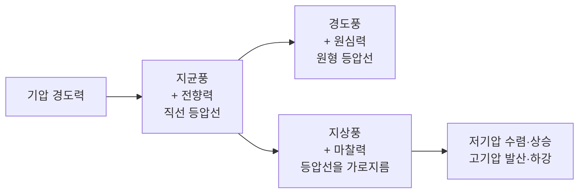

# 지구시스템과학 3. 강수 과정과 대기의 운동 — 햇빛 한 줄기가 비와 바람이 되기까지
<!-- prev: m3-02, 3-1, 5-3, earth-1, esys-2 -->
<!-- next: astro-1 -->

> [!NOTE]
> **성취기준**
> - **[12지시03-01]** 대기를 구성하는 기체들이 선택적 흡수체임을 이해하고, 온실효과 및 태양 자외선 차단 효과, 물의 존재 등으로 지구 생명체 존재 조건을 추론할 수 있다.
> - **[12지시03-02]** 지표와 대기의 열 출입과 관련된 물리 과정 및 전 지구 평균 열수지를 해석할 수 있다.
> - **[12지시03-03]** 기온의 연직 분포와 대기의 안정도와의 관계를 이해하고, 단열변화를 통해 안개나 구름이 생성되는 과정 및 강수 과정을 분석할 수 있다.
> - **[12지시03-04]** 기압의 연직 분포로 정역학적 균형을 이해하고, 대기 중 연직 운동의 발생 원인을 추론할 수 있다.
> - **[12지시03-05]** 지균풍, 경도풍, 지상풍의 발생 원리와 관련된 힘의 작용을 설명할 수 있다.
> - **[12지시03-06]** 행성파의 발달 과정을 이해하고, 지상 고⋅저기압 발달에서 편서풍 파동의 역할을 평가할 수 있다.

**학습 목표**

1. 대기 기체가 파장에 따라 복사를 골라 흡수한다는 것을 이해하고, 온실효과·자외선 차단·액체 물로 지구가 생명가능지대임을 추론할 수 있다.
2. 산란·반사·흡수·굴절과 전도·대류·잠열로 지표와 대기의 열 출입을 설명하고, 전 지구 평균 열수지에서 잠열의 역할을 해석할 수 있다.
3. 단열 감률과 기온의 연직 분포를 비교해 대기 안정도를 판정하고, 안개·구름의 생성과 강수 과정(병합설·빙정설)을 분석할 수 있다.
4. 정역학적 균형으로 기압의 연직 분포를 설명하고, 수렴·발산·지형·전선·대류 등 연직 운동의 원인을 추론할 수 있다.
5. 기압 경도력·전향력·원심력·마찰력의 작용으로 지균풍·경도풍·지상풍을 설명할 수 있다.
6. 편서풍 파동(행성파)과 제트류가 발달하는 과정을 이해하고, 지상 고·저기압 발달에서의 역할을 상층 일기도로 평가할 수 있다.

**이 단원의 학습 사다리**

| 단계 | 무엇을 하나? |
|---|---|
| STEP 1. 이전 학습 다시 보기 | 복사 평형과 온실효과, 상대습도와 단열 팽창, 대기 대순환, 중위도 저기압, 지형류를 다시 꺼낸다 |
| STEP 2. 기초 다지기 | 흑체 복사와 빈 법칙, 기체의 단열 변화, 포화 수증기압, 압력과 힘, 원운동의 구심력 |
| STEP 3. 핵심 개념 | 선택적 흡수 → 생명가능지대 → 열수지 → 단열 변화와 안정도 → 구름과 강수 → 정역학 균형과 연직 운동 → 지균풍·경도풍·지상풍 → 제트류와 편서풍 파동 |
| STEP 4. 오개념 바로잡기 | "바람은 고기압에서 저기압으로 곧장 분다?", "구름이 무거워져서 비가 온다?" 같은 착각을 바로잡는다 |
| STEP 5. 대학 전공으로 | 복사 전달, 온위와 상당 온위, 온도풍, 로스비파의 식, 수치 예보 |
| STEP 6. 생활·산업·진로 | 일기 예보, 항공 기상과 제트기류, 인공 강우, 기후 모델 |

---

## 🗺️ 단원 들어가기

서울에서 미국 서부로 가는 비행기는 돌아오는 비행기보다 1~2시간 빨리 도착할 때가 많다. 상공 약 10 km를 흐르는 강한 서풍, **제트류**를 타고 가기 때문이다. 같은 높이에서 내려다보면 구름은 어떤 날은 솜사탕처럼 높이 솟고, 어떤 날은 이불처럼 얇게 깔린다. 그리고 지상 일기도의 저기압은 대개 상층의 바람이 크게 굽이치는 곳의 동쪽에서 발달한다.

햇빛은 대기를 지나 지표를 데우고, 데워진 지표는 물을 증발시켜 대기에 열을 보낸다. 그 열이 공기를 들어 올려 구름과 비를 만들고, 위도에 따른 가열 차이가 바람과 편서풍 파동을 만든다. **이 단원에서는 햇빛 한 줄기가 비와 바람이 되기까지의 물리 과정을 처음부터 끝까지 따라가 본다.**

---

## STEP 1. 🔙 이전 학습 다시 보기

### 연계 개념표

| 이전 단원·성취기준 | 그때 배운 것 | 이 단원에서 확장되는 것 |
|---|---|---|
| 중3 「날씨와 기후변화」 [9과17-01] | 대기권의 4개 층, 복사 평형과 온실효과 | 기체마다 흡수하는 **파장이 다른** 선택적 흡수체, 생명가능지대 |
| 중3 「날씨와 기후변화」 [9과17-02] | 대기 대순환과 위도별 바람(전향력 없이) | **전향력**을 넣은 대기 대순환, 제트류 |
| 중3 「날씨와 기후변화」 [9과17-03] | 상대습도, 단열 팽창과 응결, 빙정설·병합설(정성적) | **단열 감률**로 구름 높이 계산, 대기 **안정도** |
| 중3 「날씨와 기후변화」 [9과17-04] | 기압과 바람, 고기압·저기압의 날씨 | 바람에 작용하는 **힘의 균형** |
| 통합과학1 「지구시스템의 구성과 상호작용」 [10통과1-03-01] | 권역 사이의 에너지 흐름과 물 순환 | 지표–대기 열 출입의 **물리 과정** |
| 통합과학2 「지구온난화와 기후변화」 [10통과2-02-03] | 지구 열수지 표, 온실효과 강화 | 열수지에서 **잠열**이 가장 큰 비복사 열 수송임을 해석 |
| 지구과학 「대기와 해양의 상호작용」 [12지구01-03], [12지구01-04] | 중위도 저기압·고기압의 날씨, 태풍, 악기상 | 저기압이 **왜 그곳에서 발달하는지**(편서풍 파동의 역할) |
| 지구시스템과학 「해수의 운동」 [12지시02-01] | 정역학 평형, 수압 경도력과 전향력, 지형류 | 대기의 정역학 균형과 **지균풍**(같은 원리) |

### 준비 운동 (사전 진단)

**Q1.** 지구가 복사 평형 상태라는 것은 무슨 뜻인가?

**Q2.** 공기가 상승하면 온도가 내려가는 까닭은?

**Q3.** 북반구에서 운동하는 물체에 작용하는 전향력의 방향은?

**Q4.** 기압이 같은 지점을 이은 선을 무엇이라 하며, 그 간격이 좁을수록 바람은 어떻게 되는가?

정답 및 해설

**Q1.** 지구가 흡수하는 태양 복사 에너지양과 우주로 방출하는 지구 복사 에너지양이 같아 평균 온도가 일정하게 유지되는 상태이다.

**Q2.** 높이 올라갈수록 주변 기압이 낮아져 공기가 **팽창**하면서 주위에 일을 하므로 내부 에너지가 줄어 온도가 내려간다(**단열 팽창**).

**Q3.** 운동 방향의 **오른쪽** 직각 방향이다.

**Q4.** **등압선**. 간격이 좁을수록 기압 차가 커서 바람이 강하다.

---

## STEP 2. 🧱 기초 다지기

### ① 모든 물체는 온도에 맞는 빛을 낸다 — 빈 법칙

온도가 있는 모든 물체는 전자기파를 방출한다. 이상적인 흡수·방출체(흑체)가 가장 강하게 내는 파장 $\lambda_{\max}$는 절대 온도 $T$에 반비례한다(**빈 변위 법칙**). 방출하는 총에너지는 $T^4$에 비례한다(**슈테판–볼츠만 법칙**).

$$
\lambda_{\max} = \frac{2898}{T}\ \mu\mathrm{m\cdot K}, \qquad E = \sigma T^4\ \ (\sigma = 5.67\times10^{-8}\ \mathrm{W/(m^2\cdot K^4)})
$$

| 물체 | 온도(약) | $\lambda_{\max}$ | 복사의 이름 |
|---|---|---|---|
| 태양 표면 | 5800 K | 약 0.5 μm(가시광선) | **단파 복사**(태양 복사) |
| 지표 | 288 K | 약 10 μm(적외선) | **장파 복사**(지구 복사) |

태양 복사와 지구 복사는 파장 영역이 거의 겹치지 않는다. 그래서 같은 대기가 태양 복사는 잘 통과시키고 지구 복사는 붙잡을 수 있다.

### ② 단열 변화 — 열 출입 없이 온도가 변한다

외부와 열을 주고받지 않으면서 부피가 변하는 과정을 **단열 과정**이라 한다. 열역학 제1법칙($Q = \Delta U + W$)에서 $Q = 0$이면 $\Delta U = -W$이다.

- **단열 팽창**: 기체가 외부에 일을 함($W>0$) → 내부 에너지 감소 → **온도 하강**. (예: 스프레이를 오래 뿌리면 통이 차가워진다)
- **단열 압축**: 외부가 기체에 일을 함($W<0$) → 내부 에너지 증가 → **온도 상승**. (예: 자전거 펌프 끝이 뜨거워진다)

공기 덩어리는 크기가 커서 주변과 열을 주고받는 속도가 느리므로, 상승·하강할 때 단열 과정으로 보아도 좋다.

### ③ 포화 수증기압과 이슬점

공기가 최대로 품을 수 있는 수증기의 압력을 **포화 수증기압**이라 하며, 온도가 높을수록 급격히 커진다. 공기를 식혀 수증기가 응결하기 시작하는 온도가 **이슬점**이다.

$$
\text{상대습도} = \frac{\text{현재 수증기압}}{\text{현재 기온의 포화 수증기압}}\times100\ (\%)
$$

| 기온(°C) | −10 | 0 | 10 | 20 | 30 |
|---|---|---|---|---|---|
| 물에 대한 포화 수증기압(hPa, 약) | 2.9 | 6.1 | 12.3 | 23.4 | 42.4 |

### ④ 압력 차이는 힘이다

압력은 단위 면적에 작용하는 힘이다. 공기 덩어리 양쪽의 압력이 다르면 압력이 높은 쪽에서 낮은 쪽으로 알짜힘이 생긴다. 이것이 「해수의 운동」에서 배운 **압력 경도력**이고, 대기에서는 **기압 경도력**이라 부른다.

### ⑤ 곡선 운동에는 구심력이 필요하다

곡선을 따라 도는 물체에는 곡선의 중심 쪽으로 $\dfrac{v^2}{r}$(단위 질량당)의 알짜힘이 필요하다. 바람이 둥근 등압선을 따라 돌 때도 마찬가지이다. 회전하는 공기와 함께 보면 이 효과는 바깥쪽으로 향하는 **원심력**으로 나타난다.

---

## STEP 3. 📘 핵심 개념

### ① 선택적 흡수체로서의 대기 [12지시03-01]

대기 기체는 모든 파장의 복사를 똑같이 흡수하지 않는다. 기체 분자는 자신의 구조에 맞는 **특정 파장만 골라 흡수**한다. 이런 성질을 가진 물질을 **선택적 흡수체(selective absorber)** 라고 한다.

| 기체 | 주로 흡수하는 파장 | 결과 |
|---|---|---|
| 산소($\mathrm{O_2}$) | 매우 짧은 자외선(약 0.2 μm 이하) | 높은 고도에서 자외선 흡수, 그 과정에서 산소 원자가 생겨 오존 생성 |
| 오존($\mathrm{O_3}$) | 자외선(약 0.2~0.3 μm), 적외선 9.6 μm 부근 | **생명에 해로운 자외선 차단**, 성층권을 데워 기온이 높이 따라 오름 |
| 수증기($\mathrm{H_2O}$) | 적외선의 넓은 영역(6 μm 부근, 20 μm 이상 등) | 가장 큰 온실효과 |
| 이산화 탄소($\mathrm{CO_2}$) | 적외선 15 μm 부근, 4.3 μm 부근 | 온실효과 |
| 메테인, 산화 이질소 등 | 적외선의 일부 | 양은 적지만 분자당 온실효과가 큼 |
| 질소($\mathrm{N_2}$), 아르곤 | 가시광선·적외선을 거의 흡수하지 않음 | 대기의 대부분이지만 온실 기체가 아님 |

결과를 파장별로 정리하면 다음과 같다.

- **가시광선(약 0.4~0.7 μm)**: 대기를 거의 그대로 통과한다 → 태양 에너지의 대부분이 지표에 닿는다.
- **자외선**: 산소와 오존이 대부분 흡수한다 → 지표 생명이 보호된다.
- **적외선**: 수증기와 이산화 탄소가 대부분 흡수한다. 다만 **약 8~12 μm** 영역은 잘 흡수되지 않아 지표 복사가 우주로 빠져나가는 **대기의 창(atmospheric window)** 이 된다.

> [!TIP]
> 💡 **비유** — 대기는 '들어오는 사람은 통과시키고 나가는 사람은 붙잡는 회전문'과 같다. 들어오는 손님(가시광선)과 나가는 손님(적외선)이 입은 옷(파장)이 달라서, 문지기(온실 기체)가 골라서 붙잡을 수 있다.

#### 예제 1 — 태양 복사와 지구 복사의 파장

태양 표면(5800 K)과 지표(288 K)가 가장 강하게 방출하는 파장을 빈 법칙으로 구하고, 온실 기체가 주로 지구 복사를 붙잡을 수 있는 까닭을 설명하시오.

**풀이** 태양: $\lambda_{\max} = 2898/5800 \approx 0.50\ \mu\mathrm{m}$(가시광선), 지표: $\lambda_{\max} = 2898/288 \approx 10\ \mu\mathrm{m}$(적외선). 수증기와 이산화 탄소는 가시광선은 거의 흡수하지 않고 적외선을 강하게 흡수하므로, 들어오는 태양 복사는 통과시키고 나가는 지구 복사는 흡수한다.

### ② 생명가능지대로서의 지구 [12지시03-01]

**생명가능지대(habitable zone)** 는 행성 표면에 **액체 상태의 물**이 존재할 수 있는 별 주위의 거리 범위이다. 지구가 생명의 행성이 된 조건을 대기와 물의 관점에서 정리해 보자.

**(1) 온실효과가 물을 액체로 지킨다** 대기가 없다고 가정하고 지구의 복사 평형 온도를 구해 보자. 태양 상수 $S$(약 $1361\ \mathrm{W/m^2}$)가 지구 단면적 $\pi R^2$에 들어오고, 반사율 $A$(약 0.3)를 뺀 나머지가 흡수되며, 지구 전체 표면적 $4\pi R^2$에서 $\sigma T^4$로 방출된다.

$$
S(1-A)\pi R^2 = 4\pi R^2\sigma T_e^4 \quad\Rightarrow\quad T_e = \left[\frac{S(1-A)}{4\sigma}\right]^{1/4}
$$

#### 예제 2 — 온실효과가 없다면

$S = 1361\ \mathrm{W/m^2}$, $A = 0.30$, $\sigma = 5.67\times10^{-8}\ \mathrm{W/(m^2\cdot K^4)}$일 때 $T_e$를 구하고, 실제 지표 평균 기온 약 288 K(15 °C)와 비교하시오.

**풀이**

$$
T_e = \left[\frac{1361\times0.70}{4\times5.67\times10^{-8}}\right]^{1/4} = (4.20\times10^{9})^{1/4} \approx 255\ \mathrm{K}\ (\text{약 } -18\ ^\circ\mathrm{C})
$$

온실효과가 없으면 지구 평균 기온은 약 −18 °C로 바다가 대부분 얼었을 것이다. 실제로는 온실효과 덕분에 약 33 K 더 따뜻한 15 °C여서 액체 물이 유지된다.

**(2) 자외선 차단** 오존층이 파장이 짧은 자외선을 흡수하여 DNA를 손상시키는 복사가 지표에 거의 닿지 않는다. 오존층은 광합성으로 대기 산소가 늘어난 뒤에 생겼고(「지구 탄생과 생동하는 지구」), 그 뒤 생물이 육상으로 진출할 수 있었다.

**(3) 물의 특별한 성질**

| 물의 성질 | 생명과 기후에 주는 의미 |
|---|---|
| 비열이 매우 큼 | 바다가 열을 저장해 낮밤·계절의 기온 변화를 줄임 |
| 증발 잠열이 매우 큼 | 증발과 응결로 열을 운반(④의 열수지에서 핵심) |
| 얼음이 물보다 가벼움 | 호수·바다가 위에서부터 얼어 아래의 물과 생물을 보호 |
| 많은 물질을 녹임 | 생명체 안팎에서 화학 반응의 무대 |
| 상온에서 고체·액체·기체가 모두 존재 | 물의 순환으로 에너지와 물질이 권역 사이를 이동 |

| 행성 | 평균 표면 온도(약) | 대기 | 액체 물 |
|---|---|---|---|
| 금성 | 460 °C | 두꺼운 $\mathrm{CO_2}$, 강한 온실효과 | 없음 |
| 지구 | 15 °C | $\mathrm{N_2}$·$\mathrm{O_2}$, 적당한 온실효과, 오존층 | 있음 |
| 화성 | −60 °C | 얇은 $\mathrm{CO_2}$, 약한 온실효과 | 표면에는 거의 없음 |

생명가능지대 안에 있다는 것은 '거리'만의 조건이 아니라, 적당한 **온실효과**를 가진 대기, **자외선 차단**, 그리고 **물의 순환**이 함께 갖추어져야 한다는 뜻이다.

### ③ 지표와 대기의 열 출입 — 물리 과정 [12지시03-02]

| 물리 과정 | 무엇이 일어나나 | 대기에서의 예 |
|---|---|---|
| **산란(scattering)** | 빛이 작은 입자에 부딪혀 여러 방향으로 퍼짐 | 기체 분자는 파장이 짧은 파란빛을 강하게 산란 → **파란 하늘**, 해 질 녘 붉은 노을. 구름 방울처럼 큰 입자는 모든 색을 비슷하게 산란 → **흰 구름** |
| **반사(reflection)** | 빛이 표면에서 되돌아감 | 구름·눈·얼음은 반사율이 높음, 바다·숲은 낮음. 지구 전체 반사율 약 30 % |
| **흡수(absorption)** | 복사 에너지가 물질의 내부 에너지로 바뀜 | 오존의 자외선 흡수, 수증기·$\mathrm{CO_2}$의 적외선 흡수, 지표의 태양 복사 흡수 |
| **굴절(refraction)** | 밀도가 다른 공기층을 지날 때 빛이 꺾임 | 지평선 근처의 해가 실제보다 약간 높이 보임, 신기루, 별의 반짝임 |
| 전도·대류(현열) | 지표에 닿은 공기가 데워져 상승 | 맑은 날 낮의 상승 기류, 아지랑이 |
| **잠열(latent heat)** | 물이 증발할 때 열을 흡수, 응결할 때 대기 중에 방출 | 바다에서 증발한 수증기가 구름이 되며 대기를 데움 |

### ④ 전 지구 평균 열수지 [12지시03-02]

지구 대기 꼭대기에 들어오는 태양 복사(전 지구 평균 약 $340\ \mathrm{W/m^2}$, 태양 상수의 $\frac14$)를 100으로 둔 열수지이다. 통합과학 「지구온난화와 기후변화」의 표와 같은 대표값을 쓴다(자료마다 조금씩 다를 수 있다).

| 구분 | 들어오는 양 | 나가는 양 |
|---|---|---|
| 지구 전체 | 태양 복사 100 | 반사 30 + 대기 방출 58 + 대기의 창 통과 12 = 100 |
| 대기 | 태양 복사 흡수 23 + 지표 복사 흡수 104 + **잠열 23** + 현열(전도·대류) 5 = 155 | 지표로 역복사 97 + 우주로 58 = 155 |
| 지표 | 태양 복사 흡수 47 + 대기 역복사 97 = 144 | 지표 복사 116 + **잠열 23** + 현열 5 = 144 |

**지표의 '알짜' 열 출입을 보면 잠열의 중요성이 드러난다.** 지표는 장파 복사로 116을 내보내지만 대기 역복사로 97을 돌려받으므로 **알짜 장파 손실은 19**에 불과하다. 반면 증발로 내보내는 잠열은 **23**, 전도·대류는 5이다.

| 지표가 열을 잃는 방법 | 알짜 양 | 비율(47에 대해) |
|---|---|---|
| 잠열(증발) | 23 | 약 49 % |
| 알짜 장파 복사 ($116 - 97$) | 19 | 약 40 % |
| 현열(전도·대류) | 5 | 약 11 % |
| 합계 = 지표가 흡수한 태양 복사 | 47 | 100 % |

> [!IMPORTANT]
> 지표가 흡수한 태양 에너지를 대기로 옮기는 방법 가운데 **잠열의 효과가 가장 크다.** 증발로 수증기에 숨겨진 열은 공기가 상승하여 **단열 냉각으로 응결할 때** 대기 중에 풀려난다. 그래서 구름이 생기는 과정(⑤~⑦)은 지구가 열을 위로 나르는 핵심 통로이다.

#### 예제 3 — 비 1 m가 나르는 열

전 지구 평균 강수량은 1년에 약 1 m이다. 내린 비만큼의 물이 증발했다고 하면, 단위 면적당 1초에 대기로 공급되는 잠열을 구하시오. (물의 증발 잠열 $2.5\times10^6\ \mathrm{J/kg}$, 1년 $= 3.16\times10^7\ \mathrm{s}$)

**풀이** $1\ \mathrm{m^2}$ 위 1 m 깊이의 물은 $1000\ \mathrm{kg}$이다.

$$
\frac{1000\times2.5\times10^6}{3.16\times10^7} \approx 79\ \mathrm{W/m^2}
$$

입사 태양 복사 약 $340\ \mathrm{W/m^2}$의 약 23 %로, 열수지 표의 잠열 23과 잘 맞는다. **비가 내리는 양을 알면 대기가 얼마나 데워지는지 알 수 있다.**

#### 위도에 따른 불균형

저위도는 흡수하는 태양 복사가 방출하는 지구 복사보다 많고(에너지 과잉), 고위도는 반대(에너지 부족)이다. 이 불균형을 대기(바람과 잠열)와 해양(해류)이 저위도에서 고위도로 열을 날라 해소한다. ⑫의 대기 대순환과 편서풍 파동이 바로 그 운반 장치이다.

### ⑤ 단열 변화 — 상승하는 공기의 기온과 습도 [12지시03-03]

| 감률 | 크기(약) | 적용 |
|---|---|---|
| **건조 단열 감률** $\Gamma_d$ | 10 °C/km | 불포화 공기가 상승·하강할 때 |
| **습윤 단열 감률** $\Gamma_s$ | 약 5 °C/km(기온이 높을수록 작고, 낮을수록 건조 단열 감률에 가까움) | 포화 공기가 상승할 때(응결 잠열이 냉각을 줄임) |
| 이슬점 감률 | 약 2 °C/km | 불포화 공기가 상승할 때 이슬점이 내려가는 정도 |

포화된 공기가 상승할 때 덜 식는 까닭은 수증기가 응결하며 **잠열을 방출**하기 때문이다. ④에서 지표가 증발로 보낸 열이 바로 여기서 공기를 데운다.

**상승 응결 고도(구름 밑면 높이)** 불포화 공기는 1 km 오를 때 기온이 10 °C, 이슬점이 2 °C 내려가므로 둘의 차가 8 °C/km씩 줄어든다. 처음 기온 $T$와 이슬점 $T_d$의 차가 0이 되는 높이에서 응결이 시작된다.

$$
h \approx \frac{T - T_d}{8\ ^\circ\mathrm{C/km}} = 125\,(T - T_d)\ \mathrm{m}
$$

상승하는 공기의 **상대습도**는 기온이 내려가 포화 수증기압이 작아지므로 점점 높아지고, 상승 응결 고도에서 100 %가 된다.

#### 예제 4 — 높새바람(푄)

지표(0 m)에서 기온 20 °C, 이슬점 12 °C인 공기가 높이 2000 m인 산을 넘어 반대편 지표(0 m)로 내려간다. 구름에서 생긴 비는 모두 산 위쪽 사면에 내린다고 가정한다.
(1) 구름이 생기기 시작하는 높이는? (2) 산꼭대기의 기온은? (3) 반대편 지표에서의 기온과 이슬점은?

**풀이**
(1) $h = 125\times(20-12) = 1000\ \mathrm{m}$. 이때 기온은 $20 - 10 = 10\ ^\circ\mathrm{C}$(이슬점도 10 °C)
(2) 1000 m에서 2000 m까지 습윤 단열 감률로 $10 - 5\times1 = 5\ ^\circ\mathrm{C}$ (포화 상태이므로 이슬점도 5 °C)
(3) 내려갈 때는 비를 내리고 불포화 상태가 되므로 건조 단열 감률로 2000 m 하강: $5 + 10\times2 = 25\ ^\circ\mathrm{C}$. 이슬점은 2 °C/km로 오르므로 $5 + 2\times2 = 9\ ^\circ\mathrm{C}$

반대편에서는 기온이 5 °C 높아지고 이슬점은 3 °C 낮아져 **고온 건조**해진다. 늦봄·초여름 동해 쪽에서 태백산맥을 넘어 영서 지방으로 부는 **높새바람**이 이 원리이다.

### ⑥ 기온의 연직 분포와 대기 안정도 [12지시03-03]

**대기 안정도**는 공기 덩어리를 조금 들어 올렸을 때, 원래 위치로 **되돌아오려 하는지(안정)**, 아니면 **계속 올라가려 하는지(불안정)** 를 나타낸다. 들어 올린 공기 덩어리가 주변 공기보다 **따뜻하면 가벼워 계속 상승**하고, 차가우면 무거워 되돌아온다. 주변 공기의 실제 기온 감률을 **기온 감률** $\Gamma$라 하고 단열 감률과 비교한다.

| 기온 감률 $\Gamma$ | 안정도 | 불포화 공기를 올리면 | 포화 공기를 올리면 |
|---|---|---|---|
| $\Gamma < \Gamma_s$ | **절대 안정** | 주변보다 차가움 → 되돌아옴 | 주변보다 차가움 → 되돌아옴 |
| $\Gamma_s < \Gamma < \Gamma_d$ | **조건부 불안정** | 되돌아옴 | 주변보다 따뜻함 → 계속 상승 |
| $\Gamma > \Gamma_d$ | **절대 불안정** | 계속 상승 | 계속 상승 |

**기온 역전층**($\Gamma < 0$, 위로 갈수록 기온이 오름)은 매우 안정한 층으로, 대류를 막는 뚜껑 역할을 한다. 맑고 바람이 약한 밤에 지표가 복사로 식어 생기는 **복사 역전**, 넓은 고기압권에서 공기가 가라앉으며 단열 압축으로 데워져 생기는 **침강 역전** 등이 있다. 역전층 아래에는 안개와 대기 오염 물질이 갇히기 쉽다.

| 안정도 | 구름 모양 | 강수 | 예 |
|---|---|---|---|
| 안정 | 옆으로 넓게 퍼진 **층운형**(층운, 고층운, 난층운) | 약하고 넓게, 오래 내림 | 온난 전선 앞의 넓은 구름 |
| 불안정 | 위로 솟은 **적운형**(적운, 적란운) | 강하고 좁게, 짧게 내림(소나기, 뇌우) | 한여름 오후의 소나기, 한랭 전선의 적란운 |

#### 예제 5 — 안정도 판정

세 지역의 지표~3 km 기온 감률이 A: 4 °C/km, B: 7 °C/km, C: 11 °C/km이다. ($\Gamma_d = 10$, $\Gamma_s = 5$ °C/km로 둔다.)
(1) 각 지역의 안정도는? (2) B에서 지형을 따라 강제로 상승한 공기가 포화되었다면 어떤 구름이 생기기 쉬운가?

**풀이** (1) A: 절대 안정($4 < 5$), B: 조건부 불안정($5 < 7 < 10$), C: 절대 불안정($11 > 10$). (2) 포화된 공기는 습윤 단열 감률(5 °C/km)로 식어 주변(7 °C/km)보다 덜 식으므로 따뜻해져 계속 상승한다. 위로 크게 발달하는 **적운형 구름(적란운)** 이 생기기 쉽다.

### ⑦ 안개와 구름의 생성, 그리고 강수 과정 [12지시03-03]

#### (1) 안개 — 지표 가까이 생긴 구름

공기가 이슬점 아래로 **식거나**, 수증기가 **더해져** 포화되면 응결이 일어난다. 이것이 지표 부근에서 일어나면 안개이다.

| 안개 | 생기는 과정 | 예 |
|---|---|---|
| 복사 안개 | 맑고 바람 약한 밤, 지표 복사 냉각으로 지표 공기가 냉각(복사 역전) | 가을 새벽 내륙 분지·강가의 안개 |
| 이류 안개 | 따뜻하고 습한 공기가 찬 수면·지면 위로 이동하며 냉각 | 봄·여름 서해·남해의 해무 |
| 증발 안개 | 찬 공기가 따뜻한 수면 위로 오면 수증기가 공급되어 포화 | 겨울 아침 호수·강 위의 김 |
| 활승 안개 | 공기가 산 사면을 타고 올라가며 단열 냉각 | 산 중턱의 안개 |

#### (2) 구름 — 공기가 상승해야 생긴다

구름 대부분은 공기가 **상승하여 단열 팽창으로 냉각**될 때 생긴다. 상승의 원인은 ⑨의 연직 운동과 같다(대류, 지형, 전선, 수렴). 응결이 일어나려면 수증기가 달라붙을 작은 입자인 **응결핵**(바다 소금, 먼지, 황산염 에어로졸 등)이 필요하다.

#### (3) 강수 과정 — 구름 방울은 왜 바로 떨어지지 않나?

구름 방울의 지름은 약 0.02 mm(20 μm), 보통 빗방울은 약 2 mm이다. 지름이 100배이면 부피는 $100^3 = 10^6$배이므로, **구름 방울 약 100만 개가 모여야 빗방울 1개**가 된다. 구름 방울은 너무 작아 공기 저항 때문에 떨어지는 속력이 매우 느리고, 떨어지는 도중 증발해 버린다. 그래서 구름 방울을 빗방울로 키우는 과정이 필요하다.

| 구분 | **병합설**(충돌·병합 과정) | **빙정설**(베르게론 과정) |
|---|---|---|
| 적용 구름 | 구름 전체가 0 °C보다 따뜻한 구름 | 0 °C보다 차가운 층이 있는 구름(과냉각 물방울 + 빙정) |
| 주된 지역 | 저위도(열대) | 중·고위도 |
| 과정 | 큰 물방울이 빨리 떨어지며 작은 물방울과 부딪혀 합쳐짐 → 점점 커짐 | 같은 온도에서 얼음의 포화 수증기압이 물보다 작음 → 물방울은 증발, 빙정은 수증기를 받아 성장 → 무거워져 떨어짐(녹으면 비, 녹지 않으면 눈) |

| 온도 | −10 °C |
|---|---|
| 물에 대한 포화 수증기압 | 약 2.86 hPa |
| 얼음에 대한 포화 수증기압 | 약 2.60 hPa |

#### 예제 6 — 빙정이 자라는 까닭

−10 °C의 구름 속 수증기압이 2.75 hPa이다. 과냉각 물방울과 빙정에 대해 이 공기는 각각 포화, 불포화, 과포화 중 어느 상태인가? 그 결과 무엇이 자라는가?

**풀이** 물에 대해서는 $2.75 < 2.86$이므로 **불포화** → 물방울은 증발한다. 얼음에 대해서는 $2.75 > 2.60$이므로 **과포화** → 수증기가 빙정에 달라붙어(승화) **빙정이 자란다.** 물방울에서 증발한 수증기가 빙정으로 옮겨 가는 셈이다.

### ⑧ 정역학적 균형과 기압의 연직 분포 [12지시03-04]

어느 높이의 기압은 그 위에 있는 공기 기둥의 무게이다. 공기 덩어리에는 아래로 **중력**이, 위로는 아래쪽 기압이 위쪽보다 커서 생기는 **연직 기압 경도력**이 작용하는데, 대규모 대기에서는 이 두 힘이 거의 정확히 균형을 이룬다. 이를 **정역학적 균형(hydrostatic balance)** 이라 한다.

$$
\frac{\Delta P}{\Delta z} = -\rho g
$$

공기는 압축되므로 높이 올라갈수록 밀도가 작아지고, 기압은 높이에 따라 **지수적으로** 줄어든다. 기온이 일정하다고 근사하면

$$
P = P_0\, e^{-z/H}, \qquad H = \frac{RT}{g} \approx 8\ \mathrm{km}\ (\text{규모 높이})
$$

| 기압(hPa) | 대략의 높이 | 일기도 |
|---|---|---|
| 1000 | 지표 부근 | 지상 일기도 |
| 850 | 약 1.5 km | 하층 기온·수증기 |
| 500 | 약 5.5 km | 편서풍 파동(기압골·기압 마루) |
| 300~200 | 약 9~12 km | 제트류 |

#### 예제 7 — 기압의 연직 분포

(1) 지표 공기의 밀도가 $1.2\ \mathrm{kg/m^3}$일 때 100 m 올라가면 기압이 얼마나 낮아지는가? (2) 규모 높이를 8 km로 할 때 기압이 지표의 절반(500 hPa)이 되는 높이는?

**풀이**
(1) $\Delta P = \rho g \Delta z = 1.2\times9.8\times100 \approx 1.2\times10^3\ \mathrm{Pa} = 12\ \mathrm{hPa}$ (지표 부근에서 1 hPa ≈ 8 m)
(2) $\dfrac{1}{2} = e^{-z/8}$에서 $z = 8\ln2 \approx 5.5\ \mathrm{km}$

#### 따뜻한 공기 기둥은 키가 크다

$H = RT/g$이므로 **기온이 높은 공기 기둥일수록 기압이 천천히 줄어든다.** 지상 기압이 같아도 따뜻한 곳의 500 hPa 면은 높고, 찬 곳의 500 hPa 면은 낮다. 그래서 같은 높이에서 보면 따뜻한 쪽 상공의 기압이 더 높다. 이 사실이 **상층에서 저위도(따뜻함) → 고위도(차가움)로 향하는 기압 경도력**을 만들고, ⑫의 편서풍과 제트류로 이어진다. 상층 일기도는 이런 까닭에 일정 높이의 기압 대신 **등압면의 높이(등고선)** 로 그린다.

### ⑨ 대기 중 연직 운동의 원인 [12지시03-04]

정역학적 균형 상태에서는 연직 방향의 힘이 거의 균형이므로, 대규모 연직 운동은 수평 운동(수 m/s~수십 m/s)보다 훨씬 느리다(수 cm/s 정도). 그러나 이 느린 상승이 구름과 비를 만든다. 연직 운동이 일어나는 원인을 정리하면 다음과 같다.

| 원인 | 과정 | 대표 현상 |
|---|---|---|
| **수렴과 발산** | 지상에서 공기가 모이면(수렴) 갈 곳이 위뿐이라 상승, 상층에서 공기가 흩어지면(발산) 아래 공기가 끌려 올라감. 반대로 상층 수렴·지상 발산은 하강 | 지상 저기압 = 상승(흐림), 지상 고기압 = 하강(맑음) |
| **지형에 의한 강제 상승** | 바람이 산을 만나 사면을 타고 오름 | 산의 바람받이 쪽 강수, 푄 |
| **전선** | 따뜻한 공기가 찬 공기 위로 올라가거나(온난 전선), 찬 공기가 따뜻한 공기를 밀어 올림(한랭 전선) | 전선형 구름과 강수 |
| **대류(부력)** | 지표가 가열되어 불안정해진 공기가 스스로 상승 | 여름 오후 적란운, 뇌우(상승 속력 수 m/s~수십 m/s) |
| **상층 편서풍 파동** | 상층 기압골 동쪽의 발산 | 중위도 저기압의 발달(⑭) |

> [!IMPORTANT]
> **질량 보존**이 연직 운동의 열쇠이다. 공기는 쌓이거나 사라질 수 없으므로, 수평으로 모이면 위아래로 빠져나가고 수평으로 흩어지면 위아래에서 채워진다. 지상 저기압의 상승 기류는 **지상 수렴 + 상층 발산**이 짝을 이룬 결과이다.

### ⑩ 바람에 작용하는 힘과 지균풍 [12지시03-05]

| 힘(단위 질량당) | 식 | 방향 | 특징 |
|---|---|---|---|
| **기압 경도력** | $\dfrac{1}{\rho}\dfrac{\Delta P}{\Delta n}$ | 등압선에 수직, 고기압 → 저기압 | 바람을 일으키는 원동력. 등압선이 조밀할수록 큼 |
| **전향력** | $fv$, $f = 2\Omega\sin\varphi$ | 북반구에서 운동 방향의 오른쪽 직각 | 방향만 바꿈. 적도에서 0 |
| **원심력** | $\dfrac{v^2}{r}$ | 곡선 바깥쪽 | 등압선이 휘어 있을 때 |
| **마찰력** | — | 운동 방향의 반대 | 지표~약 1 km(대기 경계층)에서만 중요 |

**지균풍(geostrophic wind)** 은 마찰이 없는 상층에서 등압선이 **직선**일 때, **기압 경도력과 전향력이 균형**을 이루어 등압선과 **나란하게** 부는 바람이다.

$$
fv_g = \frac{1}{\rho}\frac{\Delta P}{\Delta n} \quad\Rightarrow\quad v_g = \frac{1}{\rho f}\frac{\Delta P}{\Delta n}
$$

**지균풍이 되는 과정** 정지한 공기에 기압 경도력이 작용하면 저기압 쪽으로 움직이기 시작한다. 움직이면 전향력이 생겨 오른쪽(북반구)으로 휜다. 속력이 커질수록 전향력도 커지고 방향이 점점 오른쪽으로 돌아, 마침내 전향력이 기압 경도력과 정반대가 되면 힘이 균형을 이루어 등압선과 나란히 일정하게 분다.

| 성질(북반구) | 내용 |
|---|---|
| 방향 | 등압선과 나란함. 바람을 등지고 서면 **저기압이 왼쪽**, 고기압이 오른쪽 |
| 속력 | 등압선 간격이 좁을수록, 위도가 낮을수록, 공기 밀도가 작을수록 빠름 |
| 상층 일기도 | 등압면 높이 $z$로 그리면 $v_g = \dfrac{g}{f}\dfrac{\Delta z}{\Delta n}$ — 「해수의 운동」의 **지형류 식과 같은 꼴** |

<!-- sim:geostrophic-wind -->

#### 예제 8 — 지상 부근과 500 hPa의 지균풍

위도 40°($f = 9.4\times10^{-5}\ \mathrm{s^{-1}}$)에서
(1) 등압선 간격이 300 km에 4 hPa이고 공기 밀도가 $1.2\ \mathrm{kg/m^3}$일 때 지균풍 속력은?
(2) 500 hPa 일기도에서 등고선이 300 km에 60 m 차이 날 때 지균풍 속력은?

**풀이**
(1) $v_g = \dfrac{1}{1.2\times9.4\times10^{-5}}\times\dfrac{400}{3.0\times10^5} \approx 12\ \mathrm{m/s}$
(2) $v_g = \dfrac{9.8}{9.4\times10^{-5}}\times\dfrac{60}{3.0\times10^5} \approx 21\ \mathrm{m/s}$

> [!TIP]
> 💡 **바다와 대기는 같은 물리** — 해수면이 높은 쪽 = 기압이 높은 쪽, 지형류 = 지균풍. 「해수의 운동」에서 해수면 등고선을 따라 흐르던 지형류처럼, 지균풍은 등압선(등고선)을 따라 분다.

### ⑪ 경도풍과 지상풍 [12지시03-05]

#### (1) 경도풍 — 원 모양 등압선을 따라 도는 바람

등압선이 **원형**이면 바람이 곡선을 따라 돌기 위해 구심력이 필요하다. 마찰이 없는 상층에서 **기압 경도력, 전향력, 원심력**이 균형을 이루어 등압선과 나란히 부는 바람을 **경도풍(gradient wind)** 이라고 한다.

| 구분 | 저기압 주위 | 고기압 주위 |
|---|---|---|
| 회전 방향(북반구) | **반시계 방향** | **시계 방향** |
| 힘의 균형 | 기압 경도력(안쪽) = 전향력(바깥쪽) + 원심력(바깥쪽) | 전향력(안쪽) = 기압 경도력(바깥쪽) + 원심력(바깥쪽) |
| 같은 기압 경도에서의 속력 | 지균풍보다 **느림** | 지균풍보다 **빠름** |
| 특징 | 중심 부근 기압 경도가 매우 클 수 있음(태풍의 강풍) | 기압 경도가 일정 한도를 넘을 수 없어 중심 부근은 바람이 약함 |

저기압에서는 원심력이 기압 경도력 일부를 대신 '상쇄'해 주므로 전향력이 덜 필요하고, 전향력은 속력에 비례하므로 바람이 느려진다. 고기압에서는 원심력과 기압 경도력이 같은 방향(바깥쪽)이라 전향력이 둘을 모두 감당해야 하므로 바람이 빨라진다.

#### (2) 지상풍 — 마찰이 바람을 꺾는다

지표에서 약 1 km 아래(대기 경계층)에서는 **마찰력**이 바람을 약하게 만든다. 속력이 줄면 전향력도 작아져 기압 경도력이 이기게 되므로, 바람은 등압선을 비스듬히 가로질러 **저기압 쪽으로** 분다. 기압 경도력, 전향력, 마찰력의 합력이 0이 되는 이 바람을 **지상풍(surface wind)** 이라고 한다.

| 성질 | 내용 |
|---|---|
| 힘의 균형 | 기압 경도력 = 전향력과 마찰력의 합력(크기 같고 방향 반대) |
| 방향 | 등압선과 비스듬히, 저기압 쪽으로 가로지름. 마찰이 큰 육지에서 각도가 크고, 해상에서 작음 |
| 속력 | 같은 기압 경도의 지균풍보다 느림 |
| 저기압 주변 | 반시계 방향으로 **불어 들어감**(수렴 → 상승 → 구름·비) |
| 고기압 주변 | 시계 방향으로 **불어 나감**(발산 → 하강 → 맑음) |

#### 예제 9 — 같은 일기도, 다른 바람

같은 위도, 같은 등압선 간격을 가진 세 곳 — 상층의 직선 등압선(A), 상층 저기압 둘레의 원형 등압선(B), 상층 고기압 둘레의 원형 등압선(C) — 에서 바람의 속력을 비교하시오. 또 지표 부근의 저기압 둘레에서 바람 방향은 B와 어떻게 다른가?

**풀이** 기압 경도력이 같으므로 $C > A > B$(고기압 경도풍 > 지균풍 > 저기압 경도풍). 지표 부근에서는 마찰 때문에 B처럼 등압선을 따라 돌지 않고, 반시계 방향으로 돌면서 **안쪽(저기압 중심)으로 비스듬히 불어 들어간다.**

### ⑫ 대기 대순환과 제트류 [12지시03-06]

중학교에서는 전향력 없이 위도별 바람만 배웠다. 이제 전향력을 넣어 보자. 적도에서 데워진 공기는 상승하여 상층에서 고위도로 흐르는데, 전향력 때문에 오른쪽(북반구에서 동쪽)으로 휘어 **위도 30° 부근에서는 거의 서풍**이 되어 더 북쪽으로 가지 못하고 쌓였다가 가라앉는다. 그래서 하나의 거대한 순환이 아니라 **세 개의 순환 세포**가 생긴다.

| 순환 세포 | 위도 범위 | 지상 바람(북반구) | 특징 |
|---|---|---|---|
| 해들리 순환 | 0°~30° | 북동 무역풍 | 적도 상승(열대 수렴대) → 30° 하강(아열대 고압대, 사막) |
| 페렐 순환 | 30°~60° | 편서풍 | 열이 아닌 다른 순환의 영향으로 생긴 간접 순환. 실제로는 편서풍 파동과 저기압·고기압이 열을 나름 |
| 극순환 | 60°~90° | 극동풍 | 극 하강 → 60° 부근 상승(한대 전선대) |

**제트류(jet stream)** 는 대류권 상부(약 9~13 km)에서 좁은 띠 모양으로 부는 매우 강한 서풍이다(대체로 30 m/s 이상).

- 원인: ⑧에서 본 것처럼 남북 기온 차이가 클수록 위로 갈수록 남북 기압 차가 커지고, 지균풍인 **서풍이 높이에 따라 강해진다.** 남북 기온 차이가 특히 큰 곳의 상공에서 서풍이 가장 강해진다.
- **한대 전선 제트**: 찬 극 공기와 따뜻한 중위도 공기가 만나는 한대 전선대 상공. 위치와 세기가 크게 변하며 편서풍 파동과 함께 구불거린다.
- **아열대 제트**: 해들리 순환의 상층 끝(위도 30° 부근) 상공.
- 계절 변화: **겨울에 남북 기온 차가 커서 더 강하고 남쪽으로 내려온다.** 겨울철 우리나라와 일본 부근 상공은 제트류가 특히 강한 곳이다.

### ⑬ 편서풍 파동(행성파)의 발달 [12지시03-06]

중위도 상층의 편서풍은 위도선을 따라 곧게 불지 않고 남북으로 크게 **굽이치며** 지구를 돈다. 이 거대한 파동을 **편서풍 파동**, 또는 행성 규모의 파동이라는 뜻에서 **행성파(planetary wave)**, 연구자의 이름을 따 **로스비파(Rossby wave)** 라고 한다.

| 성질 | 내용 |
|---|---|
| 규모 | 파장 수천 km, 지구를 한 바퀴 도는 동안 대략 3~6개의 파 |
| 구조 | 남쪽으로 처진 부분 = **기압골**(trough, 찬 공기), 북쪽으로 솟은 부분 = **기압 마루**(ridge, 따뜻한 공기) |
| 이동 | 대체로 서쪽에서 동쪽으로 느리게 이동, 때로는 거의 멈춤(**블로킹**) |
| 역할 | 찬 공기를 남쪽으로, 따뜻한 공기를 북쪽으로 보내 **열을 고위도로 수송** |

**발달 과정** ① 저위도와 고위도의 기온 차이가 커지면 상층 서풍이 강해진다. ② 기온 차이가 어느 한도를 넘으면 곧게 부는 흐름이 불안정해져 작은 굽이가 점점 커진다. ③ 굽이친 흐름을 따라 찬 공기가 남하하고 따뜻한 공기가 북상하며 열을 나르면 기온 차이가 줄어든다. ④ 이 과정이 되풀이된다. 굽이가 제자리로 되돌아가려는 성질은 **위도에 따라 전향 효과($f$)가 달라지기** 때문에 생긴다. 북쪽으로 밀려 올라간 공기는 더 큰 전향 효과를 받아 남쪽으로 되돌아 휘고, 남쪽으로 내려간 공기는 반대로 북쪽으로 되돌아 휜다. 이것이 행성 규모의 파동을 유지한다.

> [!WARNING]
> **회전 원통(접시) 실험의 한계** — 가운데를 차갑게, 바깥을 따뜻하게 한 원통형 수조를 돌리면 물이 구불구불한 파동 모양으로 흐른다. 이 실험은 '남북 온도 차 + 회전'이 굽이치는 흐름을 만든다는 것을 잘 보여 주지만, **평평한 회전 수조에서는 전향 효과가 위도처럼 변하지 않으므로** 실제 로스비파를 되돌리는 원리(위도에 따른 $f$의 변화)를 재현하지 못한다. 수조의 크기·깊이·경계도 실제 대기와 다르다. 그러므로 이 실험의 파동이 곧 편서풍 파동이라고 생각해서는 안 되며, 실험이 보여 주는 것과 보여 주지 못하는 것을 구분해야 한다.

### ⑭ 지상 고·저기압 발달에서 편서풍 파동의 역할 [12지시03-06]

상층의 바람은 기압골에서 경도풍처럼 **저기압성**(반시계)으로 휘고, 기압 마루에서는 **고기압성**(시계)으로 휜다. ⑪에서 배웠듯이 같은 기압 경도라면 저기압성으로 휠 때 느리고 고기압성으로 휠 때 빠르다. 그러므로

- **기압골 → 기압 마루 구간(기압골의 동쪽)**: 바람이 점점 빨라져 공기가 흩어진다 → **상층 발산** → 아래 공기를 끌어올림 → 지상 기압 하강, 지상 수렴 → **지상 저기압 발달**, 상승 기류, 구름과 비
- **기압 마루 → 기압골 구간(기압골의 서쪽)**: 바람이 점점 느려져 공기가 쌓인다 → **상층 수렴** → 하강 → 지상 기압 상승, 지상 발산 → **지상 고기압 발달**, 맑은 날씨

| 위치(상층 기준) | 상층 | 연직 운동 | 지상 | 날씨 |
|---|---|---|---|---|
| 기압골 동쪽 | 발산 | 상승 | 저기압 발달 | 흐리고 비·눈 |
| 기압골 서쪽 | 수렴 | 하강 | 고기압 발달 | 맑음 |

이렇게 상층 발산과 지상 수렴이 짝을 이루어야 지상 저기압이 메워지지 않고 계속 깊어진다. 그래서 발달하는 중위도 저기압의 중심은 상층 기압골의 **동쪽(앞쪽)** 에 있고, 저기압 중심을 높이에 따라 이으면 **서쪽으로 기울어져** 있다. 저기압은 기압골이 동쪽으로 이동함에 따라 함께 이동하며, 제트류는 저기압의 진로를 이끄는 길잡이가 된다.

| 편서풍 파동의 역할 | 평가 |
|---|---|
| 저기압·고기압의 **발생과 발달** | 상층 발산·수렴으로 지상 기압계를 키운다 |
| 저기압·고기압의 **이동 경로와 속도** | 파동과 제트류를 따라 서→동으로 이동한다 |
| 남북 **열 수송** | 기압골·마루와 저기압·고기압이 함께 열을 고위도로 나른다 |
| 이상 기상 | 파동의 진폭이 커지거나 블로킹으로 멈추면 같은 날씨(폭염, 한파, 폭우)가 오래 지속될 수 있다 |

#### 예제 10 — 상층 일기도 해석

500 hPa 일기도에서 중국 북동부에 기압골이 있고, 우리나라는 그 동쪽, 기압골과 그 동쪽 기압 마루 사이에 있다. 기압골은 하루에 약 1000 km씩 동쪽으로 이동하고 있다.
(1) 우리나라 지상의 기압계와 날씨는? (2) 하루나 이틀 뒤의 날씨 변화를 예상하시오.

**풀이**
(1) 우리나라는 기압골 동쪽(상층 발산 구역)에 있으므로 상승 기류가 생기고 지상 저기압이 발달하기 쉽다. **흐리고 비가 올 가능성이 크다.**
(2) 기압골이 동쪽으로 지나가면 우리나라는 기압골 서쪽(상층 수렴, 하강 기류)에 들게 되어 지상 고기압의 영향을 받는다. 찬 공기가 내려오면서 **맑아지고 기온이 낮아질** 것이다.

---

## STEP 4. ⚠️ 오개념 바로잡기

| 흔한 오개념 | 올바른 개념 | 왜 그럴까? |
|---|---|---|
| 온실 기체는 태양 빛을 막아 지구를 데운다 | 온실 기체는 태양 복사(가시광선)는 대부분 통과시키고 **지구 복사(적외선)를 흡수**해 다시 방출한다 | 기체마다 흡수하는 파장이 다른 선택적 흡수체이기 때문이다 |
| 지표는 주로 복사로 열을 잃는다 | 지표의 알짜 열 손실은 **잠열이 가장 크다**(알짜 장파 손실은 대기 역복사로 대부분 상쇄된다) | 지표 복사 116 중 97을 대기 역복사로 돌려받는다 |
| 구름이 무거워지면 비가 된다 | 구름 방울 약 100만 개가 **병합하거나 빙정이 자라** 빗방울 크기가 되어야 떨어진다 | 구름 방울은 너무 작아 공기 저항 때문에 거의 떠 있다 |
| 공기가 올라가면 위쪽이 차가워서 식는다 | 공기는 **단열 팽창**으로 스스로 식는다 | 주변과 열을 주고받지 않아도 팽창하며 일을 하면 내부 에너지가 준다 |
| 바람은 고기압에서 저기압으로 곧장 분다 | 상층에서는 등압선과 **나란히**(지균풍·경도풍), 지표에서는 등압선을 **비스듬히** 가로질러 분다 | 전향력과 마찰력이 함께 작용하기 때문이다 |
| 기온 감률이 클수록 대기가 안정하다 | 기온 감률이 **클수록 불안정**하다 | 위가 많이 차가우면 올라간 공기가 주변보다 따뜻해져 계속 오른다 |
| 회전 원통 실험의 파동은 편서풍 파동과 같다 | 회전 수조는 위도에 따른 전향 효과의 변화를 재현하지 못한다 | 로스비파를 되돌리는 원리는 $f$가 위도에 따라 변하는 것이다 |

---

## STEP 5. 🎓 다음 단계로 한 걸음 더

> [!CAUTION]
> 이 절은 **지구시스템과학 교육과정 범위 밖의 심화 내용**으로 평가 대상이 아니다. 대학의 대기과학(대기물리학, 대기열역학, 대기역학, 기후학)으로 이 단원의 개념이 어떻게 이어지는지 맛보기로 보여 준다.

### 대학 전공 과목과의 연결

| 대학 과목 | 이어지는 내용 |
|---|---|
| 대기복사학, 대기물리학 | 복사 전달 방정식, 분자 흡수선, 에어로졸·구름의 복사 효과 |
| 대기열역학, 구름물리학 | 온위·상당 온위, 단열선도(스큐-T), 구름 방울의 성장 이론 |
| 대기역학 | 회전 좌표계 운동 방정식, 온도풍, 와도, 경압 불안정, 로스비파 |
| 수치예보, 기후 모델링 | 원시 방정식의 수치 풀이, 자료 동화, 앙상블 예보 |

### ① 온위 — 높이가 달라도 비교할 수 있는 온도

공기를 1000 hPa까지 건조 단열로 내렸을 때의 온도를 **온위**(potential temperature) $\theta$라 한다.

$$
\theta = T\left(\frac{1000\ \mathrm{hPa}}{P}\right)^{R/c_p}, \qquad \frac{R}{c_p}\approx0.286
$$

온위가 높이에 따라 증가하면 안정, 감소하면 불안정이다. 수증기의 잠열까지 포함한 **상당 온위**는 공기 덩어리를 구별하는 '꼬리표'로 쓰여 장마 전선 분석 등에 활용된다. 탐구 활동의 단열선도는 이 원리로 그린 도표이다.

### ② 경도풍 방정식과 온도풍

경도풍의 힘의 균형을 식으로 쓰면(저기압) $\dfrac{v^2}{r} + fv = fv_g$이다. 이를 풀면 $v = \dfrac{-fr + \sqrt{(fr)^2 + 4frv_g}}{2}$이다. 예를 들어 $f = 10^{-4}\ \mathrm{s^{-1}}$, $r = 500\ \mathrm{km}$, $v_g = 10\ \mathrm{m/s}$이면 저기압에서 약 8.5 m/s, 고기압(부호 반대)에서 약 13.8 m/s가 된다. 고기압에서는 근호 안이 음수가 되면 해가 없으므로 기압 경도에 상한이 있다. 또 지균풍이 높이에 따라 변하는 정도는 수평 기온 경도에 비례하는데(**온도풍** 관계), 이것이 제트류의 정량적 설명이다.

### ③ 로스비파의 식

위도에 따른 전향 인자의 변화율을 $\beta = \Delta f/\Delta y$, 파수를 $k = 2\pi/L$, 평균 서풍을 $U$라 하면 로스비파의 위상 속도는

$$
c = U - \frac{\beta}{k^2}
$$

이다. 파장이 길수록 $\beta/k^2$가 커서 서풍에 거슬러 서쪽으로 밀리므로, 아주 긴 파는 거의 정지하거나 서쪽으로 움직인다. 이것이 블로킹과 정체성 파동을 이해하는 출발점이다. 저기압이 기압골 앞에서 발달하는 과정은 **경압 불안정** 이론과 '준지균 오메가 방정식'으로 정량적으로 다룬다.

### 지금 vs 다음 단계

| 구분 | 고등학교 지구시스템과학 | 대학 대기과학 |
|---|---|---|
| 복사 | 선택적 흡수, 복사 평형 온도 | 복사 전달 방정식, 흡수 스펙트럼 계산 |
| 열수지 | 평균값 표 해석 | 위성 관측 자료, 기후 모델의 에너지 수지 |
| 안정도 | 기온 감률과 단열 감률 비교 | 온위·상당 온위, CAPE, 단열선도 분석 |
| 강수 | 병합설·빙정설 | 구름 방울 크기 분포, 미세 물리 모수화 |
| 바람 | 힘의 균형(지균풍·경도풍·지상풍) | 운동 방정식, 온도풍, 와도, 에크만 경계층 |
| 편서풍 파동 | 기압골·마루와 지상 기압계 | 로스비파 분산 관계, 경압 불안정, 수치 예보 |
| 관련 전공 | — | 대기과학, 기상학, 환경공학, 지구시스템과학 |

---

## STEP 6. 🏭 생활·산업·진로 연결

### 사례 1. 일기 예보와 수치 예보 모델

- **원리** 지상·고층 관측(라디오존데), 기상 위성, 레이더 자료로 현재 대기 상태를 만들고, 정역학 균형·운동 방정식·열역학을 슈퍼컴퓨터로 풀어 미래 대기를 계산한다. 예보관은 상층 일기도의 기압골과 제트류, 단열선도의 안정도를 함께 보고 강수와 악기상을 판단한다.
- **어디에 쓰이나** 기상청의 동네 예보와 특보, 농업·건설·에너지 수요 예측.

### 사례 2. 항공 기상과 제트류

- **원리** 제트류를 순풍으로 타면 비행시간과 연료를 줄이고, 역풍을 피하는 항로를 고른다. 제트류 부근의 바람 차이가 큰 곳에서는 맑은 하늘 난류가 생기기 쉽다.
- **어디에 쓰이나** 항공사의 항로 계획, 항공 기상 예보.

### 사례 3. 인공 강우(구름 씨 뿌리기)

- **원리** 빙정설을 이용한다. 과냉각 물방울이 많은 구름에 빙정 역할을 하는 요오드화 은이나 냉각제인 드라이아이스를 뿌려 빙정의 성장을 돕는다.
- **어디에 쓰이나** 가뭄 완화, 산불 예방, 안개 소산 연구. 효과는 구름 조건에 따라 크게 달라 지금도 연구 중이다.

### 사례 4. 기후 모델과 열수지 감시

- **원리** 인공위성으로 지구 대기 꼭대기의 들어오고 나가는 복사를 측정해 에너지 불균형(지구온난화)을 감시한다. 기후 모델은 이 단원의 열수지, 잠열, 구름 과정을 모두 계산에 넣는다.
- **어디에 쓰이나** 기후변화 시나리오, 탄소중립 정책의 과학적 근거.

### 관련 진로와 학과

| 진로 | 하는 일 | 관련 학과 |
|---|---|---|
| 예보관 | 일기도·위성·레이더 분석, 예보와 특보 발표 | 대기과학, 지구환경과학 |
| 수치 모델 개발자 | 예보·기후 모델 개발, 슈퍼컴퓨터 계산 | 대기과학, 컴퓨터공학, 응용수학 |
| 항공 기상 전문가 | 항로 바람·난류·착빙 예보 | 대기과학, 항공운항학 |
| 기후변화 연구원 | 열수지·온실 기체 관측, 기후 예측 | 대기과학, 환경공학, 지구시스템과학 |
| 기상 위성 연구원 | 위성 관측 자료 처리와 활용 | 대기과학, 원격탐사, 전자공학 |

---

## 🔬 탐구 활동 — 단열선도로 대기 안정도 해석하기 / 회전원판으로 전향 효과 실험하기

### 활동 A. 단열선도로 대기 안정도 해석하기

**목표** 고층 관측 자료(기온의 연직 분포)와 지표 공기의 단열 변화를 같은 그래프에 그려 대기 안정도와 구름 발달 가능성을 해석한다.

**준비물** 모눈종이(가로축 기온, 세로축 높이) 또는 스프레드시트, 자료, 자(필요하면 기상청이 공개하는 고층 관측 자료나 단열선도를 함께 활용한다)

**자료** 어느 날 오후 관측한 주변 대기의 기온(단순화한 자료). 지표 공기의 기온은 25 °C, 이슬점은 17 °C이다.

| 높이(km) | 0 | 1 | 2 | 3 | 4 | 5 |
|---|---|---|---|---|---|---|
| 주변 기온(°C) | 25 | 18 | 11 | 5 | −1 | −8 |

**과정**
1. 주변 기온을 높이에 따라 점으로 찍고 이어 '상태 곡선'을 그린다.
2. 지표 공기를 들어 올린다고 가정하고 상승 응결 고도를 구한다($125\times(T - T_d)$ m).
3. 응결 고도까지는 10 °C/km, 그 위로는 5 °C/km로 공기 덩어리의 기온을 계산해 '공기 덩어리 곡선'을 그린다.
4. 두 곡선을 비교하여 공기 덩어리가 주변보다 따뜻해지는 높이를 찾는다.

**결과 기록**

| 높이(km) | 0 | 1 | 2 | 3 | 4 | 5 |
|---|---|---|---|---|---|---|
| 공기 덩어리 기온(°C) | 25 | | | | | |
| 주변보다 따뜻한가? | | | | | | |

예상 결과

상승 응결 고도는 $125\times8 = 1000$ m. 공기 덩어리 기온은 0 km 25 °C → 1 km 15 °C → 2 km 10 °C → 3 km 5 °C → 4 km 0 °C → 5 km −5 °C. 3 km 아래에서는 주변보다 차가워 스스로 오르지 못하지만, 지형이나 전선으로 3 km 부근까지 들어 올려지면 그 위에서는 주변보다 따뜻해져 스스로 상승한다(조건부 불안정). 적란운이 발달하여 소나기나 뇌우가 생길 수 있다.

**생각해 보기**
1. 이 대기의 기온 감률(약 6~7 °C/km)은 어떤 안정도에 해당하는가?
2. 밤사이 지표가 식어 지표 기온이 15 °C가 된다면 안정도는 어떻게 바뀔까?
3. 상층 일기도에서 이 지역이 기압골 동쪽에 있다면 소나기 가능성은 어떻게 달라질까?

### 활동 B. 회전원판으로 전향 효과 실험하기

**목표** 회전하는 원판 위에서 직선으로 그은 선이 휘어 보이는 것을 관찰하여, 회전하는 관찰자에게 나타나는 전향 효과를 이해한다.

**준비물** 돌림판(또는 레코드 회전판, 회전 의자 위의 원판), 원형 종이, 사인펜, 자, 구슬

**과정**
1. 원판에 종이를 붙이고 멈춘 상태에서 중심에서 가장자리로 자를 대고 선을 긋는다.
2. 원판을 시계 반대 방향(북극 위에서 본 지구 자전 방향)으로 천천히 돌리면서, 원판 밖에 고정한 자를 따라 같은 속력으로 선을 긋는다.
3. 회전 속도를 빠르게 하여 반복한다.
4. 회전하는 원판 위에서 구슬을 중심에서 바깥쪽으로 굴리고, 원판에 고정한 스마트폰으로 촬영해 경로를 본다.

**결과 기록**

| 조건 | 선(또는 구슬 경로)의 모양 | 휘어진 방향(운동 방향 기준) |
|---|---|---|
| 정지 | | |
| 느린 회전 | | |
| 빠른 회전 | | |

**생각해 보기**
1. 원판 밖에서 본 펜은 직선으로 움직였는데 종이에는 왜 곡선이 그려졌을까?
2. 회전이 빠를수록 휘는 정도가 커진 것은 전향 인자 $f = 2\Omega\sin\varphi$의 어떤 부분과 관련되는가?
3. 이 원판은 어디서나 회전 속도가 같다. 실제 지구에서 위도에 따라 전향 효과가 달라지는 점을 이 실험이 보여 줄 수 있을까? (⑬의 회전 원통 실험의 한계와 비교해 보자.)

> [!WARNING]
> **안전 수칙** 회전판을 너무 빠르게 돌리지 않고, 손가락·머리카락·옷자락이 회전부에 말려 들어가지 않게 한다. 구슬이 튀어 나가 눈을 다치지 않도록 원판 둘레에 낮은 울타리를 친다.

---

## ✅ 개념 확인 문제

### 기본

**1.** 다음 중 지표의 생명체에 해로운 자외선을 주로 흡수하는 기체와, 지구 복사가 우주로 빠져나가는 '대기의 창'의 파장 영역을 바르게 짝 지은 것은?
① 이산화 탄소 — 0.4~0.7 μm ② 오존 — 약 8~12 μm ③ 수증기 — 약 8~12 μm ④ 질소 — 15 μm 부근

정답 및 해설

**정답 ②**

자외선은 성층권의 오존(과 산소)이 흡수한다. 대기의 창은 수증기와 이산화 탄소가 잘 흡수하지 않는 약 8~12 μm 적외선 영역이다.

**2.** 전 지구 평균 열수지(입사 태양 복사 100)에서 지표는 지표 복사 116, 잠열 23, 현열 5를 내보내고 대기 역복사 97과 태양 복사 47을 흡수한다. 지표가 대기로 열을 보내는 방법 중 알짜로 가장 큰 것은 무엇이며, 그 양은?

정답 및 해설

**정답** 잠열, 23

알짜 장파 복사 손실은 $116 - 97 = 19$, 현열은 5이므로 잠열(23)이 가장 크다. 합 $23 + 19 + 5 = 47$은 지표가 흡수한 태양 복사와 같다.

**3.** 지표 기온이 28 °C, 이슬점이 20 °C인 불포화 공기가 상승할 때 구름이 생기기 시작하는 높이와 그 높이에서의 기온을 구하시오.

정답 및 해설

**정답** 1000 m, 18 °C

$h = 125\times(28 - 20) = 1000\ \mathrm{m}$. 건조 단열 감률 10 °C/km로 식으므로 $28 - 10 = 18\ ^\circ\mathrm{C}$(이슬점도 $20 - 2 = 18\ ^\circ\mathrm{C}$로 같아진다).

**4.** 건조 단열 감률을 10 °C/km, 습윤 단열 감률을 5 °C/km라 할 때 기온 감률이 3 °C/km, 8 °C/km, 12 °C/km인 대기의 안정도를 각각 쓰시오.

정답 및 해설

**정답** 3 °C/km: 절대 안정, 8 °C/km: 조건부 불안정, 12 °C/km: 절대 불안정

**5.** 빙정설에서 빙정이 과냉각 물방울보다 빠르게 자라는 까닭을 포화 수증기압으로 설명하시오.

정답 및 해설

**정답** 같은 온도에서 얼음에 대한 포화 수증기압이 물에 대한 포화 수증기압보다 작다. 그래서 물방울에는 불포화(증발)이지만 빙정에는 과포화(승화 성장)인 상태가 되어, 물방울에서 증발한 수증기가 빙정으로 옮겨 가 빙정이 자란다.

### 응용

**6.** 해발 0 m에서 기온 15 °C, 이슬점 11 °C인 공기가 높이 1500 m의 산을 넘어 반대편 해발 0 m로 내려왔다. 구름에서 생긴 물은 모두 바람받이 사면에 비로 내린다고 하고, 건조 단열 감률 10 °C/km, 습윤 단열 감률 5 °C/km, 이슬점 감률 2 °C/km로 계산하시오.
(1) 구름 밑면의 높이 (2) 산꼭대기의 기온 (3) 반대편 해발 0 m의 기온과 이슬점

정답 및 해설

**정답** (1) 500 m (2) 5 °C (3) 기온 20 °C, 이슬점 8 °C

(1) $125\times(15-11) = 500\ \mathrm{m}$, 이때 기온은 $15 - 5 = 10\ ^\circ\mathrm{C}$(이슬점도 $11 - 1 = 10\ ^\circ\mathrm{C}$)
(2) 500 m → 1500 m(1 km)를 습윤 단열로: $10 - 5\times1 = 5\ ^\circ\mathrm{C}$ (포화 상태이므로 이슬점도 5 °C)
(3) 1500 m를 건조 단열로 하강: $5 + 10\times1.5 = 20\ ^\circ\mathrm{C}$, 이슬점은 2 °C/km로 올라 $5 + 2\times1.5 = 8\ ^\circ\mathrm{C}$

**7.** 위도 35°($f = 8.4\times10^{-5}\ \mathrm{s^{-1}}$)의 300 hPa 일기도에서 등고선이 400 km 사이에 120 m 차이 난다. 지균풍의 속력을 구하고, 이 바람이 제트류라고 할 수 있는지 판단하시오. ($g = 9.8\ \mathrm{m/s^2}$)

정답 및 해설

**정답** 35 m/s, 대체로 30 m/s 이상이므로 제트류로 볼 수 있다.

$v_g = \dfrac{g}{f}\dfrac{\Delta z}{\Delta n} = \dfrac{9.8}{8.4\times10^{-5}}\times\dfrac{120}{4.0\times10^5} = 35\ \mathrm{m/s}$

**8.** 규모 높이를 8 km로 가정할 때 기압이 250 hPa인 높이를 구하시오(지표 1000 hPa, $\ln 2 = 0.69$). 이 높이에서 주로 나타나는 바람은 무엇인가?

정답 및 해설

**정답** 약 11 km, 제트류

$\dfrac{250}{1000} = e^{-z/8}$에서 $z = 8\ln4 = 8\times2\times0.69 \approx 11\ \mathrm{km}$. 대류권 상부로 제트류가 부는 높이이다.

**9.** 북반구 지표 부근의 저기압 주변에서 부는 바람에 대한 설명으로 옳은 것을 **모두** 고르시오.
ㄱ. 기압 경도력, 전향력, 마찰력의 합력이 0이다.
ㄴ. 시계 반대 방향으로 돌면서 중심 쪽으로 불어 들어간다.
ㄷ. 같은 기압 경도를 가진 상층의 지균풍보다 빠르다.

정답 및 해설

**정답 ㄱ, ㄴ**

ㄷ. 마찰력 때문에 속력이 줄어 지균풍보다 **느리다.** 틀렸다.

### 융합·서술형

**10. [상층 일기도·예보]** 500 hPa 일기도에서 기압골이 우리나라 서쪽 약 1000 km에 있고 하루에 약 1000 km씩 동쪽으로 이동한다. 기압골과 우리나라 사이 구역에서 일어나는 상층의 공기 흐름(발산·수렴)과 연직 운동을 경도풍의 속력 차이로 설명하고, 앞으로 이틀 동안 우리나라 날씨의 변화를 예측하시오.

정답 및 해설

**예시 답안**
기압골에서 바람은 저기압성으로 휘어 느리고, 동쪽의 기압 마루로 갈수록 고기압성으로 휘어 빨라진다. 그래서 기압골 동쪽 구역에서는 바람이 빨라지며 공기가 흩어지는 **상층 발산**이 일어나고, 이를 채우기 위해 아래 공기가 **상승**하여 지상 기압이 낮아지고 지상 저기압이 발달한다. 우리나라는 현재 기압골 동쪽에 있으므로 오늘~내일은 저기압 발달로 **흐리고 비**가 올 가능성이 크다. 하루 뒤 기압골이 우리나라 위를 지나고, 이틀 뒤에는 우리나라가 기압골 서쪽(상층 수렴, 하강 기류)에 들어 **지상 고기압의 영향으로 맑아지고, 북서쪽의 찬 공기가 내려와 기온이 낮아질** 것이다.

**채점 포인트** ① 기압골~마루 사이의 속력 증가와 발산 ② 발산–상승–지상 저기압 발달의 연결 ③ 기압골 이동에 따른 날씨 변화 예측

**11. [생명가능지대]** 어떤 외계 행성이 중심별로부터 지구와 같은 양의 복사 에너지를 받고 반사율도 지구와 같지만, 대기가 질소로만 이루어져 있다. (1) 이 행성 표면에 액체 물이 존재하기 어려운 까닭을 복사 평형 온도와 선택적 흡수로 설명하고, (2) 이 행성 표면의 생명체에게 위험한 다른 조건을 한 가지 쓰시오.

정답 및 해설

**예시 답안**
(1) 질소는 적외선을 거의 흡수하지 않으므로 온실효과가 없다. 그러면 표면 온도는 복사 평형 온도인 약 255 K(−18 °C)에 가까워 물이 대부분 얼어 버린다. 지구는 수증기와 이산화 탄소가 지구 복사를 흡수해 약 288 K를 유지하므로 액체 물이 존재한다.
(2) 산소와 오존이 없어 별의 **자외선이 차단되지 않으므로** 표면 생명체의 DNA가 손상될 위험이 크다.

---

## 📝 한눈에 정리

### 핵심 요약

- 대기 기체는 **선택적 흡수체**이다. 가시광선은 통과, 자외선은 오존·산소가, 적외선은 수증기·$\mathrm{CO_2}$가 흡수한다(대기의 창 약 8~12 μm 제외).
- 온실효과(255 K → 288 K), 오존층의 자외선 차단, 물의 특별한 성질이 지구를 **생명가능지대**의 행성으로 만든다.
- 열 출입의 물리 과정은 산란·반사·흡수·굴절과 전도·대류·잠열이며, 열수지에서 지표의 알짜 열 손실은 **잠열(23) > 알짜 장파(19) > 현열(5)** 이다.
- 불포화 공기는 10 °C/km, 포화 공기는 약 5 °C/km로 식는다. 상승 응결 고도 $\approx 125(T - T_d)$ m. 기온 감률과 비교해 **절대 안정·조건부 불안정·절대 불안정**을 판정한다.
- 안개는 냉각(복사·이류·활승) 또는 수증기 공급(증발)으로, 구름은 상승·단열 냉각으로 생긴다. 강수는 **병합설**(따뜻한 구름)과 **빙정설**(찬 구름).
- **정역학적 균형** $\Delta P/\Delta z = -\rho g$로 기압은 높이에 따라 지수적으로 감소하며, 따뜻한 공기 기둥일수록 키가 크다. 연직 운동은 수렴·발산, 지형, 전선, 대류, 편서풍 파동이 일으킨다.
- **지균풍**: 기압 경도력 = 전향력(직선 등압선). **경도풍**: + 원심력(저기압에서 느리고 고기압에서 빠름). **지상풍**: + 마찰력(저기압 쪽으로 가로질러 붊).
- 남북 기온 차가 **제트류**와 **편서풍 파동(행성파)** 을 만든다. 기압골 동쪽의 상층 발산은 지상 저기압을, 서쪽의 상층 수렴은 지상 고기압을 발달시킨다.

### 핵심 용어

| 용어 | 뜻 |
|---|---|
| 선택적 흡수체 | 특정 파장의 복사만 골라 흡수하는 물질 |
| 대기의 창 | 지구 복사가 대기에 거의 흡수되지 않고 우주로 빠져나가는 약 8~12 μm 파장 영역 |
| 생명가능지대 | 행성 표면에 액체 물이 존재할 수 있는 별 주위의 영역 |
| 잠열 | 물의 상태 변화에 따라 흡수·방출되는 열. 증발로 지표의 열을 대기로 나른다 |
| 단열 감률 | 공기 덩어리가 단열 상승할 때 높이에 따라 기온이 낮아지는 비율 |
| 대기 안정도 | 들어 올린 공기 덩어리가 원래 위치로 되돌아오려는(안정) 또는 계속 상승하려는(불안정) 정도 |
| 빙정설 | 얼음과 물의 포화 수증기압 차이로 빙정이 자라 강수가 된다는 설명 |
| 정역학적 균형 | 중력과 연직 기압 경도력이 균형을 이룬 상태 |
| 지균풍 | 기압 경도력과 전향력이 균형을 이루어 직선 등압선과 나란히 부는 바람 |
| 경도풍 | 기압 경도력, 전향력, 원심력이 균형을 이루어 원형 등압선을 따라 부는 바람 |
| 지상풍 | 마찰력이 더해져 등압선을 비스듬히 가로질러 저기압 쪽으로 부는 지표 부근의 바람 |
| 편서풍 파동(행성파) | 중위도 상층의 서풍이 남북으로 굽이치며 지구를 도는 파장 수천 km의 파동 |

### 다음 단원으로

이 단원에서 지구가 생명가능지대의 행성이 된 조건을 대기와 물로 살펴보았다. 같은 질문을 태양계 밖으로 넓히면 진로 선택 「우주탐사와 행성계」의 **외계 행성과 생명가능지대**로 이어진다. 또 지구시스템과학 세 단원에서 배운 지권·수권·기권의 상호작용은 대학의 대기과학·해양학·지질학이 함께 다루는 '지구시스템'의 출발점이 된다.
