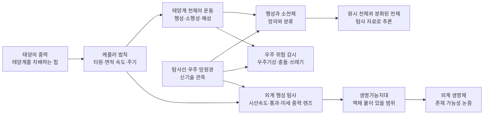

# 행성우주과학 1. 우주탐사와 행성계 — 태양의 중력이 엮은 가족, 그 너머의 세계를 찾아서
<!-- prev: m1-07, m2-08, 2-2, 3-3, earth-3 -->
<!-- next: astro-2, astro-3, mech-1 -->

> [!NOTE]
> **성취기준**
> - **[12행우01-01]** 태양계 탐사선의 활동을 통해 알아낸 성과를 이해하고, 인공위성을 활용한 우주탐사의 필요성을 토론할 수 있다.
> - **[12행우01-02]** 태양 활동 감시 시스템과 지구 접근 천체를 비롯한 지구를 위협하는 우주 위험 감시 기술의 중요성을 우주 재난 측면에서 인식할 수 있다.
> - **[12행우01-03]** 태양계를 지배하는 힘이 태양의 중력임을 이해하고, 케플러의 세 가지 법칙을 이용하여 태양계 구성 천체들의 운동을 설명할 수 있다.
> - **[12행우01-04]** 행성과 소천체의 정의를 구분하여 이해하고, 소천체 탐사 자료를 통해 이들의 특징을 추론할 수 있다.
> - **[12행우01-05]** 외계 행성계 탐사의 원리를 이해하고, 외계 행성에 생명체가 존재할 수 있는 조건과 외계 생명체의 존재 가능성에 대해 논증할 수 있다.

**학습 목표**

1. 행성 탐사선·소천체 탐사선·우주 망원경이 새롭게 밝혀낸 사실을 예로 들고, 인공위성을 활용한 우주탐사가 왜 필요한지 근거를 들어 토론할 수 있다.
2. 우주기상, 소천체 충돌, 우주 쓰레기가 일으키는 우주 재난을 설명하고, 이를 감시하는 기술이 왜 중요한지 말할 수 있다.
3. 케플러의 세 법칙 각각의 물리적 의미를 태양의 중력과 연결하여 설명하고, 제3법칙으로 태양계 천체의 공전 주기와 궤도 크기를 계산할 수 있다.
4. 국제천문연맹(IAU)의 정의에 따라 행성과 왜소행성·소천체를 구분하고, 탐사 자료로부터 원시 물질 천체와 분화된 천체를 구별할 수 있다.
5. 시선속도법·통과법·미세 중력 렌즈법 등 외계 행성 탐사의 원리를 설명하고, 중심별의 표면 온도에 따라 생명가능지대가 달라짐을 근거로 외계 생명체의 존재 가능성을 논증할 수 있다.

**이 단원의 학습 사다리**

| 단계 | 무엇을 하나? |
|---|---|
| STEP 1. 이전 학습 다시 보기 | 중학교 「태양계」·「별과 우주」, 통합과학 「중력과 운동」, 지구과학 「태양계 천체와 별과 우주의 진화」를 다시 꺼낸다 |
| STEP 2. 기초 다지기 | 만유인력과 원운동, 타원의 기하, 천문 단위, 도플러 효과, 별의 광도 식을 디딤돌로 놓는다 |
| STEP 3. 핵심 개념 | 탐사선의 성과 → 우주 위험 감시 → 케플러 법칙 → 행성과 소천체 → 외계 행성과 생명가능지대 |
| STEP 4. 오개념 바로잡기 | "행성은 원 궤도로 돈다?", "생명가능지대에 있으면 생명체가 있다?" 같은 착각을 바로잡는다 |
| STEP 5. 대학 전공으로 | 뉴턴이 다듬은 케플러 법칙, 궤도 역학, 행성 형성론, 우주생물학 |
| STEP 6. 생활·산업·진로 | 위성 항법·통신을 지키는 우주기상 예보, 행성 방어, 우주 산업과 진로 |

---

## 🗺️ 단원 들어가기

2022년 9월, 지구에서 약 1100만 km 떨어진 우주에서 자판기만 한 탐사선 하나가 초속 약 6 km로 작은 소행성에 일부러 부딪혔다. NASA의 **DART** 실험이다. 충돌 뒤 그 소행성(디모르포스)이 큰 소행성(디디모스) 둘레를 한 바퀴 도는 시간은 약 11시간 55분에서 약 11시간 23분으로, **30분 넘게 짧아졌다.** 인류가 처음으로 천체의 궤도를 '바꾼' 순간이다.

그런데 생각해 보자. 공전 주기가 짧아졌다는 사실만으로 어떻게 "궤도가 바뀌었다"고 말할 수 있을까? 공전 주기와 궤도 크기 사이에 정확한 규칙이 있기 때문이다. 400여 년 전 케플러가 행성의 관측 자료에서 찾아낸 그 규칙은 지금도 탐사선의 항로를 설계하고, 지구로 다가오는 소행성을 감시하고, 수천 광년 떨어진 별 둘레의 행성을 찾는 데 쓰인다.

이 단원에서는 탐사선과 우주 망원경이 넓혀 놓은 태양계의 모습을 살펴보고, 우주가 지구에 가하는 위험을 어떻게 감시하는지 알아본다. 이어서 태양계 천체의 운동을 지배하는 규칙(케플러 법칙)을 물리적으로 이해하고, 마지막에는 태양계 밖으로 나가 "우리만 있는가?"라는 질문을 과학적으로 따져 본다.

---

## STEP 1. 🔙 이전 학습 다시 보기

### 연계 개념표

| 이전 단원·성취기준 | 그때 배운 것 | 이 단원에서 확장되는 것 |
|---|---|---|
| 중1 「태양계」 [9과07-01] | 태양계 구성 천체(태양, 행성, 왜소행성, 소행성, 위성, 혜성), 지구형·목성형 행성 | 행성·왜소행성·소천체의 **엄밀한 정의**, 원시 천체와 분화된 천체의 구분 |
| 중1 「태양계」 [9과07-02] | 흑점·플레어·코로나 등 태양 활동과 지구에 미치는 영향(자기 폭풍, 오로라) | 태양 활동을 **감시·예보하는 시스템**과 우주기상 재난 |
| 중2 「별과 우주」 [9과15-04] | 우주탐사의 의의와 인류에게 미치는 영향 | 탐사선이 밝혀낸 구체적 성과, 인공위성 탐사의 필요성 토론 |
| 통합과학1 「별의 진화와 원소의 생성」 [10통과1-02-02] | 성운에서 태양계가 형성되고, 지구형·목성형 행성이 나뉜 까닭 | 소천체는 그 **원시 물질이 남아 있는 화석**이다 |
| 통합과학1 「중력과 운동」 [10통과1-03-03] | 지구 주위의 원운동은 지구 중심 방향의 가속도 운동이다 | 태양 둘레의 **타원 운동**과 케플러 법칙 |
| 지구과학 「태양계 천체와 별과 우주의 진화」 [12지구03-01], [12지구03-02] | 행성의 겉보기 운동, 흑체복사 법칙($L = 4\pi R^2\sigma T^4$)으로 별의 물리량 추론 | 행성의 실제 궤도 운동, 별의 광도로 **생명가능지대**의 위치 구하기 |

### 준비 운동 (사전 진단)

**Q1.** 태양계 천체 중 목성형 행성의 특징으로 옳은 것을 모두 고르시오.
ㄱ. 질량과 반지름이 크다 ㄴ. 평균 밀도가 크다 ㄷ. 위성이 많고 고리가 있다

**Q2.** 국제우주정거장이 지구 둘레를 도는 동안 계속 지구 쪽으로 '떨어지고' 있다는 말은 옳은가? 이유와 함께 답하시오.

**Q3.** 표면 온도가 같은 두 별 A, B가 있다. A의 반지름이 B의 2배라면 A의 광도는 B의 몇 배인가?

**Q4.** 태양에서 플레어가 크게 일어난 뒤 1~3일 지나 지구에서 나타날 수 있는 현상을 두 가지 쓰시오.

정답 및 해설

**Q1. ㄱ, ㄷ** — 목성형 행성은 주로 수소·헬륨으로 이루어져 질량과 반지름은 크지만 **평균 밀도는 작다.** 위성이 많고 모두 고리를 가진다.

**Q2. 옳다.** 우주정거장에는 지구 중심 방향으로 중력이 작용해 계속 지구 쪽으로 가속된다. 다만 옆으로 충분히 빠르게 움직이므로 떨어지는 만큼 지표면도 둥글게 멀어져 지면에 닿지 않는다. 이것이 원운동이다.

**Q3. 4배** — $L = 4\pi R^2 \sigma T^4$에서 온도가 같으면 $L \propto R^2$이므로 $2^2 = 4$배이다.

**Q4.** 예: 자기 폭풍(지자기 교란), 오로라의 확대, 단파 통신 장애, 위성 항법(GPS) 오차 증가, 인공위성 고장, 송전망 이상 중 두 가지.

---

## STEP 2. 🧱 기초 다지기

### ① 만유인력과 원운동 — 태양이 행성을 붙잡는 방식

통합과학에서 지구 주위의 원운동이 중력에 의한 '지구 중심 방향의 가속도 운동'임을 배웠다. 이것을 식으로 쓰면 다음과 같다. 질량 $M$, $m$인 두 물체가 거리 $r$만큼 떨어져 있을 때 서로 끌어당기는 힘은

$$
F = \frac{GMm}{r^2} \qquad (G = 6.67\times10^{-11}\ \mathrm{N\cdot m^2/kg^2})
$$

이고, 반지름 $r$인 원을 속력 $v$로 도는 물체에는 중심 방향으로 $\dfrac{mv^2}{r}$의 힘(구심력)이 필요하다. 행성이 태양 둘레를 원에 가깝게 돈다면 **태양의 중력이 바로 그 구심력**이다.

$$
\frac{GMm}{r^2} = \frac{mv^2}{r} \;\Rightarrow\; v = \sqrt{\frac{GM}{r}}
$$

- 공전 속력은 행성 자신의 질량 $m$과 **무관**하고, 태양 질량 $M$과 거리 $r$로만 정해진다.
- 멀리 있는 행성일수록 느리게 돈다(지구 약 30 km/s, 해왕성 약 5.4 km/s).

> [!TIP]
> 💡 **비유** — 줄에 매단 공을 빙빙 돌리는 장면을 떠올리자. 손이 줄을 당기는 힘이 태양의 중력이다. 줄이 끊어지면(중력이 사라지면) 공은 그 순간의 접선 방향으로 곧게 날아간다.

### ② 타원의 기하 — 궤도를 읽는 말

행성의 궤도는 **타원(ellipse)** 이다. 타원은 두 점(초점)에서의 거리의 합이 일정한 점들의 집합이다.

| 용어 | 뜻 | 태양계에서 |
|---|---|---|
| 초점 | 타원 안의 두 기준점 | 한 초점에 태양이 있다(다른 초점에는 아무것도 없다) |
| 긴반지름 $a$ | 긴지름의 절반 | 행성과 태양 사이 평균 거리의 대푯값 |
| 이심률 $e$ | 타원이 찌그러진 정도, $0 \le e < 1$ | 원이면 $e = 0$, 1에 가까울수록 길쭉하다 |
| 근일점 거리 $q$ | 태양에 가장 가까운 거리 | $q = a(1 - e)$ |
| 원일점 거리 $Q$ | 태양에서 가장 먼 거리 | $Q = a(1 + e)$ |

두 식을 더하면 $q + Q = 2a$, 빼서 나누면 $e = \dfrac{Q - q}{Q + q}$이다. 근일점·원일점 거리만 알면 궤도 모양을 모두 알 수 있다.

<!-- fig:astro-1-ellipse-geometry -->

> [!TIP]
> 💡 **직접 그려 보기** — 압정 두 개를 종이에 꽂고, 고리 모양 실을 걸어 연필로 팽팽하게 당기며 한 바퀴 돌리면 타원이 그려진다. 압정 사이를 넓히면 이심률이 커지고, 두 압정을 겹치면 원이 된다.

### ③ 천문학의 거리 단위

| 단위 | 정의 | 크기 | 주로 쓰는 곳 |
|---|---|---|---|
| 천문단위(AU) | 지구–태양 평균 거리 | 약 $1.496\times10^{8}\ \mathrm{km}$ | 태양계, 외계 행성계 |
| 광년(ly) | 빛이 1년 동안 가는 거리 | 약 $9.46\times10^{12}\ \mathrm{km}$ (약 63,000 AU) | 별, 은하 |
| 파섹(pc) | 연주시차가 1″인 거리 | 약 3.26광년 | 별, 은하(전문 연구) |

태양계 안에서는 AU를, 별 사이에서는 광년이나 파섹을 쓴다. 파섹은 다음 단원 「태양과 별의 관측」에서 자세히 다룬다.

### ④ 도플러 효과 — 움직이는 광원의 파장 변화

구급차가 다가올 때 사이렌 소리가 높아지고 멀어질 때 낮아지는 것처럼, 광원이 관측자에게 다가오면 빛의 파장이 짧아지고(**청색 편이**), 멀어지면 길어진다(**적색 편이**). 광원의 시선 방향 속력 $v_r$이 빛의 속력 $c$보다 매우 작을 때

$$
\frac{\Delta\lambda}{\lambda_0} = \frac{v_r}{c}
$$

이다. 별빛의 흡수선이 주기적으로 좌우로 흔들리면, 그 별이 무언가에 끌려 앞뒤로 흔들리고 있다는 뜻이다. 이것이 STEP 3 ⑤에서 외계 행성을 찾는 원리가 된다.

### ⑤ 별의 광도와 거리에 따른 빛의 세기

지구과학에서 배운 슈테판–볼츠만 법칙을 쓰면 반지름 $R$, 표면 온도 $T$인 별의 **광도(luminosity, 1초에 내보내는 총에너지)** 는

$$
L = 4\pi R^2 \sigma T^4
$$

이다. 이 빛은 사방으로 퍼지므로, 거리 $d$인 곳에서 단위 면적이 받는 에너지(복사 플럭스)는 $\dfrac{L}{4\pi d^2}$, 즉 **거리의 제곱에 반비례**한다. 별이 밝을수록 같은 양의 에너지를 받는 거리가 멀어진다는 사실이 생명가능지대를 이해하는 열쇠이다.

---

## STEP 3. 📘 핵심 개념

### ① 탐사선과 우주 망원경이 넓힌 태양계 [12행우01-01]

#### 왜 '가서' 보거나 '대기 밖에서' 보아야 할까?

지상 망원경은 두 가지 벽에 부딪힌다. 첫째, **지구 대기**가 자외선·X선·감마선과 적외선 대부분을 흡수하고, 대기의 흔들림 때문에 상이 번진다. 둘째, **거리**가 너무 멀어 표면의 세부 모습이나 물질의 성분을 직접 알기 어렵다. 이 두 벽을 넘는 방법이 인공위성을 활용한 우주탐사이다.

| 방식 | 하는 일 | 예 |
|---|---|---|
| 지구 궤도·라그랑주점 우주 망원경 | 대기 밖에서 여러 파장으로 관측 | 허블 우주 망원경, 제임스 웹 우주 망원경(JWST), 태양 관측 위성(SOHO, SDO) |
| 근접 통과(플라이바이) | 천체 곁을 빠르게 지나가며 촬영·측정 | 보이저 1·2호, 뉴호라이즌스 |
| 궤도선 | 천체 둘레를 돌며 오랫동안 전체를 관측 | 카시니(토성), 주노(목성), 다누리(달) |
| 착륙선·로버 | 표면에 내려 직접 분석 | 큐리오시티·퍼서비어런스(화성), 필레(혜성) |
| 시료 귀환 | 시료를 지구로 가져와 실험실에서 정밀 분석 | 하야부사2(소행성 류구), 오시리스-렉스(소행성 베누) |
| 충돌·실험 | 천체에 직접 작용해 반응을 측정 | DART(소행성 디모르포스) |

> [!TIP]
> 💡 **비유** — 우주 망원경은 '창문 없는 방 밖으로 나가 하늘을 보는 것', 근접 통과는 '달리는 기차에서 찍은 사진', 궤도선은 '그 동네에 이사 가서 매일 관찰하기', 시료 귀환은 '현장 증거를 연구실로 가져오기'이다. 가까이 갈수록 비용과 시간은 늘지만 얻는 정보의 깊이가 달라진다.

#### 행성 탐사선이 새롭게 밝혀낸 사실

| 탐사선 | 대상 | 새롭게 밝혀진 사실 |
|---|---|---|
| 큐리오시티·퍼서비어런스 | 화성 | 과거 호수·삼각주의 퇴적층, 물과 작용해 생긴 광물, 유기 분자 → **과거 화성에 액체 물이 오래 있었다** |
| 주노 | 목성 | 중심핵이 뚜렷한 경계 없이 넓게 퍼져 있을 가능성, 극지방의 거대한 소용돌이 무리 |
| 카시니 | 토성과 위성 | 엔셀라두스 남극에서 얼음 알갱이·수증기 분출 → **얼음 지각 아래 바다**, 타이탄의 메테인 호수 |
| 보이저 1호 | 태양계 외곽 | 2012년 태양풍이 미치는 경계(태양권 계면)를 넘어 성간 공간에 진입 |
| 뉴호라이즌스 | 명왕성, 카이퍼 벨트 천체 | 명왕성의 질소 얼음 평원과 비교적 젊은 지형, 두 덩어리가 천천히 붙은 눈사람 모양의 카이퍼 벨트 천체 |
| 다누리 | 달 | 극지방 영구 음영 지역 촬영, 달 표면 자기장·감마선 관측 |

이 성과에는 공통점이 있다. **지구 밖에도 물이 있거나 있었던 곳이 많고, 태양계 천체는 생각보다 '살아 있다'**(지질 활동, 대기 변화)는 것이다. 특히 목성·토성의 얼음 위성 속 바다는 생명가능지대 바깥에서도 액체 물이 존재할 수 있음을 보여 주어, ⑤에서 다룰 생명체 존재 조건의 논의를 넓혔다.

#### 신기술 망원경

JWST는 지름 6.5 m의 거울로 **적외선**을 관측하며, 태양–지구계의 라그랑주점 L2 근처에 있다. 적외선은 먼지를 잘 뚫고 차가운 천체가 내는 빛이므로, 태어나는 별과 행성계, 외계 행성의 대기 성분(이산화 탄소, 수증기 등)을 분석하는 데 강하다. 지상에서도 거울 지름이 수십 m인 초대형 망원경과, 넓은 하늘을 매일 밤 반복해서 찍어 변하는 천체를 찾는 탐사 망원경(예: 2025년 첫 영상을 공개한 루빈 천문대)이 등장하여 소천체 발견의 속도를 크게 높이고 있다.

<!-- fig:astro-1-lagrange-points -->

#### 우리나라의 우주개발 성과와 계획

| 구분 | 내용 |
|---|---|
| 발사체 | 한국형 발사체 **누리호**가 2022년 2차 발사에서 성능 검증 위성을, 2023년 3차 발사에서 실용 위성을 궤도에 올렸다 |
| 달 탐사 | 2022년 발사한 달 궤도선 **다누리**가 달 궤도에서 관측 중이며, 2030년대에 달 착륙선을 보내는 계획이 추진되고 있다 |
| 천문 관측망 | 한국천문연구원의 **외계 행성 탐색 시스템(KMTNet)**: 칠레·남아프리카공화국·호주에 설치한 망원경 3대로 24시간 남반구 하늘을 관측한다 |
| 전담 기관 | 2024년 **우주항공청**이 문을 열어 우주개발 정책과 사업을 이끈다 |

#### 토론의 쟁점 — 인공위성을 활용한 우주탐사는 필요한가?

| 필요하다는 근거 | 신중해야 한다는 근거 |
|---|---|
| 대기 밖에서만 얻을 수 있는 관측 자료(전 파장, 고해상도) | 막대한 비용, 다른 사회 문제 해결과의 우선순위 |
| 지구 환경·우주 재난 감시(기상·태양 활동·소행성) | 발사 실패 위험, 우주 쓰레기 증가 |
| 통신·항법·지구 관측 등 일상과 산업의 기반 | 다른 천체의 오염(지구 미생물 반입) 가능성 |
| 생명의 기원, 태양계 형성 같은 근본 질문 | 우주 자원 개발을 둘러싼 국제적 형평성 문제 |

> [!IMPORTANT]
> 토론에서는 "필요하다/필요 없다"로 끝내지 말고 **어떤 근거(자료)로 어떤 탐사가 필요한지**를 구체적으로 말해야 한다. 예를 들어 "엔셀라두스 탐사는 지구 밖 바다에서 생명의 화학을 확인할 유일한 방법이다"처럼 대상·방법·근거를 함께 제시한다.

#### 예제 1 — 대기의 창과 우주 망원경

다음 관측 중 지상 망원경으로는 거의 불가능하여 우주 망원경이 꼭 필요한 것을 모두 고르시오.
ㄱ. 태양 코로나의 X선 영상 ㄴ. 목성의 가시광선 사진 ㄷ. 먼 은하의 원적외선 관측 ㄹ. 달 표면의 가시광선 사진

**풀이** X선과 원적외선은 지구 대기에 대부분 흡수되므로 대기 밖에서 관측해야 한다. 가시광선은 대기를 잘 통과하므로 지상에서도 관측할 수 있다. **정답 ㄱ, ㄷ**

### ② 우주 위험 감시 — 우주 재난을 미리 아는 기술 [12행우01-02]

우주 재난은 크게 세 갈래이다. 공통점은 **미리 알면 대비할 수 있다**는 것이고, 그래서 '감시'가 핵심 기술이 된다.

| 위험 | 원인 | 피해 | 감시 수단 |
|---|---|---|---|
| 우주기상 | 태양 플레어, 코로나 질량 방출(CME), 고에너지 입자 | 위성 고장, 통신·위성 항법 장애, 송전망 정전, 우주인·항공 승무원 피폭 | 태양 관측 위성(SOHO, SDO), L1 지점의 태양풍 감시 위성, 지상 지자기 관측소 |
| 소천체 충돌 | 지구 접근 천체(소행성·혜성) | 충돌 규모에 따라 국지적 파괴에서 전 지구적 기후 변화까지 | 광시야 탐사 망원경, 레이더, 궤도 계산 |
| 우주 쓰레기 | 수명이 다한 위성, 발사체 잔해, 충돌 파편 | 운용 중인 위성·우주정거장과 충돌, 대기권 재진입 낙하물 | 레이더, 광학 감시망(한국천문연구원 OWL-Net 등) |

#### (1) 우주기상 — 태양 활동 감시 시스템

태양에서 플레어가 일어나면 X선·자외선은 **약 8분 20초** 만에 지구에 도착해 전리층을 교란한다(단파 통신 두절). CME로 튀어나온 플라스마 구름은 보통 **1~3일** 뒤 지구에 도착해 지구 자기장을 흔든다(자기 폭풍).

| 시간 순서 | 무엇이 도착하나 | 대비할 수 있는 시간 |
|---|---|---|
| 플레어 직후 약 8분 | X선·자외선(빛의 속력) | 사실상 없음 → **즉시 경보** |
| 수십 분~수 시간 | 고에너지 양성자 | 수십 분 → 우주인 대피, 극항로 항공기 경로 변경 |
| 1~3일 | CME 플라스마 구름 | 하루 이상 → 위성 안전 모드 전환, 송전망 대비 |

실제 사례도 있다. 1989년 3월 강한 자기 폭풍으로 캐나다 퀘벡주 송전망이 멈춰 수백만 명이 몇 시간 동안 정전을 겪었다. 2022년 2월에는 막 발사된 저궤도 통신 위성 약 40기가 자기 폭풍으로 부풀어 오른 상층 대기의 저항 때문에 목표 궤도에 오르지 못하고 추락했다. 우리나라에서도 국가 우주전파센터가 태양 활동을 감시하고 우주기상 예보·경보를 낸다.

> [!NOTE]
> 이 과목은 태양 표면 현상 자체보다 **우주 환경 변화로 인한 재난을 예측할 수 있는가**에 초점을 둔다. 흑점·플레어 같은 현상의 원리는 다음 단원 「태양과 별의 관측」에서 자세히 다룬다.

#### (2) 지구 접근 천체와 충돌 위험

근일점 거리가 1.3 AU 이하인 소행성·혜성을 **지구 접근 천체(NEO, near-Earth object)** 라 하고, 그중 지구 궤도와 매우 가깝고(최소 궤도 거리 0.05 AU 이하) 지름이 약 140 m 이상으로 추정되는 것을 **잠재적 위험 소행성**으로 분류해 특별히 추적한다. 지금까지 지구 접근 천체는 3만 개 넘게 발견되었다.

충돌의 위력은 운동 에너지 $E_k = \dfrac{1}{2}mv^2$로 어림한다. 소행성은 초속 십수~수십 km로 지구에 부딪히므로 작은 천체도 엄청난 에너지를 낸다.

#### 예제 2 — 작은 소행성의 위력

지름 50 m, 밀도 $3000\ \mathrm{kg/m^3}$인 암석 소행성이 $20\ \mathrm{km/s}$로 대기에 진입했다. 운동 에너지는 TNT 몇 메가톤에 해당하는가? (TNT 1메가톤 $= 4.18\times10^{15}\ \mathrm{J}$, 소행성은 구로 가정)

**풀이**
- 질량: $m = \rho \cdot \dfrac{4}{3}\pi r^3 = 3000 \times \dfrac{4}{3}\pi (25)^3 \approx 1.96\times10^{8}\ \mathrm{kg}$
- 운동 에너지: $E_k = \dfrac{1}{2}\times1.96\times10^{8}\times(2\times10^{4})^2 \approx 3.9\times10^{16}\ \mathrm{J}$
- TNT 환산: $\dfrac{3.9\times10^{16}}{4.18\times10^{15}} \approx 9.4$ 메가톤

1908년 시베리아 퉁구스카 상공에서 폭발해 넓은 숲을 쓰러뜨린 천체가 이 정도 크기였던 것으로 추정된다. 지름이 고작 50 m인 천체가 도시 하나를 파괴할 수 있다.

#### 감시에서 방어까지

1. **발견** — 광시야 망원경이 밤하늘을 반복 촬영하여 움직이는 점을 찾는다.
2. **궤도 결정** — 여러 날의 위치 자료에 케플러 법칙(정확히는 뉴턴 역학)을 적용해 궤도를 구하고 미래 위치를 예측한다. 관측 기간이 길수록 예측이 정확해진다.
3. **위험도 평가** — 충돌 확률과 에너지를 함께 고려해 등급을 매긴다. 예를 들어 소행성 아포피스는 발견 직후 2029년 충돌 확률이 한때 높게 계산되었지만, 추가 관측으로 충돌 가능성이 배제되었다. 2029년 4월 지구 표면에서 약 3만 2천 km(정지 궤도 위성보다 가까운 거리)를 지나갈 예정이다.
4. **방어** — 충분히 일찍 발견하면 DART처럼 충돌체로 속도를 아주 조금 바꾸어 궤도를 비껴가게 할 수 있다. 오래 전에 조금만 밀어도 충돌 시점에는 큰 위치 차이가 된다.

> [!TIP]
> 💡 **비유** — 멀리서 다가오는 당구공의 경로를 바꾸려면 가까이 왔을 때 세게 치기보다 **멀리 있을 때 살짝 건드리는 것**이 훨씬 쉽다. 행성 방어의 핵심은 힘이 아니라 '시간'이고, 그 시간을 벌어 주는 것이 감시 기술이다.

#### (3) 우주 쓰레기

지구 궤도에는 지름 10 cm가 넘는 인공 물체만 수만 개가 있고, 1 cm보다 작은 파편까지 합하면 1억 개가 넘는 것으로 추정된다. 저궤도 물체는 초속 약 7~8 km로 움직이므로, 서로 다른 궤도의 물체가 부딪히면 상대 속력이 초속 10 km에 이를 수 있다. 이때 질량 1.4 g짜리 파편의 운동 에너지만 해도 $\dfrac{1}{2}\times0.0014\times(10^4)^2 = 7\times10^{4}\ \mathrm{J}$로, 시속 약 35 km로 달리는 1.5톤 승용차의 운동 에너지와 비슷하다. 충돌로 생긴 파편이 또 다른 충돌을 일으키며 연쇄적으로 늘어나는 상황을 **케슬러 증후군**이라 한다. 그래서 위성을 설계할 때부터 임무가 끝나면 스스로 대기권으로 떨어지거나 '묘지 궤도'로 옮겨 가도록 하는 국제적 지침이 만들어지고 있다.

### ③ 태양의 중력과 케플러의 세 법칙 [12행우01-03]

#### 태양계를 지배하는 힘은 태양의 중력이다

태양은 태양계 전체 질량의 **약 99.8%** 를 차지한다. 가장 무거운 목성조차 태양 질량의 약 1/1000이다. 따라서 행성·소행성·혜성의 운동은 거의 전적으로 태양의 중력으로 결정되고, 행성끼리 당기는 힘은 작은 '흔들림(섭동)'으로만 나타난다. 케플러는 이 사실을 모른 채 관측 자료만으로 세 규칙을 찾아냈고, 뒤에 뉴턴이 그 규칙들이 **거리의 제곱에 반비례하는 중심 방향의 힘(태양의 중력)** 의 결과임을 밝혔다.

#### 제1법칙(타원 궤도 법칙) — 궤도의 '모양'

> 행성은 태양을 한 초점으로 하는 타원 궤도를 돈다.

**물리적 의미** 중심으로 향하는 힘의 크기가 거리의 제곱에 반비례하면, 묶여 있는 천체의 궤도는 반드시 원 또는 타원이 된다(원은 이심률 0인 타원). 태양이 타원의 '중심'이 아니라 **한 초점**에 있다는 점이 중요하다. 그래서 행성과 태양 사이의 거리는 공전하는 동안 변한다.

| 천체 | 이심률(약) | 궤도 모양 |
|---|---|---|
| 금성 | 0.007 | 거의 원 |
| 지구 | 0.017 | 거의 원 |
| 화성 | 0.093 | 약간 찌그러진 타원 |
| 수성 | 0.21 | 행성 중 가장 찌그러짐 |
| 명왕성(왜소행성) | 0.25 | 해왕성 궤도 안쪽까지 들어온다 |
| 핼리 혜성 | 0.97 | 매우 길쭉한 타원 |

#### 제2법칙(면적 속도 일정 법칙) — 궤도 위의 '빠르기'

> 태양과 행성을 잇는 선분은 같은 시간 동안 같은 넓이를 쓸고 지나간다.

**물리적 의미** 태양의 중력은 항상 태양 쪽(중심 방향)을 향하므로 행성을 '돌리는' 효과(돌림힘)가 없다. 그래서 행성의 회전하는 정도, 즉 **각운동량이 보존**된다. 근일점과 원일점에서는 속도가 반지름에 수직이므로 다음이 성립한다.

$$
r_{\text{근}}\,v_{\text{근}} = r_{\text{원}}\,v_{\text{원}} \;\Rightarrow\; \frac{v_{\text{근}}}{v_{\text{원}}} = \frac{Q}{q}
$$

행성은 태양에 가까울 때 빠르고 멀 때 느리다. 지구는 1월 초에 근일점을 지나므로, 북반구의 겨울(동지~춘분)이 여름(하지~추분)보다 며칠 짧다.

> [!TIP]
> 💡 **비유** — 회전의자에 앉아 팔을 벌린 채 돌다가 팔을 오므리면 빨라진다. 피겨 선수의 스핀도 같다. 행성이 태양에 다가가는 것은 '팔을 오므리는 것'과 같아서 빨라진다.

#### 예제 3 — 핼리 혜성의 속력 차이

핼리 혜성의 근일점 거리는 약 0.59 AU, 원일점 거리는 약 35.0 AU이다. (1) 긴반지름과 이심률을 구하고, (2) 근일점 속력은 원일점 속력의 몇 배인지 구하시오.

**풀이**
(1) $a = \dfrac{q + Q}{2} = \dfrac{0.59 + 35.0}{2} \approx 17.8\ \mathrm{AU}$, $e = \dfrac{Q - q}{Q + q} = \dfrac{34.41}{35.59} \approx 0.97$
(2) $\dfrac{v_{\text{근}}}{v_{\text{원}}} = \dfrac{Q}{q} = \dfrac{35.0}{0.59} \approx 59$배

혜성은 태양 근처를 빠르게 휙 지나가고 대부분의 시간을 먼 곳에서 느리게 보낸다. 그래서 우리가 맨눈으로 혜성을 볼 수 있는 기간은 일생 중 아주 짧다.

#### 제3법칙(조화 법칙) — 궤도의 '크기'와 주기의 관계

> 행성의 공전 주기의 제곱은 궤도 긴반지름의 세제곱에 비례한다. $T^2 \propto a^3$

공전 주기를 년, 긴반지름을 AU로 나타내면 태양 둘레를 도는 모든 천체에 대해

$$
T^2 = a^3 \qquad (T: \text{년},\ a: \mathrm{AU})
$$

이다(지구는 $T = 1$, $a = 1$로 맞춰진다).

**물리적 의미** 원 궤도로 근사하여 STEP 2 ①의 식에 $v = \dfrac{2\pi a}{T}$를 넣으면

$$
\frac{GM}{a^2} = \frac{4\pi^2 a}{T^2} \;\Rightarrow\; \frac{a^3}{T^2} = \frac{GM}{4\pi^2}
$$

이 된다. 즉, $\dfrac{a^3}{T^2}$ 값은 **중심 천체의 질량 $M$만으로 정해지는 상수**이다. 태양 둘레를 도는 모든 천체가 같은 상수를 가지는 것은, 이들이 모두 같은 한 천체(태양)의 중력에 붙잡혀 있다는 증거이다. 거꾸로 이 식을 이용하면 **공전 주기와 궤도 크기만 재서 중심 천체의 질량을 잴 수 있다.** 이 아이디어는 다음 단원 「태양과 별의 관측」의 쌍성 질량과 「은하와 우주」의 은하 질량 측정으로 그대로 이어진다.

| 천체 | 긴반지름 $a$(AU) | $a^3$ | 공전 주기 $T$(년) | $T^2$ |
|---|---|---|---|---|
| 수성 | 0.387 | 0.058 | 0.241 | 0.058 |
| 지구 | 1.000 | 1.000 | 1.000 | 1.000 |
| 화성 | 1.524 | 3.54 | 1.881 | 3.54 |
| 세레스(왜소행성) | 2.77 | 21.3 | 4.61 | 21.3 |
| 목성 | 5.203 | 140.9 | 11.86 | 140.7 |
| 해왕성 | 30.07 | 27,190 | 164.8 | 27,160 |
| 핼리 혜성 | 17.8 | 5640 | 75.1 | 5640 |

행성뿐 아니라 왜소행성·혜성까지 **태양계의 모든 천체가 같은 규칙을 따른다**는 것을 표에서 확인할 수 있다.

<!-- sim:solar-system-orbits -->

#### 예제 4 — 제3법칙으로 궤도 크기와 주기 구하기

(1) 긴반지름이 2.77 AU인 왜소행성 세레스의 공전 주기를 구하시오.
(2) 공전 주기가 약 248년인 명왕성의 긴반지름을 구하시오.

**풀이**
(1) $T = a^{3/2} = 2.77^{1.5} \approx 4.6$년
(2) $a = T^{2/3} = 248^{2/3} \approx 39.5\ \mathrm{AU}$

#### 예제 5 — 목성의 위성으로 목성의 질량 재기

목성의 위성 이오는 반지름 약 $4.22\times10^{5}\ \mathrm{km}$인 원 궤도를 약 1.77일 주기로 돈다. 목성의 질량을 구하시오. ($G = 6.67\times10^{-11}\ \mathrm{N\cdot m^2/kg^2}$)

**풀이** $M = \dfrac{4\pi^2 a^3}{GT^2}$에 SI 단위로 넣는다.
- $a = 4.22\times10^{8}\ \mathrm{m}$, $T = 1.77\times86400 \approx 1.53\times10^{5}\ \mathrm{s}$
- $M = \dfrac{4\pi^2 (4.22\times10^{8})^3}{6.67\times10^{-11}\times(1.53\times10^{5})^2} \approx 1.9\times10^{27}\ \mathrm{kg}$

지구 질량($6.0\times10^{24}\ \mathrm{kg}$)의 약 320배이다. 케플러 법칙은 태양–행성뿐 아니라 **행성–위성, 지구–인공위성처럼 중심 천체가 있는 모든 계**에 적용되며, 다만 상수 $\dfrac{a^3}{T^2}$의 값이 중심 천체마다 다를 뿐이다.

> [!IMPORTANT]
> **세 법칙 한 줄 정리**
> - 제1법칙: 궤도의 **모양** — 태양은 타원의 한 초점에 있다 ← 거리 제곱에 반비례하는 힘
> - 제2법칙: 궤도 위 **빠르기** — 가까우면 빠르고 멀면 느리다 ← 중심 방향 힘, 각운동량 보존
> - 제3법칙: 궤도 **크기와 주기** — $a^3/T^2$은 중심 천체 질량으로 정해진다 ← 같은 태양의 중력

#### 예제 6 — DART 충돌 다시 보기

디모르포스가 디디모스 둘레를 도는 주기가 충돌 뒤 약 11시간 55분에서 약 11시간 23분으로 줄었다. 케플러 제3법칙으로 보면 디모르포스의 궤도 긴반지름은 커졌는가, 작아졌는가? 대략 몇 % 변했는가?

**풀이** 같은 중심 천체(디디모스) 둘레이므로 $a \propto T^{2/3}$이다.
$\dfrac{a'}{a} = \left(\dfrac{683}{715}\right)^{2/3} \approx 0.970$ (분 단위로 11시간 23분 = 683분, 11시간 55분 = 715분)
궤도 긴반지름이 약 3% **작아졌다.** 공전 주기의 변화만 정밀하게 재도 궤도가 얼마나 바뀌었는지 알 수 있는 것이다.

### ④ 행성과 소천체 — 정의와 탐사 자료로 본 특징 [12행우01-04]

#### 행성의 정의

2006년 국제천문연맹(IAU)은 태양계의 **행성(planet)** 을 다음 세 조건을 모두 만족하는 천체로 정의했다.

| 조건 | 뜻 | 왜 필요한가 |
|---|---|---|
| ① 태양 둘레를 공전한다 | 위성처럼 다른 행성을 돌지 않는다 | 위성과 구분 |
| ② 충분히 무거워 자체 중력으로 거의 둥근 모양(정역학 평형)을 이룬다 | 감자 모양의 작은 천체가 아니다 | 소행성·혜성과 구분 |
| ③ 궤도 주변의 다른 천체들을 깨끗이 치웠다 | 궤도 근처에서 압도적으로 무겁다 | 왜소행성과 구분 |

①과 ②는 만족하지만 ③을 만족하지 못하고 위성도 아닌 천체가 **왜소행성(dwarf planet)** 이다. 명왕성은 비슷한 궤도를 도는 수많은 카이퍼 벨트 천체 가운데 하나라서 ③을 만족하지 못해 왜소행성으로 분류되었다. 현재 IAU가 인정한 왜소행성은 세레스, 명왕성, 에리스, 하우메아, 마케마케의 5개이다.

> [!NOTE]
> IAU는 공식적으로 왜소행성을 '태양계 소천체'와 따로 분류하지만, 이 교육과정은 행성보다 작은 천체를 함께 이해하기 위해 **왜소행성, 소행성, 혜성, 운석을 소천체로 묶어** 다룬다. 이 교재도 교육과정을 따른다.

#### 소천체의 종류와 특징

| 천체 | 주된 위치 | 구성 | 특징 |
|---|---|---|---|
| 왜소행성 | 소행성대(세레스), 해왕성 바깥(명왕성, 에리스 등) | 암석·얼음 | 둥글지만 궤도 주변을 치우지 못함 |
| 소행성 | 화성과 목성 사이 소행성대, 지구 접근 궤도, 목성 궤도의 트로이군 | 암석·금속 | 대부분 불규칙한 모양, 크기는 수 m~수백 km |
| 혜성 | 해왕성 바깥 카이퍼 벨트, 태양계 외곽의 오르트 구름 | 얼음과 먼지('더러운 눈덩이') | 태양에 다가오면 얼음이 승화해 코마와 꼬리가 생긴다. 꼬리는 태양 반대쪽으로 뻗는다 |
| 유성체·운석 | 행성 사이 공간 → 지구 | 소행성·혜성의 조각 | 대기에서 타며 빛나면 유성, 땅에 떨어진 것이 운석 |

<!-- fig:astro-1-small-bodies -->

#### 원시 물질 천체와 분화된 천체

소천체를 이해하는 가장 중요한 기준은 **태어난 뒤 녹아서 층이 나뉘었는가(분화)** 이다.

- **분화(differentiation)**: 천체가 충분히 크거나 방사성 원소의 열을 많이 받아 내부가 녹으면, 무거운 철·니켈은 가라앉아 핵이 되고 가벼운 규산염은 떠올라 맨틀과 지각이 된다. 통합과학에서 배운 원시 지구의 층상 구조가 생긴 과정과 같다.
- **원시 물질(primitive material)**: 작아서 녹은 적이 없으면 약 46억 년 전 태양계 성운에서 처음 뭉친 먼지와 얼음이 거의 그대로 남는다.

| 구분 | 원시 물질로 된 천체 | 분화된 천체(또는 그 조각) |
|---|---|---|
| 내부 | 층이 없는 뒤섞인 덩어리 | 핵–맨틀–지각 |
| 예 | 대부분의 혜성, 탄소가 풍부한 소행성(류구, 베누) | 소행성 베스타, 금속 소행성 프시케(분화된 천체의 핵이 드러난 것으로 추정) |
| 운석 | **콘드라이트**: 콘드룰이라는 작은 구슬 모양 알갱이가 들어 있다. 탄소질 콘드라이트에는 물·유기물이 있다 | **철 운석**(핵 조각), **석철 운석**(핵–맨틀 경계), **무구조 운석(에이콘드라이트)**(지각·맨틀 조각) |
| 알려 주는 것 | 태양계 형성 초기의 재료와 나이 | 행성이 층을 이루는 과정, 지구 핵의 성분 |

<!-- fig:astro-1-differentiation -->

> [!TIP]
> 💡 **비유** — 원시 소천체는 반죽만 해 놓고 굽지 않은 '빵 반죽', 분화된 천체는 오븐에서 구워져 겉과 속이 달라진 '빵'이다. 철 운석은 구운 빵을 깨뜨렸을 때 나온 '속살'에 해당한다. 지구의 핵은 직접 가 볼 수 없지만, 철 운석은 깨진 다른 천체의 핵을 손에 쥐어 보게 해 준다.

#### 탐사 자료로 특징 추론하기

| 탐사 | 얻은 자료 | 추론 |
|---|---|---|
| 하야부사2: 소행성 류구 시료 귀환(2020) | 물을 포함한 광물, 탄소 화합물, 여러 종류의 아미노산 | 류구는 **원시 물질**로 된 탄소질 소행성이다. 지구의 물과 유기물 일부가 이런 소행성에서 왔을 수 있다 |
| 오시리스-렉스: 소행성 베누 시료 귀환(2023) | 탄소·물을 품은 광물, 아미노산과 핵산 염기 같은 유기물 | 생명의 재료가 되는 분자가 태양계 초기 소천체에 이미 있었다 |
| 돈(Dawn): 베스타와 세레스 궤도선 | 베스타의 현무암 지각과 거대 충돌구, 세레스 표면의 밝은 탄산염 퇴적물 | 베스타는 **분화된** 원시 행성이고, 지구에 떨어진 일부 무구조 운석의 고향이다. 세레스에는 지하에 소금물이 있었다 |
| 로제타: 혜성 67P 궤도선·착륙선 | 오리 모양 핵, 아미노산(글라이신), 지구 바다와 다른 물의 수소 동위 원소비 | 혜성은 얼음이 많은 **원시 물질** 천체이다. 지구 바다의 물이 주로 이런 혜성에서 왔다고 보기는 어렵다 |
| 뉴호라이즌스: 카이퍼 벨트 천체 아로코스 | 두 덩어리가 아주 느리게 맞붙은 모양, 충돌구가 적음 | 태양계 형성 초기에 작은 덩어리들이 부드럽게 뭉쳐 커졌다는 증거 |

#### 예제 7 — 운석의 출신 추론하기

다음 운석 A, B의 특징을 보고, 각각 원시 물질 천체와 분화된 천체 중 어디에서 왔는지 추론하시오.
- A: 대부분 철과 니켈의 합금이며, 잘라서 산으로 부식시키면 큰 결정 무늬가 보인다.
- B: 밀리미터 크기의 둥근 알갱이(콘드룰)가 가득하고, 탄소 화합물과 물을 포함한 광물이 있다.

**풀이** A는 철·니켈이 분리되어 모인 **핵의 조각**이므로 분화된 천체에서 왔다. 큰 결정 무늬는 녹은 금속이 아주 천천히 식었다는 뜻으로, 큰 천체의 내부였음을 뒷받침한다. B는 녹은 적이 없어 콘드룰과 물·유기물이 보존된 **콘드라이트**이므로 원시 물질 천체에서 왔다.

### ⑤ 외계 행성계 탐사와 생명가능지대 [12행우01-05]

#### 외계 행성은 왜 찾기 어려운가?

행성은 스스로 빛을 거의 내지 않고, 밝은 중심별 바로 옆에 있다. 태양–목성계를 멀리서 보면 목성은 태양보다 가시광선에서 약 10억 배 어둡다. 그래서 대부분의 외계 행성은 **행성 자체가 아니라 중심별에 나타나는 미세한 변화**를 재서 찾는다. 1995년 보통의 별(페가수스자리 51) 둘레에서 처음 외계 행성이 발견된 뒤, 2025년까지 확인된 외계 행성은 6000개를 넘었다.

#### (1) 시선속도법 — 별의 흔들림을 도플러 효과로

행성과 중심별은 사실 **공통 질량 중심** 둘레를 함께 돈다. 별은 작은 원을 그리며 우리에게 다가왔다 멀어졌다 하므로, 별빛의 흡수선이 청색 편이와 적색 편이를 주기적으로 반복한다.

- 흔들림의 **주기** = 행성의 공전 주기 → 케플러 제3법칙으로 궤도 긴반지름을 구한다.
- 흔들림의 **속력 크기** → 행성이 무거울수록 크다 → 행성 질량(의 최솟값)을 구한다.
- 무거운 행성이 별에 가까이 있을수록 찾기 쉽다.

#### 예제 8 — 목성이 태양을 흔드는 정도

목성 때문에 태양은 약 12.5 m/s의 속력으로 흔들린다. 멀리 있는 관측자가 태양의 수소 흡수선(파장 656.3 nm)을 관측할 때 파장 변화의 최댓값은? ($c = 3.0\times10^{8}\ \mathrm{m/s}$, 관측자는 궤도면 위에 있다)

**풀이** $\Delta\lambda = \lambda_0 \dfrac{v_r}{c} = 656.3 \times \dfrac{12.5}{3.0\times10^{8}} \approx 2.7\times10^{-5}\ \mathrm{nm}$

원래 파장의 약 2400만분의 1이다. 이렇게 작은 변화를 재기 위해 매우 안정된 고분해능 분광기가 필요하다. 지구가 태양을 흔드는 속력은 약 0.09 m/s로 이보다 100배 이상 작아서, 지구 같은 행성을 이 방법으로 찾기는 훨씬 어렵다.

#### (2) 통과법(식 현상법) — 별빛이 살짝 어두워지는 순간

행성이 우리 시선 방향에서 중심별 앞을 지나가면 별빛의 일부가 가려져 밝기가 조금 줄어든다. 지구과학에서 배운 식 현상의 원리와 같다. 밝기가 줄어드는 비율은 **가려지는 면적의 비율**이다.

$$
\frac{\Delta F}{F} = \left(\frac{R_{\text{행성}}}{R_{\text{별}}}\right)^2
$$

- 밝기 감소의 **깊이** → 행성의 반지름
- 감소가 되풀이되는 **간격** → 공전 주기 → 제3법칙으로 궤도 반지름
- 통과하는 동안 별빛이 행성 대기를 지나며 생긴 흡수선 → **행성 대기의 성분**(JWST가 활발히 측정)
- 시선속도법으로 질량, 통과법으로 반지름을 함께 얻으면 → **평균 밀도**를 구해 암석 행성인지 기체 행성인지 판단

<!-- sim:exoplanet-transit -->

#### 예제 9 — 통과법의 밝기 변화

태양 반지름을 약 696,000 km, 목성 반지름을 약 71,500 km, 지구 반지름을 약 6,370 km라 하자. 먼 곳의 관측자가 목성과 지구의 통과를 각각 볼 때 태양 밝기는 몇 % 줄어드는가?

**풀이**
- 목성: $\left(\dfrac{71500}{696000}\right)^2 \approx 0.0106$ → 약 1.1 %
- 지구: $\left(\dfrac{6370}{696000}\right)^2 \approx 8.4\times10^{-5}$ → 약 0.008 %

지구 크기 행성을 찾으려면 별 밝기를 10만분의 1 수준으로 재야 한다. 대기의 흔들림이 없는 우주 망원경(케플러, TESS 등)이 이 방법으로 수천 개의 행성을 찾은 이유이다.

#### (3) 미세 중력 렌즈법 — 우연히 정렬된 별이 돋보기가 될 때

앞쪽 별(렌즈별)이 뒤쪽 먼 별 앞을 우연히 지나가면, 앞쪽 별의 중력이 빛을 휘게 하여 뒤쪽 별이 며칠~수십 일 동안 밝아진다. 렌즈별에 행성이 있으면 밝기 곡선에 짧고 뾰족한 추가 증광이 나타난다. 이 방법은 별에서 멀리 떨어진 행성이나 어두운 별 둘레의 행성도 찾을 수 있지만, 같은 정렬이 다시 일어나지 않아 **한 번밖에 관측할 수 없다.** 그래서 지구 여러 곳에서 하늘을 끊임없이 지켜보아야 하는데, 우리나라의 KMTNet이 남반구 세 대륙에서 24시간 관측하며 이 방법으로 많은 외계 행성을 발견하고 있다.

<!-- fig:astro-1-microlensing -->

#### (4) 직접 촬영법

밝은 중심별의 빛을 가리개(코로나그래프)로 막고 행성이 내는 적외선을 직접 찍는다. 별에서 멀리 떨어진 젊고 뜨거운 거대 행성에 유리하다.

| 방법 | 측정하는 것 | 알아내는 것 | 유리한 행성 |
|---|---|---|---|
| 시선속도법 | 별빛 스펙트럼선의 주기적 도플러 이동 | 공전 주기, 질량(최솟값) | 무겁고 별에 가까운 행성 |
| 통과법 | 별의 주기적인 밝기 감소 | 반지름, 공전 주기, 대기 성분 | 크고 별에 가까운 행성(궤도면이 시선과 나란해야 함) |
| 미세 중력 렌즈법 | 배경 별의 일시적 증광과 그 위의 작은 이상 | 질량비, 별과의 거리 | 별에서 멀리 떨어진 행성, 어두운 별의 행성 |
| 직접 촬영법 | 행성 자체의 빛 | 위치, 밝기, 온도 | 젊고 뜨겁고 별에서 먼 거대 행성 |

#### 생명가능지대 — 액체 상태의 물이 있을 수 있는 범위

지구 생명체에게 물은 물질을 녹여 옮기고 화학 반응이 일어나는 장소가 된다. 물은 많은 물질을 잘 녹이는 용매이고, 넓은 온도 범위에서 액체로 있으며, 열을 많이 저장해 온도 변화를 줄인다. 그래서 천문학자들은 "생명체가 있을 수 있는 곳"을 찾을 때 먼저 **행성 표면에 액체 상태의 물이 존재할 수 있는 거리 범위**를 찾고, 이를 **생명가능지대(habitable zone)** 라 한다.

생명가능지대의 위치는 행성이 받는 복사 에너지가 지구와 비슷한 곳으로 정한다. 중심별의 광도를 $L$이라 하면 거리 $d$에서 받는 에너지는 $\dfrac{L}{4\pi d^2}$이므로, 지구와 같은 에너지를 받는 거리는

$$
\frac{L}{4\pi d^2} = \frac{L_\odot}{4\pi (1\ \mathrm{AU})^2} \;\Rightarrow\; d = \sqrt{\frac{L}{L_\odot}}\ \mathrm{AU}
$$

이다. 태양계의 생명가능지대는 계산 모형에 따라 다르지만 대략 **0.95~1.4 AU**로 본다. 다른 별은 이 범위에 $\sqrt{L/L_\odot}$를 곱하면 된다. 그리고 광도는 $L = 4\pi R^2\sigma T^4$이므로, **중심별의 표면 온도가 높을수록 광도가 매우 커져서 생명가능지대가 멀어지고 폭도 넓어진다.**

| 중심별 | 표면 온도(약) | 생명가능지대 | 생명체에게 유리한 점 / 불리한 점 |
|---|---|---|---|
| 뜨거운 별(B·A형) | 10,000 K 이상 | 멀고 넓다 | 수명이 수억 년 이하로 짧아 생명이 진화할 시간이 부족하다. 강한 자외선 |
| 태양 같은 별(G형) | 약 5,800 K | 약 1 AU 부근 | 수명이 약 100억 년으로 길고 안정적이다 |
| 차가운 별(M형) | 3,500 K 이하 | 매우 가깝고 좁다 | 수명이 매우 길고 수가 많다. 그러나 가까워서 한쪽 면만 별을 향하는 동주기 자전이 되기 쉽고, 플레어가 잦다 |

<!-- fig:astro-1-habitable-zone -->

#### 예제 10 — 중심별의 표면 온도에 따른 생명가능지대

태양의 표면 온도를 5800 K, 태양계 생명가능지대를 0.95~1.4 AU라 하자.
(1) 반지름이 태양의 0.6배, 표면 온도가 4000 K인 별의 생명가능지대를 구하시오.
(2) 반지름이 태양의 2.5배, 표면 온도가 10,000 K인 별의 생명가능지대를 구하시오.

**풀이** $\dfrac{L}{L_\odot} = \left(\dfrac{R}{R_\odot}\right)^2\left(\dfrac{T}{T_\odot}\right)^4$, 거리 범위는 $\sqrt{L/L_\odot}$배가 된다.
(1) $\dfrac{L}{L_\odot} = 0.6^2 \times \left(\dfrac{4000}{5800}\right)^4 \approx 0.36 \times 0.226 \approx 0.081$, $\sqrt{0.081} \approx 0.29$ → 약 **0.27~0.40 AU**
(2) $\dfrac{L}{L_\odot} = 2.5^2 \times \left(\dfrac{10000}{5800}\right)^4 \approx 6.25 \times 8.84 \approx 55$, $\sqrt{55} \approx 7.4$ → 약 **7.1~10.4 AU**

표면 온도가 높은 별의 생명가능지대는 태양계로 치면 목성과 토성 궤도 근처까지 멀어지고 폭도 훨씬 넓다. 반대로 차가운 별의 생명가능지대는 수성 궤도보다 안쪽에 좁게 자리한다.

#### 생명가능지대만으로 충분한가? — 생명체 존재 조건 따져 보기

생명가능지대는 **필요조건의 첫걸음일 뿐 충분조건이 아니다.** 금성은 태양계 생명가능지대 안쪽 경계 근처에 있지만 두꺼운 이산화 탄소 대기의 온실 효과로 표면이 약 460 °C이고, 화성은 생명가능지대 안에 있다고 보는 모형이 많지만 대기가 얇아 지금은 표면에 액체 물이 안정하게 있기 어렵다. 반대로 엔셀라두스·유로파는 생명가능지대 밖이지만 조석 가열로 얼음 아래 바다를 유지한다.

| 조건 | 왜 필요한가 |
|---|---|
| 액체 상태의 물 | 물질을 녹이고 운반하며 화학 반응의 장소가 된다 |
| 적당한 대기 | 온실 효과로 온도를 유지하고, 해로운 복사를 막는다 |
| 행성의 크기·질량 | 너무 작으면 대기를 붙잡지 못하고, 너무 크면 기체 행성이 된다 |
| 자기장 | 항성풍과 고에너지 입자로부터 대기와 표면을 보호한다 |
| 중심별의 수명과 안정성 | 생명이 생기고 진화할 충분한 시간이 필요하다 |
| 생명의 재료와 에너지원 | 탄소·질소·인 등 원소와 빛이나 화학 에너지 |

#### 외계 생명체는 존재하는가? — 논증의 구조

| 존재 가능성이 높다는 근거 | 신중해야 한다는 근거 |
|---|---|
| 우리은하에만 별이 수천억 개이고, 관측상 별 대부분이 행성을 가진다 | 생명이 시작되는 과정 자체를 아직 모른다(표본이 지구 하나뿐) |
| 생명가능지대의 암석 행성이 이미 여러 개 발견되었다(예: 트라피스트-1계) | M형 왜성의 플레어, 동주기 자전 등 불리한 조건 |
| 아미노산 같은 생명의 재료가 소행성·혜성에도 있다 | 아직 확실한 생명 신호(생체 지표)는 발견되지 않았다 |
| 지구 생명은 지구가 생긴 뒤 비교적 이른 시기(약 40억 년 전 무렵)에 출현했다 | 지적 생명체와의 신호 교신 시도에서 아직 결과가 없다 |

> [!IMPORTANT]
> 과학적 논증은 "있다/없다"를 단정하는 것이 아니라, **증거(관측 자료) → 근거(과학 원리) → 주장 → 반론과 한계**의 순서로 구성한다. 예: "TESS가 찾은 이 행성은 생명가능지대 안에 있다(증거). 받는 복사 에너지가 지구와 비슷하므로 물이 액체일 수 있다(근거). 따라서 생명체 탐색의 우선 대상이다(주장). 다만 대기의 존재는 아직 확인되지 않았다(한계)."

---

## STEP 4. ⚠️ 오개념 바로잡기

| 흔한 오개념 | 올바른 개념 | 왜 그럴까? |
|---|---|---|
| 행성은 태양을 중심으로 원을 그리며 돈다 | 태양을 **한 초점**으로 하는 타원 궤도를 돈다 | 지구·금성은 이심률이 매우 작아 거의 원처럼 보일 뿐이다 |
| 지구가 태양에 가까워지는 때가 여름이다 | 지구의 근일점은 **1월 초**이다. 계절은 자전축 기울기 때문이다 | 거리 변화는 약 3%뿐이고, 남·북반구의 계절이 반대라는 사실로도 알 수 있다 |
| 무거운 행성일수록 공전 주기가 짧다 | 공전 주기는 **중심 천체의 질량과 궤도 크기**로 정해진다 | $a^3/T^2 = GM/4\pi^2$에 행성 질량은 들어 있지 않다(행성 질량이 태양보다 매우 작을 때) |
| 케플러 법칙은 행성에만 적용된다 | 소행성·혜성·왜소행성, 위성과 인공위성, 쌍성에도 적용된다 | 중심으로 향하는 중력이 작용하는 계라면 모두 같은 원리이다(상수만 다르다) |
| 명왕성은 너무 작아서 행성에서 빠졌다 | 궤도 주변의 다른 천체를 **치우지 못했기 때문에** 왜소행성이다 | 크기보다 '궤도 주변에서의 지배력'이 기준이다 |
| 혜성의 꼬리는 진행 방향의 뒤로 생긴다 | 꼬리는 **태양 반대쪽**으로 뻗는다 | 태양풍과 복사압이 기체·먼지를 밀어내기 때문에, 태양에서 멀어질 때는 꼬리가 앞쪽에 있기도 하다 |
| 생명가능지대에 있는 행성에는 생명체가 산다 | 생명가능지대는 액체 물이 **있을 수 있는** 거리 범위일 뿐이다 | 대기·질량·자기장·별의 활동이 맞지 않으면 물이 없을 수 있다(금성·화성) |

---

## STEP 5. 🎓 다음 단계로 한 걸음 더

> [!CAUTION]
> 이 절은 **행성우주과학 교육과정 범위 밖의 심화 내용**으로 평가 대상이 아니다. "이 개념이 대학 전공에서 어디까지 이어지는가"를 맛보기로 보여 주기 위한 내용이다.

### 대학 전공 과목과의 연결

| 대학 과목 | 이어지는 내용 |
|---|---|
| 일반물리학·고전역학 | 중심력 문제, 각운동량 보존, 케플러 문제의 엄밀한 풀이 |
| 천체역학·궤도역학 | 궤도 6요소, 섭동, 탐사선 궤도 설계, 중력 도움(스윙바이) |
| 행성과학 | 행성의 내부 구조와 대기, 운석학, 태양계 형성론 |
| 우주생물학 | 생명의 기원, 생체 지표, 극한 환경 생물 |
| 우주환경학·우주기상학 | 태양풍–자기권 상호작용, 우주 방사선 |

### ① 뉴턴이 다듬은 케플러 제3법칙

엄밀하게는 행성도 태양을 당기므로 두 천체가 공통 질량 중심 둘레를 돈다. 이때 제3법칙은

$$
\frac{a^3}{T^2} = \frac{G(M + m)}{4\pi^2}
$$

이 된다. 행성 질량 $m$이 태양 질량 $M$보다 매우 작아 고등학교에서는 무시했지만, 두 별의 질량이 비슷한 **쌍성**에서는 $M + m$ 전체가 중요해진다. 이것이 다음 단원에서 쌍성으로 별의 질량을 재는 원리이다.

### ② 궤도 에너지와 활력 방정식

대학 역학에서는 역학적 에너지 보존과 각운동량 보존으로 타원 궤도 위 어느 점에서든 속력을 구하는 **활력 방정식(vis-viva equation)** 을 얻는다.

$$
v^2 = GM\left(\frac{2}{r} - \frac{1}{a}\right)
$$

$r = a$인 원 궤도에서는 $v = \sqrt{GM/a}$가 되고, $a \to \infty$이면 탈출 속력 $v = \sqrt{2GM/r}$이 된다. 탐사선을 화성에 보낼 때 쓰는 **호만 전이 궤도**도 이 식으로 설계한다. 「역학과 에너지」의 탈출 속도와 직접 이어지는 내용이다.

### ③ 행성은 어떻게 만들어지는가 — 행성 형성론

원시 행성 원반에서 먼지가 뭉쳐 미행성(수 km)이 되고, 미행성이 충돌·합체하여 원시 행성이 된다. 얼음이 얼 수 있는 경계인 **설선(snow line)** 바깥에서는 고체 재료가 많아 거대한 핵이 빨리 자라고 주변 기체를 끌어모아 목성형 행성이 된다. 그런데 외계 행성 탐사로 별에 아주 가까이 붙은 목성형 행성(뜨거운 목성)이 많이 발견되어, 행성이 만들어진 뒤 궤도가 크게 이동한다는 **행성 이주** 이론이 발전했다. 탐사 자료가 이론을 바꾼 대표적 사례이다.

### ④ 드레이크 방정식과 생체 지표

우리은하에서 교신 가능한 문명의 수를 어림하는 **드레이크 방정식**은 별 생성률, 행성을 가진 별의 비율, 생명가능지대 행성의 수, 생명·지성·기술이 나타날 확률, 문명의 수명을 곱한 것이다. 앞쪽 항들은 외계 행성 탐사로 점점 측정되고 있지만 뒤쪽 항들은 여전히 모른다. 대학 우주생물학에서는 행성 대기에서 산소·메테인 같은 기체가 화학 평형에서 벗어나 함께 존재하는지 등 **생체 지표(biosignature)** 를 찾는 방법을 연구한다.

### 고등학교 vs 대학교

| 구분 | 고등학교 행성우주과학 | 대학교 천체역학·행성과학 |
|---|---|---|
| 케플러 법칙 | 세 법칙의 물리적 의미, $T^2 = a^3$ 계산 | 중심력 운동방정식을 풀어 타원 궤도 유도, 섭동 이론 |
| 궤도 결정 | 주기로 궤도 크기 비교 | 관측 위치 여러 개로 궤도 6요소 결정, 수치 적분 |
| 소천체 | 원시 천체와 분화된 천체 구분 | 운석의 동위 원소 연대 측정, 분광형 분류 |
| 외계 행성 | 탐사 원리와 생명가능지대 | 시선속도 곡선 맞춤, 대기 투과 스펙트럼 분석 |
| 관련 전공 | — | 천문우주학, 지구과학, 물리학, 항공우주공학, 우주생물학 |

---

## STEP 6. 🏭 생활·산업·진로 연결

### 사례 1. 우주기상 예보 — 위성 항법과 전력망을 지키다

- **원리** 태양 활동 감시 위성이 플레어와 CME를 포착하면, 태양–지구 사이 L1 지점의 위성이 태양풍의 속력·자기장 방향을 측정해 지구 도착 시각과 세기를 예측한다.
- **어디에 쓰이나** 위성 항법(GPS) 오차가 커지면 항공기 정밀 착륙, 정밀 농업, 측량, 자율 주행에 영향을 준다. 전력 회사는 자기 폭풍 예보를 받아 변압기 부하를 조절하고, 항공사는 극지방 항로를 바꿔 승무원과 승객의 방사선 피폭을 줄인다.

### 사례 2. 행성 방어 — 소행성 감시와 궤도 변경

- **원리** 케플러 법칙과 뉴턴 역학으로 소행성 궤도를 계산하고 수십 년 뒤의 위치까지 예측한다. 위험하면 충돌체로 속도를 바꾼다(DART). 2024년 발사된 유럽의 헤라 탐사선이 디디모스계를 찾아가 충돌 결과를 정밀하게 조사한다.
- **어디에 쓰이나** 국제 소행성 경보 네트워크가 관측 자료를 공유하여 충돌 위험을 평가하고, 각국 정부의 재난 대응 계획과 연결된다.

### 사례 3. 우주 산업 — 발사체, 위성, 우주 쓰레기 처리

- **원리** 케플러 제3법칙으로 위성의 고도와 주기를 정한다. 고도 약 35,800 km에서 공전 주기가 지구 자전 주기와 같아지는 **정지 궤도**는 방송·기상 위성이 쓴다.
- **어디에 쓰이나** 위성 통신·지구 관측 서비스, 소형 위성 발사, 우주 쓰레기를 붙잡아 대기권으로 끌어내리는 기술, 궤도 위 충돌 위험 알림 서비스 등 새로운 산업이 생기고 있다.

### 사례 4. 외계 행성 연구와 정밀 측정 기술

- **원리** 시선속도법에는 초정밀 분광기, 통과법에는 초정밀 광도 측정, 직접 촬영에는 별빛을 지우는 광학 기술이 필요하다.
- **어디에 쓰이나** 이렇게 개발된 정밀 분광·영상 센서·적응 광학 기술은 의료 영상(안과 검사), 반도체 검사 장비, 레이저 통신 등으로 이어진다.

### 관련 진로와 학과

| 진로 | 하는 일 | 관련 학과 |
|---|---|---|
| 행성과학자 | 탐사선 자료로 행성·소천체의 표면·내부·대기 연구 | 천문우주학, 지구과학, 지질학 |
| 우주기상 예보관 | 태양 활동 감시, 우주전파재난 예보·경보 | 천문우주학, 대기과학, 전파공학 |
| 궤도 역학 엔지니어 | 위성·탐사선 궤도 설계, 소행성 궤도 결정 | 항공우주공학, 물리학, 수학 |
| 우주 감시 연구원 | 우주 쓰레기·지구 접근 천체 추적 | 천문우주학, 전자공학, 컴퓨터공학 |
| 우주생물학자 | 외계 생명 탐색, 극한 환경 생물 연구 | 생명과학, 화학, 천문학 |

---

## 🔬 탐구 활동

### 활동 A. 중심별의 표면 온도에 따른 생명가능지대 추론하기

**목표** 중심별의 표면 온도와 반지름으로 광도를 구하고, 생명가능지대의 위치와 폭이 어떻게 달라지는지 추론한다.

**준비물** 스프레드시트(또는 파이썬), 주계열성의 표면 온도·반지름 자료표(교사 제공 또는 공개 천문 자료)

**과정**
1. 표면 온도가 다른 주계열성 5개 이상의 표면 온도 $T$와 반지름 $R$(태양 단위)을 표에 입력한다.
2. $\dfrac{L}{L_\odot} = \left(\dfrac{R}{R_\odot}\right)^2\left(\dfrac{T}{5800}\right)^4$로 광도를 계산한다.
3. 생명가능지대의 안쪽 경계 $0.95\sqrt{L/L_\odot}$, 바깥 경계 $1.4\sqrt{L/L_\odot}$ (AU)를 계산한다.
4. 가로축을 표면 온도, 세로축을 거리(AU, 로그 눈금)로 하여 생명가능지대를 띠 모양으로 그린다.
5. 실제 발견된 외계 행성 몇 개(예: 트라피스트-1의 행성들, 프록시마 센타우리 b)의 궤도 반지름을 같은 그래프에 점으로 찍는다.

**결과 기록**

| 별 | 표면 온도(K) | 반지름($R_\odot$) | 광도($L_\odot$) | 생명가능지대 안쪽(AU) | 바깥쪽(AU) | 폭(AU) |
|---|---|---|---|---|---|---|
| 1 | | | | | | |
| 2 | | | | | | |
| 3 | | | | | | |
| 4 | | | | | | |
| 5 | | | | | | |

**생각해 보기**
1. 표면 온도가 2배가 되면 생명가능지대의 거리는 대략 몇 배가 되는가? (반지름도 함께 커진다는 점을 고려하자.)
2. 생명가능지대가 가장 넓은 별이 생명체에게 가장 유리한 별이라고 할 수 있는가? 별의 수명과 관련지어 토론해 보자.
3. 이 계산에서 행성의 대기와 반사율을 고려하지 않았다. 그 효과를 더하면 경계가 어느 쪽으로 움직일까?

### 활동 B. 천체 망원경으로 목성의 위성을 관측하여 케플러 제3법칙 확인하기

**목표** 목성의 갈릴레이 위성의 위치를 여러 밤 관측하여 공전 주기와 궤도 반지름을 어림하고, 케플러 제3법칙이 행성–위성계에도 성립함을 확인한다.

**준비물** 소형 천체 망원경 또는 쌍안경(삼각대 고정), 관측 기록지, (흐린 날 대비) 천체 관측 프로그램

**과정**
1. 목성이 잘 보이는 시기에 가능한 한 여러 날(칼리스토의 주기가 약 17일이므로 2~3주) 관측하며, 주기가 짧은 이오는 하룻밤에도 몇 시간 간격으로 여러 번 기록한다. 이때 목성 원반 지름을 기준 길이로 하여 위성 4개의 위치(목성 중심에서 동서 방향 거리)를 기록한다.
2. 각 위성의 위치를 시간에 따라 그래프로 그리면 사인 곡선 모양이 된다. 곡선의 최대 거리 = 궤도 반지름, 곡선의 반복 간격 = 공전 주기이다.
3. 위성마다 $a^3/T^2$을 계산하여 비교한다.

**결과 기록**

| 위성 | 최대 거리(목성 지름 단위) | 공전 주기(일) | $a^3/T^2$ |
|---|---|---|---|
| 이오 | | | |
| 유로파 | | | |
| 가니메데 | | | |
| 칼리스토 | | | |

**생각해 보기**
1. 네 위성의 $a^3/T^2$ 값이 거의 같다면 무엇을 뜻하는가?
2. 이 값이 태양–행성계의 값과 다른 이유는 무엇인가?
3. 여러 모둠의 자료를 공유해 평균을 내면 결과가 왜 더 정확해지는가?

> [!WARNING]
> **안전 수칙** 목성 관측은 밤에 한다. 낮에 망원경을 다룰 때 **절대로 태양 쪽을 향하지 않는다**(눈에 영구적인 손상). 야간 관측은 교사와 함께 안전한 장소에서 하고, 어두운 곳에서 넘어지지 않도록 붉은 손전등을 사용한다.

---

## ✅ 개념 확인 문제

### 기본

**1.** 케플러 법칙에 대한 설명으로 옳은 것을 **모두** 고르시오.
ㄱ. 태양은 행성 타원 궤도의 중심에 있다.
ㄴ. 행성은 근일점 부근에서 원일점 부근보다 빠르게 움직인다.
ㄷ. 공전 주기의 제곱을 긴반지름의 세제곱으로 나눈 값은 태양 둘레의 모든 천체에서 같다.

정답 및 해설

**정답 ㄴ, ㄷ**

ㄱ. 태양은 타원의 **한 초점**에 있다. ㄴ. 제2법칙(면적 속도 일정)에 따라 태양에 가까울수록 빠르다. ㄷ. 제3법칙이며, 그 값은 태양 질량으로 정해진다.

**2.** 어떤 소행성의 궤도 긴반지름이 4 AU이다. 이 소행성의 공전 주기는 몇 년인가?

정답 및 해설

**정답** 8년

$T^2 = a^3 = 4^3 = 64$이므로 $T = 8$년이다.

**3.** IAU의 행성 정의 세 조건 중 왜소행성이 만족하지 **못하는** 조건을 쓰시오.

정답 및 해설

**정답** 궤도 주변의 다른 천체들을 깨끗이 치웠을 것(궤도 주변에서 지배적일 것)

왜소행성은 태양 둘레를 공전하고 거의 둥근 모양이지만 궤도 근처의 다른 천체를 치우지 못했다.

**4.** 다음 중 원시 물질 천체에서 온 것과 분화된 천체에서 온 것을 각각 고르시오.
(가) 철 운석 (나) 탄소질 콘드라이트 (다) 현무암질 무구조 운석 (라) 혜성 핵의 먼지

정답 및 해설

**정답** 원시 물질: (나), (라) / 분화된 천체: (가), (다)

철 운석은 핵, 현무암질 무구조 운석은 지각이 녹아 만들어진 것이다. 콘드라이트와 혜성 먼지는 녹은 적이 없는 태양계 초기 물질이다.

**5.** 태양에서 큰 플레어와 코로나 질량 방출이 함께 일어났다. 지구에 먼저 도착하는 것부터 순서대로 쓰시오.
ㄱ. 코로나 질량 방출의 플라스마 구름 ㄴ. X선 ㄷ. 고에너지 양성자

정답 및 해설

**정답** ㄴ → ㄷ → ㄱ

X선은 빛의 속력으로 약 8분 만에, 고에너지 양성자는 수십 분~수 시간, 플라스마 구름은 1~3일 뒤에 도착한다. 도착 시간 차이가 있으므로 앞선 신호를 이용해 뒤에 올 피해를 예보할 수 있다.

### 응용

**6.** 어떤 혜성의 근일점 거리가 1 AU, 원일점 거리가 49 AU이다. (1) 공전 주기와 (2) 근일점 속력과 원일점 속력의 비를 구하시오.

정답 및 해설

**정답** (1) 125년 (2) 49 : 1

(1) $a = \dfrac{1 + 49}{2} = 25\ \mathrm{AU}$, $T = 25^{3/2} = 125$년
(2) 제2법칙에서 $\dfrac{v_{\text{근}}}{v_{\text{원}}} = \dfrac{Q}{q} = \dfrac{49}{1} = 49$

**7.** 한 외계 행성계를 통과법으로 관측했더니 중심별의 밝기가 2.0일마다 1.0 %씩 줄었다. 중심별의 반지름이 태양과 같다면 이 행성의 반지름은 태양 반지름의 몇 배인가? 또 이 행성은 어떤 종류의 행성일 가능성이 큰가?

정답 및 해설

**정답** 약 0.1배, 목성 크기의 거대 기체 행성(뜨거운 목성)

$\left(\dfrac{R_p}{R_\ast}\right)^2 = 0.010$이므로 $\dfrac{R_p}{R_\ast} = 0.10$. 태양 반지름의 0.1배는 약 70,000 km로 목성 반지름과 비슷하다. 공전 주기가 2일로 매우 짧아 별에 아주 가까이 붙어 도는 거대 행성이다.

**8.** 반지름이 태양의 0.2배이고 표면 온도가 2900 K인 별이 있다. 태양의 표면 온도를 5800 K, 태양계 생명가능지대를 0.95~1.4 AU라 할 때, 이 별의 생명가능지대를 구하고 태양계와 비교하여 특징을 쓰시오.

정답 및 해설

**정답** 약 0.048~0.07 AU, 태양계보다 훨씬 가깝고 좁다.

$\dfrac{L}{L_\odot} = 0.2^2 \times \left(\dfrac{2900}{5800}\right)^4 = 0.04 \times \dfrac{1}{16} = 0.0025$, $\sqrt{0.0025} = 0.05$
→ $0.95 \times 0.05 \approx 0.048$ AU, $1.4 \times 0.05 = 0.07$ AU.
수성 궤도(약 0.39 AU)보다 훨씬 안쪽이며 폭도 좁다. 행성이 별에 매우 가까우므로 동주기 자전과 강한 플레어의 영향을 받기 쉽다.

**9.** 지구 둘레 원 궤도를 도는 두 인공위성 A, B의 궤도 반지름이 각각 7,000 km, 42,000 km이다. B의 공전 주기는 A의 약 몇 배인가?

정답 및 해설

**정답** 약 14.7배

같은 중심 천체(지구) 둘레이므로 $T \propto a^{3/2}$이다. $\left(\dfrac{42000}{7000}\right)^{3/2} = 6^{1.5} \approx 14.7$배. (A는 약 1.6시간, B는 약 24시간으로 정지 궤도 위성에 해당한다.)

### 융합·서술형

**10. [사회 연계]** "우주 쓰레기와 소행성 충돌은 확률이 매우 낮으므로 감시 시스템에 예산을 쓰는 것은 낭비이다."라는 주장에 대해 우주 재난의 특성(발생 확률, 피해 규모, 대비 가능 시간)을 근거로 반론을 서술하시오.

정답 및 해설

**예시 답안**
위험은 '확률 × 피해 규모'로 평가해야 한다. 큰 소행성 충돌은 확률이 낮지만 한 번 일어나면 피해가 전 지구적이므로 기대 피해가 결코 작지 않다. 또한 소행성 충돌은 **충분히 일찍 발견하면 궤도를 바꿔 피할 수 있는 거의 유일한 대형 자연재해**이며, 일찍 발견할수록 작은 힘으로 피할 수 있다. 우주 쓰레기는 연쇄 충돌(케슬러 증후군)로 스스로 늘어나므로 지금 감시·관리하지 않으면 위성 통신·항법 같은 사회 기반 시설 전체가 위협받는다. 따라서 감시 시스템은 낭비가 아니라 대비 시간을 벌어 주는 보험이다.

**채점 포인트** ① 확률과 피해 규모를 함께 고려 ② 조기 발견 시 대비·회피 가능성 ③ 우주 쓰레기의 연쇄 증가 또는 사회 기반 시설과의 관련

**11. [생명과학·화학 연계]** 토성의 위성 엔셀라두스는 태양계 생명가능지대 밖에 있지만 생명체 탐사의 유력한 후보로 꼽힌다. 생명가능지대를 '액체 상태의 물이 존재할 수 있는 범위'로 정한 이유를 물의 성질과 관련지어 설명하고, 엔셀라두스가 후보가 된 까닭을 탐사 자료를 근거로 논증하시오.

정답 및 해설

**예시 답안**
물은 많은 물질을 녹이는 용매로서 생명 활동에 필요한 물질을 운반하고, 화학 반응이 일어나는 장소가 되며, 비열이 커서 온도를 안정시킨다. 그래서 생명이 존재할 조건의 첫 기준으로 액체 물을 택한다. 생명가능지대는 중심별의 복사만으로 표면에 액체 물이 있을 수 있는 범위이다. 그러나 엔셀라두스는 토성의 조석력에 의한 내부 가열로 얼음 지각 아래에 바다를 유지하며, 카시니 탐사선이 남극의 분출물에서 얼음 알갱이·수증기와 여러 화합물을 검출하였다. 액체 물, 에너지원, 생명의 재료가 함께 있을 수 있으므로 생명가능지대 밖이라도 탐사 후보가 된다. 다만 생명체 자체가 확인된 것은 아니므로 직접 시료를 분석하는 후속 탐사가 필요하다.

**채점 포인트** ① 물의 성질(용매, 반응 장소, 온도 안정) ② 생명가능지대의 정의 ③ 탐사 자료(분출물)를 근거로 사용 ④ 한계 언급

---

## 📝 한눈에 정리

### 핵심 요약

- 우주 망원경·근접 통과·궤도선·착륙선·시료 귀환 탐사는 대기와 거리의 한계를 넘어 화성의 옛 물, 얼음 위성의 바다, 소행성의 유기물 등을 밝혀냈다.
- 우주 재난에는 **우주기상(태양 활동), 소천체 충돌, 우주 쓰레기**가 있으며, 감시 기술은 대비할 시간을 벌어 준다.
- 태양계를 지배하는 힘은 질량의 약 99.8%를 가진 **태양의 중력**이다.
- **제1법칙** 타원 궤도(태양은 한 초점), **제2법칙** 면적 속도 일정(각운동량 보존), **제3법칙** $T^2 = a^3$(년·AU), $a^3/T^2$은 중심 천체 질량으로 정해진다.
- 케플러 법칙은 행성뿐 아니라 왜소행성·소행성·혜성, 위성과 인공위성에도 적용된다.
- 행성은 공전·둥근 모양·궤도 지배의 세 조건을 만족하며, 마지막 조건을 만족하지 못하는 것이 **왜소행성**이다.
- 소천체는 녹은 적 없는 **원시 물질 천체**(콘드라이트, 혜성)와 핵·맨틀이 나뉜 **분화된 천체**(철 운석, 베스타)로 구분된다.
- 외계 행성은 **시선속도법, 통과법, 미세 중력 렌즈법, 직접 촬영법**으로 찾는다.
- **생명가능지대**는 액체 물이 존재할 수 있는 범위로, 중심별의 표면 온도가 높을수록 광도가 커져 멀고 넓어진다. 생명가능지대는 생명 존재의 필요조건일 뿐 충분조건은 아니다.

### 핵심 용어

| 용어 | 뜻 |
|---|---|
| 케플러 법칙 | 타원 궤도 법칙, 면적 속도 일정 법칙, 조화 법칙의 세 가지 행성 운동 법칙 |
| 이심률 | 타원이 찌그러진 정도. 원은 0이고 1에 가까울수록 길쭉하다 |
| 긴반지름 | 타원 긴지름의 절반. 제3법칙의 $a$ |
| 우주기상 | 태양 활동으로 변하는 지구 주변 우주 환경의 상태 |
| 지구 접근 천체 | 근일점 거리가 1.3 AU 이하인 소행성과 혜성 |
| 케슬러 증후군 | 우주 쓰레기의 충돌 파편이 연쇄 충돌을 일으켜 계속 늘어나는 현상 |
| 왜소행성 | 태양을 공전하고 둥글지만 궤도 주변을 치우지 못한 천체 |
| 분화 | 천체 내부가 녹아 무거운 물질은 가라앉고 가벼운 물질은 떠올라 층이 나뉘는 과정 |
| 콘드라이트 | 콘드룰이 들어 있는, 녹은 적 없는 원시 물질 운석 |
| 시선속도법 | 행성 때문에 흔들리는 중심별 스펙트럼의 도플러 이동으로 행성을 찾는 방법 |
| 통과법 | 행성이 중심별 앞을 지날 때 줄어드는 별의 밝기로 행성을 찾는 방법 |
| 생명가능지대 | 중심별 주위에서 행성 표면에 액체 상태의 물이 존재할 수 있는 거리 범위 |

### 다음 단원으로

이 단원에서 케플러 제3법칙이 "공전 주기와 궤도 크기로 중심 천체의 질량을 잰다"는 도구임을 배웠다. 다음 단원 「태양과 별의 관측」에서는 이 도구를 서로를 도는 두 별, 즉 **쌍성**에 적용하여 별의 질량을 직접 잰다. 또 외계 행성 탐사에 썼던 도플러 효과와 별의 광도는 별까지의 거리와 별의 공간 운동, 변광성의 정체를 밝히는 데 다시 쓰인다. 그 출발점은 우리에게 가장 가까운 별, 태양이다.
