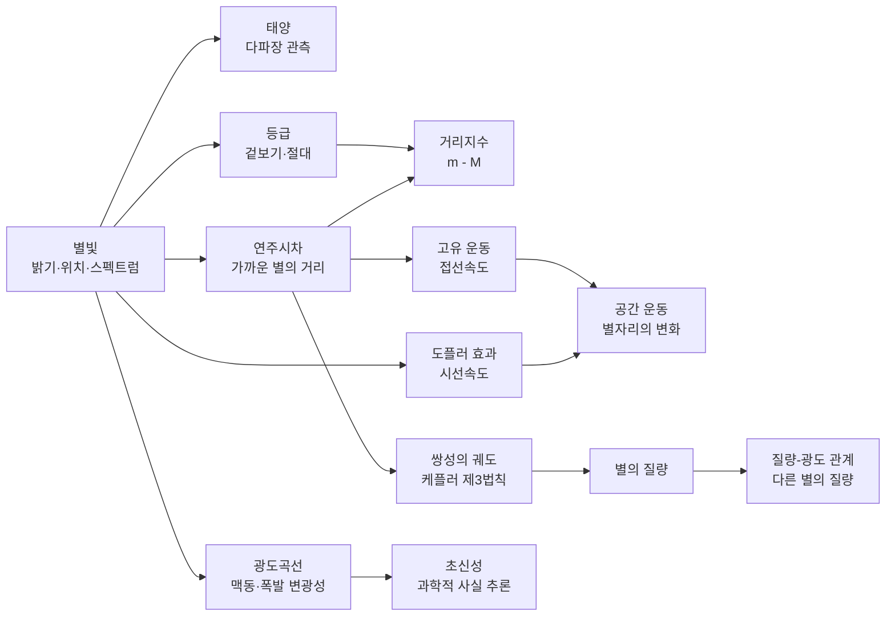

# 행성우주과학 2. 태양과 별의 관측 — 빛 한 줄기로 거리와 질량을 재다
<!-- prev: m1-07, m2-08, 2-1, earth-3, astro-1 -->
<!-- next: astro-3, emq-3 -->

> [!NOTE]
> **성취기준**
> - **[12행우02-01]** 태양의 광구와 대기에서 나타나는 현상을 설명하고, 이러한 현상이 다양한 파장의 관측 자료에서 어떻게 나타나는지 비교⋅분석할 수 있다.
> - **[12행우02-02]** 별의 시차와 밝기를 이용하여 거리를 측정하는 다양한 방법을 비교⋅평가할 수 있다.
> - **[12행우02-03]** 별의 시선속도와 접선속도의 합으로 공간 운동이 나타남을 이해하고, 별자리를 구성하는 별들의 장시간에 걸친 형태 변화를 추론할 수 있다.
> - **[12행우02-04]** 쌍성의 관측 자료를 이용하여 항성의 질량을 직접적으로 구할 수 있음을 이해하고, 질량-광도 관계를 이용하여 쌍성이 아닌 별의 질량을 구할 수 있다.
> - **[12행우02-05]** 광도곡선의 특징을 비교하여 맥동변광성과 폭발 변광성을 구분하고, 폭발 변광성 중 초신성 관측 자료를 통해 알 수 있는 과학적 사실을 추론할 수 있다.

**학습 목표**

1. 쌀알 무늬와 흑점이 생기는 까닭을 설명하고, 흑점 관측 자료로 태양 활동 주기와 차등 자전을 해석하며, 같은 태양 현상이 가시광선·Hα·자외선·X선 영상에서 어떻게 다르게 보이는지 비교할 수 있다.
2. 연주시차와 거리지수로 별까지의 거리를 계산하고, 두 방법의 원리·적용 범위·한계를 비교·평가할 수 있다.
3. 시선속도와 접선속도로 별의 공간 속도를 구하고, 별자리가 물리적 집단이 아니며 오랜 시간이 지나면 모양이 바뀜을 추론할 수 있다.
4. 케플러 제3법칙을 쌍성계에 적용해 별의 질량을 구하고, 질량-광도 관계로 쌍성이 아닌 주계열성의 질량을 어림할 수 있다.
5. 광도곡선으로 맥동변광성과 폭발 변광성을 구분하고, 초신성 관측 자료로부터 알 수 있는 과학적 사실을 추론할 수 있다.

**이 단원의 학습 사다리**

| 단계 | 무엇을 하나? |
|---|---|
| STEP 1. 이전 학습 다시 보기 | 중학교 「태양계」·「별과 우주」, 통합과학 「빛의 스펙트럼과 우주 초기 원소」, 지구과학의 흑체복사·H-R도, 앞 단원의 케플러 법칙을 꺼낸다 |
| STEP 2. 기초 다지기 | 등급과 로그, 각도의 단위, 흑체복사와 빈 법칙, 속도의 합성, 자기장을 디딤돌로 놓는다 |
| STEP 3. 핵심 개념 | 태양의 다파장 관측 → 별까지의 거리 → 별의 공간 운동과 별자리 → 쌍성과 별의 질량 → 변광성과 초신성 |
| STEP 4. 오개념 바로잡기 | "흑점은 차가워서 검다?", "별자리의 별들은 가까이 모여 있다?" 같은 착각을 바로잡는다 |
| STEP 5. 대학 전공으로 | 태양 다이너모, 정밀 위치 천문학, 분광쌍성의 질량 함수, 맥동의 원리와 초신성의 종류 |
| STEP 6. 생활·산업·진로 | 우주기상 예보, 위성 천문 측량, 천체 관측 기기, 역사 기록 속 천문학 |

---

## 🗺️ 단원 들어가기

1604년 10월, 조선의 관상감 관원들은 밤하늘의 전갈자리 근처에 전에 없던 별이 나타난 것을 보았다. 『조선왕조실록』에는 이 '객성(客星)'의 위치와 밝기 변화가 수개월에 걸쳐 거듭 기록되어 있다. 같은 별을 유럽에서는 케플러가 관측했다. 오늘날 우리는 이 별이 **초신성**이었고, 그 자리에 지금도 폭발 잔해가 퍼져 나가고 있음을 안다.

400여 년 전 사람들은 맨눈으로 별의 '밝기'와 '위치'만 볼 수 있었다. 지금 우리는 같은 빛에서 훨씬 많은 것을 읽어 낸다. 별이 해마다 조금씩 흔들리는 각도로 **거리**를, 스펙트럼선의 이동으로 **속도**를, 서로를 도는 두 별의 주기로 **질량**을, 밝기가 오르내리는 모양으로 **정체**를 알아낸다. 이 단원은 가장 가까운 별인 태양에서 출발하여, 빛만으로 별의 물리량을 하나씩 결정해 가는 과정을 따라간다.

---

## STEP 1. 🔙 이전 학습 다시 보기

### 연계 개념표

| 이전 단원·성취기준 | 그때 배운 것 | 이 단원에서 확장되는 것 |
|---|---|---|
| 중1 「태양계」 [9과07-02] | 광구의 흑점·쌀알 무늬, 채층·코로나·홍염·플레어 | 쌀알 무늬와 흑점이 생기는 **까닭**, 파장마다 다르게 보이는 태양 |
| 중1 「태양계」 [9과07-03] | 지구 공전에 의한 계절별 별자리 변화 | 별 자신의 운동(고유 운동)에 의한 **수만 년 규모**의 별자리 변화 |
| 중2 「별과 우주」 [9과15-01] | 연주시차와 거리(수식 없이), 겉보기 등급과 절대등급, 표면 온도와 색 | $d = 1/p$, 거리지수 $m - M = 5\log d - 5$로 **정량 계산** |
| 통합과학1 「빛의 스펙트럼과 우주 초기 원소」 [10통과1-02-01] | 흡수 스펙트럼선으로 천체의 구성 원소를 안다 | 스펙트럼선의 **위치 이동**으로 시선속도를 잰다 |
| 지구과학 「태양계 천체와 별과 우주의 진화」 [12지구03-02], [12지구03-03] | 분광형, 흑체복사(빈 법칙, 슈테판–볼츠만 법칙), H-R도와 주계열성 | 주계열성의 **질량-광도 관계**, 광도로 질량 어림 |
| 행성우주과학 「우주탐사와 행성계」 [12행우01-03] | 케플러 제3법칙, $a^3/T^2$로 중심 천체 질량 재기 | 쌍성에 적용해 **별의 질량**을 직접 구한다 |

### 준비 운동 (사전 진단)

**Q1.** 1등급인 별은 6등급인 별보다 약 몇 배 밝은가?

**Q2.** 연주시차가 큰 별일수록 지구에서 가까운가, 먼가?

**Q3.** 표면 온도가 높은 별일수록 최대 에너지를 내는 파장은 길어지는가, 짧아지는가?

**Q4.** 겉보기 등급이 3등급이고 절대등급이 3등급인 별까지의 거리는 몇 pc인가?

정답 및 해설

**Q1. 약 100배** — 5등급 차이가 밝기 100배로 정의되어 있다.

**Q2. 가깝다** — 가까운 물체일수록 관측 위치를 바꿀 때 더 크게 움직여 보인다.

**Q3. 짧아진다** — 빈 변위 법칙 $\lambda_{\max} = \dfrac{b}{T}$에 따라 온도에 반비례한다. 뜨거운 별이 파랗게 보이는 까닭이다.

**Q4. 10 pc** — 절대등급은 별을 10 pc 거리에 두었을 때의 등급이므로, 두 등급이 같으면 실제 거리가 10 pc이다.

---

## STEP 2. 🧱 기초 다지기

### ① 등급과 밝기 — 로그가 필요한 이유

사람의 눈은 밝기의 '차이'보다 '비율'에 반응한다. 그래서 별의 등급은 밝기 비율을 **로그**로 나타낸다. 5등급 차이가 정확히 100배이므로 1등급 차이는 $100^{1/5} \approx 2.512$배이다. 두 별의 밝기(지구에서 받는 복사 플럭스) $F_1$, $F_2$와 등급 $m_1$, $m_2$ 사이에는

$$
m_1 - m_2 = -2.5\log\frac{F_1}{F_2}
$$

가 성립한다(밝을수록 등급 숫자가 작다).

| 등급 차 | 1 | 2 | 2.5 | 5 | 10 | 15 |
|---|---|---|---|---|---|---|
| 밝기 비 | 약 2.5배 | 약 6.3배 | 10배 | 100배 | $10^4$배 | $10^6$배 |

> [!TIP]
> 💡 **로그 요령** — $\log 10 = 1$, $\log 100 = 2$, $\log 2 \approx 0.30$, $\log 3 \approx 0.48$. "등급 2.5 차이 = 10배"를 기억하면 나머지를 빠르게 어림할 수 있다.

### ② 각도의 단위와 작은 각 근사

천체의 움직임은 대부분 매우 작은 각도이다.

- $1^\circ = 60'$(분), $1' = 60''$(초) → $1^\circ = 3600''$
- 1 라디안 $\approx 57.3^\circ \approx 206{,}265''$

각도 $\theta$가 매우 작으면, 거리 $d$에 있는 물체의 크기(또는 이동 거리) $s$는 $s \approx d\,\theta$ ($\theta$는 라디안)이다. 예를 들어 100 m 떨어진 곳의 1 cm는 약 $10^{-4}$ 라디안, 즉 약 $21''$로 보인다.

### ③ 흑체복사와 빈 법칙 다시 보기

지구과학에서 배운 두 법칙은 이 단원 내내 쓰인다.

$$
\lambda_{\max} = \frac{2.9\times10^{-3}\ \mathrm{m\cdot K}}{T} \qquad\quad L = 4\pi R^2\sigma T^4
$$

- 태양 광구($T \approx 5800\ \mathrm{K}$): $\lambda_{\max} \approx 500\ \mathrm{nm}$ → 가시광선
- 태양 코로나($T \approx 10^6\ \mathrm{K}$): $\lambda_{\max} \approx 2.9\ \mathrm{nm}$ → X선·극자외선

즉, **무엇을 보고 싶은지(온도)에 따라 관측할 파장이 정해진다.** 이것이 태양을 여러 파장으로 관측하는 이유이다.

### ④ 속도의 합성 — 직각 삼각형

별의 운동 속도는 우리 시선 방향 성분(시선속도 $v_r$)과 시선에 수직인 성분(접선속도 $v_t$)으로 나눌 수 있다. 두 성분은 서로 수직이므로 실제 속도의 크기는 피타고라스 정리로 구한다.

$$
v = \sqrt{v_r^2 + v_t^2}
$$

> [!TIP]
> 💡 **비유** — 강을 건너는 배를 강둑에서 보면 '강을 가로지르는 속도'와 '물살 방향 속도'가 합쳐져 비스듬히 간다. 별의 공간 운동도 '다가오거나 멀어지는 속도'와 '하늘에서 옆으로 미끄러지는 속도'의 합이다.

### ⑤ 자기장은 대류를 막을 수 있다

뜨거운 기체(플라스마)는 전기를 띤 입자로 이루어져 있어 자기장과 함께 움직이려 한다. 자기장이 강하게 뭉친 곳에서는 기체가 자기장을 가로질러 자유롭게 흐르지 못한다. 이 성질이 STEP 3 ①에서 흑점이 생기는 열쇠가 된다.

---

## STEP 3. 📘 핵심 개념

### ① 태양의 광구와 대기 — 파장마다 다른 얼굴 [12행우02-01]

#### 태양의 층 구조 한눈에 보기

| 층 | 온도(약) | 특징 | 잘 보이는 파장 |
|---|---|---|---|
| 중심핵 | 1500만 K | 수소 핵융합으로 에너지 생성 | (직접 볼 수 없음) |
| 복사층·대류층 | 수백만 K → 수천 K | 에너지가 복사와 대류로 바깥으로 전달 | (직접 볼 수 없음) |
| 광구 | 약 5800 K | 우리가 보는 '태양 표면'. 쌀알 무늬, 흑점 | 가시광선(백색광) |
| 채층 | 수천~수만 K | 광구 바로 위의 붉은 층. 스피큘(가시 모양 기둥) | Hα선(656.3 nm) |
| 코로나 | 100만~200만 K | 태양 바깥으로 수백만 km 이상 퍼진 희박한 대기 | 극자외선, X선, (개기일식·코로나그래프의 가시광선) |

#### 쌀알 무늬 — 끓는 된장국의 표면

광구 아래 대류층에서는 뜨거운 기체가 올라오고, 식은 기체가 가라앉는 **대류**가 일어난다. 광구를 고해상도로 찍으면 지름 약 1000 km 정도의 밝은 알갱이들이 어두운 경계선에 둘러싸인 모습이 보이는데, 이것이 **쌀알 무늬(granulation)** 이다.

- 밝은 중심부: 뜨거운 기체가 올라오는 곳
- 어두운 경계: 식은 기체가 가라앉는 곳(조금 더 차가워 상대적으로 어둡다)
- 하나하나의 쌀알은 수 분~십수 분 만에 사라지고 새로 생긴다.

> [!TIP]
> 💡 **비유** — 냄비에 된장국을 끓이면 표면에 작은 칸들이 생기고, 칸 가운데서 국물이 솟고 가장자리로 가라앉는다. 쌀알 무늬는 태양 크기의 '끓는 냄비'의 표면이다.

#### 흑점 — 자기장이 대류를 막은 자리

**흑점(sunspot)** 은 광구에서 어둡게 보이는 영역이다. 흑점에서는 태양 내부의 강한 자기장 다발이 광구를 뚫고 나오는데, 자기장이 대류를 방해하여 아래에서 올라오는 열이 잘 전달되지 못한다. 그래서 주변보다 온도가 낮다(중심부 약 4000 K).

흑점이 '검게' 보이는 것은 대비 효과이다. 단위 면적당 내보내는 에너지는 $T^4$에 비례하므로

$$
\left(\frac{4000}{5800}\right)^4 \approx 0.23
$$

흑점은 주변 광구의 약 4분의 1 밝기로 빛난다. 흑점만 따로 떼어 밤하늘에 놓으면 보름달보다 훨씬 밝게 빛날 것이다. 흑점은 보통 자기장의 N극과 S극이 짝을 이루어 쌍으로 나타난다.

#### 흑점 관측 자료가 알려 주는 것 (1) — 태양 활동 주기

흑점의 수는 약 **11년**을 주기로 늘었다 줄었다 한다. 흑점이 많은 **극대기**에는 플레어와 코로나 질량 방출도 잦아 우주기상 재난의 위험이 커진다. 또 한 주기 동안 흑점이 나타나는 위도를 시간에 따라 찍어 보면, 주기 초반에는 위도 30° 안팎의 높은 위도에서 나타나고 주기가 진행될수록 점점 적도 쪽(위도 5~10°)에서 나타난다. 이 그림이 나비 날개 모양이어서 **나비 도표**라 부른다. 흑점 쌍의 자기극 배열은 주기마다 뒤바뀌므로, 자기장까지 생각한 태양 자기 주기는 약 22년이다.

#### 흑점 관측 자료가 알려 주는 것 (2) — 차등 자전

흑점을 며칠 동안 관측하면 태양 원반 위를 동쪽에서 서쪽으로 이동하는 것이 보인다. 태양이 자전하기 때문이다. 그런데 위도마다 흑점의 이동 속도가 다르다.

| 위도 | 자전 주기(항성 기준, 약) |
|---|---|
| 적도 | 25일 |
| 위도 30° | 26~27일 |
| 극 부근 | 35일 이상 |

태양은 단단한 고체가 아니라 기체 덩어리이므로 위도에 따라 자전 속도가 다르다. 이를 **차등 자전(differential rotation)** 이라 한다. 지구의 자전 주기가 위도와 관계없이 하루인 것과 대조적이다. 차등 자전은 내부의 자기장을 감고 꼬아 흑점과 태양 활동을 만들어 내는 중요한 원인으로 여겨진다.

#### 예제 1 — 흑점의 이동으로 태양의 자전 주기 구하기

적도 근처의 흑점이 지구에서 보았을 때 하루에 약 $13.2^\circ$씩 태양 원반 위를 이동했다.
(1) 지구에서 본 태양의 자전 주기(회합 주기)를 구하시오.
(2) 지구도 태양 둘레를 같은 방향으로 공전하고 있다. 별을 기준으로 한 태양의 실제 자전 주기(항성 주기)를 구하시오.

**풀이**
(1) $P_{\text{회합}} = \dfrac{360^\circ}{13.2^\circ/\text{일}} \approx 27.3$일
(2) 지구가 같은 방향으로 따라가므로, 실제 자전은 지구에서 보는 것보다 빠르다.

$$
\frac{1}{P_{\text{항성}}} = \frac{1}{P_{\text{회합}}} + \frac{1}{365.25} = \frac{1}{27.3} + \frac{1}{365.25} \;\Rightarrow\; P_{\text{항성}} \approx 25.4\ \text{일}
$$

> [!NOTE]
> 실제 관측에서는 흑점이 원반의 가장자리로 갈수록 비스듬히 보여 이동 거리가 짧아 보인다. 그래서 원반 위의 위치를 태양 표면의 경도·위도로 바꾸어 계산한다. 여러 날의 위성 영상을 컴퓨터로 겹쳐 보면 위도마다 흑점이 다른 속도로 움직이는 차등 자전을 직접 확인할 수 있다.

#### 채층과 코로나에서 일어나는 현상

| 현상 | 위치 | 설명 |
|---|---|---|
| 스피큘 | 채층 | 채층에서 솟아오르는 가느다란 기체 기둥 |
| 홍염(프로미넌스) | 채층~코로나 | 자기장을 따라 떠 있는 비교적 차갑고 밀도 높은 기체. 태양 가장자리 밖에서 밝은 고리·불꽃 모양으로 보인다. 원반 위에서는 어두운 줄(**필라멘트**)로 보인다 |
| 플레어 | 흑점 부근의 채층·코로나 | 꼬인 자기장이 갑자기 재결합하며 막대한 에너지를 짧은 시간에 방출. 거의 모든 파장에서 갑자기 밝아진다 |
| 코로나 질량 방출(CME) | 코로나 | 거대한 플라스마 덩어리가 자기장과 함께 행성 간 공간으로 분출 |
| 코로나 구멍 | 코로나 | 자기장이 바깥으로 열려 있는 곳. 기체가 빠져나가 밀도가 낮아 X선 영상에서 어둡게 보이며, 빠른 태양풍의 출처이다 |

#### 같은 태양, 다른 파장 — 다파장 관측 자료 비교하기

같은 날 같은 시각에 여러 파장으로 찍은 태양 영상을 비교해 보자.

| 관측 파장 | 주로 보이는 층 | 흑점(활동 영역)은 어떻게 보이나 | 그 밖에 잘 보이는 것 |
|---|---|---|---|
| 가시광선(백색광) | 광구 | **어둡게** | 쌀알 무늬, 가장자리가 어두워지는 주연 감광 |
| Hα선 | 채층 | 주변이 **밝은 영역(플라주)** 으로 | 필라멘트(어두운 줄), 가장자리 밖의 홍염, 플레어 |
| 극자외선 | 채층 상부~코로나 | **밝은** 코로나 고리 다발 | 자기장을 따라 휘어진 고리 구조, 코로나 구멍 |
| X선 | 코로나 | **매우 밝게** | 플레어, 어두운 코로나 구멍 |
| 전파 | 채층~코로나 | 밝게 | 플레어에 따른 전파 폭발. 10.7 cm 전파 세기는 태양 활동 지수로 쓰인다 |
| 자기장 지도 | 광구 | N극·S극이 **짝을 이룬 강한 자기장** | 흑점 쌍의 극성 배열 |

> [!IMPORTANT]
> 가시광선에서 **어두운** 흑점 자리가 극자외선·X선에서는 **가장 밝게** 빛난다. 흑점 위쪽 코로나에 강한 자기장이 에너지를 모아 기체를 수백만 K로 가열하기 때문이다. 이처럼 한 파장의 영상만으로는 태양 활동을 온전히 알 수 없고, **층마다 온도가 다르므로 그 층의 온도에 맞는 파장으로 보아야 한다.**

#### 예제 2 — 어느 파장으로 보아야 할까?

다음 현상을 관측하기에 가장 알맞은 파장을 고르고 이유를 쓰시오.
(1) 코로나 구멍 (2) 쌀알 무늬 (3) 태양 원반 위의 필라멘트

**풀이**
(1) **X선(또는 극자외선)**: 코로나는 100만 K 이상이라 빈 법칙에 따라 X선·극자외선을 주로 내고, 코로나 구멍은 기체가 적어 그 영상에서 어둡게 드러난다.
(2) **가시광선**: 쌀알 무늬는 약 5800 K인 광구의 현상이므로 가시광선에서 잘 보인다.
(3) **Hα선**: 필라멘트는 채층~코로나에 떠 있는 비교적 차가운 기체로, 수소의 Hα선 영상에서 어두운 줄로 보인다.

### ② 별까지의 거리 — 시차와 밝기 [12행우02-02]

#### 연주시차 — 지구 공전 궤도를 밑변으로 한 삼각 측량

지구가 태양 둘레를 돌기 때문에 6개월 간격으로 가까운 별을 관측하면, 먼 배경 별에 대해 가까운 별의 위치가 조금 달라 보인다. 그 각도의 절반이 **연주시차(annual parallax) $p$** 이다. 연주시차가 $1''$인 거리를 **1파섹(pc)** 이라 정의하므로

$$
d\,(\mathrm{pc}) = \frac{1}{p\,('')} \qquad (1\ \mathrm{pc} \approx 3.26\ \text{광년} \approx 2.06\times10^{5}\ \mathrm{AU})
$$

이다. 태양 다음으로 가까운 별인 프록시마 센타우리의 연주시차는 약 $0.77''$로, 거리는 약 1.3 pc(약 4.2광년)이다. 모든 별의 연주시차는 $1''$보다 작다.

> [!TIP]
> 💡 **비유** — 팔을 뻗어 엄지를 세우고 왼눈과 오른눈을 번갈아 감아 보자. 엄지가 배경에 대해 좌우로 움직인다. 엄지를 얼굴 가까이 가져오면 더 크게 움직인다. 두 눈 사이 거리가 '지구 공전 궤도 지름', 엄지가 '가까운 별'이다.

**연주시차 방법의 특징**
- 장점: 별의 물리적 성질을 전혀 가정하지 않는 **기하학적·직접적** 방법이다. 그래서 다른 모든 거리 측정법의 기준이 된다.
- 한계: 거리가 멀면 시차가 너무 작아 잴 수 없다. 대기의 흔들림 때문에 지상 관측으로는 수십 pc 정도까지가 한계였고, 위치 측정 위성(히파르코스, 가이아)이 대기 밖에서 측정하면서 범위가 크게 넓어졌다. 가이아는 밝은 별의 시차를 $10^{-5}$초 수준까지 재어 수천 pc 범위 별들의 거리를 측정하고 있다.

#### 예제 3 — 시차의 측정 오차와 거리 오차

어떤 별의 연주시차가 $0.010''$로 측정되었고 측정 오차가 $\pm0.001''$이다. 이 별까지의 거리와 그 범위를 구하시오.

**풀이** $d = \dfrac{1}{0.010} = 100\ \mathrm{pc}$
시차 범위 $0.009''\sim0.011''$ → 거리 범위 $\dfrac{1}{0.011} \approx 91\ \mathrm{pc}$ ~ $\dfrac{1}{0.009} \approx 111\ \mathrm{pc}$

시차의 상대 오차가 10 %이면 거리의 상대 오차도 약 10 %이다. 같은 측정 정밀도라면 먼 별일수록(시차가 작을수록) 상대 오차가 커져서 거리를 믿기 어려워진다.

#### 겉보기 등급, 절대등급, 그리고 거리지수

- **겉보기 등급 $m$**: 지구에서 보이는 밝기의 등급
- **절대등급 $M$**: 별을 **10 pc** 거리에 두었다고 할 때의 등급 → 별의 실제 밝기(광도)를 비교하는 척도

밝기는 거리의 제곱에 반비례하므로, 거리 $d$(pc)에 있는 별의 밝기 $F_d$와 10 pc에 둘 때의 밝기 $F_{10}$의 비는 $\dfrac{F_d}{F_{10}} = \left(\dfrac{10}{d}\right)^2$이다. 이를 STEP 2 ①의 등급 식에 넣으면

$$
m - M = -2.5\log\left(\frac{10}{d}\right)^2 = 5\log d - 5
$$

이 된다. $m - M$을 **거리지수(distance modulus)** 라 한다. 거리지수가 같으면 거리가 같다.

| 거리지수 $m - M$ | 0 | 5 | 10 | 15 | 20 | 25 |
|---|---|---|---|---|---|---|
| 거리 $d$ | 10 pc | 100 pc | 1 kpc | 10 kpc | 100 kpc | 1 Mpc |

거리지수가 5 커질 때마다 거리는 10배가 된다.

#### 예제 4 — 시차와 거리지수 함께 쓰기

(1) 겉보기 등급 5.0, 연주시차 $0.05''$인 별의 절대등급을 구하시오.
(2) 절대등급이 $-5.0$인 것으로 알려진 별이 겉보기 등급 10.0으로 보인다. 이 별까지의 거리를 구하시오.

**풀이**
(1) $d = \dfrac{1}{0.05} = 20\ \mathrm{pc}$, $M = m - 5\log d + 5 = 5.0 - 5\log 20 + 5 \approx 5.0 - 6.5 + 5 = 3.5$
(2) $m - M = 10.0 - (-5.0) = 15$ → $5\log d - 5 = 15$ → $\log d = 4$ → $d = 10^{4}\ \mathrm{pc} = 10\ \mathrm{kpc}$

(2)처럼 **절대등급을 알 수 있는 별**이 있으면, 시차를 잴 수 없을 만큼 먼 곳까지 거리를 구할 수 있다. 그러면 절대등급은 어떻게 알까? 별의 스펙트럼으로 분광형과 광도 계급을 정해 H-R도에서 절대등급을 읽거나(분광 시차), 광도가 알려진 특별한 천체(**표준 촛불**: 세페이드 변광성, 일부 초신성 등)를 이용한다.

#### 거리 측정 방법 비교·평가

| 방법 | 원리 | 꼭 필요한 정보 | 쓸 수 있는 거리(대략) | 장점 | 한계 |
|---|---|---|---|---|---|
| 연주시차 | 지구 공전에 따른 기하학적 위치 변화 | 정밀한 위치 측정 | 지상 수십 pc, 위성 수천 pc | 가정이 거의 없는 직접 측정 | 먼 별은 시차가 너무 작다 |
| 분광 시차(H-R도 이용) | 스펙트럼 → H-R도에서 절대등급 → 거리지수 | 스펙트럼, H-R도 보정 | 수만 pc까지(별이 밝게 보이는 범위) | 별 하나로도 거리 추정 | H-R도에서 읽는 절대등급의 오차가 크다 |
| 표준 촛불(변광성, 초신성) | 광도가 알려진 천체의 거리지수 | 주기-광도 관계 등 별도 보정 | 변광성은 수천만 pc, 초신성은 수십억 광년 이상 | 매우 먼 은하까지 | 표준 촛불의 밝기 보정이 가까운 천체의 시차에 의존 |

> [!IMPORTANT]
> 거리지수 방법은 모두 **"절대등급을 안다"는 가정** 위에 서 있고, 그 절대등급은 결국 **연주시차로 거리를 잰 가까운 별**로 보정한다. 그래서 거리 측정은 가까운 곳의 직접 측정에서 먼 곳의 간접 측정으로 한 칸씩 올라가는 **사다리** 구조를 이룬다. 또 별빛이 성간 티끌을 지나며 어두워지면 거리가 실제보다 멀게 계산된다. 이 보정은 다음 단원 「은하와 우주」에서 다룬다.

### ③ 별의 공간 운동과 별자리의 변화 [12행우02-03]

#### 별은 제자리에 박혀 있지 않다

옛사람들은 별을 '붙박이별(항성)'이라 불렀지만, 실제로 모든 별은 우리은하 안에서 초속 수십 km 이상으로 움직인다. 너무 멀어서 하늘에서 위치 변화가 아주 느리게 보일 뿐이다. 별의 실제 운동인 **공간 운동(space motion)** 은 두 성분으로 나누어 측정한다.

| 성분 | 무엇인가 | 어떻게 재나 |
|---|---|---|
| 시선속도 $v_r$ | 우리에게 다가오거나 멀어지는 속도 | 스펙트럼선의 도플러 이동: $v_r = c\,\dfrac{\Delta\lambda}{\lambda_0}$ (멀어지면 +) |
| 접선속도 $v_t$ | 시선에 수직 방향(하늘 면을 따라) 움직이는 속도 | 1년에 하늘에서 움직인 각도인 **고유 운동 $\mu$** 와 거리 $d$로 계산 |

접선속도는 작은 각 근사로 구한다. 1년에 $\mu$('')만큼 움직이는 별이 거리 $d$(pc)에 있으면 1년 동안 하늘 면을 따라 $\mu d$ AU만큼 이동한 것이다. 1 AU/년 $\approx 4.74\ \mathrm{km/s}$이므로

$$
v_t\,(\mathrm{km/s}) = 4.74\,\mu\,('' /\text{년})\times d\,(\mathrm{pc}) \qquad\quad v = \sqrt{v_r^2 + v_t^2}
$$

이다. 시선속도는 거리와 관계없이 스펙트럼만으로 바로 얻지만, 접선속도는 **거리를 알아야** 구할 수 있다.

> [!TIP]
> 💡 **비유** — 멀리 고속도로의 차는 천천히 가는 것처럼 보이고, 바로 앞을 지나는 차는 휙 지나간다. 같은 접선속도라도 먼 별은 고유 운동(각도의 변화)이 작다. 그래서 고유 운동이 큰 별은 대개 가까운 별이다.

#### 예제 5 — 바너드별의 공간 속도

바너드별은 고유 운동이 약 $10.4''$/년으로 하늘에서 가장 빠르게 움직이는 별이다. 거리는 약 1.83 pc이고, 스펙트럼선은 원래보다 짧은 쪽으로 이동하여 시선속도가 약 $-111\ \mathrm{km/s}$(다가옴)로 측정되었다. 이 별의 접선속도와 공간 속도를 구하시오.

**풀이**
- $v_t = 4.74 \times 10.4 \times 1.83 \approx 90\ \mathrm{km/s}$
- $v = \sqrt{111^2 + 90^2} \approx 143\ \mathrm{km/s}$

이 별은 우리 쪽으로 다가오면서 하늘에서는 옆으로 미끄러지고 있다. 약 1만 년 뒤에는 지금보다 더 가까워져 있을 것이다.

#### 별자리는 '물리적 집단'이 아니다

별자리는 지구에서 볼 때 **비슷한 방향에 있는 별들**을 묶은 것이다. 같은 별자리의 별이라도 우리로부터의 거리는 제각각이다.

| 오리온자리의 별 | 거리(약) |
|---|---|
| 벨라트릭스 | 250광년 |
| 베텔게우스 | 550~700광년(측정 방법에 따라 차이가 큼) |
| 리겔 | 860광년 |
| 허리띠의 세 별 | 각각 1200~2000광년 |

평면 하늘에서는 사냥꾼 모양으로 이웃해 보이지만, 입체로 놓으면 수백~천수백 광년에 걸쳐 흩어져 있다. 서로 중력으로 묶여 있지도 않으므로 별마다 공간 운동이 다르다.

#### 별자리는 오랜 시간이 지나면 모양이 바뀐다

별마다 고유 운동의 방향과 크기가 다르므로, 오랜 시간이 지나면 별자리의 모양이 바뀐다. 북두칠성의 일곱 별 중 가운데 다섯 별(메라크, 페크다, 메그레즈, 알리오스, 미자르)은 약 80광년 거리에서 거의 같은 방향으로 함께 움직이는 별 무리에 속하지만, 양 끝의 두 별(두베, 알카이드)은 다른 방향으로 움직인다. 그래서 약 10만 년 뒤에는 국자 모양이 크게 일그러져 지금의 모습을 알아보기 어렵게 된다.

#### 예제 6 — 별자리 모양이 바뀌는 데 걸리는 시간

고유 운동이 $0.1''$/년인 별이 하늘에서 $1^\circ$(보름달 지름의 약 2배) 움직이는 데 걸리는 시간은? 또 사람의 일생(약 80년) 동안에는 얼마나 움직이는가?

**풀이** $1^\circ = 3600''$이므로 $\dfrac{3600}{0.1} = 36{,}000$년이 걸린다. 80년 동안에는 $0.1 \times 80 = 8''$를 움직이는데, 이는 맨눈의 분해능(약 $60''$)보다 훨씬 작다. 그래서 사람의 일생 동안 별자리는 변하지 않는 것처럼 보이지만, 수만~수십만 년 규모에서는 확실히 변한다.

> [!NOTE]
> 중학교에서 배운 '계절에 따른 별자리 변화'는 지구의 공전 때문에 **밤에 보이는 방향**이 바뀌는 것이고, 별자리의 모양 자체는 그대로이다. 이 단원의 '별자리 형태 변화'는 별 자신의 공간 운동 때문에 **별자리 모양이 바뀌는 것**으로, 전혀 다른 현상이다.

### ④ 쌍성으로 별의 질량 구하기와 질량-광도 관계 [12행우02-04]

#### 왜 쌍성인가?

별의 거리·광도·온도는 빛으로 알아낼 수 있지만, **질량**은 다른 천체에 미치는 중력의 효과를 보아야만 직접 잴 수 있다. 서로의 중력으로 묶여 공통 질량 중심 둘레를 도는 두 별, 즉 **쌍성(binary star)** 이 바로 그 기회이다. 별의 절반 가까이가 쌍성이나 다중성계에 속한다.

| 쌍성의 종류 | 어떻게 알아보나 |
|---|---|
| 안시 쌍성 | 망원경으로 두 별이 따로 보이고, 오랜 기간 관측하면 서로 도는 것이 보인다 |
| 분광 쌍성 | 너무 가까워 하나로 보이지만, 스펙트럼선이 주기적으로 갈라지거나 흔들린다(도플러 효과) |
| 식쌍성 | 궤도면이 시선과 나란하여 두 별이 서로를 가릴 때 밝기가 주기적으로 줄어든다 |

#### 케플러 제3법칙을 쌍성에 적용하기

앞 단원에서 중심 천체 둘레의 운동에 대해 $\dfrac{a^3}{T^2} = \dfrac{GM}{4\pi^2}$임을 보았다. 두 별의 질량이 비슷한 쌍성에서는 두 별의 질량을 합한 $M_1 + M_2$를 써야 한다. 태양 질량($M_\odot$), AU, 년 단위로 나타내면(태양–지구계에서 1이 되도록 맞춘 단위)

$$
M_1 + M_2 = \frac{a^3}{P^2} \qquad (M: M_\odot,\ a: \mathrm{AU},\ P: \text{년})
$$

이다. 여기서 $a$는 한 별에 대한 다른 별의 상대 궤도 긴반지름, $P$는 공전 주기이다.

또 두 별은 공통 질량 중심을 사이에 두고 항상 반대편에 있으며, 질량 중심에서 각 별까지의 거리 $a_1$, $a_2$는 질량에 반비례한다(시소의 원리).

$$
M_1 a_1 = M_2 a_2 \;\Rightarrow\; \frac{M_1}{M_2} = \frac{a_2}{a_1}, \qquad a = a_1 + a_2
$$

질량의 합과 질량의 비를 함께 알면 **각 별의 질량**을 구할 수 있다.

> [!NOTE]
> 이 과목에서는 궤도가 원이고, 궤도면이 시선에 수직(안시 쌍성) 또는 시선과 나란한(분광 쌍성) **이상적인 경우**만 다룬다. 실제 궤도는 타원이고 비스듬히 기울어 있어 기울기 보정이 필요하다.

#### 예제 7 — 시리우스의 질량

시리우스 A와 B는 약 50년 주기로 서로를 도는 안시 쌍성이다. 상대 궤도의 긴반지름은 각도로 약 $7.5''$이고, 시리우스의 연주시차는 약 $0.379''$이다. 질량 중심에서 B까지의 거리는 A까지의 거리의 약 2배이다.
(1) 상대 궤도 긴반지름을 AU로 구하시오.
(2) 두 별의 질량의 합과 각 별의 질량을 구하시오.

**풀이**
(1) 거리 $d = 1/p$(pc)에서 각도 $\alpha('')$의 실제 길이는 $\alpha d$ AU이므로 $a = \dfrac{\alpha}{p} = \dfrac{7.5}{0.379} \approx 19.8\ \mathrm{AU}$
(2) $M_A + M_B = \dfrac{19.8^3}{50^2} \approx \dfrac{7760}{2500} \approx 3.1\,M_\odot$
$a_B = 2a_A$이므로 $M_A = 2M_B$ → $3M_B = 3.1$ → $M_B \approx 1.0\,M_\odot$, $M_A \approx 2.1\,M_\odot$

시리우스 B는 태양 정도의 질량이지만 매우 어두운 **백색 왜성**이다. 질량을 직접 잰 덕분에 "작은 부피에 태양만 한 질량이 압축된 별"이라는 놀라운 사실이 밝혀졌다.

#### 질량-광도 관계 — 쌍성이 아닌 별의 질량은?

쌍성으로 질량을 잰 **주계열성**들의 질량과 광도를 그래프로 그리면 뚜렷한 관계가 나타난다.

$$
\frac{L}{L_\odot} \approx \left(\frac{M}{M_\odot}\right)^{3.5}
$$

지수는 질량 범위에 따라 대략 3~4 사이에서 달라지지만, 고등학교에서는 3.5를 대푯값으로 쓴다. 질량이 2배이면 광도는 약 $2^{3.5} \approx 11$배이다. 무거운 주계열성일수록 중심부 온도와 압력이 높아 핵융합이 훨씬 격렬하게 일어나기 때문이다.

이 관계를 거꾸로 쓰면 **광도만 알아도 주계열성의 질량을 어림할 수 있다.**

$$
\frac{M}{M_\odot} \approx \left(\frac{L}{L_\odot}\right)^{1/3.5}
$$

광도는 절대등급에서 구한다. 태양의 절대등급을 약 4.8로 하면 $\dfrac{L}{L_\odot} = 10^{\,0.4\,(4.8 - M_{\text{절대}})}$이다.

> [!WARNING]
> 질량-광도 관계는 **주계열성에만** 성립한다. 적색 거성은 질량에 비해 매우 밝고, 백색 왜성은 질량에 비해 매우 어둡다(시리우스 B를 떠올리자). 따라서 이 관계를 쓰기 전에 H-R도나 스펙트럼으로 그 별이 주계열성인지 먼저 확인해야 한다.

#### 예제 8 — 절대등급으로 주계열성의 질량 구하기

절대등급이 $-0.2$인 주계열성이 있다.
(1) 이 별의 광도는 태양의 몇 배인가?
(2) 질량-광도 관계로 이 별의 질량을 구하시오.
(3) 주계열 수명은 '연료(질량) ÷ 소비 속도(광도)'에 비례한다. 태양의 주계열 수명을 약 100억 년이라 할 때 이 별의 주계열 수명을 어림하시오.

**풀이**
(1) $\dfrac{L}{L_\odot} = 10^{0.4\times(4.8 + 0.2)} = 10^{2} = 100$배
(2) $\dfrac{M}{M_\odot} = 100^{1/3.5} \approx 3.7$
(3) $t \approx 100\text{억 년} \times \dfrac{3.7}{100} \approx 3.7$억 년

질량은 태양의 3.7배인데 수명은 태양의 약 27분의 1이다. **무거운 별일수록 짧고 굵게 산다.** 지구과학의 H-R도에서 주계열의 위쪽 별들이 빨리 진화하는 이유이다.

### ⑤ 변광성과 초신성 [12행우02-05]

#### 광도곡선 읽기

밝기가 시간에 따라 변하는 별을 **변광성(variable star)** 이라 하고, 시간에 따른 밝기(등급) 변화를 나타낸 그래프를 **광도곡선(light curve)** 이라 한다. 광도곡선의 모양만으로 변광성을 크게 두 무리로 나눌 수 있다.

| 구분 | 맥동변광성 | 폭발 변광성 |
|---|---|---|
| 광도곡선 모양 | 일정한 주기로 **규칙적으로 반복**된다. 빠르게 밝아지고 천천히 어두워지는 톱니 모양이 많다 | **갑자기 크게** 밝아진 뒤 수일~수개월에 걸쳐 서서히 어두워지며, 규칙적인 반복이 없다 |
| 밝기 변화 폭 | 대개 수 등급 이내 | 수 등급~20등급 가까이(초신성) |
| 원인(개괄) | 별이 부풀었다 줄어들기를 되풀이하며 반지름과 표면 온도가 변한다 | 별 표면이나 별 전체의 폭발적 사건 |
| 예 | 세페이드 변광성(주기 수일~수십 일), 거문고자리 RR형 변광성(주기 1일 미만), 미라형 변광성(주기 수백 일) | 신성, 초신성, 플레어별 |

> [!NOTE]
> 식쌍성도 밝기가 주기적으로 변하지만, 별 자체가 변하는 것이 아니라 두 별이 서로를 **가리기** 때문이다. 식쌍성의 광도곡선은 밝기가 일정하게 유지되다가 가려지는 동안만 오목하게 내려가는 모양이어서, 매끄럽게 계속 변하는 맥동변광성과 구별된다. 맥동이 일어나는 내부 기작은 이 과목에서 다루지 않는다.

#### 예제 9 — 광도곡선 구분하기

다음 세 별의 밝기 관측 기록을 보고 어떤 종류인지 판단하시오.
- 별 A: 5.4일마다 4.0등급 → 3.6등급(1.5일 걸림) → 4.0등급(3.9일 걸림)이 정확히 반복된다.
- 별 B: 평소 16등급이던 별이 3일 만에 7등급으로 밝아진 뒤 몇 달에 걸쳐 원래 밝기로 돌아갔다.
- 별 C: 3.2일 동안 밝기가 일정하다가 약 10시간 동안 0.8등급 어두워졌다 회복하는 일이 반복된다.

**풀이** A는 주기적으로 반복되고 빨리 밝아지고 천천히 어두워지므로 **맥동변광성**(세페이드형)이다. B는 단기간에 9등급(약 4000배) 밝아졌다가 서서히 어두워졌으므로 **폭발 변광성**(신성)이다. C는 일정한 밝기 사이에 짧게 어두워지는 구간만 나타나므로 **식쌍성**이다.

#### 초신성 — 별 하나가 은하만큼 밝아지다

**초신성(supernova)** 은 폭발 변광성 가운데 가장 격렬한 것이다. 최대 밝기일 때 하나의 별이 수십억 개의 별이 모인 은하 전체와 맞먹을 만큼 밝아지고, 수 주 동안 밝았다가 수개월~수년에 걸쳐 어두워진다. 초신성의 종류와 폭발 과정은 이 과목에서 다루지 않지만, **관측 자료**만으로도 많은 과학적 사실을 추론할 수 있다.

| 관측 자료 | 추론할 수 있는 과학적 사실 |
|---|---|
| 역사 기록(1054년, 1572년, 1604년 등 갑자기 나타난 '객성') | 하늘의 별은 영원불변하지 않으며, 별에도 일생과 끝이 있다 |
| 기록된 위치에 지금 있는 팽창하는 기체 구름(예: 1054년 초신성의 잔해인 게성운) | 폭발로 별의 물질이 우주 공간으로 흩어진다. 팽창 속력과 크기로 폭발 시기를 역산할 수 있다 |
| 초신성과 잔해의 스펙트럼에 나타나는 산소, 규소, 철 등 무거운 원소의 선 | 별 내부에서 만들어진 무거운 원소가 우주로 퍼져 다음 세대 별과 행성의 재료가 된다 |
| 최대 밝기가 거의 일정한 초신성들의 겉보기 등급 | 절대등급을 아는 **표준 촛불**로 매우 먼 은하까지의 거리를 잴 수 있다 |
| 먼 은하의 초신성이 예상보다 어둡게 관측됨(1990년대 후반) | 우주의 팽창이 **가속**되고 있다(지구과학의 가속 팽창과 연결) |

#### 예제 10 — 잔해의 팽창으로 폭발 시기 추정하기

게성운의 긴 쪽 반지름은 약 5.5광년이고, 스펙트럼선의 도플러 이동으로 잰 팽창 속력은 약 $1500\ \mathrm{km/s}$이다. 팽창 속력이 일정했다고 가정할 때, 폭발은 약 몇 년 전에 일어났는가? (1광년 $= 9.46\times10^{12}\ \mathrm{km}$, 1년 $= 3.16\times10^{7}\ \mathrm{s}$)

**풀이** $t = \dfrac{r}{v} = \dfrac{5.5\times9.46\times10^{12}\ \mathrm{km}}{1500\ \mathrm{km/s}} \approx 3.5\times10^{10}\ \mathrm{s} \approx 1100$년

약 1000여 년 전으로, 1054년에 '객성'이 나타났다는 동아시아의 기록과 대략 맞는다. 관측 자료(속력·크기)와 역사 기록이라는 **서로 독립적인 두 증거**가 같은 결론을 가리킨다는 점이 중요하다. (실제로는 팽창 속력이 일정하지 않아 정밀한 값은 조금 다르다.)

#### 예제 11 — 초신성으로 거리 재기

최대 밝기의 절대등급이 약 $-19$로 거의 일정한 초신성이 어떤 은하에서 최대 겉보기 등급 16으로 관측되었다. 이 은하까지의 거리를 구하시오. (성간 소광은 무시한다.)

**풀이** $m - M = 16 - (-19) = 35 = 5\log d - 5$ → $\log d = 8$ → $d = 10^{8}\ \mathrm{pc} = 100\ \mathrm{Mpc}$ (약 3억 2600만 광년)

연주시차로는 수천 pc가 한계였지만, 초신성은 그보다 수만 배 먼 거리를 재게 해 준다.

---

## STEP 4. ⚠️ 오개념 바로잡기

| 흔한 오개념 | 올바른 개념 | 왜 그럴까? |
|---|---|---|
| 흑점은 빛을 내지 않는 검은 구멍이다 | 흑점도 약 4000 K로 빛나지만 주변보다 **상대적으로 어두울** 뿐이다 | 단위 면적당 복사 에너지가 $T^4$에 비례하여 주변의 약 4분의 1이기 때문이다 |
| 흑점이 많으면 태양이 어두워진다 | 흑점 극대기에는 오히려 태양의 총 복사량이 **아주 조금 증가**한다 | 흑점 주변의 밝은 영역(백반)이 함께 늘어나 어두운 효과를 넘어선다 |
| 태양은 고체처럼 모든 위도가 같은 주기로 자전한다 | 적도는 약 25일, 극 부근은 35일 이상으로 **차등 자전**한다 | 태양은 기체(플라스마) 덩어리이기 때문이다 |
| 별자리를 이루는 별들은 서로 가까이 모여 있다 | 비슷한 **방향**에 있을 뿐 거리는 제각각이다 | 하늘은 깊이가 보이지 않는 평면처럼 보이기 때문이다 |
| 별자리 모양은 영원히 변하지 않는다 | 별의 공간 운동 때문에 **수만 년 이상**이 지나면 모양이 바뀐다 | 별이 멀어서 고유 운동이 매우 작아 사람의 일생 동안은 거의 변화가 없다 |
| 밝게 보이는 별일수록 가까이 있다 | 겉보기 밝기는 **광도와 거리**를 함께 반영한다 | 리겔은 수백 광년 떨어져 있지만 광도가 매우 커서 밝게 보인다 |
| 질량-광도 관계로 모든 별의 질량을 구할 수 있다 | **주계열성**에만 적용된다 | 거성·백색 왜성은 내부 구조와 에너지원이 달라 같은 관계를 따르지 않는다 |

---

## STEP 5. 🎓 다음 단계로 한 걸음 더

> [!CAUTION]
> 이 절은 **행성우주과학 교육과정 범위 밖의 심화 내용**으로 평가 대상이 아니다. 특히 맥동의 기작, 초신성의 종류와 폭발 과정은 성취기준 해설에서 다루지 않도록 한 내용이며, 여기서는 대학 전공으로 이어지는 맛보기로만 소개한다.

### 대학 전공 과목과의 연결

| 대학 과목 | 이어지는 내용 |
|---|---|
| 천문학 개론·관측천문학 | 측광계, 색지수, 분광 분류, 위치 천문학 |
| 태양물리학 | 태양 다이너모, 자기 재결합, 일진학(태양 내부 진동) |
| 항성물리학(천체물리학) | 별의 내부 구조 방정식, 에너지 전달, 질량-광도 관계의 이론적 유도 |
| 항성 진화·고에너지 천체물리학 | 맥동의 원리, 초신성의 종류와 폭발 메커니즘, 중성자별 |

### ① 태양 다이너모 — 11년 주기의 정체

태양 내부의 차등 자전은 남북 방향의 자기력선을 적도 방향으로 길게 감아 강한 동서 방향 자기장을 만들고, 대류는 그것을 비틀어 다시 남북 방향 자기장을 만든다. 이 순환을 **다이너모(dynamo)** 라 한다. 감긴 자기장 다발이 부력으로 떠올라 광구를 뚫고 나온 것이 흑점 쌍이다. 대학에서는 자기 유체 역학(MHD) 방정식으로 이 과정을 다룬다.

### ② 정밀 위치 천문학과 우주 거리 사다리

가이아 위성은 10억 개가 넘는 별의 위치·시차·고유 운동을 측정하여 우리은하의 3차원 지도와 별들의 운동을 밝히고 있다. 대학에서는 시차와 고유 운동으로 별의 운동학을 분석하고, 시차 → 세페이드 → 초신성으로 이어지는 **거리 사다리**의 각 단계 오차가 어떻게 누적되는지 다룬다.

### ③ 분광 쌍성의 질량 함수

실제 쌍성의 궤도는 시선에 대해 각도 $i$만큼 기울어 있다. 분광 쌍성에서는 시선속도 $v_r = v\sin i$만 재므로, 질량을 완전히 구하지 못하고 **질량 함수**

$$
f(M) = \frac{M_2^3\sin^3 i}{(M_1 + M_2)^2} = \frac{P\,K_1^3}{2\pi G}
$$

만 얻는다($K_1$: 별 1의 시선속도 진폭). 식쌍성이라면 $i \approx 90^\circ$이므로 질량을 정확히 구할 수 있다. 이 방법은 보이지 않는 동반성(블랙홀, 외계 행성)의 질량을 재는 데에도 쓰인다.

### ④ 맥동과 초신성의 종류(맛보기)

세페이드 변광성은 별의 바깥층에 있는 헬륨의 이온화 정도가 바뀌며 불투명도가 변해 열을 가두었다 내보내기를 되풀이하는 **κ(카파) 기작**으로 맥동한다. 초신성은 스펙트럼에 수소선이 있으면 Ⅱ형, 없으면 Ⅰ형으로 나누며, 무거운 별의 중심핵이 붕괴하는 경우와 백색 왜성이 한계 질량(약 $1.4\,M_\odot$)에 이르러 폭발하는 경우(Ⅰa형)가 있다. Ⅰa형의 최대 밝기가 거의 일정한 이유가 바로 이 한계 질량이다. 1987년 대마젤란 은하의 초신성(SN 1987A)에서는 빛이 밝아지기 몇 시간 전에 중성미자가 먼저 검출되어, 무거운 별의 중심핵이 붕괴할 때 막대한 양의 중성미자가 나온다는 이론을 확인해 주었다.

### 고등학교 vs 대학교

| 구분 | 고등학교 행성우주과학 | 대학교 천체물리학 |
|---|---|---|
| 태양 | 흑점·쌀알 무늬의 원인, 다파장 영상 비교 | 자기 유체 역학, 일진학으로 본 내부 구조 |
| 거리 | $d = 1/p$, $m - M = 5\log d - 5$ | 성간 소광·색 보정, 거리 사다리의 오차 분석 |
| 공간 운동 | $v_t = 4.74\mu d$, 피타고라스 합성 | 은하 회전·태양 운동 보정, 3차원 속도 분포 |
| 쌍성 | 원 궤도·이상적 경우의 질량 계산 | 타원 궤도, 궤도 경사, 질량 함수, 식쌍성 광도곡선 분석 |
| 변광성 | 광도곡선으로 맥동·폭발 구분 | 맥동 이론, 초신성의 분류와 핵물리 |
| 관련 전공 | — | 천문우주학, 물리학, 우주과학 |

---

## STEP 6. 🏭 생활·산업·진로 연결

### 사례 1. 우주기상 예보 — 다파장 태양 영상의 실전

- **원리** 극자외선·X선 영상으로 활동 영역과 플레어를, 코로나그래프로 CME를, 자기장 지도로 흑점 쌍의 복잡도를 감시한다. 자기장 배열이 복잡하게 꼬인 흑점군일수록 큰 플레어 가능성이 높다.
- **어디에 쓰이나** 위성 운영자, 항공사, 전력 회사, 위성 항법 사용자가 예보를 받아 대비한다. 최근에는 여러 파장의 영상을 인공지능으로 학습하여 플레어 발생을 예측하는 연구가 활발하다.

### 사례 2. 위치 천문학과 측량·항법

- **원리** 시차와 고유 운동을 측정하는 정밀 위치 천문학은 '별을 기준으로 한 좌표계'를 만든다.
- **어디에 쓰이나** 매우 먼 퀘이사를 기준점으로 삼는 국제 천구 기준 좌표계는 지구 자전의 미세한 변화 측정, 위성 항법 시스템의 정밀도 유지, 우주 탐사선의 항법에 쓰인다. 별을 보고 자세를 정하는 인공위성의 별 추적기도 정밀한 별 위치 목록을 이용한다.

### 사례 3. 광도 측정·분광 기술과 산업

- **원리** 별의 미세한 밝기 변화와 스펙트럼선의 작은 이동을 재는 기술은 매우 예민한 광검출기와 분광기를 필요로 한다.
- **어디에 쓰이나** 천문용으로 발전한 영상 센서(CCD 등)와 분광 기술은 디지털카메라, 의료 영상, 환경 오염 원격 측정, 반도체 공정 검사로 이어진다.

### 사례 4. 역사 기록과 천문학 — 과거의 하늘이 데이터가 되다

- **원리** 조선왕조실록, 고려사 등에 기록된 객성·흑점·오로라 기록은 날짜와 위치가 정확해 현대 천문학의 귀중한 자료이다.
- **어디에 쓰이나** 옛 초신성 기록은 잔해의 나이를 정하는 데, 옛 흑점·오로라 기록은 수백 년 전 태양 활동의 변화를 복원하는 데 쓰인다. 고천문학은 역사학과 천문학이 만나는 융합 분야이다.

### 관련 진로와 학과

| 진로 | 하는 일 | 관련 학과 |
|---|---|---|
| 태양물리학자·우주기상 연구원 | 태양 관측 자료 분석, 태양 활동 예측 모형 개발 | 천문우주학, 물리학 |
| 항성천문학자 | 별의 거리·질량·진화 연구, 변광성·초신성 탐색 | 천문우주학, 물리학 |
| 천문 관측 기기 엔지니어 | 망원경, 분광기, 영상 센서 개발 | 광학공학, 전자공학, 기계공학 |
| 데이터 과학자(천문 빅데이터) | 대규모 관측 자료 처리, 기계 학습으로 천체 분류 | 컴퓨터공학, 통계학, 천문학 |
| 고천문학 연구자·과학 해설가 | 역사 천문 기록 해석, 천문대·과학관 교육 | 천문학, 역사학, 과학교육 |

---

## 🔬 탐구 활동

### 활동 A. 흑점의 이동으로 태양의 자전 주기 구하기

**목표** 여러 날 동안 흑점의 위치를 관측하여 태양의 자전 주기를 구하고, 위도에 따라 자전 주기가 다른지(차등 자전) 확인한다.

**준비물** 태양 관측용 필터를 장착한 망원경과 투영판(또는 공개된 태양 관측 위성의 백색광 영상), 관측 기록지, 각도기, 스프레드시트나 파이썬

**과정**
1. 맑은 날 같은 시각에 5일 이상 태양 원반을 투영판에 비추어 흑점의 위치를 기록한다(또는 날짜별 위성 영상을 내려받는다).
2. 원반의 중심과 반지름을 기준으로 각 흑점의 위치를 태양 표면의 경도·위도로 바꾼다(원반 위 위치 $x$에 대해 경도 $\approx \sin^{-1}(x/R)$, 위도가 높으면 보정).
3. 같은 흑점의 경도가 하루에 몇 도씩 변하는지 구하고, 회합 주기를 계산한다.
4. 예제 1의 방법으로 회합 주기를 항성 주기로 바꾼다.
5. 위도가 다른 흑점 여러 개로 같은 계산을 하고, 위도–자전 주기 그래프를 그린다.

**결과 기록**

| 흑점 | 위도(°) | 하루 이동 경도(°/일) | 회합 주기(일) | 항성 주기(일) |
|---|---|---|---|---|
| 1 | | | | |
| 2 | | | | |
| 3 | | | | |

**생각해 보기**
1. 원반 위의 거리만으로 계산하면 가장자리 근처의 흑점은 왜 이동이 느린 것처럼 보일까?
2. 위도가 높은 흑점의 자전 주기가 더 길게 나왔다면 무엇을 뜻하는가?
3. 여러 모둠의 자료를 모아 하나의 그래프로 그리면 어떤 점이 좋아지는가?

> [!WARNING]
> **안전 수칙** 태양을 **맨눈이나 필터 없는 망원경·쌍안경으로 절대 직접 보지 않는다.** 몇 초만으로도 실명할 수 있다. 반드시 태양 관측용 망원경을 쓰거나 공인된 태양 필터를 대물렌즈 쪽에 단단히 장착하고, 투영법으로 관측할 때도 접안렌즈 뒤에 눈이나 손을 두지 않는다. 파인더(보조 망원경)는 뚜껑을 덮는다. 모든 관측은 교사의 지도 아래 한다.

### 활동 B. 쌍성의 질량과 절대등급 자료로 질량-광도 관계 구하기

**목표** 쌍성으로 질량을 잰 주계열성들의 자료를 이용해 질량-광도 관계의 지수를 구한다.

**준비물** 스프레드시트(또는 파이썬), 아래 자료표(값은 대략적인 값이다)

| 별 | 질량($M_\odot$, 약) | 절대등급(가시광, 약) |
|---|---|---|
| 시리우스 A | 2.1 | 1.4 |
| 프로키온 A | 1.5 | 2.7 |
| 알파 센타우리 A | 1.1 | 4.4 |
| 태양 | 1.0 | 4.8 |
| 알파 센타우리 B | 0.91 | 5.7 |

**과정**
1. 절대등급으로 각 별의 광도 $\dfrac{L}{L_\odot} = 10^{\,0.4(4.8 - M_{\text{절대}})}$를 계산한다.
2. 가로축 $\log(M/M_\odot)$, 세로축 $\log(L/L_\odot)$로 점을 찍는다.
3. 점들에 가장 잘 맞는 직선을 긋고 기울기를 구한다. 이 기울기가 $L \propto M^{n}$의 지수 $n$이다. (총광도 대신 가시광 절대등급으로 계산했으므로 위 자료로는 기울기가 4.5 안팎으로, 본문의 대푯값 3.5보다 조금 크게 나온다.)
4. 공개 자료에서 쌍성 자료를 더 찾아 질량 범위를 넓혀 보고, 기울기가 질량 범위에 따라 달라지는지 확인한다.

**결과 기록**

| 별 | $\log(M/M_\odot)$ | $L/L_\odot$ | $\log(L/L_\odot)$ |
|---|---|---|---|
| 시리우스 A | | | |
| 프로키온 A | | | |
| 알파 센타우리 A | | | |
| 태양 | | | |
| 알파 센타우리 B | | | |

**생각해 보기**
1. 로그–로그 그래프를 쓰면 왜 거듭제곱 관계가 직선으로 나타날까?
2. 같은 자료에 시리우스 B(질량 약 $1.0\,M_\odot$, 절대등급 약 11.2)를 넣으면 어디에 찍히는가? 그 이유는?
3. 구한 관계로 절대등급이 1.0인 주계열성의 질량을 어림해 보자.

---

## ✅ 개념 확인 문제

### 기본

**1.** 흑점에 대한 설명으로 옳은 것을 **모두** 고르시오.
ㄱ. 강한 자기장이 대류를 방해하여 주변보다 온도가 낮다.
ㄴ. 흑점 수는 약 11년 주기로 변한다.
ㄷ. X선 영상에서 흑점 위쪽 영역은 주변보다 어둡게 보인다.

정답 및 해설

**정답 ㄱ, ㄴ**

ㄷ. 흑점 위쪽 코로나는 자기장 에너지로 강하게 가열되어 X선·극자외선 영상에서 **밝게** 보인다. 가시광선에서만 어둡다.

**2.** 연주시차가 $0.25''$인 별까지의 거리는 몇 pc이며, 약 몇 광년인가?

정답 및 해설

**정답** 4 pc, 약 13광년

$d = 1/0.25 = 4\ \mathrm{pc}$, $4 \times 3.26 \approx 13$광년

**3.** 겉보기 등급이 12, 절대등급이 2인 별까지의 거리를 구하시오.

정답 및 해설

**정답** 1000 pc (1 kpc)

$m - M = 10 = 5\log d - 5$ → $\log d = 3$ → $d = 1000\ \mathrm{pc}$

**4.** 두 별의 상대 궤도 긴반지름이 4 AU, 공전 주기가 2년인 쌍성계의 질량의 합은 태양의 몇 배인가?

정답 및 해설

**정답** $16\,M_\odot$

$M_1 + M_2 = \dfrac{a^3}{P^2} = \dfrac{64}{4} = 16\,M_\odot$

**5.** 맥동변광성과 폭발 변광성의 광도곡선의 차이를 한 문장씩 쓰시오.

정답 및 해설

**예시 답안** 맥동변광성은 일정한 주기로 밝기가 규칙적으로 반복된다. 폭발 변광성은 짧은 시간에 갑자기 크게 밝아졌다가 오랜 시간에 걸쳐 서서히 어두워지며 규칙적인 반복이 없다.

### 응용

**6.** 어떤 별의 스펙트럼에서 원래 파장 500.00 nm인 흡수선이 500.05 nm에서 관측되었다. 이 별의 고유 운동은 $0.2''$/년, 연주시차는 $0.02''$이다. (1) 시선속도, (2) 접선속도, (3) 공간 속도를 구하시오. ($c = 3.0\times10^{5}\ \mathrm{km/s}$)

정답 및 해설

**정답** (1) $+30\ \mathrm{km/s}$(멀어짐) (2) 약 $47\ \mathrm{km/s}$ (3) 약 $56\ \mathrm{km/s}$

(1) $v_r = c\dfrac{\Delta\lambda}{\lambda_0} = 3.0\times10^{5}\times\dfrac{0.05}{500} = 30\ \mathrm{km/s}$, 파장이 길어졌으므로 멀어진다.
(2) $d = 1/0.02 = 50\ \mathrm{pc}$, $v_t = 4.74 \times 0.2 \times 50 = 47.4\ \mathrm{km/s}$
(3) $v = \sqrt{30^2 + 47.4^2} \approx 56\ \mathrm{km/s}$

**7.** 알파 센타우리 A와 B는 약 80년 주기로 서로를 돌고, 상대 궤도 긴반지름은 약 23.5 AU이다. 질량 중심에서 A까지의 거리와 B까지의 거리의 비가 약 0.83 : 1일 때, 두 별의 질량의 합과 A의 질량을 구하시오. (궤도는 원으로 가정한다.)

정답 및 해설

**정답** 질량의 합 약 $2.0\,M_\odot$, A의 질량 약 $1.1\,M_\odot$

$M_A + M_B = \dfrac{23.5^3}{80^2} \approx \dfrac{12{,}980}{6400} \approx 2.0\,M_\odot$
$M_A a_A = M_B a_B$에서 $\dfrac{M_A}{M_B} = \dfrac{a_B}{a_A} = \dfrac{1}{0.83} \approx 1.2$. $M_A = 2.0 \times \dfrac{1.2}{2.2} \approx 1.1\,M_\odot$ (B는 약 $0.9\,M_\odot$)

**8.** 주계열성 X의 광도는 태양의 약 10,000배이다. 질량-광도 관계($L \propto M^{3.5}$)를 이용하여 (1) X의 질량을 구하고, (2) 태양의 주계열 수명을 100억 년이라 할 때 X의 주계열 수명을 어림하시오.

정답 및 해설

**정답** (1) 약 $14\,M_\odot$ (2) 약 1400만 년

(1) $M = 10000^{1/3.5} = 10^{4/3.5} \approx 13.9 \approx 14\,M_\odot$
(2) $t \approx 100\text{억 년} \times \dfrac{14}{10000} = 1.4\times10^{7}$년

**9.** 다음은 별자리 A를 이루는 세 별의 자료이다. 별자리 A가 같은 거리의 별들이 모인 집단이 아닌 근거를 쓰고, 시간이 지나면 별자리 모양이 바뀔지 추론하시오.

| 별 | 연주시차('') | 고유 운동(''/년) | 고유 운동 방향 |
|---|---|---|---|
| 가 | 0.10 | 0.30 | 북쪽 |
| 나 | 0.01 | 0.02 | 남동쪽 |
| 다 | 0.002 | 0.001 | 서쪽 |

정답 및 해설

**예시 답안** 세 별의 거리는 각각 10 pc, 100 pc, 500 pc로 크게 다르므로 같은 방향에 겹쳐 보일 뿐인 별들이다. 고유 운동의 크기와 방향도 서로 다르므로 오랜 시간이 지나면 각 별의 하늘 위치가 서로 다르게 바뀌어 별자리 모양이 변한다. 특히 가는 1만 년에 $3000''$(약 $0.8^\circ$)를 움직이므로 가장 먼저 모양을 바꾸는 별이 된다.

### 융합·서술형

**10. [역사·과학 연계]** 1604년 『조선왕조실록』에 기록된 객성은 오늘날 케플러 초신성으로 불린다. 이 기록과 현대의 관측 자료를 함께 이용하여 알 수 있는 과학적 사실을 두 가지 이상 서술하고, 각각 어떤 자료가 근거가 되는지 밝히시오.

정답 및 해설

**예시 답안**
① 기록된 날짜와 위치에 지금 팽창하는 잔해가 있으므로, 별이 폭발하여 물질을 우주로 흩어 놓았다는 것을 알 수 있다(근거: 역사 기록의 위치 + 현재 잔해의 영상). ② 잔해의 크기와 팽창 속력으로 계산한 나이가 기록 시점과 맞는지 비교하여 폭발 시기를 검증하고 팽창 속도의 변화를 연구할 수 있다(근거: 잔해의 크기, 도플러 이동으로 잰 팽창 속력, 기록 날짜). ③ 수개월에 걸친 밝기 변화 기록은 초신성의 광도곡선 모양을 복원하는 자료가 된다(근거: 날짜별 밝기 기록). ④ 잔해의 스펙트럼에 철 등 무거운 원소가 나타나 별이 무거운 원소를 우주에 공급함을 알 수 있다(근거: 잔해의 스펙트럼).

**채점 포인트** 사실 두 가지 이상, 각각 근거가 되는 자료(역사 기록·현대 관측)를 구체적으로 연결

**11. [수학·정보 연계]** 거리가 약 2000 pc인 별의 거리를 구하려 한다. 연주시차 측정 정밀도가 $\pm0.001''$인 망원경과 $\pm0.00002''$인 위성이 있을 때, 각각으로 측정한 거리를 믿을 수 있는지 평가하시오. 또 연주시차를 쓰기 어려운 더 먼 별의 거리는 어떤 방법으로 구할 수 있으며 그 방법의 한계는 무엇인지 서술하시오.

정답 및 해설

**예시 답안**
2000 pc인 별의 시차는 $1/2000 = 0.0005''$이다. 정밀도 $\pm0.001''$인 망원경으로는 오차가 시차보다 커서 시차가 0인지조차 구분할 수 없으므로 거리를 믿을 수 없다. 정밀도 $\pm0.00002''$인 위성으로는 상대 오차가 $0.00002/0.0005 = 4\,\%$로 거리를 약 4 % 오차로 잴 수 있다. 더 먼 별은 분광형으로 절대등급을 정하거나(분광 시차), 세페이드 변광성·초신성 같은 표준 촛불의 절대등급을 이용해 거리지수 $m - M = 5\log d - 5$로 구한다. 이 방법들은 절대등급을 정확히 알아야 하고, 그 보정이 가까운 별의 시차 측정에 의존하며, 성간 소광으로 별이 어두워지면 거리가 실제보다 멀게 계산된다는 한계가 있다.

**채점 포인트** ① 시차 계산과 오차 비교 ② 거리지수를 이용한 방법 ③ 절대등급 보정·성간 소광 등 한계

---

## 📝 한눈에 정리

### 핵심 요약

- **쌀알 무늬**는 광구 아래 대류의 흔적이고, **흑점**은 강한 자기장이 대류를 막아 온도가 낮아진(약 4000 K) 곳이다.
- 흑점 관측으로 약 **11년의 활동 주기**(나비 도표)와 위도에 따라 자전 주기가 다른 **차등 자전**(적도 약 25일, 극 35일 이상)을 알 수 있다.
- 층마다 온도가 달라 광구는 가시광선, 채층은 Hα선, 코로나는 극자외선·X선으로 본다. 흑점 자리는 가시광선에서 어둡고 X선에서 밝다.
- **연주시차** $d = 1/p$는 직접적이지만 가까운 별에 한정되고, **거리지수** $m - M = 5\log d - 5$는 절대등급을 알면 먼 별까지 쓸 수 있다.
- 공간 속도는 **시선속도**(도플러 효과)와 **접선속도**($4.74\mu d$)의 합성이다. 별자리의 별들은 거리가 제각각이고 운동이 달라 수만 년 뒤에는 모양이 바뀐다.
- 쌍성에서 $M_1 + M_2 = a^3/P^2$, $M_1/M_2 = a_2/a_1$로 별의 질량을 직접 구한다.
- 주계열성은 $L \propto M^{3.5}$의 **질량-광도 관계**를 따르므로 광도로 질량을 어림할 수 있다.
- 광도곡선이 규칙적으로 반복되면 **맥동변광성**, 갑자기 크게 밝아진 뒤 서서히 어두워지면 **폭발 변광성**이다.
- 초신성 관측 자료로 별의 죽음과 물질 순환, 무거운 원소의 공급, 먼 은하의 거리, 우주의 가속 팽창을 추론한다.

### 핵심 용어

| 용어 | 뜻 |
|---|---|
| 쌀알 무늬 | 광구에 나타나는 대류 세포의 무늬 |
| 흑점 | 강한 자기장이 대류를 방해해 주변보다 온도가 낮고 어둡게 보이는 광구의 영역 |
| 차등 자전 | 위도에 따라 자전 속도가 다른 현상 |
| 연주시차 | 지구 공전으로 생기는 별의 위치 변화 각도의 절반 |
| 파섹 | 연주시차가 1″인 거리. 약 3.26광년 |
| 거리지수 | 겉보기 등급과 절대등급의 차 $m - M$. 거리에 따라 정해진다 |
| 고유 운동 | 별이 1년 동안 하늘에서 움직인 각도 |
| 공간 운동 | 시선속도와 접선속도를 합성한 별의 실제 운동 |
| 쌍성 | 서로의 중력으로 묶여 공통 질량 중심을 도는 두 별 |
| 질량-광도 관계 | 주계열성의 광도가 질량의 약 3.5제곱에 비례하는 관계 |
| 광도곡선 | 시간에 따른 천체의 밝기 변화를 나타낸 그래프 |
| 초신성 | 별이 폭발하여 은하에 맞먹을 만큼 밝아지는 폭발 변광성 |

### 다음 단원으로

이 단원에서 연주시차가 닿지 않는 먼 곳의 거리는 **절대등급을 아는 천체**로 잴 수 있음을 배웠다. 다음 단원 「은하와 우주」에서는 성단의 C-M도와 맥동변광성의 주기-광도 관계를 이용해 우리은하의 크기와 구조를 재고, 별빛을 가리는 성간 티끌이 거리 측정을 어떻게 흐리는지 살펴본다. 또 쌍성에서 질량을 구할 때 썼던 '공전 속도로 질량 재기'를 은하 전체에 적용하면, 빛을 내지 않는 수수께끼의 물질이 모습을 드러낸다.
