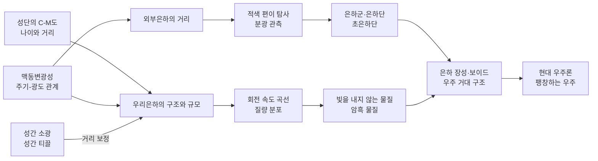

# 행성우주과학 3. 은하와 우주 — 보이지 않는 물질과 우주의 거대한 그물
<!-- prev: m2-08, 2-1, 2-2, earth-3, astro-2 -->

> [!NOTE]
> **성취기준**
> - **[12행우03-01]** 성단의 C-M도를 이용하여 성단의 나이와 거리를 비교하고, 맥동변광성의 주기-광도 관계를 이용하여 우리은하의 구조와 규모를 추론할 수 있다.
> - **[12행우03-02]** 성간 소광 자료를 통해 성간 티끌의 존재를 추론하고, 성간 티끌의 특징을 설명할 수 있다.
> - **[12행우03-03]** 은하의 회전 속도 곡선을 이용하여 질량 분포를 이해하고 은하에 빛을 내지 않는 물질의 존재를 추론할 수 있다.
> - **[12행우03-04]** 대규모로 이루어진 외부은하의 적색 편이 탐사의 성과를 이해하고, 은하의 공간 분포를 파악함에 있어서 분광 관측 자료의 중요성을 인식할 수 있다.
> - **[12행우03-05]** 은하의 공간 분포 자료를 통해 은하의 집단을 이해하고, 은하 장성, 보이드 등 우주의 거시적인 구조를 현대 우주론과 관련지어 설명할 수 있다.

**학습 목표**

1. 성단의 C-M도에서 전향점으로 성단의 나이를, 주계열 맞추기로 성단의 거리를 구하여 성단끼리 비교할 수 있다.
2. 맥동변광성의 주기-광도 관계로 거리를 구하고, 구상 성단의 분포로부터 우리은하의 중심 위치와 규모를 추론할 수 있다.
3. 성간 소광과 적색화 자료로 성간 티끌의 존재와 특징을 설명하고, 소광을 보정하지 않으면 거리가 실제보다 멀게 측정됨을 계산으로 보일 수 있다.
4. 은하의 회전 속도 곡선에서 반지름에 따른 질량 분포를 구하고, 광도로 추정한 질량과 비교하여 빛을 내지 않는 물질(암흑 물질)의 존재를 추론할 수 있다.
5. 적색 편이 탐사가 은하의 3차원 분포를 밝힌 성과를 설명하고, 은하군·은하단·초은하단·은하 장성·보이드를 우주 팽창과 관련지어 설명할 수 있다.

**이 단원의 학습 사다리**

| 단계 | 무엇을 하나? |
|---|---|
| STEP 1. 이전 학습 다시 보기 | 중학교 「별과 우주」, 통합과학의 스펙트럼, 지구과학의 H-R도·은하 분류·허블-르메트르 법칙, 앞 단원의 거리지수·질량-광도 관계를 꺼낸다 |
| STEP 2. 기초 다지기 | 색지수, 거리지수 다시 보기, 원운동으로 질량 재기, 적색 편이와 허블 법칙, 우주의 규모 감각을 디딤돌로 놓는다 |
| STEP 3. 핵심 개념 | 성단과 변광성으로 잰 우리은하 → 성간 티끌과 소광 → 회전 곡선과 암흑 물질 → 적색 편이 탐사 → 우주 거대 구조 |
| STEP 4. 오개념 바로잡기 | "우주는 텅 비어 있다?", "은하단도 우주와 함께 팽창한다?" 같은 착각을 바로잡는다 |
| STEP 5. 대학 전공으로 | 중력 렌즈, 우주 배경 복사의 요동, 바리온 음향 진동, 우주 구조 형성 시뮬레이션 |
| STEP 6. 생활·산업·진로 | 천문 빅데이터와 인공지능, 적외선·전파 관측 기술, 암흑 물질 검출 실험 |

---

## 🗺️ 단원 들어가기

도시를 벗어나 맑은 여름밤 하늘을 보면 궁수자리 쪽에서 은하수가 가장 두껍고 밝다. 그런데 그 한가운데에는 별이 거의 없는 듯한 검은 띠가 길게 갈라져 있다. 정말 그곳에 별이 없을까? 그렇지 않다. 별빛을 가리는 **티끌**이 그 앞을 막고 있을 뿐이다.

100여 년 전 천문학자들은 별을 세어 우리은하의 크기를 재려 했다. 그런데 티끌을 몰랐던 탓에 어느 방향으로 가나 일정 거리 너머에는 별이 줄어드는 것처럼 보였고, 태양이 은하의 중심 근처에 있다고 결론 내렸다. 이 착각을 깬 것은 구상 성단과 맥동변광성이었다. 그 뒤로도 우리은하는 계속 놀라움을 주었다. 은하의 회전 속도를 재 보니 **보이는 물질보다 훨씬 많은 질량**이 필요했고, 은하 수백만 개의 거리를 재 보니 은하들이 거대한 벽과 텅 빈 공동으로 이루어진 **그물** 모양으로 퍼져 있었다.

이 단원에서는 앞 단원에서 익힌 거리 측정과 질량 측정의 도구를 들고, 우리은하에서 출발해 관측 가능한 우주의 거대한 구조까지 규모를 넓혀 간다.

---

## STEP 1. 🔙 이전 학습 다시 보기

### 연계 개념표

| 이전 단원·성취기준 | 그때 배운 것 | 이 단원에서 확장되는 것 |
|---|---|---|
| 중2 「별과 우주」 [9과15-02] | 우리은하의 구조와 크기, 성운(방출·반사·암흑)과 성단(산개·구상)의 특징 | 성단의 C-M도로 **나이와 거리**를 재고, 구상 성단 분포로 **은하 중심**을 찾는다. 암흑 성운의 정체는 **성간 티끌** |
| 중2 「별과 우주」 [9과15-03] | 풍선 모형으로 본 우주 팽창 | 팽창하는 우주 속에서 **묶인 구조(은하단)와 팽창하는 구조(보이드)** 의 구분 |
| 통합과학1 「빛의 스펙트럼과 우주 초기 원소」 [10통과1-02-01] | 스펙트럼선으로 천체의 구성 물질을 안다 | 스펙트럼선의 **이동**으로 은하의 회전 속도와 거리(적색 편이)를 잰다 |
| 지구과학 「태양계 천체와 별과 우주의 진화」 [12지구03-03] | 질량에 따른 별의 진화 경로, H-R도, 영년 주계열 | 같은 나이의 별 집단인 성단의 C-M도에서 **전향점**으로 나이 구하기 |
| 지구과학 「태양계 천체와 별과 우주의 진화」 [12지구03-04], [12지구03-05] | 허블의 은하 분류, 허블-르메트르 법칙, 팽창·가속 팽창, 관측 가능한 우주 | 나선 은하의 **회전 곡선**, 적색 편이로 그린 은하의 **3차원 지도** |
| 행성우주과학 「태양과 별의 관측」 [12행우02-02], [12행우02-04], [12행우02-05] | 거리지수, 질량-광도 관계와 주계열 수명, 맥동변광성 | 거리지수에 **소광 보정** 추가, 전향점 질량으로 나이 계산, 세페이드의 **주기-광도 관계** |

### 준비 운동 (사전 진단)

**Q1.** 산개 성단과 구상 성단 중 별이 더 많고 나이가 더 많은 쪽은?

**Q2.** 겉보기 등급 15, 절대등급 0인 별까지의 거리는? (성간 소광은 무시한다.)

**Q3.** 주계열성 중 수명이 더 짧은 것은 질량이 큰 별인가, 작은 별인가?

**Q4.** 허블-르메트르 법칙에 따르면 멀리 있는 은하일수록 후퇴 속도는 어떻게 되는가?

정답 및 해설

**Q1. 구상 성단** — 수만~수백만 개의 별이 공 모양으로 빽빽하게 모여 있고, 나이가 100억 년이 넘는 늙은 별들로 이루어진다. 산개 성단은 수백~수천 개의 젊은 별로 이루어진다.

**Q2. 10 kpc** — $m - M = 15 = 5\log d - 5$ → $d = 10^{4}\ \mathrm{pc}$.

**Q3. 질량이 큰 별** — 광도가 질량의 약 3.5제곱에 비례하여 연료를 훨씬 빨리 쓰기 때문이다.

**Q4. 커진다** — 후퇴 속도가 거리에 비례한다($v = H_0 d$).

---

## STEP 2. 🧱 기초 다지기

### ① 색지수 — 두 파장의 등급 차로 온도를 읽다

같은 별을 파란빛(B 필터)과 노란빛(V 필터)으로 각각 찍어 등급을 재면, 그 차 $B - V$를 **색지수(color index)** 라 한다.

| 별의 색 | 표면 온도 | $B - V$ |
|---|---|---|
| 청백색 | 높다(약 10,000 K 이상) | 0 근처 또는 음수 |
| 노란색(태양) | 약 5800 K | 약 0.65 |
| 붉은색 | 낮다(약 3500 K) | 1.5 정도 |

등급은 숫자가 작을수록 밝으므로, 파란빛이 상대적으로 강한 뜨거운 별일수록 $B$가 작아져 $B - V$가 작다. 색지수는 **거리와 관계없이** 별의 표면 온도를 알려 준다(티끌만 없다면). 이것이 C-M도의 가로축이 된다.

### ② 거리지수 다시 보기

앞 단원에서

$$
m - M = 5\log d - 5 \qquad (d: \mathrm{pc})
$$

를 배웠다. 이 식은 별빛이 가는 길에 **아무것도 빛을 가리지 않는다**는 가정 위에 서 있다. 이 단원에서는 이 가정이 깨질 때 어떻게 되는지(성간 소광)를 다룬다.

### ③ 원운동으로 중심의 질량 재기

질량 $M(r)$이 공 모양으로 분포할 때, 반지름 $r$에서 원운동하는 물체에는 **반지름 $r$ 안쪽에 있는 질량만** 알짜 중력으로 작용한다(바깥 껍질의 중력은 상쇄된다). 중력이 구심력이 되므로

$$
\frac{GM(r)\,m}{r^2} = \frac{mv^2}{r} \;\Rightarrow\; M(r) = \frac{v^2 r}{G}
$$

이다. 「우주탐사와 행성계」에서 위성의 궤도로 목성의 질량을 쟀던 것과 같은 원리를 이번에는 **은하의 별과 기체**에 적용한다.

> [!TIP]
> 💡 **비유** — 운동장 한가운데 사람들이 모여 있고, 그 둘레를 줄을 맨 공이 돈다고 하자. 공이 빨리 돌수록 중심에서 줄을 당기는 사람(질량)이 많아야 한다. 공의 회전 속도만 보고도 중심에 몇 명이 있는지 어림할 수 있다. 그 사람들이 보이지 않는 투명 망토를 쓰고 있어도 말이다.

### ④ 적색 편이와 허블 법칙

멀어지는 천체의 스펙트럼선은 긴 파장 쪽으로 이동한다. 이동 비율을 **적색 편이(redshift) $z$** 라 한다.

$$
z = \frac{\lambda_{\text{관측}} - \lambda_0}{\lambda_0}, \qquad v \approx cz\ \ (z \ll 1)
$$

지구과학에서 배운 허블-르메트르 법칙 $v = H_0 d$를 함께 쓰면, 적색 편이만 재도 거리를 구할 수 있다.

$$
d \approx \frac{cz}{H_0} \qquad (H_0 \approx 70\ \mathrm{km/s/Mpc})
$$

<!-- sim:hubble-expansion -->

### ⑤ 우주의 규모 감각

| 대상 | 크기·거리(약) |
|---|---|
| 태양–프록시마 센타우리 | 4.2광년(1.3 pc) |
| 플레이아데스 성단까지 | 440광년(136 pc) |
| 태양–우리은하 중심 | 2만 6천 광년(8 kpc) |
| 우리은하 원반 지름 | 10만 광년(30 kpc) |
| 안드로메다 은하까지 | 250만 광년(0.77 Mpc) |
| 처녀자리 은하단까지 | 5400만 광년(16.5 Mpc) |
| 은하 장성의 길이 | 수억~10억 광년 이상 |

킬로파섹(kpc, 1000 pc)은 은하 안, 메가파섹(Mpc, 100만 pc)은 은하 사이의 거리에 쓴다.

---

## STEP 3. 📘 핵심 개념

### ① 성단의 C-M도와 맥동변광성으로 잰 우리은하 [12행우03-01]

#### C-M도 — 성단을 위한 H-R도

**성단(star cluster)** 의 별들은 같은 성운에서 거의 동시에 태어났으므로 **나이가 같고, 우리로부터의 거리도 거의 같고, 화학 조성도 비슷하다.** 다른 것은 질량뿐이다. 성단 별들의 색지수($B - V$)를 가로축에, **겉보기 등급** $V$를 세로축에 찍은 그래프를 **C-M도(색–등급도, color–magnitude diagram)** 라 한다.

모든 별이 같은 거리에 있으므로 겉보기 등급과 절대등급의 차(거리지수)가 모든 별에서 같다. 따라서 C-M도는 세로축 눈금만 일정하게 밀려 있을 뿐 **H-R도와 모양이 같다.** 별 하나하나의 거리를 몰라도 성단 전체의 H-R도를 얻는 셈이다.

| 구분 | 산개 성단 | 구상 성단 |
|---|---|---|
| 별의 수 | 수백~수천 개 | 수만~수백만 개 |
| 모양 | 불규칙하고 느슨함 | 공 모양으로 중심에 밀집 |
| 위치 | 우리은하 **원반**(나선팔) | 우리은하 **헤일로**와 팽대부, 은하 중심 둘레에 공 모양으로 분포 |
| 나이 | 수백만~수십억 년 | 100억 년 이상 |
| C-M도 | 주계열이 위쪽(뜨겁고 밝은 별)까지 길게 이어진다 | 주계열 위쪽이 없고, 전향점에서 적색 거성 가지로 꺾여 올라간다 |
| 예 | 플레이아데스(M45), 히아데스 | M13, 오메가 센타우리 |

#### 전향점으로 성단의 나이 재기

질량이 큰 별은 빨리 진화하여 주계열을 먼저 떠난다. 시간이 흐를수록 주계열의 위쪽부터 별이 하나씩 빠져나가므로, 주계열이 끝나고 거성 쪽으로 꺾이는 지점, 즉 **전향점(turnoff point)** 이 점점 아래(어둡고 붉은 쪽)로 내려온다. 전향점에 있는 별은 **지금 막 주계열 수명을 다한 별**이므로, 그 별의 주계열 수명이 곧 성단의 나이이다.

앞 단원의 관계를 쓰면 전향점 별의 질량 $M$으로 나이를 어림할 수 있다.

$$
t \approx 100\text{억 년}\times\left(\frac{M}{M_\odot}\right)^{-2.5}
$$

> [!TIP]
> 💡 **비유** — 같은 날 불을 붙인 굵기가 서로 다른 초들을 떠올리자. 굵고 화려하게 타는 초(무거운 별)부터 먼저 꺼진다. 아직 켜져 있는 초 가운데 가장 굵은 초의 수명을 알면, 불을 붙인 지 얼마나 지났는지 알 수 있다.

<!-- fig:astro-3-cmd-turnoff -->

#### 예제 1 — 두 성단의 나이 비교

성단 A의 전향점 별의 절대등급은 $-2.0$, 성단 B의 전향점 별의 절대등급은 $+4.5$이다. 태양의 절대등급을 4.8, 질량-광도 관계를 $L \propto M^{3.5}$로 하여 두 성단의 나이를 어림하고 비교하시오.

**풀이**
- A: $\dfrac{L}{L_\odot} = 10^{0.4(4.8 + 2.0)} \approx 525$, $M \approx 525^{1/3.5} \approx 6.0\,M_\odot$, $t \approx 100\text{억} \times 6.0^{-2.5} \approx 1.1$억 년
- B: $\dfrac{L}{L_\odot} = 10^{0.4(4.8 - 4.5)} \approx 1.3$, $M \approx 1.3^{1/3.5} \approx 1.08\,M_\odot$, $t \approx 100\text{억} \times 1.08^{-2.5} \approx 82$억 년

A는 약 1억 년 된 젊은 산개 성단(플레이아데스와 비슷), B는 약 80억 년 된 늙은 성단이다. 전향점이 **위쪽(밝은 쪽)에 있을수록 젊은 성단**이다.

#### 주계열 맞추기로 성단의 거리 재기

가까운 성단(예: 히아데스)의 별들은 시차로 거리를 알 수 있으므로 절대등급으로 그린 **표준 주계열**을 얻을 수 있다. 먼 성단의 C-M도를 표준 주계열과 나란히 놓고, 주계열이 겹칠 때까지 세로로 밀어 보면 **밀어 준 등급 차이가 거리지수**이다. 이를 **주계열 맞추기(main-sequence fitting)** 라 한다.

$$
V_{\text{성단 주계열}} - M_{V,\text{표준 주계열}} = m - M = 5\log d - 5 \qquad (\text{같은 색지수에서 비교})
$$

<!-- fig:astro-3-ms-fitting -->

#### 예제 2 — 플레이아데스까지의 거리

플레이아데스 성단의 C-M도에서 색지수 $B - V = 0.65$(태양과 같은 색)인 주계열 별의 겉보기 등급은 약 10.4이다. 같은 색지수의 표준 주계열 별의 절대등급은 4.8이다. 성단까지의 거리를 구하시오. (소광은 무시한다.)

**풀이** $m - M = 10.4 - 4.8 = 5.6$ → $\log d = \dfrac{5.6 + 5}{5} = 2.12$ → $d \approx 132\ \mathrm{pc}$ (약 430광년)

> [!NOTE]
> 주계열 맞추기는 별 하나가 아니라 **수십~수백 개 별이 이루는 띠 전체**를 맞추므로 개별 별의 분광 시차보다 훨씬 정확하다. 그래서 연주시차가 닿지 않는 먼 성단에서도 쓸 수 있고, 그 성단 안의 세페이드 변광성의 절대등급을 정하는 데에도 쓰인다. 거리 사다리의 한 칸이다.

#### 맥동변광성의 주기-광도 관계

1912년 리비트는 소마젤란 은하(모든 별이 거의 같은 거리에 있다)의 세페이드 변광성들을 조사하여, **변광 주기가 긴 세페이드일수록 평균 밝기가 밝다**는 사실을 발견했다. 이것이 **주기-광도 관계(period–luminosity relation)** 이다. 거리를 아는 세페이드로 이 관계의 눈금을 맞추면, 주기만 재서 절대등급을 알 수 있다.

설명을 위해 이 단원에서는 고전적 세페이드에 대해 다음 근사식을 쓴다(실제 계수는 연구에 따라 조금씩 다르다).

$$
M_V \approx -2.8\log P - 1.4 \qquad (P: \text{일})
$$

| 맥동변광성 | 주기 | 평균 절대등급(약) | 쓰임 |
|---|---|---|---|
| 고전적 세페이드 | 1~100일 | $-2\sim-6$ (주기가 길수록 밝다) | 우리은하 원반, 가까운 외부은하의 거리 |
| 거문고자리 RR형 | 1일 미만 | 약 $+0.6$ (거의 일정) | 구상 성단과 헤일로의 거리 |

거리 구하기의 순서는 다음과 같다.

1. 광도곡선에서 **주기 $P$** 와 **평균 겉보기 등급 $m$** 을 읽는다.
2. 주기-광도 관계로 **절대등급 $M$** 을 구한다.
3. 거리지수 $m - M = 5\log d - 5$로 **거리 $d$** 를 구한다.

<!-- fig:astro-3-period-luminosity -->

#### 예제 3 — 세페이드 변광성까지의 거리

우리은하 원반에 있는 어떤 세페이드 변광성의 주기가 10일, 평균 겉보기 등급이 11.0이다. 소광을 무시할 때 이 별까지의 거리를 구하시오.

**풀이** $M_V \approx -2.8\log 10 - 1.4 = -4.2$, $m - M = 11.0 - (-4.2) = 15.2$
$\log d = \dfrac{15.2 + 5}{5} = 4.04$ → $d \approx 1.1\times10^{4}\ \mathrm{pc} = 11\ \mathrm{kpc}$

#### 구상 성단으로 찾은 우리은하의 중심

1918년 섀플리는 구상 성단 속 맥동변광성으로 구상 성단들의 거리를 재고 3차원 분포를 그렸다. 그 결과 구상 성단들은 태양을 중심으로 퍼져 있지 않고, **궁수자리 방향의 한 점을 중심으로 공 모양으로** 분포했다. 구상 성단은 은하 전체의 중력에 묶여 은하 중심 둘레를 돌므로, 그 분포의 중심이 곧 **우리은하의 중심**이다. 태양은 은하 중심이 아니라 변두리에 있었다. 코페르니쿠스가 지구를 우주의 중심에서 끌어낸 것처럼, 섀플리는 태양을 은하의 중심에서 끌어냈다.

| 오늘날 알려진 우리은하의 구조 | 특징 |
|---|---|
| 원반(나선팔) | 지름 약 10만 광년, 젊은 별·산개 성단·성간 물질이 많다. 태양은 중심에서 약 2만 6천 광년 떨어진 원반에 있다 |
| 팽대부와 막대 | 중심부의 볼록한 부분, 늙은 별이 많고 막대 모양 구조가 있다. 한가운데에 태양 질량의 약 400만 배인 블랙홀(궁수자리 A*)이 있다 |
| 헤일로 | 원반을 둘러싼 공 모양 영역, 구상 성단과 늙은 별이 드문드문 분포한다 |

<!-- fig:astro-3-milky-way-structure -->

> [!IMPORTANT]
> **거리를 재는 방법은 거리 규모에 따라 달라진다.** 가까운 별은 연주시차, 수천 pc의 성단은 주계열 맞추기, 수십 kpc의 은하 구조와 수 Mpc 이내의 외부은하는 맥동변광성, 더 먼 은하는 초신성과 적색 편이를 쓴다. 각 방법은 측정할 수 있는 신호(시차의 각도, 별의 밝기)가 거리에 따라 작아지는 한계가 있어서, **가까운 단계의 결과로 다음 단계의 눈금을 맞추는 사다리**를 이룬다.

| 거리 규모 | 주요 방법 | 눈금을 맞추는 근거 |
|---|---|---|
| ~수천 pc | 연주시차 | 기하학(지구 공전 궤도) |
| ~수만 pc | 주계열 맞추기 | 시차로 거리를 아는 가까운 성단의 주계열 |
| ~수천만 pc | 세페이드·RR형 변광성 | 시차·주계열 맞추기로 거리를 아는 변광성 |
| ~수십억 광년 | 초신성(표준 촛불) | 세페이드로 거리를 아는 은하의 초신성 |
| 더 먼 우주 | 적색 편이와 허블 법칙 | 위 방법들로 정한 허블 상수 |

### ② 성간 물질과 성간 소광 — 별빛을 가리는 티끌 [12행우03-02]

#### 별과 별 사이는 비어 있지 않다

별 사이 공간에는 매우 희박한 기체와 티끌이 있는데, 이를 **성간 물질(interstellar medium)** 이라 한다. 질량으로 약 99 %가 기체, 약 1 %가 티끌이다. 성간 기체는 온도와 밀도에 따라 여러 상태로 존재한다.

| 성간 기체의 상태 | 온도(약) | 특징 | 관측 방법 |
|---|---|---|---|
| 분자운 | 10~20 K | 수소 분자($\mathrm{H_2}$)와 일산화 탄소 등 분자, 밀도가 가장 높고 별이 태어나는 곳 | 일산화 탄소 분자의 전파 |
| 중성 수소 구름 | 수십~수천 K | 원자 상태 수소, 원반 전체에 널리 퍼짐 | 중성 수소의 21 cm 전파 |
| 전리 수소 영역(HⅡ 영역) | 약 10,000 K | 뜨거운 젊은 별의 자외선이 수소를 이온화, 붉게 빛나는 방출 성운 | Hα선 등 방출선 |
| 고온 전리 기체 | 수십만~수백만 K | 초신성 폭발로 가열된 매우 희박한 기체 | X선, 자외선 흡수선 |

#### 성간 소광 — 별이 실제보다 어둡게 보인다

별빛이 성간 티끌을 지나면 일부가 흡수되거나 산란되어 어두워진다. 이를 **성간 소광(interstellar extinction)** 이라 하고, 어두워진 정도를 등급 $A$로 나타낸다. 소광이 있으면 거리지수 식은

$$
m - M = 5\log d - 5 + A
$$

가 된다. 소광을 모르고 $A = 0$으로 계산하면 별이 실제보다 어둡게 보인 만큼 **거리가 실제보다 멀게** 계산된다. 우리은하 원반을 따라가면 가시광선 소광은 대략 1 kpc마다 1등급 정도이고, 은하 중심 방향은 소광이 수십 등급에 이르러 가시광선으로는 중심을 전혀 볼 수 없다.

#### 성간 적색화 — 파란빛이 더 많이 가려진다

티끌은 파장이 짧은 파란빛을 붉은빛보다 더 많이 산란·흡수한다. 그래서 티끌 너머의 별은 어두워질 뿐 아니라 **실제보다 붉게** 보인다. 이를 **성간 적색화(interstellar reddening)** 라 한다. 해 질 녘 태양이 붉게 보이는 것과 비슷한 원리이다.

적색화는 소광을 측정하는 실마리가 된다. 별의 스펙트럼으로 분광형을 정하면 원래 색지수 $(B - V)_0$를 알 수 있고, 관측된 색지수와의 차이인 **색 초과(color excess)** 를 구할 수 있다.

$$
E(B - V) = (B - V)_{\text{관측}} - (B - V)_0, \qquad A_V \approx 3.1\,E(B - V)
$$

계수 3.1은 우리은하의 평균적인 티끌에 대해 관측으로 얻은 값이다.

<!-- fig:astro-3-extinction-reddening -->

#### 예제 4 — 소광 보정 전과 후의 거리

예제 3의 세페이드 변광성(평균 겉보기 등급 11.0, 절대등급 $-4.2$)의 색지수를 측정하니, 같은 주기의 세페이드보다 0.65만큼 붉었다. 실제 거리를 구하고 소광을 무시했을 때와 비교하시오.

**풀이** $A_V \approx 3.1 \times 0.65 \approx 2.0$등급
$5\log d - 5 = m - M - A_V = 15.2 - 2.0 = 13.2$ → $\log d = 3.64$ → $d \approx 4.4\ \mathrm{kpc}$

소광을 무시하면 11 kpc, 보정하면 4.4 kpc로 **2.5배 차이**가 난다. 등급 2.0은 밝기 약 6.3배에 해당하고, 밝기는 거리의 제곱에 반비례하므로 거리로는 $\sqrt{6.3} \approx 2.5$배이다. 섀플리가 처음 잰 우리은하의 크기가 실제보다 크게 나온 까닭 중 하나도 소광 보정을 하지 않았기 때문이다.

#### 성간 티끌이 있다는 증거와 그 특징

| 관측 자료 | 추론 |
|---|---|
| 은하수의 검은 띠, 말머리성운 같은 **암흑 성운**: 그 방향만 배경 별이 매우 적다 | 빛을 가리는 물질이 그 앞에 뭉쳐 있다 |
| 같은 분광형의 별인데 **멀수록 더 붉게** 보인다 | 파란빛을 더 많이 가리는 물질이 공간에 퍼져 있다 |
| 밝은 별 근처의 티끌이 별빛을 산란하여 **파랗게** 빛나는 반사 성운 | 티끌이 짧은 파장을 잘 산란한다 |
| 먼 별빛이 약간 **편광**되어 있다 | 길쭉한 티끌 알갱이가 자기장을 따라 정렬해 있다 |
| 차가운 구름이 **적외선**을 낸다 | 티끌이 별빛을 흡수해 데워진 뒤 적외선으로 다시 내놓는다 |

이로부터 알아낸 성간 티끌의 특징은 다음과 같다.

- **크기**: 대부분 약 $0.1\ \mu\mathrm{m}$ 안팎으로, 가시광선 파장(0.4~0.7 μm)과 비슷하거나 작다. 그래서 파장이 짧은 빛을 더 잘 가린다. 파장보다 훨씬 큰 알갱이라면 모든 색을 똑같이 가렸을 것이다(구름이 하얀 이유).
- **성분**: 규산염 광물, 탄소 화합물(흑연 비슷한 물질, 유기 분자), 차가운 곳에서는 표면에 물·일산화 탄소 얼음이 덮인다.
- **기원**: 늙은 별의 바깥층에서 흘러나온 물질과 초신성 잔해에서 만들어진다.
- **역할**: 분자운 안에서 수소 분자가 만들어지는 표면이 되고, 별빛을 막아 구름을 차갑게 유지하여 별의 탄생을 돕는다. 앞 단원 「우주탐사와 행성계」의 원시 행성 원반에서 행성의 씨앗이 된 것도 이 티끌이다.

> [!TIP]
> 💡 **비유** — 안개 낀 날 멀리 있는 가로등은 어둡게 보이고, 짙은 안개 속에서는 아예 보이지 않는다. 가로등이 어둡게 보인다고 "멀리 있다"고만 판단하면 거리를 잘못 재게 된다. 천문학자는 별빛의 '색이 바뀐 정도'로 안개의 두께를 재서 거리를 바로잡는다. 안개 속에서도 적외선 카메라로는 잘 보이듯, 티끌 너머의 은하 중심도 적외선·전파로는 보인다.

### ③ 은하의 회전 속도 곡선과 빛을 내지 않는 물질 [12행우03-03]

#### 회전 속도 곡선이란?

은하 중심에서의 거리 $r$에 따라 별과 기체가 은하 중심을 도는 속도 $v$를 그린 그래프를 **회전 속도 곡선(rotation curve)** 이라 한다. 외부은하는 원반 양쪽 끝의 스펙트럼선이 한쪽은 청색 편이, 다른 쪽은 적색 편이를 보이므로 그 차이로 회전 속도를 잰다. 우리은하는 중성 수소의 21 cm 전파를 이용한다. 중성 수소는 별이 거의 없는 원반 바깥쪽까지 퍼져 있어서 회전 곡선을 멀리까지 잴 수 있다.

#### 질량 분포에 따라 회전 곡선의 모양이 달라진다

STEP 2 ③의 $M(r) = \dfrac{v^2 r}{G}$, 즉 $v = \sqrt{\dfrac{GM(r)}{r}}$로 세 가지 경우를 생각해 보자.

| 질량 분포 | 회전 속도 | 예 |
|---|---|---|
| 질량이 중심에 몰려 있다($M$ 일정) | $v \propto \dfrac{1}{\sqrt r}$, 멀수록 느려진다(**케플러 회전**) | 태양계 행성 |
| 밀도가 균일한 공처럼 질량이 퍼져 있다($M \propto r^3$) | $v \propto r$, 바퀴처럼 함께 돈다(**강체 회전**) | 은하의 중심부 |
| $M(r) \propto r$로 질량이 계속 늘어난다 | $v$ 일정(**평탄한 회전 곡선**) | 나선 은하의 바깥쪽 |

<!-- fig:astro-3-rotation-curves -->

#### 관측 결과 — 바깥쪽이 느려지지 않는다

별과 기체가 내는 빛은 은하 중심부에 몰려 있고 바깥으로 갈수록 급격히 줄어든다. 질량이 빛과 같은 방식으로 분포한다면, 별빛이 거의 사라지는 바깥쪽에서는 태양계처럼 회전 속도가 $1/\sqrt r$로 줄어야 한다. 그런데 1970년대 루빈 등의 관측 이후 우리은하와 수많은 나선 은하에서 **회전 속도가 중심부에서 빠르게 증가한 뒤 바깥쪽까지 거의 일정하게 유지**된다는 것이 확인되었다. 이것은 모든 나선 은하에 공통적인 특징이다.

회전 속도가 일정하면 $M(r) = \dfrac{v^2 r}{G} \propto r$이다. **빛이 거의 없는 바깥쪽에서도 질량은 계속 늘어난다**는 뜻이다.

#### 예제 5 — 우리은하의 질량

태양은 은하 중심에서 약 8 kpc 떨어져 약 220 km/s로 돈다. 회전 곡선은 30 kpc까지 거의 같은 속도로 평탄하다. ($G = 6.67\times10^{-11}\ \mathrm{N\cdot m^2/kg^2}$, $1\ \mathrm{kpc} = 3.09\times10^{19}\ \mathrm{m}$, $M_\odot = 1.99\times10^{30}\ \mathrm{kg}$)
(1) 태양 궤도 안쪽의 질량을 구하시오.
(2) 30 kpc 안쪽의 질량을 구하시오.
(3) 태양이 은하 중심을 한 바퀴 도는 데 걸리는 시간을 구하시오.

**풀이**
(1) $M = \dfrac{(2.2\times10^{5})^2 \times 8\times3.09\times10^{19}}{6.67\times10^{-11}} \approx 1.8\times10^{41}\ \mathrm{kg} \approx 9\times10^{10}\,M_\odot$
(2) $v$가 같으므로 $M \propto r$: $9\times10^{10} \times \dfrac{30}{8} \approx 3.4\times10^{11}\,M_\odot$
(3) $T = \dfrac{2\pi r}{v} = \dfrac{2\pi \times 8 \times 3.09\times10^{19}\ \mathrm{m}}{2.2\times10^{5}\ \mathrm{m/s}} \approx 7.1\times10^{15}\ \mathrm{s} \approx 2.2$억 년

태양은 탄생 이후 약 46억 년 동안 은하 중심을 약 20바퀴 돌았다.

#### 광도로 잰 질량과 회전으로 잰 질량이 다르다

별의 광도를 모두 더해 질량-광도 관계 등으로 환산한 별의 질량에, 전파로 잰 기체의 질량을 더하면 우리은하의 '보이는 물질'의 질량은 태양 질량의 약 $6\times10^{10}$배 정도로 추정된다. 그런데 회전 곡선으로 잰 질량은 30 kpc 안쪽만 해도 그 5배가 넘고, 더 바깥까지 늘어난다.

| 구분 | 30 kpc 안쪽 질량(약) | 어떻게 구했나 |
|---|---|---|
| 빛으로 추정한 질량(별 + 기체) | $6\times10^{10}\,M_\odot$ | 별의 광도 합 → 질량, 21 cm 전파 → 기체 질량 |
| 회전으로 잰 질량(중력 질량) | $3\times10^{11}\,M_\odot$ 이상 | $M(r) = v^2 r / G$ |

두 값의 차이는 **빛(전자기파)을 내지도 흡수하지도 않으면서 중력만 미치는 물질**이 은하를 크게 감싸고 있음을 가리킨다. 이를 **암흑 물질(dark matter)** 이라 한다. 은하의 보이는 원반은 그보다 훨씬 크고 무거운 공 모양의 **암흑 물질 헤일로** 속에 들어 있는 셈이다. 은하단에서도 은하들의 운동 속도가 보이는 질량으로 붙잡기에는 너무 빠르다는 사실이 1930년대 츠비키에 의해 먼저 지적되었다.

<!-- sim:rotation-curve -->

> [!TIP]
> 💡 **비유** — 어두운 무도회장에서 야광 팔찌를 찬 무용수가 손을 잡은 상대와 빙글빙글 돈다. 상대는 검은 옷을 입어 보이지 않지만, 팔찌의 원운동만 보고도 "저기 누군가 붙잡고 있다"는 것과 그 사람의 무게를 어림할 수 있다. 암흑 물질은 그 '보이지 않는 춤 상대'이다.

#### 예제 6 — 회전 곡선 해석하기

어떤 나선 은하의 회전 속도가 중심에서 3 kpc까지는 거리에 비례하여 증가해 150 km/s에 이르고, 그 바깥 20 kpc까지는 150 km/s로 일정하다. 이 은하의 별빛은 대부분 5 kpc 안쪽에 있다.
(1) 3 kpc 안쪽의 질량 분포는 어떤 모양인가?
(2) 20 kpc 안쪽 질량은 5 kpc 안쪽 질량의 몇 배인가?
(3) 이 자료로부터 무엇을 추론할 수 있는가?

**풀이**
(1) $v \propto r$이면 $M(r) = v^2 r/G \propto r^3$으로, 밀도가 거의 균일한 공처럼 질량이 퍼져 있다(강체 회전).
(2) 5 kpc 이후에도 $v$ 일정 → $M \propto r$ → $\dfrac{20}{5} = 4$배
(3) 별빛이 거의 없는 5~20 kpc 사이에도 5 kpc 안쪽의 3배나 되는 질량이 더 있다. 빛을 내지 않는 물질이 은하 바깥쪽까지 넓게 분포한다.

### ④ 외부은하의 적색 편이 탐사 — 우주의 3차원 지도 [12행우03-04]

#### 사진만으로는 깊이를 알 수 없다

하늘을 촬영한 사진(영상)에는 은하의 **방향(2차원 위치)** 과 밝기만 담긴다. 은하가 밝게 보인다고 가까이 있는 것도 아니고(은하의 광도는 제각각이다), 하늘에서 이웃해 보인다고 실제로 가까운 것도 아니다. 별자리의 별들이 그랬던 것처럼 말이다. 3차원 지도를 그리려면 은하 하나하나의 **거리**가 필요하다.

수백만 개의 은하마다 세페이드나 초신성을 찾을 수는 없다. 대신 은하의 **스펙트럼**을 찍어 흡수선이나 방출선이 얼마나 긴 파장 쪽으로 이동했는지(적색 편이 $z$)를 재면, 허블 법칙으로 거리를 곧바로 얻는다. 이것이 **적색 편이 탐사(redshift survey)** 이다.

#### 예제 7 — 적색 편이로 은하단까지의 거리 구하기

머리털자리 은하단의 한 은하 스펙트럼에서 원래 파장 656.3 nm인 수소의 Hα선이 671.6 nm에서 관측되었다. 이 은하의 후퇴 속도와 거리를 구하시오. ($c = 3.0\times10^{5}\ \mathrm{km/s}$, $H_0 = 70\ \mathrm{km/s/Mpc}$)

**풀이** $z = \dfrac{671.6 - 656.3}{656.3} \approx 0.0233$, $v \approx cz \approx 7.0\times10^{3}\ \mathrm{km/s}$
$d = \dfrac{v}{H_0} \approx \dfrac{7000}{70} = 100\ \mathrm{Mpc}$ (약 3억 3천만 광년)

#### 분광 관측 자료가 왜 중요한가?

| 비교 | 영상(측광) 자료 | 분광 자료 |
|---|---|---|
| 얻는 정보 | 하늘의 위치, 밝기, 모양, 대략의 색 | 위의 정보 + 정확한 적색 편이, 구성 성분, 내부 운동 |
| 거리 | 알 수 없거나(밝기만으로는 불확실) 여러 색의 밝기로 대략 추정(측광 적색 편이) | 적색 편이를 매우 정확히 재서 거리를 구한다 |
| 장점 | 한 번에 매우 많은 천체를 빠르게 관측 | 3차원 위치가 정확하다 |
| 한계 | 깊이 방향이 흐릿하여 구조가 뭉개진다 | 천체 하나마다 빛을 펼쳐 찍어야 해 시간이 많이 든다 |

그래서 현대의 적색 편이 탐사는 **넓은 하늘을 영상으로 먼저 찍어 은하를 고르고**, 수백~수천 개의 광섬유를 망원경 초점면에 꽂아 **한 번에 수천 개 은하의 스펙트럼**을 동시에 얻는 방식으로 발전했다.

#### 대규모 적색 편이 탐사와 전천 탐사의 성과

| 탐사 | 시기 | 규모 | 대표 성과 |
|---|---|---|---|
| CfA 적색 편이 탐사 | 1980년대 | 은하 수천~수만 개 | 은하들이 거대한 벽(**CfA2 은하 장성**)과 빈 공간을 이룬다는 것을 처음으로 뚜렷이 보여 줌 |
| 2dF 은하 적색 편이 탐사(2dFGRS) | 1990년대 후반~2000년대 초 | 은하 약 22만 개 | 수십억 광년 규모의 그물 구조 확인 |
| 슬론 디지털 전천 탐사(SDSS) | 2000년~ | 은하·퀘이사 수백만 개의 스펙트럼 | 길이 10억 광년이 넘는 **슬론 은하 장성** 발견, 우주 거대 구조의 통계적 측정 |
| 암흑 에너지 분광 장비(DESI) 탐사 | 2021년~ | 은하·퀘이사 수천만 개 목표 | 지금까지 가장 큰 3차원 우주 지도, 우주 팽창 역사의 정밀 측정 |

<!-- fig:astro-3-redshift-wedge -->

이 밖에 적외선으로 하늘 전체를 찍은 2MASS, 별 10억 개 이상의 위치와 운동을 잰 가이아, X선 전천 탐사 등 여러 파장의 **전천 탐사(all-sky survey)** 가 각자 다른 측면에서 우주 지도를 보완한다. 특히 은하수의 티끌에 가려진 방향('회피 지대')은 적외선과 전파 탐사로 채운다.

### ⑤ 은하의 집단과 우주의 거대 구조 [12행우03-05]

#### 은하는 홀로 있지 않다 — 은하의 집단

| 구조 | 은하 수 | 크기(약) | 특징과 예 |
|---|---|---|---|
| 은하군 | 수십 개 이하 | 수백만 광년 | **국부 은하군**: 우리은하, 안드로메다 은하, 삼각형자리 은하와 50개가 넘는 왜소 은하. 지름 약 1000만 광년 |
| 은하단 | 수백~수천 개 | 1000만 광년 안팎 | **처녀자리 은하단**(약 5400만 광년), **머리털자리 은하단**(약 3억 광년). 은하 사이를 수천만 K의 뜨거운 기체가 채워 X선을 낸다 |
| 초은하단 | 은하군·은하단 수십~수백 개 | 수억 광년 | 우리은하는 처녀자리 은하단을 포함하는 국부 초은하단에 속하며, 더 크게는 지름 약 5억 광년의 **라니아케아 초은하단**의 일부로 본다 |
| 은하 장성·필라멘트 | 수많은 초은하단 | 수억~10억 광년 이상 | 은하들이 벽이나 실 모양으로 길게 이어진 구조. CfA2 은하 장성, 슬론 은하 장성 |
| 보이드 | 은하가 매우 적음 | 지름 수천만~수억 광년 | 은하가 거의 없는 거대한 빈 공간. 목동자리 보이드(지름 약 3억 광년) |

이들을 이어 그리면 우주의 은하 분포는 비누 거품이나 스펀지처럼, **보이드를 은하 장성과 필라멘트가 둘러싸고 그 교차점에 은하단이 자리한** 그물 모양이 된다. 이를 **우주 거대 구조(large-scale structure)** 또는 우주 그물이라 한다.

> [!TIP]
> 💡 **비유** — 밤에 비행기에서 내려다본 나라를 떠올리자. 도시(은하단)가 불빛 덩어리로 빛나고, 도시를 잇는 고속도로를 따라 마을(은하)이 줄지어 있으며(필라멘트), 그 사이에는 불빛이 거의 없는 산과 바다(보이드)가 넓게 펼쳐져 있다.

#### 묶인 구조와 팽창하는 구조

우주는 팽창하지만 모든 것이 팽창하는 것은 아니다. **자체 중력이 충분히 강해 묶여 있는 구조는 팽창하지 않는다.**

- **은하, 은하군, 은하단**: 구성원들이 서로의 중력에 묶여 공통의 중심 둘레를 돈다. 이 규모에서는 우주 팽창의 효과가 중력에 압도된다. 예를 들어 안드로메다 은하는 허블 법칙대로라면 멀어져야 하지만 실제로는 우리은하에 다가오고 있다.
- **초은하단, 보이드**: 크기가 너무 커서 구성원 전체가 중력으로 완전히 묶여 있지 않다. 그래서 **우주 팽창의 영향을 받아** 시간이 지나며 늘어난다. 보이드는 주변으로 물질이 빠져나가며 점점 더 비어 간다.

#### 예제 8 — 우주 팽창을 따르는가, 중력에 묶였는가?

$H_0 = 70\ \mathrm{km/s/Mpc}$일 때,
(1) 약 0.78 Mpc 떨어진 안드로메다 은하가 허블 법칙을 따른다면 후퇴 속도는 얼마여야 하는가? 실제로는 우리은하에 대해 초속 약 110 km로 다가오고 있다. 무엇을 뜻하는가?
(2) 약 16.5 Mpc 떨어진 처녀자리 은하단의 평균 후퇴 속도는 약 1100 km/s로 관측된다. 허블 법칙과 비교하시오.

**풀이**
(1) $v = 70 \times 0.78 \approx 55\ \mathrm{km/s}$로 멀어져야 한다. 그런데 오히려 다가오므로, 두 은하는 **서로의 중력에 묶여** 있어 우주 팽창을 따르지 않는다. 국부 은하군이 하나의 묶인 구조임을 보여 준다.
(2) $v = 70 \times 16.5 \approx 1160\ \mathrm{km/s}$로 관측값과 비슷하다. 은하단 사이의 큰 거리에서는 **우주 팽창이 주된 운동**이다.

#### 거대 구조와 현대 우주론

우주 거대 구조는 현대 우주론의 핵심 증거이다.

| 관측 사실 | 현대 우주론의 설명 |
|---|---|
| 우주 배경 복사의 온도가 방향마다 약 10만분의 1 수준으로 미세하게 다르다 | 초기 우주에 아주 작은 **밀도 요동**이 있었다 |
| 오늘날 은하는 그물 구조로 강하게 뭉쳐 있다 | 약 138억 년 동안 **중력**이 밀도가 조금 높은 곳으로 물질을 끌어모아 요동을 키웠다 |
| 보이는 물질만으로는 그 시간 안에 지금의 구조가 생기기 어렵다 | 빛과 상호작용하지 않아 일찍부터 뭉칠 수 있는 **암흑 물질**이 뼈대를 먼저 만들고, 보통 물질이 그 위에 모여 은하가 되었다 |
| 수억 광년보다 훨씬 큰 규모에서는 은하 분포가 어느 방향이나 거의 고르다 | 큰 규모에서 우주는 **균질하고 등방하다**(우주론의 원리) |
| 초은하단·보이드 규모는 팽창을 따른다 | 우주 팽창과 중력의 경쟁이 구조의 성장 속도를 결정한다. 가속 팽창은 구조의 성장을 늦춘다 |

> [!IMPORTANT]
> 회전 곡선에서 추론한 **암흑 물질**과 적색 편이 탐사로 그린 **거대 구조**는 따로 떨어진 이야기가 아니다. 암흑 물질의 중력이 은하를 붙잡고(③), 같은 중력이 은하들을 은하단과 필라멘트로 모아 우주 그물을 짰다(⑤). 앞 단원의 쌍성에서 은하, 은하단, 우주 전체에 이르기까지 **"운동을 보면 질량을 알 수 있다"** 는 한 가지 원리가 규모만 바꾸어 되풀이된다.

---

## STEP 4. ⚠️ 오개념 바로잡기

| 흔한 오개념 | 올바른 개념 | 왜 그럴까? |
|---|---|---|
| 별과 별 사이의 우주 공간은 완전히 비어 있다 | 희박한 **성간 기체와 티끌**이 있어 별빛을 어둡고 붉게 만든다 | 밀도가 매우 낮지만 수천 광년을 지나면 효과가 쌓인다 |
| 은하수의 검은 띠는 별이 없는 곳이다 | 별은 있지만 앞쪽의 **티끌이 가리고** 있다 | 적외선·전파로 보면 그 너머의 별과 은하 중심이 보인다 |
| 성간 적색화는 별이 멀어지는 적색 편이와 같다 | 적색화는 티끌이 파란빛을 더 가려 **색이 붉어지는** 것이고, 적색 편이는 스펙트럼선의 **위치가 이동**하는 것이다 | 적색화로는 흡수선의 파장이 바뀌지 않는다 |
| 은하 바깥쪽의 별은 태양계 행성처럼 느리게 돌 것이다 | 실제 회전 곡선은 바깥쪽까지 **거의 평탄**하다 | 빛을 내지 않는 질량이 바깥까지 퍼져 있기 때문이다 |
| 암흑 물질은 빛을 가리는 검은 티끌이나 기체이다 | 암흑 물질은 빛을 **내지도 흡수하지도 않고** 중력으로만 드러난다 | 티끌·기체는 적외선·전파로 관측되어 이미 '보이는 물질'에 포함된다 |
| 우주가 팽창하므로 은하와 은하단도 함께 커진다 | 중력으로 **묶인 구조는 팽창하지 않는다**. 초은하단·보이드 규모만 팽창을 따른다 | 묶인 계에서는 중력이 팽창 효과를 압도한다 |
| 은하는 우주 공간에 고르게 흩어져 있다 | 은하는 은하단·필라멘트·장성에 모이고 사이에 거대한 **보이드**가 있다 | 수억 광년보다 훨씬 큰 규모에서만 고르게 보인다 |

---

## STEP 5. 🎓 다음 단계로 한 걸음 더

> [!CAUTION]
> 이 절은 **행성우주과학 교육과정 범위 밖의 심화 내용**으로 평가 대상이 아니다. "이 개념이 대학 전공에서 어디까지 이어지는가"를 맛보기로 보여 주기 위한 내용이다.

### 대학 전공 과목과의 연결

| 대학 과목 | 이어지는 내용 |
|---|---|
| 은하천문학 | 은하의 구조와 동역학, 항성 종족, 은하 진화 |
| 성간 물리학 | 성간 기체의 가열과 냉각, 티끌의 소광 곡선, 별 탄생 |
| 우주론 | 프리드만 방정식, 우주 배경 복사, 구조 형성 이론 |
| 일반 상대성 이론 | 중력 렌즈, 시공간의 휘어짐 |
| 계산천체물리학 | N체 시뮬레이션, 우주 구조 형성 모의실험 |

### ① 중력 렌즈 — 보이지 않는 질량의 지도

질량은 시공간을 휘게 하여 그 뒤를 지나는 빛의 경로를 꺾는다(「역학과 에너지」의 시공간의 휘어짐). 은하단 뒤쪽 은하의 모습이 활처럼 늘어나거나 여러 개로 보이는 정도를 분석하면 은하단 전체의 질량 분포를 그릴 수 있다. 두 은하단이 충돌한 '총알 은하단'에서는 X선을 내는 뜨거운 기체(보통 물질의 대부분)와 중력 렌즈로 잰 질량 중심이 서로 어긋나 있어, 질량의 대부분이 보통 물질이 아닌 암흑 물질이라는 강한 증거가 되었다.

### ② 우주 구성 성분과 표준 우주 모형

우주 배경 복사와 거대 구조의 정밀 관측을 종합한 표준 우주 모형(ΛCDM 모형)에 따르면, 오늘날 우주의 에너지 밀도는 보통 물질 약 5 %, 암흑 물질 약 27 %, 암흑 에너지 약 68 %로 이루어진다. 암흑 물질의 정체(새로운 기본 입자일 가능성)는 아직 밝혀지지 않았고, 일부 학자들은 중력 법칙 자체를 수정하는 이론(MOND 등)을 연구한다.

### ③ 바리온 음향 진동 — 우주의 표준 자

초기 우주에서 빛과 보통 물질이 섞인 유체에 생긴 음파의 흔적이 은하 분포에 남아, 은하 쌍 사이의 거리가 약 5억 광년(약 150 Mpc)인 경우가 조금 더 많다. 이 길이를 '표준 자'로 삼아 적색 편이마다 그 겉보기 크기를 재면 우주 팽창의 역사를 알 수 있다. SDSS와 DESI의 핵심 성과가 이것이며, 분광 관측이 왜 중요한지를 보여 주는 대표 사례이다.

### ④ 적색 편이 공간의 왜곡

은하단 속 은하들은 허블 팽창 외에 초속 수백~천 km의 고유 운동을 가져, 적색 편이로 그린 지도에서 은하단이 시선 방향으로 길쭉하게 늘어나 보인다('신의 손가락'). 대학에서는 이 왜곡을 거꾸로 이용해 은하단의 질량과 구조 성장 속도를 잰다.

### 고등학교 vs 대학교

| 구분 | 고등학교 행성우주과학 | 대학교 은하천문학·우주론 |
|---|---|---|
| 거리 | 주계열 맞추기, 주기-광도 관계, 소광 보정 $A_V \approx 3.1E(B-V)$ | 소광 곡선, 금속 함량 보정, 거리 사다리 오차 분석 |
| 은하 질량 | $M(r) = v^2 r/G$, 광도 질량과 비교 | 원반·팽대부·헤일로 질량 모형 맞춤, 중력 렌즈 |
| 거대 구조 | 은하군·은하단·초은하단·장성·보이드의 정성적 이해 | 상관 함수, 파워 스펙트럼, N체 시뮬레이션 |
| 우주론 | 팽창과 묶인 구조의 구분, 밀도 요동의 성장(정성) | 프리드만 방정식, 섭동 이론, 우주 배경 복사 분석 |
| 관련 전공 | — | 천문우주학, 물리학, 계산과학, 데이터과학 |

---

## STEP 6. 🏭 생활·산업·진로 연결

### 사례 1. 천문 빅데이터와 인공지능

- **원리** 적색 편이 탐사와 전천 탐사는 수백만~수십억 개 천체의 영상과 스펙트럼을 만든다. 사람이 하나하나 볼 수 없으므로 자동 처리 파이프라인과 기계 학습으로 은하를 분류하고, 측광 자료만으로 적색 편이를 추정하며, 이상한 천체를 찾아낸다.
- **어디에 쓰이나** 천문학에서 발전한 대용량 자료 처리, 영상 분류, 이상 탐지 기법은 의료 영상 판독, 위성 영상 분석, 금융 자료 분석 등에 쓰이며, 천문학 전공자가 데이터 과학 분야로 많이 진출한다.

### 사례 2. 적외선·전파 관측 기술 — 티끌 너머를 보다

- **원리** 성간 티끌은 가시광선을 가리지만 적외선과 전파는 잘 통과한다. 은하 중심, 별이 태어나는 분자운을 보려면 적외선 검출기와 전파 수신기가 필요하다.
- **어디에 쓰이나** 적외선 검출기는 열화상 카메라, 야간 감시, 건물 단열 점검, 의료 진단에, 전파 천문학의 초저잡음 수신 기술은 무선 통신과 위성 통신에 이어진다. 우리나라 한국천문연구원은 여러 대의 전파 망원경을 묶어 하나처럼 쓰는 한국우주전파관측망(KVN)을 운영한다.

### 사례 3. 암흑 물질 검출 실험 — 지하 깊은 곳의 천문학

- **원리** 암흑 물질이 새로운 입자라면 아주 드물게 보통 원자핵과 부딪힐 것이다. 우주선(우주에서 오는 고에너지 입자)의 방해를 피하려고 깊은 지하에 매우 민감한 검출기를 둔다.
- **어디에 쓰이나** 극저온 검출기, 초고순도 결정 성장, 극미량 방사능 측정 기술은 의료용 방사선 검출, 반도체 소재 산업 등으로 이어진다. 우리나라도 강원도 지하 실험 시설에서 암흑 물질과 중성미자 실험을 하고 있다.

### 관련 진로와 학과

| 진로 | 하는 일 | 관련 학과 |
|---|---|---|
| 은하천문학자·우주론 연구자 | 은하의 구조와 진화, 우주 거대 구조와 팽창 역사 연구 | 천문우주학, 물리학 |
| 천문 데이터 과학자 | 대규모 탐사 자료 처리, 인공지능 분류·추정 | 천문학, 컴퓨터공학, 통계학 |
| 전파·적외선 관측 기기 엔지니어 | 수신기, 검출기, 냉각 장치 개발 | 전자공학, 전파공학, 기계공학 |
| 입자 실험 물리학자 | 암흑 물질·중성미자 검출 실험 | 물리학, 원자핵공학 |
| 계산과학자 | 우주 구조 형성 시뮬레이션, 고성능 계산 | 물리학, 계산과학, 컴퓨터공학 |

---

## 🔬 탐구 활동

### 활동 A. 주계열 맞추기를 이용하여 성단의 거리 구하기

**목표** 성단의 C-M도를 표준 주계열과 비교하여 거리지수와 거리를 구하고, 전향점으로 성단의 나이를 비교한다.

**준비물** 산개 성단 2개(예: 플레이아데스, M67)의 공개 측광 자료(별의 $V$, $B - V$), 표준 주계열 자료($B - V$별 절대등급), 스프레드시트나 파이썬, 투명 필름(종이로 할 경우)

**과정**
1. 각 성단 별들의 $B - V$를 가로축, $V$를 세로축(위로 갈수록 밝게, 즉 숫자가 작아지게)으로 하여 C-M도를 그린다.
2. 같은 축척으로 표준 주계열(가로축 $B - V$, 세로축 $M_V$)을 그린다.
3. 성단의 주계열과 표준 주계열이 가장 잘 겹치도록 세로 방향으로 이동시키고, 이동량 $m - M$을 읽는다. (컴퓨터로는 이동량을 바꿔 가며 두 곡선의 차이가 최소가 되는 값을 찾는다.)
4. $d = 10^{(m - M + 5)/5}$로 거리를 구한다.
5. 각 성단의 전향점 위치를 표시하고 어느 성단이 더 늙었는지 판단한다.

**결과 기록**

| 성단 | 거리지수 $m - M$ | 거리(pc) | 전향점의 $B - V$ | 전향점의 $M_V$ | 상대적 나이 |
|---|---|---|---|---|---|
| 성단 1 | | | | | |
| 성단 2 | | | | | |

**생각해 보기**
1. 성단의 주계열이 표준 주계열보다 오른쪽(붉은 쪽)으로 조금 치우쳐 있다면 무엇 때문일까? 이를 고려하면 거리는 어떻게 바뀌는가?
2. 주계열 맞추기에서 전향점 근처나 거성 가지의 별들은 맞추기에 쓰지 않는 이유는?
3. 연주시차로 잰 같은 성단의 거리(공개 자료)와 비교하고 차이의 원인을 토의해 보자.

### 활동 B. 맥동변광성을 이용하여 우리은하의 중심 찾기와 크기 구하기

**목표** 구상 성단 속 거문고자리 RR형 변광성의 밝기로 구상 성단까지의 거리를 구하고, 3차원 분포의 중심으로 우리은하 중심의 방향과 거리를 추론한다(섀플리의 방법).

**준비물** 아래 자료표(설명을 위해 만든 **가상 자료**로, 소광 보정을 마친 값이다), 스프레드시트나 파이썬, 모눈종이

| 구상 성단 | RR형 변광성의 평균 겉보기 등급 $V$ | 은하 경도 $l$(°) | 은하 위도 $b$(°) |
|---|---|---|---|
| 가 | 16.2 | 14 | 18 |
| 나 | 15.1 | 338 | 48 |
| 다 | 15.8 | 331 | −16 |
| 라 | 14.5 | 18 | −58 |
| 마 | 16.4 | 356 | 8 |
| 바 | 15.6 | 30 | −37 |
| 사 | 16.1 | 11 | 34 |
| 아 | 14.6 | 315 | 28 |

(은하 경도 $l = 0^\circ$은 궁수자리 방향, 은하 위도 $b$는 은하 원반 면에서 위아래로 벗어난 각도이다.)

**과정**
1. RR형 변광성의 절대등급을 $+0.6$으로 하여 각 성단의 거리 $d$(kpc)를 구한다.
2. 태양을 원점으로, 은하 원반 면에 투영한 위치 $x = d\cos b\cos l$, $y = d\cos b\sin l$을 계산한다.
3. 모눈종이(또는 산점도)에 $(x, y)$를 찍고, 점들의 평균 위치를 구한다.
4. 평균 위치의 방향과 태양으로부터의 거리를 구하여 우리은하 중심의 방향과 거리로 삼는다.
5. 가장 먼 성단까지의 거리를 이용해 은하 헤일로의 대략적인 크기를 추론한다.

**결과 기록**

| 구상 성단 | 거리 $d$(kpc) | $x$(kpc) | $y$(kpc) |
|---|---|---|---|
| 가 | | | |
| 나 | | | |
| ⋮ | | | |
| 평균 | — | | |

**생각해 보기**
1. 점들의 평균 위치는 태양에서 어느 방향(별자리), 몇 kpc 떨어져 있는가? 이것이 은하 중심이라고 판단하는 근거는?
2. 소광을 보정하지 않은 자료를 썼다면 은하의 크기는 실제보다 크게 나올까, 작게 나올까?
3. 은하 원반 면 근처($b$가 0에 가까운 방향)의 구상 성단이 적게 발견되는 까닭은 무엇일까?

> [!NOTE]
> 이 가상 자료로 계산하면 평균 위치가 궁수자리 방향($l \approx 0^\circ$)으로 약 8 kpc 떨어진 곳에 나오도록 만들어져 있다. 실제 구상 성단 자료(약 150개)는 공개 목록에서 내려받아 같은 방법으로 분석할 수 있다.

---

## ✅ 개념 확인 문제

### 기본

**1.** 성단의 C-M도에 대한 설명으로 옳은 것을 **모두** 고르시오.
ㄱ. 성단의 별들은 거리가 거의 같으므로 C-M도의 모양은 H-R도와 같다.
ㄴ. 전향점이 밝은 쪽에 있을수록 늙은 성단이다.
ㄷ. 구상 성단의 C-M도에는 밝고 파란 주계열성이 많다.

정답 및 해설

**정답 ㄱ**

ㄴ. 시간이 지날수록 무거운 별부터 주계열을 떠나 전향점이 **어두운 쪽**으로 내려가므로, 전향점이 밝을수록 **젊은** 성단이다. ㄷ. 구상 성단은 100억 년 이상 늙어 밝고 파란 주계열성은 이미 진화해 버렸다.

**2.** 어떤 성단의 C-M도를 표준 주계열과 맞추었더니 성단의 주계열이 10.0등급만큼 어둡게 나타났다. 소광을 무시할 때 성단까지의 거리는?

정답 및 해설

**정답** 1000 pc(1 kpc)

$m - M = 10 = 5\log d - 5$ → $d = 10^{3}\ \mathrm{pc}$

**3.** 성간 티끌 너머의 별이 실제보다 붉게 보이는 이유를 티끌의 크기와 관련지어 쓰시오.

정답 및 해설

**예시 답안** 성간 티끌 알갱이의 크기는 약 0.1 μm로 가시광선의 파장과 비슷하거나 작아서, 파장이 짧은 파란빛을 붉은빛보다 더 많이 산란·흡수한다. 그래서 티끌을 지나온 별빛에는 붉은빛의 비율이 커져 별이 붉게 보인다(성간 적색화).

**4.** 회전 속도 곡선이 바깥쪽까지 평탄한 은하에서, 반지름 $r$ 안쪽의 질량 $M(r)$은 $r$에 따라 어떻게 변하는가?

정답 및 해설

**정답** $r$에 비례하여 증가한다.

$M(r) = \dfrac{v^2 r}{G}$에서 $v$가 일정하므로 $M(r) \propto r$이다.

**5.** 은하군·은하단·초은하단·보이드 중 우주 팽창의 영향을 받아 시간이 지나며 커지는 구조를 모두 쓰시오.

정답 및 해설

**정답** 초은하단, 보이드

은하군과 은하단은 자체 중력에 묶여 팽창하지 않는다.

### 응용

**6.** 주기가 30일인 세페이드 변광성의 평균 겉보기 등급이 10.5이고, 색 초과 $E(B - V)$가 0.50으로 측정되었다. $M_V \approx -2.8\log P - 1.4$, $A_V \approx 3.1E(B - V)$를 이용하여 (1) 절대등급, (2) 소광을 보정한 거리, (3) 소광을 무시했을 때의 거리를 구하시오. ($\log 3 \approx 0.48$)

정답 및 해설

**정답** (1) 약 $-5.5$ (2) 약 7.9 kpc (3) 약 16 kpc

(1) $\log 30 = \log 3 + 1 \approx 1.48$, $M_V \approx -2.8 \times 1.48 - 1.4 \approx -5.54$
(2) $A_V \approx 3.1 \times 0.50 \approx 1.55$, $5\log d - 5 = m - M - A_V = 10.5 + 5.54 - 1.55 = 14.49$ → $\log d \approx 3.90$ → $d \approx 7.9\times10^{3}\ \mathrm{pc}$
(3) $5\log d - 5 = 10.5 + 5.54 = 16.04$ → $\log d \approx 4.21$ → $d \approx 1.6\times10^{4}\ \mathrm{pc} = 16\ \mathrm{kpc}$

소광을 무시하면 거리가 약 2배로 과대평가된다.

**7.** 어떤 나선 은하의 중심에서 10 kpc 떨어진 기체의 회전 속도가 200 km/s이다. (1) 10 kpc 안쪽의 질량을 태양 질량 단위로 구하시오. (2) 이 은하의 별과 기체의 광도로 추정한 10 kpc 안쪽의 질량이 $3\times10^{10}\,M_\odot$이라면, 빛을 내지 않는 물질의 질량은 전체의 약 몇 %인가? ($G = 6.67\times10^{-11}\ \mathrm{N\cdot m^2/kg^2}$, $1\ \mathrm{kpc} = 3.09\times10^{19}\ \mathrm{m}$, $M_\odot = 1.99\times10^{30}\ \mathrm{kg}$)

정답 및 해설

**정답** (1) 약 $9.3\times10^{10}\,M_\odot$ (2) 약 68 %

(1) $M = \dfrac{(2.0\times10^{5})^2 \times 3.09\times10^{20}}{6.67\times10^{-11}} \approx 1.85\times10^{41}\ \mathrm{kg} \approx 9.3\times10^{10}\,M_\odot$
(2) $\dfrac{9.3 - 3}{9.3} \approx 0.68$ → 약 68 %

**8.** 어떤 은하의 스펙트럼에서 원래 파장 393.4 nm인 칼슘 흡수선이 413.1 nm에서 관측되었다. $H_0 = 70\ \mathrm{km/s/Mpc}$일 때 이 은하까지의 거리를 구하시오. ($c = 3.0\times10^{5}\ \mathrm{km/s}$)

정답 및 해설

**정답** 약 215 Mpc

$z = \dfrac{413.1 - 393.4}{393.4} \approx 0.050$, $v \approx cz \approx 1.5\times10^{4}\ \mathrm{km/s}$, $d = \dfrac{15000}{70} \approx 215\ \mathrm{Mpc}$

**9.** 같은 하늘 영역의 은하 분포를 (가) 영상 자료로만 그린 2차원 지도와 (나) 적색 편이 탐사로 그린 3차원 지도로 비교하였다. (가)에서는 은하가 비교적 고르게 퍼져 보였지만 (나)에서는 벽 모양의 구조와 거대한 빈 공간이 뚜렷이 나타났다. 그 까닭을 설명하시오.

정답 및 해설

**예시 답안** 2차원 영상에서는 서로 다른 거리에 있는 은하들이 같은 시선 방향에 겹쳐 보이므로, 앞뒤의 보이드와 장성이 포개져 구조가 뭉개진다. 분광 관측으로 각 은하의 적색 편이를 재면 허블 법칙으로 거리를 알 수 있어 깊이 방향으로 은하를 펼쳐 놓을 수 있고, 그 결과 은하 장성과 보이드 같은 3차원 구조가 드러난다.

### 융합·서술형

**10. [과학사 연계]** 20세기 초 별의 개수를 세어 그린 우리은하 모형에서는 태양이 은하 중심 근처에 있었다. 섀플리는 구상 성단의 분포로 이를 바로잡았지만, 그가 잰 우리은하의 크기는 실제보다 컸다. 두 결과가 나온 까닭을 성간 소광과 관련지어 서술하시오.

정답 및 해설

**예시 답안**
별 세기 방법은 은하 원반을 따라 별을 세는데, 원반에는 성간 티끌이 많아 어느 방향으로 보든 일정 거리 너머의 별빛이 가려진다. 그래서 모든 방향으로 비슷한 거리까지만 별이 보여 태양이 중심에 있는 것처럼 보였다. 섀플리는 원반에서 벗어난 헤일로에 분포하는 구상 성단을 이용해 소광의 영향을 덜 받은 채 그 분포의 중심(궁수자리 방향)을 찾았다. 그러나 변광성의 밝기에 남아 있는 소광을 보정하지 않아, 별이 어두워진 만큼 거리를 실제보다 멀게 계산하여 은하의 크기를 과대평가하였다.

**채점 포인트** ① 원반의 티끌로 인한 시야 제한 ② 헤일로의 구상 성단이 소광 영향을 덜 받음 ③ 소광 미보정 → 거리 과대평가

**11. [물리학 연계]** 태양계 행성들의 공전 속도는 태양에서 멀수록 느려지지만, 나선 은하의 별들은 중심에서 멀어져도 회전 속도가 거의 일정하다. 두 계의 질량 분포 차이를 $v = \sqrt{GM(r)/r}$을 이용해 설명하고, 이로부터 은하에 빛을 내지 않는 물질이 존재한다는 결론에 이르는 논증을 '관측 증거 → 근거 → 주장 → 한계'의 순서로 서술하시오.

정답 및 해설

**예시 답안**
태양계는 질량의 약 99.8 %가 중심의 태양에 있어 행성 궤도 안쪽 질량 $M$이 거의 일정하므로 $v \propto 1/\sqrt r$로 멀수록 느려진다. (관측 증거) 나선 은하의 회전 속도는 별빛이 거의 사라지는 바깥쪽까지 일정하다. (근거) $v$가 일정하면 $M(r) = v^2 r/G \propto r$이므로 질량이 바깥쪽까지 계속 늘어나야 한다. 그런데 광도로 추정한 별과 기체의 질량은 바깥에서 거의 늘지 않는다. (주장) 따라서 은하에는 빛을 내지 않으면서 중력을 미치는 물질이 넓게 퍼져 있다. (한계) 이 결론은 뉴턴의 중력 법칙이 은하 규모에서도 그대로 성립한다는 가정에 기대고 있으며, 암흑 물질의 정체는 아직 직접 확인되지 않았다.

**채점 포인트** ① 두 계의 $M(r)$ 차이 ② 회전 곡선 → $M \propto r$ ③ 광도 질량과의 불일치 ④ 가정·한계 언급

---

## 📝 한눈에 정리

### 핵심 요약

- 성단의 **C-M도**는 거리지수만큼 밀린 H-R도이다. **전향점**이 어두운 쪽에 있을수록 늙은 성단이고, **주계열 맞추기**로 거리지수를 구한다.
- 맥동변광성의 **주기-광도 관계**로 절대등급을 알면 거리를 구할 수 있다. 구상 성단 분포의 중심이 궁수자리 방향 약 8 kpc의 **우리은하 중심**이다.
- 거리 측정 방법은 거리 규모에 따라 다르며, 가까운 단계로 먼 단계의 눈금을 맞추는 **거리 사다리**를 이룬다.
- 성간 물질은 분자운·중성 수소·전리 수소·고온 기체 등 다양한 상태의 기체와 약 1 %의 티끌로 이루어진다.
- **성간 소광**은 별을 어둡게, **성간 적색화**는 붉게 만든다. $m - M = 5\log d - 5 + A$, $A_V \approx 3.1E(B - V)$로 보정하지 않으면 거리가 실제보다 멀게 나온다.
- 성간 티끌은 약 0.1 μm 크기의 규산염·탄소 알갱이(얼음 껍질)이며, 짧은 파장을 더 잘 가린다.
- 나선 은하의 회전 곡선은 바깥까지 평탄하여 $M(r) = v^2 r/G \propto r$이다. 광도 질량과의 차이로 **암흑 물질**의 존재를 추론한다.
- **적색 편이 탐사**는 분광 관측으로 은하의 거리를 재서 3차원 지도를 그렸고, 은하 장성과 보이드를 발견했다.
- 은하는 **은하군 → 은하단 → 초은하단 → 은하 장성·필라멘트**로 모이고 사이에 **보이드**가 있다. 은하군·은하단은 중력으로 묶여 있고, 초은하단·보이드는 우주 팽창의 영향을 받는다.

### 핵심 용어

| 용어 | 뜻 |
|---|---|
| C-M도 | 성단 별들의 색지수와 겉보기 등급을 나타낸 그래프 |
| 전향점 | 성단의 C-M도에서 주계열이 끝나고 거성 쪽으로 꺾이는 점. 성단의 나이를 알려 준다 |
| 주계열 맞추기 | 성단의 주계열을 표준 주계열과 겹쳐 거리지수를 구하는 방법 |
| 주기-광도 관계 | 맥동변광성의 변광 주기가 길수록 광도가 큰 관계 |
| 성간 소광 | 성간 티끌이 별빛을 흡수·산란하여 별이 어둡게 보이는 현상 |
| 성간 적색화 | 짧은 파장의 빛이 더 많이 소광되어 별이 붉게 보이는 현상 |
| 색 초과 | 관측된 색지수와 원래 색지수의 차 $E(B - V)$ |
| 회전 속도 곡선 | 은하 중심으로부터의 거리에 따른 회전 속도 그래프 |
| 암흑 물질 | 빛을 내거나 흡수하지 않고 중력으로만 존재가 드러나는 물질 |
| 적색 편이 탐사 | 많은 은하의 스펙트럼으로 적색 편이를 재서 3차원 분포를 구하는 탐사 |
| 은하단 | 수백~수천 개의 은하가 중력으로 묶인 집단 |
| 보이드 | 은하가 거의 없는 거대한 빈 공간 |

### 다음 단원으로

「행성우주과학」의 세 단원은 하나의 원리로 이어진다. 태양 둘레 행성의 운동에서 태양의 질량을, 쌍성의 운동에서 별의 질량을, 은하의 회전에서 은하와 암흑 물질의 질량을 쟀다. 운동을 보면 질량을 알 수 있다는 이 원리는 대학의 천문학·천체물리학·우주론에서 중력 렌즈와 우주 구조 형성 이론으로 확장된다. 질량이 시공간을 휘게 한다는 아이디어는 「역학과 에너지」의 시공간의 휘어짐과 블랙홀로도 이어지니, 함께 살펴보며 우주를 바라보는 눈을 넓혀 가자.
