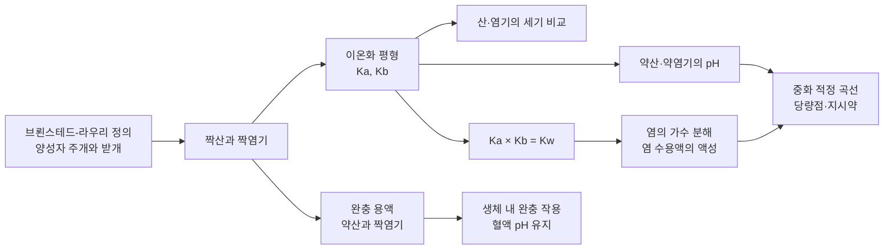

# 화학 반응의 세계 1. 산·염기 평형 — 양성자를 주고받는 평형의 세계
<!-- prev: m2-04, m3-01, 4-4, chem-3, chem-4 -->
<!-- next: rxn-3, cell-2 -->

> [!NOTE]
> **성취기준**
> - **[12반응01-01]** 브뢴스테드-라우리 산과 염기의 정의를 이해하고, 이에 따라 산과 염기를 구별할 수 있다.
> - **[12반응01-02]** 이온화 상수를 이용하여 산과 염기의 상대적인 세기를 추론하고, 약산과 약염기 수용액의 pH를 구할 수 있다.
> - **[12반응01-03]** 중화 적정 실험의 pH 변화를 데이터에 근거하여 해석할 수 있다.
> - **[12반응01-04]** 이온화 상수를 이용하여 염의 가수 분해를 설명할 수 있다.
> - **[12반응01-05]** 화학 평형으로 생체 내 완충 작용을 설명하고, 화학 원리의 신비로움을 느낄 수 있다.

**학습 목표**

1. 브뢴스테드-라우리 정의로 산과 염기, 짝산–짝염기 쌍을 구별하고, 아레니우스 정의보다 넓은 범위를 설명할 수 있는 이유를 말할 수 있다.
2. 이온화 상수 $K_\mathrm{a}$, $K_\mathrm{b}$로 산과 염기의 상대적 세기를 비교하고, 약산·약염기 수용액의 pH를 근사식으로 구할 수 있다.
3. 중화 적정 데이터로 적정 곡선을 그리고, 당량점·반당량점·지시약 선택을 근거를 들어 해석할 수 있다.
4. $K_\mathrm{a}\times K_\mathrm{b} = K_\mathrm{w}$ 관계를 이용하여 염 수용액의 액성을 예측하고 설명할 수 있다.
5. 혈액의 탄산–탄산수소 이온 완충계를 화학 평형 이동으로 설명하고, 생명 유지에서 완충 작용의 중요성을 설명할 수 있다.

**이 단원의 학습 사다리**

| 단계 | 무엇을 하나? |
|---|---|
| STEP 1. 이전 학습 다시 보기 | 이온, 아레니우스 산·염기, 평형 상수, $K_\mathrm{w}$와 pH를 다시 꺼낸다 |
| STEP 2. 기초 다지기 | 로그 계산, 평형 상수 식 쓰기, '작다고 보고 무시하기' 근사를 연습한다 |
| STEP 3. 핵심 개념 | 브뢴스테드-라우리 정의 → 이온화 상수와 pH → 적정 곡선 → 염의 가수 분해 → 완충 작용 |
| STEP 4. 오개념 바로잡기 | "강산은 진한 산이다", "중화점은 항상 pH 7이다" 같은 착각을 바로잡는다 |
| STEP 5. 대학 전공으로 | 루이스 산·염기, 헨더슨–하셀바흐 식, 다양성자산, 분석화학의 적정 |
| STEP 6. 생활·산업·진로 | 혈액 가스 검사, 수질 분석, 제약·식품의 pH 관리 |

---

## 🗺️ 단원 들어가기

식초(아세트산 약 4~5 %)와 묽은 염산을 같은 몰 농도로 맞추어 pH를 재 보면, 염산 쪽 pH가 2 가까이 더 낮다. 둘 다 '산'인데 왜 이렇게 다를까? 그런데 두 용액을 같은 부피의 수산화 나트륨 수용액으로 중화시키면 **필요한 염기의 양은 똑같다.** '얼마나 센가'와 '얼마나 많이 반응하는가'는 서로 다른 질문인 것이다.

또 하나의 수수께끼가 있다. 우리는 하루에도 여러 번 신 음식을 먹고, 운동하면 근육에서 젖산이 쌓이며, 몸속 세포는 쉬지 않고 이산화 탄소를 내놓는다. 그런데도 혈액의 pH는 약 7.35~7.45라는 아주 좁은 범위를 벗어나지 않는다. 혈액 속에 산을 '흡수'하는 장치가 숨어 있기 때문이다.

이 단원에서는 산과 염기를 **양성자($\mathrm{H^+}$)를 주고받는 가역 반응**으로 보고, 「화학 평형」에서 배운 평형 상수를 도구 삼아 이 질문들에 답해 본다.

---

## STEP 1. 🔙 이전 학습 다시 보기

### 연계 개념표

| 이전 단원·성취기준 | 그때 배운 것 | 이 단원에서 확장되는 것 |
|---|---|---|
| 중2 「물질의 구성」 [9과11-04] | 원자가 전자를 잃으면 양이온, 얻으면 음이온이 된다 | $\mathrm{H^+}$는 전자를 잃은 수소 원자, 곧 **양성자 하나**이다 |
| 중3 「화학 반응의 규칙성」 [9과16-02] | 화학 반응식과 계수비 | 이온화 반응식, 짝산–짝염기 반응식 쓰기 |
| 통합과학2 「산과 염기, 중화 반응」 [10통과2-01-04] | 아레니우스 정의($\mathrm{H^+}$, $\mathrm{OH^-}$를 내놓는 물질), 지시약, 중화 반응의 온도 변화 | **브뢴스테드-라우리 정의**로 $\mathrm{NH_3}$, $\mathrm{CO_3^{2-}}$ 같은 물질까지 설명 |
| 화학 「화학 평형」 [12화학03-02], [12화학03-04] | 평형 상수 $K$, 반응 지수 $Q$, 르샤틀리에 원리 | 산·염기 이온화에 평형 상수를 적용한 **이온화 상수** $K_\mathrm{a}$, $K_\mathrm{b}$, 완충 작용의 원리 |
| 화학 「역동적인 화학 반응」 [12화학04-01] | 물의 자동 이온화, $K_\mathrm{w} = 1.0\times10^{-14}$(25 ℃), pH | 약산·약염기의 pH, $K_\mathrm{a}\times K_\mathrm{b} = K_\mathrm{w}$ |
| 화학 「역동적인 화학 반응」 [12화학04-03], [12화학04-04] | 강산–강염기 중화의 양적 관계, 중화 적정으로 미지 농도 구하기 (적정 곡선은 다루지 않음) | **중화 적정 곡선**의 해석, 약산–강염기 적정 |

### 준비 운동 (사전 진단)

**Q1.** 25 ℃에서 $[\mathrm{H^+}] = 1.0\times10^{-3}\ \mathrm{M}$인 수용액의 pH와 $[\mathrm{OH^-}]$를 구하시오.

**Q2.** 가역 반응 $\mathrm{N_2(g) + 3H_2(g) \rightleftharpoons 2NH_3(g)}$의 평형 상수 식을 쓰시오.

**Q3.** 0.10 M 염산 20 mL를 완전히 중화하는 데 필요한 0.10 M 수산화 나트륨 수용액의 부피는?

**Q4.** 암모니아($\mathrm{NH_3}$)는 분자 안에 $\mathrm{OH}$가 없는데도 수용액이 염기성이다. 아레니우스 정의로 이것을 설명하기 어려운 이유는 무엇일까?

정답 및 해설

**Q1.** pH = 3.0, $[\mathrm{OH^-}] = \dfrac{1.0\times10^{-14}}{1.0\times10^{-3}} = 1.0\times10^{-11}\ \mathrm{M}$

**Q2.** $K = \dfrac{[\mathrm{NH_3}]^2}{[\mathrm{N_2}][\mathrm{H_2}]^3}$ — 생성물 농도의 곱을 반응물 농도의 곱으로 나누고, 계수를 지수로 쓴다.

**Q3.** 20 mL — $\mathrm{H^+}$의 양 $0.10\times0.020 = 2.0\times10^{-3}\ \mathrm{mol}$과 같은 양의 $\mathrm{OH^-}$가 필요하다.

**Q4.** 아레니우스 정의는 '자신이 가진 $\mathrm{OH^-}$를 내놓는 물질'만 염기로 본다. $\mathrm{NH_3}$는 물 분자에서 $\mathrm{H^+}$를 받아 $\mathrm{OH^-}$를 '만들어 내는' 물질이므로 새로운 정의가 필요하다. 이것이 STEP 3 ①의 출발점이다.

---

## STEP 2. 🧱 기초 다지기

### 디딤돌 1. 로그로 pH 다루기

pH는 수소 이온 농도의 상용로그에 음의 부호를 붙인 값이다.

$$
\mathrm{pH} = -\log[\mathrm{H^+}], \qquad \mathrm{pOH} = -\log[\mathrm{OH^-}], \qquad \mathrm{pH} + \mathrm{pOH} = 14\ (25\ ℃)
$$

이 단원에서 자주 쓰는 로그 값을 기억해 두면 계산이 빨라진다.

| 값 | $\log$ 값 | 활용 예 |
|---|---|---|
| 2 | 0.30 | $[\mathrm{H^+}] = 2\times10^{-3}$ → pH = 3 − 0.30 = 2.70 |
| 3 | 0.48 | $[\mathrm{H^+}] = 3\times10^{-5}$ → pH = 5 − 0.48 = 4.52 |
| 1.34 | 0.13 | $[\mathrm{H^+}] = 1.34\times10^{-3}$ → pH ≈ 2.87 |
| 1.8 | 0.26 | $K_\mathrm{a} = 1.8\times10^{-5}$ → $\mathrm{p}K_\mathrm{a}$ = 5 − 0.26 = 4.74 |

$\mathrm{p}K_\mathrm{a} = -\log K_\mathrm{a}$처럼 'p'는 언제나 "$-\log$를 취하라"는 기호이다. $K_\mathrm{a}$가 클수록 $\mathrm{p}K_\mathrm{a}$는 작다.

> [!TIP]
> 💡 **비유** — pH 눈금은 '지진의 규모'와 비슷하다. 숫자가 1 차이 나면 실제 크기는 10배 차이 난다. pH 3인 용액의 $[\mathrm{H^+}]$는 pH 5인 용액의 100배이다.

### 디딤돌 2. 평형 상수 식에서 물은 쓰지 않는다

수용액 반응에서 용매인 물의 농도는 약 55.5 M으로, 반응이 일어나도 거의 변하지 않는다. 그래서 물의 농도는 평형 상수 안에 포함시키고 식에는 쓰지 않는다. 순수한 고체도 마찬가지이다.

$$
\mathrm{CH_3COOH(aq) + H_2O(l) \rightleftharpoons CH_3COO^-(aq) + H_3O^+(aq)}
\qquad
K_\mathrm{a} = \frac{[\mathrm{CH_3COO^-}][\mathrm{H_3O^+}]}{[\mathrm{CH_3COOH}]}
$$

### 디딤돌 3. '아주 작은 값은 무시한다' — 근사의 기술

약산 HA의 처음 농도를 $C$, 이온화한 농도를 $x$라 하면 평형에서 $[\mathrm{HA}] = C - x$이다. $x$가 $C$의 5 % 이하라면 $C - x \approx C$로 보아도 pH가 거의 달라지지 않는다.

| $C$ (M) | $x$ (M) | $C - x$ | $C$로 바꾸었을 때 오차 |
|---|---|---|---|
| 0.10 | 0.0013 | 0.0987 | 약 1.3 % → 무시해도 된다 |
| 0.0010 | 0.00013 | 0.00087 | 약 13 % → 무시하면 오차가 커진다 |

> [!TIP]
> 💡 **비유** — 100만 원이 든 통장에서 1만 원을 쓰면 잔고는 "여전히 약 100만 원"이라고 말할 수 있다. 하지만 10만 원이 든 통장에서 1만 원을 쓰면 그렇게 말하기 어렵다. 근사는 '빠지는 양'이 '전체'보다 충분히 작을 때만 쓴다.

### 디딤돌 4. 몰 농도와 몰수 바꾸기

적정 계산은 결국 '몰수 세기'이다.

$$
n\ (\mathrm{mol}) = C\ (\mathrm{mol/L}) \times V\ (\mathrm{L})
$$

0.10 M 용액 25.0 mL에 녹아 있는 용질은 $0.10 \times 0.0250 = 2.5\times10^{-3}\ \mathrm{mol}$이다. 두 용액을 섞으면 **몰수는 더하고 빼지만 농도는 전체 부피로 다시 나누어야** 한다는 점을 기억하자.

---

## STEP 3. 📘 핵심 개념

### ① 브뢴스테드-라우리 산과 염기 — 양성자를 주고받는 반응 [12반응01-01]

#### 아레니우스 정의의 한계

통합과학2에서 배운 아레니우스 정의는 "수용액에서 $\mathrm{H^+}$를 내놓으면 산, $\mathrm{OH^-}$를 내놓으면 염기"였다. 간단하고 편리하지만 다음 현상을 설명하지 못한다.

| 현상 | 아레니우스 정의로 설명하기 어려운 점 |
|---|---|
| 암모니아수는 염기성이다 | $\mathrm{NH_3}$에는 $\mathrm{OH}$가 없다 |
| 염화 수소 기체와 암모니아 기체가 만나면 흰 연기($\mathrm{NH_4Cl}$)가 생긴다 | 물이 없는 기체 상태 반응이다 |
| 탄산 나트륨 수용액, 아세트산 나트륨 수용액은 염기성이다 | 이 물질들은 $\mathrm{OH^-}$를 갖고 있지 않다 |
| 물은 산과 만나면 염기처럼, 염기와 만나면 산처럼 행동한다 | 한 물질을 산 또는 염기 중 하나로 정할 수 없다 |

#### 새로운 정의: 양성자 주개와 양성자 받개

1923년 덴마크의 브뢴스테드와 영국의 라우리는 각각 독립적으로 다음 정의를 제안했다.

> [!IMPORTANT]
> - **브뢴스테드-라우리 산(Brønsted–Lowry acid)**: 다른 물질에게 양성자($\mathrm{H^+}$)를 **주는** 물질 = **양성자 주개**
> - **브뢴스테드-라우리 염기(Brønsted–Lowry base)**: 다른 물질로부터 양성자($\mathrm{H^+}$)를 **받는** 물질 = **양성자 받개**

수소 원자에서 전자 하나를 떼어 내면 양성자 하나만 남는다. 그래서 $\mathrm{H^+}$를 **양성자(proton)** 라고 부른다. 실제 수용액에서 $\mathrm{H^+}$는 홀로 있지 않고 물 분자와 결합한 **하이드로늄 이온(hydronium ion)** $\mathrm{H_3O^+}$로 존재한다. 이 단원에서는 $\mathrm{H^+}$와 $\mathrm{H_3O^+}$를 같은 뜻으로 쓴다.

암모니아의 경우를 보자.

$$
\underset{\text{염기}}{\mathrm{NH_3}} + \underset{\text{산}}{\mathrm{H_2O}} \rightleftharpoons \underset{\text{산}}{\mathrm{NH_4^+}} + \underset{\text{염기}}{\mathrm{OH^-}}
$$

$\mathrm{NH_3}$는 물에게서 양성자를 받으므로 염기이고, 물은 양성자를 주므로 산이다. $\mathrm{OH^-}$는 암모니아가 '원래 갖고 있던 것'이 아니라 **물이 양성자를 내준 결과** 생긴 것이다. 물이 없는 기체 반응도 같은 방식으로 설명된다.

$$
\mathrm{HCl(g) + NH_3(g) \rightarrow NH_4Cl(s)} \qquad (\mathrm{HCl}: \text{양성자 주개},\ \mathrm{NH_3}: \text{양성자 받개})
$$

#### 짝산과 짝염기

정반응에서 산이 양성자를 내주고 남은 것은 역반응에서 다시 양성자를 받을 수 있으므로 염기이다. 이렇게 **양성자 1개 차이**로 짝을 이루는 산과 염기를 **짝산–짝염기 쌍(conjugate acid–base pair)** 이라고 한다.

$$
\mathrm{CH_3COOH} + \mathrm{H_2O} \rightleftharpoons \mathrm{CH_3COO^-} + \mathrm{H_3O^+}
$$

| 정반응의 산 | 그 짝염기 | 정반응의 염기 | 그 짝산 |
|---|---|---|---|
| $\mathrm{CH_3COOH}$ | $\mathrm{CH_3COO^-}$ | $\mathrm{H_2O}$ | $\mathrm{H_3O^+}$ |
| $\mathrm{HCl}$ | $\mathrm{Cl^-}$ | $\mathrm{H_2O}$ | $\mathrm{H_3O^+}$ |
| $\mathrm{H_2O}$ | $\mathrm{OH^-}$ | $\mathrm{NH_3}$ | $\mathrm{NH_4^+}$ |
| $\mathrm{H_2O}$ | $\mathrm{OH^-}$ | $\mathrm{CO_3^{2-}}$ | $\mathrm{HCO_3^-}$ |

> [!TIP]
> 💡 **비유** — 양성자는 '공', 산은 '공을 던지는 사람', 염기는 '공을 받는 사람'이다. 공을 던진 사람(산)은 이제 빈손이 되어 다음 차례에 공을 받을 수 있는 사람(짝염기)이 된다. 가역 반응에서는 공이 양쪽 방향으로 계속 오간다.

#### 양쪽성 물질 — 상대에 따라 역할이 바뀐다

물은 $\mathrm{NH_3}$ 앞에서는 산, $\mathrm{HCl}$ 앞에서는 염기로 작용한다. 이처럼 산으로도 염기로도 작용할 수 있는 물질을 **양쪽성 물질(amphiprotic substance)** 이라고 한다. $\mathrm{HCO_3^-}$, $\mathrm{H_2PO_4^-}$, $\mathrm{HSO_4^-}$도 양쪽성 물질이다. 물 분자끼리 양성자를 주고받는 것이 바로 화학 시간에 배운 **물의 자동 이온화**이다.

$$
\mathrm{H_2O + H_2O \rightleftharpoons H_3O^+ + OH^-} \qquad K_\mathrm{w} = [\mathrm{H_3O^+}][\mathrm{OH^-}] = 1.0\times10^{-14}\ (25\ ℃)
$$

#### 예제 1 — 산과 염기 구별하기

다음 반응에서 브뢴스테드-라우리 산과 염기를 모두 찾고, 짝산–짝염기 쌍을 쓰시오.

$$
\mathrm{HCO_3^-(aq) + OH^-(aq) \rightleftharpoons CO_3^{2-}(aq) + H_2O(l)}
$$

**풀이** 정반응에서 $\mathrm{HCO_3^-}$는 양성자를 내주므로 산, $\mathrm{OH^-}$는 받으므로 염기이다. 역반응에서는 $\mathrm{H_2O}$가 산, $\mathrm{CO_3^{2-}}$가 염기이다.
짝산–짝염기 쌍: ($\mathrm{HCO_3^-}$, $\mathrm{CO_3^{2-}}$), ($\mathrm{H_2O}$, $\mathrm{OH^-}$)
같은 $\mathrm{HCO_3^-}$가 $\mathrm{H_3O^+}$와 만나면 양성자를 받아 $\mathrm{H_2CO_3}$가 되므로 염기로 작용한다. 즉 $\mathrm{HCO_3^-}$는 양쪽성 물질이며, 뒤의 ⑤에서 혈액 완충의 주인공으로 다시 등장한다.

#### 정의의 확장성과 유용성

| 비교 | 아레니우스 정의 | 브뢴스테드-라우리 정의 |
|---|---|---|
| 기준 | 수용액에서 $\mathrm{H^+}$ 또는 $\mathrm{OH^-}$를 내놓는가 | 양성자를 주는가, 받는가 |
| 적용 범위 | 수용액에 한정 | 수용액이 아닌 반응(기체, 다른 용매)에도 적용 |
| 염기의 예 | $\mathrm{NaOH}$, $\mathrm{KOH}$ 등 | 위의 예 + $\mathrm{NH_3}$, $\mathrm{CO_3^{2-}}$, $\mathrm{CH_3COO^-}$ 등 |
| 물의 역할 | 용매(구경꾼) | 반응에 참여하는 산 또는 염기 |
| 평형과의 연결 | 약함 | 짝산–짝염기의 가역 반응 → **평형 상수로 세기 비교 가능** |

브뢴스테드-라우리 정의의 가장 큰 힘은 산·염기 반응을 **양성자를 주고받는 평형**으로 바라보게 한다는 점이다. 이 관점 덕분에 다음 절부터 이온화 상수, 염의 가수 분해, 완충 작용을 하나의 원리로 설명할 수 있다.

### ② 이온화 상수와 산·염기의 세기, 약산·약염기의 pH [12반응01-02]

#### 산의 이온화 상수 $K_\mathrm{a}$와 염기의 이온화 상수 $K_\mathrm{b}$

산 HA가 물에 녹아 이루는 이온화 평형의 평형 상수를 **산의 이온화 상수(acid ionization constant)** $K_\mathrm{a}$라고 한다.

$$
\mathrm{HA + H_2O \rightleftharpoons A^- + H_3O^+} \qquad K_\mathrm{a} = \frac{[\mathrm{A^-}][\mathrm{H_3O^+}]}{[\mathrm{HA}]}
$$

염기 B에 대해서는 **염기의 이온화 상수(base ionization constant)** $K_\mathrm{b}$를 쓴다.

$$
\mathrm{B + H_2O \rightleftharpoons BH^+ + OH^-} \qquad K_\mathrm{b} = \frac{[\mathrm{BH^+}][\mathrm{OH^-}]}{[\mathrm{B}]}
$$

$K_\mathrm{a}$가 크다는 것은 평형이 오른쪽(이온 쪽)으로 치우쳐 있다는 뜻이다. 따라서 **$K_\mathrm{a}$가 클수록 강한 산, $K_\mathrm{b}$가 클수록 강한 염기**이다. 이온화 상수는 평형 상수이므로 온도가 일정하면 농도와 관계없이 일정하다.

| 산 | 화학식 | $K_\mathrm{a}$ (25 ℃, 약) | 세기 |
|---|---|---|---|
| 염산 | $\mathrm{HCl}$ | 매우 크다(거의 100 % 이온화) | 강산 |
| 질산 | $\mathrm{HNO_3}$ | 매우 크다 | 강산 |
| 플루오린화 수소산 | $\mathrm{HF}$ | $6.8\times10^{-4}$ | 약산 |
| 폼산(개미산) | $\mathrm{HCOOH}$ | $1.8\times10^{-4}$ | 약산 |
| 아세트산 | $\mathrm{CH_3COOH}$ | $1.8\times10^{-5}$ | 약산 |
| 탄산(1단계) | $\mathrm{H_2CO_3}$ | $4.3\times10^{-7}$ | 약산 |
| 암모늄 이온 | $\mathrm{NH_4^+}$ | $5.6\times10^{-10}$ | 매우 약한 산 |
| 사이안화 수소산 | $\mathrm{HCN}$ | 약 $5\times10^{-10}$ | 매우 약한 산 |

| 염기 | 화학식 | $K_\mathrm{b}$ (25 ℃, 약) | 세기 |
|---|---|---|---|
| 수산화 나트륨 | $\mathrm{NaOH}$ | 매우 크다 | 강염기 |
| 암모니아 | $\mathrm{NH_3}$ | $1.8\times10^{-5}$ | 약염기 |
| 아세트산 이온 | $\mathrm{CH_3COO^-}$ | $5.6\times10^{-10}$ | 매우 약한 염기 |

> [!NOTE]
> 이온화 상수 값은 자료집마다 유효 숫자가 조금씩 다르다(예: 아세트산 $1.75\times10^{-5}$ ~ $1.8\times10^{-5}$). 이 책에서는 계산을 위해 위 값을 쓴다.

#### 강산과 약산의 차이 — '센 것'과 '진한 것'은 다르다

- **강산**: 물속에서 거의 모두 이온화한다. 0.10 M 염산의 $[\mathrm{H^+}]$는 0.10 M이다.
- **약산**: 일부만 이온화하고 대부분 분자 상태로 남는다. 0.10 M 아세트산의 $[\mathrm{H^+}]$는 약 0.0013 M에 불과하다.

이온화한 비율을 **이온화도(degree of ionization)** $\alpha$라고 한다.

$$
\alpha = \frac{\text{이온화한 산의 농도}}{\text{처음 산의 농도}}
$$

**세기(strong/weak)** 는 이온화 정도, 즉 $K_\mathrm{a}$에 관한 말이고, **농도(concentrated/dilute)** 는 녹아 있는 양에 관한 말이다. "묽은 강산"도, "진한 약산"도 있다.

#### 짝산과 짝염기의 세기는 시소처럼 움직인다

같은 짝산–짝염기 쌍에서 $K_\mathrm{a}$와 $K_\mathrm{b}$를 곱하면 흥미로운 결과가 나온다.

$$
K_\mathrm{a}(\mathrm{HA}) \times K_\mathrm{b}(\mathrm{A^-}) = \frac{[\mathrm{A^-}][\mathrm{H_3O^+}]}{[\mathrm{HA}]}\times\frac{[\mathrm{HA}][\mathrm{OH^-}]}{[\mathrm{A^-}]} = [\mathrm{H_3O^+}][\mathrm{OH^-}] = K_\mathrm{w}
$$

$$
\boxed{\;K_\mathrm{a} \times K_\mathrm{b} = K_\mathrm{w} = 1.0\times10^{-14}\ (25\ ℃)\;}
$$

따라서 **강한 산의 짝염기는 약하고, 약한 산의 짝염기는 상대적으로 강하다.** 강산 HCl의 짝염기 $\mathrm{Cl^-}$는 양성자를 거의 받지 못하는(염기로서 무시할 수 있는) 이온이다. 반면 매우 약한 산 HCN의 짝염기 $\mathrm{CN^-}$는 꽤 센 염기이다.

> [!TIP]
> 💡 **비유** — 양성자를 '놓아 주기 쉬운 손(강한 산)'은 거꾸로 '다시 잡기 어려운 손(약한 짝염기)'이다. 짝을 이루는 두 세기는 시소의 양 끝처럼, 한쪽이 올라가면 다른 쪽은 내려간다.

#### 반응은 '약한 쪽'으로 진행한다

산·염기 반응은 양성자를 두고 벌이는 '줄다리기'이다. 평형은 **더 강한 산과 더 강한 염기가 반응하여 더 약한 산과 더 약한 염기가 생기는 방향**으로 치우친다.

$$
\underset{\text{강한 산}}{\mathrm{CH_3COOH}} + \underset{\text{강한 염기}}{\mathrm{OH^-}} \longrightarrow \underset{\text{약한 염기}}{\mathrm{CH_3COO^-}} + \underset{\text{약한 산}}{\mathrm{H_2O}}
$$

생활 예: 베이킹소다($\mathrm{NaHCO_3}$)에 식초를 부으면 거품이 난다. 아세트산이 $\mathrm{HCO_3^-}$에 양성자를 주어 탄산($\mathrm{H_2CO_3}$, $K_\mathrm{a}$가 아세트산보다 작은 더 약한 산)이 생기고, 탄산이 $\mathrm{CO_2}$와 물로 분해되기 때문이다.

#### 약산 수용액의 pH 구하기

처음 농도 $C$인 약산 HA에서 $x$만큼 이온화한다고 하자.

| | $\mathrm{HA}$ | $\mathrm{A^-}$ | $\mathrm{H_3O^+}$ |
|---|---|---|---|
| 처음 (M) | $C$ | 0 | 0 (물에서 오는 양은 무시) |
| 변화 (M) | $-x$ | $+x$ | $+x$ |
| 평형 (M) | $C - x \approx C$ | $x$ | $x$ |

$$
K_\mathrm{a} = \frac{x^2}{C - x} \approx \frac{x^2}{C}
\quad\Rightarrow\quad
\boxed{\;[\mathrm{H_3O^+}] = x \approx \sqrt{C K_\mathrm{a}}\;}
\qquad
\alpha \approx \sqrt{\frac{K_\mathrm{a}}{C}}
$$

약염기도 같은 방법으로 $[\mathrm{OH^-}] \approx \sqrt{C K_\mathrm{b}}$를 구한 뒤 pH = 14 − pOH로 바꾼다.

#### 예제 2 — 0.10 M 아세트산의 pH

25 ℃에서 0.10 M 아세트산 수용액의 pH와 이온화도를 구하시오. ($K_\mathrm{a} = 1.8\times10^{-5}$, $\log1.34 = 0.13$)

**풀이**
$[\mathrm{H_3O^+}] \approx \sqrt{0.10\times1.8\times10^{-5}} = \sqrt{1.8\times10^{-6}} \approx 1.34\times10^{-3}\ \mathrm{M}$
pH $= 3 - \log 1.34 \approx 2.87$
$\alpha = \dfrac{1.34\times10^{-3}}{0.10} \approx 0.013$ (약 1.3 %)

이온화도가 5 %보다 훨씬 작으므로 근사가 타당하다. 같은 농도의 염산(pH 1.0)보다 pH가 약 1.9만큼 높다. **들어가기**의 질문에 대한 답이다.

#### 예제 3 — 0.10 M 암모니아수의 pH

25 ℃에서 0.10 M 암모니아수의 pH를 구하시오. ($K_\mathrm{b} = 1.8\times10^{-5}$)

**풀이**
$[\mathrm{OH^-}] \approx \sqrt{0.10\times1.8\times10^{-5}} \approx 1.34\times10^{-3}\ \mathrm{M}$
pOH $\approx 2.87$, pH $= 14 - 2.87 = 11.13$

같은 농도의 수산화 나트륨 수용액(pH 13.0)보다 pH가 약 1.9 낮다.

#### 예제 4 — 묽히면 이온화도는 어떻게 될까?

0.10 M 아세트산을 물로 10배 묽혀 0.010 M로 만들었다. pH와 이온화도의 변화를 설명하시오.

**풀이** $[\mathrm{H_3O^+}] \approx \sqrt{0.010\times1.8\times10^{-5}} \approx 4.2\times10^{-4}\ \mathrm{M}$, pH ≈ 3.37, $\alpha \approx 4.2\ \%$
농도가 $\dfrac{1}{10}$이 되었지만 pH는 1이 아니라 **0.5만 증가**했고, 이온화도는 1.3 %에서 4.2 %로 **커졌다.** 묽히면 입자 수가 많아지는 쪽(이온 쪽)으로 평형이 이동하기 때문이다(르샤틀리에 원리). 강산은 10배 묽히면 pH가 정확히 1 증가한다는 점과 비교해 보자.

| 0.10 M 수용액 | 이온화 정도 | pH (25 ℃) |
|---|---|---|
| $\mathrm{HCl}$ | 거의 100 % | 1.00 |
| $\mathrm{CH_3COOH}$ | 약 1.3 % | 2.87 |
| $\mathrm{NH_3}$ | 약 1.3 % | 11.13 |
| $\mathrm{NaOH}$ | 거의 100 % | 13.00 |

이 표는 뒤의 탐구 활동 ① '0.1 M 강산, 강염기, 약산, 약염기 수용액의 pH 측정'의 **이론값**이 된다.

### ③ 중화 적정 곡선 — 데이터로 읽는 pH 변화 [12반응01-03]

화학 시간에는 중화 적정으로 미지 시료의 농도를 구했다. 이번에는 적정하는 동안 **pH가 어떻게 변하는지**를 데이터로 추적해 본다. 가해 준 염기의 부피를 가로축, 용액의 pH를 세로축으로 나타낸 그래프를 **중화 적정 곡선(titration curve)** 이라고 한다.

- **당량점(equivalence point)**: 가한 염기의 몰수가 처음 산의 몰수와 정확히 같아진 지점
- **종말점(end point)**: 지시약의 색이 변해 적정을 멈춘 지점. 지시약을 잘 고르면 당량점과 거의 같다.

#### 데이터 1. 강산–강염기 적정

0.100 M 염산 25.0 mL에 0.100 M 수산화 나트륨 수용액을 가하면서 pH를 계산한 값이다.

| 가한 NaOH (mL) | 0 | 10.0 | 20.0 | 24.0 | 24.9 | 25.0 | 25.1 | 26.0 | 30.0 | 40.0 |
|---|---|---|---|---|---|---|---|---|---|---|
| pH | 1.00 | 1.37 | 1.95 | 2.69 | 3.70 | 7.00 | 10.30 | 11.29 | 11.96 | 12.36 |

**해석**
1. 처음 24 mL 동안 pH는 1.0에서 2.7까지 **천천히** 오른다. 남은 $\mathrm{H^+}$가 많아서 조금 줄어도 로그 값은 크게 변하지 않는다.
2. 24.9 mL에서 25.1 mL까지, 단 0.2 mL(약 네 방울)를 넣는 동안 pH가 3.7에서 10.3으로 **약 6.6이나 뛴다.** 이 수직 구간이 당량점 근처이다.
3. 당량점의 pH는 **7.00**이다. 생성된 염 $\mathrm{NaCl}$의 두 이온은 모두 물과 반응하지 않기 때문이다(④에서 설명).
4. 당량점 이후 pH는 넘친 $\mathrm{OH^-}$에 의해 정해지며 다시 완만해진다.

#### 데이터 2. 약산–강염기 적정

0.100 M 아세트산 25.0 mL에 0.100 M 수산화 나트륨 수용액을 가할 때의 pH이다.

| 가한 NaOH (mL) | 0 | 5.0 | 10.0 | 12.5 | 20.0 | 24.0 | 25.0 | 26.0 | 30.0 | 40.0 |
|---|---|---|---|---|---|---|---|---|---|---|
| pH | 2.87 | 4.14 | 4.57 | 4.74 | 5.35 | 6.12 | 8.72 | 11.29 | 11.96 | 12.36 |

**해석**
1. **시작 pH가 더 높다**(2.87). 약산은 일부만 이온화하기 때문이다(② 예제 2).
2. 처음에 pH가 조금 빠르게 오르다가 **5~20 mL 구간에서는 완만**해진다. 이 구간의 용액에는 남은 $\mathrm{CH_3COOH}$와 새로 생긴 $\mathrm{CH_3COO^-}$가 함께 있어 ⑤에서 배울 **완충 용액**이 되기 때문이다.
3. **반당량점**(12.5 mL, 산의 절반이 중화된 지점)에서는 $[\mathrm{CH_3COOH}] = [\mathrm{CH_3COO^-}]$이므로 $K_\mathrm{a}$ 식에서 $[\mathrm{H_3O^+}] = K_\mathrm{a}$, 즉 **pH = $\mathrm{p}K_\mathrm{a}$ = 4.74**이다. 적정 곡선에서 약산의 $K_\mathrm{a}$를 읽어 낼 수 있다!
4. **당량점 pH가 7보다 크다**(8.72). 당량점에는 $\mathrm{CH_3COO^-}$만 남는데, 이 이온이 물에서 양성자를 받아 $\mathrm{OH^-}$를 만들기 때문이다(④의 가해수분해).
5. 수직 구간이 강산–강염기 적정보다 **짧고**, 위쪽으로 치우쳐 있다.
6. 당량점 이후는 넘친 $\mathrm{OH^-}$가 pH를 결정하므로 두 곡선이 거의 겹친다.

> [!TIP]
> 💡 **데이터로 곡선 그리기** — 위 두 표를 스프레드시트에 입력하고 꺾은선(분산형) 그래프로 그려 보자. 당량점 근처에서 0.1 mL 간격 데이터를 더 넣으면 수직 구간이 선명해진다. 각 점의 기울기 $\Delta\mathrm{pH}/\Delta V$를 계산해 그래프로 나타내면 기울기가 가장 큰 곳이 당량점이다. 이것이 자동 적정기가 당량점을 찾는 방법이다.

#### 두 곡선 비교

| 비교 항목 | 강산(HCl)–강염기 | 약산($\mathrm{CH_3COOH}$)–강염기 |
|---|---|---|
| 처음 pH | 1.00 | 2.87 |
| 당량점까지 필요한 NaOH | 25.0 mL | 25.0 mL (같다!) |
| 반당량점 pH | 1.48 | 4.74 (= $\mathrm{p}K_\mathrm{a}$) |
| 당량점 pH | 7.00 | 8.72 |
| 당량점 근처 수직 구간 | 약 pH 3~11로 넓다 | 약 pH 7~11로 좁다 |
| 알맞은 지시약 | 페놀프탈레인, 메틸 레드, BTB 모두 가능 | 페놀프탈레인 |

당량점까지 필요한 염기의 양이 같은 이유는 약산이라도 염기가 들어오는 즉시 평형이 이동하여 남은 HA가 계속 양성자를 내놓기 때문이다. **세기는 pH를 바꾸지만 중화에 필요한 양은 바꾸지 않는다.**

#### 지시약은 어떻게 고를까?

지시약 자체도 약산(HIn)이며, 산 형태와 짝염기 형태의 색이 다르다.

$$
\mathrm{HIn \rightleftharpoons H^+ + In^-}
$$

pH가 낮으면 평형이 왼쪽으로 이동해 HIn의 색, pH가 높으면 오른쪽으로 이동해 $\mathrm{In^-}$의 색이 보인다. 색이 바뀌는 pH 범위를 **변색 범위**라 한다.

| 지시약 | 변색 범위(pH, 약) | 색 변화(산성 → 염기성) |
|---|---|---|
| 메틸 오렌지 | 3.1 ~ 4.4 | 빨간색 → 노란색 |
| 메틸 레드 | 4.4 ~ 6.2 | 빨간색 → 노란색 |
| 브로모티몰 블루(BTB) | 6.0 ~ 7.6 | 노란색 → 파란색 |
| 페놀프탈레인 | 8.2 ~ 10.0 | 무색 → 붉은색 |

> [!IMPORTANT]
> 지시약은 **변색 범위가 적정 곡선의 수직 구간 안에 들어가야** 한다. 약산–강염기 적정에서 메틸 오렌지를 쓰면 pH 4 근처, 즉 당량점보다 훨씬 앞에서 색이 변해 산의 농도를 작게 계산하게 된다.

#### 예제 5 — 적정 데이터로 식초의 농도 구하기

식초 10.0 mL를 묽혀 페놀프탈레인을 넣고 0.200 M NaOH 수용액으로 적정했더니 당량점까지 35.0 mL가 들었다. 식초 속 아세트산의 몰 농도는?

**풀이** $n(\mathrm{NaOH}) = 0.200\times0.0350 = 7.00\times10^{-3}\ \mathrm{mol}$ = $n(\mathrm{CH_3COOH})$
$C = \dfrac{7.00\times10^{-3}\ \mathrm{mol}}{0.0100\ \mathrm{L}} = 0.700\ \mathrm{M}$
(아세트산의 몰질량 60 g/mol을 쓰면 식초 1 L에 약 42 g, 질량 백분율로 약 4 %이다.)

### ④ 염의 가수 분해 — 염 수용액은 왜 중성이 아닐까? [12반응01-04]

중화 반응으로 생기는 **염(salt)** 은 '중성'일 것 같지만, 실제로 아세트산 나트륨 수용액은 염기성, 염화 암모늄 수용액은 산성이다. 염이 물에 녹아 생긴 이온이 물과 양성자를 주고받는 반응을 **염의 가수 분해(hydrolysis of salt)** 라고 한다.

#### 어떤 이온이 가수 분해할까?

- **강산의 짝염기**($\mathrm{Cl^-}$, $\mathrm{NO_3^-}$, $\mathrm{SO_4^{2-}}$ 등)와 **강염기의 양이온**($\mathrm{Na^+}$, $\mathrm{K^+}$ 등): 양성자를 주고받는 능력이 거의 없다 → 가수 분해하지 않는다.
- **약산의 짝염기**($\mathrm{CH_3COO^-}$, $\mathrm{CO_3^{2-}}$, $\mathrm{CN^-}$ 등): 물에서 양성자를 받는다 → $\mathrm{OH^-}$ 생성 → **염기성**
- **약염기의 짝산**($\mathrm{NH_4^+}$ 등): 물에 양성자를 준다 → $\mathrm{H_3O^+}$ 생성 → **산성**

$$
\mathrm{CH_3COO^- + H_2O \rightleftharpoons CH_3COOH + OH^-} \qquad K_\mathrm{b} = \frac{K_\mathrm{w}}{K_\mathrm{a}} = \frac{1.0\times10^{-14}}{1.8\times10^{-5}} \approx 5.6\times10^{-10}
$$

$$
\mathrm{NH_4^+ + H_2O \rightleftharpoons NH_3 + H_3O^+} \qquad K_\mathrm{a} = \frac{K_\mathrm{w}}{K_\mathrm{b}} = \frac{1.0\times10^{-14}}{1.8\times10^{-5}} \approx 5.6\times10^{-10}
$$

| 염의 종류 | 예 | 가수 분해하는 이온 | 수용액의 액성 |
|---|---|---|---|
| 강산 + 강염기 | $\mathrm{NaCl}$, $\mathrm{KNO_3}$, $\mathrm{Na_2SO_4}$ | 없음 | 중성 |
| 약산 + 강염기 | $\mathrm{CH_3COONa}$, $\mathrm{Na_2CO_3}$, $\mathrm{NaHCO_3}$ | 음이온 | 염기성 |
| 강산 + 약염기 | $\mathrm{NH_4Cl}$, $\mathrm{NH_4NO_3}$ | 양이온 | 산성 |
| 약산 + 약염기 | $\mathrm{CH_3COONH_4}$ | 둘 다 | 양이온의 $K_\mathrm{a}$와 음이온의 $K_\mathrm{b}$ 비교로 결정 |

> [!TIP]
> 💡 **요령** — "염의 액성은 **센 쪽 부모**를 닮는다." 강산과 약염기에서 태어난 염은 산성, 약산과 강염기에서 태어난 염은 염기성이다. 다만 이것은 기억 요령일 뿐이고, 진짜 이유는 **약한 쪽 부모의 짝 이온이 물과 양성자를 주고받기 때문**이다.

#### 예제 6 — 아세트산 나트륨 수용액의 pH

0.10 M $\mathrm{CH_3COONa}$ 수용액의 pH를 구하시오. ($K_\mathrm{a}(\mathrm{CH_3COOH}) = 1.8\times10^{-5}$)

**풀이** $K_\mathrm{b}(\mathrm{CH_3COO^-}) \approx 5.6\times10^{-10}$
$[\mathrm{OH^-}] \approx \sqrt{0.10\times5.6\times10^{-10}} \approx 7.5\times10^{-6}\ \mathrm{M}$, pOH ≈ 5.13, **pH ≈ 8.87**
같은 방법으로 0.10 M $\mathrm{NH_4Cl}$ 수용액은 $[\mathrm{H_3O^+}] \approx 7.5\times10^{-6}\ \mathrm{M}$, **pH ≈ 5.13**이다.

③의 약산–강염기 적정에서 당량점 pH가 8.72였던 것도 같은 원리이다. 그때는 부피가 2배(50 mL)가 되어 $\mathrm{CH_3COO^-}$ 농도가 0.050 M였기 때문에 8.87보다 조금 낮다.

#### 예제 7 — 탄산수소 나트륨은 왜 염기성일까?

$\mathrm{HCO_3^-}$는 양쪽성 물질로, 산으로도($K_\mathrm{a2} \approx 4.7\times10^{-11}$) 염기로도($K_\mathrm{b} = K_\mathrm{w}/K_\mathrm{a1} \approx 2.3\times10^{-8}$) 작용할 수 있다. 수용액이 염기성인 이유를 설명하시오.

**풀이** 염기로 작용하는 정도($K_\mathrm{b} \approx 2.3\times10^{-8}$)가 산으로 작용하는 정도($K_\mathrm{a2} \approx 4.7\times10^{-11}$)보다 약 500배 크다. 따라서 $\mathrm{OH^-}$를 만드는 반응이 우세하여 약한 염기성을 띤다. 베이킹소다를 제산제나 세제로 쓰는 이유이다.

| 생활 속 염 | 액성 | 쓰임 |
|---|---|---|
| 탄산수소 나트륨(베이킹소다) | 약한 염기성 | 제산제, 제빵, 기름때 세척 |
| 탄산 나트륨(세탁 소다) | 염기성 | 세제 보조제, 유리 원료 |
| 염화 암모늄 | 약한 산성 | 비료, 납땜 용제 |
| 황산 암모늄 | 약한 산성 | 비료 — 오래 쓰면 토양이 산성화된다 |
| 아세트산 나트륨 | 약한 염기성 | 손난로(과포화 용액의 결정화), 식품 첨가물 |

### ⑤ 완충 작용 — 생명을 지키는 화학 평형 [12반응01-05]

#### 완충 용액이란?

순수한 물 1 L에 0.010 mol의 HCl을 넣으면 pH가 7에서 2로 **5나** 떨어진다. 그런데 0.10 M 아세트산과 0.10 M 아세트산 나트륨이 함께 녹아 있는 용액 1 L에 같은 양의 HCl을 넣으면 pH는 4.74에서 약 4.66으로 **0.1도 채 변하지 않는다.**

| 1 L에 더한 물질 | 순수한 물의 pH | 아세트산–아세트산 이온 용액의 pH |
|---|---|---|
| 없음 | 7.00 | 4.74 |
| HCl 0.010 mol | 2.00 | 약 4.66 |
| NaOH 0.010 mol | 12.00 | 약 4.83 |

이처럼 산이나 염기를 조금 넣어도 pH가 거의 변하지 않는 용액을 **완충 용액(buffer solution)** 이라 하고, 이런 작용을 **완충 작용**이라고 한다. 완충 용액은 보통 **약산과 그 짝염기**(또는 약염기와 그 짝산)를 비슷한 양으로 섞어 만든다.

#### 완충 작용의 원리 — 르샤틀리에 원리로 보기

$$
\mathrm{CH_3COOH + H_2O \rightleftharpoons CH_3COO^- + H_3O^+}
$$

| 넣어 준 것 | 무슨 일이 일어나나? | 결과 |
|---|---|---|
| 산($\mathrm{H_3O^+}$) | 많이 있는 짝염기 $\mathrm{CH_3COO^-}$가 $\mathrm{H_3O^+}$를 받아 $\mathrm{CH_3COOH}$가 된다 (평형이 왼쪽으로 이동) | $\mathrm{H_3O^+}$가 대부분 소모되어 pH가 거의 변하지 않는다 |
| 염기($\mathrm{OH^-}$) | 많이 있는 약산 $\mathrm{CH_3COOH}$가 $\mathrm{OH^-}$에 양성자를 주어 물이 된다 | $\mathrm{OH^-}$가 대부분 소모되어 pH가 거의 변하지 않는다 |

핵심은 **양성자를 '받을 준비가 된 염기'와 '줄 준비가 된 산'이 둘 다 넉넉히 있다**는 점이다. 약산만 있는 용액이나 짝염기만 있는 용액은 한쪽 방향만 막을 수 있다. 완충 용액의 pH는 약산과 짝염기의 **농도 비**에 따라 정해지며, 두 농도가 같으면 pH = $\mathrm{p}K_\mathrm{a}$이다(③의 반당량점). 넣은 산·염기가 너무 많아 한쪽이 바닥나면 완충 작용은 무너진다. 이 한계를 **완충 용량**이라 한다.

> [!TIP]
> 💡 **비유** — 완충 용액은 '양쪽 방향 충격 흡수 스프링'이다. 위에서 누르면(산) 짝염기 스프링이 받아 내고, 아래에서 당기면(염기) 약산 스프링이 받아 낸다. 스프링이 다 눌리면(완충 용량 초과) 더는 버티지 못한다.

#### 혈액의 완충계 — 탄산과 탄산수소 이온

혈액의 pH는 정상적으로 약 7.35~7.45이다. 이보다 낮아지면 **산증(acidosis)**, 높아지면 **알칼리증(alkalosis)** 이라 하며, 범위를 크게 벗어나면 생명이 위험해진다. 혈액의 가장 중요한 완충계는 다음 평형이다.

$$
\mathrm{CO_2(aq) + H_2O(l) \rightleftharpoons H_2CO_3(aq) \rightleftharpoons H^+(aq) + HCO_3^-(aq)}
$$

혈액 속에는 짝염기 $\mathrm{HCO_3^-}$가 탄산(용해된 $\mathrm{CO_2}$ 포함)보다 약 20배 많이 들어 있다. 그래서 몸속에서 많이 생기는 **산**에 특히 강하게 버틴다.

| 상황 | 평형의 변화 | 몸의 추가 조절 |
|---|---|---|
| 운동으로 젖산이 생겨 $\mathrm{H^+}$ 증가 | $\mathrm{HCO_3^-}$가 $\mathrm{H^+}$를 받아 $\mathrm{H_2CO_3}$ → $\mathrm{CO_2}$ + $\mathrm{H_2O}$ (왼쪽 이동) | 숨이 가빠져 늘어난 $\mathrm{CO_2}$를 폐로 내보낸다 |
| 과호흡으로 $\mathrm{CO_2}$를 너무 많이 내보냄 | $\mathrm{CO_2}$가 줄어 평형이 왼쪽으로 이동, $\mathrm{H^+}$ 감소 → pH 상승 | 호흡을 천천히 하도록 도와 $\mathrm{CO_2}$를 덜 내보내게 한다(예전에 쓰던 종이봉투 호흡은 저산소 위험 때문에 지금은 권장되지 않으며, 의료진의 판단이 필요하다) |
| 염기성 물질 증가 | $\mathrm{H_2CO_3}$가 양성자를 내주어 $\mathrm{OH^-}$를 중화 | 콩팥이 $\mathrm{HCO_3^-}$ 배설을 늘린다 |

이 완충계가 특별한 이유는 **열린 계**라는 점이다. 한쪽 끝의 $\mathrm{CO_2}$는 **폐**가 호흡으로, 다른 쪽 끝의 $\mathrm{HCO_3^-}$는 **콩팥**이 배설로 조절한다. 화학 평형, 호흡계, 배설계가 협력하는 셈이다.

#### 세포 안과 단백질의 완충계

| 완충계 | 주요 짝산–짝염기 | 주로 일하는 곳 |
|---|---|---|
| 탄산–탄산수소 이온 | $\mathrm{H_2CO_3}$ / $\mathrm{HCO_3^-}$ | 혈장 등 세포 밖 체액 |
| 인산 완충계 | $\mathrm{H_2PO_4^-}$ / $\mathrm{HPO_4^{2-}}$ ($\mathrm{p}K_\mathrm{a}$ 약 7.2) | 세포 안, 소변 |
| 단백질 완충계 | 아미노산의 $\mathrm{-COOH}$/$\mathrm{-COO^-}$, $\mathrm{-NH_3^+}$/$\mathrm{-NH_2}$ 등 | 세포 안, 혈액(헤모글로빈) |

> [!IMPORTANT]
> 생명이 완충 용액을 필요로 하는 가장 큰 이유는 **효소**이다. 효소는 단백질이라 pH가 조금만 바뀌어도 모양과 전하가 달라져 활성이 크게 떨어진다. 위의 펩신은 pH 약 2, 작은창자의 트립신은 pH 약 8에서 잘 작용하는 것처럼, 몸의 각 부분은 완충 작용으로 저마다 알맞은 pH를 유지한다.

평형 상수라는 한 줄의 식이 혈액의 pH, 호흡의 빠르기, 콩팥의 작용까지 하나로 묶어 설명한다는 것은 놀라운 일이다. 눈에 보이지 않는 양성자의 주고받음이 매 순간 우리 생명을 지키고 있다.

---

## STEP 4. ⚠️ 오개념 바로잡기

| 흔한 오개념 | 올바른 개념 | 왜 그럴까? |
|---|---|---|
| 강산은 진한 산이다 | 강산은 **거의 다 이온화**하는 산이다. 묽은 강산도 있다 | 세기는 $K_\mathrm{a}$(이온화 정도), 진하기는 농도에 관한 말이다 |
| 같은 농도의 약산은 강산보다 중화에 필요한 염기가 적다 | 같은 몰수라면 **필요한 염기의 양은 같다** | 염기가 반응하는 동안 평형이 이동해 약산도 결국 모든 양성자를 내준다 |
| 중화 적정의 당량점은 항상 pH 7이다 | 약산–강염기는 pH > 7, 강산–약염기는 pH < 7 | 당량점에 남은 염이 가수 분해하기 때문이다 |
| 염 수용액은 모두 중성이다 | 약산이나 약염기에서 유래한 이온이 있으면 산성 또는 염기성이다 | 약산의 짝염기, 약염기의 짝산이 물과 양성자를 주고받는다 |
| $\mathrm{OH^-}$가 없는 물질은 염기가 될 수 없다 | 양성자를 받을 수 있으면 염기이다($\mathrm{NH_3}$, $\mathrm{CO_3^{2-}}$) | 브뢴스테드-라우리 정의는 양성자 수용 능력을 기준으로 한다 |
| 약산을 묽히면 이온화도도 작아진다 | 묽힐수록 이온화도는 **커진다** | 묽히면 입자 수가 늘어나는 이온화 쪽으로 평형이 이동한다 |
| 완충 용액은 pH가 7인 용액이다 | 완충 용액의 pH는 약산의 $\mathrm{p}K_\mathrm{a}$ 근처에서 정해지며 산성일 수도 염기성일 수도 있다 | 완충의 핵심은 pH 값이 아니라 **pH가 잘 변하지 않는 성질**이다 |

---

## STEP 5. 🎓 다음 단계로 한 걸음 더

> [!CAUTION]
> 이 절은 **'화학 반응의 세계' 교육과정 범위 밖의 심화 내용**으로 평가 대상이 아니다. 특히 완충 용액의 pH 계산(헨더슨–하셀바흐 식)은 성취기준 해설에 따라 본문에서 지양한 내용이다. "이 개념이 대학에서 어디까지 이어지는가"를 맛보기로 보여 주기 위한 내용이다.

### 대학 전공 과목과의 연결

| 대학 과목 | 이어지는 내용 |
|---|---|
| 일반화학 | 루이스 산·염기, 다양성자산, 완충 용액 계산, 용해도곱 |
| 분석화학 | 산·염기 적정의 정밀한 이론, 활동도, 전위차 적정, 오차 분석 |
| 생화학 | 아미노산의 등전점, 단백질의 산·염기 성질, 효소의 pH 의존성 |
| 생리학·의학 | 산–염기 평형 장애(호흡성·대사성 산증과 알칼리증), 동맥혈 가스 분석 |
| 환경화학 | 해양 산성화, 탄산염 평형, 토양과 호수의 완충 능력 |

### ① 루이스 산과 염기 — 양성자 없이도 산이 될 수 있다

브뢴스테드-라우리 정의는 양성자를 주고받는 반응만 다룬다. 1923년 루이스는 기준을 **전자쌍**으로 넓혔다. **루이스 산**은 전자쌍을 받는 물질, **루이스 염기**는 전자쌍을 주는 물질이다. 이 정의에 따르면 $\mathrm{BF_3}$, 금속 이온($\mathrm{Fe^{3+}}$, $\mathrm{Cu^{2+}}$)처럼 양성자가 없는 물질도 산이 된다. 헤모글로빈의 철 이온에 산소가 결합하는 것도 루이스 산–염기 상호작용으로 볼 수 있다.

| 정의 | 산 | 염기 | 적용 범위 |
|---|---|---|---|
| 아레니우스 (통합과학) | $\mathrm{H^+}$를 내놓는다 | $\mathrm{OH^-}$를 내놓는다 | 수용액 |
| 브뢴스테드-라우리 (이 단원) | 양성자 주개 | 양성자 받개 | 양성자 이동 반응 |
| 루이스 (대학) | 전자쌍 받개 | 전자쌍 주개 | 배위 결합을 이루는 모든 반응 |

### ② 헨더슨–하셀바흐 식

$K_\mathrm{a}$ 식의 양변에 로그를 취하면 완충 용액의 pH를 바로 구하는 식이 나온다.

$$
\mathrm{pH} = \mathrm{p}K_\mathrm{a} + \log\frac{[\mathrm{A^-}]}{[\mathrm{HA}]}
$$

혈액에 적용하면 탄산계의 유효 $\mathrm{p}K_\mathrm{a}$ 약 6.1, $[\mathrm{HCO_3^-}]$ : $[\mathrm{H_2CO_3}]$ ≈ 20 : 1에서 pH ≈ 6.1 + log 20 ≈ 7.4가 된다. 병원의 **동맥혈 가스 검사**는 혈액의 pH, $\mathrm{CO_2}$ 분압, $\mathrm{HCO_3^-}$ 농도를 측정하여 이 식으로 환자의 상태를 판단한다.

### ③ 다양성자산과 여러 개의 당량점

인산($\mathrm{H_3PO_4}$)처럼 양성자를 여러 개 내놓는 산은 이온화 상수도 $K_\mathrm{a1} > K_\mathrm{a2} > K_\mathrm{a3}$로 여러 개이고, 적정 곡선에 **당량점이 여러 개** 나타난다. 분석화학에서는 이러한 곡선을 미분하거나 컴퓨터로 맞춤(fitting)하여 혼합 시료의 각 성분 양을 구한다.

### ④ 활동도 — '농도'의 정밀한 버전

진한 용액에서는 이온끼리의 인력 때문에 이온이 '실제로 활동하는 농도'가 측정 농도보다 작다. 대학 분석화학에서는 평형 상수를 농도 대신 **활동도(activity)** 로 정의하며, pH의 엄밀한 정의도 $\mathrm{pH} = -\log a_{\mathrm{H^+}}$이다.

### 지금 vs 다음 단계

| 구분 | 화학 반응의 세계 (고등학교) | 대학 일반화학·분석화학·생화학 |
|---|---|---|
| 산·염기 정의 | 브뢴스테드-라우리 | + 루이스, 용매계 정의 |
| pH 계산 | $\sqrt{CK_\mathrm{a}}$ 근사 | 근의 공식, 물의 이온화까지 포함한 정밀 계산, 활동도 |
| 적정 곡선 | 데이터 해석, 당량점·반당량점 | 전 구간 수식, 다양성자산, 전위차 적정, 오차 분석 |
| 완충 작용 | 르샤틀리에 원리로 정성적 설명 | 헨더슨–하셀바흐 식, 완충 용량의 정량화 |
| 생체 응용 | 혈액 완충계의 중요성 | 산–염기 장애의 진단, 단백질의 등전점 |

---

## STEP 6. 🏭 생활·산업·진로 연결

### 사례 1. 병원 — 혈액 가스 분석과 수액

- **원리** 탄산–탄산수소 이온 완충계의 평형(STEP 3 ⑤).
- **어디에 쓰이나** 중환자실과 응급실에서는 동맥혈의 pH, $\mathrm{CO_2}$, $\mathrm{HCO_3^-}$를 측정해 호흡 이상인지 대사 이상인지 판단한다. 수액이나 투석액에도 완충 성분이 들어 있어 몸의 pH가 갑자기 변하지 않게 한다.

### 사례 2. 수질 분석과 환경 — 알칼리도 적정

- **원리** 중화 적정 곡선과 지시약 선택(STEP 3 ③).
- **어디에 쓰이나** 하천·지하수·수돗물의 **알칼리도**(산을 중화하는 능력)는 정해진 pH까지 산으로 적정하여 구한다. 알칼리도가 높은 물은 산성비가 내려도 pH가 잘 변하지 않는다. 바닷물도 탄산계 덕분에 pH 약 8.1 근처를 유지하지만, 대기 중 $\mathrm{CO_2}$가 늘면서 조금씩 낮아지는 **해양 산성화**가 관측되고 있다.

### 사례 3. 제약·바이오 — 완충 용액 없이는 약도 없다

- **원리** 완충 작용, 약산·약염기의 이온화(STEP 3 ②, ⑤).
- **어디에 쓰이나** 주사제, 안약, 항체 의약품은 정해진 pH의 완충 용액에 녹여 만든다. pH가 맞지 않으면 단백질 약이 변성되거나 눈이 따갑다. 또 많은 약은 약산이나 약염기여서, 위(산성)와 작은창자(약염기성)에서 이온화 정도가 달라 흡수되는 정도도 달라진다.

### 사례 4. 식품 — 맛과 보존을 지키는 pH

- **원리** 염의 가수 분해, 완충 작용(STEP 3 ④, ⑤).
- **어디에 쓰이나** 탄산수소 나트륨은 반죽 속 산과 반응해 $\mathrm{CO_2}$를 내어 빵을 부풀린다. 시트르산과 시트르산 나트륨을 함께 넣은 음료는 pH가 일정해 맛과 색이 오래 유지된다. 김치가 익을수록 젖산이 쌓여 pH가 떨어지는 과정도 산·염기 평형으로 분석할 수 있다.

### 관련 진로와 학과

| 진로 | 하는 일 | 관련 학과 |
|---|---|---|
| 분석화학 연구원 | 적정·기기 분석으로 성분과 농도를 정량 | 화학과, 화학공학과 |
| 임상병리사 | 혈액 가스·체액 성분 검사 | 임상병리학과 |
| 제약 연구원 | 의약품 제형 설계, 완충 조건 최적화 | 약학과, 제약공학과, 화학과 |
| 수질 환경 연구원 | 하천·상수도 수질 분석과 관리 | 환경공학과, 환경과학과 |
| 식품 연구원 | 식품의 pH·보존성·맛 설계 | 식품공학과, 식품영양학과 |
| 의사·간호사 | 산–염기 장애 진단과 치료 | 의학과, 간호학과 |

---

## 🔬 탐구 활동

### 활동 A. 0.1 M 강산·강염기·약산·약염기 수용액의 pH 측정과 이론값 비교

**목표** 같은 농도의 산·염기 수용액에서 pH를 측정하고, 이온화 상수로 계산한 이론값과 비교하여 산·염기의 세기 차이를 확인한다.

**준비물** 0.1 M 염산, 0.1 M 수산화 나트륨 수용액, 0.1 M 아세트산 수용액, 0.1 M 암모니아수, pH 미터(또는 pH 센서와 스마트 기기), 50 mL 비커 4개, 증류수, 세척병, 보안경, 실험용 장갑

**과정**
1. pH 미터를 pH 4, 7, 10 표준 완충 용액으로 보정한다.
2. 각 비커에 수용액을 약 20 mL씩 담고 pH를 측정한다. 측정 사이마다 전극을 증류수로 씻는다.
3. STEP 3 ②의 방법으로 이론값을 계산해 함께 기록한다.
4. 아세트산과 암모니아수를 각각 10배 묽혀 다시 측정한다.

**결과 기록**

| 수용액 (0.1 M) | 측정 pH | 이론 pH | 차이 | 10배 묽힌 뒤 측정 pH |
|---|---|---|---|---|
| 염산 | | 1.00 | | |
| 아세트산 | | 2.87 | | |
| 암모니아수 | | 11.13 | | |
| 수산화 나트륨 | | 13.00 | | |

**생각해 보기**
1. 같은 농도인데 pH가 다른 까닭을 이온화 상수로 설명해 보자.
2. 10배 묽혔을 때 강산과 약산의 pH 변화량이 다른 까닭은 무엇일까?
3. 측정값과 이론값이 다르다면 그 원인(온도, 시약 농도의 정확도, 공기 중 $\mathrm{CO_2}$ 흡수 등)을 추론해 보자.

### 활동 B. 물과 완충 용액에 강산·강염기를 넣을 때의 pH 변화 비교

**목표** 완충 용액이 산과 염기의 첨가에 대해 pH 변화를 억제함을 데이터로 확인한다.

**준비물** 증류수, 0.1 M 아세트산과 0.1 M 아세트산 나트륨을 같은 부피로 섞은 완충 용액, 0.1 M 염산, 0.1 M 수산화 나트륨 수용액, 스포이트, pH 센서, 비커

**과정**
1. 비커 A에 증류수 50 mL, 비커 B에 완충 용액 50 mL를 넣고 pH를 잰다.
2. 각 비커에 0.1 M 염산을 1 mL씩 5회 넣으면서 매번 pH를 기록한다.
3. 새 용액으로 바꾸어 0.1 M 수산화 나트륨 수용액으로 같은 과정을 반복한다.
4. 넣은 부피–pH 그래프를 두 용액에 대해 한 좌표에 그린다.

**결과 기록**

| 넣은 0.1 M HCl (mL) | 0 | 1 | 2 | 3 | 4 | 5 |
|---|---|---|---|---|---|---|
| 증류수 pH | | | | | | |
| 완충 용액 pH | | | | | | |

**생각해 보기**
1. 완충 용액의 pH가 잘 변하지 않는 까닭을 평형 이동으로 설명해 보자.
2. 염산을 아주 많이 넣으면 완충 용액에서는 어떤 일이 일어날까?
3. 혈액에서 이 실험의 '완충 용액' 역할을 하는 물질은 무엇인가?

> [!WARNING]
> **안전 수칙** 산과 염기 수용액을 다룰 때는 반드시 보안경, 실험복, 실험용 장갑을 착용한다. 피부에 묻으면 즉시 많은 양의 흐르는 물로 씻고 교사에게 알린다. 암모니아수는 냄새가 자극적이므로 환기가 잘 되는 곳에서 다룬다. 실험이 끝난 용액은 하수구에 버리지 말고 화학 실험실 폐수 처리 기준에 따라 지정된 폐액 용기에 모은다.

---

## ✅ 개념 확인 문제

### 기본

**1.** 다음 반응에서 브뢴스테드-라우리 염기로 작용한 것을 **모두** 고르시오.

$$
\mathrm{HSO_4^-(aq) + CO_3^{2-}(aq) \rightleftharpoons SO_4^{2-}(aq) + HCO_3^-(aq)}
$$

정답 및 해설

**정답** $\mathrm{CO_3^{2-}}$, $\mathrm{SO_4^{2-}}$

정반응에서 $\mathrm{CO_3^{2-}}$는 $\mathrm{HSO_4^-}$로부터 양성자를 받으므로 염기이다. 역반응에서는 $\mathrm{SO_4^{2-}}$가 $\mathrm{HCO_3^-}$로부터 양성자를 받으므로 염기이다. 짝산–짝염기 쌍은 ($\mathrm{HSO_4^-}$, $\mathrm{SO_4^{2-}}$), ($\mathrm{HCO_3^-}$, $\mathrm{CO_3^{2-}}$)이다.

**2.** 25 ℃에서 산 HA의 $K_\mathrm{a} = 1.0\times10^{-6}$, 산 HB의 $K_\mathrm{a} = 1.0\times10^{-4}$이다. (1) 더 강한 산과 (2) 더 강한 짝염기를 각각 쓰시오.

정답 및 해설

**정답** (1) HB (2) $\mathrm{A^-}$

$K_\mathrm{a}$가 큰 HB가 더 강한 산이다. $K_\mathrm{b} = K_\mathrm{w}/K_\mathrm{a}$이므로 $K_\mathrm{b}(\mathrm{A^-}) = 1.0\times10^{-8}$, $K_\mathrm{b}(\mathrm{B^-}) = 1.0\times10^{-10}$으로 약한 산 HA의 짝염기 $\mathrm{A^-}$가 더 강한 염기이다.

**3.** 25 ℃에서 0.040 M 폼산(HCOOH) 수용액의 $[\mathrm{H_3O^+}]$와 pH를 구하시오. ($K_\mathrm{a} = 1.6\times10^{-4}$로 계산하고, $\log 2.5 = 0.40$이다.)

정답 및 해설

**정답** $[\mathrm{H_3O^+}] \approx 2.5\times10^{-3}\ \mathrm{M}$, pH ≈ 2.60

$[\mathrm{H_3O^+}] \approx \sqrt{CK_\mathrm{a}} = \sqrt{0.040\times1.6\times10^{-4}} = \sqrt{6.4\times10^{-6}} \approx 2.5\times10^{-3}\ \mathrm{M}$
pH $= 3 - \log2.5 = 3 - 0.40 = 2.60$
이온화도는 약 6 %로, 근사 조건(5 %)을 약간 넘기 때문에 실제 pH는 이보다 아주 조금 높다(정밀 계산 시 약 2.61).

**4.** 다음 염 중 수용액이 **산성**인 것을 고르시오.
① $\mathrm{KNO_3}$ ② $\mathrm{Na_2CO_3}$ ③ $\mathrm{NH_4NO_3}$ ④ $\mathrm{CH_3COOK}$

정답 및 해설

**정답 ③**

$\mathrm{NH_4^+}$는 약염기 $\mathrm{NH_3}$의 짝산이므로 물에 양성자를 주어 $\mathrm{H_3O^+}$를 만든다. $\mathrm{NO_3^-}$는 강산의 짝염기로 가수 분해하지 않는다. ①은 중성, ②와 ④는 약산의 짝염기($\mathrm{CO_3^{2-}}$, $\mathrm{CH_3COO^-}$)가 가수 분해하여 염기성이다.

**5.** 다음 중 완충 용액이 될 수 있는 혼합물을 고르시오. (각 물질은 같은 몰수로 섞는다.)
① $\mathrm{HCl}$ + $\mathrm{NaCl}$ ② $\mathrm{NH_3}$ + $\mathrm{NH_4Cl}$ ③ $\mathrm{NaOH}$ + $\mathrm{NaCl}$ ④ $\mathrm{HNO_3}$ + $\mathrm{KNO_3}$

정답 및 해설

**정답 ②**

완충 용액은 약산과 그 짝염기, 또는 약염기와 그 짝산이 함께 있어야 한다. ②는 약염기 $\mathrm{NH_3}$와 그 짝산 $\mathrm{NH_4^+}$가 함께 있다. 나머지는 강산이나 강염기와 그 염이므로, 짝 이온($\mathrm{Cl^-}$, $\mathrm{NO_3^-}$ 등)이 양성자를 받는 능력이 거의 없어 완충 작용을 하지 못한다.

### 응용

**6.** 그래프 대신 데이터로 주어진 적정 결과이다. 어떤 일양성자산 HX 0.10 M 20.0 mL를 0.10 M NaOH 수용액으로 적정했다.

| NaOH (mL) | 0 | 5.0 | 10.0 | 15.0 | 19.0 | 20.0 | 21.0 | 25.0 |
|---|---|---|---|---|---|---|---|---|
| pH | 3.00 | 4.52 | 5.00 | 5.48 | 6.28 | 8.85 | 11.39 | 12.05 |

(1) HX는 강산인가 약산인가? 근거를 두 가지 쓰시오. (2) HX의 $K_\mathrm{a}$를 구하시오. (3) 메틸 오렌지와 페놀프탈레인 중 알맞은 지시약은?

정답 및 해설

**정답** (1) 약산 (2) $K_\mathrm{a} = 1.0\times10^{-5}$ (3) 페놀프탈레인

(1) 0.10 M인데 처음 pH가 1이 아니라 3.00이다. 또 당량점(20.0 mL)의 pH가 8.85로 7보다 크다(짝염기 $\mathrm{X^-}$의 가수 분해).
(2) 반당량점(10.0 mL)에서 pH = $\mathrm{p}K_\mathrm{a}$ = 5.00이므로 $K_\mathrm{a} = 1.0\times10^{-5}$이다. 처음 pH로도 확인할 수 있다: $[\mathrm{H_3O^+}] = \sqrt{0.10\times1.0\times10^{-5}} = 1.0\times10^{-3}$, pH = 3.00으로 일치한다.
(3) 수직 구간이 약 pH 6.3~11.4에 있으므로 변색 범위 8.2~10.0인 페놀프탈레인이 알맞다. 메틸 오렌지(3.1~4.4)는 당량점보다 훨씬 앞에서 변색한다.

**7.** 0.10 M 염산과 0.10 M 아세트산을 각각 20 mL씩 취해 0.10 M NaOH 수용액으로 적정하였다. 옳은 것을 **모두** 고르시오.
ㄱ. 당량점까지 넣은 NaOH 수용액의 부피는 같다.
ㄴ. 당량점에서 용액의 pH는 같다.
ㄷ. NaOH를 10 mL 넣었을 때 pH는 아세트산 쪽이 더 높다.

정답 및 해설

**정답 ㄱ, ㄷ**

ㄱ. 두 산의 몰수가 $2.0\times10^{-3}$ mol로 같으므로 같은 부피(20 mL)가 필요하다.
ㄴ. 염산은 당량점에서 NaCl만 남아 pH 7이지만, 아세트산은 $\mathrm{CH_3COO^-}$가 가수 분해하여 pH가 7보다 크다.
ㄷ. 10 mL는 반당량점이다. 염산은 남은 $\mathrm{H^+}$ 농도가 $0.0010/0.030 \approx 0.033$ M로 pH ≈ 1.5, 아세트산은 pH = $\mathrm{p}K_\mathrm{a}$ ≈ 4.74이다.

**8.** 0.20 M $\mathrm{NH_4Cl}$ 수용액의 pH를 구하시오. ($K_\mathrm{b}(\mathrm{NH_3}) = 2.0\times10^{-5}$로 계산하고, $\log 1.0 = 0$이다.)

정답 및 해설

**정답** pH = 5.00

$K_\mathrm{a}(\mathrm{NH_4^+}) = \dfrac{K_\mathrm{w}}{K_\mathrm{b}} = \dfrac{1.0\times10^{-14}}{2.0\times10^{-5}} = 5.0\times10^{-10}$
$[\mathrm{H_3O^+}] \approx \sqrt{0.20\times5.0\times10^{-10}} = \sqrt{1.0\times10^{-10}} = 1.0\times10^{-5}\ \mathrm{M}$, pH = 5.00

### 융합·서술형

**9. [생명과학 연계]** 고산 지대에 오르거나 극도로 긴장하여 숨을 매우 빠르게 쉬면(과호흡) 손발이 저리고 어지러운 증상이 나타날 수 있다. 이때 혈액의 pH는 높아지는가, 낮아지는가? 아래 평형을 이용하여 서술하시오.

$$
\mathrm{CO_2(aq) + H_2O(l) \rightleftharpoons H_2CO_3(aq) \rightleftharpoons H^+(aq) + HCO_3^-(aq)}
$$

정답 및 해설

**예시 답안**
과호흡을 하면 폐를 통해 $\mathrm{CO_2}$가 평소보다 많이 빠져나가 혈액 속 $\mathrm{CO_2}$ 농도가 줄어든다. 르샤틀리에 원리에 따라 평형은 줄어든 $\mathrm{CO_2}$를 보충하는 **왼쪽**으로 이동하고, 이 과정에서 $\mathrm{H^+}$가 $\mathrm{HCO_3^-}$와 결합해 소모된다. 따라서 $[\mathrm{H^+}]$가 감소하여 혈액의 **pH가 높아진다**(호흡성 알칼리증).

**채점 포인트** ① $\mathrm{CO_2}$ 감소 ② 평형의 왼쪽 이동 ③ $[\mathrm{H^+}]$ 감소와 pH 상승의 연결

**10. [실험 설계·데이터 해석]** 학생 A는 "베이킹소다 수용액이 염기성인 것은 탄산수소 나트륨 속에 수산화 이온이 들어 있기 때문이다."라고 주장했다. (1) 이 주장의 잘못을 브뢴스테드-라우리 정의와 이온화 상수로 바로잡고, (2) 염 수용액의 액성을 예측하여 확인하는 실험을 설계하시오.

정답 및 해설

**예시 답안**
(1) $\mathrm{NaHCO_3}$에는 $\mathrm{OH^-}$가 없다. 물에 녹아 생긴 $\mathrm{HCO_3^-}$가 물로부터 양성자를 받아($\mathrm{HCO_3^- + H_2O \rightleftharpoons H_2CO_3 + OH^-}$) $\mathrm{OH^-}$가 생긴다. $\mathrm{HCO_3^-}$는 양쪽성이지만 염기로서의 $K_\mathrm{b}$(약 $2.3\times10^{-8}$)가 산으로서의 $K_\mathrm{a2}$(약 $4.7\times10^{-11}$)보다 커서 염기성을 나타낸다.
(2) $\mathrm{NaCl}$, $\mathrm{NH_4Cl}$, $\mathrm{CH_3COONa}$, $\mathrm{NaHCO_3}$, $\mathrm{Na_2CO_3}$의 0.1 M 수용액을 만든다. 먼저 짝산·짝염기의 이온화 상수로 액성과 pH 크기 순서를 예측하고, pH 미터로 측정해 비교한다. 같은 온도와 같은 농도를 유지하는 것이 통제 변인이다.

**채점 포인트** ① $\mathrm{OH^-}$가 물과의 양성자 교환으로 생김 ② $K_\mathrm{b}$와 $K_\mathrm{a}$ 비교 ③ 예측 → 측정 → 비교의 설계와 변인 통제

---

## 📝 한눈에 정리

### 핵심 요약

- **브뢴스테드-라우리 정의**: 산은 양성자 주개, 염기는 양성자 받개. 양성자 1개 차이의 짝산–짝염기 쌍이 있으며, 물과 $\mathrm{HCO_3^-}$는 양쪽성 물질이다.
- **이온화 상수** $K_\mathrm{a}$, $K_\mathrm{b}$가 클수록 강한 산·염기이다. 세기(이온화 정도)와 농도는 다른 개념이다.
- **$K_\mathrm{a}\times K_\mathrm{b} = K_\mathrm{w}$**: 강한 산의 짝염기는 약하고, 약한 산의 짝염기는 상대적으로 강하다.
- 약산의 $[\mathrm{H_3O^+}] \approx \sqrt{CK_\mathrm{a}}$, 약염기의 $[\mathrm{OH^-}] \approx \sqrt{CK_\mathrm{b}}$. 묽힐수록 이온화도는 커진다.
- **중화 적정 곡선**: 당량점 근처에서 pH가 급변한다. 약산–강염기 적정은 반당량점 pH = $\mathrm{p}K_\mathrm{a}$, 당량점 pH > 7이다.
- 지시약은 변색 범위가 수직 구간 안에 드는 것을 고른다.
- **염의 가수 분해**: 약산의 짝염기는 염기성, 약염기의 짝산은 산성을 만든다.
- **완충 용액**은 약산과 짝염기(또는 약염기와 짝산)가 함께 있어 평형 이동으로 pH 변화를 억제한다.
- 혈액은 탄산–탄산수소 이온 완충계와 폐·콩팥의 조절로 pH 약 7.35~7.45를 유지한다.

### 핵심 용어

| 용어 | 뜻 |
|---|---|
| 브뢴스테드-라우리 산·염기 | 양성자를 주는 물질(산)과 받는 물질(염기) |
| 짝산–짝염기 쌍 | 양성자 1개 차이로 짝을 이루는 산과 염기 |
| 양쪽성 물질 | 상대에 따라 산으로도 염기로도 작용하는 물질 |
| 하이드로늄 이온 | 수용액 속 양성자가 물과 결합한 $\mathrm{H_3O^+}$ |
| 이온화 상수($K_\mathrm{a}$, $K_\mathrm{b}$) | 산·염기의 이온화 평형의 평형 상수. 클수록 강하다 |
| 이온화도 | 처음 녹인 산(염기) 중 이온화한 비율 |
| 당량점 | 가한 염기(산)의 몰수가 처음 산(염기)의 몰수와 같아진 지점 |
| 반당량점 | 산의 절반이 중화된 지점. 약산 적정에서 pH = $\mathrm{p}K_\mathrm{a}$ |
| 중화 적정 곡선 | 가한 적정 용액 부피에 따른 pH 변화 그래프 |
| 염의 가수 분해 | 염에서 나온 이온이 물과 양성자를 주고받아 액성이 변하는 현상 |
| 완충 용액 | 산·염기를 조금 넣어도 pH가 거의 변하지 않는 용액 |
| 완충 용량 | 완충 용액이 pH를 유지하며 받아들일 수 있는 산·염기의 한계 |

### 다음 단원으로

산·염기 반응은 **양성자**를 주고받는 반응이었다. 다음 단원 「산화·환원 반응」에서는 주고받는 대상을 **전자**로 바꾸어, 산화수로 전자의 이동을 추적하고 그 흐름을 전지로 꺼내 쓰는 방법을 배운다. 산·염기 반응에서 '세기'를 $K_\mathrm{a}$로 비교했듯이, 산화·환원 반응에서는 **표준 환원 전위**로 산화제와 환원제의 세기를 비교하게 된다. 또 「탄소 화합물과 반응」에서는 아세트산 같은 카복실산이 왜 약산인지를 작용기의 관점에서 다시 만나게 된다.
