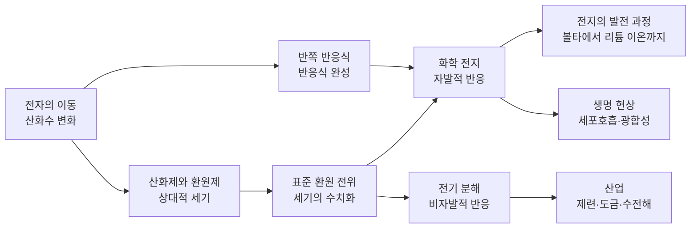

# 화학 반응의 세계 2. 산화·환원 반응 — 전자의 흐름을 에너지로 바꾸다
<!-- prev: m3-01, 4-3, chem-1, chem-2, 5-6 -->
<!-- next: matter-3, cell-3 -->

> [!NOTE]
> **성취기준**
> - **[12반응02-01]** 전자의 이동과 산화수 변화로 산화·환원 반응을 이해하고, 반쪽 반응식을 활용하여 산화·환원 반응식을 완성할 수 있다.
> - **[12반응02-02]** 화학 전지의 발전 과정을 조사하여 실용 전지의 구조적 공통점을 추론할 수 있다.
> - **[12반응02-03]** 화학 전지의 원리를 산화·환원 반응으로 설명하고, 표준 환원 전위를 이용하여 전위차를 구할 수 있다.
> - **[12반응02-04]** 전기 분해의 원리를 산화·환원 반응으로 설명하고, 산업 현장에서 활용되는 전기 분해의 예를 조사하여 발표할 수 있다.
> - **[12반응02-05]** 생명 현상 및 화학 전지에서 이용되는 다양한 산화·환원 반응과 그 반응에 이용된 물질의 역할을 조사하여 화학의 신비로움을 느낄 수 있다.

**학습 목표**

1. 산화수를 정하는 규칙으로 원자의 산화수를 구하고, 산화수 변화로 산화·환원 반응과 산화제·환원제를 판단할 수 있다.
2. 산화제와 환원제는 반응 상대에 따라 상대적으로 결정됨을 예를 들어 설명할 수 있다.
3. 반쪽 반응식을 이용하여 산성 수용액에서 일어나는 산화·환원 반응식을 완성할 수 있다.
4. 볼타 전지에서 리튬 이온 전지까지 화학 전지의 발전 과정을 정리하고, 실용 전지의 구조적 공통점을 추론할 수 있다.
5. 표준 환원 전위로 화학 전지의 표준 전지 전위를 구하고 반응의 자발성을 예측할 수 있다.
6. 전기 분해를 화학 전지와 비교하여 설명하고, 산업과 생명 현상 속 산화·환원 반응에서 각 물질의 역할을 설명할 수 있다.

**이 단원의 학습 사다리**

| 단계 | 무엇을 하나? |
|---|---|
| STEP 1. 이전 학습 다시 보기 | 산소·전자의 이동으로 본 산화·환원, 금속의 반응성, 전기 음성도, 물의 전기 분해 |
| STEP 2. 기초 다지기 | 전기 음성도와 전자의 '소유권', 전류와 전자의 방향, 전위차의 의미 |
| STEP 3. 핵심 개념 | 산화수와 반쪽 반응식 → 전지의 역사와 공통 구조 → 표준 환원 전위 → 전기 분해 → 생명과 전지 속 산화·환원 |
| STEP 4. 오개념 바로잡기 | "산화제는 정해져 있다", "계수를 2배 하면 전위도 2배" 같은 착각 |
| STEP 5. 대학 전공으로 | 깁스 에너지와 전지 전위, 네른스트 식, 패러데이 법칙, 부식 공학 |
| STEP 6. 생활·산업·진로 | 이차 전지, 수소 에너지, 도금·제련, 부식 방지 |

---

## 🗺️ 단원 들어가기

스마트폰 배터리, 전기 자동차, 손목의 스마트워치, 리모컨 속 건전지. 이 모든 장치 안에서는 **전자를 잃는 물질**과 **전자를 얻는 물질**이 떨어진 채로 반응하고, 그 사이를 잇는 전선으로 전자가 흐른다. 전지는 산화·환원 반응을 '둘로 쪼개어' 전자가 반드시 우리가 원하는 길을 지나가도록 만든 장치이다.

거꾸로 전기를 넣어 주면 저절로는 일어나지 않는 산화·환원 반응을 억지로 일으킬 수도 있다. 공기 중에서 쉽게 산화되는 알루미늄을 금속으로 얻는 일, 바닷물에서 염소와 수산화 나트륨을 만드는 일, 물을 쪼개어 수소를 얻는 일이 모두 **전기 분해**이다.

그리고 우리 몸의 세포 하나하나도 작은 전지와 닮았다. 포도당에서 떼어 낸 전자를 단백질 사슬을 따라 차례로 흘려보내 결국 산소에 건네주면서 에너지를 얻는다. 이 단원에서는 전자의 이동을 **산화수**로 정확히 장부에 기록하고, 그 흐름을 **전위**로 재고, 전지와 전기 분해와 생명 현상에 적용해 본다.

---

## STEP 1. 🔙 이전 학습 다시 보기

### 연계 개념표

| 이전 단원·성취기준 | 그때 배운 것 | 이 단원에서 확장되는 것 |
|---|---|---|
| 중2 「물질의 구성」 [9과11-04] | 전자를 잃으면 양이온, 얻으면 음이온 | 이온이 되지 않는 공유 결합 물질에서도 전자의 이동을 **산화수**로 추적 |
| 중3 「화학 반응의 규칙성」 [9과16-02], [9과16-03] | 화학 반응식, 원자의 종류와 수 보존 | 원자 수와 함께 **전하와 전자 수**까지 맞추는 반응식 완성 |
| 통합과학2 「산화와 환원」 [10통과2-01-03] | 산소·전자의 이동으로 본 산화와 환원, 동시성, 금속의 반응성 (산화수는 다루지 않음) | **산화수**, 산화제·환원제, 반응성을 **표준 환원 전위**로 수치화 |
| 통합과학2 「에너지 효율과 신재생 에너지」 [10통과2-02-06] | 에너지 전환, 연료 전지·이차 전지의 쓰임 | 화학 에너지가 전기 에너지로 바뀌는 **원리** |
| 화학 「화학의 언어」 [12화학01-03] | 화학 반응식의 계수비 = 몰수비 | 전자의 몰수로 전기 분해 생성물의 양 구하기 |
| 화학 「물질의 구조와 성질」 [12화학02-01], [12화학02-02] | 물의 전기 분해, 전기 음성도, 결합의 극성 | 전기 음성도로 **산화수 정하기**, 전기 분해의 전극 반응 |

### 준비 운동 (사전 진단)

**Q1.** 다음 반응에서 산화된 물질과 환원된 물질을 쓰시오.
$\mathrm{Zn(s) + Cu^{2+}(aq) \rightarrow Zn^{2+}(aq) + Cu(s)}$

**Q2.** 질산 은 수용액에 구리 선을 넣었을 때 일어나는 변화를 두 가지 쓰시오.

**Q3.** 물을 전기 분해하면 (−)극과 (+)극에서 각각 어떤 기체가 어떤 부피비로 생기는가?

**Q4.** 염화 수소(HCl) 분자에서 공유 전자쌍은 어느 원자 쪽으로 치우쳐 있는가? 그 이유는?

정답 및 해설

**Q1.** 산화: Zn (전자를 잃음), 환원: $\mathrm{Cu^{2+}}$ (전자를 얻음)

**Q2.** 구리 선 표면에 은이 석출되고(은빛 결정), 용액이 점점 푸른색을 띤다($\mathrm{Cu^{2+}}$ 생성). $\mathrm{Cu + 2Ag^+ \rightarrow Cu^{2+} + 2Ag}$

**Q3.** (−)극에서 수소, (+)극에서 산소가 2 : 1의 부피비로 생긴다.

**Q4.** 염소 쪽. 염소의 전기 음성도(3.0)가 수소(2.1)보다 크기 때문이다. 이 '치우침'을 극단적으로 생각한 것이 STEP 3의 산화수이다.

---

## STEP 2. 🧱 기초 다지기

### 디딤돌 1. 전기 음성도 — 전자쌍의 '소유권' 판정 기준

**전기 음성도(electronegativity)** 는 공유 결합에서 원자가 공유 전자쌍을 끌어당기는 정도이다. 자주 쓰는 값(폴링 값, 약)은 다음과 같다.

| 원소 | F | O | Cl | N | C | H | Na | Mg |
|---|---|---|---|---|---|---|---|---|
| 전기 음성도 | 4.0 | 3.5 | 3.0 | 3.0 | 2.5 | 2.1 | 0.9 | 1.2 |

공유 결합은 전자를 '함께 쓰는' 것이지만, 산화수를 정할 때는 **공유 전자쌍을 전기 음성도가 큰 원자가 모두 가져갔다고 가정**한다. 이온이 아닌 물질에도 '가상의 전하'를 매길 수 있게 되는 것이다.

> [!TIP]
> 💡 **비유** — 두 사람이 함께 쓰는 공책(공유 전자쌍)이 있다. 실제로는 함께 쓰지만, 장부에는 "힘이 센 사람(전기 음성도가 큰 원자) 소유"라고 적어 두는 것이 산화수의 규칙이다.

### 디딤돌 2. 전자의 흐름과 전류의 방향

전선 속에서 실제로 움직이는 것은 전자이다. 그런데 전류의 방향은 역사적으로 (+)에서 (−)로 정해 두었기 때문에 **전자가 흐르는 방향과 전류의 방향은 반대**이다.

| 구분 | 방향 |
|---|---|
| 전자의 이동 | (−)극 → 외부 도선 → (+)극 |
| 전류의 방향 | (+)극 → 외부 도선 → (−)극 |

### 디딤돌 3. 전위차(전압)는 '전자의 낙차'

물은 높은 곳에서 낮은 곳으로 흐르며 물레방아를 돌린다. 전자는 전자를 내주려는 경향이 큰 쪽(전위가 낮은 쪽)에서 전자를 받으려는 경향이 큰 쪽(전위가 높은 쪽)으로 흐르며 전구를 켠다. 두 지점의 **전위차(potential difference)** 가 클수록 전자 1 C이 하는 일이 크다. 단위는 볼트(V)이며, $1\ \mathrm{V} = 1\ \mathrm{J/C}$이다.

> [!TIP]
> 💡 **비유** — 전위차는 폭포의 '높이'이고 전류는 흐르는 물의 '양'이다. 같은 높이의 폭포라도 물의 양(전류)은 따로 정해진다. 그래서 작은 건전지(AAA)와 큰 건전지(D)는 크기가 달라도 전압은 똑같이 1.5 V이다.

### 디딤돌 4. 반쪽 반응식 읽기

통합과학에서 배운 것처럼 전자의 이동은 식 속에 $\mathrm{e^-}$로 직접 쓸 수 있다.

$$
\text{산화: } \mathrm{Zn \rightarrow Zn^{2+} + 2e^-} \qquad \text{환원: } \mathrm{Cu^{2+} + 2e^- \rightarrow Cu}
$$

전자가 오른쪽(생성물 쪽)에 있으면 산화, 왼쪽(반응물 쪽)에 있으면 환원이다. 두 반쪽 반응식을 더하면 전자는 지워지고 전체 반응식이 된다. **잃은 전자 수와 얻은 전자 수는 반드시 같아야 한다.** 이것이 산화와 환원이 동시에 일어나는 이유이다.

---

## STEP 3. 📘 핵심 개념

### ① 산화수와 산화·환원 반응식 [12반응02-01]

#### 산화수란?

**산화수(oxidation number)** 는 물질 속 원자가 전자를 얼마나 잃었거나 얻었는지를 나타내는 가상의 전하이다. 이온 결합 물질에서는 이온의 전하와 같고, 공유 결합 물질에서는 공유 전자쌍을 전기 음성도가 큰 원자에 모두 준다고 가정하여 정한다.

| 규칙 | 예 |
|---|---|
| 1. 원소(홑원소 물질)를 이루는 원자의 산화수는 0 | $\mathrm{Na}$, $\mathrm{O_2}$, $\mathrm{Cl_2}$, $\mathrm{C}$(흑연)에서 0 |
| 2. 단원자 이온의 산화수는 그 이온의 전하와 같다 | $\mathrm{Na^+}$: +1, $\mathrm{Cl^-}$: −1, $\mathrm{Fe^{3+}}$: +3 |
| 3. 화합물에서 1족 금속은 +1, 2족 금속은 +2 | $\mathrm{NaCl}$의 Na: +1, $\mathrm{MgO}$의 Mg: +2 |
| 4. 화합물에서 F는 항상 −1 | $\mathrm{HF}$, $\mathrm{OF_2}$ |
| 5. 화합물에서 H는 보통 +1 (금속과의 화합물에서는 −1) | $\mathrm{H_2O}$: +1, $\mathrm{NaH}$: −1 |
| 6. 화합물에서 O는 보통 −2 (과산화물에서는 −1, $\mathrm{OF_2}$에서는 +2) | $\mathrm{H_2O}$: −2, $\mathrm{H_2O_2}$: −1 |
| 7. 중성 화합물의 산화수 합은 0, 다원자 이온의 산화수 합은 그 이온의 전하 | $\mathrm{SO_4^{2-}}$: S + 4(−2) = −2 → S = +6 |

> [!NOTE]
> 규칙이 서로 부딪칠 때는 **번호가 앞선 규칙**을 먼저 적용한다. 예를 들어 $\mathrm{NaH}$에서는 3번(Na = +1)이 5번보다 앞서므로 H는 −1이 된다.

<!-- fig:rxn-2-oxnum-assign -->

#### 예제 1 — 산화수 구하기

다음 밑줄 친 원자의 산화수를 구하시오.
(1) $\mathrm{K}\underline{\mathrm{Mn}}\mathrm{O_4}$ (2) $\mathrm{K_2}\underline{\mathrm{Cr_2}}\mathrm{O_7}$ (3) $\underline{\mathrm{N}}\mathrm{H_3}$ (4) $\underline{\mathrm{N}}\mathrm{O_3^-}$ (5) $\mathrm{H_2}\underline{\mathrm{O_2}}$

**풀이**
(1) (+1) + Mn + 4(−2) = 0 → Mn = **+7**
(2) 2(+1) + 2Cr + 7(−2) = 0 → Cr = **+6**
(3) N + 3(+1) = 0 → N = **−3**
(4) N + 3(−2) = −1 → N = **+5**
(5) 2(+1) + 2O = 0 → O = **−1** (과산화물)

질소 하나만 해도 −3($\mathrm{NH_3}$)부터 +5($\mathrm{NO_3^-}$)까지 다양한 산화수를 가진다. 산화수가 다양한 원소일수록 산화·환원 반응에 다양하게 참여한다.

#### 산화수로 보는 산화와 환원

| 관점 | 산화 | 환원 |
|---|---|---|
| 산소 (통합과학) | 산소를 얻는다 | 산소를 잃는다 |
| 전자 (통합과학) | 전자를 잃는다 | 전자를 얻는다 |
| 산화수 (이 단원) | **산화수가 증가한다** | **산화수가 감소한다** |

산화수는 전자를 실제로 완전히 주고받지 않는 반응까지 다룰 수 있는 가장 넓은 기준이다. 예를 들어 메테인의 연소에서는 이온이 생기지 않지만 산화수로 분석할 수 있다.

$$
\overset{-4}{\mathrm{C}}\mathrm{H_4} + 2\overset{0}{\mathrm{O}}_2 \rightarrow \overset{+4}{\mathrm{C}}\overset{-2}{\mathrm{O}}_2 + 2\mathrm{H_2}\overset{-2}{\mathrm{O}}
$$

탄소는 −4 → +4로 산화되었고, 산소는 0 → −2로 환원되었다.

#### 산화제와 환원제 — 역할은 상대가 정한다

- **산화제(oxidizing agent)**: 다른 물질을 산화시키고 **자신은 환원되는** 물질 (전자를 빼앗는 물질)
- **환원제(reducing agent)**: 다른 물질을 환원시키고 **자신은 산화되는** 물질 (전자를 내주는 물질)

> [!IMPORTANT]
> 산화제와 환원제는 물질마다 정해진 '이름표'가 아니다. **특정 반응에서 상대보다 전자를 더 세게 끌어당기는 쪽이 산화제**가 된다. 같은 물질도 상대가 바뀌면 역할이 바뀐다.

과산화 수소($\mathrm{H_2O_2}$, O의 산화수 −1)는 좋은 예이다. 산소의 산화수 −1은 0($\mathrm{O_2}$)과 −2($\mathrm{H_2O}$)의 중간이므로 두 방향 모두 가능하다.

| 반응 상대 | 반응식 (산성 용액) | $\mathrm{H_2O_2}$의 산소 산화수 | $\mathrm{H_2O_2}$의 역할 |
|---|---|---|---|
| 아이오딘화 이온 $\mathrm{I^-}$ | $\mathrm{H_2O_2 + 2I^- + 2H^+ \rightarrow I_2 + 2H_2O}$ | −1 → −2 | **산화제** |
| 과망가니즈산 이온 $\mathrm{MnO_4^-}$ | $\mathrm{2MnO_4^- + 5H_2O_2 + 6H^+ \rightarrow 2Mn^{2+} + 5O_2 + 8H_2O}$ | −1 → 0 | **환원제** |

$\mathrm{MnO_4^-}$는 $\mathrm{H_2O_2}$보다 전자를 더 세게 끌어당기므로 $\mathrm{H_2O_2}$가 전자를 빼앗기고, $\mathrm{I^-}$는 $\mathrm{H_2O_2}$보다 전자를 쉽게 내놓으므로 $\mathrm{H_2O_2}$가 전자를 얻는다. 이 '상대적 세기'를 수치로 나타낸 것이 ③의 **표준 환원 전위**이다. 상처 소독약(과산화 수소수)의 거품도 상처의 효소에 의해 $\mathrm{H_2O_2}$끼리 한쪽은 산화되고 한쪽은 환원되는 반응($\mathrm{2H_2O_2 \rightarrow 2H_2O + O_2}$)으로 생긴 산소이다.

> [!TIP]
> 💡 **비유** — 산화제와 환원제는 '줄다리기 팀'과 같다. 중간 실력의 선수(과산화 수소)는 약한 팀(아이오딘화 이온)과 겨루면 이기고(전자를 빼앗는 산화제), 강한 팀(과망가니즈산 이온)과 겨루면 진다(전자를 빼앗기는 환원제). '강한 선수'인지 '약한 선수'인지는 상대에 따라 달라진다.

#### 반쪽 반응식으로 산화·환원 반응식 완성하기

복잡한 산화·환원 반응은 산화와 환원을 따로 나누어 맞춘 뒤 합치면 쉽다. 산성 수용액에서 과망가니즈산 이온이 철(II) 이온을 산화시키는 반응을 완성해 보자.

$$
\mathrm{MnO_4^- + Fe^{2+} \rightarrow Mn^{2+} + Fe^{3+}} \quad (\text{산성})
$$

| 단계 | 할 일 | 산화 반쪽 반응 | 환원 반쪽 반응 |
|---|---|---|---|
| 1 | 산화수 변화로 두 반쪽으로 나누기 | $\mathrm{Fe^{2+} \rightarrow Fe^{3+}}$ (+2 → +3) | $\mathrm{MnO_4^- \rightarrow Mn^{2+}}$ (+7 → +2) |
| 2 | O, H 이외의 원자 수 맞추기 | 이미 맞음 | 이미 맞음 |
| 3 | O는 $\mathrm{H_2O}$로 맞추기 | — | $\mathrm{MnO_4^- \rightarrow Mn^{2+} + 4H_2O}$ |
| 4 | H는 $\mathrm{H^+}$로 맞추기 | — | $\mathrm{MnO_4^- + 8H^+ \rightarrow Mn^{2+} + 4H_2O}$ |
| 5 | 전하를 $\mathrm{e^-}$로 맞추기 | $\mathrm{Fe^{2+} \rightarrow Fe^{3+} + e^-}$ | $\mathrm{MnO_4^- + 8H^+ + 5e^- \rightarrow Mn^{2+} + 4H_2O}$ |
| 6 | 주고받는 전자 수 같게 하기 | 전체 × 5 | 그대로 |
| 7 | 더하고 전자 지우기 | | |

$$
\mathrm{MnO_4^-(aq) + 8H^+(aq) + 5Fe^{2+}(aq) \rightarrow Mn^{2+}(aq) + 5Fe^{3+}(aq) + 4H_2O(l)}
$$

**확인** 원자 수: Mn 1, O 4, H 8, Fe 5로 양쪽이 같다. 전하: 왼쪽 (−1) + 8 + 10 = +17, 오른쪽 (+2) + 15 = +17로 같다. 5단계에서 $\mathrm{Mn}$의 산화수가 5 감소한 것과 전자 5개를 얻은 것이 일치하는지도 확인하자.

이 반응에서 보라색 $\mathrm{MnO_4^-}$는 거의 무색인 $\mathrm{Mn^{2+}}$로 바뀐다. 그래서 따로 지시약 없이도 보라색이 사라지지 않는 순간을 종말점으로 삼는 **산화·환원 적정**에 쓰인다. 「산·염기 평형」의 중화 적정과 같은 원리로, 이번에는 양성자 대신 **전자의 몰수**를 센다.

#### 예제 2 — 음주 측정기의 반응식 완성하기

산성 용액에서 다이크로뮴산 이온(주황색)이 에탄올을 산화시켜 아세트알데하이드로 만들고 자신은 크로뮴(III) 이온(초록색)이 된다. 반쪽 반응식을 이용하여 전체 반응식을 완성하시오.

$$
\mathrm{Cr_2O_7^{2-} + C_2H_5OH \rightarrow Cr^{3+} + CH_3CHO} \quad (\text{산성})
$$

**풀이**
환원: $\mathrm{Cr_2O_7^{2-} \rightarrow 2Cr^{3+}}$ → O 맞추기 $+ 7\mathrm{H_2O}$ → H 맞추기 $14\mathrm{H^+}$ → 전하 맞추기
$\mathrm{Cr_2O_7^{2-} + 14H^+ + 6e^- \rightarrow 2Cr^{3+} + 7H_2O}$ (Cr의 산화수 +6 → +3, 2개이므로 전자 6개)
산화: $\mathrm{C_2H_5OH \rightarrow CH_3CHO + 2H^+ + 2e^-}$
전자 수를 6으로 맞추기 위해 산화 반쪽 반응에 3을 곱하고 더한다.

$$
\mathrm{Cr_2O_7^{2-} + 3C_2H_5OH + 8H^+ \rightarrow 2Cr^{3+} + 3CH_3CHO + 7H_2O}
$$

(양쪽의 $\mathrm{H^+}$ 14개와 6개를 정리하여 왼쪽에 8개가 남는다.) 주황색이 초록색으로 변하는 정도로 날숨 속 알코올을 검출하는 것이 초기 음주 측정기의 원리이다. 이 반응은 「탄소 화합물과 반응」에서 **작용기의 변화**(알코올 → 알데하이드)로 다시 만난다.

#### ✔ 바로 확인

1. 염소산 이온 $\mathrm{ClO_3^-}$에서 Cl의 산화수를 구하시오.
2. (O/X) 산화제는 반응에서 자신이 산화되는 물질이다.
3. 반응 $\mathrm{2Na + Cl_2 \rightarrow 2NaCl}$에서 환원제는 무엇인가?
4. 빈칸: 산성 수용액에서 반쪽 반응식을 맞출 때 O 원자 수는 (    )로, H 원자 수는 (    )로, 전하는 (    )로 맞춘다.

정답

1. +5 — Cl + 3(−2) = −1
2. X — 산화제는 남을 산화시키고 자신은 **환원**된다.
3. Na — 산화수가 0에서 +1로 증가(산화)하며 $\mathrm{Cl_2}$를 환원시킨다.
4. $\mathrm{H_2O}$, $\mathrm{H^+}$, $\mathrm{e^-}$

### ② 화학 전지의 발전 과정과 실용 전지의 공통점 [12반응02-02]

**화학 전지(chemical cell)** 는 자발적인 산화·환원 반응에서 나오는 화학 에너지를 전기 에너지로 바꾸는 장치이다. 오늘날의 전지는 200년이 넘는 시행착오가 쌓인 결과이다.

#### 전지의 연대기

| 시기 (약) | 전지 | 구성과 특징 | 해결한 문제 / 남은 문제 |
|---|---|---|---|
| 1780년대 | 갈바니의 '동물 전기' | 두 종류 금속이 개구리 다리에 닿으면 근육이 움찔함 | 전기의 근원을 동물로 오해 |
| 1800년 | 볼타 전지(볼타 파일) | 아연판과 구리판(또는 은판) 사이에 소금물·묽은 산에 적신 천을 끼워 쌓음 | 최초로 전류를 **계속** 얻음 / 구리판에 수소 기포가 붙어 전압이 빨리 떨어짐(분극) |
| 1836년 | 다니엘 전지 | 아연은 황산 아연 용액에, 구리는 황산 구리(II) 용액에 따로 담그고 다공성 칸막이로 연결 | 산화와 환원을 **공간적으로 분리**하여 전압이 안정 |
| 1859년 | 납축전지 | 납과 이산화 납, 묽은 황산 | 최초의 **충전 가능한(2차) 전지** / 무겁다 |
| 1866년 이후 | 르클랑셰 전지 → 건전지 | 아연, 이산화 망가니즈, 전해질을 반죽 형태로 | 액체를 쏟지 않는 **휴대용** 전지 |
| 20세기 중반 이후 | 알칼리 전지, 니켈–카드뮴, 니켈–수소 전지 | 알칼리성 전해질, 수명·용량 향상 | 카드뮴의 독성, 메모리 효과 등 |
| 1991년 상용화 | 리튬 이온 전지 | 리튬 이온이 흑연과 금속 산화물 사이를 오감 | 가볍고 전압이 높음(약 3.6~3.7 V) / 화재 위험, 원료 자원 문제 |
| 현재 개발 중 | 전고체 전지, 나트륨 이온 전지, 리튬–황 전지, 연료 전지 등 | 고체 전해질, 풍부한 원료 | 안전성·가격·에너지 밀도 개선 |

> [!NOTE]
> 리튬 이온 전지를 개발한 공로로 2019년 노벨 화학상이 세 명의 과학자(구디너프, 휘팅엄, 요시노)에게 수여되었다.

#### 볼타 전지와 다니엘 전지 — 결정적 차이

볼타 전지에서 아연은 묽은 산 속에서 전자를 잃고, 그 전자는 도선을 따라 구리판으로 가서 용액의 $\mathrm{H^+}$를 수소로 환원한다. 구리 자신은 반응하지 않는다. 그런데 구리판 표면에 수소 기포가 달라붙으면 반응이 방해받아 전압이 금세 떨어진다(**분극**).

다니엘 전지는 산화(아연 쪽)와 환원(구리 쪽)을 서로 다른 용액에서 일어나게 하고, **염다리** 또는 다공성 칸막이로 이온만 지나가게 하였다. 이 '분리' 아이디어는 오늘날 모든 실용 전지의 분리막으로 이어진다.

<!-- fig:rxn-2-volta-daniell -->

#### 실용 전지의 구조적 공통점 추론하기

| 실용 전지 | (−)극 물질 (산화) | (+)극 물질 (환원) | 전해질 | 분리 장치 |
|---|---|---|---|---|
| 다니엘 전지 | Zn | $\mathrm{Cu^{2+}}$ → Cu | $\mathrm{ZnSO_4}$, $\mathrm{CuSO_4}$ 수용액 | 염다리·다공성 칸막이 |
| 알칼리 건전지 | Zn | $\mathrm{MnO_2}$ | KOH 반죽 | 분리막 |
| 납축전지 | Pb | $\mathrm{PbO_2}$ | 묽은 황산 | 분리판 |
| 리튬 이온 전지 | 리튬이 들어 있는 흑연 | 리튬 금속 산화물(예: $\mathrm{LiCoO_2}$) | 리튬염을 녹인 유기 용매 | 미세 구멍이 있는 고분자 분리막 |
| 수소 연료 전지 | $\mathrm{H_2}$ (백금 촉매 전극) | $\mathrm{O_2}$ (백금 촉매 전극) | 양성자 교환 고분자막 등 | 전해질막이 분리 역할 |

> [!IMPORTANT]
> **실용 전지의 구조적 공통점**
> 1. 전자를 내주는 물질(환원제)이 있는 **(−)극**과 전자를 받는 물질(산화제)이 있는 **(+)극**이 있다.
> 2. 두 극은 **외부 도선**으로 연결되어 전자가 그 길로만 흐른다.
> 3. 두 극 사이에는 이온만 이동시키는 **전해질**이 있어 전하 균형을 맞춘다.
> 4. 두 반응물이 직접 닿아 전자를 바로 주고받지 않도록 **분리 장치**(염다리·분리막)가 있다.
>
> 결국 모든 전지는 "산화제와 환원제를 떼어 놓고, 전자는 도선으로, 이온은 전해질로 다니게 한" 장치이다.

> [!NOTE]
> **용어 주의** 화학에서 전지의 (−)극은 산화가 일어나므로 **산화 전극(anode)**, (+)극은 환원이 일어나므로 **환원 전극(cathode)** 이다. 배터리 산업에서는 방전 기준으로 (+)극 소재를 '양극재', (−)극 소재를 '음극재'라고 부른다.

#### 1차 전지, 2차 전지, 연료 전지

| 종류 | 특징 | 예 |
|---|---|---|
| 1차 전지 | 한 번 방전하면 다시 쓸 수 없다 | 망가니즈 건전지, 알칼리 건전지, 리튬 1차 전지(동전형) |
| 2차 전지 | 외부 전원으로 역반응(전기 분해)을 일으켜 충전할 수 있다 | 납축전지, 니켈–수소 전지, 리튬 이온 전지 |
| 연료 전지 | 반응물(연료와 산소)을 밖에서 계속 공급하면 계속 전기를 만든다 | 수소 연료 전지 |

2차 전지의 **충전은 곧 전기 분해**이다. 화학 전지와 전기 분해가 같은 반응의 정방향과 역방향이라는 사실은 ④에서 다시 확인한다.

#### ✔ 바로 확인

1. (O/X) 볼타 전지는 아연 쪽 용액과 구리 쪽 용액을 염다리로 분리한 전지이다.
2. 알칼리 건전지, 납축전지, 리튬 이온 전지를 1차 전지와 2차 전지로 나누시오.
3. 실용 전지가 공통으로 갖춘 구조 네 가지를 쓰시오.

정답

1. X — 산화와 환원을 다른 용액으로 분리한 것은 다니엘 전지이다.
2. 1차 전지: 알칼리 건전지 / 2차 전지: 납축전지, 리튬 이온 전지
3. (−)극과 (+)극, 외부 도선, 전해질, 분리 장치(염다리·분리막)

### ③ 화학 전지의 원리와 표준 환원 전위 [12반응02-03]

#### 다니엘 전지를 자세히 보기

$$
\text{(−)극(산화 전극): } \mathrm{Zn(s) \rightarrow Zn^{2+}(aq) + 2e^-}
$$

$$
\text{(+)극(환원 전극): } \mathrm{Cu^{2+}(aq) + 2e^- \rightarrow Cu(s)}
$$

$$
\text{전체: } \mathrm{Zn(s) + Cu^{2+}(aq) \rightarrow Zn^{2+}(aq) + Cu(s)}
$$

| 관찰 | 이유 |
|---|---|
| 아연판의 질량이 줄어든다 | Zn이 $\mathrm{Zn^{2+}}$로 산화되어 녹아 나간다 |
| 구리판의 질량이 늘어난다 | $\mathrm{Cu^{2+}}$가 Cu로 환원되어 달라붙는다 |
| 황산 구리(II) 용액의 푸른색이 옅어진다 | $\mathrm{Cu^{2+}}$가 줄어든다 |
| 전자는 아연판 → 도선 → 구리판으로 흐른다 | 아연이 구리보다 전자를 내놓으려는 경향이 크다 |
| 염다리의 음이온은 아연 쪽, 양이온은 구리 쪽으로 이동한다 | 아연 쪽은 $\mathrm{Zn^{2+}}$가 늘어 (+)전하가, 구리 쪽은 $\mathrm{Cu^{2+}}$가 줄어 (−)전하가 남으려 하므로 이를 중화한다 |

> [!WARNING]
> 염다리를 통해 이동하는 것은 **전자가 아니라 이온**이다. 전자는 금속 도선으로만 이동한다. 염다리를 빼면 이온이 이동하지 못해 전하 균형이 깨지고, 곧바로 전류가 멈춘다.

이 전지는 다음과 같은 **전지 표시법**으로 간단히 나타낸다. 왼쪽에 산화 전극, 오른쪽에 환원 전극을 쓰고, 세로선 하나는 상의 경계, 두 줄은 염다리를 뜻한다.

$$
\mathrm{Zn(s)\,\vert\,Zn^{2+}(aq)\,\Vert\,Cu^{2+}(aq)\,\vert\,Cu(s)}
$$

#### 화학 에너지가 전기 에너지로 바뀌는 원리

아연판을 황산 구리(II) 수용액에 직접 담그면 같은 반응이 일어나지만, 전자가 아연 표면에서 $\mathrm{Cu^{2+}}$로 바로 건너가므로 에너지는 **열**로만 나온다(용액이 따뜻해진다). 전지는 두 반응물을 떼어 놓아 전자가 반드시 **도선을 지나가게** 만들었다. 도선 중간에 전구나 전동기를 두면 전자가 지나가며 일을 하므로, 화학 에너지의 상당 부분이 **전기 에너지**로 바뀐다.

> [!TIP]
> 💡 **비유** — 언덕 위의 물을 그냥 쏟아 버리면(직접 반응) 물보라(열)만 생긴다. 하지만 물길을 만들어 물레방아를 지나가게 하면(도선 + 전구) 그 낙차로 일을 시킬 수 있다. 전지는 전자의 '물길'을 만든 장치이다.

#### 표준 환원 전위

전지의 전압은 두 전극이 전자를 끌어당기는 경향의 차이로 생긴다. 이 경향을 비교하려면 **기준**이 필요하다. 과학자들은 25 ℃, 1 atm의 수소 기체와 1 M의 $\mathrm{H^+}$ 용액에 백금 전극을 담근 **표준 수소 전극**의 전위를 0 V로 정했다.

$$
\mathrm{2H^+(aq, 1\ M) + 2e^- \rightleftharpoons H_2(g, 1\ atm)} \qquad E^\circ = 0\ \mathrm{V}
$$

표준 상태(25 ℃, 용액 1 M, 기체 1 atm)에서 어떤 반쪽 반응이 **환원**될 때의 전위를 표준 수소 전극과 비교하여 나타낸 값을 **표준 환원 전위(standard reduction potential)** $E^\circ$라고 한다.

| 환원 반쪽 반응 | $E^\circ$ (V, 25 ℃, 약) |
|---|---|
| $\mathrm{F_2 + 2e^- \rightarrow 2F^-}$ | +2.87 |
| $\mathrm{MnO_4^- + 8H^+ + 5e^- \rightarrow Mn^{2+} + 4H_2O}$ | +1.51 |
| $\mathrm{Cl_2 + 2e^- \rightarrow 2Cl^-}$ | +1.36 |
| $\mathrm{Cr_2O_7^{2-} + 14H^+ + 6e^- \rightarrow 2Cr^{3+} + 7H_2O}$ | +1.33 |
| $\mathrm{O_2 + 4H^+ + 4e^- \rightarrow 2H_2O}$ | +1.23 |
| $\mathrm{Ag^+ + e^- \rightarrow Ag}$ | +0.80 |
| $\mathrm{Fe^{3+} + e^- \rightarrow Fe^{2+}}$ | +0.77 |
| $\mathrm{I_2 + 2e^- \rightarrow 2I^-}$ | +0.54 |
| $\mathrm{Cu^{2+} + 2e^- \rightarrow Cu}$ | +0.34 |
| $\mathrm{2H^+ + 2e^- \rightarrow H_2}$ | 0 (기준) |
| $\mathrm{Pb^{2+} + 2e^- \rightarrow Pb}$ | −0.13 |
| $\mathrm{Ni^{2+} + 2e^- \rightarrow Ni}$ | −0.26 |
| $\mathrm{Fe^{2+} + 2e^- \rightarrow Fe}$ | −0.44 |
| $\mathrm{Zn^{2+} + 2e^- \rightarrow Zn}$ | −0.76 |
| $\mathrm{2H_2O + 2e^- \rightarrow H_2 + 2OH^-}$ | −0.83 |
| $\mathrm{Al^{3+} + 3e^- \rightarrow Al}$ | −1.66 |
| $\mathrm{Mg^{2+} + 2e^- \rightarrow Mg}$ | −2.37 |
| $\mathrm{Na^+ + e^- \rightarrow Na}$ | −2.71 |
| $\mathrm{Li^+ + e^- \rightarrow Li}$ | −3.04 |

**표 읽는 법**
- $E^\circ$가 **클수록**(위쪽) 왼쪽 물질이 환원되기 쉽다 → **강한 산화제** ($\mathrm{F_2}$, $\mathrm{MnO_4^-}$)
- $E^\circ$가 **작을수록**(아래쪽) 오른쪽 물질이 산화되기 쉽다 → **강한 환원제** ($\mathrm{Li}$, $\mathrm{Na}$)
- 통합과학에서 배운 금속의 반응성 순서(K > Na > Mg > Al > Zn > Fe > Ni > Sn > Pb > H > Cu > Ag …)는 이 표를 아래에서 위로 읽은 것과 같다.

①에서 $\mathrm{MnO_4^-}$(+1.51)가 $\mathrm{H_2O_2}$를 산화시키고, $\mathrm{H_2O_2}$가 $\mathrm{I^-}$(+0.54)를 산화시킨 것도 이 표로 설명된다. (참고: $\mathrm{O_2/H_2O_2}$는 약 +0.70 V, $\mathrm{H_2O_2/H_2O}$는 약 +1.78 V이다.) 표준 환원 전위는 산화제·환원제의 '상대적 세기'를 숫자로 나타낸 순위표인 셈이다.

<!-- fig:rxn-2-reduction-ladder -->

#### 표준 전지 전위 구하기

$$
\boxed{\;E^\circ_{\text{전지}} = E^\circ_{\text{환원 전극}} - E^\circ_{\text{산화 전극}}\;}
$$

$E^\circ$가 더 큰 쪽이 환원 전극((+)극), 더 작은 쪽이 산화 전극((−)극)이 된다. $E^\circ_{\text{전지}} > 0$이면 그 반응은 **자발적**으로 일어난다.

> [!IMPORTANT]
> 반쪽 반응식에 계수를 곱해도 $E^\circ$는 **곱하지 않는다.** 전위는 전자 1 C당 에너지(J/C)이므로, 반응하는 양과 관계없는 '세기'의 성질이기 때문이다. 전자 수를 맞추는 것은 반응식을 위한 일이지 전위 계산과는 상관없다.

<!-- sim:galvanic-cell -->

#### 예제 3 — 다니엘 전지의 표준 전지 전위

$E^\circ_{\text{전지}} = E^\circ(\mathrm{Cu^{2+}/Cu}) - E^\circ(\mathrm{Zn^{2+}/Zn}) = 0.34 - (-0.76) = 1.10\ \mathrm{V}$

#### 예제 4 — 아연–은 전지

아연과 은으로 전지를 만들 때 (1) (+)극, (2) 전체 반응식, (3) 표준 전지 전위를 구하시오.

**풀이**
(1) $E^\circ(\mathrm{Ag^+/Ag}) = +0.80\ \mathrm{V} > E^\circ(\mathrm{Zn^{2+}/Zn}) = -0.76\ \mathrm{V}$이므로 **은 전극이 (+)극**(환원 전극)이다.
(2) 전자 수를 맞추기 위해 은의 반쪽 반응에 2를 곱한다.
$\mathrm{Zn(s) + 2Ag^+(aq) \rightarrow Zn^{2+}(aq) + 2Ag(s)}$
(3) $E^\circ_{\text{전지}} = 0.80 - (-0.76) = 1.56\ \mathrm{V}$ (은의 $E^\circ$에 2를 곱하지 않는다!)

#### 예제 5 — 반응이 일어날까?

다음 중 자발적으로 일어나는 반응을 고르시오.
(가) 구리를 묽은 염산에 넣는다. (나) 철못을 황산 구리(II) 수용액에 넣는다. (다) 은을 황산 아연 수용액에 넣는다.

**풀이**
(가) Cu가 산화, $\mathrm{H^+}$가 환원: $E^\circ = 0 - 0.34 = -0.34\ \mathrm{V} < 0$ → 일어나지 않는다.
(나) Fe가 산화, $\mathrm{Cu^{2+}}$가 환원: $E^\circ = 0.34 - (-0.44) = 0.78\ \mathrm{V} > 0$ → **일어난다.** 철못 표면이 붉게 변한다.
(다) Ag가 산화, $\mathrm{Zn^{2+}}$가 환원: $E^\circ = -0.76 - 0.80 = -1.56\ \mathrm{V} < 0$ → 일어나지 않는다.

#### 전지의 전압을 키우려면?

| 방법 | 원리 | 예 |
|---|---|---|
| $E^\circ$ 차이가 큰 두 물질을 고른다 | 표의 맨 아래(강한 환원제)와 맨 위(강한 산화제)에 가까울수록 좋다 | 리튬(−3.04 V)을 쓰는 리튬 전지가 3 V 이상을 내는 이유 |
| 전지를 직렬로 연결한다 | 전압이 더해진다 | 자동차 12 V 납축전지 = 약 2 V 전지 6개를 직렬 연결 |
| 전극을 크게 만든다 | 전압은 그대로, **용량**(흘릴 수 있는 전기의 양)이 커진다 | 같은 1.5 V의 AAA 건전지와 D 건전지 |

> [!NOTE]
> 리튬은 물과 격렬히 반응하므로 리튬 전지는 물 대신 **유기 용매** 전해질을 쓴다. 물을 전해질로 쓰면 이론적으로 약 1.23 V보다 큰 전압에서 물 자체가 분해되기 시작하기 때문에, 3 V 이상의 전지를 만들려면 물이 아닌 전해질이 필요하다.

#### ✔ 바로 확인

1. (O/X) 표준 환원 전위가 클수록 강한 환원제이다.
2. $E^\circ(\mathrm{Ag^+/Ag}) = +0.80\ \mathrm{V}$, $E^\circ(\mathrm{Cu^{2+}/Cu}) = +0.34\ \mathrm{V}$일 때 은–구리 전지의 (+)극과 표준 전지 전위를 쓰시오.
3. 다니엘 전지에서 전자는 어느 전극에서 어느 전극으로 이동하는가?
4. 빈칸: 염다리를 통해 이동하는 것은 전자가 아니라 (    )이다.

정답

1. X — 표준 환원 전위가 클수록 환원되기 쉬운 **강한 산화제**이다.
2. 은 전극, 0.46 V — $0.80 - 0.34 = 0.46$
3. 아연판 → 도선 → 구리판
4. 이온

### ④ 전기 분해의 원리와 산업 [12반응02-04]

#### 전기 분해란?

$E^\circ_{\text{전지}} < 0$인 반응은 저절로 일어나지 않는다. 그러나 외부 전원으로 그 차이보다 큰 전압을 걸어 전자를 강제로 밀어 넣으면 반응을 일으킬 수 있다. 이처럼 **전기 에너지를 이용해 비자발적인 산화·환원 반응을 일으키는 것**을 **전기 분해(electrolysis)** 라고 한다.

| 비교 | 화학 전지 | 전기 분해 |
|---|---|---|
| 에너지 전환 | 화학 에너지 → 전기 에너지 | 전기 에너지 → 화학 에너지 |
| 반응의 자발성 | 자발적 ($E^\circ_{\text{전지}} > 0$) | 비자발적 (외부 전원 필요) |
| 산화가 일어나는 전극 | (−)극 = 산화 전극 | 전원의 (+)극에 연결된 전극 = 산화 전극 |
| 환원이 일어나는 전극 | (+)극 = 환원 전극 | 전원의 (−)극에 연결된 전극 = 환원 전극 |
| 예 | 건전지 방전, 연료 전지 | 2차 전지 충전, 도금, 금속 제련 |

> [!TIP]
> 💡 **요령** — 전극의 부호는 장치마다 바뀌지만 **"산화 전극에서는 산화, 환원 전극에서는 환원"** 은 변하지 않는다. 전기 분해에서는 전원의 (−)극이 전자를 밀어 넣는 쪽이므로 그 전극에 붙은 물질이 전자를 얻어 **환원**된다고 기억하자.

#### 여러 가지 전기 분해

| 전기 분해 대상 | 환원 전극 (전원 (−)극) | 산화 전극 (전원 (+)극) | 생성물 |
|---|---|---|---|
| 용융 염화 나트륨 | $\mathrm{Na^+ + e^- \rightarrow Na}$ | $\mathrm{2Cl^- \rightarrow Cl_2 + 2e^-}$ | 나트륨 금속, 염소 기체 |
| 염화 나트륨 수용액 | $\mathrm{2H_2O + 2e^- \rightarrow H_2 + 2OH^-}$ | $\mathrm{2Cl^- \rightarrow Cl_2 + 2e^-}$ | 수소, 염소, 수산화 나트륨 |
| 물 (황산 나트륨 첨가) | $\mathrm{2H_2O + 2e^- \rightarrow H_2 + 2OH^-}$ | $\mathrm{2H_2O \rightarrow O_2 + 4H^+ + 4e^-}$ | 수소 : 산소 = 2 : 1 (부피) |
| 황산 구리(II) 수용액 (백금 전극) | $\mathrm{Cu^{2+} + 2e^- \rightarrow Cu}$ | $\mathrm{2H_2O \rightarrow O_2 + 4H^+ + 4e^-}$ | 구리, 산소 (용액은 점점 산성) |

**수용액에서는 물과의 경쟁**을 생각해야 한다.
- 환원 전극: $E^\circ$가 물(−0.83 V)보다 훨씬 작은 $\mathrm{Na^+}$(−2.71 V), $\mathrm{K^+}$, $\mathrm{Mg^{2+}}$, $\mathrm{Al^{3+}}$ 등은 환원되지 않고 **물이 환원되어 수소**가 나온다. $\mathrm{Cu^{2+}}$, $\mathrm{Ag^+}$처럼 $E^\circ$가 큰 이온은 금속으로 석출된다. 그래서 나트륨이나 알루미늄은 물이 없는 **용융 상태**에서 전기 분해해야 얻을 수 있다.
- 산화 전극: $\mathrm{SO_4^{2-}}$, $\mathrm{NO_3^-}$는 산화되지 않고 물이 산화되어 산소가 나온다. $\mathrm{Cl^-}$이 진하게 녹아 있으면 실제로는 염소 기체가 주로 나온다(그 이유는 STEP 5에서 다룬다).

<!-- fig:rxn-2-electrolysis-cells -->

#### 전자의 몰수로 생성물의 양 구하기

전극 반응식의 계수비는 **전자의 몰수비**이기도 하다. 예를 들어 $\mathrm{Cu^{2+} + 2e^- \rightarrow Cu}$에서 전자 2 mol이 흐르면 구리 1 mol이 석출된다.

#### 예제 6 — 황산 구리(II) 수용액의 전기 분해

백금 전극으로 황산 구리(II) 수용액을 전기 분해하여 전자 0.20 mol이 흘렀다. 환원 전극에서 석출된 구리의 질량과, 산화 전극에서 발생한 산소의 몰수를 구하시오. (Cu의 원자량은 63.5)

**풀이**
구리: 전자 2 mol당 Cu 1 mol → 0.10 mol × 63.5 g/mol = **6.35 g**
산소: 전자 4 mol당 $\mathrm{O_2}$ 1 mol → **0.050 mol**
(두 전극에 흐른 전자 수는 같다는 점을 이용한다.)

#### 산업 현장의 전기 분해

| 산업 | 전기 분해 반응의 요점 | 생산물과 쓰임 |
|---|---|---|
| 염소–알칼리 공업 | 진한 소금물을 전기 분해. 환원 전극에서 $\mathrm{H_2}$와 $\mathrm{OH^-}$, 산화 전극에서 $\mathrm{Cl_2}$. 이온 교환막으로 두 쪽을 분리 | 수산화 나트륨(비누·종이·섬유), 염소(소독제·PVC 원료), 수소 |
| 알루미늄 제련 | 알루미나($\mathrm{Al_2O_3}$)를 녹는점이 낮은 빙정석에 녹여 약 950 ℃ 근처에서 전기 분해. $\mathrm{Al^{3+} + 3e^- \rightarrow Al}$ | 알루미늄 캔, 항공기·자동차 경량 소재 (막대한 전력 소비 → 재활용의 에너지 절약 효과가 크다) |
| 구리 정련 | 순도 낮은 구리를 산화 전극, 순수한 구리를 환원 전극으로 하여 황산 구리(II) 수용액에서 전기 분해 | 순도 99.9 % 이상의 전선용 구리. 금·은 등은 전극 아래 찌꺼기로 회수 |
| 전기 도금 | 도금할 물체를 환원 전극에, 도금할 금속을 산화 전극에 연결 | 니켈·크로뮴 도금(녹 방지·광택), 금 도금(전자 부품 접점) |
| 알루마이트(양극 산화) | 알루미늄을 **산화 전극**으로 하여 표면에 두껍고 단단한 산화 알루미늄 막을 만든다 | 냄비, 스마트폰 금속 외장, 창틀 |
| 물의 전기 분해(수전해) | 물을 산소와 수소로 분해. 재생 에너지 전기를 쓰면 탄소를 배출하지 않는 '그린 수소' | 연료 전지·수소 자동차·제철용 수소 |

> [!TIP]
> 💡 **조사·발표 아이디어** — 위 산업 중 하나를 골라 ① 전극 반응식, ② 필요한 에너지와 환경 문제, ③ 우리나라 관련 산업의 현황을 조사해 발표해 보자. 발표 후 친구들의 발표를 서로 검토하며 반응식이 맞는지, 근거 자료가 믿을 만한지 동료 평가를 해 보자.

#### ✔ 바로 확인

1. (O/X) 전기 분해에서 전원의 (−)극에 연결된 전극에서는 환원이 일어난다.
2. 염화 나트륨 수용액을 전기 분해할 때 전원의 (−)극에 연결된 전극에서 생기는 기체는?
3. $\mathrm{Ag^+ + e^- \rightarrow Ag}$에서 전자 0.10 mol이 흐르면 은은 몇 mol 석출되는가?
4. 철 클립에 구리를 도금하려면 철 클립을 전원의 어느 극에 연결해야 하는가?

정답

1. O — (−)극이 전자를 밀어 넣으므로 그 전극의 물질이 전자를 얻는다.
2. 수소 — $\mathrm{Na^+}$보다 물이 먼저 환원된다.
3. 0.10 mol — 전자 1 mol당 은 1 mol
4. (−)극 — 클립 표면에서 $\mathrm{Cu^{2+}}$가 환원되어 구리가 입혀진다.

### ⑤ 생명 현상과 화학 전지 속 산화·환원 — 물질의 역할 [12반응02-05]

#### 세포호흡 — 몸속의 '연료 전지'

세포호흡의 전체 반응은 포도당이 산소와 반응하는 산화·환원 반응이다.

$$
\mathrm{C_6H_{12}O_6 + 6O_2 \rightarrow 6CO_2 + 6H_2O} \qquad (\text{C의 평균 산화수 }0 \rightarrow +4,\ \text{O는 }0 \rightarrow -2)
$$

하지만 포도당을 한꺼번에 태우면 에너지가 열로 흩어져 버린다. 세포는 전지처럼 반응을 **여러 단계로 나누고**, 전자를 **운반체**에 실어 옮긴다.

| 물질 | 역할 | 전지에 비유하면 |
|---|---|---|
| 포도당 | 전자를 내주는 연료 (산화된다) | (−)극의 환원제 |
| $\mathrm{NAD^+}$ / NADH | 포도당에서 떼어 낸 전자(와 수소)를 받아 나르는 전자 운반체 | 전자를 실어 나르는 '도선' 역할 |
| 미토콘드리아 내막의 전자 전달계 단백질 | 전자를 조금씩 단계적으로 전달하며 에너지를 꺼내 쓴다 | 여러 개의 작은 전구를 직렬로 지나는 도선 |
| 산소 | 전자를 마지막으로 받아 물이 되는 **최종 전자 수용체** (환원된다) | (+)극의 산화제 |

산소가 최종 전자 수용체인 이유는 표준 환원 전위 표에서 산소가 매우 위쪽(+1.23 V)에 있어 전자를 강하게 끌어당기기 때문이다. 전자가 '높은 낙차'를 단계적으로 내려오며 내놓는 에너지로 세포는 ATP를 만든다.

<!-- fig:rxn-2-electron-staircase -->

#### 광합성 — 빛으로 거꾸로 돌리는 산화·환원

$$
\mathrm{6CO_2 + 6H_2O \xrightarrow{\text{빛에너지}} C_6H_{12}O_6 + 6O_2}
$$

광합성에서는 물이 **산화되어** 산소가 되고, 이산화 탄소는 **환원되어** 포도당이 된다. 물은 전자를 잘 내놓지 않는 물질이지만 엽록소가 흡수한 **빛에너지**가 전자를 높은 에너지 상태로 끌어올려 이 '오르막' 반응을 가능하게 한다. 외부 에너지로 비자발적 반응을 일으킨다는 점에서 전기 분해와 닮았고, 실제로 물을 쪼개 산소를 낸다는 점은 물의 전기 분해와 같다.

#### 생활과 생명 속 다양한 산화·환원과 물질의 역할

| 현상 | 산화되는 물질 (환원제) | 환원되는 물질 (산화제) | 물질의 역할 |
|---|---|---|---|
| 항산화 작용 | 비타민 C, 비타민 E | 활성 산소, 산소 | 비타민 C가 먼저 산화되어 세포 성분을 보호하는 '희생 환원제' |
| 사과의 갈변 | 사과 속 폴리페놀 | 공기 중 산소 | 효소가 산화를 촉진. 레몬즙(비타민 C)을 뿌리면 갈변이 늦어진다 |
| 반딧불이의 빛 | 루시페린 | 산소 | 효소(루시페레이스)가 반응을 돕고, 에너지가 열 대신 빛으로 나온다 |
| 표백·소독 | 색소, 세균의 구성 물질 | 차아염소산 이온(락스), 과산화 수소 | 강한 산화제가 색소 분자와 세균을 산화시킨다 |
| 철의 부식 | 철 | 산소 (물이 있을 때) | 물과 전해질(소금)이 있으면 작은 전지가 생겨 녹이 빨리 슨다 |
| 손난로(일회용) | 철가루 | 산소 | 소금물·활성탄이 산화를 빠르게 하여 열을 낸다 |

#### 화학 전지 속 물질의 역할 — 리튬 이온 전지

| 구성 요소 | 대표 물질 | 방전할 때의 역할 |
|---|---|---|
| (−)극 활물질 | 흑연(층 사이에 리튬 저장) | 리튬이 $\mathrm{Li^+}$로 산화되어 빠져나가며 전자를 도선으로 내보낸다 |
| (+)극 활물질 | 리튬 코발트 산화물, 니켈·코발트·망가니즈 산화물(NCM), 인산 철 리튬(LFP) 등 | 전이 금속 이온이 전자를 받아 환원되고 $\mathrm{Li^+}$를 받아들인다 |
| 전해질 | 리튬염을 녹인 유기 용매 | $\mathrm{Li^+}$의 이동 통로 (전자는 통과시키지 않는다) |
| 분리막 | 미세 구멍이 있는 폴리에틸렌·폴리프로필렌 막 | 두 극의 직접 접촉(단락)을 막는다 |
| 집전체 | 구리박((−)극), 알루미늄박((+)극) | 전자를 모아 외부 회로로 전달한다 |

$$
\text{방전 시 (−)극: } \mathrm{LiC_6 \rightarrow C_6 + Li^+ + e^-}
\qquad
\text{(+)극: } \mathrm{CoO_2 + Li^+ + e^- \rightarrow LiCoO_2}
$$

(실제 전지에서는 리튬이 일부만 드나들지만, 원리를 보이기 위해 간단히 나타냈다.) 충전할 때는 외부 전원이 이 반응을 거꾸로 일으켜 리튬을 다시 흑연 쪽으로 돌려보낸다. 코발트의 산화수가 방전 때 +4 → +3으로 줄어드는 것을 확인해 보자.

<!-- fig:rxn-2-li-ion-battery -->

#### 다른 실용 전지의 반응

| 전지 | (−)극 반응 (산화) | (+)극 반응 (환원) | 전압 (약) |
|---|---|---|---|
| 납축전지 | $\mathrm{Pb + SO_4^{2-} \rightarrow PbSO_4 + 2e^-}$ | $\mathrm{PbO_2 + 4H^+ + SO_4^{2-} + 2e^- \rightarrow PbSO_4 + 2H_2O}$ | 2.0 V |
| 수소 연료 전지 (산성 전해질) | $\mathrm{H_2 \rightarrow 2H^+ + 2e^-}$ | $\mathrm{O_2 + 4H^+ + 4e^- \rightarrow 2H_2O}$ | 이론 1.23 V |
| 알칼리 건전지 | Zn이 산화되어 아연 산화물이 된다 | $\mathrm{MnO_2}$의 Mn이 +4에서 +3으로 환원된다 | 1.5 V |

납축전지는 방전하면 두 극 모두 $\mathrm{PbSO_4}$가 되고 황산이 소모되어 전해질의 밀도가 줄어든다. 그래서 전해질의 밀도로 충전 상태를 확인할 수 있다. 수소 연료 전지의 전체 반응은 $\mathrm{2H_2 + O_2 \rightarrow 2H_2O}$로, 세포호흡처럼 연료를 '태우는' 대신 전자를 도선으로 돌려 전기를 얻는다. 생성물이 물뿐이라는 점이 장점이다.

세포 속 전자 전달계와 연료 전지는 "전자를 내주는 물질과 받는 물질을 떼어 놓고, 그 사이에 정해진 길을 만들어 에너지를 꺼낸다"는 같은 전략을 쓴다. 생명은 수십억 년 전에 이미 정교한 '전지'를 발명해 쓰고 있었던 셈이다.

#### ✔ 바로 확인

1. 세포호흡의 전자 전달계에서 최종 전자 수용체는 무엇인가?
2. (O/X) 광합성에서 물은 산화되어 산소가 된다.
3. 리튬 이온 전지가 방전할 때 $\mathrm{Li^+}$는 어느 극에서 어느 극으로 이동하는가?
4. 비타민 C가 항산화제로 작용할 때 비타민 C 자신은 산화되는가, 환원되는가?

정답

1. 산소 — 전자를 받아 물이 된다.
2. O
3. (−)극(흑연) → (+)극(리튬 금속 산화물), 전해질과 분리막을 지나간다.
4. 산화된다 — 먼저 산화되어 세포 성분을 보호하는 '희생 환원제'이다.

---

## STEP 4. ⚠️ 오개념 바로잡기

| 흔한 오개념 | 올바른 개념 | 왜 그럴까? |
|---|---|---|
| 산화제와 환원제는 물질마다 정해져 있다 | 반응 상대에 따라 **상대적으로** 정해진다 | $\mathrm{H_2O_2}$는 $\mathrm{I^-}$ 앞에서는 산화제, $\mathrm{MnO_4^-}$ 앞에서는 환원제이다 |
| 산화제는 산화되는 물질이다 | 산화제는 남을 산화시키고 **자신은 환원**된다 | '~제'는 남에게 그 작용을 하는 물질이라는 뜻이다 |
| 반쪽 반응식에 2를 곱하면 $E^\circ$도 2배가 된다 | $E^\circ$는 곱하지 않는다 | 전위는 전하 1 C당 에너지로, 반응의 양과 무관한 세기 성질이다 |
| 염다리로 전자가 이동한다 | 염다리로는 **이온**이 이동하고 전자는 도선으로만 이동한다 | 용액 속에는 자유 전자가 거의 존재할 수 없다 |
| (+)극에서는 항상 산화가 일어난다 | 화학 전지의 (+)극은 환원 전극, 전기 분해에서 전원 (+)극에 연결된 전극은 산화 전극이다 | 부호가 아니라 '산화가 일어나는 곳 = 산화 전극'으로 판단한다 |
| 전지가 클수록 전압이 높다 | 전압은 전극 **물질의 종류**로 정해지고, 크기는 **용량**을 바꾼다 | AAA 건전지와 D 건전지의 전압은 모두 1.5 V이다 |
| 산화수는 원자가 실제로 띠는 전하이다 | 공유 결합 물질의 산화수는 장부상의 **가상 전하**이다 | 공유 전자쌍을 전기 음성도가 큰 원자에 모두 주었다고 가정한 값이다 |

---

## STEP 5. 🎓 다음 단계로 한 걸음 더

> [!CAUTION]
> 이 절은 **'화학 반응의 세계' 교육과정 범위 밖의 심화 내용**으로 평가 대상이 아니다. 전지 전위와 에너지의 관계, 농도에 따른 전위 변화, 전기량 계산 등이 대학 전공에서 어떻게 이어지는지 맛보기로 보여 주기 위한 내용이다.

### 대학 전공 과목과의 연결

| 대학 과목 | 이어지는 내용 |
|---|---|
| 일반화학 | 깁스 자유 에너지와 전지 전위, 네른스트 식, 패러데이 법칙 |
| 전기화학 | 전극 반응 속도론, 과전압, 순환 전압 전류법, 전지·연료 전지·수전해 설계 |
| 분석화학 | 산화·환원 적정, 전위차 측정, pH 전극·이온 선택성 전극 |
| 재료공학·화학공학 | 전극 소재 설계, 부식 공학, 도금·표면 처리 공정 |
| 생화학 | 전자 전달계 단백질의 환원 전위, 광합성 반응 중심 |

### ① 전지 전위와 에너지 — $\Delta G^\circ = -nFE^\circ$

전자 1 mol이 가진 전하량을 **패러데이 상수** $F \approx 96500\ \mathrm{C/mol}$이라 한다. 전자 $n$ mol이 전위차 $E$를 지나며 하는 일은 $nFE$이다. 대학에서는 이것을 화학 반응의 자발성을 나타내는 **깁스 자유 에너지** 변화와 연결한다.

$$
\Delta G^\circ = -nFE^\circ
$$

$E^\circ > 0$이면 $\Delta G^\circ < 0$, 즉 자발적이다. 다니엘 전지는 $\Delta G^\circ = -2\times96500\times1.10 \approx -212\ \mathrm{kJ}$이다. 「화학 변화의 자발성」에서 엔탈피와 엔트로피로 판단하던 자발성이 전압계 눈금 하나로 측정되는 것이다.

### ② 네른스트 식 — 농도가 바뀌면 전압도 바뀐다

표준 상태가 아닐 때의 전위는 다음과 같다(25 ℃).

$$
E = E^\circ - \frac{0.0592}{n}\log Q
$$

전지를 쓰면 반응물이 줄고 생성물이 늘어 $Q$가 커지므로 전압이 서서히 떨어지고, 평형($E = 0$)에 이르면 전지는 '다 닳는다'. 또 이 식으로 평형 상수와 표준 전위의 관계 $E^\circ = \dfrac{0.0592}{n}\log K$가 나온다. pH 미터는 수소 이온 농도에 따라 전위가 변하는 유리 전극으로 네른스트 식을 이용하는 장치이다(「산·염기 평형」과의 연결).

### ③ 패러데이 법칙 — 전기량으로 생성물의 양 계산

$$
n(\mathrm{e^-}) = \frac{Q}{F} = \frac{It}{F}
$$

2.0 A의 전류를 965초 동안 흘리면 $Q = 1930\ \mathrm{C}$, 전자 0.020 mol이므로 구리 0.010 mol(약 0.64 g)이 석출된다. 도금 두께, 수소 생산량, 전지의 용량(mAh)이 모두 이 식으로 계산된다.

### ④ 과전압과 부식 공학

$E^\circ$만 보면 소금물 전기 분해의 산화 전극에서는 산소가 먼저 나와야 할 것 같지만 실제로는 염소가 주로 나온다. 산소 발생 반응은 속도가 느려 추가 전압(**과전압**)이 많이 필요하기 때문이다. 전기화학에서는 이처럼 '열역학(전위)'과 '속도론(과전압)'을 함께 다룬다. 또 선박 바닥에 아연 덩어리를 붙여 철 대신 아연이 산화되게 하는 **희생 양극법**, 전원으로 철을 환원 전극 상태로 유지하는 **음극 보호법**은 부식 공학의 기본이다.

### 지금 vs 다음 단계

| 구분 | 화학 반응의 세계 (고등학교) | 대학 일반화학·전기화학 |
|---|---|---|
| 산화·환원 판단 | 산화수 변화, 반쪽 반응식(산성 용액) | 염기성 용액, 유기 반응의 산화·환원까지 |
| 전지 전위 | 표준 환원 전위의 차 | $\Delta G^\circ = -nFE^\circ$, 네른스트 식, 평형 상수와의 관계 |
| 전기 분해 | 전극 반응과 전자 몰수 관계 | 패러데이 법칙, 과전압, 전류 효율 |
| 실용 전지 | 구조적 공통점 추론 | 에너지 밀도·출력·수명의 정량 설계, 전극 계면 분석 |
| 생명 현상 | 세포호흡·광합성의 물질 역할 | 전자 전달 단백질의 환원 전위, 생체 전기화학 센서 |

---

## STEP 6. 🏭 생활·산업·진로 연결

### 사례 1. 이차 전지 — 전기 자동차와 에너지 저장 장치

- **원리** 리튬 이온의 산화·환원과 이동(STEP 3 ②, ⑤).
- **어디에 쓰이나** 스마트폰, 전기 자동차, 태양광·풍력 전기를 저장하는 에너지 저장 장치(ESS). 우리나라는 이차 전지 소재와 셀 제조 분야에서 세계적인 생산 규모를 갖추고 있다.
- **현장의 과제** 더 많은 리튬을 저장하는 양극재·음극재, 불이 붙지 않는 고체 전해질, 다 쓴 전지에서 니켈·코발트·리튬을 되찾는 재활용 기술(이 역시 산화·환원 반응을 이용한다).

### 사례 2. 수소 에너지 — 수전해와 연료 전지

- **원리** 물의 전기 분해(STEP 3 ④)와 그 역반응인 수소 연료 전지(STEP 3 ⑤).
- **어디에 쓰이나** 재생 에너지로 만든 전기로 물을 분해해 수소를 만들고, 필요할 때 연료 전지로 다시 전기를 만든다. 수소 연료 전지 자동차·버스, 건물용 연료 전지 발전, 제철 공정에서 탄소 대신 수소로 철광석을 환원하는 기술이 연구·도입되고 있다.

### 사례 3. 금속 제련과 표면 처리

- **원리** 전기 분해와 전기 도금(STEP 3 ④).
- **어디에 쓰이나** 알루미늄 제련, 전선용 구리 정련, 반도체 칩 속 구리 배선 도금, 자동차 부품의 크로뮴·니켈 도금, 스마트폰 외장의 알루마이트 처리. 반도체 공정에서는 수 나노미터 두께의 배선을 전기 도금으로 채우기도 한다.

### 사례 4. 부식 방지와 안전

- **원리** 표준 환원 전위의 크기 비교(STEP 3 ③).
- **어디에 쓰이나** 다리·선박·지하 배관에 아연이나 마그네슘을 연결하여 철 대신 산화되게 하는 희생 양극, 철에 아연을 입힌 함석(아연 도금 강판). 부식으로 인한 경제적 손실은 매우 커서 많은 나라가 부식 관리를 중요한 산업 과제로 다룬다.

### 관련 진로와 학과

| 진로 | 하는 일 | 관련 학과 |
|---|---|---|
| 이차 전지 연구원 | 전극·전해질 소재 개발, 전지 수명·안전성 평가 | 화학과, 화학공학과, 신소재공학과 |
| 수소·연료 전지 엔지니어 | 수전해 장치·연료 전지 스택 설계 | 화학공학과, 기계공학과, 에너지공학과 |
| 금속·표면 처리 엔지니어 | 제련·도금·양극 산화 공정 관리 | 금속공학과, 재료공학과 |
| 부식 방지 엔지니어 | 교량·선박·플랜트의 부식 진단과 방식 설계 | 재료공학과, 조선해양공학과, 토목공학과 |
| 반도체 공정 엔지니어 | 배선 도금, 식각·세정 공정 | 화학공학과, 전자공학과 |
| 생화학·의공학 연구원 | 혈당 센서 등 산화·환원을 이용한 바이오 센서 개발 | 생명과학과, 의공학과, 화학과 |

---

## 🔬 탐구 활동

### 활동 A. 금속판과 전해질로 전지를 만들고 효율적인 전지의 조건 탐색하기

**목표** 금속의 종류와 전해질을 바꾸어 가며 전압을 측정하고, 표준 환원 전위의 예측과 비교하여 효율적인 전지가 갖추어야 할 조건을 찾는다.

**준비물** 아연판, 구리판, 마그네슘 리본, 철판(사포로 표면 손질), 1 M 황산 아연 수용액, 1 M 황산 구리(II) 수용액, 1 M 질산 칼륨 수용액(염다리용), 거름종이 띠 또는 U자관, 비커, 집게 전선, 디지털 멀티미터, 작은 LED 또는 전자 멜로디 소자, 보안경, 실험용 장갑

**과정**
1. 아연판을 황산 아연 수용액에, 구리판을 황산 구리(II) 수용액에 담그고, 질산 칼륨 수용액에 적신 거름종이 띠로 두 비커를 잇는다.
2. 멀티미터로 전압을 측정하고 표준 전지 전위(1.10 V)와 비교한다.
3. 염다리를 떼었을 때 전압이 어떻게 되는지 확인한다.
4. 아연판 대신 마그네슘이나 철을 써서 같은 방법으로 측정한다(각 금속에 맞는 염 수용액이 없으면 같은 농도의 질산 칼륨 수용액을 써도 된다).
5. 전지 2개를 직렬로 연결하여 LED가 켜지는지 확인한다.

**결과 기록**

| (−)극 금속 | (+)극 금속 | 예측 $E^\circ_{\text{전지}}$ (V) | 측정 전압 (V) | 염다리 제거 시 | LED 점등 |
|---|---|---|---|---|---|
| Zn | Cu | 1.10 | | | |
| Mg | Cu | 2.71 | | | |
| Fe | Cu | 0.78 | | | |
| Zn 전지 2개 직렬 | Cu | 2.20 | | | |

**생각해 보기**
1. 측정값이 예측값과 다른 까닭은 무엇일까? (용액의 농도, 금속 표면의 산화막, 온도 등)
2. 염다리를 떼면 왜 전류가 흐르지 않을까?
3. 실험 결과를 바탕으로 '효율적인 전지'의 조건(전압, 지속 시간, 안전성, 재료 가격)을 정리해 보자.

### 활동 B. 염 수용액과 전원 장치로 금속 표면에 구리 도금하기

**목표** 전기 분해를 이용하여 철 클립 표면에 구리를 도금하고 두 전극의 반응을 설명한다.

**준비물** 0.5 M 황산 구리(II) 수용액(소량의 묽은 황산 첨가), 구리판, 철 클립(사포와 세제로 기름기 제거), 직류 전원 장치(1.5~3 V) 또는 건전지, 집게 전선, 비커, 전자저울

**과정**
1. 구리판과 철 클립의 질량을 각각 잰다.
2. 구리판을 전원의 (+)극, 철 클립을 (−)극에 연결하고 두 전극이 닿지 않게 용액에 담근다.
3. 약 5~10분 동안 전류를 흘린 뒤 꺼내어 물로 씻고 말려 질량을 다시 잰다.
4. 전극을 바꾸어 연결하면 어떻게 되는지 예측하고 확인한다.

**결과 기록**

| 전극 | 처음 질량 (g) | 나중 질량 (g) | 질량 변화 (g) | 관찰 내용 |
|---|---|---|---|---|
| 구리판 (+) | | | | |
| 철 클립 (−) | | | | |

**생각해 보기**
1. 두 전극의 반쪽 반응식을 쓰고, 질량 변화가 거의 같은 까닭을 설명해 보자.
2. 용액의 푸른색은 진해지는가, 그대로인가? 그 이유는?
3. 도금이 고르게 되려면 어떤 조건(전류의 세기, 표면 손질, 시간)을 조절해야 할까?

### 활동 C. (토의) 지속가능한 발전을 위한 미래 전지 설계하기

모둠별로 '희귀 금속을 덜 쓰고, 불이 덜 나고, 재활용이 쉬운 전지'를 설계한다. (−)극·(+)극 물질을 표준 환원 전위 표에서 고르고, 전해질과 분리막의 조건, 예상 전압, 원료의 매장량과 환경 영향을 근거로 발표한다.

> [!WARNING]
> **안전 수칙** 보안경, 실험복, 실험용 장갑을 착용한다. 황산 구리(II) 수용액은 피부와 눈에 해로우므로 묻으면 즉시 많은 양의 물로 씻는다. 전원 장치의 두 전극이 서로 닿아 단락되지 않도록 한다. 마그네슘 리본을 불 가까이 두지 않는다. 사용한 구리 이온 용액은 하수구에 버리지 말고 지정된 중금속 폐액 용기에 모은다.

---

## ✅ 개념 확인 문제

### 기본

**1.** 다음 물질에서 밑줄 친 원자의 산화수를 구하시오.
(1) $\underline{\mathrm{S}}\mathrm{O_2}$ (2) $\mathrm{H_2}\underline{\mathrm{S}}\mathrm{O_4}$ (3) $\mathrm{Na}\underline{\mathrm{H}}$ (4) $\underline{\mathrm{Fe}}\mathrm{_2O_3}$

정답 및 해설

**정답** (1) +4 (2) +6 (3) −1 (4) +3

(1) S + 2(−2) = 0 (2) 2(+1) + S + 4(−2) = 0 (3) 1족 금속 Na가 +1이므로 H는 −1 (4) 2Fe + 3(−2) = 0

**2.** 다음 반응에서 산화제와 환원제를 쓰시오.
$\mathrm{Fe_2O_3 + 3CO \rightarrow 2Fe + 3CO_2}$

정답 및 해설

**정답** 산화제: $\mathrm{Fe_2O_3}$, 환원제: CO

Fe의 산화수는 +3 → 0으로 감소(환원)하므로 $\mathrm{Fe_2O_3}$는 자신이 환원되면서 CO를 산화시키는 산화제이다. C의 산화수는 +2 → +4로 증가(산화)하므로 CO는 환원제이다. 용광로에서 철광석을 철로 바꾸는 반응이다.

**3.** 그림과 같이 니켈 전극과 은 전극으로 전지를 만들었다. 표준 환원 전위가 $E^\circ(\mathrm{Ni^{2+}/Ni}) = -0.26\ \mathrm{V}$, $E^\circ(\mathrm{Ag^+/Ag}) = +0.80\ \mathrm{V}$일 때, 니켈–은 전지의 (1) (−)극과 (2) 표준 전지 전위를 구하시오.

<!-- fig:rxn-2-q-ni-ag-cell -->

정답 및 해설

**정답** (1) 니켈 (2) 1.06 V

$E^\circ$가 작은 니켈이 산화되는 (−)극이다. $E^\circ_{\text{전지}} = 0.80 - (-0.26) = 1.06\ \mathrm{V}$. 전체 반응은 $\mathrm{Ni + 2Ag^+ \rightarrow Ni^{2+} + 2Ag}$이지만 은의 $E^\circ$에 2를 곱하지 않는다.

**4.** 화학 전지와 전기 분해를 비교한 설명으로 옳은 것을 **모두** 고르시오.
ㄱ. 화학 전지는 화학 에너지를 전기 에너지로 바꾼다.
ㄴ. 전기 분해에서 전원의 (−)극에 연결된 전극에서는 산화가 일어난다.
ㄷ. 2차 전지를 충전하는 것은 전기 분해에 해당한다.

정답 및 해설

**정답 ㄱ, ㄷ**

ㄴ. 전원의 (−)극은 전자를 밀어 넣으므로 그 전극에서는 **환원**이 일어난다.

**5.** 실용 전지의 구조적 공통점으로 보기 **어려운** 것은?
① 산화가 일어나는 극과 환원이 일어나는 극이 있다.
② 전자는 외부 도선을 따라 이동한다.
③ 전해질을 통해 이온이 이동하여 전하 균형을 맞춘다.
④ 두 극의 물질은 반드시 서로 다른 금속이다.

정답 및 해설

**정답 ④**

(+)극 물질은 금속 산화물($\mathrm{MnO_2}$, $\mathrm{PbO_2}$, $\mathrm{LiCoO_2}$)이나 기체($\mathrm{O_2}$)인 경우가 많고, 연료 전지의 (−)극 물질은 수소 기체이다. 전지의 본질은 '서로 다른 금속'이 아니라 '전자를 내주는 물질과 받는 물질의 분리'이다.

### 응용

**6.** 묽은 질산에 구리를 넣으면 일산화 질소(NO) 기체가 발생한다. 반쪽 반응식을 이용하여 다음 반응식을 완성하시오.
$\mathrm{Cu + NO_3^- \rightarrow Cu^{2+} + NO}$ (산성)

정답 및 해설

**정답** $\mathrm{3Cu + 2NO_3^- + 8H^+ \rightarrow 3Cu^{2+} + 2NO + 4H_2O}$

산화: $\mathrm{Cu \rightarrow Cu^{2+} + 2e^-}$
환원: N의 산화수 +5 → +2. $\mathrm{NO_3^- \rightarrow NO + 2H_2O}$ → $\mathrm{NO_3^- + 4H^+ \rightarrow NO + 2H_2O}$ → $\mathrm{NO_3^- + 4H^+ + 3e^- \rightarrow NO + 2H_2O}$
전자 수를 6으로 맞추려고 산화 반응에 3, 환원 반응에 2를 곱해 더한다.
확인: 전하 왼쪽 (−2) + 8 = +6, 오른쪽 3 × (+2) = +6.

**7.** 표준 환원 전위 표를 보고 판단하시오. (1) $\mathrm{Fe^{3+}}$ 이온은 $\mathrm{I^-}$ 이온을 $\mathrm{I_2}$로 산화시킬 수 있는가? (2) $\mathrm{Fe^{3+}}$ 이온은 $\mathrm{Cl^-}$ 이온을 $\mathrm{Cl_2}$로 산화시킬 수 있는가? 각각 표준 전지 전위를 계산하여 답하시오.

정답 및 해설

**정답** (1) 있다 (+0.23 V) (2) 없다 (−0.59 V)

(1) $E^\circ = E^\circ(\mathrm{Fe^{3+}/Fe^{2+}}) - E^\circ(\mathrm{I_2/I^-}) = 0.77 - 0.54 = +0.23\ \mathrm{V} > 0$ → 자발적
(2) $E^\circ = 0.77 - 1.36 = -0.59\ \mathrm{V} < 0$ → 비자발적
같은 $\mathrm{Fe^{3+}}$라도 $\mathrm{I^-}$에게는 산화제로 작용하지만 $\mathrm{Cl^-}$은 산화시키지 못한다. 산화제의 세기는 상대적이다.

**8.** 녹인 빙정석에 산화 알루미늄을 녹여 전기 분해하여 알루미늄 54 g을 얻으려면 몇 mol의 전자가 필요한가? 또 같은 전기량으로 황산 구리(II) 수용액을 전기 분해하면 구리 몇 mol이 석출되는가? (Al의 원자량은 27)

정답 및 해설

**정답** 전자 6 mol, 구리 3 mol

Al 54 g = 2 mol. $\mathrm{Al^{3+} + 3e^- \rightarrow Al}$이므로 전자 6 mol이 필요하다. 구리는 $\mathrm{Cu^{2+} + 2e^- \rightarrow Cu}$이므로 전자 6 mol로 3 mol이 석출된다.

### 융합·서술형

**9. [생명과학 연계]** 세포호흡의 전자 전달계에서 산소가 없으면 전자 전달이 멈추고 ATP 생산이 크게 줄어든다. 이 현상을 화학 전지에서 (+)극 물질이 모두 소모된 상황에 비유하여, 산소의 역할을 '산화제', '최종 전자 수용체', '표준 환원 전위'라는 말을 모두 써서 서술하시오.

정답 및 해설

**예시 답안**
화학 전지에서 (+)극의 산화제가 모두 소모되면 전자를 받을 물질이 없어 도선에 전자가 흐르지 못하고 전류가 멈춘다. 세포호흡에서 산소는 전자 전달계를 지나온 전자를 마지막으로 받아 물이 되는 **최종 전자 수용체**, 즉 **산화제**이다. 산소는 **표준 환원 전위**가 매우 커서 전자를 강하게 끌어당기므로 전자가 단계적으로 흘러 내려오며 에너지를 내놓을 수 있다. 산소가 없으면 전자가 갈 곳이 없어 전자 전달이 멈추고, 그 흐름으로 만들던 ATP도 거의 만들지 못한다.

**채점 포인트** ① 전지의 산화제 소모와의 대응 ② 최종 전자 수용체로서 산소가 환원됨 ③ 큰 표준 환원 전위와 전자의 흐름 연결

**10. [산업·환경 연계]** 알루미늄 캔을 재활용하면 광석에서 새로 알루미늄을 만들 때보다 에너지를 크게 절약할 수 있다고 한다. (1) 알루미늄을 광석에서 얻을 때 전기 분해를 써야 하는 이유를 표준 환원 전위로 설명하고, (2) 재활용이 에너지를 절약하는 까닭을 산화·환원의 관점에서 서술하시오.

정답 및 해설

**예시 답안**
(1) 알루미늄의 표준 환원 전위(−1.66 V)는 매우 작아서 $\mathrm{Al^{3+}}$는 환원되기 어렵다. 탄소 같은 흔한 환원제로는 쉽게 환원되지 않고, 수용액에서 전기 분해하면 $\mathrm{Al^{3+}}$보다 물(−0.83 V)이 먼저 환원되어 수소만 나온다. 따라서 물이 없는 용융 상태에서 큰 전기 에너지로 강제로 전자를 주는 전기 분해가 필요하다.
(2) 재활용은 이미 금속(산화수 0) 상태인 알루미늄을 녹여 다시 모양만 바꾸는 과정이므로, $\mathrm{Al^{3+}}$에 전자 3개씩을 넣어 환원시키는 데 필요한 막대한 전기 에너지가 들지 않는다.

**채점 포인트** ① 작은 표준 환원 전위 → 환원이 어려움 ② 수용액에서는 물이 먼저 환원됨 ③ 재활용은 환원 과정이 필요 없음

### 실력 다지기

**11.** 소독용 과산화 수소수를 묽힌 용액 10.0 mL에 묽은 황산을 넣고 0.020 M 과망가니즈산 칼륨 수용액으로 적정하였더니, 20.0 mL를 넣었을 때 보라색이 사라지지 않았다. 반응식은 다음과 같다.

$$
\mathrm{2MnO_4^- + 5H_2O_2 + 6H^+ \rightarrow 2Mn^{2+} + 5O_2 + 8H_2O}
$$

(1) 이 반응에서 $\mathrm{H_2O_2}$는 산화제인가, 환원제인가? 산소의 산화수 변화로 답하시오.
(2) 묽힌 과산화 수소수의 몰 농도를 구하시오.

정답 및 해설

**정답** (1) 환원제 (−1 → 0) (2) 0.10 M

(1) $\mathrm{H_2O_2}$의 산소는 산화수 −1에서 $\mathrm{O_2}$의 0으로 증가(산화)하므로, 자신은 산화되며 $\mathrm{MnO_4^-}$를 환원시키는 환원제이다.
(2) $n(\mathrm{MnO_4^-}) = 0.020\times0.0200 = 4.0\times10^{-4}$ mol. 계수비 $\mathrm{MnO_4^-} : \mathrm{H_2O_2} = 2 : 5$이므로 $n(\mathrm{H_2O_2}) = 4.0\times10^{-4}\times\dfrac{5}{2} = 1.0\times10^{-3}$ mol. 농도 $= \dfrac{1.0\times10^{-3}}{0.0100} = 0.10\ \mathrm{M}$
(전자 수로 확인: $\mathrm{MnO_4^-}$ 1개는 전자 5개, $\mathrm{H_2O_2}$ 1개는 전자 2개를 주고받으므로 $4.0\times10^{-4}\times5 = 1.0\times10^{-3}\times2$)

**12.** 금속 X, Y, Z와 그 이온의 1 M 수용액으로 다음 결과를 얻었다(아래 그림). (모두 2가 양이온을 만든다.)
- X를 $\mathrm{Y^{2+}}$ 수용액에 넣으면 X 표면에 Y가 석출된다.
- Z를 $\mathrm{X^{2+}}$ 수용액에 넣으면 Z 표면에 X가 석출된다.
- X–Y 전지의 표준 전지 전위는 0.78 V, Z–X 전지는 0.32 V이다.

(1) X, Y, Z를 환원제로서의 세기가 큰 것부터 쓰시오.
(2) $E^\circ(\mathrm{Y^{2+}/Y}) = +0.34\ \mathrm{V}$일 때 X와 Z의 표준 환원 전위를 구하시오.
(3) Z–Y 전지의 (+)극과 표준 전지 전위를 구하시오.

<!-- fig:rxn-2-q-metal-displacement -->

정답 및 해설

**정답** (1) Z > X > Y (2) X: −0.44 V, Z: −0.76 V (3) Y 전극, 1.10 V

(1) X가 $\mathrm{Y^{2+}}$에게 전자를 주므로 X가 Y보다, Z가 $\mathrm{X^{2+}}$에게 전자를 주므로 Z가 X보다 전자를 잘 내놓는다(강한 환원제).
(2) X–Y 전지에서 Y가 환원 전극이므로 $0.78 = 0.34 - E^\circ_\mathrm{X}$ → $E^\circ_\mathrm{X} = -0.44\ \mathrm{V}$. Z–X 전지에서 X가 환원 전극이므로 $0.32 = -0.44 - E^\circ_\mathrm{Z}$ → $E^\circ_\mathrm{Z} = -0.76\ \mathrm{V}$
(3) 표준 환원 전위가 큰 Y가 (+)극. $E^\circ = 0.34 - (-0.76) = 1.10\ \mathrm{V}$ (두 전지 전위의 합 0.78 + 0.32와 같다). 표의 값과 비교하면 X는 철, Y는 구리, Z는 아연이다.

**13.** 그림과 같이 백금 전극을 넣은 질산 은 수용액 전해조와 황산 구리(II) 수용액 전해조를 **직렬**로 연결하고 전류를 흘렸더니, 첫 번째 전해조의 환원 전극에 은 2.16 g이 석출되었다. (원자량 Ag 108, Cu 63.5)
(1) 흐른 전자는 몇 mol인가?
(2) 두 번째 전해조의 환원 전극에 석출된 구리의 질량을 구하시오.
(3) 각 전해조의 산화 전극에서 발생한 산소는 각각 몇 mol인가?

<!-- fig:rxn-2-q-series-electrolysis -->

정답 및 해설

**정답** (1) 0.0200 mol (2) 0.635 g (3) 각각 0.00500 mol

(1) $\mathrm{Ag^+ + e^- \rightarrow Ag}$, 은 $\dfrac{2.16}{108} = 0.0200$ mol이므로 전자도 0.0200 mol이다.
(2) 직렬 연결이므로 두 전해조에 같은 양의 전자가 흐른다. $\mathrm{Cu^{2+} + 2e^- \rightarrow Cu}$에서 구리 0.0100 mol, $0.0100\times63.5 = 0.635$ g
(3) 두 전해조 모두 음이온($\mathrm{NO_3^-}$, $\mathrm{SO_4^{2-}}$) 대신 물이 산화된다. $\mathrm{2H_2O \rightarrow O_2 + 4H^+ + 4e^-}$이므로 각각 $0.0200/4 = 0.00500$ mol

**14.** 탄소 전극으로 (가) 염화 나트륨 수용액과 (나) 염화 구리(II) 수용액을 각각 전기 분해한다. 두 용액에는 페놀프탈레인 용액을 몇 방울씩 넣었다.
(1) (가)와 (나)에서 전원의 (−)극에 연결된 전극의 생성물을 표준 환원 전위로 설명하시오.
(2) (가)에서 붉은색이 나타나는 곳은 어느 전극 근처인지 까닭과 함께 쓰시오.

정답 및 해설

**정답** (1) (가) 수소 기체 (나) 구리 (2) (−)극에 연결된 전극 근처

(1) (가) $E^\circ(\mathrm{Na^+/Na}) = -2.71\ \mathrm{V}$는 물의 환원(−0.83 V)보다 훨씬 작아 $\mathrm{Na^+}$ 대신 물이 환원되어 수소가 생긴다. (나) $E^\circ(\mathrm{Cu^{2+}/Cu}) = +0.34\ \mathrm{V}$는 물보다 커서 $\mathrm{Cu^{2+}}$가 먼저 환원되어 붉은 구리가 석출된다.
(2) (가)의 (−)극 쪽에서 $\mathrm{2H_2O + 2e^- \rightarrow H_2 + 2OH^-}$로 $\mathrm{OH^-}$가 생겨 염기성이 되므로 페놀프탈레인이 붉게 변한다.

**채점 포인트** ① 금속 이온과 물의 표준 환원 전위 비교 ② (−)극에서 $\mathrm{OH^-}$ 생성

### 도전

**15. [정량 분석]** 철광석 시료 0.558 g을 묽은 황산에 녹여 철을 모두 $\mathrm{Fe^{2+}}$로 만든 뒤 0.0200 M 과망가니즈산 칼륨 수용액으로 적정하였더니 20.0 mL에서 연한 보라색이 사라지지 않았다. (원자량 Fe 55.8)
(1) 반쪽 반응식을 이용해 전체 이온 반응식을 쓰시오.
(2) 시료 속 철의 질량 백분율을 구하시오.
(3) 이 적정에 따로 지시약이 필요 없는 까닭과, 황산을 넣어 산성으로 만드는 까닭을 각각 쓰시오.

정답 및 해설

**정답** (1) $\mathrm{MnO_4^- + 8H^+ + 5Fe^{2+} \rightarrow Mn^{2+} + 5Fe^{3+} + 4H_2O}$ (2) 20.0 % (3) 아래 해설

(1) 산화: $\mathrm{Fe^{2+} \rightarrow Fe^{3+} + e^-}$ (× 5), 환원: $\mathrm{MnO_4^- + 8H^+ + 5e^- \rightarrow Mn^{2+} + 4H_2O}$를 더한다.
(2) $n(\mathrm{MnO_4^-}) = 0.0200\times0.0200 = 4.00\times10^{-4}$ mol → $n(\mathrm{Fe^{2+}}) = 5\times4.00\times10^{-4} = 2.00\times10^{-3}$ mol → $2.00\times10^{-3}\times55.8 = 0.1116$ g → $\dfrac{0.1116}{0.558}\times100 = 20.0\ \%$
(3) 보라색 $\mathrm{MnO_4^-}$가 반응하면 거의 무색인 $\mathrm{Mn^{2+}}$가 되므로, $\mathrm{Fe^{2+}}$가 모두 반응한 뒤 넣은 한 방울의 보라색이 남는 순간이 곧 종말점이다. 또 환원 반쪽 반응에 $\mathrm{H^+}$ 8개가 반응물로 필요하므로 산성 조건을 만들어 주어야 반응식대로 전자 5개를 받는 반응이 일어난다.

**채점 포인트** ① 전자 수를 맞춘 반응식 ② 몰수비 1 : 5로 철의 양 계산 ③ $\mathrm{MnO_4^-}$의 색 변화와 $\mathrm{H^+}$의 역할

**16. [자료 해석·예측]** 납축전지의 두 극 반응은 다음과 같다. (원자량 Pb 207, S 32, O 16, H 1)

$$
(-)\text{극: } \mathrm{Pb + SO_4^{2-} \rightarrow PbSO_4 + 2e^-} \qquad (+)\text{극: } \mathrm{PbO_2 + 4H^+ + SO_4^{2-} + 2e^- \rightarrow PbSO_4 + 2H_2O}
$$

(1) (+)극에서 Pb의 산화수 변화를 쓰시오.
(2) 전자 0.10 mol이 흐르도록 방전했을 때 (−)극과 (+)극의 질량은 각각 몇 g 늘어나거나 줄어드는가?
(3) 이때 소모되는 황산($\mathrm{H_2SO_4}$)은 몇 mol인가? 이것으로 '전해질의 밀도로 충전 상태를 확인한다'는 원리를 설명하시오.

정답 및 해설

**정답** (1) +4 → +2 (2) (−)극 4.8 g 증가, (+)극 3.2 g 증가 (3) 0.10 mol

(1) $\mathrm{PbO_2}$에서 Pb + 2(−2) = 0 → +4, $\mathrm{PbSO_4}$에서 +2이므로 환원된다.
(2) 전자 2 mol이 흐를 때 (−)극은 Pb(207 g)이 $\mathrm{PbSO_4}$(303 g)가 되어 96 g 늘고, (+)극은 $\mathrm{PbO_2}$(239 g)가 $\mathrm{PbSO_4}$(303 g)가 되어 64 g 는다. 전자 0.10 mol이면 그 $\dfrac{1}{20}$이므로 (−)극 +4.8 g, (+)극 +3.2 g. 두 극 모두 고체 $\mathrm{PbSO_4}$가 달라붙어 질량이 **늘어난다**.
(3) 두 식을 더하면 $\mathrm{Pb + PbO_2 + 2H_2SO_4 \rightarrow 2PbSO_4 + 2H_2O}$이므로 전자 2 mol당 황산 2 mol이 소모된다. 전자 0.10 mol이면 황산 0.10 mol(9.8 g)이 줄고 물이 생긴다. 방전할수록 진한 황산이 묽어져 밀도가 작아지므로, 밀도를 재면 남은 충전량을 알 수 있다.

**채점 포인트** ① 산화수 계산 ② 전자 몰수와 두 극의 질량 변화 비례 ③ 전체 반응식에서 황산 소모와 밀도 감소 연결

**17. [새로운 상황 적용]** 철판의 녹을 막으려고 한쪽은 아연을 입힌 강판(함석), 다른 쪽은 주석을 입힌 강판(양철)을 만들었다. 두 강판 모두 그림과 같이 표면이 긁혀 철이 드러난 채로 빗물에 젖었다. ($E^\circ$: $\mathrm{Zn^{2+}/Zn}$ −0.76 V, $\mathrm{Fe^{2+}/Fe}$ −0.44 V, $\mathrm{Sn^{2+}/Sn}$ −0.14 V)
(1) 긁힌 뒤에도 철이 잘 보호되는 강판은 어느 것인지 표준 환원 전위로 설명하시오.
(2) 다른 강판에서는 긁힌 부분의 철이 오히려 더 빨리 녹슬 수 있다. 그 까닭을 '작은 전지'의 (−)극과 (+)극으로 설명하시오.
(3) 그런데도 통조림 캔 안쪽에는 주석을 입히는 경우가 많다. 표면이 긁히지 않았을 때 주석 도금의 장점을 추론하시오.

<!-- fig:rxn-2-q-scratched-coatings -->

정답 및 해설

**예시 답안**
(1) 아연을 입힌 강판. 아연의 $E^\circ$(−0.76 V)가 철(−0.44 V)보다 작아 아연이 더 쉽게 산화된다. 철과 아연이 빗물(전해질) 속에서 맞닿으면 아연이 (−)극이 되어 대신 산화되고, 철은 전자를 받는 쪽이 되어 산화되지 않는다(희생적으로 보호).
(2) 주석의 $E^\circ$(−0.14 V)는 철보다 크므로, 긁힌 부분에서 철과 주석이 작은 전지를 이루면 **철이 (−)극**이 되어 산화되고 주석 쪽 표면에서는 산소 등이 환원된다. 드러난 좁은 철 부분에 산화가 몰려 녹이 더 빨리 슨다.
(3) 주석은 철보다 산화되기 어려워 표면이 온전하면 막이 오래 유지되고, 식품 속 산과도 잘 반응하지 않아 철이 녹아 나오는 것을 막는다.

**채점 포인트** ① $E^\circ$ 비교로 먼저 산화되는 금속 판단 ② 철–주석 전지에서 철이 (−)극이 됨 ③ 주석의 낮은 반응성과 쓰임의 연결

---

## 📝 한눈에 정리

### 핵심 요약

- **산화수**는 공유 전자쌍을 전기 음성도가 큰 원자에 모두 준다고 가정한 가상 전하이다. 산화수가 **증가하면 산화, 감소하면 환원**이다.
- **산화제**는 자신이 환원되며 남을 산화시키고, **환원제**는 자신이 산화되며 남을 환원시킨다. 역할은 반응 상대와의 **상대적 세기**로 정해진다.
- 반쪽 반응식은 원자 → O($\mathrm{H_2O}$) → H($\mathrm{H^+}$) → 전하($\mathrm{e^-}$) 순서로 맞추고, 주고받는 전자 수를 같게 하여 더한다.
- 화학 전지는 볼타 → 다니엘 → 납축전지 → 건전지 → 리튬 이온 전지로 발전했으며, 모두 **(−)극(산화)·(+)극(환원)·전해질·분리 장치**의 공통 구조를 가진다.
- **표준 환원 전위**가 클수록 강한 산화제, 작을수록 강한 환원제이다. $E^\circ_{\text{전지}} = E^\circ_{\text{환원 전극}} - E^\circ_{\text{산화 전극}}$, 계수를 곱해도 $E^\circ$는 그대로이다.
- **전기 분해**는 전기 에너지로 비자발적 산화·환원을 일으킨다. 전원 (−)극 쪽에서 환원, (+)극 쪽에서 산화가 일어나며, 수용액에서는 물과의 경쟁을 고려한다.
- 염소–알칼리 공업, 알루미늄 제련, 구리 정련, 도금, 수전해가 전기 분해의 대표적 산업 예이다.
- 세포호흡에서는 포도당이 전자를 내주고 산소가 최종 전자 수용체가 되며, 광합성은 빛에너지로 물을 산화시키고 이산화 탄소를 환원시킨다.

### 핵심 용어

| 용어 | 뜻 |
|---|---|
| 산화수 | 물질 속 원자가 전자를 잃거나 얻은 정도를 나타내는 가상의 전하 |
| 산화제 | 다른 물질을 산화시키고 자신은 환원되는 물질 |
| 환원제 | 다른 물질을 환원시키고 자신은 산화되는 물질 |
| 반쪽 반응식 | 산화 또는 환원 중 한쪽만 전자를 포함하여 나타낸 반응식 |
| 화학 전지 | 자발적 산화·환원 반응의 화학 에너지를 전기 에너지로 바꾸는 장치 |
| 산화 전극·환원 전극 | 산화가 일어나는 전극(anode)과 환원이 일어나는 전극(cathode) |
| 염다리 | 두 반쪽 전지를 이온으로 연결하여 전하 균형을 맞추는 장치 |
| 표준 수소 전극 | 표준 환원 전위의 기준(0 V)이 되는 전극 |
| 표준 환원 전위 | 표준 상태에서 반쪽 반응이 환원되려는 경향을 표준 수소 전극과 비교한 전위 |
| 표준 전지 전위 | 표준 상태에서 두 전극의 표준 환원 전위의 차 |
| 전기 분해 | 전기 에너지로 비자발적인 산화·환원 반응을 일으키는 것 |
| 최종 전자 수용체 | 세포호흡의 전자 전달계에서 전자를 마지막으로 받는 물질(산소) |

### 다음 단원으로

산화수는 무기 이온뿐 아니라 탄소 화합물에도 똑같이 적용된다. 메탄올에서 폼알데하이드, 폼산으로 갈수록 탄소의 산화수는 −2 → 0 → +2로 커진다. 다음 단원 「탄소 화합물과 반응」에서는 이 변화를 **작용기**(알코올 → 알데하이드 → 카복실산)의 변화로 다시 읽고, 음주 측정기와 은거울 반응 속 산화·환원을 직접 확인한다.
