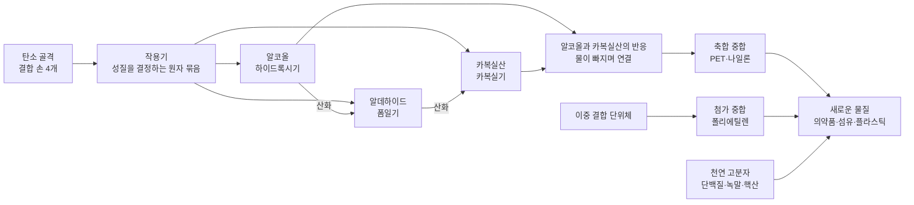

# 화학 반응의 세계 3. 탄소 화합물과 반응 — 작용기가 바꾸는 물질의 성질
<!-- prev: m2-04, 2-4, 2-5, 6-1, chem-2, rxn-2 -->
<!-- next: cell-2, gene-1 -->

> [!NOTE]
> **성취기준**
> - **[12반응03-01]** 일상생활에 유용한 탄소 화합물을 작용기에 따라 분류할 수 있다.
> - **[12반응03-02]** 간단한 탄소 화합물의 화학 반응 예를 찾아 작용기의 변화로 설명할 수 있다.
> - **[12반응03-03]** 단위체의 중합 반응으로 다양한 고분자가 합성되는 것을 이해하여 화학 반응의 유용성을 인식할 수 있다.
> - **[12반응03-04]** 탄소 화합물의 반응을 통해 합성된 새로운 물질이 과학·기술·사회 발전에 끼친 영향을 조사하여 화학의 유용성을 깨달을 수 있다.

**학습 목표**

1. 작용기의 뜻을 알고, 일상생활의 탄소 화합물을 알코올, 알데하이드, 카복실산으로 분류할 수 있다.
2. 작용기에 따라 끓는점, 물에 대한 용해성, 산성 등 성질이 달라지는 까닭을 분자 구조로 설명할 수 있다.
3. 알코올의 산화, 은거울 반응, 알코올과 카복실산의 반응 등 간단한 반응을 작용기의 변화로 설명할 수 있다.
4. 천연 고분자와 합성 고분자가 모두 단위체의 반복적 결합으로 만들어짐을 예를 들어 설명할 수 있다.
5. 의약품, 섬유, 플라스틱 등 탄소 화합물의 반응으로 만든 새로운 물질이 사회에 끼친 영향을 조사하고 그 편익과 문제점을 균형 있게 평가할 수 있다.

**이 단원의 학습 사다리**

| 단계 | 무엇을 하나? |
|---|---|
| STEP 1. 이전 학습 다시 보기 | 화학식, 공유 결합, 단위체, 전기 음성도와 극성, 산화수를 다시 꺼낸다 |
| STEP 2. 기초 다지기 | 탄소의 네 결합 손, 구조식 읽기, 탄화수소 이름, 수소 결합 |
| STEP 3. 핵심 개념 | 작용기로 분류하기 → 작용기의 변화로 반응 읽기 → 중합 반응과 고분자 → 새로운 물질과 사회 |
| STEP 4. 오개념 바로잡기 | "알코올은 OH가 있으니 염기성이다", "천연은 안전하고 합성은 위험하다" 같은 착각 |
| STEP 5. 대학 전공으로 | 더 많은 작용기, 반응 메커니즘, 입체화학, 고분자화학, 의약화학 |
| STEP 6. 생활·산업·진로 | 신약 개발, 향료·화장품, 플라스틱 순환, 바이오 소재 |

---

## 🗺️ 단원 들어가기

식초는 시큼하고, 소독용 알코올은 톡 쏘며 금방 날아가고, 계피는 달콤하고 매운 향이 난다. 세 물질의 주성분(아세트산, 에탄올, 계피알데하이드)은 모두 탄소·수소·산소로 이루어져 있다. 같은 원소로 된 물질의 냄새와 맛과 성질이 이렇게 다른 까닭은 무엇일까?

비밀은 분자 속 **작은 원자 묶음**에 있다. 에탄올의 $\mathrm{-CH_2OH}$를 $\mathrm{-CHO}$로 바꾸면 숙취를 일으키는 아세트알데하이드가 되고, 한 번 더 바꾸어 $\mathrm{-COOH}$로 만들면 식초의 아세트산이 된다. 우리 몸의 간에서는 술을 마실 때마다 바로 이 변화가 일어난다.

이 작은 묶음을 양 끝에 하나씩 가진 분자들을 수천 개 이어 붙이면 페트병과 나일론 옷이 되고, 자연은 같은 방법으로 단백질과 녹말과 DNA를 만든다. 이 단원에서는 **작용기**를 열쇠로 탄소 화합물을 분류하고, 작용기의 변화로 반응을 읽고, 그 반응으로 인류가 만들어 낸 새로운 물질을 탐구한다.

---

## STEP 1. 🔙 이전 학습 다시 보기

### 연계 개념표

| 이전 단원·성취기준 | 그때 배운 것 | 이 단원에서 확장되는 것 |
|---|---|---|
| 중2 「물질의 구성」 [9과11-01] | 원소와 화합물, 화학식으로 나타내기 | 분자식·시성식·구조식으로 탄소 화합물 나타내기 |
| 통합과학1 「이온 결합과 공유 결합」 [10통과1-02-04] | 물·산소 등 공유 결합 물질의 생성 | 탄소가 만드는 다양한 공유 결합 골격 |
| 통합과학1 「지각과 생명체 구성 물질의 규칙성」 [10통과1-02-05] | 단백질·핵산은 기본 단위체가 결합하여 만들어진다 | 단위체끼리 결합하는 **중합 반응**과 합성 고분자 |
| 통합과학2 「감염병과 과학의 유용성」 [10통과2-03-01] | 진단·백신·치료제 개발로 본 과학의 유용성 | 탄소 화합물의 반응으로 **의약품**을 설계·합성하는 화학 |
| 화학 「물질의 구조와 성질」 [12화학02-02]~[12화학02-04] | 전기 음성도와 극성, 루이스 구조, 분자 모양과 성질 | 작용기의 극성과 수소 결합으로 끓는점·용해성 설명 |
| 화학 반응의 세계 「산·염기 평형」 [12반응01-02] | 이온화 상수로 약산의 세기 비교 | 카복실산이 약산인 까닭 |
| 화학 반응의 세계 「산화·환원 반응」 [12반응02-01] | 산화수, 다이크로뮴산 이온과 에탄올의 반응 | 알코올 → 알데하이드 → 카복실산의 **산화** |

### 준비 운동 (사전 진단)

**Q1.** 탄소 원자는 최대 몇 개의 공유 결합을 할 수 있는가? 그 이유를 원자가 전자 수로 설명하시오.

**Q2.** 물($\mathrm{H_2O}$, 분자량 18)의 끓는점이 메테인($\mathrm{CH_4}$, 분자량 16)보다 훨씬 높은 까닭은?

**Q3.** 단백질을 이루는 기본 단위체는 무엇인가?

**Q4.** 메탄올($\mathrm{CH_3OH}$)에서 탄소의 산화수를 구하시오.

정답 및 해설

**Q1.** 4개. 탄소는 원자가 전자가 4개이므로 다른 원자와 전자쌍 4개를 공유하면 옥텟을 이룬다.

**Q2.** 물 분자 사이에는 강한 **수소 결합**이 있어 분자를 떼어 놓는 데 더 많은 에너지가 필요하다. 메테인은 무극성 분자이다.

**Q3.** 아미노산

**Q4.** −2. H 3개(+3)와 O(−2), OH의 H(+1)가 있으므로 C + 3 − 2 + 1 = 0 → C = −2.

---

## STEP 2. 🧱 기초 다지기

### 디딤돌 1. 탄소는 왜 '뼈대'가 될까?

탄소는 결합 손이 4개이고, 탄소끼리 단일·이중·삼중 결합으로 길게 이어지거나 가지를 치거나 고리를 만들 수 있다. 그래서 지금까지 알려진 화합물의 대부분이 탄소 화합물이다. 탄소와 수소만으로 된 화합물을 **탄화수소(hydrocarbon)** 라고 한다.

| 탄소 수 | 1 | 2 | 3 | 4 | 5 | 6 |
|---|---|---|---|---|---|---|
| 접두어(어간) | 메트(meth-) | 에트(eth-) | 프로프(prop-) | 뷰트(but-) | 펜트(pent-) | 헥스(hex-) |
| 탄화수소 | 메테인 $\mathrm{CH_4}$ | 에테인 $\mathrm{C_2H_6}$ | 프로페인 $\mathrm{C_3H_8}$ | 뷰테인 $\mathrm{C_4H_{10}}$ | 펜테인 $\mathrm{C_5H_{12}}$ | 헥세인 $\mathrm{C_6H_{14}}$ |

이 어간은 이 단원 내내 쓰인다. 예를 들어 탄소 2개짜리 알코올은 **에탄올**, 알데하이드는 **에탄알**(아세트알데하이드), 카복실산은 **에탄산**(아세트산)이다.

> [!TIP]
> 💡 **비유** — 탄소 골격은 '레고 기본판', 작용기는 그 위에 끼우는 '특수 블록'이다. 기본판이 같아도 바퀴 블록을 끼우면 자동차, 날개 블록을 끼우면 비행기가 된다. 분자의 '기능'은 주로 특수 블록이 정한다.

### 디딤돌 2. 탄소 화합물을 나타내는 여러 가지 방법

| 표현 | 에탄올 | 아세트산 | 특징 |
|---|---|---|---|
| 분자식 | $\mathrm{C_2H_6O}$ | $\mathrm{C_2H_4O_2}$ | 원자의 종류와 수만 보인다 |
| 시성식 | $\mathrm{C_2H_5OH}$ | $\mathrm{CH_3COOH}$ | **작용기를 따로 묶어** 성질을 짐작할 수 있다 |
| 구조식 | 모든 원자와 결합을 선으로 나타냄 | C=O 이중 결합까지 보임 | 결합 방식이 정확히 보인다 |

에탄올 $\mathrm{C_2H_6O}$와 다이메틸 에터 $\mathrm{CH_3OCH_3}$는 분자식이 같지만 성질이 전혀 다르다(에탄올의 끓는점 약 78 ℃, 다이메틸 에터 약 −24 ℃). 그래서 탄소 화합물은 분자식보다 **시성식이나 구조식**으로 나타내야 정체가 드러난다.

구조식을 글로 읽는 연습을 해 보자. 아세트산 $\mathrm{CH_3COOH}$는 "메틸기($\mathrm{CH_3-}$)의 탄소가 두 번째 탄소와 결합하고, 두 번째 탄소는 산소 하나와 **이중 결합**(C=O), 다른 산소 하나와 단일 결합하며, 그 산소에 수소가 붙어 있다"는 뜻이다.

### 디딤돌 3. 극성과 수소 결합 — 성질을 예측하는 도구

전기 음성도가 큰 산소가 수소와 결합한 $\mathrm{O-H}$는 극성이 매우 크다. $\mathrm{O-H}$를 가진 분자끼리는 한 분자의 H와 다른 분자의 O 사이에 **수소 결합(hydrogen bond)** 이 생긴다.

| 분자 사이의 힘 | 해당하는 분자 | 끓는점에 미치는 영향 |
|---|---|---|
| 분산력만 작용 | 탄화수소(무극성) | 낮다 |
| 쌍극자–쌍극자 힘 | C=O가 있지만 O–H는 없는 분자(알데하이드 등) | 중간 |
| 수소 결합 | O–H가 있는 분자(물, 알코올, 카복실산) | 높다 |

물에 대한 용해성도 같은 원리이다. 물과 수소 결합할 수 있는 작용기가 있으면 물에 잘 녹고, 무극성인 탄화수소 부분이 길어질수록 물에 덜 녹는다. "비슷한 것끼리 잘 섞인다."

---

## STEP 3. 📘 핵심 개념

### ① 작용기로 탄소 화합물 분류하기 [12반응03-01]

#### 작용기란?

탄소 화합물에서 특정한 성질을 나타내는 원자나 원자단을 **작용기(functional group)** 라고 한다. 탄소 골격이 조금 달라도 같은 작용기를 가진 화합물은 비슷한 성질을 나타내므로, 수많은 탄소 화합물을 작용기에 따라 '가족'으로 묶어 이해할 수 있다. 이 단원에서는 세 가족을 다룬다.

| 가족 | 작용기 | 작용기 이름 | 일반식 | 이름 붙이기 |
|---|---|---|---|---|
| **알코올(alcohol)** | $\mathrm{-OH}$ | 하이드록시기 | $\mathrm{R-OH}$ | 탄화수소 이름 + '-올' (에탄올) |
| **알데하이드(aldehyde)** | $\mathrm{-CHO}$ | 폼일기 | $\mathrm{R-CHO}$ | 탄화수소 이름 + '-알' (에탄알) |
| **카복실산(carboxylic acid)** | $\mathrm{-COOH}$ | 카복실기 | $\mathrm{R-COOH}$ | 탄화수소 이름 + '-산' (에탄산) |

(R은 탄소 골격 부분을 줄여 쓴 기호이다.) 폼일기는 탄소가 산소와 이중 결합하고 수소 하나와 결합한 $\mathrm{-C(=O)H}$, 카복실기는 탄소가 한 산소와 이중 결합하고 다른 산소에 수소가 붙은 $\mathrm{-C(=O)OH}$ 구조이다.

#### 생활 속 세 가족

| 분류 | 화합물 | 시성식 | 생활 속 쓰임·특징 |
|---|---|---|---|
| 알코올 | 메탄올 | $\mathrm{CH_3OH}$ | 연료·용매. 독성이 커서 마시면 실명할 수 있다 |
| 알코올 | 에탄올 | $\mathrm{C_2H_5OH}$ | 술의 성분, 손 소독제(약 70 % 수용액), 바이오 연료 |
| 알코올 | 글리세롤 | $\mathrm{C_3H_5(OH)_3}$ | $\mathrm{-OH}$가 3개. 화장품 보습제, 비누 제조의 부산물 |
| 알데하이드 | 폼알데하이드 | $\mathrm{HCHO}$ | 수용액(포르말린)은 생물 표본 보존제. 새 가구·건축 자재에서 나오는 실내 오염 물질 |
| 알데하이드 | 아세트알데하이드 | $\mathrm{CH_3CHO}$ | 몸속에서 에탄올이 분해될 때 생겨 숙취를 일으킨다 |
| 알데하이드 | 계피알데하이드 | (고리 구조 + $\mathrm{-CHO}$) | 계피 향의 주성분 |
| 카복실산 | 폼산(개미산) | $\mathrm{HCOOH}$ | 개미의 독 성분의 하나(개미에게 물린 곳이 따끔한 이유) |
| 카복실산 | 아세트산 | $\mathrm{CH_3COOH}$ | 식초의 성분(약 4~5 %) |
| 카복실산 | 시트르산 | ($\mathrm{-COOH}$ 3개) | 레몬·귤의 신맛, 식품 첨가물 |
| 카복실산 | 지방산 | 긴 탄소 사슬 + $\mathrm{-COOH}$ | 지방(기름)의 구성 성분, 비누의 원료 |

> [!NOTE]
> 한 분자에 작용기가 여러 개 있을 수도 있다. 요구르트와 김치의 신맛을 내는 **젖산** $\mathrm{CH_3CH(OH)COOH}$는 하이드록시기와 카복실기를 함께 가진다. 이런 분자는 두 가족의 성질을 모두 조금씩 나타낸다.

#### 작용기가 바뀌면 성질이 바뀐다 ① — 끓는점

분자량이 비슷한 탄소 화합물의 끓는점을 비교해 보자.

| 화합물 | 시성식 | 분자량 | 작용기 | 끓는점 (℃, 약) | 분자 사이의 주된 힘 |
|---|---|---|---|---|---|
| 프로페인 | $\mathrm{CH_3CH_2CH_3}$ | 44 | 없음 | −42 | 분산력 |
| 아세트알데하이드 | $\mathrm{CH_3CHO}$ | 44 | 폼일기 | 20 | 쌍극자–쌍극자 힘 |
| 에탄올 | $\mathrm{C_2H_5OH}$ | 46 | 하이드록시기 | 78 | 수소 결합 |
| 폼산 | $\mathrm{HCOOH}$ | 46 | 카복실기 | 101 | 수소 결합(두 분자가 쌍을 이룰 만큼 강하다) |

분자량이 44~46으로 거의 같은데도 끓는점은 140 ℃ 넘게 차이 난다. **작용기가 분자 사이의 힘을 바꾸고, 그 힘이 끓는점을 바꾼다.** 알데하이드는 C=O의 극성이 있지만 산소에 결합한 수소가 없어 자기들끼리 수소 결합을 하지 못하므로 알코올보다 끓는점이 낮다. 카복실산은 $\mathrm{C=O}$와 $\mathrm{O-H}$를 함께 가져 두 분자가 수소 결합 2개로 짝을 이루므로 끓는점이 특히 높다.

#### 작용기가 바뀌면 성질이 바뀐다 ② — 물에 녹는 정도

| 탄소 수 | 알코올 | 물에 녹는 정도 |
|---|---|---|
| 1~3 | 메탄올, 에탄올, 프로판올 | 물과 어떤 비율로도 섞인다 |
| 4 | 뷰탄올 | 조금 녹는다 |
| 6 이상 | 헥산올 등 | 거의 녹지 않는다 |

하이드록시기는 물과 수소 결합하여 '물과 친한' 부분이지만, 탄소 사슬은 '물과 친하지 않은' 부분이다. 사슬이 길어질수록 물과 친하지 않은 부분이 커져 물에 덜 녹는다. 이 원리는 ④의 비누에서 다시 쓰인다.

#### 작용기가 바뀌면 성질이 바뀐다 ③ — 산성

| 성질 | 알코올 (에탄올) | 카복실산 (아세트산) |
|---|---|---|
| 수용액의 액성 | 거의 중성 | 약한 산성 (0.1 M에서 pH 약 2.9) |
| $\mathrm{NaHCO_3}$와의 반응 | 반응하지 않는다 | $\mathrm{CO_2}$ 기체가 발생한다 |
| 금속 Na와의 반응 | 수소 기체 발생 | 수소 기체 발생 |
| 까닭 | $\mathrm{O-H}$의 양성자를 물에 거의 주지 않는다 | 양성자를 내준 뒤 남은 $\mathrm{-COO^-}$의 음전하가 두 산소에 퍼져 안정하므로 양성자를 비교적 잘 내준다 |

$$
\mathrm{CH_3COOH + H_2O \rightleftharpoons CH_3COO^- + H_3O^+} \qquad K_\mathrm{a} \approx 1.8\times10^{-5}
$$

카복실산이 약산이라는 것은 「산·염기 평형」에서 배운 이온화 상수로 나타난다. 같은 $\mathrm{-OH}$를 가졌는데도 옆에 C=O가 붙어 있느냐에 따라 산성이 크게 달라진다는 점이 바로 '작용기의 힘'이다.

#### 예제 1 — 작용기로 분류하기

다음 물질을 알코올, 알데하이드, 카복실산으로 분류하시오.
(가) $\mathrm{CH_3CH_2CH_2OH}$ (나) $\mathrm{HCOOH}$ (다) $\mathrm{CH_3CH_2CHO}$ (라) $\mathrm{HOCH_2CH_2OH}$ (마) $\mathrm{HOOC-COOH}$

**풀이**
- 알코올: (가) 프로판올, (라) 에틸렌 글리콜(하이드록시기 2개, 자동차 부동액·PET의 원료)
- 알데하이드: (다) 프로판알
- 카복실산: (나) 폼산, (마) 옥살산(카복실기 2개, 시금치 등에 들어 있다)

**주의** (라)와 (마)처럼 작용기가 **양 끝에 2개**씩 있는 분자는 ③에서 고분자의 단위체로 다시 등장한다.

#### 예제 2 — 성질 예측하기

에탄올, 아세트알데하이드, 아세트산 세 가지 무색 액체가 있다. 각각에 (1) 탄산수소 나트륨 수용액을 넣는 실험, (2) 끓는점 측정으로 구별하는 방법을 설명하시오.

**풀이**
(1) 거품($\mathrm{CO_2}$)이 생기는 것이 아세트산이다. 카복실산만 탄산수소 이온에 양성자를 줄 만큼 산성이 강하다.
(2) 끓는점은 아세트알데하이드(약 20 ℃) < 에탄올(약 78 ℃) < 아세트산(약 118 ℃) 순서이다. 수소 결합 유무와 세기의 차이 때문이다.

### ② 작용기의 변화로 반응 설명하기 [12반응03-02]

탄소 화합물의 반응은 대부분 탄소 골격은 그대로 두고 **작용기가 다른 작용기로 바뀌는** 과정이다. 반응 전후의 작용기를 비교하면 무슨 일이 일어났는지, 성질이 어떻게 달라졌는지 알 수 있다.

#### 반응 1. 알코올 → 알데하이드 → 카복실산 (산화)

$$
\underset{\text{에탄올 (알코올)}}{\mathrm{CH_3CH_2OH}} \xrightarrow{\text{산화}} \underset{\text{아세트알데하이드 (알데하이드)}}{\mathrm{CH_3CHO}} \xrightarrow{\text{산화}} \underset{\text{아세트산 (카복실산)}}{\mathrm{CH_3COOH}}
$$

| 단계 | 작용기의 변화 | 작용기 탄소의 산화수 | 무엇이 일어나나 |
|---|---|---|---|
| 에탄올 | $\mathrm{-CH_2OH}$ | −1 | |
| → 아세트알데하이드 | $\mathrm{-CH_2OH \rightarrow -CHO}$ | −1 → +1 | 수소 2개를 잃는다 |
| → 아세트산 | $\mathrm{-CHO \rightarrow -COOH}$ | +1 → +3 | 산소 1개를 얻는다 |

「산화·환원 반응」에서 배운 대로 탄소의 산화수가 증가하므로 **산화**이다. 이 산화에 쓰이는 대표적 산화제는 산성 다이크로뮴산 칼륨, 과망가니즈산 칼륨이고, 몸속에서는 **효소**가 그 역할을 한다.

| 산화가 일어나는 곳 | 산화제(또는 촉매) | 결과 |
|---|---|---|
| 초기 음주 측정기 | 산성 다이크로뮴산 칼륨 | 주황색 $\mathrm{Cr_2O_7^{2-}}$ → 초록색 $\mathrm{Cr^{3+}}$, 색 변화로 알코올 검출 |
| 사람의 간 | 알코올 분해 효소, 알데하이드 분해 효소 | 에탄올 → 아세트알데하이드(얼굴이 붉어지고 두통) → 아세트산 → 최종적으로 $\mathrm{CO_2}$와 물 |
| 막걸리·와인을 공기 중에 오래 둘 때 | 아세트산균과 공기 중 산소 | 시큼한 식초가 된다 |
| 가열한 구리선을 메탄올 증기에 넣을 때 | 산화 구리(II) | 검은 구리선이 다시 붉어지고 폼알데하이드의 자극적인 냄새가 난다 |

> [!IMPORTANT]
> **작용기가 바뀌면 성질도 바뀐다.** 에탄올(중성, 수소 결합, 끓는점 78 ℃) → 아세트알데하이드(중성, 수소 결합 없음, 끓는점 20 ℃, 독성) → 아세트산(산성, 강한 수소 결합, 끓는점 118 ℃, 신맛). 탄소 골격은 똑같은데 작용기 하나 때문에 '술'이 '독'이 되었다가 '식초'가 된다.

> [!TIP]
> 💡 **생활 연결** — 술을 마시면 얼굴이 쉽게 붉어지는 사람은 알데하이드 분해 효소의 활성이 낮아 아세트알데하이드가 오래 남는 경우가 많다. 이 사람에게 술은 같은 양이라도 더 해롭다. 같은 반응이 사람마다 다른 속도로 일어나는 것이다.

#### 반응 2. 은거울 반응 — 알데하이드를 찾아내는 반응

알데하이드는 쉽게 산화되는 성질이 있어 약한 산화제로도 카복실산으로 바뀐다. 암모니아성 질산 은 용액(톨렌스 시약)에 알데하이드를 넣고 따뜻하게 하면, 알데하이드는 산화되고 은 이온은 환원되어 시험관 안쪽에 은이 거울처럼 붙는다. 이것을 **은거울 반응(silver mirror reaction)** 이라고 한다.

| 물질 | 변화 | 역할 |
|---|---|---|
| 알데하이드 $\mathrm{R-CHO}$ | 카복실산(염기성 용액이라 $\mathrm{R-COO^-}$)으로 **산화** | 환원제 |
| 은 이온 $\mathrm{Ag^+}$ (암모니아와 결합한 상태) | 은 $\mathrm{Ag}$로 **환원** | 산화제 |

$$
\mathrm{RCHO + 2Ag(NH_3)_2^+ + 3OH^- \rightarrow RCOO^- + 2Ag + 4NH_3 + 2H_2O}
$$

알코올과 카복실산은 이 조건에서 은거울을 만들지 않으므로, 은거울 반응은 **폼일기가 있는지 확인하는 시험**으로 쓰인다. 포도당도 사슬 모양일 때 폼일기를 가지고 있어 은거울 반응을 한다. 예전에는 이 반응으로 실제 거울을 만들었다. 비슷하게 펠링 용액(푸른색 $\mathrm{Cu^{2+}}$)과 알데하이드를 함께 가열하면 붉은 산화 구리(I) 앙금이 생긴다.

#### 반응 3. 알코올과 카복실산이 만나면 — 물이 빠지며 연결

카복실산과 알코올을 진한 황산(촉매)과 함께 가열하면, 카복실기의 $\mathrm{-OH}$와 하이드록시기의 $\mathrm{H}$가 물로 빠져나가며 두 분자가 연결된다.

$$
\mathrm{CH_3COOH + HOCH_2CH_3 \rightleftharpoons CH_3COOCH_2CH_3 + H_2O}
$$

| 변화 | 반응 전 | 반응 후 |
|---|---|---|
| 작용기 | 카복실기 + 하이드록시기 | 두 작용기가 사라지고 $\mathrm{-COO-}$ 연결 고리가 생긴다 |
| 냄새 | 식초의 시큼한 냄새, 알코올 냄새 | 과일 같은 달콤한 향 |
| 산성 | 산성 | 거의 중성 |
| 물에 녹는 정도 | 둘 다 물에 잘 녹는다 | 물에 덜 녹는다 (수소 결합하는 $\mathrm{O-H}$가 사라짐) |

이 반응으로 생긴 물질을 **에스터(ester)** 라고 하며, 과일 향과 꽃향기의 상당수가 에스터이다. 바나나 향, 파인애플 향 같은 **인공 향료**도 알맞은 알코올과 카복실산을 골라 이 반응으로 만든다. 이처럼 **작은 분자(물)가 빠져나가며 두 분자가 연결되는 반응**을 **축합 반응(condensation reaction)** 이라 한다. 이 '연결 방법'이 ③의 고분자 합성에서 핵심 역할을 한다.

> [!NOTE]
> 이 과목에서 작용기는 알코올, 알데하이드, 카복실산만 다룬다. 에스터는 '알코올과 카복실산의 작용기가 반응하여 생긴 물질'이라는 수준으로 이해하고, 에스터 자체의 성질과 반응은 STEP 5와 대학 유기화학에서 다룬다.

#### 반응 4. 카복실산과 염기 — 중화

카복실산은 염기와 중화 반응하여 염과 물을 만든다.

$$
\mathrm{CH_3COOH + NaOH \rightarrow CH_3COONa + H_2O}
$$

카복실기($\mathrm{-COOH}$)가 카복실산 이온($\mathrm{-COO^-}$)으로 바뀌면 이온이 되어 물에 훨씬 잘 녹고 냄새가 거의 사라진다. 생선 비린내를 내는 염기성 물질에 식초나 레몬즙(카복실산)을 뿌리면 비린내가 줄어드는 것도 산·염기 반응으로 냄새 물질이 염으로 바뀌기 때문이다.

#### 작용기 변화 한눈에 보기

| 반응 | 반응 전 작용기 | 반응 후 작용기·결합 | 함께 쓰는 물질 | 생활 속 예 |
|---|---|---|---|---|
| 알코올의 산화 | $\mathrm{-OH}$ | $\mathrm{-CHO}$ → $\mathrm{-COOH}$ | 다이크로뮴산 칼륨, 효소 | 음주 측정, 숙취, 식초 만들기 |
| 은거울 반응 | $\mathrm{-CHO}$ | $\mathrm{-COO^-}$ (은 석출) | 암모니아성 질산 은 | 알데하이드 검출, 거울 |
| 알코올 + 카복실산 | $\mathrm{-OH}$, $\mathrm{-COOH}$ | $\mathrm{-COO-}$ 연결 + 물 | 진한 황산(촉매) | 인공 향, PET |
| 카복실산의 중화 | $\mathrm{-COOH}$ | $\mathrm{-COO^-}$ | 염기 | 비누, 비린내 제거 |

#### 예제 3 — 반응을 작용기로 해석하기

메탄올이 산화되어 폼알데하이드를 거쳐 폼산이 되었다. (1) 각 물질의 작용기와 (2) 탄소의 산화수 변화를 쓰고, (3) 은거울 반응을 하는 물질을 고르시오.

**풀이**
(1) 메탄올 $\mathrm{CH_3OH}$(하이드록시기) → 폼알데하이드 $\mathrm{HCHO}$(폼일기) → 폼산 $\mathrm{HCOOH}$(카복실기)
(2) 탄소의 산화수: −2 → 0 → +2 (모두 산화)
(3) 폼알데하이드. 흥미롭게도 폼산 $\mathrm{H-COOH}$도 탄소에 수소가 직접 붙어 있어 폼일기와 비슷한 부분이 있으므로 은거울 반응을 한다. 작용기를 정확히 들여다보면 예외처럼 보이는 현상도 설명할 수 있다.

### ③ 단위체와 중합 반응 — 고분자의 세계 [12반응03-03]

#### 단위체, 중합체, 중합 반응

분자량이 보통 1만 이상인 큰 분자를 **고분자(polymer)** 라 하고, 고분자를 이루는 작은 반복 단위 분자를 **단위체(monomer)** 라고 한다. 단위체가 수백~수만 개 반복적으로 결합하여 고분자가 되는 반응을 **중합 반응(polymerization)** 이라고 한다.

> [!TIP]
> 💡 **비유** — 단위체는 '구슬', 고분자는 '목걸이'이다. 구슬에 구멍이 **양쪽에** 뚫려 있어야 길게 꿸 수 있다. 분자도 결합할 수 있는 '구멍'(작용기 또는 이중 결합)이 양쪽에 있어야 사슬처럼 길게 이어진다. 구멍이 하나뿐인 구슬은 끝에만 붙고 사슬은 거기서 끝난다.

#### 첨가 중합 — 이중 결합이 열리며 연결

탄소–탄소 이중 결합을 가진 단위체는 이중 결합 중 하나가 끊어지며 옆 분자와 연결된다. 이때 빠져나가는 분자가 없다. 이것을 **첨가 중합(addition polymerization)** 이라고 한다.

$$
n\,\mathrm{CH_2{=}CH_2} \longrightarrow \mathrm{-\!\!\left[CH_2-CH_2\right]_{\!n}\!\!-}
$$

| 단위체 | 고분자 | 쓰임 |
|---|---|---|
| 에틸렌(에텐) $\mathrm{CH_2{=}CH_2}$ | 폴리에틸렌(PE) | 비닐봉지, 랩, 우유병 |
| 프로필렌(프로펜) $\mathrm{CH_2{=}CHCH_3}$ | 폴리프로필렌(PP) | 배달 용기, 마스크 필터, 자동차 범퍼 |
| 염화 비닐 $\mathrm{CH_2{=}CHCl}$ | 폴리염화 비닐(PVC) | 수도관, 전선 피복 |
| 스타이렌 | 폴리스타이렌(PS) | 일회용 컵, 스티로폼 |
| 아크릴산 $\mathrm{CH_2{=}CHCOOH}$ | 폴리아크릴산(나트륨) | 기저귀 속 고흡수성 수지 |

마지막 줄의 **고흡수성 수지**는 사슬에 카복실기가 촘촘히 달려 있다. 이 카복실기를 나트륨염($\mathrm{-COO^-Na^+}$)으로 바꾸어 두면 물이 들어올 때 이온과 물 사이의 강한 인력으로 자기 질량의 수백 배에 이르는 물을 붙잡는다. 작용기의 성질이 고분자 전체의 기능을 결정한 예이다.

#### 축합 중합 — 작용기가 반응하며 물이 빠진다

②의 반응 3에서 카복실산과 알코올은 물을 내놓으며 연결되었다. 만약 **양 끝에 카복실기가 2개** 있는 분자와 **양 끝에 하이드록시기가 2개** 있는 분자를 섞으면 어떻게 될까? 연결된 분자의 양 끝에 여전히 반응할 작용기가 남아 있으므로, 연결이 끝없이 이어져 긴 사슬이 된다. 이처럼 작은 분자가 빠져나가며 단위체가 연결되는 중합을 **축합 중합(condensation polymerization)** 이라고 한다.

| 고분자 | 단위체 ① | 단위체 ② | 빠지는 분자 | 쓰임 |
|---|---|---|---|---|
| 폴리에틸렌 테레프탈레이트(PET) | 테레프탈산 (카복실기 2개) | 에틸렌 글리콜 (하이드록시기 2개) | 물 | 생수병, 폴리에스터 섬유 |
| 나일론 66 | 아디프산 (카복실기 2개) | 헥사메틸렌다이아민 (아미노기 2개) | 물 | 스타킹, 등산복, 낚싯줄 |
| 폴리락트산(PLA) | 젖산 (하이드록시기 + 카복실기를 한 분자에) | — | 물 | 생분해성 컵·빨대, 녹는 수술 실 |

> [!NOTE]
> 나일론의 아미노기($\mathrm{-NH_2}$)는 이 과목에서 다루는 작용기가 아니다. "카복실기와 다른 작용기가 물을 내놓으며 반복해서 연결된다"는 점만 이해하면 충분하다.

#### 천연 고분자도 같은 원리로 만들어진다

| 천연 고분자 | 단위체 | 연결될 때 | 하는 일 |
|---|---|---|---|
| 녹말, 셀룰로스, 글리코젠 | 포도당 | 두 포도당의 하이드록시기에서 물이 빠지며 연결 | 에너지 저장(녹말·글리코젠), 식물 세포벽(셀룰로스) |
| 단백질 | 아미노산 (아미노기 + 카복실기) | 한 아미노산의 카복실기와 다음 아미노산의 아미노기에서 물이 빠지며 연결(펩타이드 결합) | 효소, 근육, 항체, 호르몬 |
| 핵산(DNA, RNA) | 뉴클레오타이드 | 당의 하이드록시기와 인산 사이에서 물이 빠지며 연결 | 유전 정보 저장과 전달 |
| 천연고무 | 아이소프렌 | 이중 결합이 열리며 연결(첨가 중합과 비슷) | 탄성 소재 |

통합과학1 「지각과 생명체 구성 물질의 규칙성」에서 "단백질과 핵산은 단위체가 결합하여 만들어진다"고 배웠다. 이제 그 '결합'의 정체가 대부분 **작용기 사이에서 물이 빠져나가는 축합**이라는 것을 알 수 있다. 우리 몸이 단백질을 음식으로 섭취하면 소화 효소가 거꾸로 물을 넣어 이 연결을 끊는다(가수 분해). 자연과 실험실의 고분자 합성은 같은 화학 원리를 따른다.

#### 예제 4 — 축합 중합에서 빠지는 물 분자 수

(1) 포도당 1000개가 한 줄로 연결되어 녹말 사슬 하나를 만들 때 빠져나가는 물 분자는 몇 개인가? (2) 단위체가 한쪽 끝에만 카복실기를 가진 아세트산이라면 왜 고분자를 만들 수 없는가?

**풀이**
(1) 연결 하나마다 물 1개가 빠진다. 1000개를 한 줄로 이으면 연결은 999개이므로 **물 999개**가 빠진다.
(2) 아세트산은 반응할 수 있는 작용기가 하나뿐이어서 한 번 연결되면 더 이을 '구멍'이 없다. 고분자를 만들려면 단위체가 작용기를 **2개 이상** 가져야 한다.

#### 고분자의 성질 — 구조가 쓰임을 정한다

| 구분 | 구조 | 성질 | 예 |
|---|---|---|---|
| 열가소성 고분자 | 사슬이 서로 얽혀 있을 뿐 사슬 사이 결합은 없다 | 가열하면 물러져 다시 성형할 수 있다 → 재활용 쉬움 | PE, PP, PET, 나일론 |
| 열경화성 고분자 | 사슬 사이가 공유 결합으로 그물처럼 연결되어 있다 | 가열해도 녹지 않고 단단하다 | 멜라민 수지 그릇, 전기 기판, 에폭시 접착제 |

나일론과 단백질 섬유(비단)가 질긴 것은 사슬 사이에 수소 결합이 많기 때문이고, PE가 물에 젖지 않는 것은 사슬에 극성 작용기가 없기 때문이다. 작은 분자에서 배운 '작용기 → 분자 사이 힘 → 성질'의 원리가 고분자에서도 그대로 통한다.

### ④ 새로운 탄소 화합물이 바꾼 세상 [12반응03-04]

#### 사례 조사 1. 의약품 — 버드나무 껍질에서 아스피린까지

| 시기 (약) | 일 | 화학의 역할 |
|---|---|---|
| 고대 | 버드나무 껍질을 진통·해열에 사용 | 경험적 이용 |
| 19세기 | 버드나무 성분에서 살리실산을 얻고 합성법 개발 | 유효 성분 분리와 합성 |
| 19세기 말 | 살리실산의 하이드록시기를 바꾸어 위 자극을 줄인 아세틸살리실산(아스피린) 합성 | **작용기를 바꾸어 부작용을 줄임** |
| 20세기 이후 | 혈전 예방 등 새로운 효능 발견, 대량 생산 | 세계적으로 널리 쓰이는 의약품 |

살리실산은 하이드록시기와 카복실기를 함께 가진 분자로, 진통 효과가 있지만 위를 심하게 자극했다. 하이드록시기를 아세트산과 비슷한 원리로 변화시키자 효과는 유지되면서 위 자극이 줄었다. **작용기 하나를 바꾸는 반응이 인류의 건강을 바꾼 대표적 사례**이다.

그 밖에도 페니실린(1928년 플레밍이 곰팡이에서 발견, 1940년대 대량 생산)은 세균 감염에 의한 사망을 크게 줄였고, 오늘날에는 천연 페니실린의 구조 일부를 화학 반응으로 바꾼 다양한 항생제가 쓰인다. 신약 개발은 보통 수많은 후보 물질을 합성·시험하고, 동물 실험과 여러 단계의 임상 시험을 거쳐 10년 이상 걸리는 경우가 많다.

#### 사례 조사 2. 합성 섬유와 플라스틱 — 편리함과 그림자

| 물질 | 영향 (편익) | 문제점과 대안 |
|---|---|---|
| 나일론(1930년대 개발) | 최초로 널리 쓰인 합성 섬유. 비단보다 질기고 값싸 의류·낙하산·로프에 쓰임 | 석유 원료 의존, 세탁 시 미세 섬유 배출 |
| 폴리에틸렌·폴리프로필렌 | 가볍고 값싸며 썩지 않아 포장·의료용품의 위생을 크게 높임 | 썩지 않는 성질 때문에 해양 쓰레기·미세플라스틱 문제 |
| PET | 투명하고 가벼운 음료병 | 분리배출과 재활용이 중요. 단위체로 되돌리는 화학적 재활용 연구 |
| 고흡수성 수지 | 기저귀·생리대의 위생 향상, 농업용 보습제 | 일회용 사용량 증가 |
| 고강도 아라미드 섬유 | 방탄복, 소방복, 광섬유 케이블 보강재 | 비싼 가격, 재활용의 어려움 |
| 생분해성 고분자(PLA 등) | 옥수수·사탕수수 녹말에서 얻은 젖산으로 만들어 미생물이 분해 가능 | 특정 조건(온도·습도)의 퇴비화 시설이 필요하고 일반 플라스틱보다 비쌈 |

> [!IMPORTANT]
> 플라스틱의 '썩지 않는 성질'은 처음에는 **장점**이었지만 시간이 지나 **환경 문제**가 되었다. 새로운 물질의 영향을 평가할 때는 편익과 위험을 함께 따지고, 원료–생산–사용–폐기까지 전 과정을 살펴보아야 한다. 화학은 문제를 만든 원인이기도 하지만, 생분해성 고분자와 화학적 재활용처럼 해결책을 만드는 도구이기도 하다.

#### 사례 조사 3. 비누와 합성 세제 — 카복실산 이온의 두 얼굴

비누는 지방(기름)을 수산화 나트륨으로 분해해 얻은 **긴 사슬 지방산의 나트륨염**($\mathrm{R-COO^-Na^+}$)이다. 한쪽 끝의 $\mathrm{-COO^-}$는 물과 친하고, 긴 탄소 사슬은 기름과 친하다. 그래서 기름때를 사슬 쪽으로 둘러싸 물에 씻겨 나가게 한다. ①에서 배운 '물과 친한 작용기 + 물과 친하지 않은 사슬'이라는 구조가 그대로 세척 기능이 된 것이다. 비누의 발명과 대량 생산은 위생을 개선하여 감염병을 줄이는 데에도 큰 역할을 했다.

#### 사례 조사 4. 향료와 식품 — 작은 작용기, 큰 산업

| 물질 | 작용기·반응 | 쓰임 |
|---|---|---|
| 바닐린 | 폼일기를 가진 분자, 화학적으로 합성 가능 | 아이스크림·과자의 바닐라 향 |
| 계피알데하이드 | 폼일기 | 계피 향 식품·향료 |
| 과일 향 에스터 | 알코올 + 카복실산의 반응 | 음료·사탕의 인공 향 |
| 시트르산 | 카복실기 3개 | 음료의 신맛, 식품 보존 |

#### 조사 결과를 평가하는 기준

| 평가 관점 | 질문 |
|---|---|
| 과학적 원리 | 어떤 작용기가 어떻게 바뀌는 반응으로 만들었는가? |
| 사회적 편익 | 건강·생활·산업에 어떤 도움을 주었는가? |
| 위험과 부작용 | 사람·환경에 어떤 피해를 줄 수 있는가? 어떻게 확인했는가? |
| 지속가능성 | 원료는 재생 가능한가? 폐기·재활용은 쉬운가? |
| 대안 | 더 나은 물질이나 공정이 개발되고 있는가? |

---

## STEP 4. ⚠️ 오개념 바로잡기

| 흔한 오개념 | 올바른 개념 | 왜 그럴까? |
|---|---|---|
| 알코올은 $\mathrm{-OH}$가 있으므로 염기성이다 | 알코올 수용액은 거의 **중성**이다 | 알코올의 $\mathrm{-OH}$는 탄소와 공유 결합한 하이드록시기로, $\mathrm{OH^-}$ 이온을 내놓지 않는다 |
| 카복실산의 $\mathrm{-OH}$는 알코올의 $\mathrm{-OH}$와 성질이 같다 | 옆의 C=O 때문에 카복실산은 양성자를 훨씬 잘 내놓는 **약산**이다 | 양성자를 내놓은 뒤의 음전하가 두 산소에 퍼져 안정하다 |
| 분자량이 비슷하면 끓는점도 비슷하다 | 작용기에 따라 분자 사이 힘이 달라 끓는점이 크게 다르다 | 프로페인(−42 ℃)과 에탄올(78 ℃)은 분자량이 거의 같다 |
| 고분자는 모두 사람이 만든 합성 물질이다 | 단백질, 녹말, 셀룰로스, DNA도 **천연 고분자**이다 | 천연·합성 모두 단위체의 반복적 결합으로 만들어진다 |
| 단위체가 연결되기만 하면 무엇이든 고분자가 된다 | 단위체는 결합할 수 있는 자리(작용기, 이중 결합)가 **2개 이상** 있어야 한다 | 결합 자리가 하나면 한 번 연결된 뒤 사슬이 끝난다 |
| 천연 물질은 안전하고 합성 물질은 위험하다 | 안전성은 '천연·합성'이 아니라 **물질의 구조와 양**으로 결정된다 | 천연 물질도 독성이 강한 것이 있고(복어 독 등), 합성 의약품은 엄격한 시험을 거친다 |
| 생분해성 플라스틱은 아무 데나 버려도 금방 사라진다 | 대부분 알맞은 온도·습도·미생물 조건에서만 빠르게 분해된다 | 분해 조건을 갖춘 시설에서 처리해야 효과가 있다 |

---

## STEP 5. 🎓 다음 단계로 한 걸음 더

> [!CAUTION]
> 이 절은 **'화학 반응의 세계' 교육과정 범위 밖의 심화 내용**으로 평가 대상이 아니다. 성취기준 해설에 따라 이 과목은 작용기를 알코올, 알데하이드, 카복실산으로 한정하므로, 그 밖의 작용기와 반응 메커니즘은 대학 과목을 미리 보여 주기 위한 맛보기이다.

### 대학 전공 과목과의 연결

| 대학 과목 | 이어지는 내용 |
|---|---|
| 유기화학 | 케톤, 에터, 에스터, 아민, 아마이드 등 다양한 작용기, 반응 메커니즘, 입체화학, 분광학적 구조 분석 |
| 고분자화학·고분자공학 | 중합 반응의 속도와 분자량 분포, 고분자의 열적·기계적 성질 |
| 의약화학·약학 | 구조–활성 관계, 약물의 흡수·대사, 신약 설계 |
| 생화학 | 효소가 작용기를 바꾸는 반응, 단백질·핵산·탄수화물의 구조 |
| 화학공학 | 석유화학·바이오 공정, 촉매 반응기 설계, 플라스틱 재활용 공정 |

### ① 더 많은 작용기 가족

| 작용기 | 이름 | 예 | 특징 |
|---|---|---|---|
| $\mathrm{C=O}$ (탄소 사이) | 케톤 | 아세톤(매니큐어 제거제) | 알데하이드와 비슷하지만 쉽게 산화되지 않는다 |
| $\mathrm{-O-}$ | 에터 | 다이에틸 에터(과거 마취제) | 수소 결합을 하지 않아 끓는점이 낮다 |
| $\mathrm{-COO-}$ | 에스터 | 아세트산 에틸, 지방 | 과일 향, 지방은 글리세롤과 지방산의 에스터 |
| $\mathrm{-NH_2}$ | 아민 | 생선 비린내 성분, 아미노산 | 약한 염기 |
| $\mathrm{-CONH-}$ | 아마이드 | 나일론, 단백질의 펩타이드 결합 | 매우 안정한 연결 |

### ② 반응 메커니즘 — 전자쌍의 움직임으로 반응 읽기

대학 유기화학에서는 "반응물이 생성물로 바뀐다"를 넘어, **전자쌍이 어디서 어디로 이동하는지**를 굽은 화살표로 그려 반응을 설명한다. 예를 들어 카복실산과 알코올의 반응에서는 알코올 산소의 비공유 전자쌍이 카복실기 탄소를 공격하는 단계부터 차례로 분석한다. 「산·염기 평형」 STEP 5의 루이스 산·염기(전자쌍 주개와 받개) 개념이 여기서 핵심 도구가 된다.

### ③ 입체화학 — 거울상 분자

젖산처럼 탄소 하나에 서로 다른 네 원자단이 붙어 있으면, 오른손과 왼손처럼 서로 겹쳐지지 않는 **거울상 이성질체**가 생긴다. 두 분자는 끓는점 같은 성질은 같지만 몸속 효소·수용체와는 다르게 작용할 수 있다. 1950~60년대 일부 국가에서 판매된 진정제 탈리도마이드가 심각한 선천성 기형을 일으킨 사건 이후, 의약품의 거울상 이성질체를 구분하여 시험하는 것이 중요해졌다.

### ④ 현대 합성화학의 도구

생체 안에서도 방해 없이 원하는 두 분자를 정확하게 이어 붙이는 '클릭 화학'과 '생체 직교 화학'은 2022년 노벨 화학상의 주제였다. 신약 후보 물질에 형광 표지를 붙이거나 항체에 약물을 연결하는 기술로 이어지고 있다. 또 컴퓨터 시뮬레이션과 인공지능으로 단백질 구조를 예측하고 약물이 결합할 자리를 찾는 연구가 활발하다.

### 지금 vs 다음 단계

| 구분 | 화학 반응의 세계 (고등학교) | 대학 유기화학·고분자화학 |
|---|---|---|
| 작용기 | 알코올, 알데하이드, 카복실산 | 약 10여 가지 주요 작용기와 그 반응 |
| 반응의 설명 | 작용기의 변화, 산화수 변화 | 전자쌍 이동(메커니즘), 반응 속도와 에너지 도표 |
| 구조 | 시성식·구조식 | 3차원 입체 구조, 거울상 이성질체, 분광법(NMR·IR)으로 구조 결정 |
| 고분자 | 첨가·축합 중합으로 단위체가 반복 결합 | 분자량 분포, 공중합, 고분자 물성 설계 |
| 사회와의 연결 | 사례 조사와 편익·위험 평가 | 친환경 공정(그린 케미스트리), 신약·신소재 연구 개발 |

---

## STEP 6. 🏭 생활·산업·진로 연결

### 사례 1. 신약 개발 — 작용기를 설계하는 일

- **원리** 작용기가 바뀌면 성질이 바뀐다(STEP 3 ①, ④).
- **어디에 쓰이나** 의약화학자는 효과가 있는 '선도 물질'을 찾은 뒤, 작용기를 하나씩 바꾸어 효과는 높이고 부작용은 줄인 수많은 유사 물질을 합성한다. 물에 잘 녹게 하려면 극성 작용기를, 세포막을 잘 통과하게 하려면 탄소 사슬 부분을 조절한다. 우리나라도 바이오의약품과 합성 신약 개발에 활발히 투자하고 있다.

### 사례 2. 플라스틱 순환 — 고분자를 다시 단위체로

- **원리** 축합 중합의 역반응(STEP 3 ③).
- **어디에 쓰이나** PET는 물이나 알코올로 연결 고리를 끊어 다시 단위체로 되돌릴 수 있다. 이렇게 얻은 단위체로 새 PET를 만드는 **화학적 재활용**은 녹여서 다시 모양을 만드는 물리적 재활용보다 품질이 좋은 플라스틱을 얻을 수 있어 연구와 투자가 늘고 있다.

### 사례 3. 향료·화장품·식품 산업

- **원리** 작용기에 따른 냄새·용해성(STEP 3 ①, ②).
- **어디에 쓰이나** 조향사와 향료 화학자는 알데하이드·알코올·에스터 등 작용기가 다른 물질을 조합해 향을 만든다. 화장품의 보습 성분인 글리세롤은 하이드록시기 3개로 물을 붙잡는다. 식품 공학에서는 시트르산·젖산 같은 카복실산으로 맛과 보존성을 조절한다.

### 사례 4. 음주 측정과 화학 센서

- **원리** 에탄올의 산화(STEP 3 ②)와 산화·환원 전지(「산화·환원 반응」).
- **어디에 쓰이나** 초기에는 다이크로뮴산 칼륨의 색 변화를 이용했지만, 오늘날 많이 쓰이는 측정기는 날숨 속 에탄올을 전극에서 **산화**시켜 생기는 전류를 재는 연료 전지형 센서이다. 에탄올이 많을수록 전류가 커진다. 한 반응이 화학과 전기를 잇는 센서가 된 예이다.

### 관련 진로와 학과

| 진로 | 하는 일 | 관련 학과 |
|---|---|---|
| 의약화학자·신약 연구원 | 후보 물질 설계·합성, 구조–활성 관계 연구 | 화학과, 약학과, 제약공학과 |
| 고분자 소재 연구원 | 플라스틱·섬유·접착제·전지용 고분자 개발 | 고분자공학과, 화학공학과, 신소재공학과 |
| 화학 공정 엔지니어 | 석유화학·바이오화학 공장의 공정 설계와 운영 | 화학공학과, 생명공학과 |
| 조향사·화장품 연구원 | 향료 조합, 화장품 성분 설계 | 화학과, 화장품공학과 |
| 식품 연구원 | 맛·향·보존성 설계, 식품 첨가물 안전성 평가 | 식품공학과, 식품영양학과 |
| 환경 화학 연구원 | 미세플라스틱 분석, 생분해성 소재 평가 | 환경공학과, 화학과 |

---

## 🔬 탐구 활동

### 활동 A. 알코올·알데하이드·카복실산을 화학식으로 표현하고 성질 탐구하기

**목표** 탄소 수가 같은 세 가족 분자를 모형과 화학식으로 나타내고, 실험으로 작용기에 따른 성질 차이를 확인한다.

**준비물** 분자 모형 세트(또는 분자 모델링 소프트웨어), 에탄올(소독용), 식초(또는 묽은 아세트산 수용액), 증류수, 탄산수소 나트륨, 만능 지시약 또는 pH 시험지, 시험관, 스포이트

**과정**
1. 분자 모형으로 에탄올, 아세트알데하이드, 아세트산을 만들고 각각 분자식, 시성식, 구조식을 쓴다. 세 분자에서 바뀐 부분에 색을 칠한다.
2. 소프트웨어를 쓸 수 있으면 세 분자의 3차원 구조와 전하 분포(극성)를 비교한다.
3. 에탄올과 식초를 각각 시험관에 조금씩 담아 pH 시험지로 액성을 확인한다.
4. 두 시험관에 탄산수소 나트륨을 조금씩 넣고 변화를 관찰한다.
5. 교과서나 자료집에서 세 물질의 끓는점, 물에 대한 용해성을 찾아 표에 정리한다.

**결과 기록**

| 물질 | 작용기 | pH (액성) | $\mathrm{NaHCO_3}$ 반응 | 끓는점 (자료, ℃) | 수소 결합 가능 여부 |
|---|---|---|---|---|---|
| 에탄올 | | | | | |
| 아세트알데하이드 | | (실험하지 않음) | (실험하지 않음) | | |
| 아세트산(식초) | | | | | |

**생각해 보기**
1. 세 분자의 탄소 골격은 같은데 성질이 다른 까닭을 작용기로 설명해 보자.
2. 아세트알데하이드는 왜 학교에서 직접 다루지 않을까? (끓는점과 독성을 생각해 보자.)

### 활동 B. 은거울 반응으로 폼일기 확인하기 (교사 시범 또는 교사 지도 아래)

**목표** 알데하이드가 산화되고 은 이온이 환원되는 은거울 반응으로 작용기의 변화를 확인한다.

**준비물** 0.1 M 질산 은 수용액, 묽은 암모니아수, 묽은 수산화 나트륨 수용액, 포도당 수용액(사슬 구조일 때 폼일기를 가짐), 에탄올(비교용), 깨끗이 씻은 시험관, 50~60 ℃ 물중탕

**과정**
1. 시험관에 질산 은 수용액 2 mL를 넣고 수산화 나트륨 수용액을 한두 방울 넣어 갈색 앙금을 만든다.
2. 묽은 암모니아수를 한 방울씩 넣으며 흔들어 앙금이 막 녹을 때 멈춘다(톨렌스 시약).
3. 시약을 두 시험관에 나누어 하나에는 포도당 수용액, 다른 하나에는 에탄올을 넣고 물중탕에서 몇 분 동안 데운다.
4. 시험관 안쪽 벽의 변화를 관찰한다.

**결과 기록**

| 시험관 | 넣은 물질 | 관찰 결과 | 해석 (산화된 것 / 환원된 것) |
|---|---|---|---|
| 1 | 포도당 | | |
| 2 | 에탄올 | | |

**생각해 보기**
1. 은 이온은 산화제인가, 환원제인가? 「산화·환원 반응」의 용어로 설명해 보자.
2. 에탄올 시험관에서 은거울이 생기지 않은 까닭은?
3. 음주 측정기(다이크로뮴산 이온의 색 변화)와 은거울 반응의 공통점을 산화수로 설명해 보자.

### 활동 C. (조사·제작) 탄소 화합물의 반응으로 만드는 새로운 물질

모둠별로 의약품(아스피린), 인공 향(과일 향 에스터), 고분자(나일론 줄 뽑기, PLA, 고흡수성 수지) 중 하나를 골라 ① 단위체와 반응 전후의 작용기, ② 사회에 끼친 편익과 문제점, ③ 실험실에서 만들 때의 안전 조치를 조사해 발표한다. 직접 합성 실험은 반드시 교사의 시범이나 지도 아래 후드에서 한다.

> [!WARNING]
> **안전 수칙** 보안경, 실험복, 실험용 장갑을 착용한다. 에탄올은 불이 잘 붙으므로 불꽃 근처에서 다루지 않는다. 질산 은은 피부에 닿으면 검은 얼룩이 생기므로 주의한다. **톨렌스 시약은 오래 두면 폭발성 물질이 생길 수 있으므로 실험 직전에 만들고, 실험이 끝나면 즉시 묽은 질산 등으로 처리하여 지정된 폐액 용기에 버린다.** 다이크로뮴산 칼륨(크로뮴 화합물)과 진한 황산은 독성·부식성이 강하므로 학생이 직접 다루지 않는다. 냄새는 손으로 부채질하여 맡는다. 남은 물질은 화학 실험실 폐수 및 폐기물 처리 기준에 따라 처리한다.

---

## ✅ 개념 확인 문제

### 기본

**1.** 다음 화합물을 작용기에 따라 분류하시오.
(가) $\mathrm{CH_3OH}$ (나) $\mathrm{CH_3CH_2COOH}$ (다) $\mathrm{HCHO}$ (라) $\mathrm{C_3H_5(OH)_3}$

정답 및 해설

**정답** 알코올: (가) 메탄올, (라) 글리세롤 / 알데하이드: (다) 폼알데하이드 / 카복실산: (나) 프로판산

(라)는 하이드록시기가 3개인 알코올이다. 작용기 개수가 달라도 하이드록시기를 가지면 알코올 가족이다.

**2.** 에탄올, 아세트알데하이드, 아세트산 중 (1) 수용액이 산성인 것, (2) 끓는점이 가장 낮은 것을 고르고 이유를 쓰시오.

정답 및 해설

**정답** (1) 아세트산 (2) 아세트알데하이드

(1) 카복실기가 양성자를 내놓아 약산성을 띤다. (2) 아세트알데하이드는 산소에 결합한 수소가 없어 분자끼리 수소 결합을 하지 못하므로 끓는점이 가장 낮다(약 20 ℃).

**3.** 에탄올이 아세트알데하이드를 거쳐 아세트산이 되는 반응에서 작용기 탄소의 산화수 변화를 쓰고, 이 반응이 산화인지 환원인지 판단하시오.

정답 및 해설

**정답** −1 → +1 → +3, 산화

산화수가 증가하므로 산화이다. 에탄올은 수소 2개를 잃고, 아세트알데하이드는 산소 1개를 얻는다.

**4.** 다음 중 천연 고분자가 **아닌** 것은?
① 녹말 ② 셀룰로스 ③ 단백질 ④ 폴리에틸렌 ⑤ DNA

정답 및 해설

**정답 ④**

폴리에틸렌은 에틸렌을 첨가 중합하여 만든 합성 고분자이다. 나머지는 생물이 만드는 천연 고분자이며, 모두 단위체(포도당, 아미노산, 뉴클레오타이드)의 반복적 결합으로 이루어진다.

**5.** 첨가 중합과 축합 중합을 비교한 설명으로 옳은 것을 **모두** 고르시오.
ㄱ. 첨가 중합의 단위체에는 보통 탄소–탄소 이중 결합이 있다.
ㄴ. 축합 중합에서는 단위체가 연결될 때 물과 같은 작은 분자가 빠져나간다.
ㄷ. PET는 첨가 중합으로 만들어진다.

정답 및 해설

**정답 ㄱ, ㄴ**

ㄷ. PET는 테레프탈산(카복실기 2개)과 에틸렌 글리콜(하이드록시기 2개)이 물을 내놓으며 연결되는 축합 중합으로 만들어진다.

### 응용

**6.** 분자식이 $\mathrm{C_2H_4O_2}$인 무색 액체 X가 있다. X는 탄산수소 나트륨 수용액과 반응하여 기체를 내고, 에탄올과 진한 황산을 넣고 가열하면 과일 향이 나는 물질이 생긴다. (1) X의 시성식과 작용기를 쓰고, (2) 탄산수소 나트륨과의 반응에서 발생한 기체를 쓰시오.

정답 및 해설

**정답** (1) $\mathrm{CH_3COOH}$, 카복실기 (2) 이산화 탄소

$\mathrm{NaHCO_3}$와 반응해 $\mathrm{CO_2}$를 내는 것은 카복실산의 특징이다. 에탄올과 반응해 과일 향 물질(아세트산 에틸, 에스터)을 만드는 것도 카복실기와 하이드록시기의 반응이다.

**7.** 시험관 A, B, C에 각각 메탄올, 폼알데하이드 수용액, 아세트산 수용액 중 하나가 들어 있다. 다음 결과로 A~C를 판별하시오.
- A만 톨렌스 시약과 은거울 반응을 하였다.
- B는 푸른색 리트머스 종이를 붉게 하였다.
- C는 가열한 산화 구리(II)와 반응하여 A의 물질이 되었다.

정답 및 해설

**정답** A: 폼알데하이드, B: 아세트산, C: 메탄올

은거울 반응은 폼일기가 있는 A(폼알데하이드)의 특징이다. 산성을 나타내는 B는 카복실산(아세트산)이다. C(메탄올)는 산화 구리(II)에 의해 산화되어 폼알데하이드(A)가 된다. 이때 산화 구리(II)는 환원되어 붉은 구리가 된다.

**8.** 젖산 $\mathrm{CH_3CH(OH)COOH}$ 500개가 한 줄로 축합 중합하여 폴리락트산(PLA) 사슬 하나를 만들었다. (1) 젖산이 혼자서 고분자를 만들 수 있는 까닭을 작용기로 설명하고, (2) 이때 빠져나간 물 분자 수를 구하시오.

정답 및 해설

**정답** (1) 한 분자 안에 하이드록시기와 카복실기가 함께 있어, 한 분자의 카복실기와 이웃 분자의 하이드록시기가 반응하며 양쪽으로 계속 이어질 수 있다. (2) 499개

500개를 한 줄로 이으면 연결 고리가 499개이고, 고리 하나마다 물 1개가 빠진다.

### 융합·서술형

**9. [생명과학 연계]** 술을 마셨을 때 몸속에서 에탄올이 분해되는 과정을 작용기의 변화로 설명하고, '얼굴이 쉽게 붉어지는 사람'에게 음주가 더 위험할 수 있는 까닭을 서술하시오.

정답 및 해설

**예시 답안**
간에서 에탄올(하이드록시기)은 효소에 의해 산화되어 아세트알데하이드(폼일기)가 되고, 아세트알데하이드는 다른 효소에 의해 다시 산화되어 아세트산(카복실기)이 된다. 아세트산은 결국 이산화 탄소와 물로 분해된다. 중간 물질인 아세트알데하이드는 독성이 있어 얼굴이 붉어지고 두통·구역질을 일으킨다. 얼굴이 쉽게 붉어지는 사람은 아세트알데하이드를 아세트산으로 바꾸는 효소의 활성이 낮은 경우가 많아, 독성 물질이 몸에 더 오래 남으므로 같은 양을 마셔도 더 해롭다.

**채점 포인트** ① 알코올 → 알데하이드 → 카복실산의 작용기 변화 ② 산화 반응과 효소의 역할 ③ 중간 물질의 독성과 효소 활성의 개인차

**10. [과학·기술·사회]** "플라스틱은 썩지 않아 환경을 오염시키므로 모든 플라스틱을 생분해성 고분자로 바꾸어야 한다."는 주장에 대하여 (1) 플라스틱이 사회에 끼친 편익, (2) 생분해성 고분자의 장점과 한계를 근거로 들어 자신의 의견을 서술하시오.

정답 및 해설

**예시 답안**
(1) 플라스틱은 가볍고 값싸며 썩지 않아 식품 포장의 위생, 일회용 의료 기구, 자동차 경량화 등에 크게 기여했다. 썩지 않는 성질은 오랫동안 쓰는 제품(수도관, 전선 피복)에는 오히려 필요한 성질이다.
(2) 젖산으로 만든 PLA 같은 생분해성 고분자는 미생물이 분해할 수 있고 식물 원료로 만들 수 있다는 장점이 있다. 그러나 대부분 알맞은 온도·습도의 퇴비화 시설에서만 빠르게 분해되고, 가격이 비싸며, 일반 플라스틱과 섞이면 재활용을 방해할 수 있다.
따라서 '모든' 플라스틱을 바꾸기보다 쓰임에 따라 오래 쓸 제품은 재활용하기 쉬운 플라스틱으로, 짧게 쓰고 회수가 어려운 제품은 생분해성 고분자로 선택하며, 화학적 재활용과 분리배출을 함께 강화하는 것이 바람직하다.

**채점 포인트** ① 플라스틱의 구체적 편익 ② 생분해성 고분자의 장점과 한계(분해 조건, 가격, 재활용) ③ 근거에 기반한 균형 잡힌 결론

---

## 📝 한눈에 정리

### 핵심 요약

- **작용기**는 탄소 화합물의 성질을 결정하는 원자(단)이다. 이 단원에서는 **알코올**($\mathrm{-OH}$, 하이드록시기), **알데하이드**($\mathrm{-CHO}$, 폼일기), **카복실산**($\mathrm{-COOH}$, 카복실기)을 다룬다.
- 작용기가 바뀌면 분자 사이 힘이 달라져 **끓는점·용해성**이 바뀐다. $\mathrm{O-H}$가 있으면 수소 결합을 한다.
- 알코올은 거의 중성, 카복실산은 **약산**이다. 카복실산만 $\mathrm{NaHCO_3}$와 반응하여 $\mathrm{CO_2}$를 낸다.
- **알코올 → 알데하이드 → 카복실산**은 탄소의 산화수가 증가하는 **산화**이다(음주 측정기, 간의 알코올 분해, 식초).
- **은거울 반응**은 알데하이드가 산화되고 은 이온이 환원되는 반응으로, 폼일기를 확인하는 데 쓴다.
- 알코올과 카복실산은 **물이 빠지며 연결**된다(축합). 이 반응으로 인공 향을 만든다.
- **고분자**는 단위체의 반복적 결합으로 만들어진다. 이중 결합이 열리는 **첨가 중합**(PE, PP), 작은 분자가 빠지는 **축합 중합**(PET, 나일론, PLA)이 있다.
- 단백질·녹말·핵산 같은 **천연 고분자**도 같은 원리로 만들어진다.
- 아스피린, 나일론, 플라스틱, 비누 등 새로운 탄소 화합물은 사회를 크게 바꾸었으며, 편익과 위험을 함께 평가해야 한다.

### 핵심 용어

| 용어 | 뜻 |
|---|---|
| 작용기 | 탄소 화합물에서 특정한 성질을 나타내는 원자나 원자단 |
| 알코올 | 하이드록시기($\mathrm{-OH}$)를 가진 탄소 화합물 |
| 알데하이드 | 폼일기($\mathrm{-CHO}$)를 가진 탄소 화합물 |
| 카복실산 | 카복실기($\mathrm{-COOH}$)를 가진 탄소 화합물. 약산이다 |
| 시성식 | 작용기를 따로 묶어 나타낸 화학식 |
| 수소 결합 | O–H의 H와 다른 분자의 O 사이에 작용하는 강한 분자 간 인력 |
| 은거울 반응 | 알데하이드가 산화되며 은 이온을 환원시켜 은을 석출하는 반응 |
| 축합 반응 | 물과 같은 작은 분자가 빠져나가며 두 분자가 연결되는 반응 |
| 단위체 | 고분자를 이루는 작은 반복 단위 분자 |
| 고분자 | 단위체가 수많이 반복 결합한 분자량이 매우 큰 분자 |
| 첨가 중합 | 이중 결합이 열리며 빠지는 분자 없이 단위체가 연결되는 중합 |
| 축합 중합 | 작은 분자가 빠져나가며 단위체가 연결되는 중합 |

### 다음 단원으로

「화학 반응의 세계」에서는 양성자(산·염기), 전자(산화·환원), 작용기(탄소 화합물)를 주고받거나 바꾸는 반응을 차례로 탐구했다. 이 세 가지는 따로 있는 것이 아니다. 카복실산은 양성자를 내놓는 약산이고, 알코올의 산화는 전자의 이동이며, 세포 속에서 이 모든 반응은 **효소**라는 단백질 고분자가 조절한다. 「세포와 물질대사」에서는 효소가 탄소 화합물의 작용기를 바꾸며 생명을 유지하는 과정을, 「생물의 유전」에서는 뉴클레오타이드가 이어진 고분자 DNA가 정보를 담는 방식을 만나게 된다. 대학에서는 유기화학, 고분자화학, 의약화학, 생화학으로 이 길이 이어진다.
