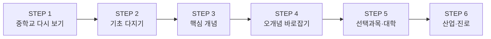

# 교재 설계 안내

이 문서는 교재가 **왜 이런 순서로 구성되었는지**, 그리고 **학생과 교사가 어떻게 활용하면 좋은지**를 설명한다.

---

## 1. 설계 목표

| 목표 | 교재에서 구현한 방법 |
|---|---|
| 개념을 **정확하게** 이해한다 | 모든 단원을 교육부 고시 성취기준 원문에서 출발하고, '성취기준 해설'의 범위(다루는 것·다루지 않는 것)를 지킨다 |
| 이해의 **빈틈을 메운다** | 중학교에서 배운 개념을 먼저 다시 보고(STEP 1), 필요한 기초 개념을 디딤돌로 놓은 뒤(STEP 2) 핵심 개념으로 들어간다 |
| 개념을 **다른 분야에 적용**한다 | 고2·3 선택과목과 대학 전공 과목으로 이어지는 길(STEP 5), 실제 산업 현장 사례와 진로(STEP 6)를 함께 보여 준다 |

---

## 2. 6단계 학습 사다리

모든 단원은 같은 순서로 구성된다. 아래 단계를 차례로 오르면 **중학교 → 고등학교 → 대학 → 산업**으로 자연스럽게 이어진다.

| 단계 | 목적 | 구성 |
|---|---|---|
| 🗺️ 단원 들어가기 | 호기심 불러일으키기 | 생활 속 질문, 단원 개념 지도 |
| STEP 1. 🔙 중학교 다시 보기 | 이미 아는 것과 연결하기 | 중학교 성취기준 연계표, 사전 진단 문제 |
| STEP 2. 🧱 기초 다지기 | 이해에 필요한 디딤돌 놓기 | 기초 개념, 수학 도구, 비유 |
| STEP 3. 📘 핵심 개념 | 성취기준의 핵심 이해하기 | 개념 설명, 표·그림, 풀이가 있는 예제 |
| STEP 4. ⚠️ 오개념 바로잡기 | 흔한 착각 고치기 | 오개념 – 올바른 개념 – 이유 비교표 |
| STEP 5. 🎓 선택과목·대학으로 한 걸음 더 | 개념이 어디까지 이어지는지 보기 | 선택과목 연결표, 대학 과목 맛보기, 고교 vs 대학 비교 |
| STEP 6. 🏭 산업 현장과 진로 연결 | 개념을 실제 세계에 적용하기 | 산업 사례, 관련 진로·학과 |
| 🔬 탐구 활동 | 직접 해 보며 확인하기 | 교육과정 제시 탐구 활동 기반 실험·조사 |
| ✅ 개념 확인 문제 | 스스로 점검하기 | 기본 → 응용 → 융합·서술형, 정답·해설 |
| 📝 한눈에 정리 | 기억에 남기기 | 핵심 요약, 핵심 용어, 다음 단원 연결 |

---

## 3. 교육과정 범위 표시 원칙

- **STEP 1~4, 탐구 활동, 개념 확인 문제**는 통합과학 교육과정 범위 안의 내용이다. 시험 준비는 이 부분을 중심으로 한다.
- **STEP 5**는 범위 밖 심화 내용이며, 시작 부분에 다음과 같은 빨간 상자로 표시하였다. 평가 대상이 아니므로 부담 없이 '미리 보기'로 읽으면 된다.

> [!CAUTION]
> 이 절은 **통합과학 교육과정 범위 밖의 심화 내용**으로 평가 대상이 아니다.

- 성취기준 해설에서 "다루지 않는다"고 명시한 내용(예: 산화수, 엔탈피, 반도체 접합 원리, 센서 작동 원리 등)은 STEP 5에서만 다룬다.

---

## 4. 상자와 아이콘 읽는 법

| 표시 | 의미 |
|---|---|
| `NOTE` 파란 상자 | 성취기준 원문 |
| `TIP` 초록 상자 | 💡 비유, 기억 요령 |
| `IMPORTANT` 보라 상자 | 꼭 기억해야 할 핵심 |
| `WARNING` 노란 상자 | 주의할 점, 실험 안전 수칙 |
| `CAUTION` 빨간 상자 | 교육과정 범위 밖 심화 |
| ▶ 정답 및 해설 | 눌러서 펼치면 정답과 해설이 보인다. 먼저 스스로 풀어 본 뒤 펼치자 |

---

## 5. 이렇게 활용하세요

### 학생

1. **STEP 1의 사전 진단 문제를 먼저 푼다.** 틀린 문제가 있으면 해당 중학교 개념을 다시 읽고 넘어간다.
2. STEP 2~3은 예제를 **직접 손으로 풀어 본 뒤** 풀이를 확인한다.
3. STEP 4의 오개념 표에서 "나도 이렇게 생각했다"는 항목에 표시해 둔다.
4. STEP 5~6은 관심 있는 진로와 연결해 읽는다. 학생부 탐구 주제나 진로 활동의 아이디어로 활용할 수 있다.
5. 개념 확인 문제는 기본 → 응용 → 융합·서술형 순서로 푼다.

### 교사

- 각 단원 맨 위의 성취기준과 학습 목표로 수업 목표를 확인한다.
- STEP 1 사전 진단은 수업 도입의 **진단 평가**로, 개념 확인 문제는 **형성 평가**로 활용할 수 있다.
- 융합·서술형 문제에는 채점 포인트를 함께 실어 **과정 중심 평가**에 활용할 수 있도록 하였다.
- 탐구 활동은 교육과정 <탐구 활동>을 바탕으로 구성하였으며, 디지털 탐구 도구(스마트폰 센서 등) 활용 방안을 포함한다.

---

## 6. 중학교 연계에 관하여

- 중학교 연계는 2022 개정 교육과정 중학교 1~3학년군 성취기준 코드(예: [9과05-03])로 표시하였다.
- 2015 개정 교육과정으로 중학교를 다닌 학생도 같은 개념을 배웠다. 단원 이름이나 배운 학년만 다를 수 있으므로, 연계표의 **'중학교에서 배운 것'** 칸의 내용을 기준으로 복습하면 된다.

---

## 7. 근거 자료

- 교육부 고시 제2022-33호 [별책 9] 「과학과 교육과정」 — 중학교 1~3학년 '과학', 고등학교 '통합과학1', '통합과학2'
- 성취기준 원문과 해설은 [부록: 교육과정 성취기준](부록/교육과정_성취기준.md)에 정리하였다.
