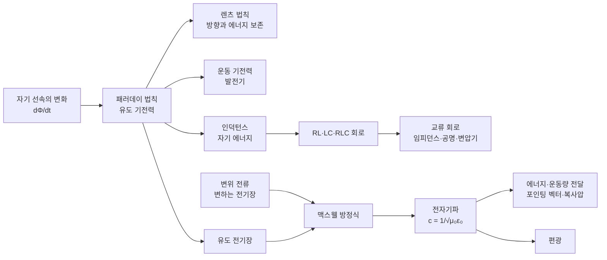

# 일반물리학 10. 전자기 유도와 전자기파 — 변하는 장이 장을 낳고, 빛이 되어 퍼져 나간다
<!-- prev: emq-1, emq-2, 5-5, uphy-9 -->
<!-- next: uphy-11, uphy-12 -->

> [!NOTE]
> **이 단원의 범위**
> - 패러데이 법칙과 렌츠 법칙, 운동 기전력과 유도 전기장
> - 인덕턴스(자체·상호)와 자기 에너지
> - RL·LC·RLC 회로의 시간 변화
> - 교류 회로(리액턴스, 임피던스, 공명, 전력)와 변압기
> - 변위 전류와 맥스웰 방정식
> - 전자기파(속력, 에너지 전달과 포인팅 벡터, 복사압, 편광)

**학습 목표**

1. 자기 선속을 면적분으로 구하고, 패러데이 법칙 $\varepsilon = -d\Phi_B/dt$와 렌츠 법칙으로 유도 기전력의 크기와 방향을 정할 수 있다.
2. 운동 기전력을 로런츠 힘으로, 정지한 회로의 유도 기전력을 유도 전기장 $\oint \vec{E}\cdot d\vec{s} = -d\Phi_B/dt$로 설명하고 에너지 보존과 연결할 수 있다.
3. 인덕턴스와 자기 에너지를 구하고, RL·LC·RLC 회로의 미분 방정식을 세워 시간 상수와 진동수를 계산할 수 있다.
4. 교류 회로에서 리액턴스·임피던스·위상차·평균 전력을 페이저로 계산하고, 공명과 변압기의 원리를 설명할 수 있다.
5. 변위 전류가 필요한 이유를 설명하고, 맥스웰 방정식에서 전자기파의 속력 $c = 1/\sqrt{\mu_0\varepsilon_0}$를 이끌어 낼 수 있다.
6. 전자기파의 세기·포인팅 벡터·복사압·편광을 정량적으로 다룰 수 있다.

**이 단원의 학습 사다리**

| 단계 | 무엇을 하나? |
|---|---|
| STEP 1. 이전 학습 다시 보기 | 통합과학 「발전기와 전기 에너지」, 전자기와 양자 「전자기적 상호작용」·「빛과 정보 통신」에서 배운 유도·변압기·편광을 꺼내 본다 |
| STEP 2. 기초 다지기 | 선적분과 면적분, 1계 선형 미분 방정식과 지수 함수, 단순 조화 진동의 식, 사인 함수의 평균과 실횻값, 회전하는 화살표(페이저) |
| STEP 3. 핵심 개념 | 패러데이·렌츠 → 운동 기전력·유도 전기장 → 인덕턴스·자기 에너지 → RL·LC·RLC → 교류 회로·변압기 → 변위 전류·맥스웰 방정식 → 전자기파 |
| STEP 4. 오개념 바로잡기 | "자기장이 세면 기전력도 크다?", "교류 전압은 평균이 0이니 전력도 0?" 같은 착각을 바로잡는다 |
| STEP 5. 다음 단계로 | 전자기학의 미분형 맥스웰 방정식, 파동 방정식, 회로이론의 복소 임피던스 |
| STEP 6. 생활·산업·진로 | 송배전망, 무선 충전과 RFID, 자기 공명 영상(MRI), 태양 돛과 레이저 광학 |

---

## 🗺️ 단원 들어가기

발전소 터빈이 돌면 수백 km 떨어진 집에서 전등이 켜진다. 스마트폰을 패드에 올려놓으면 전선 없이 충전된다. 밤하늘의 별빛은 수천 년 동안 텅 빈 우주를 건너와 우리 눈에 닿는다. 셋은 전혀 다른 일처럼 보이지만 같은 한 문장으로 설명된다. **"변하는 자기장은 전기장을 만들고, 변하는 전기장은 자기장을 만든다."**

앞 단원 「전류·회로와 자기장」에서는 시간이 지나도 변하지 않는 전기장과 자기장을 다루었다. 이 단원에서는 장이 **시간에 따라 변할 때** 무슨 일이 생기는지 본다. 그 끝에서 맥스웰은 전기와 자기의 법칙 네 개를 하나로 묶고, 장의 출렁임이 빛의 속력으로 퍼져 나간다는 것을 계산으로 보여 주었다. 빛이 곧 전자기파였던 것이다.

---

## STEP 1. 🔙 이전 학습 다시 보기

### 연계 개념표

| 이전 단원 | 고등학교에서는 여기까지 | 대학에서는 이렇게 확장 |
|---|---|---|
| 통합과학2 「발전기와 전기 에너지」 | 자석이 움직이면 코일에 전류가 흐른다(전자기 유도), 발전기와 송전, 변압기의 정성적 원리 | 유도 기전력을 $-d\Phi_B/dt$로 정량화하고, 송전 손실 $I^2R$로 고전압 송전을 계산한다 |
| 전자기와 양자 「전자기적 상호작용」 '전자기 유도' | $\varepsilon = -N\Delta\Phi/\Delta t$, 렌츠 법칙, 변압기 $V_1/V_2 = N_1/N_2$, 자체 유도 $\varepsilon = -L\Delta I/\Delta t$ | 변화율을 **도함수**로, 선속을 **면적분**으로 쓰고, 유도 전기장·상호 인덕턴스·자기 에너지 밀도까지 다룬다 |
| 전자기와 양자 「전자기적 상호작용」 '저항·축전기·인덕터' | R·C·L이 에너지를 소모·저장하는 방식(정성적) | 회로 미분 방정식을 풀어 $\tau = L/R$, $\omega_0 = 1/\sqrt{LC}$, 감쇠 진동을 구한다 |
| 전자기와 양자 「빛과 정보 통신」 '편광' | 편광판 두 장을 지날 때 투과량의 정성적 변화 | 맬러스 법칙(말뤼스 법칙) $I = I_0\cos^2\theta$, 전자기파의 세기·복사압 계산 |
| 일반물리학 「전류·회로와 자기장」 | (앞 대학 단원) 비오–사바르·앙페르 법칙, RC 회로 | 앙페르 법칙에 변위 전류를 더해 맥스웰 방정식을 완성한다 |

### 준비 운동 (사전 진단)

**Q1.** 넓이 $0.020\ \mathrm{m^2}$인 고리를 세기 $0.50\ \mathrm{T}$인 균일한 자기장이 고리 면과 $30^\circ$ 기울어져(즉 법선과 $60^\circ$) 지난다. 자기 선속은?

**Q2.** 막대자석의 N극을 코일에 가까이 할 때, 코일의 자석 쪽 끝은 N극과 S극 중 무엇이 되는가?

**Q3.** 함수 $x(t) = x_0e^{-t/\tau}$를 미분하면? 이 함수는 어떤 미분 방정식을 만족하는가?

**Q4.** 가정용 교류 $220\ \mathrm{V}$, $60\ \mathrm{Hz}$에서 $220\ \mathrm{V}$는 전압의 최댓값인가?

정답 및 해설

**Q1.** $\Phi_B = BA\cos60^\circ = 0.50\times0.020\times0.5 = 5.0\times10^{-3}\ \mathrm{Wb}$. 선속은 **법선과 자기장 사이의 각**으로 계산한다.

**Q2.** N극. 다가오는 N극을 밀어내는 쪽으로 유도 전류가 흐른다(렌츠 법칙).

**Q3.** $\dfrac{dx}{dt} = -\dfrac{x_0}{\tau}e^{-t/\tau} = -\dfrac{x}{\tau}$. 즉 '변화율이 현재 값에 비례하여 줄어드는' 미분 방정식 $dx/dt = -x/\tau$를 만족한다. RC 회로의 방전, RL 회로의 전류 감소가 모두 이 꼴이다.

**Q4.** 아니다. $220\ \mathrm{V}$는 **실횻값**(rms)이고, 최댓값은 $220\sqrt{2} \approx 311\ \mathrm{V}$이다. STEP 2 ④에서 이유를 본다.

---

## STEP 2. 🧱 기초 다지기

### ① 면적분으로 구하는 선속

자기장이 면 위에서 일정하지 않거나 면이 휘어 있으면, 면을 작은 조각 $d\vec{A}$(크기는 넓이, 방향은 법선)로 나누어 더한다.

$$
\Phi_B = \int \vec{B}\cdot d\vec{A}
$$

자기장이 균일하고 면이 평평하면 $\Phi_B = BA\cos\theta$로 돌아간다. 단위는 웨버($1\ \mathrm{Wb} = 1\ \mathrm{T\cdot m^2}$). 같은 방법으로 전기 선속 $\Phi_E = \int \vec{E}\cdot d\vec{A}$도 정의한다(「전기장과 전위」의 가우스 법칙).

> [!TIP]
> 💡 **비유** — 선속은 '창문으로 들어오는 빗줄기의 양'이다. 비가 세게 와도(큰 $B$) 창문이 빗줄기와 나란하면(법선과 $90^\circ$) 하나도 들어오지 않는다. 비가 고르게 오지 않으면 창문을 작은 칸으로 나눠 칸마다 세어 더하면 된다. 이것이 면적분이다.

### ② 닫힌 경로의 선적분

경로를 따라 작은 변위 $d\vec{s}$마다 $\vec{E}\cdot d\vec{s}$를 더한 것이 선적분이다. 닫힌 경로를 한 바퀴 돌 때는 $\oint$로 쓴다.

| 식 | 뜻 | 정전기장에서 | 이 단원에서 |
|---|---|---|---|
| $\oint\vec{E}\cdot d\vec{s}$ | 단위 전하를 한 바퀴 옮길 때 전기력이 하는 일 = 기전력 | 0(보존력) | $-d\Phi_B/dt$ (0이 아닐 수 있다) |
| $\oint\vec{B}\cdot d\vec{s}$ | 자기장의 '감김 정도' | $\mu_0 I_{\text{감싼}}$ (앙페르 법칙) | $\mu_0(I + \varepsilon_0\,d\Phi_E/dt)$ |

### ③ 1계 선형 미분 방정식과 2계 진동 방정식

이 단원의 회로는 거의 모두 다음 두 꼴 중 하나로 정리된다.

| 꼴 | 해 | 등장하는 곳 |
|---|---|---|
| $\dfrac{dx}{dt} = \dfrac{x_\infty - x}{\tau}$ | $x(t) = x_\infty + (x_0 - x_\infty)e^{-t/\tau}$ | RL 회로, 레일 위 막대의 종단 속도 |
| $\dfrac{d^2x}{dt^2} = -\omega_0^2x$ | $x(t) = X\cos(\omega_0t + \phi)$ | LC 회로(용수철 진자와 같은 꼴) |
| $\dfrac{d^2x}{dt^2} + 2\gamma\dfrac{dx}{dt} + \omega_0^2x = 0$ | $x(t) = Xe^{-\gamma t}\cos(\omega' t + \phi)$, $\omega' = \sqrt{\omega_0^2 - \gamma^2}$ | RLC 회로(감쇠 진동, 「중력·진동·유체」) |

$\tau$는 **시간 상수**로, 처음 차이의 $1/e \approx 37\%$만 남는 데 걸리는 시간이다. $t = 5\tau$이면 차이는 $e^{-5} \approx 0.7\%$로, 사실상 끝났다고 본다.

### ④ 사인 함수의 평균과 실횻값

$\sin^2\omega t$를 한 주기 동안 평균하면 $\dfrac{1}{2}$이다($\sin^2 = \dfrac{1-\cos2\omega t}{2}$이고 코사인의 평균은 0). 그래서 $I(t) = I_m\sin\omega t$가 저항에서 내는 평균 전력은

$$
\overline{P} = \overline{I^2}R = \frac{1}{2}I_m^2R = I_{\text{rms}}^2R, \qquad I_{\text{rms}} = \frac{I_m}{\sqrt{2}}
$$

**실횻값**(rms, root-mean-square)은 '같은 저항에서 같은 평균 전력을 내는 직류의 값'이다. 가정용 $220\ \mathrm{V}$는 실횻값이고 최댓값은 약 $311\ \mathrm{V}$이다.

### ⑤ 페이저 — 회전하는 화살표로 사인 함수 더하기

$A\sin(\omega t + \phi)$는 길이 $A$인 화살표가 각속도 $\omega$로 돌 때 그 세로 성분이다. 진동수가 같은 사인 함수 두 개를 더하는 것은 **화살표 두 개를 벡터처럼 더하는 것**과 같다. 이 화살표를 **페이저**(phasor)라 한다. 교류 회로에서 위상이 다른 전압들을 더할 때 이 방법을 쓴다.

> [!TIP]
> 💡 **요령** — 페이저 그림에서 "앞선다"는 반시계 방향으로 더 돌아가 있다는 뜻이다. 인덕터 전압은 전류보다 $90^\circ$ **앞서고**, 축전기 전압은 전류보다 $90^\circ$ **뒤진다**. 'ELI the ICE man'(L에서 E가 I보다 먼저, C에서 I가 E보다 먼저)이라는 영어 기억법이 널리 쓰인다.

---

## STEP 3. 📘 핵심 개념

### ① 패러데이 법칙과 렌츠 법칙

#### 실험 사실에서 법칙으로

1831년 패러데이는 코일 근처에서 자석을 움직이거나, 옆 코일의 전류를 켜고 끄거나, 코일 자체를 자기장 속에서 움직일 때 검류계 바늘이 움직이는 것을 관찰했다. 자기장이 **있다는 것**만으로는 아무 일도 일어나지 않았고, 회로를 지나는 자기 선속이 **변할 때**만 전류가 흘렀다. 이를 식으로 쓴 것이 **패러데이 법칙**(Faraday's law)이다.

$$
\varepsilon = -\frac{d\Phi_B}{dt}, \qquad N\text{번 감은 코일이면}\quad \varepsilon = -N\frac{d\Phi_B}{dt}
$$

고등학교의 $\Delta\Phi/\Delta t$는 일정한 시간 동안의 **평균** 변화율이고, $d\Phi_B/dt$는 그 순간의 변화율이다. 선속이 시간에 따라 매끄럽지 않게 변하면 순간마다 기전력이 다르다.

선속 $\Phi_B = \int\vec{B}\cdot d\vec{A}$를 바꾸는 방법은 세 가지이다.

| 바꾸는 것 | 예 | 기전력의 물리적 원인 |
|---|---|---|
| 자기장의 세기 $B(t)$ | 변압기, 무선 충전, 자석을 코일에 넣기 | 유도 전기장(②) |
| 회로의 넓이 $A(t)$ | 레일 위를 미끄러지는 막대 | 움직이는 전하가 받는 로런츠 힘(②) |
| 방향 $\theta(t)$ | 발전기의 회전 코일 | 로런츠 힘 |

#### 렌츠 법칙 — 부호의 의미

식의 음(−)의 부호가 **렌츠 법칙**(Lenz's law)이다. 유도 전류는 **자기 선속의 변화를 방해하는 방향**으로 흐른다. 방향을 정하는 순서는 다음과 같다.

1. 회로를 지나는 자기장의 방향과, 선속이 **늘어나는지 줄어드는지** 본다.
2. 늘어나면 유도 전류가 만드는 자기장은 **반대** 방향, 줄어들면 **같은** 방향이다.
3. 그 자기장을 만드는 전류 방향을 오른손 규칙으로 정한다.

렌츠 법칙은 **에너지 보존**의 결과이다. 유도 전류가 변화를 돕는 방향이라면, 자석을 살짝만 밀어도 끝없이 빨려 들어가며 운동 에너지와 전기 에너지가 동시에 늘어날 것이다.

#### 예제 1 — 사인 함수로 변하는 자기장

한 변 $3.0\ \mathrm{cm}$인 정사각형 코일(200회)의 면에 수직으로 자기장 $B(t) = (0.12\ \mathrm{T})\sin(2\pi\cdot50t)$가 지난다. 유도 기전력 $\varepsilon(t)$와 그 최댓값을 구하시오.

**풀이**
- 식 세우기: $\Phi_B = BA$, $\varepsilon = -NA\dfrac{dB}{dt} = -NAB_0\omega\cos\omega t$
- 대입: $A = (0.030)^2 = 9.0\times10^{-4}\ \mathrm{m^2}$, $\omega = 2\pi\times50 = 314\ \mathrm{rad/s}$
  $\varepsilon_{\max} = 200\times9.0\times10^{-4}\times0.12\times314 \approx 6.8\ \mathrm{V}$
- 의미: 기전력은 $B$가 0을 지나는 순간(변화가 가장 빠른 순간) 최대이고, $B$가 최대인 순간에는 0이다. **세기가 아니라 변화율**이 기전력을 정한다.

#### 예제 2 — 균일하지 않은 자기장의 선속

긴 직선 도선에 전류 $I(t)$가 위쪽으로 흐르고, 같은 평면에 직사각형 고리(도선과 나란한 변의 길이 $a = 30\ \mathrm{cm}$)가 도선에서 $c = 2.0\ \mathrm{cm}$부터 $b = 10.0\ \mathrm{cm}$까지 놓여 있다. 전류가 $dI/dt = 50\ \mathrm{A/s}$로 늘어날 때 고리의 유도 기전력과 유도 전류의 방향은?

<!-- fig:uphy-10-loop-flux-strip -->

**풀이**
- 식 세우기: 도선에서 거리 $r$인 곳의 자기장은 $B = \dfrac{\mu_0I}{2\pi r}$이다. 폭 $dr$인 띠의 넓이는 $a\,dr$이므로
  $\Phi_B = \displaystyle\int_c^b\frac{\mu_0I}{2\pi r}a\,dr = \frac{\mu_0Ia}{2\pi}\ln\frac{b}{c}$
- 대입: $\varepsilon = \dfrac{\mu_0a}{2\pi}\ln\dfrac{b}{c}\dfrac{dI}{dt} = (2.0\times10^{-7})(0.30)(\ln5.0)(50) \approx 4.8\times10^{-6}\ \mathrm{V}$
- 방향: 도선 오른쪽에 고리가 있으면 고리를 지나는 자기장은 종이에 들어가는 방향이고 늘어나고 있다. 유도 전류는 종이에서 나오는 자기장을 만들어야 하므로 **시계 반대 방향**이다.
- 의미: 기전력은 약 $5\ \mu\mathrm{V}$로 작지만, 전력선 옆 긴 통신선에 잡음이 생기는 원리가 이것이다.

> [!IMPORTANT]
> 패러데이 법칙은 '회로'가 없어도 성립한다. 도선이 없더라도 공간의 닫힌 경로를 따라 $\oint\vec{E}\cdot d\vec{s} = -d\Phi_B/dt$인 전기장이 생긴다. 도선은 그 전기장으로 전하가 움직이게 해 주는 통로일 뿐이다(② 유도 전기장).

### ② 운동 기전력과 유도 전기장

#### 운동 기전력 — 로런츠 힘이 원인일 때

자기장 $\vec{B}$(종이에 들어가는 방향) 속에서 길이 $L$인 도체 막대가 레일 위를 속도 $v$로 움직인다. 막대 속 전자는 막대와 함께 움직이므로 로런츠 힘 $q\vec{v}\times\vec{B}$를 받아 막대를 따라 밀린다. 단위 전하가 막대를 따라 받는 일이 기전력이므로

$$
\varepsilon = \oint(\vec{v}\times\vec{B})\cdot d\vec{s} = BLv
$$

같은 결과를 패러데이 법칙으로도 얻는다. 회로 넓이가 $A = Lx$이고 $dx/dt = v$이므로 $\lvert d\Phi_B/dt\rvert = BLv$이다. **같은 현상을 두 방법으로 설명할 수 있다**는 점이 중요하다.

#### 에너지는 어디서 오는가

회로 저항이 $R$이면 전류 $I = BLv/R$가 흐르고, 막대는 자기력 $F = ILB = B^2L^2v/R$를 운동 반대 방향으로 받는다(렌츠 법칙). 막대를 등속으로 끌려면 외력이 이만큼 일을 해야 한다.

$$
P_{\text{외력}} = Fv = \frac{B^2L^2v^2}{R} = I^2R = P_{\text{열}}
$$

외력이 한 일이 전기 에너지를 거쳐 모두 열이 된다. 발전기가 '공짜로' 전기를 만들지 못하는 이유이다.

#### 예제 3 — 수직 레일을 떨어지는 막대의 종단 속도

수평 균일 자기장 $B = 0.80\ \mathrm{T}$가 수직 레일 평면에 수직으로 걸려 있다. 레일 간격 $L = 0.25\ \mathrm{m}$, 막대 질량 $m = 20\ \mathrm{g}$, 회로 전체 저항 $R = 0.50\ \Omega$이고 마찰은 없다. 정지 상태에서 놓은 막대의 (1) 운동 방정식과 $v(t)$, (2) 종단 속도, (3) 종단 속도에서 중력의 일률과 저항의 열 발생률을 구하시오. ($g = 9.80\ \mathrm{m/s^2}$)

**풀이**
(1) $m\dfrac{dv}{dt} = mg - \dfrac{B^2L^2}{R}v$. STEP 2 ③의 꼴이므로 $v(t) = v_t(1 - e^{-t/\tau})$, $\tau = \dfrac{mR}{B^2L^2}$
(2) $v_t = \dfrac{mgR}{B^2L^2} = \dfrac{0.020\times9.80\times0.50}{(0.80)^2(0.25)^2} = \dfrac{0.098}{0.040} \approx 2.5\ \mathrm{m/s}$ (정확히 $2.45$), $\tau = 0.25\ \mathrm{s}$
(3) $mgv_t = 0.196\times2.45 \approx 0.48\ \mathrm{W}$. 전류 $I = BLv_t/R = 0.98\ \mathrm{A}$, $I^2R \approx 0.48\ \mathrm{W}$로 같다.
- 의미: 종단 속도에서는 줄어드는 중력 퍼텐셜 에너지가 전부 열로 바뀐다. 약 $1\ \mathrm{s}$($4\tau$)면 종단 속도의 98%에 이른다. 낙하 놀이기구와 승강기의 **자기 제동**은 마찰 없이 이렇게 속도를 제한한다.

<!-- sim:u-motional-emf -->

#### 회전하는 막대와 발전기

자기장에 수직인 면에서 길이 $L$인 막대가 한 끝을 축으로 각속도 $\omega$로 돌면, 축에서 $r$인 부분의 속력이 $\omega r$이므로

$$
\varepsilon = \int_0^L B\omega r\,dr = \frac{1}{2}B\omega L^2
$$

넓이 $A$인 코일($N$회)이 균일한 자기장 속에서 각속도 $\omega$로 돌면 $\Phi_B = BA\cos\omega t$이므로 $\varepsilon = NBA\omega\sin\omega t$이다. 이것이 교류 발전기이며, 통합과학 「발전기와 전기 에너지」의 발전기를 식으로 쓴 것이다.

#### 유도 전기장 — 회로가 움직이지 않을 때

정지한 코일 안에서 자기장만 변할 때는 전하가 움직이지 않으므로 로런츠 힘 $q\vec{v}\times\vec{B}$가 원인일 수 없다. 이때 전하를 미는 것은 변하는 자기장이 만드는 **유도 전기장**(induced electric field)이다.

$$
\oint\vec{E}\cdot d\vec{s} = -\frac{d\Phi_B}{dt}
$$

| 비교 | 정전기장(전하가 만든 것) | 유도 전기장(변하는 자기장이 만든 것) |
|---|---|---|
| 전기력선 | 양전하에서 시작해 음전하에서 끝남 | 시작과 끝이 없는 **닫힌 고리** |
| 닫힌 경로의 선적분 | 항상 0(보존장) | $-d\Phi_B/dt$ (0이 아닐 수 있다) |
| 전위 | 정의할 수 있다 | 정의할 수 없다(한 바퀴 돌면 '높이'가 달라짐) |

<!-- fig:uphy-10-induced-e-field -->

#### 예제 4 — 솔레노이드 안팎의 유도 전기장

반지름 $R = 5.0\ \mathrm{cm}$인 긴 솔레노이드 속 균일한 자기장이 $dB/dt = 0.40\ \mathrm{T/s}$로 늘어난다. 축에서 (1) $r = 2.0\ \mathrm{cm}$, (2) $r = 5.0\ \mathrm{cm}$, (3) $r = 10\ \mathrm{cm}$인 곳의 유도 전기장 세기는?

**풀이** 대칭성 때문에 유도 전기장은 축을 중심으로 한 원을 따라 돌고, 같은 $r$에서 세기가 같다. 반지름 $r$인 원에 대해 $E(2\pi r) = \lvert d\Phi_B/dt\rvert$.
- 안($r \le R$): $E\cdot2\pi r = \pi r^2\dfrac{dB}{dt}$ → $E = \dfrac{r}{2}\dfrac{dB}{dt}$. (1) $4.0\times10^{-3}\ \mathrm{V/m}$ (2) $1.0\times10^{-2}\ \mathrm{V/m}$
- 밖($r > R$): 선속은 $\pi R^2B$뿐이므로 $E = \dfrac{R^2}{2r}\dfrac{dB}{dt}$. (3) $5.0\times10^{-3}\ \mathrm{V/m}$
- 의미: 자기장이 **없는** 솔레노이드 바깥에도 유도 전기장은 있다. 전기장을 만드는 것은 그 자리의 자기장이 아니라 경로가 감싼 **선속의 변화**이다.

#### 맴돌이 전류

넓은 도체판 안에서도 유도 전기장은 닫힌 고리 모양의 **맴돌이 전류**(eddy current)를 만든다. 변압기 철심은 얇은 판을 절연해 겹쳐 맴돌이 전류에 의한 열 손실을 줄이고, 인덕션 레인지와 금속 탐지기는 거꾸로 맴돌이 전류를 이용한다.

> [!TIP]
> 💡 **비유** — 정전기장은 '언덕의 경사'이다. 한 바퀴 돌아 제자리에 오면 높이 변화가 0이다. 유도 전기장은 '빙글빙글 도는 물레방아 물살'이다. 한 바퀴 돌 때마다 같은 방향으로 계속 밀려서 에너지를 얻는다.

### ③ 인덕턴스와 자기 에너지

#### 자체 인덕턴스

코일에 전류 $I$가 흐르면 자기 자신을 지나는 선속 $N\Phi_B$가 생기고, 그것은 $I$에 비례한다. 비례 상수가 **자체 인덕턴스**(self-inductance) $L$이다.

$$
L = \frac{N\Phi_B}{I}, \qquad \varepsilon_L = -L\frac{dI}{dt}
$$

단위는 헨리($1\ \mathrm{H} = 1\ \mathrm{V\cdot s/A} = 1\ \mathrm{Wb/A}$). $L$은 코일의 모양과 감은 수, 속을 채운 물질로만 정해진다. 길이 $l$, 단면적 $A$, 단위 길이당 감은 수 $n$인 긴 솔레노이드에서 $B = \mu_0nI$, $N = nl$이므로

$$
L = \frac{(nl)(\mu_0nI)A}{I} = \mu_0n^2Al
$$

#### 상호 인덕턴스

코일 1의 전류 $I_1$이 만든 선속 중 코일 2를 지나는 양이 $N_2\Phi_{21} = MI_1$일 때 $M$을 **상호 인덕턴스**(mutual inductance)라 한다. 코일 2에는 $\varepsilon_2 = -M\,dI_1/dt$가 유도된다. 놀랍게도 $M_{21} = M_{12}$가 항상 성립한다(어느 코일을 기준으로 해도 같다). 변압기, 무선 충전, 교통 카드(RFID)가 상호 유도를 이용한다.

#### 자기 에너지와 에너지 밀도

전류를 0에서 $I$까지 늘리는 동안 전원은 역기전력 $L\,di/dt$를 거슬러 일을 해야 한다.

$$
U_B = \int_0^I Li\,di = \frac{1}{2}LI^2
$$

이 에너지는 자기장 속에 저장된다. 솔레노이드에 적용해 부피 $Al$로 나누면

$$
u_B = \frac{\frac{1}{2}\mu_0n^2AlI^2}{Al} = \frac{(\mu_0nI)^2}{2\mu_0} = \frac{B^2}{2\mu_0}
$$

이 결과는 솔레노이드뿐 아니라 **자기장이 있는 모든 곳**에서 성립한다. 전기장의 $u_E = \frac{1}{2}\varepsilon_0E^2$(「전기장과 전위」)와 짝을 이룬다.

| 비교 | 축전기 | 인덕터 |
|---|---|---|
| 정의 | $C = Q/V$ | $L = N\Phi_B/I$ |
| 저장 에너지 | $\frac{1}{2}CV^2 = \frac{Q^2}{2C}$ | $\frac{1}{2}LI^2$ |
| 에너지가 머무는 곳 | 전기장, $u_E = \frac{1}{2}\varepsilon_0E^2$ | 자기장, $u_B = B^2/2\mu_0$ |
| 갑자기 바뀔 수 없는 양 | 전압(전하) | 전류 |

#### 예제 5 — 솔레노이드의 인덕턴스와 에너지

길이 $20\ \mathrm{cm}$, 반지름 $1.0\ \mathrm{cm}$, 1000회 감은 공심 솔레노이드에 $2.0\ \mathrm{A}$가 흐른다. (1) $L$, (2) 저장 에너지, (3) 내부 자기장과 에너지 밀도를 구하고 (2)와 일치하는지 확인하시오. ($\mu_0 = 4\pi\times10^{-7}\ \mathrm{T\cdot m/A}$)

**풀이**
(1) $n = 1000/0.20 = 5.0\times10^3\ \mathrm{m^{-1}}$, $A = \pi(0.010)^2 = 3.14\times10^{-4}\ \mathrm{m^2}$
$L = \mu_0n^2Al = (4\pi\times10^{-7})(2.5\times10^7)(3.14\times10^{-4})(0.20) \approx 1.97\times10^{-3}\ \mathrm{H}$
(2) $U_B = \frac{1}{2}(1.97\times10^{-3})(2.0)^2 \approx 3.9\times10^{-3}\ \mathrm{J}$
(3) $B = \mu_0nI \approx 1.26\times10^{-2}\ \mathrm{T}$, $u_B = B^2/2\mu_0 \approx 62.8\ \mathrm{J/m^3}$. 부피 $6.28\times10^{-5}\ \mathrm{m^3}$를 곱하면 $3.9\times10^{-3}\ \mathrm{J}$로 일치한다.
- 의미: 수 mJ로 작아 보이지만, 스위치를 $1\ \mathrm{ms}$ 만에 끊으면 $\varepsilon \approx L\,\Delta I/\Delta t \approx 4\ \mathrm{V}$이고, 더 빨리 끊을수록 기전력이 커져 접점에 불꽃이 튄다.

### ④ RL·LC·RLC 회로

#### RL 회로 — 전류의 '관성'

기전력 $\varepsilon$, 저항 $R$, 인덕터 $L$을 직렬로 연결하고 $t = 0$에 스위치를 닫는다. 키르히호프 고리 법칙에서

$$
\varepsilon - IR - L\frac{dI}{dt} = 0 \quad\Rightarrow\quad I(t) = \frac{\varepsilon}{R}\left(1 - e^{-t/\tau_L}\right),\qquad \tau_L = \frac{L}{R}
$$

전원을 떼고 저항으로 닫으면 $I(t) = I_0e^{-t/\tau_L}$로 줄어든다. 「전류·회로와 자기장」의 RC 회로($\tau = RC$)와 비교하면, 축전기는 **전압**이 서서히 변하고 인덕터는 **전류**가 서서히 변한다.

| 시각 | 인덕터의 행동 | 회로 전류 |
|---|---|---|
| 스위치를 닫은 직후 | 끊어진 도선처럼(전류 변화를 막음) | 0 |
| $t = \tau_L$ | — | 최종값의 63% |
| 충분히 오랜 뒤 | 그냥 도선처럼($dI/dt = 0$) | $\varepsilon/R$ |

#### 예제 6 — RL 회로의 시간 상수

$\varepsilon = 12\ \mathrm{V}$, $R = 10\ \Omega$, $L = 50\ \mathrm{mH}$인 RL 회로의 (1) 시간 상수, (2) 최종 전류, (3) 최종값의 90%에 이르는 시간, (4) 최종 상태에 저장된 에너지를 구하시오.

**풀이**
(1) $\tau_L = L/R = 0.050/10 = 5.0\ \mathrm{ms}$ (2) $I_\infty = 1.2\ \mathrm{A}$
(3) $1 - e^{-t/\tau} = 0.90$ → $t = \tau\ln10 \approx 11.5\ \mathrm{ms}$
(4) $U = \frac{1}{2}(0.050)(1.2)^2 = 0.036\ \mathrm{J}$
- 의미: 전원 공급 장치의 '초크 코일'은 이 느린 응답으로 전류의 급변(잡음)을 걸러 낸다.

#### LC 회로 — 전기 에너지와 자기 에너지의 시소

충전된 축전기를 인덕터에 연결하면 저항이 없을 때 $\dfrac{Q^2}{2C} + \dfrac{1}{2}LI^2$이 보존된다. 시간으로 미분하고 $I = dQ/dt$를 쓰면

$$
\frac{d^2Q}{dt^2} = -\frac{1}{LC}Q \quad\Rightarrow\quad Q(t) = Q_0\cos\omega_0t,\qquad \omega_0 = \frac{1}{\sqrt{LC}}
$$

| 용수철 진자 | LC 회로 |
|---|---|
| 변위 $x$ | 전하 $Q$ |
| 속도 $v = dx/dt$ | 전류 $I = dQ/dt$ |
| 질량 $m$ (관성) | 인덕턴스 $L$ |
| 용수철 상수 $k$ | $1/C$ |
| $\frac{1}{2}kx^2 + \frac{1}{2}mv^2$ | $\frac{Q^2}{2C} + \frac{1}{2}LI^2$ |
| $\omega_0 = \sqrt{k/m}$ | $\omega_0 = 1/\sqrt{LC}$ |

#### 예제 7 — LC 진동

$C = 5.0\ \mu\mathrm{F}$ 축전기를 $10\ \mathrm{V}$로 충전해 $L = 2.0\ \mathrm{mH}$ 인덕터에 연결했다. (1) 진동수, (2) 최대 전류, (3) 에너지가 처음으로 전부 자기 에너지가 되는 시각을 구하시오.

**풀이**
(1) $\omega_0 = 1/\sqrt{(2.0\times10^{-3})(5.0\times10^{-6})} = 1.0\times10^4\ \mathrm{rad/s}$, $f = \omega_0/2\pi \approx 1.59\ \mathrm{kHz}$
(2) $Q_0 = CV = 5.0\times10^{-5}\ \mathrm{C}$, $I_{\max} = \omega_0Q_0 = 0.50\ \mathrm{A}$. 확인: $\frac{1}{2}CV^2 = 2.5\times10^{-4}\ \mathrm{J} = \frac{1}{2}LI_{\max}^2$
(3) 주기 $T = 2\pi/\omega_0 \approx 0.63\ \mathrm{ms}$의 $\frac{1}{4}$, 약 $0.16\ \mathrm{ms}$ 뒤.

#### RLC 회로 — 감쇠 진동

저항 $R$이 있으면 $L\ddot{Q} + R\dot{Q} + Q/C = 0$이고, STEP 2 ③의 세 번째 꼴에서 $\gamma = R/2L$이다.

$$
Q(t) = Q_0e^{-Rt/2L}\cos(\omega' t + \phi), \qquad \omega' = \sqrt{\frac{1}{LC} - \left(\frac{R}{2L}\right)^2}
$$

예제 7의 회로에 $R = 4.0\ \Omega$을 넣으면 $R/2L = 1.0\times10^3\ \mathrm{s^{-1}}$이므로 $\omega' \approx 9.95\times10^3\ \mathrm{rad/s}$로 거의 그대로이지만, 진폭은 $\ln2/1000 \approx 0.69\ \mathrm{ms}$마다(약 1.1주기마다) 절반이 된다. 전하 진폭이 절반이면 에너지는 $\frac{1}{4}$이다. $R > 2\sqrt{L/C}$이면 진동하지 않고 그냥 줄어든다(과감쇠).

### ⑤ 교류 회로와 변압기

#### 저항·인덕터·축전기 하나씩

교류 전류 $i = I\sin\omega t$가 흐를 때 각 소자의 전압은 다음과 같다.

| 소자 | 전압 | 진폭 관계 | 위상 | 리액턴스 |
|---|---|---|---|---|
| 저항 $R$ | $iR = IR\sin\omega t$ | $V_R = IR$ | 전류와 같다 | — |
| 인덕터 $L$ | $L\,di/dt = I\omega L\cos\omega t$ | $V_L = IX_L$ | 전류보다 $90^\circ$ 앞선다 | $X_L = \omega L$ |
| 축전기 $C$ | $q/C = -\dfrac{I}{\omega C}\cos\omega t$ | $V_C = IX_C$ | 전류보다 $90^\circ$ 뒤진다 | $X_C = 1/\omega C$ |

**리액턴스**(reactance)는 '교류에 대한 저항 같은 것'이지만 에너지를 소모하지 않는다. $X_L$은 진동수에 비례하고, $X_C$는 반비례한다. 그래서 인덕터는 고주파를 막고, 축전기는 고주파를 잘 통과시킨다(스피커의 크로스오버 필터).

#### 직렬 RLC 회로와 임피던스

직렬 연결이면 전류가 공통이므로 전류를 기준(가로축)으로 페이저를 그린다. $V_R$은 가로, $V_L$은 위, $V_C$는 아래를 향한다. 벡터 합을 구하면

$$
V = I\sqrt{R^2 + (X_L - X_C)^2} = IZ, \qquad \tan\phi = \frac{X_L - X_C}{R}
$$

$Z$를 **임피던스**(impedance), $\phi$를 전압이 전류보다 앞선 위상각이라 한다.

#### 공명

$X_L = X_C$, 즉 $\omega = \omega_0 = 1/\sqrt{LC}$일 때 $Z = R$로 최소가 되어 전류가 최대이다. 이것이 **공명**(resonance)이며, 공명 진동수는 LC 회로의 고유 진동수와 같다. 라디오는 가변 축전기로 $\omega_0$를 원하는 방송국 진동수에 맞추어 그 신호만 크게 받는다. 공명 곡선의 날카로움은 **품질 인자** $Q = \omega_0L/R$로 나타내며, $R$이 작을수록 날카롭다.

#### 교류의 전력과 역률

순간 전력 $p = vi$를 평균하면 위상차 때문에 다음과 같다.

$$
\overline{P} = V_{\text{rms}}I_{\text{rms}}\cos\phi = I_{\text{rms}}^2R
$$

$\cos\phi$를 **역률**(power factor)이라 한다. 인덕터와 축전기는 에너지를 받았다가 돌려주기만 하므로 평균 전력은 저항에서만 소모된다.

<!-- sim:u-rlc-resonance -->

#### 예제 8 — 직렬 RLC 회로

$R = 30\ \Omega$, $L = 0.20\ \mathrm{H}$, $C = 50\ \mu\mathrm{F}$를 직렬로 $220\ \mathrm{V}$(실횻값), $60\ \mathrm{Hz}$ 전원에 연결했다. (1) $X_L$, $X_C$, $Z$, (2) 전류의 실횻값과 위상각, (3) 평균 전력, (4) 공명 진동수, (5) 각 소자 전압의 실횻값을 구하시오.

**풀이**
(1) $\omega = 377\ \mathrm{rad/s}$. $X_L = 377\times0.20 \approx 75.4\ \Omega$, $X_C = 1/(377\times5.0\times10^{-5}) \approx 53.1\ \Omega$
$Z = \sqrt{30^2 + 22.3^2} \approx 37.4\ \Omega$
(2) $I_{\text{rms}} = 220/37.4 \approx 5.88\ \mathrm{A}$, $\phi = \tan^{-1}(22.3/30) \approx 36.7^\circ$ (전압이 앞섬, 유도성)
(3) $\overline{P} = I_{\text{rms}}^2R = 5.88^2\times30 \approx 1.04\times10^3\ \mathrm{W}$. 역률 $\cos\phi \approx 0.80$
(4) $f_0 = \dfrac{1}{2\pi\sqrt{LC}} = \dfrac{1}{2\pi\sqrt{1.0\times10^{-5}}} \approx 50.3\ \mathrm{Hz}$
(5) $V_R \approx 176\ \mathrm{V}$, $V_L \approx 443\ \mathrm{V}$, $V_C \approx 312\ \mathrm{V}$
- 의미: $V_L$이 전원 전압 $220\ \mathrm{V}$보다 크다. 위상이 다른 전압은 **산술적으로 더하지 않고 벡터(페이저)로 더하기** 때문이다. 공명 근처에서는 소자 전압이 전원보다 몇 배 커질 수 있어 절연 설계에 주의해야 한다.

#### 변압기와 송전

철심에 감긴 두 코일에서 1차 코일의 교류가 만든 선속이 철심을 따라 2차 코일을 지난다. 감은 한 바퀴당 기전력 $d\Phi_B/dt$가 두 코일에서 같으므로

$$
\frac{V_2}{V_1} = \frac{N_2}{N_1}, \qquad \frac{I_2}{I_1} = \frac{N_1}{N_2}\ (\text{이상 변압기, } V_1I_1 = V_2I_2)
$$

2차 쪽에 부하 저항 $R$을 달면 1차 쪽에서는 $R_{\text{등가}} = (N_1/N_2)^2R$로 보인다. 이 성질로 앰프와 스피커처럼 서로 다른 임피던스를 맞추기도 한다(임피던스 정합).

#### 예제 9 — 왜 초고압으로 송전하는가

발전소에서 $100\ \mathrm{MW}$를 저항 $5.0\ \Omega$인 송전선으로 보낸다(단순화한 모형). 송전 전압이 (1) $154\ \mathrm{kV}$일 때와 (2) $345\ \mathrm{kV}$일 때 송전선의 열 손실은?

**풀이** $I = P/V$, 손실 $= I^2R$.
(1) $I \approx 649\ \mathrm{A}$, 손실 $\approx 2.1\ \mathrm{MW}$ (약 2.1%)
(2) $I \approx 290\ \mathrm{A}$, 손실 $\approx 0.42\ \mathrm{MW}$ (약 0.42%)
- 의미: 손실은 $1/V^2$에 비례하므로 전압을 약 2.24배 높이면 손실은 약 $\frac{1}{5}$이 된다. 전압을 쉽게 바꿀 수 있는 변압기 덕분에 교류가 송전의 표준이 되었다.

> [!TIP]
> 💡 **비유** — 같은 양의 물을 보내려면 '많은 물을 천천히'보다 '적은 물을 높은 압력으로' 보내는 편이 좁은 관의 마찰 손실이 적다. 변압기는 이 압력(전압)을 손쉽게 바꾸는 장치이다.

### ⑥ 변위 전류와 맥스웰 방정식

#### 앙페르 법칙의 모순

충전 중인 평행판 축전기를 생각하자. 도선에는 전류 $i$가 흐르지만 두 판 사이에는 전하가 지나가지 않는다. 도선을 둘러싼 원을 경계로 하는 면을 두 가지로 잡아 보자.

| 경계가 같은 두 면 | 그 면을 지나는 전도 전류 | 앙페르 법칙 $\oint\vec{B}\cdot d\vec{s} = \mu_0I$의 값 |
|---|---|---|
| 도선을 자르는 평평한 원판 | $i$ | $\mu_0i$ |
| 두 판 사이로 부풀려 도선을 피한 주머니 모양 면 | 0 | 0 |

같은 경로의 선적분이 두 값을 가질 수는 없다. 1860년대 초 맥스웰은 두 판 사이에서는 전류 대신 **전기 선속이 변하고 있다**는 점에 주목해, 다음 양을 전류처럼 더했다.

$$
i_d = \varepsilon_0\frac{d\Phi_E}{dt}, \qquad \oint\vec{B}\cdot d\vec{s} = \mu_0\left(i + \varepsilon_0\frac{d\Phi_E}{dt}\right)
$$

$i_d$를 **변위 전류**(displacement current)라 한다. 판 사이에서 $\Phi_E = EA = Q/\varepsilon_0$이므로 $i_d = dQ/dt = i$이다. 전도 전류가 끊기는 곳에서 변위 전류가 정확히 이어 준다. 이 단원 처음의 문장 "변하는 전기장은 자기장을 만든다"가 바로 이것이다.

<!-- fig:uphy-10-displacement-current -->

#### 예제 10 — 충전 중인 축전기 사이의 자기장

반지름 $R = 5.0\ \mathrm{cm}$인 원형 평행판 축전기를 $i = 2.0\ \mathrm{A}$로 충전한다. 축에서 (1) $r = 3.0\ \mathrm{cm}$, (2) $r = 5.0\ \mathrm{cm}$인 판 사이 지점의 자기장과 (3) 판 사이 전기장의 변화율을 구하시오.

**풀이**
(1) 반지름 $r$ 안의 변위 전류는 $i(r^2/R^2)$이므로 $B(2\pi r) = \mu_0i\dfrac{r^2}{R^2}$ → $B = \dfrac{\mu_0ir}{2\pi R^2} = 4.8\times10^{-6}\ \mathrm{T}$
(2) $B = \dfrac{\mu_0i}{2\pi R} = 8.0\times10^{-6}\ \mathrm{T}$ (같은 전류가 흐르는 도선 바깥과 같은 값)
(3) $\dfrac{dE}{dt} = \dfrac{i}{\varepsilon_0\pi R^2} \approx 2.9\times10^{13}\ \mathrm{V/(m\cdot s)}$
- 의미: 자기장은 지구 자기장(약 $5\times10^{-5}\ \mathrm{T}$)의 10분의 1 정도로 작아 일상에서는 잘 느끼지 못한다. 그러나 진동수가 매우 높은 전자기파에서는 이 항이 결정적이다.

#### 맥스웰 방정식

| 이름 | 적분형 | 뜻 |
|---|---|---|
| 전기의 가우스 법칙 | $\oint\vec{E}\cdot d\vec{A} = Q_{\text{안}}/\varepsilon_0$ | 전기장의 원천은 전하이다 |
| 자기의 가우스 법칙 | $\oint\vec{B}\cdot d\vec{A} = 0$ | 자기 홀극은 없다. 자기력선은 닫혀 있다 |
| 패러데이 법칙 | $\oint\vec{E}\cdot d\vec{s} = -d\Phi_B/dt$ | 변하는 자기장이 전기장을 만든다 |
| 앙페르–맥스웰 법칙 | $\oint\vec{B}\cdot d\vec{s} = \mu_0i + \mu_0\varepsilon_0\,d\Phi_E/dt$ | 전류와 변하는 전기장이 자기장을 만든다 |

여기에 전하가 받는 힘 $\vec{F} = q(\vec{E} + \vec{v}\times\vec{B})$를 더하면, 고전 전자기 현상 전체가 이 다섯 식으로 설명된다.

> [!IMPORTANT]
> 전하도 전류도 없는 빈 공간에서 남는 것은 패러데이 법칙과 앙페르–맥스웰 법칙의 **두 변화항**이다. 변하는 $\vec{B}$가 $\vec{E}$를, 변하는 $\vec{E}$가 다시 $\vec{B}$를 만드는 사슬이 원천 없이도 스스로 이어져 공간을 퍼져 나간다. 이것이 전자기파이다.

### ⑦ 전자기파 — 속력, 에너지, 운동량, 편광

#### 파동 방정식과 빛의 속력

$x$축으로 나아가는 평면파에서 $\vec{E} = E\hat{y}$, $\vec{B} = B\hat{z}$라 하자. 패러데이 법칙을 폭 $dx$, 높이 $h$인 $xy$면의 작은 직사각형에, 앙페르–맥스웰 법칙을 $xz$면의 작은 직사각형에 적용하면 다음 두 식을 얻는다.

$$
\frac{\partial E}{\partial x} = -\frac{\partial B}{\partial t}, \qquad \frac{\partial B}{\partial x} = -\mu_0\varepsilon_0\frac{\partial E}{\partial t}
$$

첫 식을 $x$로, 둘째 식을 $t$로 미분해 $B$를 없애면

$$
\frac{\partial^2E}{\partial x^2} = \mu_0\varepsilon_0\frac{\partial^2E}{\partial t^2}
$$

이는 「파동과 소리」의 파동 방정식 $\partial^2y/\partial x^2 = (1/v^2)\partial^2y/\partial t^2$과 같은 꼴이므로 파동의 속력은

$$
c = \frac{1}{\sqrt{\mu_0\varepsilon_0}} = \frac{1}{\sqrt{(4\pi\times10^{-7})(8.854\times10^{-12})}} \approx 3.00\times10^8\ \mathrm{m/s}
$$

전기와 자기의 실험 상수 두 개만으로 이미 측정되어 있던 빛의 속력이 나왔다. 맥스웰은 이로부터 빛이 전자기파라고 결론 내렸고, 1888년 무렵 헤르츠가 전기 불꽃 회로로 전자기파를 만들어 확인했다.

#### 전자기파의 성질

해 $E = E_m\sin(kx - \omega t)$, $B = B_m\sin(kx - \omega t)$를 첫 식에 넣으면 $kE_m = \omega B_m$이므로 다음이 성립한다.

| 성질 | 내용 |
|---|---|
| 횡파 | $\vec{E}$와 $\vec{B}$는 진행 방향에 수직이고 서로도 수직이다 |
| 진행 방향 | $\vec{E}\times\vec{B}$의 방향 |
| 크기 비 | $E = cB$ (매 순간, 모든 곳) |
| 위상 | $E$와 $B$는 같은 위상으로 진동한다 |
| 매질 | 필요 없다. 진공에서 속력 $c$, 매질 속에서는 $v = c/n$ |
| 스펙트럼 | 전파·마이크로파·적외선·가시광선·자외선·X선·감마선은 모두 같은 파동이며 진동수만 다르다($c = f\lambda$) |

<!-- sim:em-wave -->

#### 에너지 전달과 포인팅 벡터

전자기파의 에너지 밀도는 $u = \frac{1}{2}\varepsilon_0E^2 + \frac{B^2}{2\mu_0}$인데, $B = E/c$를 넣으면 두 항이 **같다**. 이 에너지가 속력 $c$로 흐르므로 단위 시간에 단위 넓이를 지나는 에너지는 $uc$이고, 방향까지 담은 벡터가 **포인팅 벡터**(Poynting vector)이다.

$$
\vec{S} = \frac{1}{\mu_0}\vec{E}\times\vec{B}, \qquad S = \frac{EB}{\mu_0} = \frac{E^2}{c\mu_0}
$$

빛의 **세기**(intensity)는 $S$의 시간 평균이다.

$$
I = \overline{S} = \frac{E_m^2}{2c\mu_0} = \frac{1}{2}c\varepsilon_0E_m^2 = \frac{E_{\text{rms}}^2}{c\mu_0}
$$

점광원이 모든 방향으로 고르게 일률 $P$를 내면 $I = P/4\pi r^2$로 거리의 제곱에 반비례한다.

#### 운동량 전달과 복사압

전자기파는 에너지 $U$와 함께 운동량 $p = U/c$를 나른다. 넓이 $A$인 면에 수직으로 비칠 때 면이 받는 힘과 **복사압**(radiation pressure)은

| 면의 종류 | 받는 운동량 | 복사압 |
|---|---|---|
| 완전히 흡수 | $\Delta p = U/c$ | $p_r = I/c$ |
| 완전히 반사(수직 입사) | $\Delta p = 2U/c$ | $p_r = 2I/c$ |

#### 예제 11 — 햇빛의 전기장과 복사압

지구 대기권 밖에서 햇빛의 세기는 약 $1360\ \mathrm{W/m^2}$이다. (1) 전기장과 자기장의 진폭, (2) 완전 흡수면이 받는 복사압, (3) $100\ \mathrm{m}\times100\ \mathrm{m}$의 완전 반사 태양 돛이 받는 힘을 구하시오. ($c = 3.00\times10^8\ \mathrm{m/s}$, $\varepsilon_0 = 8.85\times10^{-12}\ \mathrm{C^2/(N\cdot m^2)}$)

**풀이**
(1) $E_m = \sqrt{2I/c\varepsilon_0} = \sqrt{\dfrac{2\times1360}{(3.00\times10^8)(8.85\times10^{-12})}} \approx 1.01\times10^3\ \mathrm{V/m}$, $B_m = E_m/c \approx 3.4\times10^{-6}\ \mathrm{T}$
(2) $p_r = I/c \approx 4.5\times10^{-6}\ \mathrm{Pa}$ (대기압의 약 $10^{-11}$배)
(3) $F = 2IA/c = 2\times1360\times1.0\times10^4/(3.00\times10^8) \approx 0.091\ \mathrm{N}$
- 의미: 힘은 작지만 우주에는 마찰이 없어 오랫동안 계속 가속할 수 있다. 같은 이유로 혜성의 먼지 꼬리는 태양 반대쪽으로 밀려난다.

#### 편광

전자기파의 **편광**(polarization) 방향은 전기장의 진동 방향이다. 햇빛이나 전등빛처럼 편광 방향이 무작위로 섞인 빛을 비편광이라 한다.

| 경우 | 투과 세기 | 근거 |
|---|---|---|
| 비편광 빛 → 편광판 1장 | $I_0/2$ | $\cos^2\theta$의 평균이 $\frac{1}{2}$ |
| 편광된 빛 → 투과축과 $\theta$인 편광판 | $I = I_0\cos^2\theta$ (**맬러스 법칙**) | 투과축 성분 $E_0\cos\theta$만 지나고, 세기는 $E^2$에 비례 |
| 서로 수직인 편광판 2장 | 0 | $\cos^290^\circ = 0$ |

반사에 의한 편광도 있다. 빛이 굴절률 $n$인 표면에 $\tan\theta_B = n$인 **브루스터 각**으로 입사하면 반사광은 면에 나란한 방향으로 완전히 편광된다. 편광 선글라스가 수면의 눈부심을 줄이는 원리이다.

#### 예제 12 — 편광판 세 장

비편광 빛(세기 $I_0$)이 투과축이 $0^\circ$, $30^\circ$, $90^\circ$인 편광판 세 장을 차례로 지난다. 최종 세기는? 가운데 편광판을 빼면?

**풀이** $I = \dfrac{I_0}{2}\cos^230^\circ\cos^260^\circ = \dfrac{I_0}{2}\times0.75\times0.25 \approx 0.094I_0$. 가운데 판을 빼면 $0^\circ$와 $90^\circ$가 수직이므로 0이다. 편광판을 **더 넣었더니** 빛이 지나간다. 각 편광판이 빛을 자기 투과축 방향으로 '다시 편광'시키기 때문이다(「양자와 미시세계」에서는 이를 광자 하나의 측정으로 해석했다).

---

## STEP 4. ⚠️ 오개념 바로잡기

| 흔한 오개념 | 올바른 개념 | 왜 그럴까? |
|---|---|---|
| 자기장이 셀수록 유도 기전력이 크다 | 기전력은 자기 **선속의 변화율**로 정해진다. $B$가 아무리 커도 일정하면 0이다 | 예제 1에서 $B$가 최대인 순간 $\varepsilon = 0$ |
| 렌츠 법칙: 유도 전류의 자기장은 항상 원래 자기장과 반대 방향이다 | 선속이 **늘 때만** 반대, 줄 때는 **같은** 방향이다 | 방해하는 것은 자기장이 아니라 '선속의 변화' |
| 유도 전기장도 전위로 나타낼 수 있다 | 유도 전기장은 닫힌 고리 모양이어서 $\oint\vec{E}\cdot d\vec{s} \ne 0$이고 전위를 정의할 수 없다 | 한 바퀴 돌 때마다 일을 받으므로 '높이'가 하나로 정해지지 않는다 |
| 인덕터는 전류를 막는다 | 인덕터는 전류의 **변화**를 막는다. 직류가 안정되면 그냥 도선이다 | $\varepsilon_L = -L\,dI/dt$ |
| 직렬 RLC에서 각 소자 전압의 합은 전원 전압과 같다(크기로) | **순간값**의 합은 같지만, 실횻값·진폭은 페이저(벡터)로 더해야 한다. 소자 전압이 전원보다 클 수 있다 | 위상이 서로 다르다(예제 8) |
| 교류 전압의 평균이 0이므로 평균 전력도 0이다 | 전력은 $i^2R$로 항상 0 이상이고 평균은 $I_{\text{rms}}^2R$ | $\sin^2$의 평균은 $\frac{1}{2}$ |
| 변압기는 직류 전압도 바꾼다 | 직류는 선속이 일정하므로 2차 코일에 기전력이 생기지 않는다 | 패러데이 법칙은 선속의 **변화**를 요구한다 |
| 전자기파의 전기장과 자기장은 서로 $90^\circ$ 위상차로 번갈아 커진다 | 진행하는 평면파에서 $E$와 $B$는 **같은 위상**이며 방향만 수직이다 | $kE_m = \omega B_m$, 두 장이 동시에 최대 |

---

## STEP 5. 🎓 다음 단계로 한 걸음 더

> [!CAUTION]
> 여기부터는 일반 과목의 범위를 넘는 전공 과목 맛보기이다. 평가 대상이 아니며, 이 단원의 개념이 전공에서 어떻게 확장되는지 보여 주기 위한 내용이다.

### 전공 과목과의 연결

| 전공 과목 | 이어지는 내용 |
|---|---|
| 전자기학 | 발산·회전 연산자로 쓴 미분형 맥스웰 방정식, 경계 조건, 도파관, 안테나 복사 |
| 회로이론·신호와 시스템 | 복소 임피던스, 전달 함수, 필터 설계, 라플라스 변환으로 과도 응답 풀기 |
| 광학·광전자공학 | 매질 속 전자기파, 분산과 흡수, 편광 소자와 액정, 레이저 공진기 |
| 전력공학 | 3상 교류, 무효 전력과 역률 보상, 변압기 등가 회로 |
| 특수 상대론·장론 | 맥스웰 방정식이 로런츠 변환에 대해 형태가 변하지 않음(「현대 물리」) |

### 맛보기 ① 미분형 맥스웰 방정식

스토크스 정리 $\oint\vec{E}\cdot d\vec{s} = \int(\nabla\times\vec{E})\cdot d\vec{A}$와 발산 정리를 쓰면 적분형이 공간의 한 점에서 성립하는 미분형으로 바뀐다.

$$
\nabla\cdot\vec{E} = \frac{\rho}{\varepsilon_0},\quad \nabla\cdot\vec{B} = 0,\quad \nabla\times\vec{E} = -\frac{\partial\vec{B}}{\partial t},\quad \nabla\times\vec{B} = \mu_0\vec{J} + \mu_0\varepsilon_0\frac{\partial\vec{E}}{\partial t}
$$

진공에서 회전을 한 번 더 취하면 3차원 파동 방정식 $\nabla^2\vec{E} = \mu_0\varepsilon_0\,\partial^2\vec{E}/\partial t^2$이 바로 나온다. STEP 3 ⑦의 작은 직사각형 논의를 모든 방향으로 일반화한 것이다.

### 맛보기 ② 복소 임피던스

$e^{i\omega t}$를 쓰면 미분이 곱셈 $i\omega$로 바뀐다. 그러면 저항 $R$, 인덕터 $i\omega L$, 축전기 $1/(i\omega C)$를 그냥 '복소수 저항'처럼 직렬·병렬로 계산할 수 있다. 직렬 RLC의 $Z = R + i(\omega L - 1/\omega C)$의 크기가 STEP 3의 $\sqrt{R^2 + (X_L - X_C)^2}$이고 편각이 위상각 $\phi$이다. 페이저 그림을 복소평면에 그린 것이 바로 이것이다.

### 일반물리학 vs 전공 과목

| 구분 | 일반물리학 | 전공 과목 |
|---|---|---|
| 맥스웰 방정식 | 적분형, 대칭성이 높은 경우 | 미분형, 경계 조건, 일반적 해법 |
| 회로 | 직렬 RLC, 단일 진동수 | 임의의 회로망, 과도 응답, 주파수 응답 |
| 전자기파 | 진공 속 평면파, 세기와 복사압 | 매질·도체 속 파동, 반사·투과 계수, 안테나 |
| 편광 | 맬러스 법칙, 브루스터 각 | 존스 벡터, 복굴절, 원편광 |
| 수학 도구 | 미분·적분, 벡터곱 | 벡터 미적분, 복소 함수, 푸리에 해석 |

---

## STEP 6. 🏭 생활·산업·진로 연결

### 사례 1. 송배전망과 변압기

- **원리** 변압기의 $V_2/V_1 = N_2/N_1$과 송전 손실 $I^2R$. 철심은 얇은 판을 겹쳐 맴돌이 전류 손실을 줄인다.
- **어디에 쓰이나** 발전소 승압 → 초고압 송전 → 변전소 강압 → 주상 변압기 → 가정. 최근에는 아주 먼 거리나 해저 송전에 전력 반도체로 변환한 고압 직류 송전도 함께 쓰인다.

### 사례 2. 무선 충전·교통 카드·금속 탐지기

- **원리** 상호 인덕턴스와 공명. 송신 코일과 수신 코일을 같은 공명 진동수에 맞추면 에너지 전달 효율이 높아진다.
- **어디에 쓰이나** 스마트폰 무선 충전, 전동 칫솔, 교통 카드와 출입증(카드 속 코일이 리더기의 자기장에서 전력을 얻어 칩을 작동), 공항 금속 탐지기(맴돌이 전류가 만든 자기장 감지).

### 사례 3. 자기 공명 영상(MRI)

- **원리** 초전도 코일이 만든 강한 정자기장 속에서 수소 원자핵의 스핀이 특정 진동수의 전자기파에 공명한다. 원자핵이 내는 신호가 수신 코일에 **유도 기전력**으로 잡힌다.
- **어디에 쓰이나** 방사선 없이 연부 조직을 영상화하는 의료 진단. 큰 전류를 흘리는 초전도 코일에는 막대한 자기 에너지 $\frac{1}{2}LI^2$이 저장되어 있어 안전 관리가 중요하다.

### 사례 4. 태양 돛과 광학 집게

- **원리** 전자기파의 운동량과 복사압 $2I/c$.
- **어디에 쓰이나** 태양 돛 우주선 시험, 인공위성 궤도 계산에서 복사압 보정, 레이저의 복사압으로 세포나 미세 입자를 잡아 옮기는 광학 집게(2018년 노벨 물리학상 업적 중 하나).

### 관련 전공과 진로

| 진로 | 하는 일 | 관련 전공 |
|---|---|---|
| 전력·에너지 엔지니어 | 변압기·송전망·발전기 설계, 신재생 에너지 계통 연계 | 전기공학, 에너지공학 |
| RF·안테나 엔지니어 | 무선 통신, 레이더, 무선 충전 회로 설계 | 전자공학, 전파공학 |
| 의공학 연구원 | MRI 코일과 영상 시스템 개발 | 의공학, 물리학 |
| 광학 엔지니어 | 편광 소자, 디스플레이, 레이저 시스템 | 광학공학, 물리학, 재료공학 |
| 전자기 적합성(EMC) 전문가 | 기기 간 전자기 간섭 분석과 대책 | 전자공학, 전기공학 |

---

## 🔬 탐구 활동

### 활동 A. 구리관 속을 떨어지는 자석 — 맴돌이 전류의 제동

**목표** 도체관 속을 떨어지는 강한 자석의 낙하 시간을 측정하여, 맴돌이 전류가 종단 속도를 만든다는 것을 확인하고 예제 3의 모형과 비교한다.

**준비물** 길이 1 m 안팎의 구리관과 알루미늄관(안지름이 자석보다 조금 큰 것), 같은 크기의 플라스틱관, 네오디뮴 원통 자석, 같은 크기의 자석이 아닌 금속 원통, 초시계(또는 스마트폰 슬로 모션 촬영), 저울, 줄자

**과정**
1. 자석이 아닌 원통을 각 관에 떨어뜨려 낙하 시간을 잰다(기준).
2. 자석을 구리관, 알루미늄관, 플라스틱관에 각각 5회씩 떨어뜨려 시간을 잰다.
3. 관 길이를 낙하 시간으로 나누어 평균 속력을 구한다. 자석이 관 입구에서 곧 종단 속도에 이른다고 보고 이를 종단 속도로 어림한다.
4. 자석 두 개를 붙여(질량 2배) 같은 실험을 반복한다.

**결과 기록**

| 관 | 낙하체 | 평균 낙하 시간(s) | 평균 속력(m/s) | 자유 낙하 시간 대비 |
|---|---|---|---|---|
| 플라스틱 | 자석 | | | |
| 알루미늄 | 자석 | | | |
| 구리 | 자석 | | | |
| 구리 | 자석 2개 | | | |

**생각해 보기**
1. 구리관과 알루미늄관의 결과 차이를 두 금속의 비저항(구리가 더 작다)으로 설명해 보자. 예제 3의 $v_t = mgR/B^2L^2$에서 $R$에 해당하는 것은 무엇인가?
2. 자석 질량이 2배가 되면 종단 속도는 어떻게 될 것으로 예상하는가? 자석 두 개를 붙이면 자기장도 바뀐다는 점을 고려해 결과를 해석해 보자.
3. 종단 속도로 떨어질 때 자석의 중력 퍼텐셜 에너지는 어디로 가는가? 관을 만져 보면 따뜻해지는지 측정 가능성을 토의해 보자.

> [!WARNING]
> **안전 수칙** 네오디뮴 자석은 매우 강해 서로 붙을 때 손가락이 끼일 수 있고 깨지면 파편이 튄다. 전자 기기, 카드, 심장 박동 조율기를 가진 사람 가까이 두지 않는다. 관 아래에 부드러운 받침을 두어 자석이 튀지 않게 한다.

### 활동 B. 스프레드시트로 그리는 RLC 공명 곡선

**목표** 직렬 RLC 회로의 전류 실횻값을 진동수에 따라 계산해 공명 곡선을 그리고, 저항이 공명의 날카로움(품질 인자)에 미치는 영향을 분석한다.

**준비물** 스프레드시트 프로그램

**과정**
1. A열에 진동수 $f$를 $10\ \mathrm{Hz}$부터 $150\ \mathrm{Hz}$까지 $1\ \mathrm{Hz}$ 간격으로 입력한다.
2. $L = 0.20\ \mathrm{H}$, $C = 50\ \mu\mathrm{F}$, $V_{\text{rms}} = 220\ \mathrm{V}$로 두고 B열에 $X_L = 2\pi fL$, C열에 $X_C = 1/(2\pi fC)$를 계산한다.
3. $R = 10, 30, 100\ \Omega$ 세 경우에 대해 $Z$와 $I_{\text{rms}} = V/Z$를 계산하고 같은 그래프에 그린다.
4. 각 곡선에서 최대 전류의 $1/\sqrt{2}$배가 되는 두 진동수 사이의 폭 $\Delta f$를 읽는다.

**결과 기록**

| $R$ ($\Omega$) | 공명 진동수(Hz) | 최대 전류(A) | 폭 $\Delta f$(Hz) | $f_0/\Delta f$ | $Q = \omega_0L/R$ |
|---|---|---|---|---|---|
| 10 | | | | | |
| 30 | | | | | |
| 100 | | | | | |

**생각해 보기**
1. 공명 진동수는 $R$에 따라 달라지는가? 예제 8에서 구한 $50.3\ \mathrm{Hz}$와 비교해 보자.
2. $f_0/\Delta f$와 $Q = \omega_0L/R$을 비교해 보자. 두 값이 가까운가?
3. 라디오 수신기에서 $Q$가 너무 작거나 너무 크면 각각 어떤 문제가 생길지 생각해 보자.

---

## ✅ 개념 확인 문제

### 기본

**1.** 반지름 $10\ \mathrm{cm}$인 원형 고리(저항 $2.0\ \Omega$)를 수직으로 지나는 균일한 자기장이 $0.20\ \mathrm{s}$ 동안 $0.50\ \mathrm{T}$에서 $0.10\ \mathrm{T}$로 일정하게 줄었다. (1) 유도 기전력과 (2) 유도 전류의 크기, (3) 유도 전류가 만드는 자기장의 방향을 쓰시오.

정답 및 해설

**정답** (1) 약 $0.063\ \mathrm{V}$ (2) 약 $0.031\ \mathrm{A}$ (3) 원래 자기장과 **같은** 방향

(1) $\lvert\Delta\Phi_B\rvert = 0.40\times\pi(0.10)^2 \approx 1.26\times10^{-2}\ \mathrm{Wb}$, $\varepsilon = 1.26\times10^{-2}/0.20 \approx 6.3\times10^{-2}\ \mathrm{V}$
(2) $I = \varepsilon/R \approx 3.1\times10^{-2}\ \mathrm{A}$
(3) 선속이 줄고 있으므로 줄어드는 것을 막는 쪽, 즉 원래 자기장과 같은 방향의 자기장을 만든다.

**2.** 길이 $1.5\ \mathrm{m}$인 금속 막대가 지구 자기장의 연직 성분 $5.0\times10^{-5}\ \mathrm{T}$ 속에서 수평으로, 막대에 수직인 방향으로 $20\ \mathrm{m/s}$로 움직인다. 막대 양 끝의 운동 기전력은?

정답 및 해설

**정답** $1.5\times10^{-3}\ \mathrm{V}$

$\varepsilon = BLv = (5.0\times10^{-5})(1.5)(20) = 1.5\times10^{-3}\ \mathrm{V}$. 수평으로 움직이므로 $\vec{v}\times\vec{B}$에 기여하는 것은 연직 성분이다.

**3.** 인덕턴스 $0.30\ \mathrm{H}$인 코일에 $4.0\ \mathrm{A}$가 흐른다. (1) 저장된 자기 에너지는? (2) 이 전류를 $0.010\ \mathrm{s}$ 동안 일정하게 0으로 줄이면 자체 유도 기전력의 크기는?

정답 및 해설

**정답** (1) $2.4\ \mathrm{J}$ (2) $120\ \mathrm{V}$

(1) $U = \frac{1}{2}LI^2 = \frac{1}{2}(0.30)(4.0)^2 = 2.4\ \mathrm{J}$
(2) $\lvert\varepsilon\rvert = L\lvert dI/dt\rvert = 0.30\times4.0/0.010 = 120\ \mathrm{V}$. 줄어드는 전류를 유지하려는 방향이다.

**4.** $10\ \mu\mathrm{F}$ 축전기와 $10\ \mathrm{mH}$ 인덕터의 리액턴스를 $60\ \mathrm{Hz}$와 $6.0\ \mathrm{kHz}$에서 각각 구하고, 고음(높은 진동수) 신호를 스피커의 트위터로 보내려면 어느 소자를 트위터와 직렬로 연결해야 하는지 쓰시오.

정답 및 해설

**정답** $X_C$: 약 $265\ \Omega$ → $2.65\ \Omega$, $X_L$: 약 $3.77\ \Omega$ → $377\ \Omega$. **축전기**를 직렬로 연결한다.

$X_C = 1/(2\pi fC)$는 진동수에 반비례, $X_L = 2\pi fL$은 비례한다. 축전기는 고주파에서 리액턴스가 작아 고음을 잘 통과시키고 저음을 막는다.

**5.** 전기장 진폭이 $30\ \mathrm{V/m}$인 평면 전자기파의 (1) 자기장 진폭과 (2) 세기를 구하시오. (3) 진동수 $2.4\ \mathrm{GHz}$인 전자기파의 파장은? ($c = 3.00\times10^8\ \mathrm{m/s}$, $\varepsilon_0 = 8.85\times10^{-12}\ \mathrm{C^2/(N\cdot m^2)}$)

정답 및 해설

**정답** (1) $1.0\times10^{-7}\ \mathrm{T}$ (2) 약 $1.2\ \mathrm{W/m^2}$ (3) $0.125\ \mathrm{m}$

(1) $B_m = E_m/c = 30/(3.00\times10^8) = 1.0\times10^{-7}\ \mathrm{T}$
(2) $I = \frac{1}{2}c\varepsilon_0E_m^2 = \frac{1}{2}(3.00\times10^8)(8.85\times10^{-12})(900) \approx 1.2\ \mathrm{W/m^2}$
(3) $\lambda = c/f = 3.00\times10^8/2.4\times10^9 = 0.125\ \mathrm{m}$ (12.5 cm, 무선 랜·전자레인지 대역)

### 응용

**6.** $\varepsilon = 24\ \mathrm{V}$, $R = 20\ \Omega$, $L = 0.40\ \mathrm{H}$인 RL 회로의 스위치를 $t = 0$에 닫았다. (1) 시간 상수, (2) $t = \tau_L$일 때의 전류, (3) $t = 0$ 직후 전류의 증가율 $dI/dt$를 구하시오.

정답 및 해설

**정답** (1) $0.020\ \mathrm{s}$ (2) 약 $0.76\ \mathrm{A}$ (3) $60\ \mathrm{A/s}$

(1) $\tau_L = L/R = 0.020\ \mathrm{s}$
(2) $I = (\varepsilon/R)(1 - e^{-1}) = 1.2\times0.632 \approx 0.76\ \mathrm{A}$
(3) $t = 0$에서 $I = 0$이므로 $IR = 0$, 전원 전압이 모두 인덕터에 걸린다. $dI/dt = \varepsilon/L = 24/0.40 = 60\ \mathrm{A/s}$

**7.** FM 라디오의 동조 회로에서 인덕턴스는 $2.0\ \mu\mathrm{H}$이다. (1) $100\ \mathrm{MHz}$ 방송을 받으려면 축전기의 전기 용량은 얼마여야 하는가? (2) $90\ \mathrm{MHz}$로 바꾸려면 전기 용량을 몇 배로 해야 하는가?

정답 및 해설

**정답** (1) 약 $1.27\ \mathrm{pF}$ (2) 약 $1.23$배(약 $1.56\ \mathrm{pF}$)

(1) $f_0 = 1/(2\pi\sqrt{LC})$ → $C = \dfrac{1}{4\pi^2f_0^2L} = \dfrac{1}{4\pi^2(1.0\times10^8)^2(2.0\times10^{-6})} \approx 1.27\times10^{-12}\ \mathrm{F}$
(2) $C \propto 1/f_0^2$이므로 $(100/90)^2 \approx 1.23$배

**8.** 넓이 $0.050\ \mathrm{m^2}$, 100회 감은 코일이 $0.20\ \mathrm{T}$의 균일한 자기장 속에서 1분에 3000번 회전한다. (1) 기전력의 최댓값과 (2) 실횻값을 구하고, (3) 회전 속력을 2배로 하면 무엇이 바뀌는지 쓰시오.

정답 및 해설

**정답** (1) 약 $314\ \mathrm{V}$ (2) 약 $222\ \mathrm{V}$ (3) 기전력의 최댓값과 진동수가 모두 2배가 된다.

(1) $f = 3000/60 = 50\ \mathrm{Hz}$, $\omega = 314\ \mathrm{rad/s}$. $\varepsilon_{\max} = NBA\omega = 100\times0.20\times0.050\times314 \approx 314\ \mathrm{V}$
(2) $314/\sqrt{2} \approx 222\ \mathrm{V}$
(3) $\varepsilon = NBA\omega\sin\omega t$에서 진폭과 진동수가 모두 $\omega$에 비례한다.

**9.** 전기 용량 $2.0\ \mu\mathrm{F}$인 축전기의 전압이 $5.0\times10^4\ \mathrm{V/s}$의 비율로 늘고 있다. (1) 두 판 사이의 변위 전류는? (2) 축전기에 연결된 도선의 전도 전류는? (3) 판 사이를 둘러싼 원 경로에서 자기장이 0이 아닌 이유를 쓰시오.

정답 및 해설

**정답** (1) $0.10\ \mathrm{A}$ (2) $0.10\ \mathrm{A}$ (3) 변위 전류가 자기장을 만들기 때문

(1) $i_d = \varepsilon_0\dfrac{d\Phi_E}{dt} = \dfrac{dQ}{dt} = C\dfrac{dV}{dt} = (2.0\times10^{-6})(5.0\times10^4) = 0.10\ \mathrm{A}$
(2) 도선으로 들어오는 전하가 판에 쌓이는 비율이므로 같은 $0.10\ \mathrm{A}$이다.
(3) 판 사이에 전도 전류는 없지만 전기 선속이 변하므로 앙페르–맥스웰 법칙에 따라 그 변위 전류를 감싸는 경로에 자기장이 생긴다.

### 융합·서술형

**10. [기술 연계]** 단위 길이당 2000회 감은 긴 솔레노이드(반지름 $2.0\ \mathrm{cm}$)의 바깥을 50회 감은 작은 코일이 둘러싸고 있다. (1) 두 코일의 상호 인덕턴스를 구하시오. (2) 솔레노이드에 $i_1 = (3.0\ \mathrm{A})\sin(2\pi\cdot100t)$가 흐를 때 바깥 코일 기전력의 최댓값은? (3) 무선 충전 패드에서 스마트폰을 패드에서 멀리 떼면 충전이 잘 안 되는 이유를 상호 인덕턴스로 설명하시오.

정답 및 해설

**정답** (1) 약 $1.6\times10^{-4}\ \mathrm{H}$ (2) 약 $0.30\ \mathrm{V}$ (3) 해설 참고

(1) 솔레노이드 자기장 $B = \mu_0n_1i_1$은 솔레노이드 안에만 있으므로, 바깥 코일 한 바퀴를 지나는 선속은 $\mu_0n_1i_1\pi r_1^2$이다.
$M = \dfrac{N_2\Phi}{i_1} = \mu_0n_1N_2\pi r_1^2 = (4\pi\times10^{-7})(2000)(50)\pi(0.020)^2 \approx 1.58\times10^{-4}\ \mathrm{H}$
(2) $\varepsilon_{\max} = M\omega I_1 = (1.58\times10^{-4})(2\pi\times100)(3.0) \approx 0.30\ \mathrm{V}$
(3) **예시 답안** 무선 충전에서는 솔레노이드처럼 자기장을 한곳에 가두는 구조가 아니므로, 거리가 멀어지면 송신 코일의 선속 중 수신 코일을 지나는 비율이 급격히 줄어 상호 인덕턴스 $M$이 작아진다. 유도 기전력 $M\,di/dt$가 작아지고, 같은 전력을 보내려면 송신 전류를 키워야 해서 코일 저항의 열 손실이 커지므로 효율이 떨어진다. 그래서 두 코일을 같은 공명 진동수에 맞추고 정렬용 자석을 쓰는 방식 등이 활용된다.

**채점 포인트** ① 선속이 솔레노이드 단면적으로 정해짐 ② $\varepsilon_{\max} = M\omega I$ ③ 거리에 따른 $M$ 감소와 효율 연결

**11. [천체 연계]** 태양으로부터 지구 궤도에서 햇빛의 세기는 약 $1360\ \mathrm{W/m^2}$이다. (1) 지구(반지름 $6.37\times10^6\ \mathrm{m}$)가 햇빛을 모두 흡수한다고 할 때 받는 복사력을 구하고, (2) 태양이 지구에 작용하는 중력(약 $3.5\times10^{22}\ \mathrm{N}$)과 비교하시오. (3) 아주 작은 먼지 알갱이는 태양 복사압에 의해 태양계 밖으로 밀려날 수 있지만 큰 천체는 그렇지 않은 이유를, 알갱이 반지름 $r$에 대한 두 힘의 비례 관계로 설명하시오.

정답 및 해설

**정답** (1) 약 $5.8\times10^8\ \mathrm{N}$ (2) 중력의 약 $1.6\times10^{-14}$배 (3) 해설 참고

(1) 햇빛을 받는 단면적은 $\pi R^2$이므로 $F = \dfrac{I\pi R^2}{c} = \dfrac{1360\times\pi(6.37\times10^6)^2}{3.00\times10^8} \approx 5.8\times10^8\ \mathrm{N}$
(2) $5.8\times10^8/3.5\times10^{22} \approx 1.6\times10^{-14}$. 지구 공전에는 영향이 거의 없다.
(3) **예시 답안** 복사력은 단면적에 비례하므로 $r^2$에 비례하고, 중력은 질량에 비례하므로 $r^3$에 비례한다. 두 힘의 비(복사력/중력)는 $1/r$에 비례하므로 알갱이가 작을수록 복사력의 비중이 커진다. 충분히 작은 먼지는 복사력이 중력과 비슷하거나 커져 밀려나지만, 큰 천체는 비가 무시할 만큼 작다. 두 힘이 모두 거리의 제곱에 반비례하므로 이 비는 태양에서의 거리와 관계없다.

---

## 📝 한눈에 정리

### 핵심 요약

- **패러데이 법칙** $\varepsilon = -d\Phi_B/dt$: 기전력은 선속의 **변화율**로 정해진다. 음의 부호(**렌츠 법칙**)는 변화를 방해하는 방향을 뜻하며 에너지 보존의 결과이다.
- **운동 기전력** $BLv$는 로런츠 힘에서, 정지 회로의 기전력은 **유도 전기장**에서 생긴다. 유도 전기장은 닫힌 고리 모양이어서 전위를 정의할 수 없다.
- **인덕턴스** $L = N\Phi_B/I$, 솔레노이드는 $\mu_0n^2Al$. 자기 에너지 $\frac{1}{2}LI^2$은 자기장 속에 $u_B = B^2/2\mu_0$로 저장된다.
- RL 회로는 $\tau = L/R$로 지수적으로 변하고, LC 회로는 $\omega_0 = 1/\sqrt{LC}$로 진동하며, R이 있으면 $e^{-Rt/2L}$로 감쇠한다.
- 교류 회로: $X_L = \omega L$, $X_C = 1/\omega C$, $Z = \sqrt{R^2 + (X_L - X_C)^2}$. 공명에서 $Z = R$, 평균 전력 $V_{\text{rms}}I_{\text{rms}}\cos\phi$.
- 변압기는 감은 수 비로 전압을 바꾸고, 고전압 송전은 손실 $I^2R$를 줄인다.
- **변위 전류** $\varepsilon_0\,d\Phi_E/dt$가 앙페르 법칙을 완성해 **맥스웰 방정식** 네 개가 된다.
- 맥스웰 방정식에서 파동 방정식과 $c = 1/\sqrt{\mu_0\varepsilon_0}$가 나온다. 전자기파는 $E = cB$인 횡파이다.
- 에너지 흐름은 **포인팅 벡터** $\vec{S} = \vec{E}\times\vec{B}/\mu_0$, 세기 $I = \frac{1}{2}c\varepsilon_0E_m^2$, **복사압**은 $I/c$(흡수) 또는 $2I/c$(반사), 편광판 투과는 $I_0\cos^2\theta$이다.

**주요 식 정리**

| 내용 | 식 |
|---|---|
| 패러데이 법칙 | $\varepsilon = -N\,d\Phi_B/dt$, $\oint\vec{E}\cdot d\vec{s} = -d\Phi_B/dt$ |
| 운동 기전력 | $\varepsilon = BLv$, 회전 막대 $\frac{1}{2}B\omega L^2$, 발전기 $NBA\omega\sin\omega t$ |
| 인덕턴스 | $L = N\Phi_B/I$, $\varepsilon_L = -L\,dI/dt$, 솔레노이드 $L = \mu_0n^2Al$ |
| 자기 에너지 | $U_B = \frac{1}{2}LI^2$, $u_B = B^2/2\mu_0$ |
| RL·LC | $\tau_L = L/R$, $\omega_0 = 1/\sqrt{LC}$ |
| 교류 | $X_L = \omega L$, $X_C = 1/\omega C$, $Z = \sqrt{R^2 + (X_L - X_C)^2}$, $\overline{P} = I_{\text{rms}}^2R$ |
| 변압기 | $V_2/V_1 = N_2/N_1$ |
| 변위 전류 | $i_d = \varepsilon_0\,d\Phi_E/dt$ |
| 전자기파 | $c = 1/\sqrt{\mu_0\varepsilon_0}$, $E = cB$, $I = \frac{1}{2}c\varepsilon_0E_m^2$ |
| 복사압·편광 | $p_r = I/c$ 또는 $2I/c$, $I = I_0\cos^2\theta$ |

### 핵심 용어

| 용어 | 뜻 |
|---|---|
| 자기 선속 | 면을 지나는 자기장의 양, $\int\vec{B}\cdot d\vec{A}$ (단위 Wb) |
| 패러데이 법칙 | 유도 기전력은 자기 선속의 시간 변화율의 음수와 같다는 법칙 |
| 렌츠 법칙 | 유도 전류는 선속의 변화를 방해하는 방향으로 흐른다는 법칙 |
| 운동 기전력 | 자기장 속에서 도체가 움직일 때 로런츠 힘으로 생기는 기전력 |
| 유도 전기장 | 변하는 자기장이 만드는, 닫힌 고리 모양의 비보존 전기장 |
| 자체 인덕턴스 | 자기 전류가 만든 선속과 전류의 비, $L = N\Phi_B/I$ (단위 H) |
| 상호 인덕턴스 | 한 코일의 전류가 다른 코일에 만드는 선속과 그 전류의 비 |
| 시간 상수 | 지수적 변화에서 차이가 $1/e$로 줄어드는 시간($L/R$, $RC$) |
| 리액턴스 | 인덕터·축전기가 교류를 방해하는 정도, $\omega L$, $1/\omega C$ |
| 임피던스 | 교류 회로 전체가 전류를 방해하는 정도, $V = IZ$ |
| 공명 | $X_L = X_C$가 되어 전류가 최대가 되는 현상 |
| 변위 전류 | 변하는 전기 선속이 전류처럼 자기장을 만드는 항, $\varepsilon_0\,d\Phi_E/dt$ |
| 포인팅 벡터 | 전자기 에너지가 흐르는 방향과 단위 넓이당 일률, $\vec{E}\times\vec{B}/\mu_0$ |
| 복사압 | 전자기파가 운동량을 전달해 면에 작용하는 압력 |

### 다음 단원으로

이 단원에서 빛은 전기장과 자기장이 서로를 낳으며 퍼져 나가는 전자기파임을 보았다. 다음 단원 「빛과 광학」에서는 이 파동이 물질의 경계에서 반사·굴절하고, 렌즈와 거울로 상을 맺으며, 간섭·회절로 무늬를 만드는 과정을 다룬다. 또 맥스웰 방정식이 예측한 '누구에게나 같은 빛의 속력'은 「현대 물리」의 특수 상대성 이론으로 이어져 시간과 공간의 개념을 바꾸게 된다.
