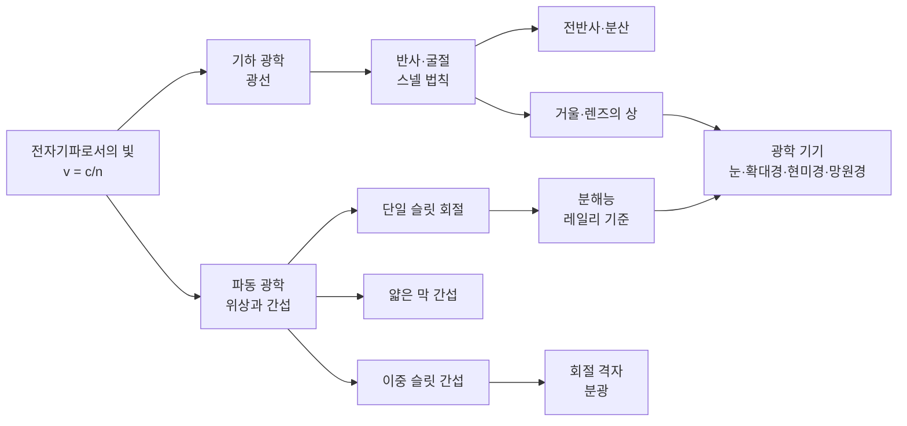

# 일반물리학 11. 빛과 광학 — 광선으로 상을 맺고, 파동으로 무늬를 읽는다
<!-- prev: emq-2, phy-3, uphy-6 -->
<!-- next: uphy-12, uearth-11 -->

> [!NOTE]
> **이 단원의 범위**
> - 빛의 반사와 굴절(스넬 법칙), 전반사, 분산
> - 거울과 얇은 렌즈의 상(거울·렌즈 방정식, 배율)
> - 광학 기기(눈, 확대경, 현미경, 망원경)
> - 영의 이중 슬릿 간섭과 얇은 막 간섭
> - 단일 슬릿 회절과 분해능(레일리 기준), 회절 격자

**학습 목표**

1. 굴절률과 스넬 법칙을 하위헌스 원리나 페르마 원리로 유도하고, 전반사의 임계각과 분산을 정량적으로 다룰 수 있다.
2. 부호 규약을 정해 거울 방정식·렌즈 방정식·렌즈 제작자 식을 적용하고, 상의 위치·종류·배율을 구할 수 있다.
3. 눈, 확대경, 현미경, 망원경의 배율을 렌즈 두 개 이상의 결합으로 계산하고, 시력 교정 렌즈의 굴절력을 구할 수 있다.
4. 이중 슬릿의 밝기 분포 $I = 4I_0\cos^2(\phi/2)$를 유도하고, 반사 위상 변화를 고려해 얇은 막 간섭 조건을 세울 수 있다.
5. 단일 슬릿 회절의 어두운 무늬 조건과 세기 분포를 이해하고, 레일리 기준으로 광학 기기의 분해능 한계를 계산할 수 있다.
6. 회절 격자의 밝은 무늬 조건, 분산, 분해능을 계산하고 분광 분석에 적용할 수 있다.

**이 단원의 학습 사다리**

| 단계 | 무엇을 하나? |
|---|---|
| STEP 1. 이전 학습 다시 보기 | 물리학 「빛과 물질」, 전자기와 양자 「빛과 정보 통신」, 일반물리학 「파동과 소리」에서 배운 굴절·렌즈·간섭·회절을 꺼내 본다 |
| STEP 2. 기초 다지기 | 작은 각 근사, 경로차와 위상차, 진폭 더하기와 세기, 극값 찾기(미분), 부호 규약 |
| STEP 3. 핵심 개념 | 반사·굴절 → 전반사·분산 → 거울 → 굴절면과 얇은 렌즈 → 광학 기기 → 이중 슬릿 → 얇은 막 → 단일 슬릿과 분해능 → 회절 격자 |
| STEP 4. 오개념 바로잡기 | "렌즈를 반쯤 가리면 상의 절반이 사라진다?", "배율만 높이면 더 작은 것이 보인다?" 같은 착각을 바로잡는다 |
| STEP 5. 다음 단계로 | 행렬 광학, 푸리에 광학, X선 회절, 간섭계 |
| STEP 6. 생활·산업·진로 | 광섬유 통신, 반도체 노광, 천체 망원경, 분광 분석 |

---

## 🗺️ 단원 들어가기

물이 담긴 컵에 꽂은 빨대는 꺾여 보이고, 비 갠 뒤 하늘에는 무지개가 뜬다. 안경 한 장이 흐릿한 세상을 또렷하게 바꾸고, 망원경은 수십억 광년 떨어진 은하를 보여 준다. 한편 비누 거품의 무지갯빛, CD 표면의 빛 띠, 먼 가로등 두 개가 한 점으로 합쳐 보이는 현상은 빛이 **파동**이기 때문에 생긴다.

앞 단원 「전자기 유도와 전자기파」에서 빛이 전자기파임을 보았다. 파장이 물체보다 훨씬 작을 때는 빛을 곧게 나아가는 **광선**으로 다루면 충분하다(기하 광학). 파장과 비슷한 크기의 틈이나 막을 만나면 **파동**의 성질이 드러난다(파동 광학). 이 단원은 두 관점을 차례로 다루고, 두 관점이 만나는 곳, 즉 "아무리 좋은 렌즈도 파장 때문에 넘을 수 없는 한계"까지 간다.

---

## STEP 1. 🔙 이전 학습 다시 보기

### 연계 개념표

| 이전 단원 | 고등학교에서는 여기까지 | 대학에서는 이렇게 확장 |
|---|---|---|
| 물리학 「빛과 물질」 '빛의 굴절', '볼록렌즈의 상' | 굴절률, 스넬 법칙, 볼록렌즈의 광선 추적(작도) | 스넬 법칙을 페르마 원리로 **유도**하고, 렌즈 방정식과 렌즈 제작자 식으로 상을 **계산**한다 |
| 물리학 「빛과 물질」 '빛의 간섭' | 이중 슬릿 간섭무늬, 경로차가 반파장의 짝수배·홀수배 | 무늬의 **밝기 분포** $\cos^2$를 유도하고, 회절 격자로 확장한다 |
| 전자기와 양자 「빛과 정보 통신」 '간섭과 회절', '얇은 막' | 얇은 막 간섭, 반사 방지 코팅, 회절과 분해능의 정성적 관계 | 반사 위상 변화로 막 두께를 계산하고, 레일리 기준 $1.22\lambda/D$로 분해능을 정량화한다 |
| 전자기와 양자 「빛과 정보 통신」 '렌즈와 거울로 만드는 광학 기기' | 카메라, 망원경, 현미경의 구조와 수차(정성적) | 각배율과 결합 렌즈 계산, 시력 교정의 굴절력(디옵터) |
| 일반물리학 「파동과 소리」 | (앞 대학 단원) 파동 함수, 중첩, 위상차와 간섭 | 같은 수학을 빛에 적용하고, 2차원 경계의 반사·굴절과 회절로 넓힌다 |

### 준비 운동 (사전 진단)

**Q1.** 빛이 공기에서 굴절률 1.50인 유리로 들어가면 속력, 진동수, 파장 중 변하지 않는 것은?

**Q2.** 초점 거리 $10\ \mathrm{cm}$인 볼록렌즈 앞 $15\ \mathrm{cm}$에 물체를 두면 상은 렌즈 뒤 몇 cm에 생기는가? 똑바로 선 상인가, 거꾸로 선 상인가?

**Q3.** 두 파동이 같은 진폭 $A$로 만난다. 위상차가 0일 때와 $\pi$일 때 합성 진폭은? 세기는 한 파동의 몇 배인가?

**Q4.** $\theta = 0.010\ \mathrm{rad}$일 때 $\sin\theta$, $\tan\theta$, $\theta$를 비교하시오.

정답 및 해설

**Q1.** 진동수. 진동수는 광원이 정하며 경계에서 바뀌지 않는다. 속력은 $c/n$, 파장은 $\lambda_0/n$으로 줄어든다.

**Q2.** $\frac{1}{15} + \frac{1}{i} = \frac{1}{10}$ → $i = 30\ \mathrm{cm}$. 렌즈 뒤에 생기는 실상이며 거꾸로 선 상(배율 $-2$)이다.

**Q3.** 위상차 0: 진폭 $2A$, 세기 4배. 위상차 $\pi$: 진폭 0, 세기 0. 세기는 진폭의 제곱에 비례하므로 "에너지가 2배"가 아니라 밝은 곳은 4배, 어두운 곳은 0이 되어 평균이 2배이다.

**Q4.** $\sin\theta \approx 0.0099998$, $\tan\theta \approx 0.0100003$, $\theta = 0.010$. 상대 차이가 $10^{-5}$ 수준이므로 작은 각에서는 셋을 같게 놓아도 된다.

---

## STEP 2. 🧱 기초 다지기

### ① 작은 각 근사

라디안으로 잰 각 $\theta$가 작을 때(대략 $0.1\ \mathrm{rad} \approx 6^\circ$ 이하)

$$
\sin\theta \approx \tan\theta \approx \theta, \qquad \cos\theta \approx 1 - \frac{\theta^2}{2}
$$

광축 가까이 지나는 광선(**근축 광선**)만 생각하면 거울·렌즈 식이 간단해지고, 간섭무늬가 스크린에서 등간격이 된다. 근사가 깨지는 곳에서 **수차**가 생긴다.

### ② 광학적 경로 길이와 위상차

굴절률 $n$인 매질에서 길이 $L$을 지나는 동안 빛의 파장은 $\lambda_0/n$이므로, 진공에서 $nL$을 간 것과 같은 수의 파장이 들어간다. $nL$을 **광학적 경로 길이**라 한다. 두 경로의 광학적 경로차가 $\Delta$이면 위상차는

$$
\phi = \frac{2\pi}{\lambda_0}\Delta
$$

| 경로차 $\Delta$ | 위상차 $\phi$ | 결과 |
|---|---|---|
| $m\lambda$ ($m = 0, 1, 2, \ldots$) | $2\pi m$ | 보강 간섭 |
| $(m + \frac{1}{2})\lambda$ | $(2m + 1)\pi$ | 상쇄 간섭 |

### ③ 진폭을 더한 뒤 제곱한다

같은 진동수의 두 파동 $E_1 = E_0\sin\omega t$, $E_2 = E_0\sin(\omega t + \phi)$를 더하면 삼각 함수의 합 공식으로

$$
E_1 + E_2 = 2E_0\cos\frac{\phi}{2}\,\sin\!\left(\omega t + \frac{\phi}{2}\right)
$$

세기는 진폭의 제곱에 비례하므로 $I = 4I_0\cos^2(\phi/2)$이다. 페이저로 보면 길이 $E_0$인 두 화살표가 각 $\phi$를 이루고 더해지는 그림이다(「전자기 유도와 전자기파」 STEP 2 ⑤). 여러 파동을 더할 때도 화살표를 이어 붙이면 된다.

### ④ 미분으로 극값 찾기

어떤 양 $t(x)$가 최소가 되는 $x$는 $dt/dx = 0$에서 찾는다. 페르마 원리로 굴절 법칙을 유도할 때 이 방법을 쓴다.

### ⑤ 부호 규약 — 이 단원의 약속

| 양 | 양(+)일 때 | 음(−)일 때 |
|---|---|---|
| 물체 거리 $p$ | 실물체(빛이 들어오는 쪽에 있음) | 허물체(앞 렌즈가 만든 상이 다음 렌즈 뒤에 있을 때) |
| 상 거리 $i$ | 실상(빛이 나가는 쪽: 거울은 앞, 렌즈는 뒤) | 허상(반대쪽) |
| 초점 거리 $f$ | 오목 거울, 볼록렌즈(수렴) | 볼록 거울, 오목렌즈(발산) |
| 곡률 반지름 $r$ (굴절면) | 곡률 중심이 빛이 나가는 쪽에 있음 | 곡률 중심이 빛이 들어오는 쪽에 있음 |
| 배율 $m$ | 똑바로 선 상 | 거꾸로 선 상 |

> [!TIP]
> 💡 **요령** — "실(實)은 양수"라고 기억하자. 실제로 빛이 모이거나 실제로 빛이 출발하는 쪽이 양수이다. 부호 규약은 책마다 다를 수 있으니, 한 문제 안에서는 한 가지 규약을 끝까지 지키는 것이 중요하다.

---

## STEP 3. 📘 핵심 개념

### ① 빛의 반사와 굴절 — 스넬 법칙

#### 굴절률

매질 속 빛의 속력이 $v$일 때 **굴절률**(index of refraction)은 $n = c/v$이다. 전자기파의 관점에서 $v = 1/\sqrt{\mu\varepsilon}$이므로, 굴절률은 매질이 전기장에 얼마나 반응하는지(유전율)를 반영한다.

| 물질 | 굴절률(노란빛 기준, 약) |
|---|---|
| 진공 | 1 (정의) |
| 공기(1기압, 상온) | 1.0003 |
| 물 | 1.33 |
| 보통 유리 | 1.5 안팎 |
| 다이아몬드 | 2.42 |

#### 반사 법칙과 굴절 법칙

경계에 들어온 빛의 일부는 반사하고 일부는 굴절한다. 각은 모두 **법선**에서 잰다.

$$
\theta_1' = \theta_1\ (\text{반사}), \qquad n_1\sin\theta_1 = n_2\sin\theta_2\ (\text{스넬 법칙})
$$

#### 페르마 원리로 유도하기

**페르마 원리**는 "빛은 두 점 사이를 이동 시간이 극값(보통 최소)이 되는 경로로 간다"는 것이다. 매질 1의 점 $P$(경계에서 높이 $a$)에서 매질 2의 점 $Q$(경계에서 깊이 $b$)로 가는 빛이 경계의 $x$ 지점을 지난다고 하자. 두 점의 수평 거리를 $d$라 하면

$$
t(x) = \frac{\sqrt{a^2 + x^2}}{v_1} + \frac{\sqrt{b^2 + (d - x)^2}}{v_2}
$$

$$
\frac{dt}{dx} = \frac{x}{v_1\sqrt{a^2 + x^2}} - \frac{d - x}{v_2\sqrt{b^2 + (d - x)^2}} = \frac{\sin\theta_1}{v_1} - \frac{\sin\theta_2}{v_2} = 0
$$

$v = c/n$을 넣으면 $n_1\sin\theta_1 = n_2\sin\theta_2$이다. 하위헌스 원리로도 같은 결과가 나오며, 근본적으로는 경계에서 전자기파의 위상이 이어져야 한다는 조건과 같다.

> [!TIP]
> 💡 **비유** — 모래사장에서 바다에 빠진 사람을 구하러 가는 구조 요원은 일직선으로 뛰지 않는다. 빠른 모래 위를 조금 더 달리고 느린 물속 거리를 줄인다. 시간을 가장 줄이는 지점에서 '꺾어 들어가는' 이 경로가 바로 굴절 경로이다.

<!-- fig:uphy-11-fermat-lifeguard -->

#### 예제 1 — 물속으로 들어가는 빛

공기에서 물($n = 1.33$)로 입사각 $40^\circ$로 빛이 들어간다. (1) 굴절각, (2) 물속 빛의 속력, (3) 진공 파장이 $589\ \mathrm{nm}$일 때 물속 파장을 구하시오. ($c = 3.00\times10^8\ \mathrm{m/s}$)

**풀이**
(1) $\sin\theta_2 = \sin40^\circ/1.33 = 0.483$ → $\theta_2 \approx 28.9^\circ$
(2) $v = c/n \approx 2.26\times10^8\ \mathrm{m/s}$
(3) $\lambda = 589/1.33 \approx 443\ \mathrm{nm}$. 그래도 눈에는 같은 색(노란빛)으로 보인다. 색을 정하는 것은 진동수이고, 눈 속 액체에서도 같은 일이 일어나기 때문이다.

#### 평평한 면의 겉보기 깊이

물속 깊이 $h$인 동전을 바로 위에서 보면, 작은 각 근사로 $n_{\text{물}}\theta_1 = n_{\text{공기}}\theta_2$이므로 겉보기 깊이는 $h' = h(n_{\text{공기}}/n_{\text{물}}) \approx h/1.33$이다. 깊이 $1.0\ \mathrm{m}$인 수영장 바닥은 약 $0.75\ \mathrm{m}$로 보인다. 수영장이 실제보다 얕아 보이는 이유이다.

#### ✔ 바로 확인

1. 굴절률 1.50인 유리 속에서 빛의 속력은? ($c = 3.00\times10^8\ \mathrm{m/s}$)
2. (O/X) 빛이 공기에서 물로 들어갈 때 진동수는 그대로이고 파장이 짧아진다.
3. 실제 깊이 $2.0\ \mathrm{m}$인 물속 바닥을 바로 위에서 보면 겉보기 깊이는 약 몇 m인가? (물 $n = 1.33$)

정답

1. $2.00\times10^8\ \mathrm{m/s}$ — $v = c/n$
2. O — 경계에서 파동이 이어지려면 진동수가 같아야 하고, $\lambda = \lambda_0/n$이다.
3. 약 $1.5\ \mathrm{m}$ — $h' = h/1.33$

### ② 전반사와 분산

#### 전반사

빛이 굴절률이 큰 매질에서 작은 매질로($n_1 > n_2$) 나갈 때, 입사각이 **임계각**

$$
\sin\theta_c = \frac{n_2}{n_1}
$$

보다 크면 굴절광이 없어지고 모두 반사한다. 이것이 **전반사**(total internal reflection)이다. 물–공기 경계의 임계각은 약 $48.8^\circ$, 다이아몬드–공기는 약 $24.4^\circ$이다. 다이아몬드는 임계각이 작아 안으로 들어온 빛이 여러 번 전반사한 뒤 위로 나오므로 반짝인다.

#### 광섬유

광섬유는 굴절률이 조금 큰 **코어**를 굴절률이 조금 작은 **클래딩**이 감싼 구조이다. 코어 안에서 경계에 임계각보다 크게 닿는 빛은 전반사를 거듭하며 수십 km를 간다.

<!-- fig:uphy-11-fiber-acceptance -->

#### 예제 2 — 광섬유가 받아들이는 빛의 각

코어 $n_1 = 1.48$, 클래딩 $n_2 = 1.46$인 광섬유의 (1) 코어–클래딩 임계각, (2) 공기 중에서 광섬유 끝면으로 들어와 전반사될 수 있는 최대 입사각을 구하시오.

**풀이**
(1) $\sin\theta_c = 1.46/1.48$ → $\theta_c \approx 80.6^\circ$
(2) 끝면에서 굴절각 $\theta_r$인 빛이 옆면에 닿는 입사각은 $90^\circ - \theta_r$이다. 이것이 $\theta_c$ 이상이려면 $\cos\theta_r \ge n_2/n_1$이어야 한다. 끝면에서 $\sin\theta_{\max} = n_1\sin\theta_r$이므로
$\sin\theta_{\max} = n_1\sqrt{1 - (n_2/n_1)^2} = \sqrt{n_1^2 - n_2^2} = \sqrt{2.1904 - 2.1316} \approx 0.243$ → $\theta_{\max} \approx 14.0^\circ$
- 의미: $\sqrt{n_1^2 - n_2^2}$를 **개구수**(numerical aperture)라 한다. 굴절률 차가 작은 광섬유는 받아들이는 각이 좁지만, 경로 길이 차가 작아 신호가 덜 퍼진다.

#### 분산

굴절률은 파장에 따라 조금씩 다르다. 대부분의 투명 물질에서 **파장이 짧을수록 굴절률이 크다.** 이 때문에 프리즘을 지난 백색광이 색으로 갈라지는데, 이를 **분산**(dispersion)이라 한다.

어떤 유리의 굴절률이 빨간빛에서 1.513, 보랏빛에서 1.532라면, 공기에서 입사각 $50^\circ$로 들어간 빛의 굴절각은 빨강 약 $30.4^\circ$, 보라 약 $30.0^\circ$이다. 면 하나에서는 $0.4^\circ$ 정도 차이지만, 프리즘의 두 면을 지나며 차이가 더 벌어진다.

| 분산이 만드는 것 | 설명 |
|---|---|
| 무지개 | 물방울 안에서 굴절–반사–굴절하며 색마다 나오는 각이 다르다. 햇빛 반대 방향에서 약 $42^\circ$(빨강)와 약 $40^\circ$(보라) 근처에 밝게 보인다 |
| 렌즈의 색수차 | 색마다 초점 거리가 달라 상의 가장자리에 색 번짐이 생긴다. 분산이 다른 유리 두 장을 붙인 색지움 렌즈로 줄인다 |
| 광섬유의 색분산 | 파장마다 속력이 달라 짧은 빛 펄스가 퍼진다. 통신 속도를 제한하는 요인이다 |

무지개와 프리즘이 펼쳐 놓는 색의 차례는 같다.

<!-- photo:uphy-11-rainbow-prism -->

#### ✔ 바로 확인

1. 빈칸: 전반사는 빛이 굴절률이 (    ) 매질에서 (    ) 매질로 나갈 때만 일어난다.
2. 굴절률 1.50인 유리와 공기 경계의 임계각은?
3. (O/X) 대부분의 유리에서 보랏빛의 굴절률은 빨간빛보다 작다.

정답

1. 큰, 작은 — $\sin\theta_c = n_2/n_1$이 1보다 작아야 한다.
2. 약 $41.8^\circ$ — $\sin\theta_c = 1/1.50$
3. X — 파장이 짧을수록 굴절률이 크므로 보랏빛이 더 크게 꺾인다.

### ③ 거울의 상

#### 평면거울과 구면 거울

평면거울은 물체와 같은 크기의 허상을 거울 뒤 같은 거리에 만든다. 구면 거울에서 근축 광선은 곡률 반지름의 절반 지점에 모인다. 즉 초점 거리는 $f = r/2$이다(오목 거울 $f > 0$, 볼록 거울 $f < 0$).

#### 거울 방정식과 배율

물체 거리 $p$, 상 거리 $i$일 때(STEP 2 ⑤의 규약)

$$
\frac{1}{p} + \frac{1}{i} = \frac{1}{f}, \qquad m = -\frac{i}{p}
$$

**유도의 요점**: 물체 끝에서 거울 꼭짓점으로 간 광선은 광축에 대해 같은 각으로 반사하고, 곡률 중심을 지나는 광선은 제자리로 되돌아온다. 두 광선이 만나는 점에서 닮은 삼각형을 세우고 작은 각 근사를 쓰면 위 식이 나온다.

| 오목 거울에서 물체 위치 | 상의 위치 | 상의 종류 |
|---|---|---|
| $p > 2f$ | $f < i < 2f$ | 실상, 거꾸로, 축소 |
| $p = 2f$ | $i = 2f$ | 실상, 거꾸로, 같은 크기 |
| $f < p < 2f$ | $i > 2f$ | 실상, 거꾸로, 확대 |
| $p < f$ | $i < 0$ (거울 뒤) | 허상, 똑바로, 확대 |
| 볼록 거울(모든 $p$) | $i < 0$, $\lvert i\rvert < \lvert f\rvert$ | 허상, 똑바로, 축소 |

<!-- sim:u-mirror-lens -->

#### 예제 3 — 오목 거울과 볼록 거울

(1) 초점 거리 $20\ \mathrm{cm}$인 오목 거울 앞 $30\ \mathrm{cm}$와 (2) $10\ \mathrm{cm}$에 물체를 둘 때, (3) 초점 거리 $-30\ \mathrm{cm}$인 볼록 거울(자동차 측면 거울) 앞 $60\ \mathrm{cm}$에 물체가 있을 때 상의 위치와 배율을 구하시오.

**풀이**
(1) $\frac{1}{i} = \frac{1}{20} - \frac{1}{30} = \frac{1}{60}$ → $i = 60\ \mathrm{cm}$, $m = -2$. 거울 앞 실상, 거꾸로, 2배
(2) $\frac{1}{i} = \frac{1}{20} - \frac{1}{10} = -\frac{1}{20}$ → $i = -20\ \mathrm{cm}$, $m = +2$. 거울 뒤 허상, 똑바로, 2배(화장용 거울)
(3) $\frac{1}{i} = -\frac{1}{30} - \frac{1}{60} = -\frac{1}{20}$ → $i = -20\ \mathrm{cm}$, $m = +\frac{1}{3}$

<!-- fig:uphy-11-q-mirror-rays -->

- 의미: 볼록 거울은 상을 작게 만들어 넓은 범위를 보여 주지만, 상이 작으므로 물체가 실제보다 **멀리 있는 것처럼** 느껴진다. 측면 거울에 "사물이 보이는 것보다 가까이 있음"이라고 적힌 이유이다.

#### ✔ 바로 확인

1. 곡률 반지름 $40\ \mathrm{cm}$인 오목 거울의 초점 거리는?
2. 초점 거리 $20\ \mathrm{cm}$인 오목 거울 앞 $60\ \mathrm{cm}$에 물체가 있다. 상 거리와 배율은?
3. (O/X) 볼록 거울은 물체 위치와 관계없이 똑바로 선 축소 허상을 만든다.

정답

1. $20\ \mathrm{cm}$ — $f = r/2$
2. $i = 30\ \mathrm{cm}$, $m = -0.5$ — $\frac{1}{i} = \frac{1}{20} - \frac{1}{60}$, 거꾸로 선 축소 실상
3. O — $f < 0$이므로 늘 $i < 0$, $0 < m < 1$이다.

### ④ 굴절면과 얇은 렌즈

#### 구면 굴절면 하나

굴절률 $n_1$인 쪽의 물체가 곡률 반지름 $r$인 구면을 지나 굴절률 $n_2$인 쪽에 상을 맺을 때, 근축 근사에서

$$
\frac{n_1}{p} + \frac{n_2}{i} = \frac{n_2 - n_1}{r}
$$

평평한 면($r \to \infty$)이면 $i = -(n_2/n_1)p$로, ①의 겉보기 깊이가 된다.

#### 렌즈 제작자 식과 렌즈 방정식

얇은 렌즈는 굴절면 두 개이다. 첫 면이 만든 상을 둘째 면의 물체로 삼아 두 식을 더하고 렌즈 두께를 0으로 보내면

$$
\frac{1}{f} = (n - 1)\left(\frac{1}{r_1} - \frac{1}{r_2}\right), \qquad \frac{1}{p} + \frac{1}{i} = \frac{1}{f}, \qquad m = -\frac{i}{p}
$$

첫 식이 **렌즈 제작자 식**(lensmaker's equation)이다(공기 중 렌즈, $n$은 렌즈의 굴절률). 렌즈 방정식은 거울 방정식과 모양이 같지만, 렌즈에서는 상이 **렌즈 뒤**에 생길 때 $i > 0$(실상)이다.

| 볼록렌즈($f > 0$)에서 물체 위치 | 상 |
|---|---|
| $p > 2f$ | 렌즈 뒤 $f$와 $2f$ 사이, 실상, 거꾸로, 축소(카메라, 눈) |
| $f < p < 2f$ | 렌즈 뒤 $2f$ 바깥, 실상, 거꾸로, 확대(영사기) |
| $p < f$ | 렌즈 앞, 허상, 똑바로, 확대(돋보기) |
| 오목렌즈($f < 0$) | 항상 렌즈 앞, 허상, 똑바로, 축소 |

#### 예제 4 — 렌즈 만들기

굴절률 1.50인 유리로 양쪽이 볼록한 렌즈를 만들었다. 빛이 들어오는 첫 면의 곡률 반지름은 $20\ \mathrm{cm}$, 둘째 면은 $30\ \mathrm{cm}$이다. (1) 초점 거리를 구하고, (2) 렌즈 앞 $36\ \mathrm{cm}$에 둔 물체의 상을 구하시오. (3) 이 렌즈를 물($n = 1.33$) 속에 넣으면 초점 거리는 어떻게 되는가?

**풀이**
(1) 첫 면은 곡률 중심이 렌즈 뒤(빛이 나가는 쪽)에 있으므로 $r_1 = +20\ \mathrm{cm}$, 둘째 면은 곡률 중심이 렌즈 앞에 있으므로 $r_2 = -30\ \mathrm{cm}$.
$\frac{1}{f} = 0.50\left(\frac{1}{20} + \frac{1}{30}\right) = \frac{1}{24}$ → $f = 24\ \mathrm{cm}$
(2) $\frac{1}{i} = \frac{1}{24} - \frac{1}{36} = \frac{1}{72}$ → $i = 72\ \mathrm{cm}$, $m = -2$. 렌즈 뒤 실상, 거꾸로, 2배
(3) 물속에서는 $(n - 1)$ 대신 $(n_{\text{렌즈}}/n_{\text{물}} - 1) = 0.128$이 들어가므로 $f \approx 24\times0.50/0.128 \approx 94\ \mathrm{cm}$로 약 4배 길어진다. 물속에서 눈을 뜨면 흐릿하게 보이는 이유와 같다(각막과 물의 굴절률 차가 작아진다).

#### 렌즈 두 개의 결합

첫 렌즈가 만든 상을 둘째 렌즈의 물체로 삼아 차례로 계산한다. 전체 배율은 각 배율의 곱 $m = m_1m_2$이다. 첫 상이 둘째 렌즈 뒤에 생기면 둘째 렌즈에게는 허물체($p_2 < 0$)이다. 두 얇은 렌즈를 붙이면 $1/f = 1/f_1 + 1/f_2$로, **굴절력**(단위 디옵터, $\mathrm{D} = \mathrm{m^{-1}}$) $P = 1/f$가 더해진다.

#### ✔ 바로 확인

1. 초점 거리 $10\ \mathrm{cm}$인 볼록렌즈 앞 $15\ \mathrm{cm}$에 물체가 있다. 상 거리와 배율은?
2. 굴절력 $+2.0\ \mathrm{D}$와 $-0.50\ \mathrm{D}$인 얇은 렌즈를 붙이면 합성 초점 거리는?
3. (O/X) 렌즈 방정식에서 $i > 0$이면 상은 렌즈 앞(물체 쪽)에 생긴다.

정답

1. $i = 30\ \mathrm{cm}$, $m = -2$ — 렌즈 뒤 실상, 거꾸로, 2배
2. 약 $67\ \mathrm{cm}$ — 굴절력이 더해져 $1.5\ \mathrm{D}$, $f = 1/1.5\ \mathrm{m}$
3. X — 렌즈에서 $i > 0$은 빛이 나가는 쪽, 즉 렌즈 뒤의 실상이다.

### ⑤ 광학 기기 — 눈, 확대경, 현미경, 망원경

#### 눈과 시력 교정

눈은 각막과 수정체가 함께 볼록렌즈 역할을 하여 망막에 실상을 맺는다. 굴절의 대부분은 공기–각막 경계에서 일어나고, 수정체는 모양을 바꾸어 초점 거리를 조절한다(**조절**). 또렷이 볼 수 있는 가장 가까운 거리를 **근점**, 가장 먼 거리를 **원점**이라 하며, 표준 근점은 $25\ \mathrm{cm}$로 잡는다.

| 시력 문제 | 원인 | 교정 렌즈 |
|---|---|---|
| 근시 | 원점이 무한대보다 가깝다(상이 망막 앞) | 오목렌즈: 무한대의 물체를 원점에 허상으로 |
| 원시·노안 | 근점이 $25\ \mathrm{cm}$보다 멀다 | 볼록렌즈: $25\ \mathrm{cm}$의 물체를 근점에 허상으로 |
| 난시 | 각막이 방향에 따라 곡률이 다르다 | 원기둥 렌즈 |

#### 예제 5 — 안경의 굴절력

(1) 원점이 $50\ \mathrm{cm}$인 근시인 사람과 (2) 근점이 $100\ \mathrm{cm}$인 원시인 사람에게 필요한 안경의 굴절력을 구하시오(안경과 눈 사이 거리는 무시).

**풀이**
(1) $p = \infty$, $i = -50\ \mathrm{cm}$ → $\frac{1}{f} = 0 - \frac{1}{0.50\ \mathrm{m}}$ → $P = -2.0\ \mathrm{D}$
(2) $p = 25\ \mathrm{cm}$, $i = -100\ \mathrm{cm}$ → $\frac{1}{f} = \frac{1}{0.25} - \frac{1}{1.00} = 3.0\ \mathrm{m^{-1}}$ → $P = +3.0\ \mathrm{D}$
- 의미: 안경 처방전의 "−2.00"은 굴절력 $-2.0\ \mathrm{D}$, 즉 초점 거리 $-50\ \mathrm{cm}$인 오목렌즈를 뜻한다.

#### 확대경

물체가 크게 보인다는 것은 망막의 상이 크다는 것, 즉 물체가 눈에 만드는 **각**이 크다는 것이다. 맨눈으로 가장 크게 보는 방법은 근점($25\ \mathrm{cm}$)에 두는 것이고, 이때 각은 $\theta_0 \approx h/25\ \mathrm{cm}$이다. 초점 거리 $f$인 볼록렌즈의 초점 근처에 물체를 두면 상이 무한대에 생기고 각은 $\theta \approx h/f$이다. **각배율**은

$$
m_\theta = \frac{\theta}{\theta_0} \approx \frac{25\ \mathrm{cm}}{f}
$$

초점 거리 $5.0\ \mathrm{cm}$인 돋보기의 각배율은 약 5배이다.

#### 복합 현미경

물체를 대물렌즈의 초점 바로 바깥에 두어 확대된 실상을 만들고, 그 실상을 접안렌즈로 확대경처럼 본다. 대물렌즈의 뒤 초점과 접안렌즈의 앞 초점 사이 거리를 $s$(경통 길이)라 하면

$$
M = m_{\text{대물}}\times m_{\theta,\text{접안}} \approx -\frac{s}{f_{\text{대물}}}\cdot\frac{25\ \mathrm{cm}}{f_{\text{접안}}}
$$

$f_{\text{대물}} = 4.0\ \mathrm{mm}$, $f_{\text{접안}} = 25\ \mathrm{mm}$, $s = 160\ \mathrm{mm}$이면 $M \approx -40\times10 = -400$배이다.

#### 망원경

천체처럼 먼 물체는 대물렌즈(또는 오목 거울)의 초점면에 실상을 만들고, 접안렌즈로 그 상을 본다. 두 렌즈 사이 거리는 약 $f_{\text{대물}} + f_{\text{접안}}$이고 각배율은

$$
m_\theta = -\frac{f_{\text{대물}}}{f_{\text{접안}}}
$$

<!-- fig:uphy-11-microscope-telescope -->

| 망원경에서 중요한 것 | 무엇으로 정해지나 |
|---|---|
| 각배율 | $f_{\text{대물}}/f_{\text{접안}}$ |
| 집광력(어두운 천체를 보는 능력) | 구경의 제곱 $D^2$ |
| 분해능(가까운 두 별을 구별하는 능력) | $\lambda/D$ (⑧) |

큰 렌즈는 무겁고 색수차가 있으므로 대형 천체 망원경은 오목 거울을 쓰는 **반사 망원경**이다. 배율은 접안렌즈만 바꾸어도 키울 수 있지만, 구경이 정하는 분해능을 넘을 수는 없다.

#### ✔ 바로 확인

1. 초점 거리 $2.5\ \mathrm{cm}$인 확대경의 각배율은?
2. 대물렌즈 초점 거리 $100\ \mathrm{cm}$, 접안렌즈 $2.0\ \mathrm{cm}$인 망원경의 각배율 크기는?
3. 근시를 교정하는 렌즈는 볼록렌즈와 오목렌즈 중 어느 것인가?

정답

1. 약 10배 — $m_\theta \approx 25\ \mathrm{cm}/f$
2. 50배 — $f_{\text{대물}}/f_{\text{접안}}$
3. 오목렌즈 — 무한대의 물체를 원점에 허상으로 만든다.

### ⑥ 영의 이중 슬릿 간섭

#### 밝고 어두운 무늬의 위치

1801년 무렵 영은 빛을 두 틈에 통과시켜 줄무늬를 보여 빛의 파동성을 입증했다. 간격 $d$인 두 슬릿에서 멀리($L \gg d$) 떨어진 스크린의 각 $\theta$ 방향으로 가는 두 빛의 경로차는 $\Delta = d\sin\theta$이다.

$$
\text{밝은 무늬: } d\sin\theta = m\lambda, \qquad \text{어두운 무늬: } d\sin\theta = \left(m + \tfrac{1}{2}\right)\lambda \qquad (m = 0, \pm1, \pm2, \ldots)
$$

작은 각에서 스크린 위치는 $y = L\tan\theta \approx L\theta$이므로 이웃한 밝은 무늬 사이 간격은

$$
\Delta y = \frac{\lambda L}{d}
$$

<!-- fig:uphy-11-double-slit-geometry -->

#### 밝기 분포

STEP 2 ③에서 위상차 $\phi = \dfrac{2\pi d\sin\theta}{\lambda}$인 두 파동의 세기는

$$
I(\theta) = 4I_0\cos^2\!\left(\frac{\pi d\sin\theta}{\lambda}\right)
$$

($I_0$는 슬릿 하나만 열었을 때의 세기) 밝은 곳은 $4I_0$, 어두운 곳은 0이고, 스크린 전체의 평균은 $2I_0$이다. 간섭은 에너지를 만들거나 없애지 않고 **재배치**할 뿐이다.

간섭무늬가 보이려면 두 빛의 위상차가 시간에 따라 일정해야 한다(**결맞음**, coherence). 서로 다른 전구 두 개의 빛은 위상이 무작위로 바뀌어 무늬가 평균되어 사라진다. 영은 한 광원의 빛을 두 슬릿으로 나누어 이 문제를 해결했고, 오늘날에는 결맞음이 좋은 레이저를 쓴다.

#### 예제 6 — 레이저 이중 슬릿

파장 $633\ \mathrm{nm}$인 레이저를 간격 $0.20\ \mathrm{mm}$인 이중 슬릿에 비추고 $1.5\ \mathrm{m}$ 떨어진 스크린에서 관찰한다. (1) 무늬 간격, (2) 중앙에서 셋째 밝은 무늬까지의 거리, (3) 중앙 밝은 무늬에서 $\Delta y/4$ 떨어진 곳의 세기(중앙 대비)를 구하시오.

**풀이**
(1) $\Delta y = \dfrac{(633\times10^{-9})(1.5)}{0.20\times10^{-3}} \approx 4.7\ \mathrm{mm}$ (정확히 $4.75\ \mathrm{mm}$)
(2) $3\Delta y \approx 14\ \mathrm{mm}$
(3) $\Delta y/4$에서 경로차는 $\lambda/4$, 위상차는 $\pi/2$이므로 $I = 4I_0\cos^2(\pi/4) = 2I_0$. 중앙의 절반이다.
- 의미: $\Delta y$가 mm 단위로 커지는 것은 $L/d$가 약 7500배이기 때문이다. 아주 작은 파장을 눈으로 잴 수 있는 크기로 '확대'하는 장치인 셈이다.

#### 한쪽 슬릿에 얇은 판을 놓으면

한 슬릿 앞에 두께 $t$, 굴절률 $n$인 투명한 판을 놓으면 그 경로의 광학적 길이가 $(n - 1)t$만큼 늘어나 무늬 전체가 이동한다. 무늬가 $k$개만큼 옮겨 가면 $(n - 1)t = k\lambda$이다. 이 원리로 아주 얇은 막의 두께나 기체의 굴절률을 잰다(간섭계).

#### ✔ 바로 확인

1. 파장 $500\ \mathrm{nm}$, 슬릿 간격 $0.50\ \mathrm{mm}$, 스크린 거리 $2.0\ \mathrm{m}$일 때 무늬 간격은?
2. 두 슬릿에서 오는 빛의 경로차가 $1.5\lambda$인 곳은 밝은가, 어두운가?
3. (O/X) 이중 슬릿 간섭에서 어두운 무늬의 에너지는 사라진다.

정답

1. $2.0\ \mathrm{mm}$ — $\Delta y = \lambda L/d$
2. 어둡다 — $(m + \frac{1}{2})\lambda$ 꼴($m = 1$)이다.
3. X — 에너지는 밝은 무늬로 재배치될 뿐이며 평균 세기는 $2I_0$이다.

### ⑦ 얇은 막 간섭

#### 반사에서 생기는 위상 변화

빛이 굴절률이 **더 큰** 매질의 경계에서 반사하면 위상이 $\pi$만큼(반파장) 바뀌고, **더 작은** 매질의 경계에서 반사하면 바뀌지 않는다. 줄의 고정단·자유단 반사(「파동과 소리」)와 같은 성질이다.

#### 간섭 조건

두께 $L$, 굴절률 $n_2$인 막에 빛이 거의 수직으로 비칠 때, 윗면 반사광과 아랫면 반사광의 광학적 경로차는 $2n_2L$이다. 반사 위상 변화를 함께 따져 조건을 정한다.

| 두 반사 중 위상이 뒤집히는 것 | 반사광 보강 | 반사광 상쇄 | 예 |
|---|---|---|---|
| 한쪽만 | $2n_2L = (m + \frac{1}{2})\lambda$ | $2n_2L = m\lambda$ | 공기 속 비누막, 물 위의 기름막 |
| 둘 다 또는 둘 다 아님 | $2n_2L = m\lambda$ | $2n_2L = (m + \frac{1}{2})\lambda$ | 유리 위의 반사 방지막 |

($\lambda$는 진공 파장, $m = 0, 1, 2, \ldots$) 막이 매우 얇으면($L \ll \lambda$) 경로차가 거의 0이므로 위상 변화만 남는다. 비누막이 터지기 직전 위쪽이 검게 보이는 것은 한쪽만 위상이 뒤집혀 반사광이 상쇄되기 때문이다.

<!-- fig:uphy-11-thin-film-phase -->

#### 예제 7 — 비누막의 색

공기 중에 있는 두께 $320\ \mathrm{nm}$, 굴절률 1.33인 비누막을 수직으로 비춘 백색광의 반사광에서 가장 강한 가시광선의 파장은?

**풀이** 윗면(공기→막) 반사만 위상이 뒤집히므로 반사 보강 조건은 $2n_2L = (m + \frac{1}{2})\lambda$.
$2n_2L = 2\times1.33\times320 = 851\ \mathrm{nm}$ → $\lambda = 851/(m + 0.5)$: $m = 0$이면 $1702\ \mathrm{nm}$, $m = 1$이면 약 $567\ \mathrm{nm}$, $m = 2$이면 $340\ \mathrm{nm}$.
가시광선 영역(약 $400$~$700\ \mathrm{nm}$)에 드는 것은 약 $567\ \mathrm{nm}$(연두~노랑)이다. 막 두께가 위치마다 달라 색 띠가 생긴다.

<!-- photo:uphy-11-soap-bubble-colors -->

#### 반사 방지 코팅

유리($n = 1.50$)에 플루오린화 마그네슘($n = 1.38$) 막을 입히면 두 반사 모두 위상이 뒤집히므로, 반사광 상쇄 조건은 $2n_2L = \frac{1}{2}\lambda$(가장 얇은 경우), 즉 $L = \lambda/4n_2$이다. 초록빛 $550\ \mathrm{nm}$에 맞추면 $L \approx 99.6\ \mathrm{nm}$, 약 $100\ \mathrm{nm}$이다.

> [!NOTE]
> 단일 막으로는 반사가 완전히 0이 되지 않는다. 두 반사광의 진폭이 같아야 완전히 상쇄되는데, 그러려면 막의 굴절률이 $\sqrt{1.50} \approx 1.22$여야 한다. 플루오린화 마그네슘 막은 수직 입사 반사율을 약 4%에서 약 1.4%로 줄인다. 반사되지 않은 에너지는 **투과**로 간다. 카메라 렌즈는 굴절률이 다른 여러 층을 쌓아 넓은 파장에서 반사를 더 줄인다.

#### 쐐기 모양 공기층

유리판 두 장의 한쪽 끝을 붙이고 다른 끝에 가는 철사(지름 $D$)를 끼우면 두께가 고르게 변하는 공기층이 생긴다. 판 길이가 $\ell$이면 두께가 $\lambda/2$ 변할 때마다 무늬 하나가 생기므로 무늬 간격은 $\Delta x = \lambda\ell/2D$이다. 무늬가 휘어 있으면 판의 표면이 평평하지 않은 것이다. 광학 부품의 평면도를 이렇게 검사한다. 볼록 렌즈를 평평한 유리 위에 얹으면 가운데를 중심으로 두께가 같은 곳이 원을 이루므로 동심원 무늬(뉴턴 고리)가 생긴다.

<!-- photo:uphy-11-newton-rings -->

#### ✔ 바로 확인

1. (O/X) 빛이 굴절률이 더 큰 매질의 경계에서 반사하면 위상이 $\pi$만큼 바뀐다.
2. 유리($n = 1.50$) 위 플루오린화 마그네슘($n = 1.38$) 막이 파장 $600\ \mathrm{nm}$의 반사를 없애는 가장 얇은 두께는?
3. 터지기 직전의 아주 얇은 비누막 윗부분은 반사광에서 어떻게 보이는가?

정답

1. O — 줄의 고정단 반사와 같다.
2. 약 $109\ \mathrm{nm}$ — 두 반사 모두 위상이 뒤집히므로 $L = \lambda/4n_2$
3. 검게 보인다 — 경로차가 거의 0이고 한쪽 반사만 위상이 뒤집혀 상쇄된다.

### ⑧ 단일 슬릿 회절과 분해능

#### 어두운 무늬의 조건

폭 $a$인 슬릿 하나를 지난 빛도 퍼지며 무늬를 만든다. 슬릿을 위아래 두 절반으로 나누고, 위 절반의 각 점과 그보다 $a/2$ 아래의 점을 짝지어 보자. $\theta$ 방향으로 가는 두 빛의 경로차가 $\frac{a}{2}\sin\theta = \frac{\lambda}{2}$이면 모든 짝이 상쇄되어 어둡다. 4등분, 6등분 … 으로 나누면 일반적으로

$$
a\sin\theta = m\lambda \qquad (m = \pm1, \pm2, \ldots)
$$

에서 어둡다. $m = 0$은 중앙 밝은 무늬이므로 빠진다. 이중 슬릿의 **밝은** 무늬 식과 모양이 같지만 뜻이 반대인 점에 주의하자.

#### 세기 분포

슬릿을 아주 많은 조각으로 나누면 각 조각의 페이저가 조금씩 위상이 어긋나며 이어져 원호를 이룬다. 원호의 현의 길이로 합성 진폭을 구하면

$$
I(\theta) = I_m\left(\frac{\sin\alpha}{\alpha}\right)^2, \qquad \alpha = \frac{\pi a\sin\theta}{\lambda}
$$

중앙 밝은 무늬의 폭은 양쪽 첫 어두운 무늬 사이로 이웃 무늬의 2배이고, 첫째 옆 밝은 무늬의 세기는 중앙의 약 4.7%에 불과하다. 빛 에너지 대부분이 중앙 무늬에 모인다.

실제 이중 슬릿의 무늬는 이중 슬릿 간섭 $\cos^2$에 단일 슬릿 회절 $(\sin\alpha/\alpha)^2$이 곱해진 모양이다. 회절 무늬가 큰 '봉투'가 되고, 그 안에 간섭무늬가 촘촘히 들어 있다.

<!-- fig:uphy-11-single-slit-pattern -->

#### 예제 8 — 단일 슬릿의 중앙 무늬

폭 $0.10\ \mathrm{mm}$인 슬릿에 파장 $633\ \mathrm{nm}$ 레이저를 비추고 $2.0\ \mathrm{m}$ 떨어진 스크린에서 본다. 중앙 밝은 무늬의 폭은? 슬릿 폭을 절반으로 줄이면?

**풀이** 첫 어두운 무늬는 $\sin\theta \approx \theta = \lambda/a$, 스크린 위치 $y_1 = L\lambda/a$. 중앙 폭은 $2y_1 = \dfrac{2(2.0)(633\times10^{-9})}{0.10\times10^{-3}} \approx 25\ \mathrm{mm}$. 슬릿을 절반으로 줄이면 폭은 **2배**(약 $51\ \mathrm{mm}$)로 넓어진다.
- 의미: 틈을 좁혀 빛을 '가늘게' 만들려 할수록 빛은 더 퍼진다. 「현대 물리」의 불확정성 원리와 같은 뿌리이다.

#### 원형 구멍과 레일리 기준

렌즈나 눈동자처럼 지름 $D$인 원형 구멍을 지난 빛은 중앙의 밝은 원반(**에어리 원반**)과 희미한 고리를 만든다. 첫 어두운 고리의 각은

$$
\sin\theta_1 = 1.22\frac{\lambda}{D}
$$

이다(계수 1.22는 원형 구멍의 적분에서 나온다). 두 점광원의 상이 이만큼 떨어져 있으면, 즉 한 상의 중심이 다른 상의 첫 어두운 고리에 놓이면 겨우 둘로 구별된다고 본다. 이것이 **레일리 기준**(Rayleigh criterion)이다.

$$
\theta_R \approx 1.22\frac{\lambda}{D}
$$

<!-- fig:uphy-11-rayleigh-criterion -->

#### 예제 9 — 눈과 망원경의 분해능

(1) 눈동자 지름 $3.0\ \mathrm{mm}$, 파장 $550\ \mathrm{nm}$일 때 눈의 회절 한계 분해능과, 간격 $1.4\ \mathrm{m}$인 자동차 전조등 두 개를 구별할 수 있는 최대 거리를 구하시오. (2) 구경 $2.4\ \mathrm{m}$인 우주 망원경의 분해능은?

**풀이**
(1) $\theta_R = 1.22\times\dfrac{550\times10^{-9}}{3.0\times10^{-3}} \approx 2.2\times10^{-4}\ \mathrm{rad}$. 거리 $= 1.4/2.24\times10^{-4} \approx 6.3\times10^3\ \mathrm{m}$, 약 $6\ \mathrm{km}$
(2) $\theta_R = 1.22\times550\times10^{-9}/2.4 \approx 2.8\times10^{-7}\ \mathrm{rad}$
- 의미: 실제 눈은 망막 세포 간격과 수차 때문에 이보다 조금 나쁘다. 지상 망원경은 대기의 흔들림이 회절 한계보다 더 큰 제약이 되어, 대기 밖으로 망원경을 보내거나 대기 흔들림을 실시간으로 보정하는 기술을 쓴다.

> [!TIP]
> 💡 **비유** — 회절 한계는 '붓의 굵기'와 같다. 아무리 큰 종이(배율)에 그려도, 붓끝보다 가는 선은 그릴 수 없다. 광학 기기의 붓 굵기는 $\lambda/D$이다. 붓을 가늘게 하려면 파장을 줄이거나 구경을 키워야 한다.

#### ✔ 바로 확인

1. 단일 슬릿에서 $a\sin\theta = m\lambda$ ($m = \pm1, \pm2, \ldots$)는 밝은 무늬와 어두운 무늬 중 어느 쪽의 조건인가?
2. 슬릿 폭을 2배로 넓히면 중앙 밝은 무늬의 폭은 몇 배가 되는가?
3. 구경 $10\ \mathrm{cm}$인 망원경의 회절 한계 분해능은? ($\lambda = 550\ \mathrm{nm}$)

정답

1. 어두운 무늬 — 이중 슬릿의 밝은 무늬 식과 모양만 같다.
2. $\frac{1}{2}$배 — 폭은 $2L\lambda/a$
3. 약 $6.7\times10^{-6}\ \mathrm{rad}$ — $\theta_R = 1.22\lambda/D$

### ⑨ 회절 격자

#### 밝은 무늬와 선의 날카로움

같은 간격 $d$로 슬릿 $N$개를 늘어놓은 것이 **회절 격자**(diffraction grating)이다. 이웃한 슬릿의 경로차가 파장의 정수배이면 $N$개의 빛이 모두 보강된다.

$$
d\sin\theta = m\lambda \qquad (m = 0, \pm1, \pm2, \ldots)
$$

조건 자체는 이중 슬릿과 같지만, $N$이 클수록 밝은 무늬(**주 극대**)가 **훨씬 가늘고 밝아진다.** 위상이 조금만 어긋나도 $N$개의 페이저가 원을 그리며 합이 0이 되기 때문이다. 주 극대의 반폭(중심에서 첫 어두운 곳까지)은 $\Delta\theta_{\text{hw}} = \lambda/(Nd\cos\theta)$이다.

| 격자의 성능 | 식 | 뜻 |
|---|---|---|
| 분산 | $D = \dfrac{d\theta}{d\lambda} = \dfrac{m}{d\cos\theta}$ | 파장이 다른 두 선이 각으로 얼마나 벌어지나 |
| 분해능 | $R = \dfrac{\lambda}{\Delta\lambda} = Nm$ | 얼마나 가까운 두 파장을 구별하나 |

분산은 간격 $d$가 좁을수록 크고, 분해능은 비춘 슬릿 수 $N$이 많을수록 크다. 둘은 다른 성질이다.

<!-- sim:u-diffraction-grating -->

#### 예제 10 — 나트륨의 두 노란 선

$1\ \mathrm{mm}$당 600줄인 격자로 나트륨의 $589.0\ \mathrm{nm}$와 $589.6\ \mathrm{nm}$ 선을 본다. (1) 격자 간격과 $589.0\ \mathrm{nm}$의 1차·2차 밝은 무늬 각, (2) 볼 수 있는 최고 차수, (3) 두 선을 구별하는 데 필요한 최소 슬릿 수(1차), (4) 빛이 격자의 $2.0\ \mathrm{mm}$ 폭을 비출 때 1차에서 두 선이 구별되는지 판단하시오.

**풀이**
(1) $d = 1/600\ \mathrm{mm} \approx 1.67\ \mu\mathrm{m}$. $\sin\theta_1 = 0.5890/1.667 = 0.353$ → $\theta_1 \approx 20.7^\circ$, $\sin\theta_2 = 0.707$ → $\theta_2 \approx 45.0^\circ$
(2) $\sin\theta \le 1$이므로 $m \le d/\lambda \approx 2.83$ → 2차까지
(3) $R = \lambda/\Delta\lambda = 589.3/0.6 \approx 982$, $m = 1$이면 $N \ge 982$
(4) 비춘 슬릿 수 $N = 2.0\times600 = 1200 > 982$이므로 구별된다.
- 의미: 2차에서는 두 선의 각 차이가 약 $0.058^\circ$로, 1차(약 $0.022^\circ$)보다 크게 벌어진다. 분광기는 이렇게 격자로 빛을 파장별로 펼쳐, 별빛 속 원소(「양자와 미시세계」)와 물질의 성분을 분석한다.

#### 생활 속 격자

CD나 DVD의 기록 트랙은 일정한 간격으로 늘어선 홈이어서 반사형 회절 격자 역할을 한다(CD의 트랙 간격은 약 $1.6\ \mu\mathrm{m}$). 공작새 깃털과 일부 딱정벌레의 색도 미세한 주기 구조의 간섭·회절로 생기는 **구조색**이다. 결정의 원자 배열은 X선에 대한 3차원 격자가 되어 원자 간격을 알려 준다(STEP 5).

#### ✔ 바로 확인

1. $1\ \mathrm{mm}$당 500줄인 격자에 파장 $500\ \mathrm{nm}$인 빛을 비출 때 1차 밝은 무늬의 각은?
2. (O/X) 같은 간격 $d$에서 슬릿 수 $N$을 늘리면 주 극대의 위치가 바뀐다.
3. 1000개의 슬릿을 비춘 격자의 2차 스펙트럼에서 분해능 $R$은?

정답

1. 약 $14.5^\circ$ — $d = 2.0\ \mu\mathrm{m}$, $\sin\theta = 0.25$
2. X — 위치($d\sin\theta = m\lambda$)는 그대로이고 주 극대가 가늘고 밝아진다.
3. 2000 — $R = Nm$

---

## STEP 4. ⚠️ 오개념 바로잡기

| 흔한 오개념 | 올바른 개념 | 왜 그럴까? |
|---|---|---|
| 빛이 굴절하면 색(진동수)도 바뀐다 | 경계에서 진동수는 그대로이고 속력과 파장만 바뀐다 | 경계 양쪽의 진동이 매 순간 이어져야 한다 |
| 볼록렌즈를 반쯤 가리면 상의 절반이 사라진다 | 상 전체가 그대로 생기고 **어두워질** 뿐이다 | 물체의 각 점에서 나온 빛이 렌즈 전체를 지나 한 점에 모인다 |
| 실상은 스크린이 있어야만 생긴다 | 실상은 빛이 실제로 모이는 곳에 스크린 없이도 생긴다. 스크린은 그것을 보여 줄 뿐이다 | 망원경의 접안렌즈는 공중에 생긴 실상을 본다 |
| 배율만 충분히 높이면 얼마든지 작은 것을 볼 수 있다 | 분해능은 회절 한계 $1.22\lambda/D$로 제한된다. 그 이상의 배율은 흐린 상을 크게 할 뿐이다 | 빛은 파동이어서 한 점의 상도 에어리 원반으로 퍼진다 |
| 단일 슬릿의 $a\sin\theta = m\lambda$는 밝은 무늬 조건이다 | 단일 슬릿에서 이 식은 **어두운** 무늬 조건이다 | 슬릿을 짝지어 나눈 빛이 서로 상쇄되는 조건이다 |
| 얇은 막 간섭에서 경로차는 막 두께 $L$이다 | 왕복하므로 $2L$, 매질 속이므로 광학적 경로차는 $2nL$이고, 반사 위상 변화까지 고려해야 한다 | 위상 변화를 빠뜨리면 보강·상쇄가 뒤바뀐다 |
| 간섭의 어두운 곳에서 에너지가 사라진다 | 에너지는 밝은 곳으로 재배치될 뿐이며 평균 세기는 그대로이다 | $\cos^2$의 평균은 $\frac{1}{2}$이므로 평균 $2I_0$ |
| 회절 격자의 슬릿 수를 늘리면 무늬 사이 간격이 커진다 | 무늬 **위치**는 $d$로 정해진다. 슬릿 수를 늘리면 무늬가 **가늘고 밝아질** 뿐이다 | $d\sin\theta = m\lambda$에 $N$이 없다 |

---

## STEP 5. 🎓 다음 단계로 한 걸음 더

> [!CAUTION]
> 여기부터는 일반 과목의 범위를 넘는 전공 과목 맛보기이다. 평가 대상이 아니며, 이 단원의 개념이 전공에서 어떻게 확장되는지 보여 주기 위한 내용이다.

### 전공 과목과의 연결

| 전공 과목 | 이어지는 내용 |
|---|---|
| 광학 | 두꺼운 렌즈와 주요점, 행렬 광학, 수차 이론, 프레넬 방정식(반사율의 편광 의존) |
| 푸리에 광학 | 프라운호퍼 회절 = 구멍 모양의 푸리에 변환, 공간 필터링, 홀로그래피 |
| 고체물리·결정학 | X선 회절과 브래그 법칙, 역격자 |
| 레이저 공학·양자 광학 | 결맞음 이론, 광공진기, 광자의 간섭 |
| 천문학 관측 기기 | 적응 광학, 간섭계 망원경, 분광기 설계 |

### 맛보기 ① 회절 무늬는 구멍의 푸리에 변환

STEP 3 ⑧의 단일 슬릿 진폭은 슬릿 위 모든 점의 기여를 위상과 함께 더한 적분이다.

$$
E(\theta) \propto \int_{-a/2}^{a/2}e^{ikx\sin\theta}\,dx = a\frac{\sin\alpha}{\alpha}
$$

이 적분은 '슬릿 모양 함수'의 **푸리에 변환**이다. 구멍이 좁을수록 무늬가 넓어지는 것은 "좁은 함수의 푸리에 변환은 넓다"는 수학적 성질이다. 결정 구조 분석, 전파 망원경의 영상 복원, 반도체 노광 마스크 설계가 모두 이 관점을 쓴다.

### 맛보기 ② 브래그 법칙

결정 속 원자 평면(간격 $d$)에서 반사된 X선이 보강되는 조건은 $2d\sin\theta = m\lambda$이다(여기서 $\theta$는 평면과 이루는 각). 얇은 막 간섭과 같은 '두 면 반사의 경로차' 원리이다. 이 법칙으로 소금의 결정 구조에서 DNA 이중 나선, 단백질 구조까지 밝혀졌다.

### 일반물리학 vs 전공 과목

| 구분 | 일반물리학 | 전공 과목 |
|---|---|---|
| 렌즈 | 얇은 렌즈, 근축 근사 | 두꺼운 렌즈, 행렬 광학, 수차의 정량 분석 |
| 반사와 투과 | 반사 위상 변화의 규칙 | 프레넬 방정식으로 반사율·투과율 계산 |
| 회절 | 단일 슬릿, 원형 구멍, 격자의 결과식 | 키르히호프 회절 적분, 프레넬·프라운호퍼 회절, 푸리에 광학 |
| 간섭 | 이중 슬릿, 얇은 막 | 결맞음 길이, 다중 반사 간섭계, 홀로그래피 |
| 수학 도구 | 삼각 함수, 미분, 페이저 | 복소 적분, 푸리에 변환, 행렬 |

---

## STEP 6. 🏭 생활·산업·진로 연결

### 사례 1. 광섬유 통신

- **원리** 코어와 클래딩의 전반사, 개구수, 색분산.
- **어디에 쓰이나** 대륙 사이 해저 케이블에서 가정의 인터넷까지 정보 통신망의 뼈대. 분산을 줄이려고 굴절률 분포를 설계하고, 분산이 작은 파장대의 레이저를 쓴다. 의료용 내시경도 광섬유 다발로 상을 전달한다.

### 사례 2. 반도체 노광 장비

- **원리** 회절 한계 $\lambda/D$와 렌즈의 개구수. 더 작은 회로를 새기려면 파장을 줄이고 개구수를 키워야 한다.
- **어디에 쓰이나** 반도체 칩 제조. 자외선 레이저에서 극자외선(파장 약 $13.5\ \mathrm{nm}$)으로 옮겨 가면서 렌즈 대신 다층 반사 거울을 쓰게 되었다. 다층 반사 거울은 얇은 막 간섭으로 반사를 극대화한 것이다.

### 사례 3. 천체 망원경과 적응 광학

- **원리** 구경이 클수록 집광력($D^2$)과 분해능($\lambda/D$)이 좋아진다. 대기 흔들림은 변형 거울로 실시간 보정한다.
- **어디에 쓰이나** 지름 수 m~수십 m급 지상 망원경, 우주 망원경, 여러 망원경을 묶어 구경을 키우는 간섭계.

### 사례 4. 분광 분석과 반사 방지·구조색

- **원리** 회절 격자의 분산과 분해능, 얇은 막 간섭.
- **어디에 쓰이나** 성분 분석(환경 오염 물질, 의약품 품질 검사), 별빛 분석. 안경·카메라·태양 전지의 반사 방지막, 지폐의 위조 방지 필름, 구조색을 이용한 페인트와 화장품.

### 관련 전공과 진로

| 진로 | 하는 일 | 관련 전공 |
|---|---|---|
| 광학 설계 엔지니어 | 카메라·스마트폰 렌즈, 현미경, 노광 장비 광학계 설계 | 광학공학, 물리학, 기계공학 |
| 광통신 엔지니어 | 광섬유망, 광 송수신 소자 개발 | 전자공학, 광학공학 |
| 안경사·시기능 전문가 | 굴절 검사, 교정 렌즈 처방 | 안경광학과 |
| 천문 관측 기기 연구원 | 망원경, 분광기, 적응 광학 개발 | 천문우주학, 물리학 |
| 분석 화학·분광 연구원 | 분광 장비로 물질 성분 분석 | 화학, 재료공학, 환경공학 |

---

## 🔬 탐구 활동

### 활동 A. 레이저 회절로 아주 작은 길이 재기

**목표** 회절 격자와 머리카락의 회절 무늬를 측정하여 격자 간격과 머리카락 굵기를 구하고, 이중 슬릿·단일 슬릿 식을 확인한다.

**준비물** 파장을 아는 레이저 포인터(빨강 약 $650\ \mathrm{nm}$ 또는 초록 약 $532\ \mathrm{nm}$, 출력 $1\ \mathrm{mW}$ 이하), 줄 수를 아는 회절 격자 필름, 머리카락, 클립과 슬라이드 틀, 흰 종이 스크린, 줄자, 자

**과정**
1. 격자를 스크린에서 $L = 1.00\ \mathrm{m}$ 떨어뜨려 레이저를 비추고, 0차와 1차·2차 밝은 점 사이 거리를 잰다.
2. $\tan\theta = y/L$로 각을 구하고 $d = m\lambda/\sin\theta$로 격자 간격을 계산해 표시된 줄 수와 비교한다.
3. 머리카락을 틀에 팽팽히 붙이고 레이저를 비춘다. 머리카락은 같은 폭의 슬릿과 같은 회절 무늬를 만든다(바비네 원리). 중앙 밝은 무늬 양쪽 첫 어두운 점 사이 거리 $w$를 잰다.
4. $a = 2\lambda L/w$로 머리카락 굵기를 구한다. $L$을 $1.5\ \mathrm{m}$, $2.0\ \mathrm{m}$로 바꾸어 반복한다.

**결과 기록**

| 대상 | $L$ (m) | 측정 거리 (mm) | 계산한 $d$ 또는 $a$ ($\mu\mathrm{m}$) | 표시값·참고값 |
|---|---|---|---|---|
| 회절 격자 1차 | 1.00 | | | |
| 회절 격자 2차 | 1.00 | | | |
| 머리카락 | 1.00 | | | |
| 머리카락 | 1.50 | | | |
| 머리카락 | 2.00 | | | |

**생각해 보기**
1. 격자 실험에서 작은 각 근사 $\sin\theta \approx \tan\theta$를 쓰면 2차 무늬에서 오차가 얼마나 생기는지 계산해 보자.
2. 머리카락 굵기 측정에서 $L$을 크게 할수록 상대 오차가 어떻게 변하는가?
3. 빨강과 초록 레이저로 같은 격자를 비추면 어느 쪽 무늬 간격이 넓은가? 그 이유를 식으로 설명해 보자.

> [!WARNING]
> **안전 수칙** 레이저 빛을 직접 보거나 사람의 눈을 향해 비추지 않는다. 거울·유리 같은 반사면에서 튄 빛도 위험하므로 빔 높이를 눈높이보다 낮게 하고 빔 경로에 반사물을 두지 않는다. 출력이 표시되지 않은 레이저나 고출력 레이저는 쓰지 않는다.

### 활동 B. 볼록렌즈의 초점 거리 — 1/p와 1/i의 직선 관계

**목표** 물체 거리를 바꾸며 상 거리를 측정하고, 스프레드시트로 $1/i$를 $1/p$에 대해 그려 렌즈 방정식을 확인하고 초점 거리를 구한다.

**준비물** 볼록렌즈(초점 거리 $10$~$20\ \mathrm{cm}$), 광학대 또는 긴 자, 촛불이나 화살표 모양 LED 광원, 흰 스크린, 스프레드시트

**과정**
1. 광원을 렌즈 앞 $p = 25, 30, 35, 40, 50, 60\ \mathrm{cm}$에 차례로 놓고, 스크린을 움직여 상이 가장 선명한 위치 $i$를 잰다. 상의 크기도 잰다.
2. 스프레드시트에 $1/p$와 $1/i$를 계산하고, 가로축 $1/p$, 세로축 $1/i$로 산점도를 그린다.
3. 추세선(직선)을 그려 기울기와 세로축 절편을 읽는다. 렌즈 방정식에 따르면 기울기는 $-1$, 절편은 $1/f$이다.
4. 상의 크기 비와 $-i/p$를 비교한다.

**결과 기록**

| $p$ (cm) | $i$ (cm) | $1/p$ ($\mathrm{cm^{-1}}$) | $1/i$ ($\mathrm{cm^{-1}}$) | 측정 배율 | $-i/p$ |
|---|---|---|---|---|---|
| 25 | | | | | |
| 30 | | | | | |
| 40 | | | | | |
| 60 | | | | | |

**생각해 보기**
1. 추세선의 기울기가 $-1$에서 벗어났다면 그 원인은 무엇일까? (상의 선명한 위치를 정하는 어려움, 렌즈 두께 등)
2. $p < f$인 곳에 광원을 두면 스크린에 상이 생기지 않는다. 그 이유와, 이때 렌즈 반대쪽에서 보이는 상의 종류를 설명해 보자.
3. 렌즈의 위쪽 절반을 종이로 가리고 상을 관찰해 보자. 무엇이 변하고 무엇이 변하지 않는가?

> [!WARNING]
> **안전 수칙** 촛불을 쓸 때는 주변에 탈 물건을 두지 않고 머리카락·옷소매를 조심한다. 렌즈로 햇빛을 모으지 않는다(화재와 눈 손상 위험).

---

## ✅ 개념 확인 문제

### 기본

**1.** 굴절률 1.50인 유리 속에서 유리–공기 경계에 빛이 입사각 $30^\circ$로 닿는다. (1) 굴절각과 (2) 이 경계의 임계각을 구하시오.

정답 및 해설

**정답** (1) 약 $48.6^\circ$ (2) 약 $41.8^\circ$

(1) $1.50\sin30^\circ = 1.00\sin\theta_2$ → $\sin\theta_2 = 0.75$ → $\theta_2 \approx 48.6^\circ$
(2) $\sin\theta_c = 1/1.50$ → $\theta_c \approx 41.8^\circ$. 입사각이 이보다 크면 전반사한다.

**2.** 곡률 반지름 $30\ \mathrm{cm}$인 오목 거울 앞 $45\ \mathrm{cm}$에 물체가 있다. 상의 위치·배율·종류를 쓰시오.

정답 및 해설

**정답** 거울 앞 $22.5\ \mathrm{cm}$, $m = -0.5$, 거꾸로 선 축소 실상

$f = r/2 = 15\ \mathrm{cm}$. $\frac{1}{i} = \frac{1}{15} - \frac{1}{45} = \frac{2}{45}$ → $i = 22.5\ \mathrm{cm}$. $m = -22.5/45 = -0.5$

**3.** 초점 거리 $-15\ \mathrm{cm}$인 오목렌즈 앞 $30\ \mathrm{cm}$에 물체가 있다. 상의 위치와 배율은?

정답 및 해설

**정답** 렌즈 앞 $10\ \mathrm{cm}$($i = -10\ \mathrm{cm}$), $m = +\frac{1}{3}$

$\frac{1}{i} = -\frac{1}{15} - \frac{1}{30} = -\frac{1}{10}$. 허상, 똑바로, 축소. 오목렌즈는 실물체에 대해 항상 이런 상을 만든다.

**4.** 간격 $0.25\ \mathrm{mm}$인 이중 슬릿에서 $1.2\ \mathrm{m}$ 떨어진 스크린의 무늬 간격이 $2.6\ \mathrm{mm}$였다. 빛의 파장은?

정답 및 해설

**정답** 약 $542\ \mathrm{nm}$

$\lambda = \dfrac{d\,\Delta y}{L} = \dfrac{(0.25\times10^{-3})(2.6\times10^{-3})}{1.2} \approx 5.4\times10^{-7}\ \mathrm{m}$. 초록빛이다.

**5.** 밤에 눈동자 지름이 $5.0\ \mathrm{mm}$로 커졌다. 파장 $500\ \mathrm{nm}$에서 눈의 회절 한계 분해능은? 낮(지름 $2.5\ \mathrm{mm}$)과 비교하면?

정답 및 해설

**정답** 약 $1.2\times10^{-4}\ \mathrm{rad}$. 낮보다 2배 좋다(각이 절반).

$\theta_R = 1.22\lambda/D = 1.22\times500\times10^{-9}/5.0\times10^{-3} \approx 1.2\times10^{-4}\ \mathrm{rad}$. $D$에 반비례하므로 지름이 2배면 분해각은 절반이다. 다만 실제로는 눈동자가 커지면 수차가 커져 회절 한계에 이르지 못하는 경우가 많다.

### 응용

**6.** 초점 거리 $10\ \mathrm{cm}$인 볼록렌즈 두 개가 $50\ \mathrm{cm}$ 떨어져 있다. 첫 렌즈 앞 $15\ \mathrm{cm}$에 물체를 두었을 때 최종 상의 위치, 전체 배율, 상의 종류를 구하시오.

정답 및 해설

**정답** 둘째 렌즈 뒤 $20\ \mathrm{cm}$, 전체 배율 $+2$, 똑바로 선 확대 실상

첫 렌즈: $\frac{1}{i_1} = \frac{1}{10} - \frac{1}{15}$ → $i_1 = 30\ \mathrm{cm}$, $m_1 = -2$
둘째 렌즈: 물체 거리 $p_2 = 50 - 30 = 20\ \mathrm{cm}$ → $i_2 = 20\ \mathrm{cm}$, $m_2 = -1$
$m = m_1m_2 = +2$. 두 번 뒤집혀 똑바로 선다.

<!-- fig:uphy-11-q-two-lens-rays -->

**7.** 물(굴절률 1.33) 위에 굴절률 1.45, 두께 $400\ \mathrm{nm}$인 기름막이 떠 있다. 위에서 수직으로 비친 백색광의 반사광에서 가장 강하게 보이는 가시광선의 파장은?

정답 및 해설

**정답** 약 $464\ \mathrm{nm}$(파랑)

공기→기름(굴절률 증가)에서만 위상이 뒤집히고, 기름→물(감소)에서는 뒤집히지 않는다. 보강 조건 $2n_2L = (m + \frac{1}{2})\lambda$, $2n_2L = 1160\ \mathrm{nm}$.
$\lambda = 1160/(m + 0.5)$: $2320$, $773$, $464$, $331\ \mathrm{nm}$. 가시광선 영역은 $464\ \mathrm{nm}$이다($773\ \mathrm{nm}$는 가시광선 끝보다 길다).

**8.** $1\ \mathrm{mm}$당 500줄인 격자에 파장 $400$~$700\ \mathrm{nm}$의 백색광을 비춘다. (1) 1차와 2차 스펙트럼은 겹치는가? (2) 2차와 3차는?

정답 및 해설

**정답** (1) 겹치지 않는다 (2) 겹친다

$d = 2.0\ \mu\mathrm{m}$. $\sin\theta = m\lambda/d$.
(1) 1차 끝(700 nm): $\sin\theta = 0.35$, 2차 시작(400 nm): $0.40$ → $0.35 < 0.40$이므로 겹치지 않는다.
(2) 2차 끝(700 nm): $0.70$, 3차 시작(400 nm): $0.60$ → 3차 보라가 2차 빨강보다 안쪽에 오므로 겹친다. 분광기에서 높은 차수를 쓸 때 색 필터로 겹침을 막는 이유이다.

<!-- fig:uphy-11-q-grating-orders -->

**9.** 대물렌즈 초점 거리 $90\ \mathrm{cm}$, 접안렌즈 $3.0\ \mathrm{cm}$인 굴절 망원경이 있다. (1) 각배율, (2) 경통 길이(대략)를 구하고, (3) 시지름 $0.52^\circ$인 달이 몇 도로 보이는지 쓰시오.

정답 및 해설

**정답** (1) $-30$배 (2) 약 $93\ \mathrm{cm}$ (3) 약 $16^\circ$

(1) $m_\theta = -f_{\text{대물}}/f_{\text{접안}} = -30$ (음수는 상이 거꾸로임을 뜻한다)
(2) $f_{\text{대물}} + f_{\text{접안}} = 93\ \mathrm{cm}$
(3) $0.52^\circ\times30 \approx 15.6^\circ$

### 융합·서술형

**10. [지구과학·기술 연계]** 고도 $500\ \mathrm{km}$에서 지표를 촬영하는 관측 위성의 망원경 구경이 $1.1\ \mathrm{m}$이다. (1) 파장 $550\ \mathrm{nm}$에서 회절 한계 분해각과 지표에서 구별할 수 있는 최소 간격을 구하시오. (2) 실제 위성 영상의 해상도가 이보다 나쁠 수 있는 이유를 두 가지 쓰시오. (3) 반도체 노광 장비가 점점 짧은 파장의 빛을 쓰는 이유를 같은 원리로 설명하시오.

정답 및 해설

**정답** (1) 약 $6.1\times10^{-7}\ \mathrm{rad}$, 약 $0.31\ \mathrm{m}$ (2)(3) 해설 참고

(1) $\theta_R = 1.22\times550\times10^{-9}/1.1 \approx 6.1\times10^{-7}\ \mathrm{rad}$, 최소 간격 $\approx 500\times10^3\times6.1\times10^{-7} \approx 0.31\ \mathrm{m}$
(2) **예시 답안** ① 대기의 온도·밀도 요동이 빛의 경로를 흔든다. ② 검출기 화소 크기가 상의 에어리 원반보다 크면 화소가 해상도를 정한다. 그 밖에 렌즈·거울의 수차, 위성의 흔들림 등.
(3) **예시 답안** 노광 장비는 마스크의 회로 무늬를 렌즈로 축소해 웨이퍼에 새긴다. 새길 수 있는 가장 작은 무늬는 회절 한계 $\sim\lambda/\text{개구수}$로 정해지므로, 개구수를 키우는 데 한계가 있으면 파장을 줄여야 더 미세한 회로를 만들 수 있다.

**채점 포인트** ① $1.22\lambda/D$와 거리의 곱 ② 회절 외의 제약 요인 ③ 노광 해상도와 $\lambda$의 비례 관계

**11. [화학·기술 연계]** 굴절률 1.50인 안경 렌즈에 굴절률 1.38인 반사 방지막을 입힌다. (1) 파장 $550\ \mathrm{nm}$의 반사를 없애는 가장 얇은 막 두께와 그다음 두께를 구하시오. (2) 반사 방지막을 입힌 렌즈가 비스듬히 보면 보랏빛이나 초록빛으로 희미하게 반사되는 이유를 설명하시오. (3) "반사를 없애면 빛 에너지가 사라진다"는 주장을 에너지 보존으로 반박하시오.

정답 및 해설

**정답** (1) 약 $100\ \mathrm{nm}$, 약 $299\ \mathrm{nm}$ (2)(3) 해설 참고

(1) 두 반사 모두 위상이 뒤집히므로 상쇄 조건은 $2n_2L = (m + \frac{1}{2})\lambda$. $m = 0$: $L = \lambda/4n_2 \approx 99.6\ \mathrm{nm}$, $m = 1$: $L = 3\lambda/4n_2 \approx 299\ \mathrm{nm}$
(2) **예시 답안** 막 두께는 $550\ \mathrm{nm}$(초록) 근처에 맞추었으므로 파장이 다른 빨강·파랑 쪽은 덜 상쇄되어 일부 반사된다. 그 결과 남는 반사광이 빨강과 파랑이 섞인 보랏빛으로 보인다. 비스듬히 보면 막 속 경로차가 달라져 상쇄되는 파장이 바뀌므로 색이 변한다(초록빛 등).
(3) **예시 답안** 간섭은 에너지를 없애지 않고 재배치한다. 반사광이 상쇄되면 그만큼의 에너지는 투과광으로 간다. 그래서 반사 방지막을 입힌 렌즈나 태양 전지는 더 많은 빛을 통과시키거나 흡수한다.

### 실력 다지기

**12.** 그림과 같이 깊이 $1.2\ \mathrm{m}$인 수영장 바닥에 작은 전구가 있다(물 $n = 1.33$). (1) 수면에서 빛이 공기로 빠져나오는 영역은 반지름이 얼마인 원인가? (2) 수면 위에 굴절률 1.50인 얇은 유리판을 덮으면 이 원의 반지름은 커지는가, 작아지는가, 그대로인가? 스넬 법칙으로 까닭을 설명하시오.

<!-- fig:uphy-11-q-pool-bulb -->

정답 및 해설

**정답** (1) 약 $1.37\ \mathrm{m}$ (2) 그대로이다.

(1) 임계각 $\sin\theta_c = 1/1.33$ → $\theta_c \approx 48.8^\circ$. 그보다 비스듬한 빛은 전반사되므로 원의 반지름은 $r = h\tan\theta_c = 1.2\times1.14 \approx 1.37\ \mathrm{m}$
(2) 평행한 경계를 차례로 지나면 $n_{\text{물}}\sin\theta_1 = n_{\text{유리}}\sin\theta_2 = n_{\text{공기}}\sin\theta_3$이 이어진다. 공기로 나가려면 $\sin\theta_3 \le 1$, 즉 $1.33\sin\theta_1 \le 1$이어야 하므로 조건은 유리판이 없을 때와 같다. 유리판 속 굴절각만 달라질 뿐, 물속에서 빠져나올 수 있는 빛의 각 범위는 그대로이다(얇은 판이므로 옆으로 밀리는 거리는 무시).

**채점 포인트** ① $r = h\tan\theta_c$ ② $n\sin\theta$가 평행한 경계마다 보존됨

**13.** 파장 $600\ \mathrm{nm}$인 빛으로 이중 슬릿 무늬를 만든 뒤, 그림과 같이 위쪽 슬릿만 굴절률 1.50인 얇은 투명 필름으로 덮었더니 무늬 전체가 정확히 밝은 무늬 5개만큼 이동했다. (1) 필름의 두께는? (2) 무늬는 위쪽과 아래쪽 중 어느 쪽으로 이동했는가? (3) 필름을 덮은 뒤 원래 중앙(O)의 밝기는 어떠한가?

<!-- fig:uphy-11-q-film-slit -->

정답 및 해설

**정답** (1) $6.0\ \mu\mathrm{m}$ (2) 위쪽(필름을 덮은 슬릿 쪽) (3) 밝다(5차 밝은 무늬가 온다).

(1) $(n - 1)t = k\lambda$ → $t = \dfrac{5\times600\ \mathrm{nm}}{0.50} = 6.0\ \mu\mathrm{m}$
(2) 위쪽 경로의 광학적 길이가 늘었으므로, 경로차 0인 중앙 무늬는 위쪽 슬릿까지의 기하적 거리가 더 짧은 곳, 즉 위쪽으로 옮겨 간다.
(3) O에서 광학적 경로차는 $(n - 1)t = 5\lambda$로 파장의 정수배이므로 여전히 밝다. 무늬가 정수 개만큼 옮겨 가면 무늬 모양만 보고는 이동을 알 수 없으므로, 필름을 천천히 덮으며 지나가는 무늬 수를 세어야 한다.

**14.** 간격 $d = 0.30\ \mathrm{mm}$, 폭 $a = 0.060\ \mathrm{mm}$인 이중 슬릿에 파장 $600\ \mathrm{nm}$인 빛을 비춘다. (1) 단일 슬릿 회절의 중앙 봉우리 안에 들어오는 이중 슬릿 밝은 무늬는 몇 개인가? (2) 보이지 않는 첫 차수는? (3) 스크린 거리가 $2.0\ \mathrm{m}$일 때 중앙 봉우리의 폭과 그 안의 무늬 간격을 구하시오.

정답 및 해설

**정답** (1) 9개 (2) $m = \pm5$ (3) 중앙 봉우리 폭 $40\ \mathrm{mm}$, 무늬 간격 $4.0\ \mathrm{mm}$

(1)·(2) 이중 슬릿 밝은 무늬는 $d\sin\theta = m\lambda$, 회절의 첫 어두운 곳은 $a\sin\theta = \lambda$이다. $d/a = 5$이므로 $m = \pm5$의 밝은 무늬가 회절의 어두운 곳과 겹쳐 사라지고(빠진 차수), 중앙 봉우리 안에는 $m = -4, \ldots, 4$의 9개가 남는다.
(3) 중앙 봉우리 폭 $2L\lambda/a = 2(2.0)(600\times10^{-9})/(6.0\times10^{-5}) = 0.040\ \mathrm{m}$, 무늬 간격 $\lambda L/d = 4.0\times10^{-3}\ \mathrm{m}$. 폭 $40\ \mathrm{mm}$를 $4\ \mathrm{mm}$ 간격으로 나누면 양 끝($\pm20\ \mathrm{mm}$, 사라진 5차)을 빼고 9개로 (1)과 맞는다.

<!-- fig:uphy-11-q-envelope -->

### 도전

**15.** **[근사의 타당성·설계]** 구경 $10\ \mathrm{cm}$, 대물렌즈 초점 거리 $1.0\ \mathrm{m}$인 굴절 망원경으로 파장 $550\ \mathrm{nm}$의 빛을 본다. 사람 눈이 구별할 수 있는 가장 작은 각은 약 $3\times10^{-4}\ \mathrm{rad}$라고 하자. (1) 망원경의 회절 한계 분해각과, 그 각만큼 떨어진 두 별의 상이 대물렌즈 초점면에서 떨어진 거리를 구하시오. (2) 망원경이 분해한 가장 가까운 두 별을 눈이 구별하려면 각배율이 최소 얼마여야 하는가? 이때 접안렌즈 초점 거리는? (3) 초점 거리 $4\ \mathrm{mm}$인 접안렌즈로 바꾸어 배율을 높이면 더 작은 구조가 보이는지 판단하시오.

정답 및 해설

**정답** (1) 약 $6.7\times10^{-6}\ \mathrm{rad}$, 약 $6.7\ \mu\mathrm{m}$ (2) 약 45배, 약 $2.2\ \mathrm{cm}$ 이하 (3) 보이지 않는다(빈 배율).

(1) $\theta_R = 1.22\lambda/D = 1.22\times550\times10^{-9}/0.10 \approx 6.7\times10^{-6}\ \mathrm{rad}$. 초점면에서 상 사이 거리 $f_{\text{대물}}\theta_R \approx 6.7\ \mu\mathrm{m}$
(2) 접안렌즈를 지나면 각이 $m_\theta$배가 되므로 $m_\theta\theta_R \ge 3\times10^{-4}$ → $m_\theta \ge 45$. $f_{\text{접안}} = f_{\text{대물}}/m_\theta \le 1.0/45 \approx 2.2\ \mathrm{cm}$
(3) $f_{\text{접안}} = 4\ \mathrm{mm}$이면 250배이지만, 대물렌즈가 이미 $\theta_R$보다 가까운 두 점을 하나의 에어리 원반으로 뭉개 놓았으므로 접안렌즈는 그 흐린 원반을 크게 보여 줄 뿐이다. 새로운 구조는 나타나지 않는다. 분해능을 높이려면 구경 $D$를 키우거나 파장을 줄여야 한다.

**채점 포인트** ① $\theta_R$과 초점면 거리 $f\theta_R$ ② 필요한 최소 배율 = 눈의 분해각/망원경 분해각 ③ 배율과 분해능은 다르다는 판단

**16.** **[근사의 타당성]** 간격 $d = 0.020\ \mathrm{mm}$인 이중 슬릿에 파장 $633\ \mathrm{nm}$ 레이저를 비추고 $1.0\ \mathrm{m}$ 떨어진 스크린에서 무늬를 본다. (1) 10차 밝은 무늬의 위치를 정확한 식($d\sin\theta = m\lambda$, $y = L\tan\theta$)과 작은 각 근사($y = m\lambda L/d$)로 각각 구하고 상대 오차를 구하시오. (2) 근사의 오차가 1% 이하인 차수는 몇 차까지인가? (3) 정확한 식에서 무늬 간격은 중앙에서 멀어질수록 어떻게 되는가?

정답 및 해설

**정답** (1) 정확 약 $0.334\ \mathrm{m}$, 근사 약 $0.317\ \mathrm{m}$, 오차 약 5.4% (2) 4차까지 (3) 점점 넓어진다.

(1) $\sin\theta = 10\times633\times10^{-9}/2.0\times10^{-5} = 0.3165$ → $\theta \approx 18.5^\circ$, $y = L\tan\theta \approx 0.334\ \mathrm{m}$. 근사는 $y = 0.3165\ \mathrm{m}$. 오차는 $\tan\theta/\sin\theta - 1 = 1/\cos\theta - 1 \approx 5.4\%$이다.
(2) 오차는 $1/\cos\theta - 1 \approx \frac{1}{2}\sin^2\theta$이므로 1% 이하이려면 $\sin\theta \lesssim 0.14$, 즉 $m \le 0.14d/\lambda \approx 4.4$. 확인: $m = 4$이면 $\sin\theta = 0.1266$, 오차 약 0.81%이고 $m = 5$이면 $\sin\theta = 0.158$, 오차 약 1.3%이다. 따라서 4차까지이다.
(3) $dy/d\theta = L/\cos^2\theta$이고 이웃 차수의 $\sin\theta$ 간격은 $\lambda/d$로 같으므로, $\cos\theta$가 작아지는 바깥쪽일수록 간격이 넓어진다. '등간격 무늬'는 작은 각 근사의 결과이다.

**채점 포인트** ① 정확한 식과 근사식을 구분해 계산 ② 오차 $\approx\frac{1}{2}\sin^2\theta$로 한계 차수 판단 ③ 바깥쪽 간격이 넓어짐

---

## 📝 한눈에 정리

### 핵심 요약

- 굴절률 $n = c/v$. 경계에서 진동수는 그대로이고 속력과 파장이 $1/n$배가 된다. **스넬 법칙** $n_1\sin\theta_1 = n_2\sin\theta_2$는 페르마 원리(시간 최소)에서 유도된다.
- $n_1 > n_2$에서 입사각이 임계각 $\sin\theta_c = n_2/n_1$보다 크면 **전반사**한다(광섬유). 굴절률이 파장에 따라 달라 **분산**이 생긴다(프리즘, 무지개, 색수차).
- 거울과 얇은 렌즈는 같은 식 $\frac{1}{p} + \frac{1}{i} = \frac{1}{f}$, $m = -i/p$를 따르며, 부호 규약은 "실은 양수"이다. 렌즈의 초점 거리는 렌즈 제작자 식으로 정해진다.
- 눈은 굴절력을 조절하고, 근시는 오목렌즈, 원시는 볼록렌즈로 교정한다. 확대경 $25\ \mathrm{cm}/f$, 현미경은 두 배율의 곱, 망원경은 $f_{\text{대물}}/f_{\text{접안}}$이다.
- 이중 슬릿: 밝은 무늬 $d\sin\theta = m\lambda$, 간격 $\lambda L/d$, 세기 $4I_0\cos^2(\pi d\sin\theta/\lambda)$. 간섭은 에너지를 재배치한다.
- 얇은 막: 광학적 경로차 $2nL$에 반사 위상 변화(굴절률이 큰 쪽에서 반사하면 $\pi$)를 더해 조건을 정한다(비누막, 반사 방지막).
- 단일 슬릿: 어두운 무늬 $a\sin\theta = m\lambda$, 세기 $(\sin\alpha/\alpha)^2$. 틈이 좁을수록 더 퍼진다.
- **레일리 기준** $\theta_R = 1.22\lambda/D$는 배율과 관계없는 분해능의 한계이다.
- 회절 격자: $d\sin\theta = m\lambda$. 슬릿 수 $N$이 많을수록 선이 가늘어지고 분해능 $R = Nm$이 커진다.

**주요 식 정리**

| 내용 | 식 |
|---|---|
| 굴절률·스넬 법칙 | $n = c/v$, $n_1\sin\theta_1 = n_2\sin\theta_2$ |
| 임계각 | $\sin\theta_c = n_2/n_1$ |
| 거울·렌즈 | $\frac{1}{p} + \frac{1}{i} = \frac{1}{f}$, $m = -\frac{i}{p}$, 거울 $f = r/2$ |
| 렌즈 제작자 식 | $\frac{1}{f} = (n - 1)\left(\frac{1}{r_1} - \frac{1}{r_2}\right)$ |
| 광학 기기 | 확대경 $25\ \mathrm{cm}/f$, 현미경 $-\frac{s}{f_{\text{ob}}}\cdot\frac{25\ \mathrm{cm}}{f_{\text{ey}}}$, 망원경 $-f_{\text{ob}}/f_{\text{ey}}$ |
| 이중 슬릿 | $d\sin\theta = m\lambda$, $\Delta y = \lambda L/d$, $I = 4I_0\cos^2(\phi/2)$ |
| 얇은 막(위상 반전 한 번) | 반사 보강 $2nL = (m + \frac{1}{2})\lambda$ |
| 단일 슬릿 | 어두운 무늬 $a\sin\theta = m\lambda$, $I = I_m(\sin\alpha/\alpha)^2$ |
| 분해능 | $\theta_R = 1.22\lambda/D$ |
| 회절 격자 | $d\sin\theta = m\lambda$, $R = Nm$ |

### 핵심 용어

| 용어 | 뜻 |
|---|---|
| 굴절률 | 진공 속 빛의 속력과 매질 속 빛의 속력의 비, $n = c/v$ |
| 페르마 원리 | 빛은 이동 시간이 극값이 되는 경로로 진행한다는 원리 |
| 전반사 | 임계각보다 큰 입사각에서 빛이 모두 반사되는 현상 |
| 분산 | 굴절률이 파장에 따라 달라 빛이 색으로 갈라지는 현상 |
| 실상·허상 | 빛이 실제로 모여 생긴 상, 빛이 모인 것처럼 보이기만 하는 상 |
| 렌즈 제작자 식 | 렌즈의 굴절률과 두 면의 곡률 반지름으로 초점 거리를 정하는 식 |
| 굴절력(디옵터) | 초점 거리(m)의 역수, 렌즈가 빛을 꺾는 정도 |
| 각배율 | 기기로 볼 때와 맨눈으로 볼 때 물체가 눈에 만드는 각의 비 |
| 결맞음 | 두 빛의 위상차가 시간에 따라 일정하여 간섭무늬를 만들 수 있는 성질 |
| 광학적 경로 길이 | 굴절률과 기하학적 길이의 곱 $nL$ |
| 회절 | 파동이 틈이나 장애물을 지나며 퍼지는 현상 |
| 레일리 기준 | 한 점의 상 중심이 다른 상의 첫 어두운 고리에 놓일 때 두 점이 구별된다는 기준 |
| 회절 격자 | 같은 간격의 많은 슬릿으로 빛을 파장별로 나누는 장치 |
| 분해능(격자) | 구별할 수 있는 두 파장의 비 $\lambda/\Delta\lambda = Nm$ |

### 다음 단원으로

이 단원에서 빛은 렌즈로 모으고 틈으로 퍼뜨릴 수 있는 파동이었다. 그런데 금속에 빛을 비추면 전자가 튀어나오는 방식, 뜨거운 물체가 내는 빛의 색 분포는 파동만으로 설명되지 않는다. 다음 단원 「현대 물리」에서는 빛이 에너지 덩어리인 광자로 행동하고, 거꾸로 전자가 이 단원의 이중 슬릿과 회절 무늬를 그대로 만든다는 사실에서 양자 물리를 시작한다. 또 '누구에게나 같은 빛의 속력'에서 출발하는 특수 상대성 이론도 함께 다룬다.
