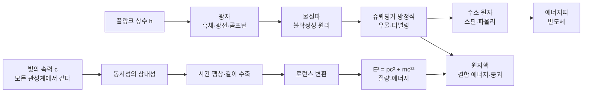

# 일반물리학 12. 현대 물리 — 빛의 속력과 플랑크 상수가 바꾼 세계
<!-- prev: emq-3, mech-1, phy-3 -->
<!-- next: uchem-4, uchem-12, uearth-11 -->

> [!NOTE]
> **이 단원의 범위**
> - 특수 상대성 이론: 두 가설, 동시성, 시간 팽창, 길이 수축, 로런츠 변환, 상대론적 운동량과 에너지
> - 광자: 흑체 복사, 광전 효과, 콤프턴 효과
> - 물질파와 불확정성 원리, 슈뢰딩거 방정식과 무한 퍼텐셜 우물, 터널링
> - 수소 원자, 스핀, 파울리 배타 원리
> - 고체의 에너지띠와 반도체
> - 원자핵: 결합 에너지, 방사성 붕괴, 핵분열·핵융합

**학습 목표**

1. 특수 상대성의 두 가설에서 동시성의 상대성, 시간 팽창, 길이 수축을 이끌어 내고, 로런츠 변환과 상대론적 속도 덧셈으로 계산할 수 있다.
2. 상대론적 운동량·에너지 관계 $E^2 = (pc)^2 + (mc^2)^2$를 이용해 빠른 입자의 운동 에너지와 속력을 구할 수 있다.
3. 흑체 복사·광전 효과·콤프턴 효과의 실험 결과가 빛의 에너지 양자 $E = hf$, 운동량 $p = h/\lambda$를 요구함을 정량적으로 설명할 수 있다.
4. 물질파와 불확정성 원리를 이해하고, 슈뢰딩거 방정식을 무한 퍼텐셜 우물에 풀어 양자화된 에너지와 확률 분포를 구하며, 터널링 확률을 어림할 수 있다.
5. 수소 원자의 양자수와 스핀, 파울리 배타 원리로 원자의 껍질 구조를, 에너지띠로 도체·절연체·반도체의 차이를 설명할 수 있다.
6. 원자핵의 결합 에너지 곡선과 지수 붕괴 법칙으로 방사성 붕괴, 핵분열, 핵융합의 에너지와 시간 규모를 계산할 수 있다.

**이 단원의 학습 사다리**

| 단계 | 무엇을 하나? |
|---|---|
| STEP 1. 이전 학습 다시 보기 | 물리학 「빛과 물질」, 전자기와 양자 「양자와 미시세계」, 역학과 에너지 「시공간과 운동」에서 배운 이중성·불확정성·상대성을 꺼내 본다 |
| STEP 2. 기초 다지기 | 근사식 $(1+x)^n \approx 1+nx$, 전자볼트와 $hc$, 2계 미분 방정식 $\psi'' = -k^2\psi$, 확률 밀도와 정규화, 지수 붕괴 |
| STEP 3. 핵심 개념 | 상대성의 가설·동시성 → 시간 팽창·길이 수축 → 로런츠 변환 → 상대론적 에너지 → 광자 → 물질파·불확정성 → 슈뢰딩거 방정식 → 수소 원자·스핀 → 에너지띠 → 원자핵 |
| STEP 4. 오개념 바로잡기 | "움직이는 물체의 질량이 커진다?", "반감기의 2배가 지나면 모두 붕괴한다?" 같은 착각을 바로잡는다 |
| STEP 5. 다음 단계로 | 양자역학(연산자, 수소 원자의 정확한 해), 고체물리, 원자핵·입자물리, 일반 상대론 |
| STEP 6. 생활·산업·진로 | GPS 시간 보정, 반도체·LED·태양 전지, 의료 영상과 방사선 치료, 원자력과 핵융합 |

---

## 🗺️ 단원 들어가기

1900년 무렵의 물리학자들은 역학, 열역학, 전자기학으로 자연을 거의 다 설명했다고 생각했다. 남은 것은 "작은 구름 두 조각"뿐이었다. 하나는 에테르 속을 달리는 지구의 속력이 왜 측정되지 않는가였고, 다른 하나는 뜨거운 물체가 내는 빛의 색 분포가 왜 계산과 맞지 않는가였다.

첫 번째 구름은 **빛의 속력 $c$** 를 중심에 둔 상대성 이론이 되어 시간과 공간의 개념을 바꾸었다. 두 번째 구름은 **플랑크 상수 $h$** 를 중심에 둔 양자 물리가 되어 원자, 화학 결합, 반도체, 원자핵을 설명했다. 오늘날 스마트폰의 위치 측정에는 상대성 이론이, 그 속의 칩과 화면에는 양자 물리가 들어 있다. 이 단원은 두 기둥을 일반물리학의 수학으로 세워 본다.

---

## STEP 1. 🔙 이전 학습 다시 보기

### 연계 개념표

| 이전 단원 | 고등학교에서는 여기까지 | 대학에서는 이렇게 확장 |
|---|---|---|
| 물리학 「빛과 물질」 '광속 불변 원리', '시간 팽창과 길이 수축' | 두 원리, 빛 시계로 본 시간 팽창, 뮤온 사례(현상 중심, 식 없음) | $\gamma = 1/\sqrt{1 - v^2/c^2}$로 정량화하고, 동시성의 상대성과 로런츠 변환, $E^2 = (pc)^2 + (mc^2)^2$까지 |
| 물리학 「빛과 물질」 '광전 효과', '에너지띠', '반도체 소자' | 광자 $E = hf$, 도체·부도체의 띠 구조, p-n 접합(정성적) | 광전 효과의 정량식, 콤프턴 효과, 띠틈과 빛의 파장, 도핑과 페르미 준위의 의미 |
| 전자기와 양자 「양자와 미시세계」 | 드브로이 파장, 단일 양자 간섭, 불확정성 $\Delta x\Delta p \ge h/4\pi$, 터널 효과(정성적), 현대 원자모형, 별의 핵융합과 질량 결손 | 슈뢰딩거 방정식을 실제로 풀고, 터널링 확률 $e^{-2\kappa L}$을 계산하며, 양자수·스핀·파울리 원리와 결합 에너지 곡선으로 확장 |
| 역학과 에너지 「시공간과 운동」 '등가 원리와 시공간의 휘어짐' | 중력 시간 지연과 GPS(정성적) | 특수 상대성 효과를 근사식으로 계산해 GPS 보정의 크기를 구한다 |

### 준비 운동 (사전 진단)

**Q1.** 파장 $500\ \mathrm{nm}$인 광자의 에너지는 몇 eV인가? ($hc \approx 1240\ \mathrm{eV\cdot nm}$)

**Q2.** 기차 안에서 앞쪽으로 $0.5c$로 빛 신호가 아니라 공을 던졌다. 기차가 땅에 대해 $0.5c$로 달린다면, 뉴턴 역학으로는 땅에서 본 공의 속력이 얼마인가? 이 답에 무슨 문제가 있는가?

**Q3.** 반감기가 3시간인 방사성 시료가 처음에 1600개의 원자핵을 가졌다면 9시간 뒤 몇 개가 남는가?

**Q4.** 보어 모형에서 수소 원자의 바닥상태 에너지는 $-13.6\ \mathrm{eV}$이다. $n = 2$ 상태의 에너지는?

정답 및 해설

**Q1.** $E = 1240/500 \approx 2.5\ \mathrm{eV}$

**Q2.** $0.5c + 0.5c = c$. 이대로라면 조금만 더 빨리 던져도 빛보다 빨라진다. 실제로는 속도를 이렇게 더할 수 없다(STEP 3 ③에서 $0.8c$가 나온다).

**Q3.** 9시간은 반감기의 3배이므로 $1600\times(1/2)^3 = 200$개. 단, 이것은 평균적인 기댓값이다. 붕괴는 확률적이다.

**Q4.** $E_2 = -13.6/2^2 = -3.4\ \mathrm{eV}$

---

## STEP 2. 🧱 기초 다지기

### ① 작은 양의 근사 $(1 + x)^n \approx 1 + nx$

$\lvert x\rvert \ll 1$이면 $(1 + x)^n \approx 1 + nx$이다(이항 전개의 첫 두 항). 상대성 이론에서 $v \ll c$일 때 자주 쓴다.

$$
\gamma = \left(1 - \frac{v^2}{c^2}\right)^{-1/2} \approx 1 + \frac{1}{2}\frac{v^2}{c^2}
$$

시속 1000 km 비행기($v/c \approx 9.3\times10^{-7}$)에서 $\gamma - 1 \approx 4\times10^{-13}$이다. 일상에서 상대성 효과를 느끼지 못하는 이유이다.

### ② 전자볼트와 편리한 상수 조합

**전자볼트**(eV)는 전자 하나가 $1\ \mathrm{V}$를 지날 때 얻는 에너지로 $1\ \mathrm{eV} = 1.602\times10^{-19}\ \mathrm{J}$이다.

| 상수·조합 | 값 |
|---|---|
| 플랑크 상수 $h$ | $6.626\times10^{-34}\ \mathrm{J\cdot s} = 4.136\times10^{-15}\ \mathrm{eV\cdot s}$ |
| $\hbar = h/2\pi$ | $1.055\times10^{-34}\ \mathrm{J\cdot s}$ |
| $hc$ | $\approx 1240\ \mathrm{eV\cdot nm}$ |
| 전자의 정지 에너지 $m_ec^2$ | $0.511\ \mathrm{MeV}$ |
| 양성자의 정지 에너지 $m_pc^2$ | $938.3\ \mathrm{MeV}$ |
| 원자 질량 단위 $1\ \mathrm{u}$ | $1.6605\times10^{-27}\ \mathrm{kg}$, $931.5\ \mathrm{MeV}/c^2$ |
| 볼츠만 상수 $k_B$ | $8.617\times10^{-5}\ \mathrm{eV/K}$ (상온 $k_BT \approx 0.026\ \mathrm{eV}$) |

### ③ $\psi'' = -k^2\psi$와 $\psi'' = \kappa^2\psi$

| 방정식 | 일반해 | 모양 |
|---|---|---|
| $\dfrac{d^2\psi}{dx^2} = -k^2\psi$ | $A\sin kx + B\cos kx$ | 진동(파동) |
| $\dfrac{d^2\psi}{dx^2} = +\kappa^2\psi$ | $Ce^{-\kappa x} + De^{\kappa x}$ | 지수적 감소·증가 |

슈뢰딩거 방정식에서 입자의 에너지가 퍼텐셜보다 크면 첫째 꼴(파동), 작으면 둘째 꼴(장벽 속으로 스며드는 지수 감소)이 된다.

### ④ 확률 밀도와 정규화

입자를 $x$와 $x + dx$ 사이에서 발견할 확률이 $P(x)\,dx$이면 $P(x)$를 **확률 밀도**라 한다. 어딘가에서는 반드시 발견되므로 $\int_{-\infty}^{\infty}P(x)\,dx = 1$이어야 한다(**정규화**). 양자역학에서는 $P(x) = \lvert\psi(x)\rvert^2$이다.

### ⑤ 지수 붕괴

변화율이 현재 양에 비례하여 줄어들면($dN/dt = -\lambda N$) $N(t) = N_0e^{-\lambda t}$이다. 절반이 되는 시간은 $T_{1/2} = \ln2/\lambda \approx 0.693/\lambda$, 평균 수명은 $\tau = 1/\lambda$이다. 「전자기 유도와 전자기파」의 RL 회로와 같은 수학이다.

---

## STEP 3. 📘 핵심 개념

### ① 특수 상대성의 두 가설과 동시성의 상대성

#### 두 가설

맥스웰 방정식은 빛의 속력을 $c = 1/\sqrt{\mu_0\varepsilon_0}$라는 **하나의 값**으로 준다(「전자기 유도와 전자기파」). 그렇다면 그 속력은 누구에 대한 속력인가? 1887년 마이컬슨–몰리 실험은 지구의 운동 방향과 관계없이 빛의 속력이 같음을 보였다. 1905년 아인슈타인은 다음 두 가설을 받아들였다.

| 가설 | 내용 |
|---|---|
| 상대성 원리 | 모든 **관성 기준틀**에서 물리 법칙은 같은 꼴이다. 절대 정지 기준틀은 없다 |
| 광속 불변 원리 | 진공 속 빛의 속력은 모든 관성 기준틀에서, 광원의 운동과 관계없이 $c$이다 |

**사건**(event)은 '어디서($x, y, z$), 언제($t$)'로 정해지는 시공간의 한 점이다. 각 관성 기준틀은 자기 자 막대와 동기화된 시계로 사건의 좌표를 잰다.

#### 동시성의 상대성

길이가 긴 기차의 한가운데에서 앞뒤로 빛 신호를 보낸다.

| 관찰자 | 무엇을 보나 | 결론 |
|---|---|---|
| 기차 안 관찰자 | 빛은 앞뒤로 같은 속력 $c$, 같은 거리 → 동시에 도착 | 두 도착 사건은 **동시** |
| 땅 위 관찰자 | 빛은 여전히 $c$(광속 불변), 그러나 뒤쪽 벽은 빛을 향해 다가오고 앞쪽 벽은 멀어진다 | 뒤쪽에 **먼저** 도착 |

한 기준틀에서 다른 장소에서 동시에 일어난 두 사건은 그 기준틀에 대해 움직이는 기준틀에서는 동시가 아니다. 이것이 **동시성의 상대성**이며, 시간 팽창과 길이 수축의 근본 원인이다. 같은 장소에서 일어난 두 사건의 순서, 그리고 원인과 결과의 순서는 어느 기준틀에서도 뒤바뀌지 않는다.

> [!IMPORTANT]
> "누구의 시계가 맞는가?"는 답이 없는 질문이다. 두 관찰자 모두 옳다. 상대성 이론은 '모든 것이 상대적'이라는 뜻이 아니라, **빛의 속력과 물리 법칙이 절대적**이기 때문에 시간과 공간의 측정값이 기준틀에 따라 달라진다는 뜻이다.

### ② 시간 팽창과 길이 수축

#### 빛 시계로 유도하는 시간 팽창

거울 두 장이 간격 $D$로 마주 보는 빛 시계를 우주선에 싣는다. 우주선 안에서 빛이 한 번 왕복하는 시간은 $\Delta t_0 = 2D/c$이다. 우주선이 속력 $v$로 지나가는 것을 보는 땅의 관찰자에게 빛은 비스듬히 지그재그로 가며, 한 번 왕복하는 시간을 $\Delta t$라 하면 피타고라스 정리에서

$$
\left(\frac{c\Delta t}{2}\right)^2 = D^2 + \left(\frac{v\Delta t}{2}\right)^2 \quad\Rightarrow\quad \Delta t = \frac{\Delta t_0}{\sqrt{1 - v^2/c^2}} = \gamma\Delta t_0
$$

$\gamma = 1/\sqrt{1 - \beta^2}$($\beta = v/c$)를 **로런츠 인자**라 한다. $\Delta t_0$처럼 두 사건이 **같은 장소**에서 일어나는 기준틀에서 잰 시간을 **고유 시간**(proper time)이라 한다. 고유 시간이 가장 짧다.

| $\beta = v/c$ | 0.10 | 0.60 | 0.80 | 0.99 | 0.995 |
|---|---|---|---|---|---|
| $\gamma$ | 1.005 | 1.25 | 1.67 | 7.09 | 10.0 |

#### 길이 수축

물체가 정지한 기준틀에서 잰 길이를 **고유 길이** $L_0$라 한다. 물체가 속력 $v$로 움직이는 기준틀에서 그 길이(운동 방향)는

$$
L = \frac{L_0}{\gamma} = L_0\sqrt{1 - \frac{v^2}{c^2}}
$$

움직이는 막대의 길이를 재려면 두 끝의 위치를 **동시에** 표시해야 하는데, 동시성이 기준틀마다 다르므로 길이도 달라진다. 운동 방향에 수직인 길이는 변하지 않는다.

#### 예제 1 — 대기를 뚫고 내려오는 뮤온

뮤온의 고유 평균 수명은 $2.2\ \mu\mathrm{s}$이다. 고도 약 $10\ \mathrm{km}$에서 만들어진 뮤온이 $0.995c$로 연직 아래로 날아온다. (1) 지상에서 본 평균 수명과 그동안 가는 거리, (2) 지표까지 남아 있는 비율을 상대론적으로 구하고 (3) 비상대론적 예측과 비교하시오. ($c = 3.00\times10^8\ \mathrm{m/s}$)

**풀이**
(1) $\gamma = 1/\sqrt{1 - 0.995^2} \approx 10.0$. 수명 $\gamma\tau_0 \approx 22\ \mu\mathrm{s}$, 거리 $0.995c\times22\ \mu\mathrm{s} \approx 6.6\ \mathrm{km}$ (상대론을 무시하면 약 $660\ \mathrm{m}$)
(2) 지상 기준 비행 시간 $t = 10\times10^3/(0.995c) \approx 33.5\ \mu\mathrm{s}$, 뮤온의 고유 시간 $t/\gamma \approx 3.35\ \mu\mathrm{s}$. 남는 비율 $e^{-3.35/2.2} \approx 0.22$
(3) 비상대론적이면 $e^{-33.5/2.2} \approx 2.4\times10^{-7}$. 실제로 지표에서 많은 뮤온이 검출되는 것은 상대론의 강력한 증거이다.
- 뮤온 입장에서는 대기층이 $10\ \mathrm{km}/\gamma \approx 1.0\ \mathrm{km}$로 수축하여 고유 시간 $3.35\ \mu\mathrm{s}$ 만에 지난다. 두 기준틀의 설명은 같은 결과를 준다.

#### 예제 2 — 별까지의 여행

지구에서 $4.24$광년 떨어진 별을 향해 우주선이 $0.80c$로 간다(가속 구간은 무시). (1) 지구 시간으로 걸리는 시간, (2) 우주선 승무원이 경험하는 시간, (3) 정지했을 때 길이 $100\ \mathrm{m}$인 우주선을 지구에서 잰 길이를 구하시오.

**풀이** $\gamma = 1/\sqrt{1 - 0.64} = 5/3$.
(1) $4.24/0.80 = 5.3$년 (2) $5.3/\gamma \approx 3.2$년. 승무원에게는 거리가 $4.24/\gamma \approx 2.54$광년으로 수축해 보인다. (3) $100/\gamma = 60\ \mathrm{m}$

### ③ 로런츠 변환과 속도 덧셈

#### 로런츠 변환

기준틀 $S'$이 $S$에 대해 $+x$ 방향으로 속력 $v$로 움직이고 $t = t' = 0$에 원점이 겹친다. 한 사건의 두 좌표는 다음 관계로 이어진다.

$$
x' = \gamma(x - vt), \qquad t' = \gamma\left(t - \frac{vx}{c^2}\right), \qquad y' = y,\quad z' = z
$$

$v \ll c$이면 $\gamma \to 1$, $vx/c^2 \to 0$이 되어 갈릴레이 변환 $x' = x - vt$, $t' = t$로 돌아간다. 차이 형태로 쓰면 $\Delta t' = \gamma(\Delta t - v\Delta x/c^2)$이다.

| 로런츠 변환에서 꺼내기 | 조건 | 결과 |
|---|---|---|
| 동시성의 상대성 | $S$에서 $\Delta t = 0$, $\Delta x \ne 0$ | $\Delta t' = -\gamma v\Delta x/c^2 \ne 0$ |
| 시간 팽창 | $S'$에서 같은 장소 $\Delta x' = 0$ | $\Delta t = \gamma\Delta t'$ |
| 길이 수축 | 막대가 $S'$에 정지, $S$에서 두 끝을 동시에($\Delta t = 0$) 표시 | $L_0 = \Delta x' = \gamma\Delta x$ |
| 불변량 | 모든 기준틀에서 같은 값 | $(c\Delta t)^2 - (\Delta x)^2 = (c\Delta t')^2 - (\Delta x')^2$ |

마지막 줄의 양을 **시공간 간격**이라 한다. 시간과 공간이 따로 변하지만, 이 조합은 모든 관성 기준틀에서 같다. 시간과 공간이 하나의 **시공간**을 이룬다는 뜻이다.

#### 속도 덧셈

$S'$에서 $x$ 방향 속도 $u'$으로 움직이는 물체의 $S$에서의 속도는 로런츠 변환을 미분해 얻는다.

$$
u = \frac{u' + v}{1 + u'v/c^2}
$$

$u' = c$를 넣으면 $u = c$이다. 빛의 속력은 정말로 누구에게나 같다.

#### 예제 3 — 우주선에서 쏜 탐사선

지구에 대해 $0.80c$로 나는 우주선이 앞쪽으로 우주선에 대해 $0.60c$인 탐사선을 쏘았다. 지구에서 본 탐사선의 속력은?

**풀이** $u = \dfrac{0.60c + 0.80c}{1 + 0.48} = \dfrac{1.40}{1.48}c \approx 0.946c$. 뉴턴 역학의 $1.40c$와 달리 $c$를 넘지 않는다.

### ④ 상대론적 운동량과 에너지

#### 운동량

$p = mv$를 그대로 쓰면, 한 기준틀에서 보존되는 운동량이 다른 기준틀에서는 보존되지 않는다. 모든 관성 기준틀에서 운동량 보존이 성립하도록 정의를 바꾸면

$$
\vec{p} = \gamma m\vec{v}
$$

($m$은 기준틀과 관계없는 질량) $v \to c$이면 $p \to \infty$이므로, 질량이 있는 입자는 유한한 힘으로 $c$까지 가속할 수 없다.

#### 에너지

일–에너지 정리 $K = \int F\,dx = \int v\,dp$를 상대론적 운동량으로 계산하면

$$
K = (\gamma - 1)mc^2, \qquad E = \gamma mc^2 = K + mc^2
$$

$mc^2$을 **정지 에너지**라 한다. $v \ll c$이면 STEP 2 ①의 근사로 $K \approx \frac{1}{2}mv^2$이 되어 뉴턴 역학과 일치한다. $E$와 $p$에서 $\gamma$를 없애면 기준틀과 무관한 관계를 얻는다.

$$
E^2 = (pc)^2 + (mc^2)^2
$$

질량이 0인 광자는 $E = pc$이다. 입자물리에서는 운동량을 $\mathrm{MeV}/c$, 질량을 $\mathrm{MeV}/c^2$ 단위로 쓰면 이 식이 간단해진다.

| 양 | 뉴턴 역학 | 특수 상대론 |
|---|---|---|
| 운동량 | $mv$ | $\gamma mv$ |
| 운동 에너지 | $\frac{1}{2}mv^2$ | $(\gamma - 1)mc^2$ |
| 전체 에너지 | 정의 없음 | $\gamma mc^2$ |
| 에너지–운동량 | $K = p^2/2m$ | $E^2 = (pc)^2 + (mc^2)^2$ |
| 질량 | 보존 | 보존되지 않을 수 있다(정지 에너지가 다른 에너지로 전환) |

#### 예제 4 — 1 MV로 가속한 전자

정지한 전자를 전위차 $1.0\ \mathrm{MV}$로 가속했다. (1) 전체 에너지와 $\gamma$, (2) 속력, (3) 운동량($\mathrm{MeV}/c$)을 구하고, (4) 뉴턴 역학으로 계산한 속력과 비교하시오.

**풀이**
(1) $K = 1.0\ \mathrm{MeV}$, $E = 1.0 + 0.511 = 1.511\ \mathrm{MeV}$, $\gamma = 1.511/0.511 \approx 2.96$
(2) $\beta = \sqrt{1 - 1/\gamma^2} \approx 0.941$, $v \approx 0.94c$
(3) $pc = \sqrt{E^2 - (mc^2)^2} = \sqrt{1.511^2 - 0.511^2} \approx 1.42\ \mathrm{MeV}$, $p \approx 1.42\ \mathrm{MeV}/c$
(4) $\frac{1}{2}mv^2 = K$이면 $v/c = \sqrt{2K/mc^2} \approx 1.98$, 빛보다 빠르다는 틀린 답이 나온다. 운동 에너지가 정지 에너지와 비슷하거나 크면 반드시 상대론으로 계산해야 한다.

#### 질량–에너지 등가

$E = mc^2$은 질량 $1\ \mathrm{g}$이 약 $9.0\times10^{13}\ \mathrm{J}$에 해당함을 말한다. 화학 반응에서도 결합 에너지만큼 질량이 변하지만 너무 작아 측정하기 어렵고, 원자핵 반응에서는 질량 변화가 약 0.1~1%에 이르러 뚜렷하다(⑩).

### ⑤ 광자 — 흑체 복사, 광전 효과, 콤프턴 효과

#### 흑체 복사

모든 물체는 온도에 따라 전자기파를 낸다. 들어오는 복사를 모두 흡수하는 이상적인 물체를 **흑체**라 하며, 흑체 복사의 스펙트럼은 온도만으로 정해진다. 실험에서 얻은 두 법칙은 다음과 같다.

| 법칙 | 식 | 뜻 |
|---|---|---|
| 빈 변위 법칙 | $\lambda_{\max}T = 2.898\times10^{-3}\ \mathrm{m\cdot K}$ | 뜨거울수록 세기가 최대인 파장이 짧다 |
| 슈테판–볼츠만 법칙 | $P = \sigma AT^4$, $\sigma = 5.67\times10^{-8}\ \mathrm{W/(m^2\cdot K^4)}$ | 전체 복사 일률은 절대 온도의 네제곱에 비례 |

고전 이론(빛의 에너지가 연속적이라는 가정)으로 계산하면 파장이 짧아질수록 세기가 끝없이 커지는 모순('자외선 파탄')이 생겼다. 1900년 플랑크는 진동수 $f$인 전자기 진동의 에너지가 $hf$의 정수배로만 주고받아진다고 가정해, 실험과 정확히 맞는 식을 얻었다.

$$
I(\lambda, T) = \frac{2\pi hc^2}{\lambda^5}\cdot\frac{1}{e^{hc/\lambda k_BT} - 1}
$$

짧은 파장에서는 $hf \gg k_BT$가 되어 지수 함수가 세기를 눌러 준다. 이 식을 미분해 최댓값을 찾으면 빈 법칙이, 모든 파장에 대해 적분하면 슈테판–볼츠만 법칙이 나온다.

#### 예제 5 — 태양과 사람의 복사

(1) 표면 온도 약 $5800\ \mathrm{K}$인 태양과 체온 $310\ \mathrm{K}$인 사람의 $\lambda_{\max}$를 구하시오. (2) 표면적 $1.8\ \mathrm{m^2}$, 피부 온도 $306\ \mathrm{K}$인 사람이 $293\ \mathrm{K}$인 방에서 복사로 잃는 알짜 일률은? (피부를 흑체로 본다.)

**풀이**
(1) 태양: $2.898\times10^{-3}/5800 \approx 500\ \mathrm{nm}$(가시광선), 사람: $\approx 9.3\ \mu\mathrm{m}$(적외선). 열화상 카메라가 이 대역을 본다.
(2) $P = \sigma A(T^4 - T_0^4) = 5.67\times10^{-8}\times1.8\times(306^4 - 293^4) \approx 1.4\times10^2\ \mathrm{W}$. 쉬고 있을 때 몸의 대사 일률(약 $100\ \mathrm{W}$)과 비슷한 크기여서, 옷을 입지 않으면 쉽게 추위를 느낀다.

#### 광전 효과

금속에 빛을 비추면 전자가 튀어나온다. 실험 사실은 파동 이론과 맞지 않았다.

| 실험 사실 | 파동 이론의 예상 | 광자 설명 |
|---|---|---|
| 한계 진동수 $f_0$보다 낮으면 아무리 밝아도 전자가 안 나온다 | 밝으면 언젠가 나와야 함 | 광자 하나의 에너지 $hf$가 일함수 $\phi$보다 작으면 불가능 |
| 광전자의 최대 운동 에너지는 진동수에만 관계, 밝기와 무관 | 밝을수록 커야 함 | $K_{\max} = hf - \phi$ |
| 빛을 비추자마자 나온다 | 약한 빛은 에너지를 모으는 시간이 필요 | 광자 하나가 전자 하나에 한꺼번에 에너지 전달 |
| 밝을수록 전자 수가 많다 | — | 광자 수에 비례 |

저지 전압 $V_s$를 측정하면 $eV_s = K_{\max} = hf - \phi$이므로, $V_s$를 $f$에 대해 그린 직선의 기울기가 $h/e$이다. 1916년 밀리컨은 이 측정으로 플랑크 상수를 독립적으로 구해 아인슈타인의 광양자설을 확인했다.

#### 예제 6 — 광전 효과

일함수 $2.30\ \mathrm{eV}$인 금속에 파장 $400\ \mathrm{nm}$인 빛을 비춘다. (1) 광전자의 최대 운동 에너지와 저지 전압, (2) 한계 파장을 구하시오.

**풀이**
(1) $hf = 1240/400 = 3.10\ \mathrm{eV}$, $K_{\max} = 3.10 - 2.30 = 0.80\ \mathrm{eV}$, $V_s = 0.80\ \mathrm{V}$
(2) $\lambda_0 = hc/\phi = 1240/2.30 \approx 539\ \mathrm{nm}$. 이보다 긴 파장(빨간빛 등)은 아무리 밝아도 전자를 떼어 내지 못한다.

#### 콤프턴 효과 — 광자의 운동량

1923년 콤프턴은 X선을 흑연에 쪼였을 때 산란된 X선의 파장이 입사 파장보다 길어지고, 그 차이가 산란각 $\phi$에만 관계함을 측정했다. 광자를 에너지 $hf$, 운동량 $h/\lambda$인 입자로 보고, 정지한 전자와의 **탄성 충돌**에서 상대론적 에너지와 운동량 보존을 함께 쓰면

$$
\Delta\lambda = \lambda' - \lambda = \frac{h}{m_ec}(1 - \cos\phi)
$$

$h/m_ec \approx 2.43\ \mathrm{pm}$를 전자의 **콤프턴 파장**이라 한다. 가시광선(수백 nm)에서는 이 변화가 너무 작아 보이지 않고, 파장이 짧은 X선·감마선에서 뚜렷하다.

**유도의 요점**: 에너지 보존 $hc/\lambda + m_ec^2 = hc/\lambda' + E_e$, 운동량 보존(벡터) $\vec{p}_\lambda = \vec{p}_{\lambda'} + \vec{p}_e$에서 $p_e^2 = p^2 + p'^2 - 2pp'\cos\phi$를 만들고, $E_e^2 = (p_ec)^2 + (m_ec^2)^2$에 넣어 전자의 양을 없앤다.

#### 예제 7 — X선의 콤프턴 산란

파장 $71.0\ \mathrm{pm}$인 X선이 전자에 의해 $90^\circ$로 산란된다. (1) 산란된 X선의 파장, (2) 전자가 얻은 운동 에너지를 구하시오.

**풀이**
(1) $\Delta\lambda = 2.43\ \mathrm{pm}\times(1 - 0) = 2.43\ \mathrm{pm}$, $\lambda' \approx 73.4\ \mathrm{pm}$
(2) $E = 1240/0.0710 \approx 17.46\ \mathrm{keV}$, $E' = 1240/0.07343 \approx 16.89\ \mathrm{keV}$, $K_e \approx 0.58\ \mathrm{keV}$
- 의미: 광자 에너지의 약 3%가 전자로 넘어갔다. 의료용 X선 영상에서 산란선이 상을 흐리게 하는 이유이며, 방사선 차폐 설계에서도 중요하다.

### ⑥ 물질파와 불확정성 원리

#### 드브로이 파장

광자가 $p = h/\lambda$를 가진다면, 거꾸로 운동량 $p$인 입자도 파장 $\lambda = h/p$의 파동성을 가진다(드브로이, 1924). 비상대론적 입자는 $p = \sqrt{2mK}$이다. 1927년 무렵 데이비슨과 거머는 니켈 결정에 약 $54\ \mathrm{eV}$ 전자를 쏘아 X선과 같은 회절을 관찰했다. 이 전자의 파장은

$$
\lambda = \frac{h}{\sqrt{2m_eK}} = \frac{6.626\times10^{-34}}{\sqrt{2(9.109\times10^{-31})(54\times1.602\times10^{-19})}} \approx 0.167\ \mathrm{nm}
$$

로 결정의 원자 간격과 비슷하다. 상온의 열중성자(약 $0.025\ \mathrm{eV}$)는 약 $0.18\ \mathrm{nm}$로, 중성자 회절은 물질 속 원자 배열과 자성 연구에 쓰인다. 「빛과 광학」의 회절 공식이 물질 입자에도 그대로 적용되는 것이다.

#### 불확정성 원리

파동 묶음을 한 곳($\Delta x$)에 모으려면 여러 파수의 파동을 겹쳐야 하고($\Delta k$), 그 관계는 대략 $\Delta x\Delta k \gtrsim 1$이다. $p = \hbar k$를 쓰면 **하이젠베르크 불확정성 원리**가 된다.

$$
\Delta x\,\Delta p_x \ge \frac{\hbar}{2}, \qquad \Delta E\,\Delta t \gtrsim \frac{\hbar}{2}
$$

($\hbar/2 = h/4\pi$로 「양자와 미시세계」의 식과 같다.) 두 번째 식은 수명이 $\Delta t$인 들뜬 상태의 에너지가 $\Delta E$만큼 흐려져 있다는 뜻이며, 스펙트럼선이 완전히 가늘지 않은 '자연 선폭'의 원인이다.

#### 예제 8 — 원자핵 속에 전자가 있을 수 있을까?

(1) 전자를 원자핵 크기 $\Delta x = 1.0\times10^{-14}\ \mathrm{m}$ 안에 가두면 운동량 불확정도의 최솟값과 그에 해당하는 에너지 규모($pc$)는? (2) 수명 $10\ \mathrm{ns}$인 들뜬 원자 상태의 에너지 폭은?

**풀이**
(1) $\Delta p \ge \hbar/2\Delta x = 1.055\times10^{-34}/(2.0\times10^{-14}) \approx 5.3\times10^{-21}\ \mathrm{kg\cdot m/s}$, $pc \approx 5.3\times10^{-21}\times3.00\times10^8/1.602\times10^{-13} \approx 9.9\ \mathrm{MeV}$. 운동량이 적어도 이만큼이면 전자의 에너지는 정지 에너지($0.511\ \mathrm{MeV}$)의 약 20배로, 핵이 전자를 붙잡아 둘 수 있는 에너지 규모를 넘는다. 베타 붕괴의 전자가 핵 안에 원래 있던 것이 아니라 붕괴 순간 **만들어진다**는 근거 중 하나이다.
(2) $\Delta E \approx \hbar/2\Delta t \approx 3.3\times10^{-8}\ \mathrm{eV}$. 광자 에너지(수 eV)에 비해 매우 작지만, 정밀 분광에서는 측정된다.

### ⑦ 슈뢰딩거 방정식과 무한 퍼텐셜 우물, 터널링

#### 시간에 무관한 슈뢰딩거 방정식

퍼텐셜 에너지 $U(x)$ 속에서 에너지 $E$인 입자의 파동 함수 $\psi(x)$는 다음을 만족한다(1926년, 슈뢰딩거).

$$
-\frac{\hbar^2}{2m}\frac{d^2\psi}{dx^2} + U(x)\psi = E\psi
$$

뉴턴의 $F = ma$처럼 유도되는 식이 아니라 실험으로 검증된 기본 법칙이다. 다만 자유 입자($U = 0$)에 $\psi = \sin kx$를 넣으면 $E = \hbar^2k^2/2m = p^2/2m$으로 드브로이 관계와 운동 에너지가 함께 나온다. 해 $\psi$가 물리적이려면 연속이고, 정규화 가능해야 하며, $\lvert\psi\rvert^2$이 확률 밀도이다.

#### 무한 퍼텐셜 우물

입자가 $0 < x < L$ 안에서는 $U = 0$, 바깥에서는 $U = \infty$인 상자에 갇혀 있다. 바깥에서는 $\psi = 0$이고, 안에서는 STEP 2 ③의 첫째 꼴이다. 벽에서 $\psi$가 연속이려면 $\psi(0) = \psi(L) = 0$이므로

$$
\psi_n(x) = \sqrt{\frac{2}{L}}\sin\frac{n\pi x}{L}, \qquad kL = n\pi, \qquad E_n = \frac{n^2h^2}{8mL^2} \quad (n = 1, 2, 3, \ldots)
$$

$\sqrt{2/L}$은 정규화 $\int_0^L\lvert\psi\rvert^2dx = 1$에서 정해진다. 이는 「파동과 소리」에서 양 끝이 고정된 줄의 정상파 조건 $L = n\lambda/2$와 같다. 경계 조건이 에너지를 **양자화**한다.

| 특징 | 내용 |
|---|---|
| 영점 에너지 | $n = 0$은 $\psi = 0$(입자 없음)이므로 불가능. 가장 낮은 에너지 $E_1 > 0$ — 갇힌 입자는 멈출 수 없다(불확정성 원리와 일치) |
| 간격 | $E_n \propto n^2$, 상자가 작을수록($L$) 간격이 커진다 |
| 마디 | $\psi_n$에는 벽을 뺀 마디가 $n - 1$개 |
| 고전 극한 | $n$이 크면 확률 밀도가 촘촘히 진동하여 평균적으로 고르게 퍼진다(고전적 예상과 일치) |

#### 예제 9 — 상자 속 전자

폭 $L = 0.50\ \mathrm{nm}$인 무한 퍼텐셜 우물 속 전자에 대해 (1) $E_1$, $E_2$, $E_3$, (2) $n = 2 \to 1$ 전이에서 나오는 광자의 파장, (3) 바닥상태 전자가 가운데 $\frac{1}{3}$ 영역($L/3 < x < 2L/3$)에서 발견될 확률을 구하시오.

**풀이**
(1) $E_1 = \dfrac{(6.626\times10^{-34})^2}{8(9.109\times10^{-31})(0.50\times10^{-9})^2} \approx 2.41\times10^{-19}\ \mathrm{J} \approx 1.50\ \mathrm{eV}$, $E_2 = 4E_1 \approx 6.02\ \mathrm{eV}$, $E_3 = 9E_1 \approx 13.5\ \mathrm{eV}$
(2) $\Delta E = 3E_1 \approx 4.51\ \mathrm{eV}$, $\lambda = 1240/4.51 \approx 275\ \mathrm{nm}$(자외선)
(3) $P = \dfrac{2}{L}\displaystyle\int_{L/3}^{2L/3}\sin^2\frac{\pi x}{L}dx = \frac{1}{3} + \frac{\sqrt{3}}{2\pi} \approx 0.61$. 고전적 입자라면 $\frac{1}{3}$이었을 것이다. 바닥상태 전자는 가운데에 몰려 있다.
- 의미: 나노미터 크기의 반도체 알갱이(**양자점**)는 크기를 바꾸면 에너지 간격이 바뀌어 내는 빛의 색이 달라진다($E \propto 1/L^2$). 실제 양자점은 무한 우물보다 복잡하지만 원리는 같다.

#### 터널링

높이 $U_0$, 폭 $L$인 장벽에 에너지 $E < U_0$인 입자가 다가오면, 장벽 안에서는 STEP 2 ③의 둘째 꼴 $\psi \propto e^{-\kappa x}$로 감소한다.

$$
\kappa = \frac{\sqrt{2m(U_0 - E)}}{\hbar}, \qquad T \approx e^{-2\kappa L} \quad (\kappa L \gg 1)
$$

$T$는 **투과 확률**이다. 고전적으로는 0이어야 할 확률이 장벽이 얇고 낮고 입자가 가벼우면 무시할 수 없게 된다.

#### 예제 10 — 터널링 확률과 주사 터널링 현미경

에너지 $1.0\ \mathrm{eV}$인 전자가 높이 $5.0\ \mathrm{eV}$인 장벽에 닿는다. (1) 장벽 폭이 $0.50\ \mathrm{nm}$일 때와 $0.60\ \mathrm{nm}$일 때 투과 확률을 구하고, (2) 폭이 $0.10\ \mathrm{nm}$ 늘 때마다 확률이 몇 분의 1이 되는지 쓰시오.

**풀이**
(1) $\kappa = \sqrt{2(9.109\times10^{-31})(4.0\times1.602\times10^{-19})}/(1.055\times10^{-34}) \approx 1.02\times10^{10}\ \mathrm{m^{-1}}$
$L = 0.50\ \mathrm{nm}$: $2\kappa L \approx 10.2$, $T \approx 3.6\times10^{-5}$. $L = 0.60\ \mathrm{nm}$: $T \approx 4.6\times10^{-6}$
(2) $e^{-2\kappa(0.10\ \mathrm{nm})} \approx 0.13$, 약 8분의 1
- 의미: 원자 하나 높이(약 $0.1\ \mathrm{nm}$)의 변화가 전류를 약 8배 바꾸므로, 주사 터널링 현미경(STM)은 표면의 원자 하나하나를 구별한다. 원자핵의 알파 붕괴, 별의 핵융합, 플래시 메모리도 터널링에 기댄다(「양자와 미시세계」).

### ⑧ 수소 원자, 스핀, 파울리 배타 원리

#### 수소 원자의 에너지와 양자수

전자가 양성자의 쿨롱 퍼텐셜 $U(r) = -\dfrac{e^2}{4\pi\varepsilon_0r}$ 속에 있을 때 3차원 슈뢰딩거 방정식을 풀면, 에너지는 보어 모형과 같은 값이 나온다.

$$
E_n = -\frac{m_ee^4}{8\varepsilon_0^2h^2}\frac{1}{n^2} = -\frac{13.6\ \mathrm{eV}}{n^2}
$$

그러나 상태는 세 양자수로 정해지고, '궤도' 대신 확률 구름(오비탈)으로 나타난다.

| 양자수 | 기호와 허용값 | 정하는 것 |
|---|---|---|
| 주 양자수 | $n = 1, 2, 3, \ldots$ | 에너지, 대략적인 크기 |
| 궤도 양자수 | $l = 0, 1, \ldots, n - 1$ (s, p, d, f …) | 궤도 각운동량의 크기 $L = \sqrt{l(l+1)}\,\hbar$, 오비탈 모양 |
| 궤도 자기 양자수 | $m_l = -l, \ldots, 0, \ldots, +l$ | 각운동량의 $z$ 성분 $L_z = m_l\hbar$ |
| 스핀 자기 양자수 | $m_s = +\frac{1}{2}, -\frac{1}{2}$ | 스핀의 $z$ 성분 $S_z = m_s\hbar$ |

같은 $n$을 가진 상태 수는 $\sum_{l=0}^{n-1}(2l + 1) = n^2$이고, 스핀까지 세면 $2n^2$이다. 바닥상태($n = 1$, $l = 0$)에서 각운동량은 0이다. 보어 모형의 $L = n\hbar$와 다른 점이다.

#### 예제 11 — 수소의 자외선과 상태 수

(1) $n = 2 \to 1$ 전이(라이먼 알파선)의 광자 에너지와 파장, (2) $n = 2$에서의 이온화 에너지, (3) $n = 3$인 상태(스핀 포함)의 수와 각 $l$에서의 $m_l$ 값을 쓰시오.

**풀이**
(1) $\Delta E = 13.6(1 - \frac{1}{4}) = 10.2\ \mathrm{eV}$, $\lambda = 1240/10.2 \approx 122\ \mathrm{nm}$(자외선)
(2) $3.4\ \mathrm{eV}$
(3) $l = 0$: $m_l = 0$ / $l = 1$: $-1, 0, 1$ / $l = 2$: $-2, -1, 0, 1, 2$ → 공간 상태 9개, 스핀까지 $2\times9 = 18$개

#### 스핀

1922년 슈테른–게를라흐 실험에서 은 원자 빔이 불균일한 자기장을 지나며 **두 갈래**로만 갈라졌다. 궤도 각운동량이라면 $2l + 1$(홀수) 갈래가 되어야 하므로, 전자에는 궤도 운동과 무관한 고유 각운동량이 있어야 했다. 이를 **스핀**(spin)이라 한다. 전자의 스핀 양자수는 $s = \frac{1}{2}$이고, 어느 방향으로 재든 그 성분은 $+\hbar/2$ 또는 $-\hbar/2$ 두 값뿐이다. 스핀은 작은 공이 실제로 자전하는 것이 아니라 전자가 가진 양자적 성질이며, 스핀에 딸린 자기 모멘트가 물질의 자성(「전기와 자기」의 강자성체)을 만든다.

#### 파울리 배타 원리와 주기율표

> [!IMPORTANT]
> **파울리 배타 원리**: 한 원자 안에서 두 전자가 네 양자수 $(n, l, m_l, m_s)$를 모두 같게 가질 수 없다. 즉 하나의 양자 상태에는 전자가 하나만 들어간다.

이 원리가 없다면 모든 전자가 가장 낮은 $n = 1$ 상태로 내려가 원자들의 화학적 성질이 거의 비슷했을 것이다. 실제로는 전자가 아래 상태부터 차례로 채워져 **껍질 구조**가 생긴다.

| 껍질 | $n$ | 최대 전자 수 $2n^2$ | 채워지면 |
|---|---|---|---|
| K | 1 | 2 | He에서 닫힘 |
| L | 2 | 8 | Ne에서 닫힘 |
| M | 3 | 18 | (에너지 순서 때문에 4s가 3d보다 먼저 채워짐) |

다전자 원자에서는 다른 전자들이 핵 전하를 가리므로 같은 $n$에서도 $l$이 클수록 에너지가 높다. 이 순서와 파울리 원리로 주기율표의 구조와 화학 결합이 설명되며, 이는 「원자의 전자 구조와 주기성」으로 이어진다. 백색 왜성과 중성자별이 무너지지 않고 버티는 것도 전자와 중성자의 배타 원리 덕분이다.

### ⑨ 고체의 에너지띠와 반도체

#### 원자 준위에서 띠로

원자 두 개가 가까워지면 같은 에너지였던 준위가 둘로 갈라진다. 원자 $N$개($\sim10^{23}$개)가 결정을 이루면 각 준위가 $N$개로 갈라져 사실상 연속적인 **에너지띠**(energy band)가 되고, 띠 사이에는 전자가 가질 수 없는 **띠틈**(band gap) $E_g$가 남는다. 파울리 원리에 따라 각 띠에는 정해진 수의 전자만 들어간다.

| 물질 | 띠 구조 | 전기 전도 |
|---|---|---|
| 도체(금속) | 전자가 일부만 찬 띠가 있다 | 아주 작은 전기장에도 전자가 바로 위 빈 상태로 옮겨 가 전류가 흐른다 |
| 절연체 | 꽉 찬 원자가띠와 빈 전도띠 사이에 큰 띠틈(수 eV 이상, 예: 다이아몬드 약 5.5 eV) | 상온 열에너지($\approx 0.026\ \mathrm{eV}$)로는 띠틈을 넘지 못함 |
| 반도체 | 띠틈이 작다(규소 약 1.12 eV, 저마늄 약 0.67 eV) | 일부 전자가 열로 전도띠에 올라가 전도. 온도가 오르면 전도도 **증가** |

꽉 찬 띠에서 전자 하나가 빠진 빈자리는 양전하처럼 움직이는데, 이를 **양공**(hole)이라 한다. 반도체에서는 전도띠의 전자와 원자가띠의 양공이 함께 전류를 나른다.

#### 도핑과 p-n 접합

| 종류 | 첨가 원소(규소에) | 만드는 준위 | 주된 운반자 |
|---|---|---|---|
| n형 | 15족(인 P, 비소 As) | 전도띠 바로 아래 주개 준위 | 전자 |
| p형 | 13족(붕소 B, 갈륨 Ga) | 원자가띠 바로 위 받개 준위 | 양공 |

p형과 n형을 붙이면 경계에서 전자와 양공이 만나 사라지며 운반자가 없는 **공핍층**과 내부 전기장이 생긴다. 순방향 전압은 장벽을 낮춰 전류를 흘리고, 역방향 전압은 장벽을 높여 막는다(다이오드). 전자와 양공이 재결합하며 띠틈 에너지만큼의 빛을 내면 **발광 다이오드**(LED), 빛을 흡수해 전자–양공 쌍을 만들고 내부 전기장으로 분리하면 **태양 전지**와 광검출기이다.

#### 예제 12 — 띠틈과 빛의 파장

(1) 규소($E_g \approx 1.12\ \mathrm{eV}$)가 흡수할 수 있는 빛의 최대 파장, (2) 띠틈 약 $3.4\ \mathrm{eV}$인 질화 갈륨 LED와 약 $1.9\ \mathrm{eV}$인 LED의 빛의 파장을 구하시오.

**풀이**
(1) $\lambda_{\max} = 1240/1.12 \approx 1.11\times10^3\ \mathrm{nm}$(근적외선). 이보다 긴 파장은 규소를 투과한다.
(2) $1240/3.4 \approx 365\ \mathrm{nm}$(근자외선~보라), $1240/1.9 \approx 653\ \mathrm{nm}$(빨강)
- 의미: 파란 LED(질화 갈륨 계열)가 실용화되면서 형광체와 결합한 백색 LED 조명이 가능해졌다(2014년 노벨 물리학상).

### ⑩ 원자핵 — 결합 에너지, 방사성 붕괴, 핵분열·핵융합

#### 원자핵의 크기와 핵력

원자핵은 양성자 $Z$개와 중성자 $N$개(질량수 $A = Z + N$)로 이루어지며 반지름은 대략 $R \approx R_0A^{1/3}$($R_0 \approx 1.2\ \mathrm{fm}$)이다. 부피가 $A$에 비례하므로 핵의 밀도는 거의 일정하고, 약 $2\times10^{17}\ \mathrm{kg/m^3}$로 물의 약 $10^{14}$배이다. 양성자 사이의 전기적 반발을 이기고 핵을 묶는 것은 매우 강하지만 약 $1$~$2\ \mathrm{fm}$ 안에서만 작용하는 **핵력**(강한 상호 작용)이다.

#### 질량 결손과 결합 에너지

핵의 질량은 구성 핵자 질량의 합보다 작다. 그 차이가 **결합 에너지**이다(원자 질량을 쓰면 전자 질량이 자동으로 상쇄된다).

$$
E_b = \left[Zm(^1\mathrm{H}) + Nm_n - m(\text{원자})\right]c^2
$$

| 핵종 | 원자 질량(u) | 결합 에너지(MeV) | 핵자당 결합 에너지(MeV) |
|---|---|---|---|
| $^4\mathrm{He}$ | 4.002603 | 약 28.3 | 약 7.07 |
| $^{16}\mathrm{O}$ | 15.994915 | 약 127.6 | 약 7.98 |
| $^{56}\mathrm{Fe}$ | 55.934936 | 약 492 | 약 8.79 |
| $^{235}\mathrm{U}$ | — | 약 1784 | 약 7.6 |

($m(^1\mathrm{H}) = 1.007825\ \mathrm{u}$, $m_n = 1.008665\ \mathrm{u}$, $1\ \mathrm{u} = 931.5\ \mathrm{MeV}/c^2$)

핵자당 결합 에너지는 질량수 60 근처(철·니켈)에서 가장 크다. 그래서 무거운 핵은 **쪼개지면**(핵분열), 가벼운 핵은 **합쳐지면**(핵융합) 핵자당 결합 에너지가 커지며 에너지가 나온다.

#### 예제 13 — 헬륨과 철의 결합 에너지

$^4\mathrm{He}$와 $^{56}\mathrm{Fe}$의 결합 에너지와 핵자당 결합 에너지를 구하시오.

**풀이**
- $^4\mathrm{He}$: $\Delta m = 2(1.007825) + 2(1.008665) - 4.002603 = 0.030377\ \mathrm{u}$, $E_b \approx 28.3\ \mathrm{MeV}$, 핵자당 약 $7.07\ \mathrm{MeV}$
- $^{56}\mathrm{Fe}$: $\Delta m = 26(1.007825) + 30(1.008665) - 55.934936 \approx 0.52846\ \mathrm{u}$, $E_b \approx 492\ \mathrm{MeV}$, 핵자당 약 $8.79\ \mathrm{MeV}$
- 의미: 핵자당 수 MeV는 화학 결합(수 eV)의 약 100만 배이다. 같은 질량의 연료에서 얻는 에너지 차이가 그만큼 크다.

#### 방사성 붕괴의 종류

| 붕괴 | 무엇이 나오나 | 핵의 변화 | 원인이 되는 상호 작용 |
|---|---|---|---|
| 알파($\alpha$) | $^4\mathrm{He}$ 핵 | $Z - 2$, $A - 4$ | 핵력과 전기력, 터널링으로 탈출 |
| 베타 음($\beta^-$) | 전자와 반중성미자 | 중성자 → 양성자, $Z + 1$ | 약한 상호 작용 |
| 베타 양($\beta^+$) | 양전자와 중성미자 | 양성자 → 중성자, $Z - 1$ | 약한 상호 작용 |
| 감마($\gamma$) | 고에너지 광자 | 들뜬 핵 → 바닥상태, $Z$와 $A$ 그대로 | 전자기 상호 작용 |

#### 붕괴 법칙

각 핵은 단위 시간당 일정한 확률 $\lambda$(**붕괴 상수**)로 붕괴하며, 그 확률은 핵의 나이와 관계없다. 그래서 STEP 2 ⑤의 지수 법칙을 따른다.

$$
N(t) = N_0e^{-\lambda t} = N_0\left(\frac{1}{2}\right)^{t/T_{1/2}}, \qquad R = -\frac{dN}{dt} = \lambda N
$$

$R$을 **방사능**(activity)이라 하며 단위는 베크렐($1\ \mathrm{Bq}$ = 초당 1회 붕괴)이다. 탄소-14(반감기 약 5730년)는 생물이 죽은 뒤 줄어들기 시작하므로, 남은 비율로 연대를 측정한다. 남은 양이 25%이면 반감기의 2배, 약 11500년 전이다.

#### 예제 14 — 의료용 아이오딘-131

갑상샘 치료에 쓰는 아이오딘-131의 반감기는 약 8.02일이다. (1) 붕괴 상수, (2) 방사능 $1.0\times10^9\ \mathrm{Bq}$인 시료에 든 원자핵 수, (3) 방사능이 처음의 10%가 되는 데 걸리는 시간을 구하시오.

**풀이**
(1) $\lambda = \ln2/T_{1/2} = 0.693/(8.02\times86400\ \mathrm{s}) \approx 1.0\times10^{-6}\ \mathrm{s^{-1}}$
(2) $N = R/\lambda \approx 1.0\times10^{15}$개 (질량으로는 약 $0.2\ \mathrm{ng}$에 불과하다)
(3) $t = T_{1/2}\dfrac{\ln10}{\ln2} \approx 26.6$일

#### 핵분열

우라늄-235가 느린 중성자를 흡수하면 들뜬 우라늄-236이 되어 두 개의 중간 질량 핵으로 쪼개지며 중성자 2~3개와 약 $200\ \mathrm{MeV}$를 낸다. 예를 들면

$$
{}^{235}\mathrm{U} + n \rightarrow {}^{141}\mathrm{Ba} + {}^{92}\mathrm{Kr} + 3n
$$

새로 나온 중성자가 다른 우라늄 핵을 쪼개는 **연쇄 반응**이 일어난다. 원자로는 감속재로 중성자를 느리게 하고 제어봉으로 중성자 수를 조절해, 한 번의 분열이 평균 정확히 한 번의 분열을 일으키도록(임계 상태) 유지한다.

#### 핵융합

가벼운 핵이 합쳐지려면 전기적 반발을 넘어 핵력이 미치는 거리까지 가까워져야 한다. 매우 높은 온도에서 빠르게 움직이는 핵들이 터널링의 도움으로 융합한다. 태양은 양성자–양성자 연쇄로 수소를 헬륨으로 바꾸고(「양자와 미시세계」), 지상의 핵융합 연구는 반응 확률이 큰 중수소–삼중수소 반응을 쓴다.

$$
{}^2\mathrm{H} + {}^3\mathrm{H} \rightarrow {}^4\mathrm{He} + n + 17.6\ \mathrm{MeV}
$$

#### 예제 15 — 핵분열과 핵융합의 에너지

(1) 우라늄-235 $1.0\ \mathrm{kg}$이 모두 분열하면(분열당 $200\ \mathrm{MeV}$) 나오는 에너지는? 석탄(약 $2.9\times10^7\ \mathrm{J/kg}$) 몇 kg에 해당하는가? (2) 중수소($2.014102\ \mathrm{u}$)와 삼중수소($3.016049\ \mathrm{u}$)의 융합에서 나오는 에너지를 질량 결손으로 확인하시오.

**풀이**
(1) 원자 수 $= (1000/235)\times6.02\times10^{23} \approx 2.56\times10^{24}$, $E \approx 2.56\times10^{24}\times200\times1.602\times10^{-13}\ \mathrm{J} \approx 8.2\times10^{13}\ \mathrm{J}$, 석탄 약 $2.8\times10^6\ \mathrm{kg}$(약 2800톤)
(2) $\Delta m = 2.014102 + 3.016049 - 4.002603 - 1.008665 = 0.018883\ \mathrm{u}$ → $\approx 17.6\ \mathrm{MeV}$. 반응물 질량 $5.03\ \mathrm{u}$에 대해 핵자당 약 $3.5\ \mathrm{MeV}$로, 핵분열(핵자당 약 $0.85\ \mathrm{MeV}$)보다 질량당 에너지가 크다.

---

## STEP 4. ⚠️ 오개념 바로잡기

| 흔한 오개념 | 올바른 개념 | 왜 그럴까? |
|---|---|---|
| 시간 팽창은 빠르게 움직이는 시계가 고장 나거나 착시로 느려 보이는 것이다 | 시계의 구조와 관계없이 모든 과정이 측정상 느려진다. 빛이 오는 시간을 보정한 뒤에도 남는 실제 효과이다 | 뮤온 수명, 입자 가속기, GPS에서 측정된다 |
| 움직이는 물체는 질량이 커진다 | 질량 $m$은 불변이고, 운동량 $\gamma mv$와 에너지 $\gamma mc^2$이 커진다 | '상대론적 질량'은 혼란을 낳아 현대 교재에서는 잘 쓰지 않는다 |
| $E = mc^2$은 핵반응에서만 성립한다 | 모든 에너지 변화에 질량 변화가 따른다. 화학 반응에서는 너무 작아 측정하기 어려울 뿐이다 | 결합 에너지가 수 eV 대 수 MeV |
| 빛을 밝게 하면 광전자의 운동 에너지가 커진다 | 밝기는 광자의 **수**를 늘릴 뿐이다. 최대 운동 에너지는 진동수로 정해진다 | $K_{\max} = hf - \phi$ |
| 무한 퍼텐셜 우물의 가장 낮은 에너지는 0이다 | $E_1 = h^2/8mL^2 > 0$. 갇힌 입자는 정지할 수 없다 | $n = 0$이면 파동 함수가 0, 불확정성 원리 |
| 스핀은 전자가 작은 공처럼 실제로 자전하는 것이다 | 스핀은 고전적 회전으로 설명되지 않는 고유 각운동량이며, 성분은 $\pm\hbar/2$ 두 값만 가진다 | 자전으로 보면 표면 속력이 빛보다 빨라야 하는 모순이 생긴다 |
| 반감기의 2배가 지나면 모두 붕괴한다 | 반감기마다 절반씩 줄어 2배 지나면 $\frac{1}{4}$이 남는다 | 붕괴 확률은 핵의 나이와 무관하다 |
| 반도체는 온도가 오르면 금속처럼 저항이 커진다 | 반도체는 온도가 오르면 전도띠로 올라가는 전자가 늘어 저항이 **작아진다** | 금속은 운반자 수가 일정하고 산란만 늘어 저항이 커진다 |

---

## STEP 5. 🎓 다음 단계로 한 걸음 더

> [!CAUTION]
> 여기부터는 일반 과목의 범위를 넘는 전공 과목 맛보기이다. 평가 대상이 아니며, 이 단원의 개념이 전공에서 어떻게 확장되는지 보여 주기 위한 내용이다.

### 전공 과목과의 연결

| 전공 과목 | 이어지는 내용 |
|---|---|
| 현대물리학 | 로런츠 변환의 사차원 벡터 표현, 콤프턴 산란과 쌍생성, 보어–조머펠트 양자화 |
| 양자역학 | 연산자와 고유값, 조화 진동자, 수소 원자의 정확한 해, 각운동량 합성, 섭동 이론 |
| 고체물리 | 블로흐 정리와 띠 구조 계산, 유효 질량, 페르미–디랙 분포, 초전도 |
| 원자핵·입자물리 | 핵 모형(액체 방울, 껍질), 붕괴 이론, 쿼크와 표준 모형 |
| 일반 상대론·우주론 | 시공간의 곡률, 중력 시간 지연, 블랙홀, 팽창 우주 |
| 물리화학 | 분자 궤도의 양자역학, 분광학, 통계 역학 |

### 맛보기 ① 사차원 벡터

$(ct, x, y, z)$를 한 벡터로 보면 로런츠 변환은 이 벡터의 '회전'이 되고, 시공간 간격 $(ct)^2 - x^2 - y^2 - z^2$은 그 길이이다. 에너지와 운동량도 $(E/c, p_x, p_y, p_z)$로 묶여 같은 방식으로 변환되며, 그 길이가 바로 $E^2 - (pc)^2 = (mc^2)^2$이다. 이 단원의 두 불변량은 같은 구조의 두 얼굴이다.

### 맛보기 ② 연산자로 쓰는 양자역학

양자역학에서는 물리량을 파동 함수에 작용하는 **연산자**로 쓴다. 운동량은 $\hat{p} = -i\hbar\,d/dx$, 에너지(해밀토니안)는 $\hat{H} = \hat{p}^2/2m + U(x)$이다. 그러면 슈뢰딩거 방정식은 $\hat{H}\psi = E\psi$라는 **고윳값 방정식**이 되고, 측정할 수 있는 값은 고윳값뿐이다. $\hat{x}\hat{p} - \hat{p}\hat{x} = i\hbar$라는 교환 관계에서 불확정성 원리가 수학적으로 나온다.

### 일반물리학 vs 전공 과목

| 구분 | 일반물리학 | 전공 과목 |
|---|---|---|
| 상대성 | 1차원 로런츠 변환, $E$–$p$ 관계 | 사차원 벡터와 텐서, 전자기장의 변환, 일반 상대론 |
| 양자 | 1차원 상자·장벽, 결과로서의 수소 에너지 | 연산자 대수, 3차원 해, 각운동량·스핀의 대수 |
| 원자 | 양자수와 파울리 원리로 껍질 구조 | 다전자 원자의 근사법, 미세 구조, 원자 분광 |
| 고체 | 띠의 정성적 기원, 띠틈과 빛 | 띠 구조 계산, 운반자 통계, 소자 물리 |
| 원자핵 | 결합 에너지 곡선, 지수 붕괴 | 핵 모형, 반응 단면적, 입자 물리의 표준 모형 |

---

## STEP 6. 🏭 생활·산업·진로 연결

### 사례 1. 위성 항법(GPS)의 시간 보정

- **원리** 궤도 속력 약 $3.9\ \mathrm{km/s}$인 위성 시계는 특수 상대성 효과로 하루에 약 $7\ \mu\mathrm{s}$ 늦어지고, 중력이 약한 높은 곳에 있어 일반 상대성 효과로 약 $45\ \mu\mathrm{s}$ 빨라진다. 합쳐서 하루 약 $38\ \mu\mathrm{s}$ 빨라진다.
- **어디에 쓰이나** 위성 시계는 발사 전에 진동수를 미리 조정해 이 효과를 보정한다. 보정하지 않으면 위치 오차가 하루에 수 km씩 쌓인다(「시공간과 운동」).

### 사례 2. 반도체, LED, 태양 전지, 이미지 센서

- **원리** 에너지띠와 띠틈, 도핑과 p-n 접합, 광전 효과(내부 광전 효과).
- **어디에 쓰이나** 트랜지스터와 메모리, 조명·디스플레이용 LED, 태양광 발전, 스마트폰 카메라의 이미지 센서. 양자점은 디스플레이의 색 재현에 쓰인다.

### 사례 3. 의료 영상과 방사선 치료

- **원리** X선의 흡수와 콤프턴 산란, 양전자–전자 쌍소멸($E = mc^2$, 감마선 두 개), 방사성 동위 원소의 붕괴, 핵의 스핀 공명.
- **어디에 쓰이나** X선 촬영과 CT, 양전자 단층 촬영(PET), 갑상샘 치료(아이오딘-131), 양성자·중입자 치료, MRI(「전자기 유도와 전자기파」).

### 사례 4. 원자력 발전과 핵융합 연구

- **원리** 결합 에너지 곡선, 연쇄 반응의 임계 조건, 중수소–삼중수소 융합.
- **어디에 쓰이나** 원자력 발전(사용 후 핵연료 관리와 안전이 핵심 과제), 토카막 등 자기 가둠 핵융합 장치 연구, 방사성 연대 측정(고고학, 지질학).

### 관련 전공과 진로

| 진로 | 하는 일 | 관련 전공 |
|---|---|---|
| 반도체 소자·공정 엔지니어 | 트랜지스터·메모리·광소자 개발 | 전자공학, 반도체공학, 재료공학, 물리학 |
| 의학물리학자 | 방사선 치료 계획, 의료 영상 장비 품질 관리 | 의학물리, 물리학, 방사선학 |
| 원자력·핵융합 연구원 | 원자로 설계·안전, 핵융합 플라스마 연구 | 원자핵공학, 에너지공학, 물리학 |
| 양자 기술 연구원 | 양자 컴퓨터, 양자 센서, 양자 통신 | 물리학, 전자공학, 컴퓨터공학 |
| 입자·천체물리 연구자 | 가속기 실험, 우주선·중성미자 관측 | 물리학, 천문우주학 |

---

## 🔬 탐구 활동

### 활동 A. LED의 문턱 전압으로 플랑크 상수 구하기

**목표** 색이 다른 LED가 빛을 내기 시작하는 전압을 측정하고, $eV_{\text{문턱}} \approx hc/\lambda$ 관계로 플랑크 상수를 어림한다.

**준비물** 색이 다른 LED 4~5개(빨강, 주황, 초록, 파랑 등, 파장이 표시된 것), 가변 직류 전원 또는 전지와 가변 저항, 보호 저항($1\ \mathrm{k\Omega}$ 안팎), 전압계, 전류계(선택), 어두운 상자, 스프레드시트

**과정**
1. LED에 보호 저항을 직렬로 연결하고, LED 양단에 전압계를 연결한다.
2. 전압을 0부터 천천히 올리며, 어두운 상자 안에서 LED가 겨우 빛나기 시작하는 전압을 기록한다(전류계가 있으면 전류–전압 그래프를 그려 직선 부분을 전류 0으로 연장한 전압을 쓴다).
3. 스프레드시트에 $1/\lambda$와 문턱 전압 $V$를 입력하고, 가로축 $1/\lambda$, 세로축 $V$로 그래프를 그려 추세선의 기울기 $k$를 구한다.
4. $h = ek/c$로 플랑크 상수를 계산하고 참값과 비교한다.

**결과 기록** (아래 측정값은 계산 방법을 익히기 위한 예시이다)

| LED 색 | 파장 $\lambda$ (nm) | $1/\lambda$ ($10^6\ \mathrm{m^{-1}}$) | 문턱 전압 $V$ (V) | $eV\lambda/c$ ($\mathrm{J\cdot s}$) |
|---|---|---|---|---|
| 빨강(예시) | 630 | 1.59 | 1.97 | |
| 주황(예시) | 590 | 1.69 | 2.10 | |
| 초록(예시) | 525 | 1.90 | 2.36 | |
| 파랑(예시) | 470 | 2.13 | 2.64 | |
| 직접 측정 | | | | |

**생각해 보기**
1. 예시 자료의 마지막 열을 계산하면 플랑크 상수와 얼마나 가까운가? 직접 측정한 값의 오차 원인(문턱의 판단, LED 파장의 폭, 온도 등)을 찾아보자.
2. 이 실험이 광전 효과 실험과 어떤 점에서 '거꾸로'인지 에너지의 흐름으로 설명해 보자.
3. 문턱 전압이 띠틈 에너지와 정확히 같지 않을 수 있는 이유를 생각해 보자.

> [!WARNING]
> **안전 수칙** LED는 반드시 보호 저항과 함께 연결하고 정격 전류를 넘기지 않는다. 극성을 반대로 높은 전압을 걸지 않는다. 파란색·자외선 LED를 가까이에서 직접 오래 보지 않는다.

### 활동 B. 주사위로 하는 방사성 붕괴 모의실험

**목표** 많은 '원자핵'이 각자 일정한 확률로 붕괴할 때 전체가 지수 함수로 줄어드는 것을 확인하고 반감기와 붕괴 상수의 관계를 구한다.

**준비물** 주사위 100개(또는 스프레드시트의 난수 함수), 그래프 용지

**과정**
1. 주사위 100개를 던져 '1'이 나온 것을 붕괴한 핵으로 보고 빼낸다(붕괴 확률 $p = 1/6$).
2. 남은 주사위로 반복하며, 회차마다 남은 수를 기록한다. 0개 근처가 될 때까지 계속한다.
3. 스프레드시트에서는 1000개 셀에 난수를 만들고, 각 회차마다 난수가 $1/6$보다 작으면 붕괴로 처리하여 같은 실험을 한다.
4. 남은 수 $N$과 $\ln N$을 회차에 대해 그린다. $\ln N$ 그래프의 기울기로 붕괴 상수 $\lambda$를 구하고, 반감기를 그래프에서 읽는다.

**결과 기록**

| 회차 | 0 | 1 | 2 | 3 | 4 | 5 | 6 | … |
|---|---|---|---|---|---|---|---|---|
| 남은 수(주사위 100개) | 100 | | | | | | | |
| 남은 수(난수 1000개) | 1000 | | | | | | | |
| 이론값 $1000(5/6)^n$ | 1000 | 833 | 694 | 579 | 482 | 402 | 335 | |

**생각해 보기**
1. 이론적으로 $\lambda = -\ln(5/6) \approx 0.182$(회당), 반감기는 $\ln2/0.182 \approx 3.8$회이다. 측정값과 비교해 보자.
2. 주사위 100개와 난수 1000개의 결과 중 어느 쪽이 이론 곡선에 더 가까운가? 그 이유를 통계적 요동으로 설명해 보자.
3. 특정 주사위 하나가 언제 '붕괴'할지 예측할 수 있는가? 이것이 실제 방사성 핵과 어떻게 닮았는가?

---

## ✅ 개념 확인 문제

### 기본

**1.** 지구에 대해 $0.60c$로 움직이는 우주선 안에서 정확히 1시간이 흘렀다. 지구에서 잰 시간은?

정답 및 해설

**정답** $1.25$시간(75분)

$\gamma = 1/\sqrt{1 - 0.36} = 1/0.8 = 1.25$. 우주선 안의 1시간은 우주선에 대해 같은 장소에서 잰 고유 시간이므로 지구 시간은 $\gamma\times1\ \mathrm{h} = 1.25\ \mathrm{h}$이다.

**2.** 일함수 $4.5\ \mathrm{eV}$인 금속에 파장 $200\ \mathrm{nm}$인 자외선을 비춘다. (1) 광전자의 최대 운동 에너지와 (2) 한계 파장은?

정답 및 해설

**정답** (1) 약 $1.7\ \mathrm{eV}$ (2) 약 $276\ \mathrm{nm}$

(1) $hf = 1240/200 = 6.2\ \mathrm{eV}$, $K_{\max} = 6.2 - 4.5 = 1.7\ \mathrm{eV}$
(2) $\lambda_0 = 1240/4.5 \approx 276\ \mathrm{nm}$. 가시광선으로는 이 금속에서 광전자가 나오지 않는다.

**3.** $1.0\times10^6\ \mathrm{m/s}$로 움직이는 양성자(질량 $1.67\times10^{-27}\ \mathrm{kg}$)의 드브로이 파장은?

정답 및 해설

**정답** 약 $4.0\times10^{-13}\ \mathrm{m}$

$\lambda = h/mv = 6.63\times10^{-34}/(1.67\times10^{-27}\times1.0\times10^6) \approx 4.0\times10^{-13}\ \mathrm{m}$. 원자보다 훨씬 작고 원자핵보다는 크다. 속력이 $c$의 약 0.3%이므로 비상대론적으로 계산해도 된다.

**4.** 폭 $1.0\ \mathrm{nm}$인 무한 퍼텐셜 우물 속 전자의 $E_1$과 $E_3$을 eV로 구하시오.

정답 및 해설

**정답** $E_1 \approx 0.38\ \mathrm{eV}$, $E_3 \approx 3.4\ \mathrm{eV}$

$E_1 = h^2/8mL^2 = (6.626\times10^{-34})^2/[8(9.109\times10^{-31})(1.0\times10^{-9})^2] \approx 6.0\times10^{-20}\ \mathrm{J} \approx 0.376\ \mathrm{eV}$. $E_3 = 9E_1 \approx 3.4\ \mathrm{eV}$. 예제 9보다 폭이 2배이므로 에너지는 $\frac{1}{4}$이다.

**5.** 반감기 약 5.27년인 코발트-60 시료가 21.1년 뒤 처음 양의 몇 분의 몇이 남는가?

정답 및 해설

**정답** 약 $\frac{1}{16}$

$21.1/5.27 \approx 4.0$이므로 반감기 4번, $(1/2)^4 = 1/16$이 남는다.

### 응용

**6.** 운동 에너지가 $1.0\ \mathrm{GeV}$인 양성자($mc^2 = 938\ \mathrm{MeV}$)의 (1) $\gamma$, (2) 속력, (3) 운동량($\mathrm{MeV}/c$)을 구하시오.

정답 및 해설

**정답** (1) 약 $2.07$ (2) 약 $0.875c$ (3) 약 $1.70\times10^3\ \mathrm{MeV}/c$

(1) $E = K + mc^2 = 1938\ \mathrm{MeV}$, $\gamma = 1938/938 \approx 2.07$
(2) $\beta = \sqrt{1 - 1/\gamma^2} \approx 0.875$
(3) $pc = \sqrt{1938^2 - 938^2} \approx 1696\ \mathrm{MeV}$

**7.** 파장 $0.100\ \mathrm{nm}$인 X선이 정지한 전자에 정면으로 부딪혀 $180^\circ$로 되튀었다. (1) 산란 X선의 파장과 (2) 전자가 얻은 운동 에너지를 구하시오. ($h/m_ec = 2.43\ \mathrm{pm}$)

정답 및 해설

**정답** (1) 약 $0.1049\ \mathrm{nm}$ (2) 약 $0.57\ \mathrm{keV}$

(1) $\Delta\lambda = 2.43\times(1 - \cos180^\circ) = 4.86\ \mathrm{pm}$, $\lambda' \approx 0.1049\ \mathrm{nm}$
(2) $K = 1240/0.100 - 1240/0.1049 \approx 12.40 - 11.83 \approx 0.57\ \mathrm{keV}$. $180^\circ$일 때 파장 변화와 전자가 받는 에너지가 가장 크다.

**8.** 수소 원자에서 (1) $n = 4 \to 3$ 전이에서 나오는 빛의 파장을 구하고 어느 영역인지 쓰시오. (2) $n = 4$ 껍질에 들어갈 수 있는 전자 상태의 수는? (3) $n = 4$, $l = 3$인 상태에서 궤도 각운동량의 크기는 $\hbar$의 몇 배인가?

정답 및 해설

**정답** (1) 약 $1875\ \mathrm{nm}$, 적외선 (2) 32개 (3) $\sqrt{12} \approx 3.46$배

(1) $\Delta E = 13.6(\frac{1}{9} - \frac{1}{16}) \approx 0.661\ \mathrm{eV}$, $\lambda = 1240/0.661 \approx 1875\ \mathrm{nm}$
(2) $2n^2 = 32$
(3) $L = \sqrt{l(l+1)}\,\hbar = \sqrt{12}\,\hbar$. $L_z$의 최댓값 $3\hbar$보다 크므로 각운동량은 결코 $z$축과 완전히 나란할 수 없다.

**9.** 산소-16(원자 질량 $15.994915\ \mathrm{u}$)의 결합 에너지와 핵자당 결합 에너지를 구하고, 헬륨-4(핵자당 약 $7.07\ \mathrm{MeV}$)와 비교하시오. ($m(^1\mathrm{H}) = 1.007825\ \mathrm{u}$, $m_n = 1.008665\ \mathrm{u}$)

정답 및 해설

**정답** 약 $127.6\ \mathrm{MeV}$, 핵자당 약 $7.98\ \mathrm{MeV}$

$\Delta m = 8(1.007825) + 8(1.008665) - 15.994915 = 0.137005\ \mathrm{u}$, $E_b = 0.137005\times931.5 \approx 127.6\ \mathrm{MeV}$, $127.6/16 \approx 7.98\ \mathrm{MeV}$. 헬륨보다 크므로 헬륨 4개가 산소 하나로 융합하면 에너지가 나온다(무거운 별 속의 헬륨 연소).

### 융합·서술형

**10. [지구과학·기술 연계]** GPS 위성은 약 $3.87\ \mathrm{km/s}$로 궤도를 돈다. (1) STEP 2 ①의 근사로 $\gamma - 1$을 구하고, 특수 상대성 효과로 위성 시계가 지상에 비해 하루에 몇 $\mu\mathrm{s}$ 늦어지는지 계산하시오. (2) 이 시간 오차가 빛의 이동 거리로 얼마인지 구하시오. (3) 실제로는 위성 시계가 하루 약 $38\ \mu\mathrm{s}$ 빨라지는 이유를 설명하시오.

정답 및 해설

**정답** (1) 약 $8.3\times10^{-11}$, 하루 약 $7.2\ \mu\mathrm{s}$ (2) 약 $2.2\ \mathrm{km}$ (3) 해설 참고

(1) $\gamma - 1 \approx \frac{1}{2}(v/c)^2 = \frac{1}{2}(3.87\times10^3/3.00\times10^8)^2 \approx 8.3\times10^{-11}$. 하루($86400\ \mathrm{s}$)에 $8.3\times10^{-11}\times86400 \approx 7.2\times10^{-6}\ \mathrm{s}$
(2) $c\times7.2\ \mu\mathrm{s} \approx 2.2\ \mathrm{km}$. 위치는 신호 도착 시간으로 계산하므로 이만큼 오차가 쌓인다.
(3) **예시 답안** 위성은 지표보다 중력이 약한 곳에 있어 일반 상대성 이론에 따라 시계가 빨리 간다(하루 약 $45\ \mu\mathrm{s}$). 특수 상대성 효과(약 $7\ \mu\mathrm{s}$ 늦어짐)보다 크므로 합하면 하루 약 $38\ \mu\mathrm{s}$ 빨라진다.

**채점 포인트** ① 근사식의 올바른 사용 ② 시간 오차를 거리로 환산 ③ 두 효과의 방향과 크기 비교

**11. [화학·에너지 연계]** 규소 태양 전지(띠틈 약 $1.12\ \mathrm{eV}$)에 대해 (1) 전자–양공 쌍을 만들 수 있는 빛의 최대 파장을 구하시오. (2) 파장 $400\ \mathrm{nm}$인 광자가 흡수될 때 띠틈을 넘고 남는 에너지는 얼마이며, 그 에너지는 결국 어떻게 되는가? (3) 띠틈이 아주 작은 물질과 아주 큰 물질이 모두 태양 전지로 효율이 낮은 이유를 햇빛 스펙트럼(최대 세기 약 $500\ \mathrm{nm}$)과 관련지어 설명하시오.

정답 및 해설

**정답** (1) 약 $1.1\ \mu\mathrm{m}$ (2) 약 $2.0\ \mathrm{eV}$, 대부분 열 (3) 해설 참고

(1) $\lambda_{\max} = 1240/1.12 \approx 1107\ \mathrm{nm}$
(2) $1240/400 - 1.12 = 3.10 - 1.12 \approx 1.98\ \mathrm{eV}$. 전도띠 높은 곳으로 올라간 전자는 결정 격자와 충돌하며 빠르게 띠 바닥으로 내려오고, 남는 에너지는 격자 진동(열)이 된다.
(3) **예시 답안** 띠틈이 너무 크면 햇빛의 상당 부분(띠틈보다 에너지가 작은 긴 파장)을 흡수하지 못한다. 띠틈이 너무 작으면 거의 모든 광자를 흡수하지만, 광자마다 띠틈 에너지만큼만 전기 에너지로 쓰이고 나머지는 열로 사라지며 전지의 전압도 낮다. 그래서 햇빛 스펙트럼에 맞춘 적당한 띠틈(약 1~1.5 eV)이 유리하고, 띠틈이 다른 여러 층을 쌓으면 효율을 더 높일 수 있다.

---

## 📝 한눈에 정리

### 핵심 요약

- 특수 상대성의 두 가설(상대성 원리, 광속 불변)에서 **동시성의 상대성**이 나오고, 그 결과 움직이는 시계는 느리게($\Delta t = \gamma\Delta t_0$), 움직이는 물체는 짧게($L = L_0/\gamma$) 측정된다.
- **로런츠 변환** $x' = \gamma(x - vt)$, $t' = \gamma(t - vx/c^2)$은 이 효과들을 모두 담고, 속도 덧셈에서 $c$를 넘지 않는다. 시공간 간격은 불변이다.
- 운동량 $\gamma mv$, 에너지 $\gamma mc^2$, $E^2 = (pc)^2 + (mc^2)^2$. 운동 에너지가 정지 에너지와 비슷하면 반드시 상대론으로 계산한다.
- 흑체 복사(플랑크), 광전 효과($K_{\max} = hf - \phi$), 콤프턴 효과($\Delta\lambda = \frac{h}{m_ec}(1 - \cos\phi)$)는 빛이 에너지 $hf$, 운동량 $h/\lambda$인 **광자**임을 보여 준다.
- 입자는 파장 $\lambda = h/p$인 물질파를 가지며, $\Delta x\Delta p \ge \hbar/2$의 **불확정성**은 파동성의 결과이다.
- **슈뢰딩거 방정식**의 경계 조건이 에너지를 양자화한다. 무한 우물 $E_n = n^2h^2/8mL^2$, 장벽 투과 $T \approx e^{-2\kappa L}$.
- 수소 원자의 상태는 $n, l, m_l, m_s$로 정해지고, **스핀**은 $\pm\hbar/2$의 고유 각운동량이다. **파울리 배타 원리**가 껍질 구조와 주기율표를 만든다.
- 고체의 에너지띠와 띠틈으로 도체·절연체·반도체가 구별되고, 도핑과 p-n 접합이 다이오드·LED·태양 전지를 만든다.
- 핵자당 결합 에너지는 철 근처에서 최대여서 핵분열과 핵융합이 모두 에너지를 낸다. 방사성 붕괴는 $N = N_0e^{-\lambda t}$, $T_{1/2} = \ln2/\lambda$를 따른다.

**주요 식 정리**

| 내용 | 식 |
|---|---|
| 로런츠 인자 | $\gamma = 1/\sqrt{1 - v^2/c^2}$ |
| 시간 팽창·길이 수축 | $\Delta t = \gamma\Delta t_0$, $L = L_0/\gamma$ |
| 로런츠 변환 | $x' = \gamma(x - vt)$, $t' = \gamma(t - vx/c^2)$ |
| 속도 덧셈 | $u = (u' + v)/(1 + u'v/c^2)$ |
| 상대론적 에너지 | $E = \gamma mc^2$, $K = (\gamma - 1)mc^2$, $E^2 = (pc)^2 + (mc^2)^2$ |
| 흑체 복사 | $\lambda_{\max}T = 2.898\times10^{-3}\ \mathrm{m\cdot K}$, $P = \sigma AT^4$ |
| 광자 | $E = hf$, $p = h/\lambda$, $K_{\max} = hf - \phi$ |
| 콤프턴 효과 | $\Delta\lambda = (h/m_ec)(1 - \cos\phi)$ |
| 물질파·불확정성 | $\lambda = h/p$, $\Delta x\Delta p \ge \hbar/2$ |
| 무한 우물·터널링 | $E_n = n^2h^2/8mL^2$, $T \approx e^{-2\kappa L}$ |
| 수소 원자 | $E_n = -13.6\ \mathrm{eV}/n^2$, 상태 수 $2n^2$ |
| 원자핵 | $E_b = \Delta mc^2$, $N = N_0e^{-\lambda t}$, $T_{1/2} = \ln2/\lambda$ |

### 핵심 용어

| 용어 | 뜻 |
|---|---|
| 관성 기준틀 | 관성 법칙이 성립하는 기준틀, 서로 등속도로 움직인다 |
| 동시성의 상대성 | 한 기준틀에서 동시인 두 사건이 다른 기준틀에서는 동시가 아닐 수 있다는 것 |
| 고유 시간 | 두 사건이 같은 장소에서 일어나는 기준틀에서 잰 시간 |
| 로런츠 변환 | 두 관성 기준틀 사이 시공간 좌표의 변환 |
| 정지 에너지 | 정지한 입자가 가진 에너지 $mc^2$ |
| 흑체 | 들어오는 복사를 모두 흡수하는 이상적인 물체 |
| 일함수 | 금속에서 전자 하나를 떼어 내는 데 필요한 최소 에너지 |
| 콤프턴 효과 | X선이 전자에 산란되어 파장이 길어지는 현상 |
| 파동 함수 | 입자의 양자 상태를 나타내며, 그 절댓값 제곱이 확률 밀도인 함수 |
| 터널링 | 입자가 자기 에너지보다 높은 장벽을 확률적으로 통과하는 현상 |
| 스핀 | 전자 등 입자가 가진 고유 각운동량, 전자는 성분 $\pm\hbar/2$ |
| 파울리 배타 원리 | 두 전자가 같은 양자 상태에 있을 수 없다는 원리 |
| 띠틈 | 전자가 가질 수 없는 에너지 구간, 원자가띠와 전도띠 사이 |
| 결합 에너지 | 원자핵을 낱낱의 핵자로 떼어 내는 데 필요한 에너지 |

### 다음 단원으로

이 단원에서 세운 두 기둥은 다른 과목으로 곧장 이어진다. 수소 원자의 양자수, 스핀, 파울리 원리는 일반화학 「원자의 전자 구조와 주기성」에서 주기율표와 화학 결합의 바탕이 되고, 결합 에너지와 방사성 붕괴는 「핵화학·배위 화학·유기화학 개관」에서 핵반응식과 연대 측정으로 다시 만난다. 흑체 복사와 스펙트럼, 핵융합은 일반지구과학 「별과 은하, 우주」에서 별의 온도와 에너지원을 읽는 도구가 된다. 이것으로 일반물리학의 여정을 마치며, 고전 물리의 법칙들이 상대성과 양자라는 더 넓은 틀 안에서 어떤 근사였는지 돌아보기 바란다.
