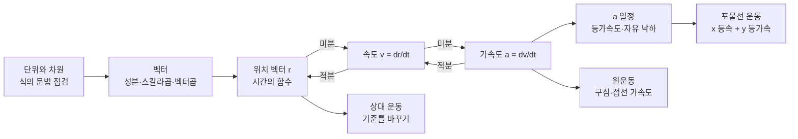

# 일반물리학 1. 운동의 기술 — 미분과 벡터로 다시 쓰는 '어디, 얼마나 빨리, 어느 쪽으로'
<!-- prev: mech-1, phy-1, 3-3 -->
<!-- next: uphy-2, uphy-3, uphy-5 -->

> [!NOTE]
> **이 단원의 범위**
> - 단위와 차원 분석, 어림과 유효 숫자
> - 벡터: 성분과 단위 벡터, 스칼라곱과 벡터곱
> - 1차원 운동: 위치·속도·가속도의 미분·적분 관계, 등가속도 운동과 자유 낙하
> - 2·3차원 운동과 포물선 운동, 등속 원운동(구심 가속도)과 접선 가속도
> - 상대 운동(갈릴레이 속도 변환)

**학습 목표**

1. 물리량의 차원을 써서 식의 옳고 그름을 점검하고, 차원 분석으로 물리량 사이의 관계를 어림할 수 있다.
2. 벡터를 단위 벡터와 성분으로 나타내고, 스칼라곱과 벡터곱을 계산하여 두 벡터 사이의 각과 넓이를 구할 수 있다.
3. 위치 함수를 미분하여 속도와 가속도를, 가속도 함수를 적분하여 속도와 위치를 구하고, 변위와 이동 거리를 구별할 수 있다.
4. 적분으로 등가속도 운동의 식을 유도하고, 자유 낙하와 연직 던지기 문제를 단계적으로 풀 수 있다.
5. 위치 벡터 $\vec{r}(t)$를 미분하여 2·3차원 운동을 기술하고, 포물선 운동과 원운동의 가속도를 구할 수 있다.
6. 서로 다른 기준틀에서 본 위치·속도의 관계를 벡터식으로 쓰고, 강을 건너는 배나 바람 속 비행기의 운동을 분석할 수 있다.

**이 단원의 학습 사다리**

| 단계 | 무엇을 하나? |
|---|---|
| STEP 1. 이전 학습 다시 보기 | 고등학교 「힘과 에너지」의 등가속도 운동, 「시공간과 운동」의 포물선·원운동을 꺼내 본다 |
| STEP 2. 기초 다지기 | 도함수와 적분의 뜻, 자주 쓰는 미분 공식, 라디안, 유효 숫자를 익힌다 |
| STEP 3. 핵심 개념 | 차원 분석 → 벡터 → 1차원 운동의 미적분 → 등가속도·자유 낙하 → 2·3차원·포물선 운동 → 원운동 → 상대 운동 |
| STEP 4. 오개념 바로잡기 | "속도가 0이면 가속도도 0", "평균 속력 = 평균 속도의 크기" 같은 착각을 바로잡는다 |
| STEP 5. 다음 단계로 한 걸음 더 | 극좌표에서의 가속도, 운동을 수치로 푸는 방법(오일러 방법) 맛보기 |
| STEP 6. 생활·산업·진로 | 관성 항법 장치, 스포츠 궤적 추적, 항공 항법, 원심 분리기 |

---

## 🗺️ 단원 들어가기

스마트폰을 손에 쥐고 엘리베이터를 타 보자. 스마트폰 속 손톱만 한 **가속도계**는 1초에 수백 번 가속도를 잰다. 그런데 지도 앱이 알고 싶은 것은 가속도가 아니라 "지금 어디에 있는가"이다. 가속도에서 위치를 얻으려면 무엇을 해야 할까? 거꾸로, 야구 중계의 투구 추적 장치는 공의 위치를 1초에 수십 번 찍어서 공의 속도와 휘는 정도를 알아낸다. 위치에서 속도를 얻으려면 또 무엇을 해야 할까?

고등학교에서는 "등가속도 운동"이라는 특별한 경우에 맞는 세 개의 식으로 대부분의 문제를 풀었다. 그러나 출발하는 지하철, 브레이크를 서서히 밟는 자동차, 휘어진 도로를 달리며 속력을 높이는 차의 가속도는 일정하지 않다. 이 단원에서는 **미분과 적분**, 그리고 **벡터**라는 두 가지 언어로 운동을 다시 쓴다. 이 언어를 익히면 등가속도 운동의 식은 외울 필요가 없는 '한 줄 적분의 결과'가 되고, 포물선 운동과 원운동은 '위치 벡터를 두 번 미분한 것'으로 하나로 이어진다. 이 단원은 일반물리학 전체를 읽기 위한 문법책이다.

---

## STEP 1. 🔙 이전 학습 다시 보기

### 연계 개념표

| 이전 단원 | 고등학교에서는 여기까지 | 대학에서는 이렇게 확장 |
|---|---|---|
| 통합과학1 「기본량과 단위」 | 7개 기본량과 SI 단위, 유도 단위 | 모든 식의 양변 **차원이 같아야** 한다는 규칙으로 식을 점검하고, 차원 분석으로 관계를 어림한다 |
| 통합과학1 「중력과 운동」 | 자유 낙하, 수평으로 던진 운동을 두 방향으로 나누어 설명 | 위치를 시간의 함수로 쓰고 **미분·적분**으로 속도와 가속도를 연결한다 |
| 물리학 「힘과 에너지」 '등가속도 운동' | 등가속도 운동의 세 식과 속도–시간 그래프의 기울기·넓이 | 그래프의 기울기 = **도함수**, 넓이 = **정적분**. 세 식을 적분으로 유도하고, 가속도가 변하는 운동까지 다룬다 |
| 역학과 에너지 「시공간과 운동」 '포물선 운동' | $R = v_0^2\sin2\theta/g$, 같은 높이로 떨어지는 경우 중심 | **위치 벡터**로 궤적 방정식을 유도하고, 높이가 다른 곳으로 떨어지는 일반적인 경우를 푼다 |
| 역학과 에너지 「시공간과 운동」 '원운동' | 구심 가속도 $v^2/r$을 결과로 사용 | $\vec{r}(t)$를 두 번 미분하여 $v^2/r$을 **유도**하고, 속력이 변하는 원운동의 **접선 가속도**까지 다룬다 |
| 중3 「운동과 에너지」 | 시간–속력 그래프 해석 | 속력(스칼라)과 속도(벡터), 이동 거리와 변위를 엄밀하게 구별한다 |

### 준비 운동 (사전 진단)

**Q1.** 함수 $f(t) = 4t^3 - 2t$의 도함수 $f'(t)$를 구하고, $t = 1$에서의 값을 구하시오.

**Q2.** 속도–시간 그래프가 $(0\ \mathrm{s}, 2\ \mathrm{m/s})$에서 $(4\ \mathrm{s}, 10\ \mathrm{m/s})$까지 곧은 선이다. 이 4초 동안의 가속도와 이동 거리는?

**Q3.** 동쪽으로 3 m 간 뒤 북쪽으로 4 m 갔다. 이동 거리와 변위의 크기는?

**Q4.** 공기 저항이 없을 때, 비스듬히 던진 공이 최고점에 있는 순간의 가속도는? (① 0 ② 수평 방향 $g$ ③ 연직 아래로 $g$ ④ 공의 속도 방향으로 $g$)

정답 및 해설

**Q1.** $f'(t) = 12t^2 - 2$, $f'(1) = 10$ — 다항식은 $\frac{d}{dt}t^n = nt^{n-1}$을 항마다 적용한다.

**Q2.** 가속도 $2\ \mathrm{m/s^2}$, 이동 거리 $24\ \mathrm{m}$ — 기울기 $(10-2)/4 = 2$, 그래프 아래 넓이(사다리꼴) $\frac{1}{2}(2+10)\times4 = 24$이다. 대학에서는 이것을 각각 $dv/dt$와 $\int v\,dt$로 쓴다.

**Q3.** 이동 거리 7 m, 변위의 크기 5 m — 변위는 처음 위치에서 나중 위치로 향하는 벡터이므로 $\sqrt{3^2+4^2} = 5\ \mathrm{m}$이다.

**Q4. ③** — 공이 받는 힘은 중력뿐이므로 가속도는 운동 내내 연직 아래로 $g$이다. 최고점에서 0이 되는 것은 속도의 연직 성분뿐이다.

---

## STEP 2. 🧱 기초 다지기

### 디딤돌 1. 도함수 — '순간'의 변화율

어떤 양 $x$가 시간 $t$에 따라 변할 때, 짧은 시간 $\Delta t$ 동안의 평균 변화율 $\Delta x/\Delta t$에서 $\Delta t$를 한없이 0에 가깝게 한 극한을 **도함수(derivative)** 라 한다.

$$
\frac{dx}{dt} = \lim_{\Delta t\to0}\frac{x(t+\Delta t) - x(t)}{\Delta t}
$$

그래프로는 **접선의 기울기**이다. 물리에서는 "1초에 얼마씩 변하는가"를 그 순간에 대해 묻는 것이다. 이 단원에서 자주 쓰는 공식은 다음과 같다($a$, $b$, $n$, $\omega$는 상수).

| 함수 $f(t)$ | 도함수 $f'(t)$ | 비고 |
|---|---|---|
| $t^n$ | $nt^{n-1}$ | 상수의 도함수는 0 |
| $\sin\omega t$ | $\omega\cos\omega t$ | 각은 라디안 |
| $\cos\omega t$ | $-\omega\sin\omega t$ | 각은 라디안 |
| $e^{bt}$ | $be^{bt}$ | 끌림힘 문제(일반물리학 2)에서 쓴다 |
| $a f(t) + b g(t)$ | $a f'(t) + b g'(t)$ | 선형성: 항마다 따로 미분 |
| $f(g(t))$ | $f'(g(t))\,g'(t)$ | **연쇄 법칙(chain rule)** |

시간에 대한 도함수를 점으로 나타내기도 한다: $\dot{x} = dx/dt$, $\ddot{x} = d^2x/dt^2$.

### 디딤돌 2. 적분 — 잘게 나누어 모두 더하기

속도 $v(t)$가 변하는 동안 이동한 변위는, 시간을 아주 잘게 나누어 각 조각에서의 $v\,\Delta t$를 모두 더한 것이다. 조각의 폭을 0으로 보내면 **정적분(definite integral)** 이 된다.

$$
\Delta x = \int_{t_1}^{t_2} v(t)\,dt \qquad(\text{그래프 아래의 부호 있는 넓이})
$$

**미적분의 기본 정리**에 따라, 적분은 미분의 역연산이다. $\frac{d}{dt}F(t) = f(t)$인 $F$를 찾으면 $\int_{t_1}^{t_2} f\,dt = F(t_2) - F(t_1)$이다. 예를 들어 $\int t^n\,dt = \frac{t^{n+1}}{n+1} + C$($n\ne-1$)이다.

> [!TIP]
> 💡 **비유** — 자동차의 속력계는 '미분'을, 주행 거리계는 '적분'을 하는 장치이다. 속력계는 지금 이 순간 거리가 얼마나 빨리 늘어나는지 보여 주고, 주행 거리계는 매 순간의 속력을 쉬지 않고 더해 둔다. 두 장치는 서로 정보를 바꿔 계산할 수 있다.

> [!WARNING]
> 정적분은 **부호 있는** 넓이이다. 속도가 음수인 구간(뒤로 가는 구간)의 넓이는 음수로 더해진다. 그래서 $\int v\,dt$는 변위이고, 이동 거리는 $\int \lvert v \rvert\,dt$이다.

<!-- fig:uphy-1-derivative-integral -->

### 디딤돌 3. 라디안

원호의 길이 $s$를 반지름 $r$로 나눈 값으로 각을 재는 것이 **라디안(radian)** 이다: $\theta = s/r$. 한 바퀴는 $2\pi\ \mathrm{rad} = 360^\circ$이다. $\frac{d}{d\theta}\sin\theta = \cos\theta$ 같은 공식은 각을 라디안으로 잴 때만 성립하므로, 원운동을 미분할 때는 반드시 라디안을 쓴다.

### 디딤돌 4. 유효 숫자와 과학적 표기

측정값의 믿을 만한 자릿수를 **유효 숫자(significant figures)** 라 한다. 이 책의 대학 단원은 다음 규칙을 따른다.

| 규칙 | 예 |
|---|---|
| 곱셈·나눗셈의 결과는 유효 숫자가 가장 적은 값에 맞춘다 | $2.5\ \mathrm{m} \div 1.23\ \mathrm{s} = 2.0\ \mathrm{m/s}$ |
| 덧셈·뺄셈의 결과는 소수점 아래 자리가 가장 적은 값에 맞춘다 | $12.0\ \mathrm{m} + 0.345\ \mathrm{m} = 12.3\ \mathrm{m}$ |
| 중간 계산에서는 자릿수를 넉넉히 두고, 마지막에 한 번만 반올림한다 | 반올림 오차가 쌓이지 않게 한다 |
| 아주 크거나 작은 수는 과학적 표기로 쓴다 | $0.000\,52\ \mathrm{m} = 5.2\times10^{-4}\ \mathrm{m}$ |

예제에서는 문제에 주어진 값이 보통 세 자리이므로 답도 세 자리로 쓴다. 중력 가속도는 $g = 9.80\ \mathrm{m/s^2}$을 쓴다.

---

## STEP 3. 📘 핵심 개념

### ① 단위와 차원 분석

#### (1) SI 기본 단위와 차원

물리량은 '수 × 단위'이다. 국제단위계(SI)는 7개의 기본 단위에서 모든 단위를 만든다. 역학에서는 길이, 질량, 시간 세 가지로 충분하다.

| 기본량 | SI 단위 | 차원 기호 | 현재의 정의(요약) |
|---|---|---|---|
| 길이 | 미터(m) | $\mathsf{L}$ | 빛이 진공에서 $1/299\,792\,458$초 동안 가는 거리 |
| 질량 | 킬로그램(kg) | $\mathsf{M}$ | 플랑크 상수 $h$의 값을 고정하여 정의 |
| 시간 | 초(s) | $\mathsf{T}$ | 세슘-133 원자의 특정 전이 진동수를 고정하여 정의 |
| 전류 | 암페어(A) | $\mathsf{I}$ | 기본 전하 $e$의 값을 고정하여 정의 |
| 온도 | 켈빈(K) | $\Theta$ | 볼츠만 상수 $k_B$의 값을 고정하여 정의 |
| 물질량 | 몰(mol) | $\mathsf{N}$ | 아보가드로 수를 고정하여 정의 |
| 광도 | 칸델라(cd) | $\mathsf{J}$ | 특정 진동수 빛의 시감 효능을 고정하여 정의 |

어떤 물리량이 기본량의 어떤 조합인지를 그 양의 **차원(dimension)** 이라 하고 대괄호로 쓴다. 예를 들어 속도는 $[v] = \mathsf{L}\mathsf{T}^{-1}$, 가속도는 $[a] = \mathsf{L}\mathsf{T}^{-2}$, 힘은 $[F] = \mathsf{M}\mathsf{L}\mathsf{T}^{-2}$이다.

#### (2) 차원의 규칙 — 식의 문법

1. 더하거나 빼거나 등호로 잇는 항들은 **모두 같은 차원**이어야 한다.
2. $\sin$, $\cos$, $e^{x}$, $\ln x$의 안에 들어가는 $x$는 **차원이 없어야** 한다.
3. 차원이 맞는 식이 반드시 옳은 것은 아니다(앞의 숫자 $\frac{1}{2}$, $2\pi$ 등은 차원으로 알 수 없다). 그러나 **차원이 틀린 식은 반드시 틀렸다.**

예를 들어 $x = v_0t + \frac{1}{2}at^2$에서 각 항의 차원은 $\mathsf{L}$, $\mathsf{L}\mathsf{T}^{-1}\cdot\mathsf{T} = \mathsf{L}$, $\mathsf{L}\mathsf{T}^{-2}\cdot\mathsf{T}^2 = \mathsf{L}$로 모두 같다. 시험 답안에서 $x = v_0t + \frac{1}{2}at$를 썼다면 차원만 보고도 틀렸음을 알 수 있다.

#### 예제 1 — 차원 분석으로 진자의 주기 어림하기

단진자의 주기 $T$가 줄의 길이 $l$, 추의 질량 $m$, 중력 가속도 $g$에만 관계된다고 하자. $T = C\,l^{a}m^{b}g^{c}$($C$는 차원 없는 상수)로 놓고 $a$, $b$, $c$를 구하시오.

**풀이**
- 식 세우기: 양변의 차원을 같게 놓는다. $\mathsf{T}^1 = \mathsf{L}^{a}\,\mathsf{M}^{b}\,(\mathsf{L}\mathsf{T}^{-2})^{c} = \mathsf{L}^{a+c}\mathsf{M}^{b}\mathsf{T}^{-2c}$
- 지수 비교: $\mathsf{M}$: $b = 0$, $\mathsf{T}$: $-2c = 1 \Rightarrow c = -\frac{1}{2}$, $\mathsf{L}$: $a + c = 0 \Rightarrow a = \frac{1}{2}$
- 결과: $T = C\sqrt{l/g}$

**의미** 주기는 추의 질량과 관계없고, 줄 길이의 제곱근에 비례한다. 줄을 4배로 늘리면 주기는 2배가 된다. 상수 $C$($= 2\pi$)는 차원 분석으로 얻을 수 없고, 운동 방정식을 풀어야 한다(「중력·진동·유체」).

#### (3) 단위 환산과 어림

단위 환산은 '1과 같은 분수'를 곱하는 것이다. 예를 들어

$$
110\ \frac{\mathrm{km}}{\mathrm{h}}\times\frac{1000\ \mathrm{m}}{1\ \mathrm{km}}\times\frac{1\ \mathrm{h}}{3600\ \mathrm{s}} = 30.6\ \mathrm{m/s}
$$

**어림(order-of-magnitude estimate)** 은 자릿수만 맞추는 계산이다. 1년은 $365.25\times86\,400\ \mathrm{s} \approx 3.16\times10^7\ \mathrm{s}$인데, 이는 $\pi\times10^7\ \mathrm{s}$와 0.5 % 안쪽으로 맞아서 물리학자들이 즐겨 쓰는 어림값이다.

> [!TIP]
> 💡 **요령** — 계산이 끝나면 답의 단위가 구하려는 양의 단위인지부터 확인하자. 거리를 구했는데 단위가 $\mathrm{m/s}$로 나왔다면, 숫자를 볼 필요도 없이 어디선가 틀린 것이다. 차원 점검은 가장 빠르고 값싼 검산이다.

#### ✔ 바로 확인

1. (O/X) 양변의 차원이 맞는 식은 반드시 옳은 식이다.
2. 빈칸: 힘의 차원은 $\mathsf{M}^{(\ \ )}\mathsf{L}^{(\ \ )}\mathsf{T}^{(\ \ )}$이다.
3. $72.0\ \mathrm{km/h}$는 몇 $\mathrm{m/s}$인가?
4. $y = A\sin(kx)$에서 $x$가 길이일 때 상수 $k$의 차원은?

정답

1. X — 차원이 틀린 식은 반드시 틀리지만, $\frac{1}{2}$, $2\pi$ 같은 숫자 인자는 차원으로 확인할 수 없다.
2. $\mathsf{M}^1\mathsf{L}^1\mathsf{T}^{-2}$ — $F = ma$이므로 질량 × 가속도의 차원이다.
3. $20.0\ \mathrm{m/s}$ — $72.0\times\frac{1000}{3600} = 20.0$.
4. $\mathsf{L}^{-1}$ — $\sin$ 안의 $kx$는 차원이 없어야 한다.

### ② 벡터 — 성분, 스칼라곱, 벡터곱

#### (1) 단위 벡터와 성분 표기

3차원 직교 좌표계에서 $x$, $y$, $z$축 방향의 크기 1인 벡터를 **단위 벡터(unit vector)** $\hat{i}$, $\hat{j}$, $\hat{k}$로 쓴다. 모든 벡터는 이들의 조합이다.

$$
\vec{A} = A_x\hat{i} + A_y\hat{j} + A_z\hat{k}, \qquad \lvert\vec{A}\rvert = A = \sqrt{A_x^2 + A_y^2 + A_z^2}
$$

2차원에서 크기 $A$, $x$축과 이루는 각 $\theta$이면 $A_x = A\cos\theta$, $A_y = A\sin\theta$이고, 거꾸로 $\theta = \tan^{-1}(A_y/A_x)$이다(단, $A_x < 0$이면 계산기 값에 $180^\circ$를 더해야 한다). 벡터의 덧셈·뺄셈은 **성분끼리** 한다. 벡터에 스칼라 $c$를 곱하면 모든 성분에 $c$가 곱해진다.

<!-- fig:uphy-1-vector-components -->

#### (2) 스칼라곱(내적)

두 벡터의 **스칼라곱(scalar product, dot product)** 은 결과가 스칼라인 곱이다.

$$
\vec{A}\cdot\vec{B} = AB\cos\phi = A_xB_x + A_yB_y + A_zB_z
$$

여기서 $\phi$는 두 벡터 사이의 각이다. 두 번째 등호는 $\hat{i}\cdot\hat{i} = 1$, $\hat{i}\cdot\hat{j} = 0$ 등을 써서 전개하면 얻어진다.

| 성질 | 의미 |
|---|---|
| $\vec{A}\cdot\vec{B} = \vec{B}\cdot\vec{A}$ | 순서를 바꿔도 같다 |
| $\vec{A}\cdot\vec{B} = 0$ ($\vec{A}, \vec{B} \ne 0$) | 두 벡터가 **수직** |
| $\vec{A}\cdot\vec{A} = A^2$ | 크기의 제곱 |
| $\vec{A}\cdot\hat{i} = A_x$ | 한 방향으로의 **사영(성분)** |

물리에서는 "한 벡터가 다른 벡터 방향으로 얼마나 기여하는가"를 물을 때 쓴다. 일 $W = \vec{F}\cdot\vec{d}$(「일·에너지와 운동량」), 일률 $P = \vec{F}\cdot\vec{v}$가 대표적이다.

#### (3) 벡터곱(외적)

두 벡터의 **벡터곱(vector product, cross product)** $\vec{C} = \vec{A}\times\vec{B}$는 결과가 벡터이다.

- **크기**: $C = AB\sin\phi$ — $\vec{A}$와 $\vec{B}$가 만드는 평행사변형의 넓이
- **방향**: $\vec{A}$와 $\vec{B}$ 모두에 수직이며, **오른손 법칙**을 따른다(오른손 네 손가락을 $\vec{A}$에서 $\vec{B}$ 쪽으로 감아쥘 때 엄지 방향)
- **성분**:

$$
\vec{A}\times\vec{B} = (A_yB_z - A_zB_y)\,\hat{i} + (A_zB_x - A_xB_z)\,\hat{j} + (A_xB_y - A_yB_x)\,\hat{k}
$$

| 성질 | 의미 |
|---|---|
| $\vec{A}\times\vec{B} = -\vec{B}\times\vec{A}$ | 순서를 바꾸면 방향이 반대 |
| $\vec{A}\times\vec{A} = 0$ | 나란한 벡터끼리는 0 |
| $\hat{i}\times\hat{j} = \hat{k}$, $\hat{j}\times\hat{k} = \hat{i}$, $\hat{k}\times\hat{i} = \hat{j}$ | 오른손 좌표계의 순환 규칙 |

벡터곱은 돌림힘 $\vec{\tau} = \vec{r}\times\vec{F}$, 각운동량 $\vec{L} = \vec{r}\times\vec{p}$(「회전 운동과 각운동량」), 자기력 $q\vec{v}\times\vec{B}$(「전류·회로와 자기장」)에서 계속 나온다.

> [!TIP]
> 💡 **비유** — 스칼라곱은 "얼마나 같은 쪽을 보고 있나"를 재는 **그림자**이고, 벡터곱은 "얼마나 엇갈려 있나"를 재는 **넓이와 회전축**이다. 문을 미는 힘이 문짝과 나란하면(그림자는 크지만) 문은 돌지 않고, 문짝에 수직일 때 회전 효과(벡터곱)가 가장 크다.

<!-- fig:uphy-1-dot-cross -->

#### 예제 2 — 두 벡터의 사이각과 평행사변형의 넓이

$\vec{A} = 3\hat{i} - 2\hat{j} + \hat{k}$, $\vec{B} = \hat{i} + 4\hat{j} - 2\hat{k}$ (단위: m)일 때 (1) $\vec{A}\cdot\vec{B}$와 사이각 (2) $\vec{A}\times\vec{B}$와 두 벡터가 만드는 평행사변형의 넓이를 구하시오.

**풀이**
(1) $\vec{A}\cdot\vec{B} = 3(1) + (-2)(4) + 1(-2) = -7\ \mathrm{m^2}$. 크기는 $A = \sqrt{14} \approx 3.74\ \mathrm{m}$, $B = \sqrt{21} \approx 4.58\ \mathrm{m}$이므로

$$
\cos\phi = \frac{-7}{\sqrt{14}\sqrt{21}} \approx -0.408 \;\Rightarrow\; \phi \approx 114^\circ
$$

(2) 성분 공식에 넣으면

$$
\vec{A}\times\vec{B} = [(-2)(-2) - (1)(4)]\hat{i} + [(1)(1) - (3)(-2)]\hat{j} + [(3)(4) - (-2)(1)]\hat{k} = 0\,\hat{i} + 7\hat{j} + 14\hat{k}\ (\mathrm{m^2})
$$

넓이 $= \lvert\vec{A}\times\vec{B}\rvert = \sqrt{0 + 49 + 196} = \sqrt{245} \approx 15.7\ \mathrm{m^2}$.

**검산** $AB\sin\phi = \sqrt{294}\times\sin114.1^\circ \approx 17.15\times0.913 \approx 15.7\ \mathrm{m^2}$로 일치한다. 또 $\vec{A}\cdot(\vec{A}\times\vec{B}) = 0 - 14 + 14 = 0$이므로 결과가 $\vec{A}$에 수직임도 확인된다. 스칼라곱이 음수라는 것은 사이각이 둔각이라는 뜻이다.

#### ✔ 바로 확인

1. $\vec{A} = 3\hat{i} + 4\hat{j}$의 크기는?
2. (O/X) 영벡터가 아닌 두 벡터의 스칼라곱이 0이면 두 벡터는 서로 수직이다.
3. 빈칸: $\hat{i}\times\hat{j} = (\quad)$, $\hat{j}\times\hat{i} = (\quad)$
4. $\vec{B} = -2\hat{i} + 2\hat{j}$가 $+x$축과 이루는 방향각은? (계산기의 $\tan^{-1}(-1) = -45^\circ$에 주의)

정답

1. 5 — $\sqrt{3^2 + 4^2}$.
2. O — $AB\cos\phi = 0$이면 $\phi = 90^\circ$이다.
3. $\hat{k}$, $-\hat{k}$ — 벡터곱은 순서를 바꾸면 부호가 바뀐다.
4. $135^\circ$ — $B_x < 0$이므로 $-45^\circ$에 $180^\circ$를 더한다(제2사분면).

### ③ 1차원 운동 — 위치·속도·가속도의 미분·적분 관계

#### (1) 위치, 변위, 평균 속도

직선 위의 운동은 위치 $x(t)$ 하나로 기술된다. 시간 $t_1$에서 $t_2$ 사이의 **변위(displacement)** 는 $\Delta x = x(t_2) - x(t_1)$이고, **평균 속도(average velocity)** 는 $\bar{v} = \Delta x/\Delta t$이다. 반면 **평균 속력(average speed)** 은 이동 거리 $\div$ 걸린 시간으로, 방향을 바꾸는 운동에서는 평균 속도의 크기보다 크다.

#### (2) 순간 속도와 가속도 — 미분

$$
v(t) = \frac{dx}{dt}, \qquad a(t) = \frac{dv}{dt} = \frac{d^2x}{dt^2}
$$

- $v$의 부호가 운동 방향을 알려 준다. $v = 0$인 순간이 **방향을 바꾸는 점(되돌이점)** 이 될 수 있다.
- $a$와 $v$의 부호가 같으면 **빨라지고**, 다르면 **느려진다.** 가속도가 음수라고 해서 반드시 느려지는 것은 아니다.

#### (3) 거꾸로 — 적분

가속도를 알면 적분으로 속도와 위치를 되찾는다. 처음 조건 $v(0) = v_0$, $x(0) = x_0$이 반드시 필요하다(적분 상수).

$$
v(t) = v_0 + \int_0^t a(t')\,dt', \qquad x(t) = x_0 + \int_0^t v(t')\,dt'
$$

| 알고 있는 것 | 구하는 것 | 하는 일 | 그래프에서 |
|---|---|---|---|
| $x(t)$ | $v(t)$ | 미분 | $x$–$t$ 그래프의 접선 기울기 |
| $v(t)$ | $a(t)$ | 미분 | $v$–$t$ 그래프의 접선 기울기 |
| $a(t)$, $v_0$ | $v(t)$ | 적분 | $a$–$t$ 그래프 아래 넓이 + $v_0$ |
| $v(t)$, $x_0$ | $x(t)$ | 적분 | $v$–$t$ 그래프 아래 넓이 + $x_0$ |

<!-- fig:uphy-1-xva-graphs -->

#### 예제 3 — 방향을 두 번 바꾸는 운동

직선 위를 움직이는 입자의 위치가 $x(t) = t^3 - 6t^2 + 9t + 2$ (단위: m, s)이다. (1) 속도와 가속도 함수 (2) 입자가 멈추는 순간 (3) $t = 0$부터 4 s까지의 변위와 이동 거리 (4) 이 동안의 평균 속도와 평균 속력을 구하시오.

**풀이**
(1) $v = \dfrac{dx}{dt} = 3t^2 - 12t + 9 = 3(t-1)(t-3)\ \mathrm{m/s}$, $a = \dfrac{dv}{dt} = 6t - 12\ \mathrm{m/s^2}$

(2) $v = 0$에서 $t = 1\ \mathrm{s}$, $t = 3\ \mathrm{s}$. 두 순간 모두 $v$의 부호가 바뀌므로 되돌이점이다.

(3) 각 순간의 위치를 표로 정리한다.

| $t$ (s) | 0 | 1 | 2 | 3 | 4 |
|---|---|---|---|---|---|
| $x$ (m) | 2 | 6 | 4 | 2 | 6 |
| $v$ (m/s) | 9 | 0 | $-3$ | 0 | 9 |
| $a$ (m/s²) | $-12$ | $-6$ | 0 | 6 | 12 |

변위 $= x(4) - x(0) = 4\ \mathrm{m}$. 이동 거리는 구간별로 더한다: $0\to1$ s에 4 m 앞으로, $1\to3$ s에 4 m 뒤로, $3\to4$ s에 4 m 앞으로 → **12 m**.

(4) 평균 속도 $= 4/4 = 1\ \mathrm{m/s}$, 평균 속력 $= 12/4 = 3\ \mathrm{m/s}$.

**의미** $t = 0$에서 $v > 0$, $a < 0$이므로 입자는 앞으로 가면서 느려지고 있다. $t = 2\ \mathrm{s}$에서는 가속도가 0이지만 속도는 $-3\ \mathrm{m/s}$로, 이때 뒤로 가는 속력이 가장 크다. 가속도가 0인 것과 멈춘 것은 전혀 다르다.

#### 예제 4 — 가속도에서 위치로

정지해 있던 로봇 청소기가 $t = 0$에 원점에서 출발하여, 가속도 $a(t) = 4.0 - 2.0t$ (단위: m/s², s)로 직선 운동한다. (1) $v(t)$와 $x(t)$ (2) 속도가 최대인 순간과 그 값 (3) 다시 멈추는 순간의 위치를 구하시오.

**풀이**
(1) $v(t) = 0 + \int_0^t (4.0 - 2.0t')\,dt' = 4.0t - 1.0t^2$, $\quad x(t) = 0 + \int_0^t (4.0t' - 1.0t'^2)\,dt' = 2.0t^2 - \dfrac{t^3}{3}$

(2) 속도가 최대인 순간은 $dv/dt = a = 0$인 $t = 2.0\ \mathrm{s}$이고, $v(2.0) = 8.0 - 4.0 = 4.0\ \mathrm{m/s}$이다.

(3) $v = t(4.0 - t) = 0$에서 $t = 4.0\ \mathrm{s}$. $x(4.0) = 32 - \dfrac{64}{3} \approx 10.7\ \mathrm{m}$.

**의미** 이 운동은 가속도가 시간에 따라 변하므로 고등학교의 등가속도 식으로는 풀 수 없다. 적분을 쓰면 가속도가 어떤 함수이든 같은 방법으로 풀린다.

> [!IMPORTANT]
> 미분은 정보를 **잃고**(상수항이 사라진다), 적분은 정보를 **요구한다**(적분 상수 = 처음 조건). 가속도만으로는 운동이 결정되지 않는다. "언제, 어디서, 얼마의 속도로 출발했는가"가 함께 주어져야 한다. 이것이 뉴턴 역학에서 처음 위치와 처음 속도가 중요한 이유이다.

#### ✔ 바로 확인

1. $x(t) = 5t^2 - 2t$ (단위: m, s)일 때 $v(t)$와 $a(t)$는?
2. (O/X) 속도가 0인 순간에는 가속도도 반드시 0이다.
3. 어느 순간 $v = -4\ \mathrm{m/s}$, $a = +2\ \mathrm{m/s^2}$이다. 물체는 빨라지는가, 느려지는가?
4. 빈칸: $v$–$t$ 그래프 아래의 부호 있는 넓이는 (    )이고, $\lvert v\rvert$–$t$ 그래프 아래 넓이는 (    )이다.

정답

1. $v = 10t - 2\ \mathrm{m/s}$, $a = 10\ \mathrm{m/s^2}$ — 항마다 미분한다.
2. X — 예제 3의 $t = 1\ \mathrm{s}$처럼 속도가 0이어도 가속도($-6\ \mathrm{m/s^2}$)가 있다.
3. 느려진다 — $v$와 $a$의 부호가 반대이다.
4. 변위, 이동 거리 — 정적분은 뒤로 간 구간을 빼고 더한다.

### ④ 등가속도 운동과 자유 낙하

#### (1) 적분으로 유도하는 등가속도 운동의 식

가속도 $a$가 일정하면 적분이 쉽다.

$$
v = v_0 + \int_0^t a\,dt' = v_0 + at, \qquad x = x_0 + \int_0^t (v_0 + at')\,dt' = x_0 + v_0t + \tfrac{1}{2}at^2
$$

두 식에서 $t$를 소거하면 $v^2 = v_0^2 + 2a(x - x_0)$를 얻는다. 또 연쇄 법칙을 쓰면 시간을 거치지 않고 바로 유도할 수도 있다.

$$
a = \frac{dv}{dt} = \frac{dv}{dx}\frac{dx}{dt} = v\frac{dv}{dx} \;\Rightarrow\; \int_{x_0}^{x} a\,dx' = \int_{v_0}^{v} v'\,dv' \;\Rightarrow\; a(x - x_0) = \tfrac{1}{2}(v^2 - v_0^2)
$$

| 식 | 빠진 양 | 쓰기 좋은 때 |
|---|---|---|
| $v = v_0 + at$ | 위치 | 시간과 속도의 관계 |
| $x - x_0 = v_0t + \frac{1}{2}at^2$ | 나중 속도 | 시간과 위치의 관계 |
| $v^2 = v_0^2 + 2a(x - x_0)$ | 시간 | 시간을 모를 때 |
| $x - x_0 = \frac{1}{2}(v_0 + v)t$ | 가속도 | 평균 속도 = 처음과 나중의 평균(등가속도일 때만) |

> [!WARNING]
> 네 식은 **가속도가 일정할 때만** 성립한다. 예제 4처럼 가속도가 변하면 쓸 수 없다. 특히 "평균 속도 = $(v_0 + v)/2$"는 등가속도 운동에서만 맞는다.

#### (2) 자유 낙하

공기 저항을 무시하면 지표 근처의 모든 물체는 질량과 관계없이 같은 가속도 $g$로 떨어진다. 위쪽을 $+y$로 잡으면 $a_y = -g$이다. $g$는 위도와 고도에 따라 약 $9.78$~$9.83\ \mathrm{m/s^2}$ 사이의 값을 가지며, 이 책에서는 $g = 9.80\ \mathrm{m/s^2}$을 쓴다.

#### 예제 5 — 옥상에서 위로 던진 공

높이 15.0 m인 건물 옥상 가장자리에서 공을 연직 위로 12.0 m/s로 던졌다. 공은 옥상 바깥으로 떨어져 땅에 닿는다. 공기 저항을 무시하고 $g = 9.80\ \mathrm{m/s^2}$일 때 (1) 옥상에서부터 잰 최고 높이와 그때까지 걸린 시간 (2) 땅에 닿을 때까지 걸린 시간 (3) 땅에 닿기 직전의 속력을 구하시오.

**풀이** 옥상을 원점, 위쪽을 $+y$로 잡는다. $v_0 = +12.0\ \mathrm{m/s}$, $a = -9.80\ \mathrm{m/s^2}$.

(1) 최고점에서 $v = 0$: $0 = 12.0^2 - 2(9.80)y_{\max}$ → $y_{\max} = \dfrac{144}{19.6} = 7.35\ \mathrm{m}$, $t = \dfrac{12.0}{9.80} = 1.22\ \mathrm{s}$

(2) 땅은 $y = -15.0\ \mathrm{m}$: $-15.0 = 12.0t - 4.90t^2$ → $4.90t^2 - 12.0t - 15.0 = 0$

$$
t = \frac{12.0 + \sqrt{12.0^2 + 4(4.90)(15.0)}}{2(4.90)} = \frac{12.0 + 20.9}{9.80} = 3.36\ \mathrm{s}
$$

음의 근($t \approx -0.91\ \mathrm{s}$)은 출발 전이므로 버린다.

(3) $v^2 = 12.0^2 + 2(9.80)(15.0) = 438$ → $\lvert v\rvert = 20.9\ \mathrm{m/s}$ (방향은 아래)

**의미** (3)의 값은 공을 아래로 12.0 m/s로 던졌을 때와 같다. 위로 던진 공은 올라갔다가 옥상 높이를 지날 때 다시 12.0 m/s로 아래로 내려오기 때문이다. $v^2$ 식에 방향 정보가 없다는 점도 기억하자.

> [!TIP]
> 💡 **요령** — 연직 운동 문제에서는 ① 원점과 + 방향을 **먼저** 정하고, ② 모든 양에 부호를 붙여 쓰고, ③ 이차 방정식의 근 중 물리적으로 맞는 것을 고른다. 부호 하나를 잘못 붙이는 것이 대학 1학년 역학 오답의 가장 큰 원인이다.

#### ✔ 바로 확인

1. 정지 상태에서 $2.0\ \mathrm{m/s^2}$로 5.0 s 동안 등가속도 운동한 물체의 나중 속도와 이동 거리는?
2. (O/X) 평균 속도 $= (v_0 + v)/2$는 가속도가 변하는 운동에도 쓸 수 있다.
3. 공을 연직 위로 $19.6\ \mathrm{m/s}$로 던졌다. 최고점에 이르는 데 걸리는 시간은? ($g = 9.80\ \mathrm{m/s^2}$)
4. 위쪽을 $+y$로 잡을 때 자유 낙하의 가속도 $a_y$는 $+g$인가, $-g$인가?

정답

1. $10\ \mathrm{m/s}$, $25\ \mathrm{m}$ — $v = at$, $x = \frac{1}{2}at^2$.
2. X — 등가속도 운동에서만 성립한다.
3. 2.00 s — 최고점에서 $v = 0$이므로 $t = v_0/g$.
4. $-g$ — 가속도는 언제나 아래 방향이므로 위가 +이면 음수이다.

### ⑤ 2·3차원 운동과 포물선 운동

#### (1) 위치 벡터, 속도 벡터, 가속도 벡터

공간에서 입자의 위치는 원점에서 입자로 향하는 **위치 벡터(position vector)** $\vec{r}(t) = x(t)\hat{i} + y(t)\hat{j} + z(t)\hat{k}$로 나타낸다. 단위 벡터는 시간에 따라 변하지 않으므로 성분마다 미분하면 된다.

$$
\vec{v} = \frac{d\vec{r}}{dt} = \frac{dx}{dt}\hat{i} + \frac{dy}{dt}\hat{j} + \frac{dz}{dt}\hat{k}, \qquad \vec{a} = \frac{d\vec{v}}{dt} = \frac{d^2\vec{r}}{dt^2}
$$

- 속도 벡터는 언제나 **궤적의 접선 방향**이다.
- 가속도 벡터는 궤적이 휘는 **안쪽**을 향하는 성분을 가진다. 속도에 나란한 성분은 속력을, 수직인 성분은 방향을 바꾼다.
- 성분마다 1차원 운동의 미분·적분 관계가 독립적으로 성립한다. 이것이 "운동을 방향별로 나누어 푼다"는 고등학교 방법의 수학적 근거이다.

#### 예제 6 — 드론의 위치 벡터

평면에서 움직이는 드론의 위치가 $\vec{r}(t) = (2.0t^2)\hat{i} + (12t - 2.0t^3)\hat{j}$ (단위: m, s)이다. $t = 1.0\ \mathrm{s}$에서 (1) 위치 (2) 속도와 속력 (3) 가속도와 그 크기를 구하고, (4) $y$ 방향 속도가 0이 되는 순간을 구하시오.

**풀이**
$\vec{v} = (4.0t)\hat{i} + (12 - 6.0t^2)\hat{j}$, $\vec{a} = 4.0\hat{i} - (12t)\hat{j}$

(1) $\vec{r}(1.0) = 2.0\hat{i} + 10\hat{j}\ \mathrm{m}$
(2) $\vec{v}(1.0) = 4.0\hat{i} + 6.0\hat{j}\ \mathrm{m/s}$, 속력 $\sqrt{4.0^2 + 6.0^2} \approx 7.2\ \mathrm{m/s}$
(3) $\vec{a}(1.0) = 4.0\hat{i} - 12\hat{j}\ \mathrm{m/s^2}$, 크기 $\sqrt{16 + 144} \approx 13\ \mathrm{m/s^2}$
(4) $12 - 6.0t^2 = 0$ → $t = \sqrt{2} \approx 1.4\ \mathrm{s}$. 이때 드론은 가장 높은 $y$에 있다.

**의미** $t = 1.0\ \mathrm{s}$에서 $\vec{v}\cdot\vec{a} = 16 - 72 = -56 < 0$이다. 가속도가 속도와 둔각을 이루므로 이 순간 드론의 속력은 줄어들고 있다. 스칼라곱 하나로 "빨라지는가, 느려지는가"를 판단할 수 있다($\frac{d}{dt}v^2 = 2\vec{v}\cdot\vec{a}$).

#### (2) 포물선 운동의 일반식

공기 저항을 무시하고 지표 근처에서 던진 물체의 가속도는 $\vec{a} = -g\hat{j}$로 일정하다. 출발점을 원점, 처음 속도를 $\vec{v}_0 = v_0\cos\theta_0\,\hat{i} + v_0\sin\theta_0\,\hat{j}$라 하면, 적분하여

$$
\vec{v}(t) = \vec{v}_0 - gt\,\hat{j}, \qquad \vec{r}(t) = \vec{v}_0t - \tfrac{1}{2}gt^2\,\hat{j}
$$

$x = v_0\cos\theta_0\,t$에서 $t$를 구해 $y$에 넣으면 **궤적 방정식**을 얻는다.

$$
y = x\tan\theta_0 - \frac{g}{2v_0^2\cos^2\theta_0}\,x^2
$$

$y$가 $x$의 이차 함수이므로 궤적은 포물선이다. 같은 높이로 떨어질 때는 $y = 0$에서 수평 도달 거리 $R = \dfrac{v_0^2\sin2\theta_0}{g}$를 얻는다(고등학교에서 배운 식). 그러나 출발점과 도착점의 높이가 다르면 이 식을 쓸 수 없고, $y(t)$의 이차 방정식을 직접 풀어야 한다.

| 경우 | 체공 시간을 구하는 식 | 주의 |
|---|---|---|
| 같은 높이로 떨어짐 | $0 = v_{0y}t - \frac{1}{2}gt^2$ | $t = 2v_{0y}/g$ |
| 높은 곳에서 출발 | $-h = v_{0y}t - \frac{1}{2}gt^2$ | 양의 근을 고른다 |
| 높은 곳에 도착 | $+h = v_{0y}t - \frac{1}{2}gt^2$ | 두 양의 근: 올라가며 지날 때와 내려오며 지날 때 |

#### 예제 7 — 운동장에서 찬 공

평평한 운동장에서 공을 수평면과 $35.0^\circ$ 방향으로 25.0 m/s로 찼다. (1) 최고 높이 (2) 체공 시간 (3) 수평 도달 거리를 구하시오. ($g = 9.80\ \mathrm{m/s^2}$)

**풀이** $v_{0x} = 25.0\cos35.0^\circ = 20.48\ \mathrm{m/s}$, $v_{0y} = 25.0\sin35.0^\circ = 14.34\ \mathrm{m/s}$

(1) $H = \dfrac{v_{0y}^2}{2g} = \dfrac{14.34^2}{19.6} = 10.5\ \mathrm{m}$
(2) $t = \dfrac{2v_{0y}}{g} = \dfrac{2(14.34)}{9.80} = 2.93\ \mathrm{s}$
(3) $R = v_{0x}t = 20.48\times2.926 = 59.9\ \mathrm{m}$ (검산: $v_0^2\sin70.0^\circ/g = 625\times0.940/9.80 = 59.9\ \mathrm{m}$)

#### 예제 8 — 절벽 위에서 비스듬히 던진 돌

해수면 위 30.0 m 높이의 절벽 끝에서 돌을 수평면 위 $40.0^\circ$ 방향으로 20.0 m/s로 던졌다. (1) 바다에 떨어지기까지의 시간 (2) 절벽에서 떨어진 수평 거리 (3) 물에 닿는 순간의 속력과 방향을 구하시오.

**풀이** 출발점을 원점, 위를 $+y$로 잡는다. $v_{0x} = 15.32\ \mathrm{m/s}$, $v_{0y} = 12.86\ \mathrm{m/s}$.

(1) $-30.0 = 12.86t - 4.90t^2$ → $t = \dfrac{12.86 + \sqrt{12.86^2 + 4(4.90)(30.0)}}{9.80} = \dfrac{12.86 + 27.45}{9.80} = 4.11\ \mathrm{s}$
(2) $x = 15.32\times4.112 = 63.0\ \mathrm{m}$
(3) $v_x = 15.32\ \mathrm{m/s}$, $v_y = 12.86 - 9.80\times4.112 = -27.45\ \mathrm{m/s}$
속력 $= \sqrt{15.32^2 + 27.45^2} = 31.4\ \mathrm{m/s}$, 방향은 수평 아래로 $\tan^{-1}(27.45/15.32) = 60.8^\circ$

**의미** $R = v_0^2\sin2\theta/g$를 쓰면 $40.2\ \mathrm{m}$가 나오는데, 이는 출발 높이로 돌아오는 지점까지의 거리일 뿐이다. 높이가 다른 문제에서 공식을 기계적으로 쓰면 크게 틀린다. 속력은 에너지 보존 $v^2 = v_0^2 + 2gh = 400 + 588$로도 바로 구해진다(「일·에너지와 운동량」).

<!-- fig:uphy-1-projectile-cliff -->

> [!NOTE]
> **근사와 그 한계** 포물선 운동은 ① 중력 가속도가 일정하고 ② 공기 저항이 없으며 ③ 지구가 평평하고 자전하지 않는다는 근사이다. 축구공(약 25 m/s)에서는 공기 저항 때문에 실제 도달 거리가 이론값보다 눈에 띄게 짧고, 수십 km를 나는 포탄에서는 지구 곡률과 자전 효과까지 고려해야 한다. 공기 저항은 「뉴턴 법칙과 그 응용」에서 정량적으로 다룬다.

<!-- sim:u-projectile-drag -->

#### ✔ 바로 확인

1. $\vec{r}(t) = (3t)\hat{i} + (t^2)\hat{j}$ (단위: m, s)일 때 $t = 2\ \mathrm{s}$의 속도와 속력은?
2. 빈칸: 공기 저항이 없는 포물선 운동에서 속도의 수평 성분은 (    )하다.
3. (O/X) 출발점과 도착점의 높이가 다르면 $R = v_0^2\sin2\theta_0/g$로 도달 거리를 구할 수 없다.
4. 포물선 운동의 최고점에서 속도와 가속도가 이루는 각은?

정답

1. $\vec{v} = 3\hat{i} + 4\hat{j}\ \mathrm{m/s}$, 속력 $5\ \mathrm{m/s}$ — $\vec{v} = 3\hat{i} + 2t\hat{j}$.
2. 일정 — 수평 방향 가속도가 0이다.
3. O — 이 식은 출발 높이로 돌아오는 지점까지의 거리이다(예제 8).
4. $90^\circ$ — 속도는 수평, 가속도는 연직 아래이다.

### ⑥ 원운동 — 구심 가속도와 접선 가속도

#### (1) 위치 벡터를 미분하여 구심 가속도 유도하기

반지름 $R$인 원 위를 각속도 $\omega$(일정)로 도는 입자의 위치는

$$
\vec{r}(t) = R\cos\omega t\,\hat{i} + R\sin\omega t\,\hat{j}
$$

이다. 성분마다 미분하면

$$
\vec{v} = -R\omega\sin\omega t\,\hat{i} + R\omega\cos\omega t\,\hat{j}, \qquad \vec{a} = -R\omega^2\cos\omega t\,\hat{i} - R\omega^2\sin\omega t\,\hat{j} = -\omega^2\vec{r}
$$

- 속력: $v = \lvert\vec{v}\rvert = R\omega$ (일정)
- $\vec{r}\cdot\vec{v} = 0$: 속도는 언제나 반지름에 수직(접선 방향)
- $\vec{a} = -\omega^2\vec{r}$: 가속도는 언제나 **중심을 향하고**, 크기는

$$
a_c = R\omega^2 = \frac{v^2}{R}
$$

이것이 **구심 가속도(centripetal acceleration)** 이다. 고등학교에서 결과로 썼던 식이 위치 벡터를 두 번 미분한 결과로 나온다. 한 바퀴 도는 시간(주기)은 $T = 2\pi/\omega = 2\pi R/v$이다.

#### (2) 속력이 변하는 원운동 — 접선 가속도

자동차가 굽은 길에서 속력을 높이면 가속도는 두 성분을 가진다. 궤적에 접하는 방향의 단위 벡터 $\hat{t}$와 중심을 향하는 단위 벡터 $\hat{n}$으로 나누면

$$
\vec{a} = \frac{dv}{dt}\,\hat{t} + \frac{v^2}{R}\,\hat{n}, \qquad \lvert\vec{a}\rvert = \sqrt{a_t^2 + a_c^2}
$$

| 성분 | 크기 | 하는 일 | 0이 되는 때 |
|---|---|---|---|
| **접선 가속도(tangential acceleration)** $a_t$ | $dv/dt$ | 속력을 바꾼다 | 등속 원운동 |
| 구심(지름 방향) 가속도 $a_c$ | $v^2/R$ | 방향을 바꾼다 | 직선 운동($R \to \infty$) |

이 분해는 원이 아닌 곡선에도 쓸 수 있다. 이때 $R$은 그 점에서 궤적에 가장 잘 맞는 원의 반지름, 즉 **곡률 반지름(radius of curvature)** 이다.

<!-- fig:uphy-1-circular-accel -->

#### 예제 9 — 지구 자전과 원심 분리기

(1) 적도 위의 사람이 지구 자전 때문에 가지는 구심 가속도를 구하시오. 지구 반지름은 $6.37\times10^6\ \mathrm{m}$, 자전 주기(항성일)는 약 $8.62\times10^4\ \mathrm{s}$이다.
(2) 실험실 원심 분리기가 1분에 12 000바퀴 돈다. 회전축에서 10.0 cm 떨어진 시료의 구심 가속도는 $g$의 몇 배인가?

**풀이**
(1) $\omega = \dfrac{2\pi}{8.62\times10^4} = 7.29\times10^{-5}\ \mathrm{rad/s}$, $a_c = R\omega^2 = 6.37\times10^6\times(7.29\times10^{-5})^2 = 3.38\times10^{-2}\ \mathrm{m/s^2}$. $g$의 약 0.35 %이다.
(2) $\omega = 12\,000\times\dfrac{2\pi}{60\ \mathrm{s}} = 1.26\times10^3\ \mathrm{rad/s}$, $a_c = 0.100\times(1257)^2 = 1.58\times10^5\ \mathrm{m/s^2} \approx 1.61\times10^4\,g$

**의미** 지구 자전의 구심 가속도는 작지만, 정밀한 중력 측정에서는 무시할 수 없다(적도에서 몸무게가 약간 가볍게 측정되는 원인 중 하나). 원심 분리기는 $g$의 1만 배가 넘는 가속도로 세포 소기관이나 단백질을 밀도와 크기에 따라 가라앉힌다.

#### 예제 10 — 굽은 길에서 가속하는 자동차

반지름 50.0 m인 굽은 길에서 속력 15.0 m/s로 달리던 자동차가 $2.00\ \mathrm{m/s^2}$의 비율로 속력을 높인다. 이 순간 가속도의 크기와, 가속도가 중심 방향과 이루는 각을 구하시오.

**풀이** $a_c = \dfrac{15.0^2}{50.0} = 4.50\ \mathrm{m/s^2}$, $a_t = 2.00\ \mathrm{m/s^2}$

$$
\lvert\vec{a}\rvert = \sqrt{4.50^2 + 2.00^2} = 4.92\ \mathrm{m/s^2}, \qquad \phi = \tan^{-1}\frac{2.00}{4.50} = 24.0^\circ
$$

가속도는 중심 방향에서 진행 방향 쪽으로 $24.0^\circ$ 기울어져 있다. 타이어와 도로의 마찰력이 이 전체 가속도를 만들어야 하므로, 굽은 길에서 가속하거나 제동하면 미끄러지기 쉽다(「뉴턴 법칙과 그 응용」).

> [!TIP]
> 💡 **비유** — 원운동하는 물체의 가속도는 '운전대'와 '가속 페달' 두 개의 손잡이로 이루어져 있다. 운전대(구심 가속도)는 방향만, 페달(접선 가속도)은 속력만 바꾼다. 굽은 길에서 두 손잡이를 동시에 크게 돌리면, 타이어가 감당해야 할 몫은 두 값의 '피타고라스 합'이 된다.

#### ✔ 바로 확인

1. 반지름 2.0 m인 원을 4.0 m/s로 등속 원운동하는 물체의 구심 가속도는?
2. (O/X) 등속 원운동은 가속도가 0인 운동이다.
3. 어느 순간 접선 가속도가 $3.0\ \mathrm{m/s^2}$, 구심 가속도가 $4.0\ \mathrm{m/s^2}$이다. 가속도의 크기는?
4. 빈칸: 접선 가속도는 (    )을, 구심 가속도는 (    )을 바꾼다.

정답

1. $8.0\ \mathrm{m/s^2}$ — $v^2/R = 16/2.0$.
2. X — 속도의 방향이 계속 바뀌므로 중심을 향하는 가속도가 있다.
3. $5.0\ \mathrm{m/s^2}$ — 두 성분은 서로 수직이므로 $\sqrt{3.0^2 + 4.0^2}$.
4. 속력, 방향

### ⑦ 상대 운동

#### (1) 기준틀과 위치·속도의 변환

운동은 언제나 **무엇에 대해** 측정한 것이다. 측정의 기준이 되는 좌표계와 시계를 **기준틀(reference frame)** 이라 한다. 입자 P를 기준틀 A와 B에서 본다고 하자. B의 원점이 A에서 본 위치 $\vec{r}_{BA}$에 있으면, 벡터의 덧셈으로

$$
\vec{r}_{PA} = \vec{r}_{PB} + \vec{r}_{BA}
$$

아래 첨자는 "누가(앞) 누구에 대해(뒤)"로 읽는다. 시간으로 미분하면

$$
\vec{v}_{PA} = \vec{v}_{PB} + \vec{v}_{BA}, \qquad \vec{a}_{PA} = \vec{a}_{PB} + \vec{a}_{BA}
$$

B가 A에 대해 **등속도**로 움직이면 $\vec{a}_{BA} = 0$이므로 $\vec{a}_{PA} = \vec{a}_{PB}$이다. **서로 등속도로 움직이는 기준틀에서는 가속도가 같다.** 이 사실은 뉴턴 법칙이 그런 모든 기준틀에서 같은 꼴로 성립한다는 뜻이며(「뉴턴 법칙과 그 응용」의 관성 기준틀), 이 변환을 **갈릴레이 변환(Galilean transformation)** 이라 한다.

> [!NOTE]
> 갈릴레이 속도 변환은 빛의 속력에 비해 매우 느린 운동에서만 맞는 근사이다. 빛의 속력에 가까워지면 속도는 단순히 더해지지 않고, 「현대 물리」의 로런츠 변환을 써야 한다.

#### 예제 11 — 강을 건너는 배

폭 80.0 m인 강이 동쪽으로 1.20 m/s로 흐른다. 물에 대한 배의 속력은 2.00 m/s이다. 배는 남쪽 강가에서 북쪽 강가로 건넌다.
(1) 뱃머리를 정북으로 향하면 건너는 데 걸리는 시간, 하류로 떠내려간 거리, 땅에 대한 배의 속력은?
(2) 정북의 맞은편 지점에 도착하려면 뱃머리를 어느 방향으로 향해야 하고, 시간은 얼마나 걸리는가?

**풀이** 배(B), 물(W), 땅(G): $\vec{v}_{BG} = \vec{v}_{BW} + \vec{v}_{WG}$, $\vec{v}_{WG} = 1.20\hat{i}\ \mathrm{m/s}$ (동쪽 $\hat{i}$, 북쪽 $\hat{j}$)

(1) $\vec{v}_{BW} = 2.00\hat{j}$ → $\vec{v}_{BG} = 1.20\hat{i} + 2.00\hat{j}$. 건너는 시간은 북쪽 성분만으로 정해진다: $t = 80.0/2.00 = 40.0\ \mathrm{s}$. 떠내려간 거리 $1.20\times40.0 = 48.0\ \mathrm{m}$, 땅에 대한 속력 $\sqrt{1.20^2 + 2.00^2} = 2.33\ \mathrm{m/s}$.

(2) $\vec{v}_{BG}$의 동쪽 성분이 0이어야 한다. 뱃머리를 북쪽에서 서쪽(상류)으로 $\alpha$만큼 돌리면 $2.00\sin\alpha = 1.20$ → $\alpha = 36.9^\circ$. 땅에 대한 속력은 $2.00\cos36.9^\circ = 1.60\ \mathrm{m/s}$, 시간 $80.0/1.60 = 50.0\ \mathrm{s}$.

**의미** 가장 빨리 건너는 방법(1)과 가장 짧은 경로로 건너는 방법(2)은 다르다. 물의 흐름은 건너는 시간에는 영향을 주지 않고(1), 맞은편에 곧장 가려면 속도의 일부를 흐름을 거스르는 데 써야 한다(2). 만약 물살이 배보다 빠르면 맞은편에 곧장 갈 방법이 없다.

<!-- sim:u-relative-velocity -->

#### (2) 바람 속의 비행기, 빗속의 자동차

같은 관계가 항공 항법에도 그대로 쓰인다. 비행기의 공기에 대한 속도($\vec{v}_{PA}$, 대기 속도)와 공기의 땅에 대한 속도(바람, $\vec{v}_{AG}$)를 더하면 땅에 대한 속도(대지 속도)가 된다. 조종사는 바람이 부는 쪽으로 기수를 약간 돌려(편류 수정각) 원하는 경로를 따라간다. 연직으로 떨어지는 비도 달리는 자동차에서 보면 앞쪽에서 비스듬히 날아온다. 자동차에서 본 빗방울의 속도는 $\vec{v}_{\text{비,차}} = \vec{v}_{\text{비,땅}} - \vec{v}_{\text{차,땅}}$이기 때문이다.

<!-- fig:uphy-1-rain-wind -->

| 상황 | A(기준틀) | B(움직이는 기준틀) | P(물체) | 관계 |
|---|---|---|---|---|
| 강을 건너는 배 | 땅 | 물 | 배 | 땅에 대한 배 = 물에 대한 배 + 땅에 대한 물 |
| 비행기와 바람 | 땅 | 공기 | 비행기 | 대지 속도 = 대기 속도 + 바람 |
| 빗속의 자동차 | 땅 | 자동차 | 빗방울 | 차에서 본 비 = 땅에서 본 비 − 땅에서 본 차 |
| 달리는 기차 안의 공 | 땅 | 기차 | 공 | 땅에서 본 공 = 기차에서 본 공 + 기차의 속도 |

> [!TIP]
> 💡 **요령** — 상대 속도 문제는 아래 첨자를 '도미노'처럼 이어 쓰면 틀리지 않는다. $\vec{v}_{PA} = \vec{v}_{PB} + \vec{v}_{BA}$에서 안쪽의 B와 B가 맞물려 사라진다. 또 $\vec{v}_{AB} = -\vec{v}_{BA}$(내가 너에게 동쪽으로 가면, 너는 나에게 서쪽으로 간다)이다.

#### ✔ 바로 확인

1. 동쪽으로 20 m/s로 달리는 기차 안에서 승객이 기차에 대해 앞(동쪽)으로 2 m/s로 걷는다. 땅에 대한 승객의 속도는?
2. (O/X) $\vec{v}_{AB} = -\vec{v}_{BA}$이다.
3. (O/X) 서로 등속도로 움직이는 두 기준틀에서 같은 물체를 보면 가속도가 다르게 측정된다.
4. 땅에 대해 연직으로 4.0 m/s로 떨어지는 빗방울을 수평으로 3.0 m/s로 달리는 자전거에서 보면 빗방울의 속력은?

정답

1. 동쪽 22 m/s — $\vec{v}_{\text{승객,땅}} = \vec{v}_{\text{승객,기차}} + \vec{v}_{\text{기차,땅}}$.
2. O — 내가 너에게 동쪽으로 가면 너는 나에게 서쪽으로 간다.
3. X — $\vec{a}_{BA} = 0$이므로 가속도는 같다.
4. 5.0 m/s — $\vec{v}_{\text{비,자전거}} = \vec{v}_{\text{비,땅}} - \vec{v}_{\text{자전거,땅}}$의 크기 $\sqrt{4.0^2 + 3.0^2}$.

---

## STEP 4. ⚠️ 오개념 바로잡기

| 흔한 오개념 | 올바른 개념 | 왜 그럴까? |
|---|---|---|
| 속도가 0인 순간에는 가속도도 0이다 | 속도가 0이어도 가속도는 0이 아닐 수 있다. 위로 던진 공의 최고점에서 $a = -g$이다 | 가속도는 속도의 **변화율**이다. 그 순간의 값이 0이어도 변하고 있으면 가속도가 있다. 가속도가 0이면 공은 최고점에 멈춰 있어야 한다 |
| 가속도가 음수이면 물체는 느려진다 | 가속도와 속도의 **부호가 반대일 때** 느려진다. 둘 다 음수이면 음의 방향으로 빨라진다 | 부호는 좌표축을 어떻게 잡았는지에 따른 방향일 뿐이다. 판단 기준은 $\vec{v}\cdot\vec{a}$의 부호이다 |
| 평균 속력은 평균 속도의 크기와 같다 | 방향을 바꾸는 운동에서는 평균 속력 > 평균 속도의 크기이다 | 평균 속력은 이동 거리, 평균 속도는 변위로 계산한다(예제 3: 3 m/s와 1 m/s) |
| $\int v\,dt$는 언제나 이동 거리이다 | $\int v\,dt$는 **변위**이고, 이동 거리는 $\int\lvert v\rvert\,dt$이다 | 정적분은 부호 있는 넓이이므로 뒤로 간 구간이 빼진다 |
| 등가속도 식은 모든 직선 운동에 쓸 수 있다 | 가속도가 **일정할 때만** 쓸 수 있다. 가속도가 변하면 적분해야 한다 | 등가속도 식은 $a$를 상수로 놓고 적분한 결과이다 |
| $R = v_0^2\sin2\theta/g$로 언제나 도달 거리를 구할 수 있다 | 출발점과 도착점의 **높이가 같을 때만** 맞다 | 이 식은 $y = 0$으로 돌아오는 시간을 써서 얻었다(예제 8) |
| 등속 원운동은 속도가 일정한 운동이다 | **속력**만 일정하고 속도(방향)는 계속 변하므로 가속 운동이다 | $\vec{a} = -\omega^2\vec{r} \ne 0$ |
| 벡터곱은 순서를 바꿔도 같다 | $\vec{A}\times\vec{B} = -\vec{B}\times\vec{A}$이다 | 오른손 법칙에서 감아쥐는 방향이 반대가 된다. 스칼라곱만 순서와 무관하다 |

---

## STEP 5. 🎓 다음 단계로 한 걸음 더

> [!CAUTION]
> 여기부터는 일반 과목의 범위를 넘는 전공 과목 맛보기이다. 이 단원의 미분·벡터 도구가 물리학과·공학 계열 전공 과목에서 어떻게 확장되는지 보여 주기 위한 내용이다.

### 전공 과목과의 연결

| 전공 과목 | 이어지는 내용 |
|---|---|
| 일반역학·고전역학 | 극좌표·원통 좌표·구면 좌표에서의 속도와 가속도, 회전 좌표계, 라그랑주 역학 |
| 수리물리학 | 벡터 해석(기울기·발산·회전), 좌표 변환과 텐서 |
| 미분 방정식·수치 해석 | 운동 방정식의 해석적 풀이와 컴퓨터 수치 해법 |
| 동역학(기계공학) | 강체의 3차원 운동, 상대 운동 해석, 메커니즘 설계 |
| 항법·제어 공학 | 관성 항법, 센서 융합(칼만 필터), 궤적 추정 |

### 맛보기 ① 극좌표에서의 속도와 가속도

평면 운동을 중심으로부터의 거리 $r$과 각 $\theta$로 나타내면(극좌표), 단위 벡터 $\hat{r}$, $\hat{\theta}$가 입자를 따라 회전하므로 그 자체가 시간에 따라 변한다($\dot{\hat{r}} = \dot\theta\,\hat{\theta}$, $\dot{\hat{\theta}} = -\dot\theta\,\hat{r}$). 이를 이용해 $\vec{r} = r\hat{r}$을 두 번 미분하면

$$
\vec{v} = \dot{r}\,\hat{r} + r\dot\theta\,\hat{\theta}, \qquad \vec{a} = (\ddot{r} - r\dot\theta^2)\,\hat{r} + (r\ddot\theta + 2\dot{r}\dot\theta)\,\hat{\theta}
$$

$r$이 일정하면 $-r\dot\theta^2\hat{r}$이 이 단원의 구심 가속도, $r\ddot\theta\,\hat\theta$가 접선 가속도이다. 새로 나타난 $2\dot{r}\dot\theta$ 항은 회전 좌표계에서 '코리올리 효과'로 이어지며, 행성의 타원 궤도를 푸는 데 필수적이다(「중력·진동·유체」).

### 맛보기 ② 컴퓨터로 운동 풀기 — 오일러 방법

가속도가 위치나 속도에 복잡하게 의존하면 적분을 손으로 할 수 없는 경우가 많다. 이때는 시간을 작은 간격 $\Delta t$로 나누어 차례로 계산한다.

$$
\vec{v}_{n+1} = \vec{v}_n + \vec{a}(\vec{r}_n, \vec{v}_n)\,\Delta t, \qquad \vec{r}_{n+1} = \vec{r}_n + \vec{v}_{n+1}\,\Delta t
$$

이것은 "도함수 ≈ 평균 변화율"이라는 미분의 정의를 거꾸로 쓴 것이다. 위 방식(속도를 먼저 갱신하는 '반암시적 오일러 방법')은 단순하지만 궤도 계산에서도 꽤 안정적이다. 전공 과목에서는 오차를 더 줄이는 룽게–쿠타 방법 등을 배우며, 날씨 예보와 인공위성 궤도 계산도 근본적으로 같은 원리이다. 아래 탐구 활동 B에서 스프레드시트로 직접 해 본다.

### 지금 vs 다음 단계

| 구분 | 일반물리학 | 전공 과목 |
|---|---|---|
| 좌표계 | 직교 좌표 위주, 원운동은 접선·지름 방향 분해 | 극좌표·구면 좌표, 회전하는 좌표계, 일반 좌표 |
| 수학 | 다항식·삼각 함수의 미적분, 벡터 대수 | 미분 방정식, 벡터 해석, 선형 대수 |
| 운동의 기술 | 주어진 $\vec{r}(t)$, $\vec{a}(t)$의 미적분 | 힘의 법칙에서 $\vec{r}(t)$를 구하는 방정식 풀이(해석적·수치적) |
| 상대 운동 | 등속도로 움직이는 기준틀의 갈릴레이 변환 | 회전 기준틀(원심·코리올리 항), 로런츠 변환 |

---

## STEP 6. 🏭 생활·산업·진로 연결

### 사례 1. 관성 항법 장치 — 가속도를 두 번 적분하는 기계

- **원리** 가속도계로 $\vec{a}(t)$를, 자이로스코프로 자세(방향)를 재고, 이를 시간에 대해 두 번 적분하여 $\vec{v}(t)$와 $\vec{r}(t)$를 계산한다. 외부 신호 없이 스스로 위치를 알 수 있다.
- **어디에 쓰이나** 항공기·잠수함·미사일·우주 발사체의 항법, 스마트폰의 걸음 수 측정과 실내 위치 추정, 자동차의 터널 안 위치 보정. 다만 가속도에 작은 오차 $b$가 있으면 위치 오차가 $\frac{1}{2}bt^2$으로 시간의 제곱에 비례해 커지므로(개념 확인 문제 10), 위성 항법 신호 등으로 주기적으로 보정한다.

### 사례 2. 스포츠 궤적 추적

- **원리** 여러 대의 고속 카메라나 레이더가 공의 위치를 짧은 시간 간격으로 기록하고, 위치 자료를 수치 미분하여 속도·가속도를 구한다. 포물선에서 벗어난 정도로부터 공기 저항과 회전의 효과를 추정한다.
- **어디에 쓰이나** 야구의 투구 속도·회전수·변화 폭 분석, 테니스·배구의 인·아웃 판정, 골프 타구의 발사각 분석, 선수 훈련과 장비 개발.

### 사례 3. 항공 항법과 드론 비행

- **원리** 대지 속도 = 대기 속도 + 바람 속도라는 상대 속도 관계로 기수 방향과 비행 시간을 정한다.
- **어디에 쓰이나** 항공기 비행 계획(제트 기류를 타면 동쪽으로 가는 비행이 빨라진다), 드론 배송 경로 계산, 선박의 해류 보정 항해.

### 사례 4. 원심 분리기와 고중력 훈련 장치

- **원리** 구심 가속도 $r\omega^2$을 크게 만들어, 중력만으로는 오래 걸리는 침강을 빠르게 하거나 사람에게 큰 가속도를 체험시킨다.
- **어디에 쓰이나** 혈액 성분 분리, 바이러스·단백질 정제, 우라늄 동위 원소 분리, 조종사·우주인의 가속도 내성 훈련.

### 관련 전공과 진로

| 진로 | 하는 일 | 관련 전공 |
|---|---|---|
| 항법·제어 엔지니어 | 관성 항법, 센서 융합, 자율 주행 위치 추정 | 전자공학, 기계공학, 항공우주공학 |
| 로봇·드론 개발자 | 경로 계획, 운동 기술과 제어 | 기계공학, 로봇공학, 컴퓨터공학 |
| 스포츠 데이터 분석가 | 궤적·동작 추적 자료 분석 | 스포츠과학, 데이터과학, 물리학 |
| 계산 과학자 | 운동 방정식의 수치 해법과 시뮬레이션 | 물리학, 응용수학, 계산과학 |
| 바이오 공정 연구원 | 원심 분리·정제 공정 설계 | 생명공학, 화학공학 |

---

## 🔬 탐구 활동

### 활동 A. 위치 자료를 수치 미분하여 가속도 구하기

**목표** 굴러 내려가는 공(또는 수레)의 위치–시간 자료를 수치 미분하여 속도와 가속도를 구하고, 적분(넓이)으로 다시 위치를 되찾아 미분과 적분이 역관계임을 확인한다.

**준비물** 길이 1.5~2 m의 매끄러운 판(또는 커튼 레일), 받침대, 공(구슬), 줄자, 초당 60프레임 이상 촬영 가능한 스마트폰과 삼각대, 동영상 분석 프로그램, 스프레드시트

**과정**
1. 판을 약 $5^\circ$로 기울이고 옆에 줄자를 붙인다. 판 옆에서 수직으로 촬영되도록 스마트폰을 고정한다.
2. 공을 가만히 놓아 굴러 내려가는 장면을 찍고, 분석 프로그램으로 0.05 s 간격의 위치 $x_n$을 기록한다.
3. 스프레드시트에서 중앙 차분으로 속도를 구한다: $v_n \approx \dfrac{x_{n+1} - x_{n-1}}{2\Delta t}$. 같은 방법으로 $a_n$을 구한다.
4. $v$–$t$ 그래프에 추세선(직선)을 넣어 기울기(가속도)를 구하고, 3의 $a_n$ 평균과 비교한다.
5. 거꾸로 $v_n$ 자료를 사다리꼴 공식으로 적분하여 $x_n$을 되찾고, 측정한 위치와 비교한다.

**결과 기록**

| $t$ (s) | $x$ 측정 (m) | $v$ 중앙 차분 (m/s) | $a$ 중앙 차분 (m/s²) | $x$ 적분 복원 (m) |
|---|---|---|---|---|
| | | | | |
| | | | | |
| | | | | |

**생각해 보기**
1. 3에서 구한 $a_n$은 $v_n$보다 훨씬 들쭉날쭉하다. 측정 오차가 미분을 거칠 때마다 커지는 이유를 설명해 보자.
2. 5에서 적분으로 복원한 위치는 측정값과 잘 맞는가? 적분이 잡음을 '평균 내는' 성질과 관련지어 보자.
3. 매끄러운 빗면을 미끄러지는 물체의 가속도는 $g\sin\theta$이다. 굴러 내려가는 공의 가속도는 이 값과 같은가? (차이는 「회전 운동과 각운동량」에서 설명된다.)

> [!WARNING]
> **안전 수칙** 판을 받침대에 단단히 고정하여 넘어지지 않게 하고, 굴러 나간 공이 바닥에서 미끄러짐 사고를 일으키지 않도록 끝에 받침 상자를 둔다.

### 활동 B. 스프레드시트로 포물선 운동 수치 계산하기

**목표** 오일러 방법으로 포물선 운동을 계산하여 해석적 결과(예제 7)와 비교하고, 공기 저항을 넣으면 궤적이 어떻게 달라지는지 본다.

**준비물** 스프레드시트

**과정**
1. 열을 $t$, $x$, $y$, $v_x$, $v_y$로 만든다. 첫 행에 $t = 0$, $x = y = 0$, $v_x = 20.48$, $v_y = 14.34$(예제 7)를 넣는다.
2. 다음 행: $v_x \leftarrow v_x$, $v_y \leftarrow v_y - g\Delta t$, $x \leftarrow x + v_x\Delta t$, $y \leftarrow y + v_y\Delta t$($\Delta t = 0.01\ \mathrm{s}$, 새로 구한 속도 사용).
3. $y$가 처음으로 음수가 되는 행에서 $x$를 읽어 59.9 m와 비교한다. $\Delta t$를 0.1 s, 0.001 s로 바꾸어 오차가 어떻게 변하는지 기록한다.
4. 공기 저항을 넣는다: 가속도에 $-k\lvert\vec{v}\rvert\vec{v}$ 항을 더한다($k = 0.010\ \mathrm{m^{-1}}$ 정도). 도달 거리와 최적 발사각이 어떻게 바뀌는지 본다.

**결과 기록**

| $\Delta t$ (s) | 공기 저항 | 최고 높이 (m) | 도달 거리 (m) | 해석적 값과의 차이 |
|---|---|---|---|---|
| 0.1 | 없음 | | | |
| 0.01 | 없음 | | | |
| 0.01 | 있음 | | | — |

**생각해 보기** 공기 저항이 있을 때 궤적은 최고점을 지난 뒤 더 가파르게 떨어지는가? 도달 거리가 최대가 되는 발사각은 $45^\circ$보다 큰가, 작은가?

---

## ✅ 개념 확인 문제

### 기본

**1.** 빠르게 움직이는 물체가 받는 공기 저항력은 $F = kv^2$으로 쓸 수 있다. 상수 $k$의 SI 단위와 차원을 구하시오.

정답 및 해설

**정답** 단위 $\mathrm{kg/m}$, 차원 $\mathsf{M}\mathsf{L}^{-1}$

$[k] = [F]/[v^2] = \dfrac{\mathsf{M}\mathsf{L}\mathsf{T}^{-2}}{\mathsf{L}^2\mathsf{T}^{-2}} = \mathsf{M}\mathsf{L}^{-1}$이므로 단위는 $\mathrm{N\cdot s^2/m^2} = \mathrm{kg/m}$이다. 실제로 $k = \frac{1}{2}C\rho A$(공기 밀도 $\times$ 넓이)로, 차원이 $\mathsf{M}\mathsf{L}^{-3}\cdot\mathsf{L}^2 = \mathsf{M}\mathsf{L}^{-1}$과 맞는다(「뉴턴 법칙과 그 응용」).

**2.** $\vec{A} = 2\hat{i} + 3\hat{j}$, $\vec{B} = -\hat{i} + 2\hat{j} + 4\hat{k}$일 때 (1) $\vec{A}\cdot\vec{B}$ (2) $\vec{A}\times\vec{B}$를 구하고, (3) 구한 $\vec{A}\times\vec{B}$가 $\vec{A}$와 $\vec{B}$에 모두 수직임을 확인하시오.

정답 및 해설

**정답** (1) 4 (2) $12\hat{i} - 8\hat{j} + 7\hat{k}$ (3) 아래 해설

(1) $2(-1) + 3(2) + 0(4) = 4$
(2) $(3\cdot4 - 0\cdot2)\hat{i} + (0\cdot(-1) - 2\cdot4)\hat{j} + (2\cdot2 - 3\cdot(-1))\hat{k} = 12\hat{i} - 8\hat{j} + 7\hat{k}$
(3) $\vec{A}\cdot(12, -8, 7) = 24 - 24 + 0 = 0$, $\vec{B}\cdot(12, -8, 7) = -12 - 16 + 28 = 0$. 스칼라곱이 모두 0이므로 수직이다.

**3.** 직선 위를 움직이는 물체의 위치가 $x(t) = 3.0t^2 - 0.20t^3$ (단위: m, s)이다. 가속도가 0이 되는 순간과 그때의 속도를 구하시오.

정답 및 해설

**정답** $t = 5.0\ \mathrm{s}$, $v = 15\ \mathrm{m/s}$

$v = 6.0t - 0.60t^2$, $a = 6.0 - 1.2t$. $a = 0$에서 $t = 5.0\ \mathrm{s}$, $v(5.0) = 30 - 15 = 15\ \mathrm{m/s}$. 이 순간 속도가 최대이다(가속도가 양에서 음으로 바뀐다).

**4.** 다리 위에서 돌을 가만히 놓았더니 2.50 s 뒤에 수면에 닿았다. 다리의 높이와 수면에 닿기 직전의 속력을 구하시오. (공기 저항 무시, $g = 9.80\ \mathrm{m/s^2}$)

정답 및 해설

**정답** 높이 30.6 m, 속력 24.5 m/s

$h = \frac{1}{2}gt^2 = 4.90\times2.50^2 = 30.6\ \mathrm{m}$, $v = gt = 9.80\times2.50 = 24.5\ \mathrm{m/s}$. 실제로는 소리가 올라오는 시간(약 0.09 s)과 공기 저항 때문에 이렇게 잰 높이는 약간의 오차가 있다.

**5.** 반지름 0.300 m인 바퀴가 1분에 600바퀴 회전한다. 바퀴 가장자리 한 점의 (1) 각속도 (2) 속력 (3) 구심 가속도를 구하시오.

정답 및 해설

**정답** (1) $62.8\ \mathrm{rad/s}$ (2) $18.8\ \mathrm{m/s}$ (3) $1.18\times10^3\ \mathrm{m/s^2}$

(1) $\omega = 600\times2\pi/60 = 20\pi \approx 62.8\ \mathrm{rad/s}$ (2) $v = R\omega = 0.300\times62.8 = 18.8\ \mathrm{m/s}$ (3) $a_c = R\omega^2 = 0.300\times62.8^2 \approx 1.18\times10^3\ \mathrm{m/s^2}$ (약 $121g$). 바퀴 가장자리의 진흙이 접선 방향으로 튀어 나가는 이유이다.

### 응용

**6.** 평평한 땅에서 공을 15.0 m/s로 차서 같은 높이에 있는 20.0 m 앞의 지점에 떨어뜨리려 한다. 가능한 발사각을 모두 구하고, 두 경우의 체공 시간을 비교하시오. (공기 저항 무시, $g = 9.80\ \mathrm{m/s^2}$)

정답 및 해설

**정답** $30.3^\circ$와 $59.7^\circ$, 체공 시간 약 1.54 s와 2.64 s

$\sin2\theta = \dfrac{Rg}{v_0^2} = \dfrac{20.0\times9.80}{225} = 0.871$ → $2\theta = 60.6^\circ$ 또는 $119.4^\circ$ → $\theta = 30.3^\circ$ 또는 $59.7^\circ$. 두 각의 합은 $90^\circ$이다. 체공 시간 $t = 2v_0\sin\theta/g$는 $30.3^\circ$에서 $1.54\ \mathrm{s}$, $59.7^\circ$에서 $2.64\ \mathrm{s}$로, 높은 각이 1.7배 정도 오래 난다. 수비수를 피하려면 낮게, 시간을 벌려면 높게 차는 선택이 된다.

**7.** 직선 위에서 $t = 0$에 원점을 지나는 물체의 속도가 $v(t) = -3.0 + 1.0t^2$ (단위: m/s, s)이다. $t = 0$부터 3.0 s까지의 (1) 변위 (2) 이동 거리를 구하시오.

정답 및 해설

**정답** (1) 0 (2) 약 6.9 m

$x(t) = \int_0^t v\,dt' = -3.0t + t^3/3$이므로 $x(3.0) = -9.0 + 9.0 = 0$ — 원점으로 돌아온다. 그러나 $t = \sqrt{3} \approx 1.73\ \mathrm{s}$에서 $v = 0$이 되어 방향을 바꾼다. $x(\sqrt3) = -3\sqrt3 + \sqrt3 = -2\sqrt3 \approx -3.46\ \mathrm{m}$. 따라서 이동 거리는 $3.46 + 3.46 = 4\sqrt3 \approx 6.9\ \mathrm{m}$이다.

**8.** 대기 속도 240 m/s인 비행기가 정북쪽 공항으로 가려 한다. 서쪽에서 동쪽으로 50.0 m/s의 바람이 분다. (1) 기수를 어느 방향으로 향해야 하는가? (2) 대지 속도는 얼마인가?

정답 및 해설

**정답** (1) 북쪽에서 서쪽으로 약 $12.0^\circ$ (2) 약 235 m/s

$\vec{v}_{\text{대지}} = \vec{v}_{\text{대기}} + \vec{v}_{\text{바람}}$에서 대지 속도의 동쪽 성분이 0이어야 하므로 $240\sin\alpha = 50.0$ → $\alpha = \sin^{-1}(0.208) = 12.0^\circ$(서쪽으로). 대지 속도 $= 240\cos12.0^\circ = \sqrt{240^2 - 50.0^2} \approx 235\ \mathrm{m/s}$. 옆바람만 불어도 목적지 방향의 속력은 줄어든다.

**9.** 평면 위 입자의 위치가 $\vec{r}(t) = 4.0\cos(2.0t)\,\hat{i} + 4.0\sin(2.0t)\,\hat{j}$ (단위: m, s)이다. (1) 입자의 궤적은 어떤 모양인가? (2) 속력과 가속도의 크기를 구하고, (3) $\vec{r}\cdot\vec{v} = 0$임을 보여 그 의미를 쓰시오. (4) 주기는?

정답 및 해설

**정답** (1) 반지름 4.0 m인 원 (2) 속력 8.0 m/s, 가속도 $16\ \mathrm{m/s^2}$ (3) 해설 (4) $\pi \approx 3.1\ \mathrm{s}$

(1) $x^2 + y^2 = 16$이므로 원점이 중심인 반지름 4.0 m인 원이다.
(2) $\vec{v} = -8.0\sin(2.0t)\hat{i} + 8.0\cos(2.0t)\hat{j}$ → $v = 8.0\ \mathrm{m/s}$. $\vec{a} = -16\cos(2.0t)\hat{i} - 16\sin(2.0t)\hat{j} = -4.0\vec{r}$ → $a = 16\ \mathrm{m/s^2}$ ($= v^2/R = 64/4.0$와 일치).
(3) $\vec{r}\cdot\vec{v} = -32\cos\sin + 32\sin\cos = 0$. 속도가 항상 반지름에 수직, 즉 원의 접선 방향이라는 뜻이다.
(4) $T = 2\pi/\omega = 2\pi/2.0 = \pi\ \mathrm{s}$

### 융합·서술형

**10. [기술 연계]** 어떤 관성 항법 장치의 가속도계가 실제보다 $0.010\ \mathrm{m/s^2}$만큼 큰 값을 계속 출력한다(편향 오차). 정지해 있는 장치가 이 값을 그대로 두 번 적분한다면, (1) 1분 뒤와 (2) 10분 뒤의 위치 오차는 얼마인가? (3) 이 결과를 바탕으로 스마트폰이 가속도계만으로 위치를 계산하지 않는 이유를 서술하시오.

정답 및 해설

**정답** (1) 18 m (2) 1800 m (약 1.8 km) (3) 해설

(1)(2) 일정한 가속도 오차 $b$를 두 번 적분하면 $\Delta x = \frac{1}{2}bt^2$이다. $t = 60\ \mathrm{s}$: $\frac{1}{2}(0.010)(60)^2 = 18\ \mathrm{m}$, $t = 600\ \mathrm{s}$: $\frac{1}{2}(0.010)(600)^2 = 1800\ \mathrm{m}$.
(3) 위치 오차는 시간의 **제곱**에 비례해 커지므로, 아주 작은 가속도 오차도 몇 분이면 쓸 수 없을 만큼 큰 위치 오차가 된다. 그래서 스마트폰은 위성 항법·와이파이·지도 정보로 위치를 주기적으로 바로잡고, 가속도계는 짧은 시간의 움직임(걸음, 방향 전환)을 보충하는 데 쓴다. 적분은 측정 잡음은 평균 내지만, 한쪽으로 치우친 오차는 쌓아 올린다는 점이 핵심이다.

**채점 포인트** ① $\frac{1}{2}bt^2$ 유도(두 번 적분) ② 계산 ③ 오차가 $t^2$으로 커진다는 점과 외부 보정의 필요성

**11. [상대 운동 연계]** 20.0 m/s로 곧게 달리는 기차 안에서 승객이 공을 기차에 대해 연직 위로 4.90 m/s로 던졌다가 다시 받았다. 공기 저항은 무시한다. (1) 공이 손을 떠났다가 돌아오기까지의 시간과 최고 높이 (2) 기차 안에서 본 공의 궤적과 땅에서 본 공의 궤적 (3) 그 사이 땅에 대해 공이 움직인 수평 거리를 구하고, 두 관찰자가 공의 **가속도**에 대해서는 같은 값을 얻는 이유를 설명하시오.

정답 및 해설

**정답** (1) 1.00 s, 1.23 m (2) 기차 안: 연직선, 땅: 포물선 (3) 20.0 m, 해설

(1) $t = 2v_0/g = 2(4.90)/9.80 = 1.00\ \mathrm{s}$, $H = v_0^2/2g = 4.90^2/19.6 = 1.23\ \mathrm{m}$ (반올림 전 1.225 m).
(2) 기차 안에서는 공이 곧게 올라갔다 내려오는 연직선이다. 땅에서 보면 공은 처음부터 수평 속도 20.0 m/s를 가지고 있으므로($\vec{v}_{\text{공,땅}} = \vec{v}_{\text{공,기차}} + \vec{v}_{\text{기차,땅}}$) 포물선을 그린다.
(3) 수평 거리 $= 20.0\times1.00 = 20.0\ \mathrm{m}$. 기차가 등속도로 움직이므로 $\vec{a}_{\text{기차,땅}} = 0$이고, 따라서 $\vec{a}_{\text{공,땅}} = \vec{a}_{\text{공,기차}} = -g\hat{j}$이다. 궤적과 속도는 기준틀에 따라 다르지만 가속도는 같다. 그래서 두 관찰자 모두 "공에는 중력만 작용한다"는 같은 물리 법칙을 얻는다.

**채점 포인트** ① 체공 시간·높이 계산 ② 속도 덧셈으로 두 궤적 설명 ③ 등속 기준틀에서 가속도가 같다는 결론

### 실력 다지기

**12.** 직선 위를 움직이는 물체의 가속도가 $a(t) = 6.0t$ (단위: m/s², s)이고, $t = 0$에 원점에서 $v_0 = -3.0\ \mathrm{m/s}$로 움직이고 있었다. (1) 처음으로 멈추는 순간 (2) $t = 2.0\ \mathrm{s}$에서의 위치 (3) $t = 0$부터 2.0 s까지의 이동 거리를 구하시오.

정답 및 해설

**정답** (1) 1.0 s (2) $x = 2.0\ \mathrm{m}$ (3) 6.0 m

(1) $v(t) = -3.0 + \int_0^t 6.0t'\,dt' = -3.0 + 3.0t^2$. $v = 0$에서 $t = 1.0\ \mathrm{s}$.
(2) $x(t) = \int_0^t(-3.0 + 3.0t'^2)\,dt' = -3.0t + t^3$ → $x(2.0) = -6.0 + 8.0 = 2.0\ \mathrm{m}$.
(3) $t = 1.0\ \mathrm{s}$에서 방향을 바꾼다. $x(1.0) = -2.0\ \mathrm{m}$이므로 $0 \to 1.0\ \mathrm{s}$에 뒤로 2.0 m, $1.0 \to 2.0\ \mathrm{s}$에 앞으로 $2.0 - (-2.0) = 4.0\ \mathrm{m}$ → 이동 거리 6.0 m(변위는 2.0 m).

**13.** 평평한 땅에서 공을 수평면 위 $50.0^\circ$ 방향으로 15.0 m/s로 던졌다. 공이 높이 4.00 m를 지나는 두 순간을 구하고, 각 순간의 수평 거리와 연직 속도를 구하시오. 두 순간의 연직 속도를 비교하여 그 의미를 쓰시오. (공기 저항 무시, $g = 9.80\ \mathrm{m/s^2}$)

정답 및 해설

**정답** 0.425 s(수평 4.10 m, $v_y = +7.32\ \mathrm{m/s}$)와 1.92 s(수평 18.5 m, $v_y = -7.32\ \mathrm{m/s}$)

$v_{0x} = 15.0\cos50.0^\circ = 9.642\ \mathrm{m/s}$, $v_{0y} = 15.0\sin50.0^\circ = 11.49\ \mathrm{m/s}$.
$4.00 = 11.49t - 4.90t^2$ → $t = \dfrac{11.49 \mp \sqrt{11.49^2 - 4(4.90)(4.00)}}{9.80} = \dfrac{11.49 \mp 7.32}{9.80} = 0.425\ \mathrm{s},\ 1.92\ \mathrm{s}$
수평 거리: $9.642\times0.425 = 4.10\ \mathrm{m}$, $9.642\times1.920 = 18.5\ \mathrm{m}$.
연직 속도: $v_y = 11.49 - 9.80t = +7.32\ \mathrm{m/s}$(올라가는 중), $-7.32\ \mathrm{m/s}$(내려오는 중).
같은 높이에서 연직 속도의 크기가 같고 부호만 반대이다. 두 근의 평균 $(0.425 + 1.920)/2 = 1.17\ \mathrm{s}$는 최고점에 이르는 시간 $v_{0y}/g$와 같다 — 포물선이 최고점을 중심으로 대칭이기 때문이다.

**14.** 깊은 바다에서 물결파의 속력 $v$가 중력 가속도 $g$, 파장 $\lambda$, 물의 밀도 $\rho$에만 관계된다고 하자. (1) 차원 분석으로 $v = C\,g^a\lambda^b\rho^c$의 지수를 구하시오. (2) 파장이 4배인 물결파의 속력은 몇 배인가? (3) 이 분석으로 알 수 없는 것은 무엇인가?

정답 및 해설

**정답** (1) $a = \frac{1}{2}$, $b = \frac{1}{2}$, $c = 0$ (2) 2배 (3) 해설

(1) $\mathsf{L}\mathsf{T}^{-1} = (\mathsf{L}\mathsf{T}^{-2})^a\mathsf{L}^b(\mathsf{M}\mathsf{L}^{-3})^c$. $\mathsf{M}$: $c = 0$, $\mathsf{T}$: $-2a = -1$ → $a = \frac{1}{2}$, $\mathsf{L}$: $a + b - 3c = 1$ → $b = \frac{1}{2}$. 따라서 $v = C\sqrt{g\lambda}$.
(2) $v \propto \sqrt{\lambda}$이므로 $\sqrt{4} = 2$배. 파장이 긴 너울이 먼저 해안에 도착하는 이유이다.
(3) 차원 없는 상수 $C$의 값(실제로는 $1/\sqrt{2\pi}$)은 알 수 없다. 또 처음에 고른 변수 외의 양(예: 수심, 표면 장력)이 중요한 경우에는 이 결과가 맞지 않는다 — 차원 분석은 "무엇이 관계되는가"를 바르게 골랐을 때만 쓸 수 있다.

**채점 포인트** ① 지수 연립 방정식 ② 비례 관계로 배수 계산 ③ 상수와 변수 선택의 한계 지적

**15.** 평면 위 입자의 위치가 $\vec{r}(t) = 5.0\cos(\pi t/2)\,\hat{i} + 5.0\sin(\pi t/2)\,\hat{j}$ (단위: m, s)이다. $t = 0$부터 1.0 s까지(원의 $\frac{1}{4}$바퀴) (1) 평균 속도의 크기와 속력을 비교하고 (2) 평균 가속도의 크기와 구심 가속도의 크기를 비교하시오. 두 비교에서 평균값이 순간값보다 작은 이유를 설명하시오.

정답 및 해설

**정답** (1) 평균 속도 7.07 m/s < 속력 7.85 m/s (2) 평균 가속도 $11.1\ \mathrm{m/s^2}$ < 구심 가속도 $12.3\ \mathrm{m/s^2}$

(1) 변위: $(5.0, 0) \to (0, 5.0)$이므로 크기 $5.0\sqrt2 = 7.07\ \mathrm{m}$ → 평균 속도 $7.07\ \mathrm{m/s}$. 속력은 $R\omega = 5.0\times\pi/2 = 7.85\ \mathrm{m/s}$로 일정하다.
(2) $\vec{v} = \frac{5.0\pi}{2}(-\sin\frac{\pi t}{2}\,\hat{i} + \cos\frac{\pi t}{2}\,\hat{j})$이므로 $\vec{v}(0) = 7.85\hat{j}$, $\vec{v}(1.0) = -7.85\hat{i}$. $\lvert\Delta\vec{v}\rvert = 7.85\sqrt2 = 11.1\ \mathrm{m/s}$ → 평균 가속도 $11.1\ \mathrm{m/s^2}$. 구심 가속도 $R\omega^2 = 5.0\times(\pi/2)^2 = 12.3\ \mathrm{m/s^2}$.
까닭: 평균은 처음과 나중의 **벡터 차**로 계산한다. 그 사이에 방향이 계속 돌아가므로, 같은 크기의 작은 벡터들을 방향을 바꿔 가며 더한 합(현의 길이)은 크기만 더한 값(호의 길이)보다 작다. 구간을 짧게 할수록 현과 호가 같아져 평균값이 순간값에 다가간다.

**채점 포인트** ① 변위와 이동 거리(현과 호) 구별 ② 속도 벡터의 차로 평균 가속도 계산 ③ 극한으로 순간값에 다가간다는 설명

### 도전

**16. [유도]** 폭 60.0 m인 강이 3.00 m/s로 흐르고, 물에 대한 배의 속력은 2.00 m/s이다(물살이 배보다 빠르다). 뱃머리를 정면(강을 가로지르는 방향)에서 상류 쪽으로 각 $\theta$만큼 돌린다.
(1) 맞은편에 닿을 때까지 하류로 떠내려간 거리 $D(\theta)$를 식으로 쓰시오.
(2) $D$를 최소로 하는 $\theta$를 미분으로 구하고, 그때의 $D$와 건너는 시간을 구하시오.
(3) 뱃머리를 정면으로 향했을 때와 비교하고, "맞은편에 곧장 갈 수는 없다"는 것을 속도 벡터로 설명하시오.

정답 및 해설

**정답** (1) $D = W\dfrac{v_w - v_b\sin\theta}{v_b\cos\theta}$ (2) $\sin\theta = 2/3$, $\theta = 41.8^\circ$, $D = 67.1\ \mathrm{m}$, 40.2 s (3) 해설

(1) 땅에 대한 배의 속도: 가로지르는 성분 $v_b\cos\theta$, 하류 성분 $v_w - v_b\sin\theta$. 건너는 시간 $t = W/(v_b\cos\theta)$이므로 $D = (v_w - v_b\sin\theta)t$.
(2) $\dfrac{dD}{d\theta} = W\dfrac{(-v_b\cos\theta)\cos\theta + (v_w - v_b\sin\theta)\sin\theta}{v_b\cos^2\theta} = W\dfrac{v_w\sin\theta - v_b}{v_b\cos^2\theta} = 0$ → $\sin\theta = \dfrac{v_b}{v_w} = \dfrac{2}{3}$, $\theta = 41.8^\circ$.
$D = 60.0\times\dfrac{3.00 - 2.00(2/3)}{2.00\times0.7454} = 67.1\ \mathrm{m}$, 시간 $= \dfrac{60.0}{2.00\times0.7454} = 40.2\ \mathrm{s}$.
(3) 정면으로 향하면 $D = 60.0\times3.00/2.00 = 90.0\ \mathrm{m}$(30.0 s)이므로 약 23 m 덜 떠내려간다. 맞은편에 곧장 가려면 하류 성분 $v_w - v_b\sin\theta = 0$, 즉 $\sin\theta = 1.5$여야 하는데 불가능하다. 물에 대한 속도 벡터(길이 2.00)를 어느 방향으로 돌려도 물살 벡터(길이 3.00)의 하류 성분을 지울 수 없다. 최적 방향은 땅에 대한 속도 벡터가 반지름 2.00인 원에 **접할** 때로, 이때 $\vec{v}_{BG}$가 가장 상류 쪽으로 기운다.

**채점 포인트** ① 성분으로 $D(\theta)$ 세우기 ② 미분하여 극값 조건 $\sin\theta = v_b/v_w$ ③ 수치 계산 ④ 불가능성의 벡터 설명

**17. [근사의 타당성]** 포물선 운동은 지구가 평평하다고 보는 근사이다.
(1) 반지름 $R$인 지구 위에서 출발점의 수평선(접선)과 지표 사이의 높이 차가 수평 거리 $x$($x \ll R$)에서 $h \approx \dfrac{x^2}{2R}$임을 보이시오.
(2) 예제 7의 공(도달 거리 59.9 m)과 도달 거리 30.0 km인 포탄에 대해 $h$를 구하시오. ($R = 6.37\times10^6\ \mathrm{m}$)
(3) 두 경우에 '평평한 지구' 근사가 타당한지 판단하시오.

정답 및 해설

**정답** (1) 해설 (2) 공 $2.8\times10^{-4}\ \mathrm{m}$, 포탄 약 71 m (3) 해설

(1) 지구 중심에서 접선 위의 점까지 거리는 피타고라스 정리로 $\sqrt{R^2 + x^2}$이므로 $h = \sqrt{R^2 + x^2} - R = R\left(\sqrt{1 + x^2/R^2} - 1\right) \approx R\cdot\dfrac{x^2}{2R^2} = \dfrac{x^2}{2R}$ ($\sqrt{1 + \epsilon} \approx 1 + \epsilon/2$, $\epsilon \ll 1$).
(2) 공: $\dfrac{59.9^2}{2\times6.37\times10^6} = 2.8\times10^{-4}\ \mathrm{m}$(0.3 mm). 포탄: $\dfrac{(3.00\times10^4)^2}{2\times6.37\times10^6} = 70.6\ \mathrm{m}$.
(3) 공: 0.3 mm는 공의 크기나 측정 오차보다 훨씬 작고, 그보다 공기 저항의 효과가 수천 배 크다 → 평평한 지구 근사는 충분히 타당하다. 포탄: 땅이 약 71 m 낮아지므로 착탄 지점이 수십 m 더 멀어진다. 30 km 거리에서는 0.2 % 정도이지만 표적을 맞히는 데는 무시할 수 없고, 비행 시간이 길어 지구 자전 효과와 $g$의 방향 변화도 함께 고려해야 한다. 근사의 타당성은 "무시한 효과의 크기"를 "필요한 정밀도"와 비교하여 판단한다.

**채점 포인트** ① 기하로 $\sqrt{R^2 + x^2} - R$ 세우기 ② 근사식 전개 ③ 수치 비교 ④ 필요한 정밀도와 비교한 판단

**18. [유도]** 직선 위를 움직이는 물체의 속도가 위치의 함수로 $v = b\sqrt{x}$($b = 2.0\ \mathrm{m^{1/2}/s}$, $x \ge 0$)로 주어진다. (1) 연쇄 법칙 $a = v\,dv/dx$를 써서 가속도를 구하고, 이 운동이 어떤 운동인지 판단하시오. (2) $t = 0$에 $x = 0$이었다면 $x(t)$는? (3) $x = 9.0\ \mathrm{m}$에 이르는 시간과 그때의 속력을 구하시오.

정답 및 해설

**정답** (1) $a = b^2/2 = 2.0\ \mathrm{m/s^2}$ (일정) — 등가속도 운동 (2) $x = t^2$ (3) 3.0 s, 6.0 m/s

(1) $\dfrac{dv}{dx} = \dfrac{b}{2\sqrt{x}}$ → $a = b\sqrt{x}\cdot\dfrac{b}{2\sqrt{x}} = \dfrac{b^2}{2} = 2.0\ \mathrm{m/s^2}$. 위치와 관계없이 일정하므로 등가속도 운동이다. 실제로 $v^2 = b^2x$는 $v_0 = 0$인 $v^2 = 2ax$와 같은 꼴이다.
(2) $\dfrac{dx}{dt} = b\sqrt{x}$ → $\displaystyle\int_0^x\dfrac{dx'}{\sqrt{x'}} = \int_0^t b\,dt'$ → $2\sqrt{x} = bt$ → $x = \dfrac{b^2t^2}{4} = t^2$ (단위 m, s). $x = \frac{1}{2}at^2$와 일치한다.
(3) $9.0 = t^2$ → $t = 3.0\ \mathrm{s}$, $v = 2.0\sqrt{9.0} = 6.0\ \mathrm{m/s}$ ($= at$로 검산).

**채점 포인트** ① 연쇄 법칙 사용 ② 변수 분리 적분과 처음 조건 ③ 등가속도 식으로 검산

---

## 📝 한눈에 정리

### 핵심 요약

- 모든 식의 각 항은 **차원이 같아야** 한다. 차원 분석으로 식을 점검하고, 물리량 사이의 관계(예: $T \propto \sqrt{l/g}$)를 어림할 수 있다.
- 벡터는 단위 벡터와 성분으로 다룬다. **스칼라곱** $AB\cos\phi$는 사영과 사이각, **벡터곱** $AB\sin\phi$(오른손 법칙)는 넓이와 회전 방향을 알려 준다.
- $v = dx/dt$, $a = dv/dt$(미분)와 $x = x_0 + \int v\,dt$, $v = v_0 + \int a\,dt$(적분)는 서로 역관계이며, 적분에는 처음 조건이 필요하다.
- $\int v\,dt$는 변위, $\int\lvert v\rvert\,dt$는 이동 거리이다. 속도가 0이어도 가속도는 0이 아닐 수 있다.
- 등가속도 운동의 식은 $a$를 상수로 놓고 적분한 결과이며, 가속도가 일정할 때만 쓴다. 자유 낙하는 $a = -g$인 경우이다.
- 2·3차원 운동은 위치 벡터 $\vec{r}(t)$를 성분별로 미분·적분한다. 포물선 운동의 궤적은 $y = x\tan\theta_0 - \dfrac{gx^2}{2v_0^2\cos^2\theta_0}$이다.
- 원운동은 $\vec{a} = -\omega^2\vec{r}$로부터 **구심 가속도** $v^2/R$이 유도되며, 속력이 변하면 **접선 가속도** $dv/dt$가 더해진다.
- 상대 운동: $\vec{v}_{PA} = \vec{v}_{PB} + \vec{v}_{BA}$. 서로 등속도로 움직이는 기준틀에서는 가속도가 같다.

**주요 식 정리**

| 내용 | 식 |
|---|---|
| 스칼라곱 | $\vec{A}\cdot\vec{B} = AB\cos\phi = A_xB_x + A_yB_y + A_zB_z$ |
| 벡터곱의 크기 | $\lvert\vec{A}\times\vec{B}\rvert = AB\sin\phi$ |
| 속도·가속도 | $\vec{v} = d\vec{r}/dt$, $\vec{a} = d\vec{v}/dt$ |
| 등가속도 운동 | $v = v_0 + at$, $x = x_0 + v_0t + \frac{1}{2}at^2$, $v^2 = v_0^2 + 2a\Delta x$ |
| 포물선 운동(같은 높이) | $H = \dfrac{v_0^2\sin^2\theta_0}{2g}$, $R = \dfrac{v_0^2\sin2\theta_0}{g}$ |
| 원운동 | $v = R\omega$, $a_c = v^2/R = R\omega^2$, $a_t = dv/dt$ |
| 상대 속도 | $\vec{v}_{PA} = \vec{v}_{PB} + \vec{v}_{BA}$ |

### 핵심 용어

| 용어 | 뜻 |
|---|---|
| 차원(dimension) | 물리량이 기본량(길이·질량·시간 등)의 어떤 조합인지 나타낸 것 |
| 유효 숫자 | 측정값에서 믿을 수 있는 자릿수 |
| 단위 벡터 | 크기가 1이고 방향만 나타내는 벡터($\hat{i}$, $\hat{j}$, $\hat{k}$) |
| 스칼라곱(내적) | 두 벡터의 크기와 사이각의 코사인의 곱, 결과는 스칼라 |
| 벡터곱(외적) | 두 벡터에 수직이고 크기가 $AB\sin\phi$인 벡터 |
| 변위 | 처음 위치에서 나중 위치로 향하는 벡터 |
| 순간 속도 | 위치의 시간에 대한 도함수 $d\vec{r}/dt$ |
| 가속도 | 속도의 시간에 대한 도함수 $d\vec{v}/dt$ |
| 자유 낙하 | 중력만 받아 가속도 $g$로 떨어지는 운동 |
| 포물선 운동 | 일정한 중력 가속도만 받는 물체의 2차원 운동 |
| 구심 가속도 | 원운동에서 중심을 향하고 크기가 $v^2/R$인 가속도 |
| 접선 가속도 | 궤적의 접선 방향 가속도로 속력의 변화율 $dv/dt$ |
| 기준틀 | 운동을 측정하는 기준이 되는 좌표계와 시계 |
| 갈릴레이 변환 | 서로 등속도로 움직이는 기준틀 사이의 위치·속도 변환 |

### 다음 단원으로

이 단원에서는 운동이 **어떻게** 일어나는지를 미분과 벡터로 기술하는 방법을 익혔다. 그러나 가속도가 왜 생기고 어떤 값이 되는지는 묻지 않았다. 다음 단원 「뉴턴 법칙과 그 응용」에서는 가속도의 원인인 **힘**을 다룬다. $\vec{F} = m\vec{a}$의 $\vec{a}$가 바로 이 단원에서 익힌 $d^2\vec{r}/dt^2$이며, 수직 항력·장력·마찰력·끌림힘을 써서 가속도를 구한 뒤 이 단원의 적분으로 운동을 예측하게 된다. 원운동의 구심 가속도는 뱅크 커브와 원뿔 진자에서 '그 가속도를 만드는 힘'과 짝을 이룬다.
