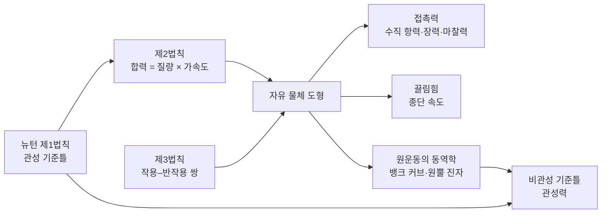

# 일반물리학 2. 뉴턴 법칙과 그 응용 — 힘을 그리고, 식을 세우고, 운동을 예측한다
<!-- prev: phy-1, mech-1, m1-05, uphy-1 -->
<!-- next: uphy-3, uphy-4, uphy-5 -->

> [!NOTE]
> **이 단원의 범위**
> - 뉴턴의 세 법칙과 관성 기준틀, 질량과 무게
> - 자유 물체 도형과 문제 풀이 절차
> - 수직 항력·장력·마찰력(정지·운동 마찰)
> - 끌림힘(속도에 비례·속도 제곱에 비례)과 종단 속도
> - 원운동의 동역학(평평한 커브, 뱅크 커브, 원뿔 진자), 비관성 기준틀과 관성력

**학습 목표**

1. 뉴턴의 세 법칙을 벡터식으로 쓰고, 관성 기준틀의 뜻과 작용–반작용 쌍을 정확히 구별할 수 있다.
2. 자유 물체 도형을 그려 여러 물체가 연결된 계의 가속도와 장력을 연립 방정식으로 구할 수 있다.
3. 수직 항력이 운동 상태에 따라 정해짐을 알고, 정지 마찰과 운동 마찰을 구별하여 빗면·끌기·포개진 물체 문제를 풀 수 있다.
4. 끌림힘이 있는 운동의 미분 방정식을 세워 풀고, 종단 속도와 시간 상수를 구할 수 있다.
5. 평평한 커브, 뱅크 커브, 원뿔 진자에서 구심 가속도를 만드는 힘을 찾아 속력·각·주기를 구할 수 있다.
6. 가속하거나 회전하는 기준틀에서 관성력을 도입하여 운동을 설명하고, 관성 기준틀의 설명과 비교할 수 있다.

**이 단원의 학습 사다리**

| 단계 | 무엇을 하나? |
|---|---|
| STEP 1. 이전 학습 다시 보기 | 중학교 「힘의 작용」, 물리학 「힘과 에너지」, 역학과 에너지 「시공간과 운동」의 힘과 운동 법칙을 꺼내 본다 |
| STEP 2. 기초 다지기 | 연립 방정식, 분리 가능한 미분 방정식과 지수 함수, 자유 물체 도형의 규칙을 익힌다 |
| STEP 3. 핵심 개념 | 세 법칙 → 자유 물체 도형 → 수직 항력·장력·마찰력 → 끌림힘과 종단 속도 → 원운동의 동역학 → 비관성 기준틀 |
| STEP 4. 오개념 바로잡기 | "수직 항력은 무게의 반작용", "원심력이 바깥으로 민다" 같은 착각을 바로잡는다 |
| STEP 5. 다음 단계로 한 걸음 더 | 레이놀즈 수와 스토크스 법칙, 코리올리 힘의 벡터식 맛보기 |
| STEP 6. 생활·산업·진로 | 도로 설계, 엘리베이터와 승차감, 낙하산과 자동차의 공기 역학, 인공 중력 |

---

## 🗺️ 단원 들어가기

고속 도로의 굽은 구간을 달리면 길이 바깥쪽으로 살짝 높게 기울어져 있다. 이 기울기는 몇 도로 정해야 할까? 비가 와서 타이어가 미끄러워지면 그 구간의 안전 속도는 얼마로 줄어들까? 스카이다이버는 4000 m 높이에서 뛰어내려도 끝없이 빨라지지 않고 시속 200 km 안팎에서 속력이 더 늘지 않는다. 낙하산을 펴면 그 속력은 몇 분의 1로 줄어드는가? 엘리베이터가 출발할 때 몸이 무거워지는 느낌, 급정거하는 버스에서 몸이 앞으로 쏠리는 느낌은 정말 '힘'일까?

이 질문들의 답은 모두 하나의 방정식 $\sum\vec{F} = m\vec{a}$에서 나온다. 앞 단원 「운동의 기술」에서 가속도 $\vec{a} = d^2\vec{r}/dt^2$을 다루는 수학을 익혔다면, 이 단원에서는 그 가속도를 만드는 **힘**을 찾고 세는 방법을 익힌다. 일반물리학 역학 문제의 대부분은 "모든 힘을 빠짐없이, 두 번 세지 않고 찾는 것"에서 승부가 난다.

---

## STEP 1. 🔙 이전 학습 다시 보기

### 연계 개념표

| 이전 단원 | 고등학교에서는 여기까지 | 대학에서는 이렇게 확장 |
|---|---|---|
| 중1 「힘의 작용」 | 중력·탄성력·마찰력·부력을 화살표로 나타내고, 힘의 평형을 설명 | 모든 힘을 **3차원 벡터**로 쓰고, 접촉력의 미시적 기원(분자 사이의 전기력)까지 생각한다 |
| 물리학 「힘과 에너지」 '뉴턴 운동 법칙' | 1차원에서 $F = ma$, 함께 밀리는 두 상자와 도르래 문제 | 여러 물체·여러 방향의 **연립 방정식**, 마찰이 있는 연결 물체, 정지 마찰의 조건 판정 |
| 물리학 「힘과 에너지」 '작용과 반작용' | 작용 반작용과 힘의 평형의 구별 | 작용–반작용 쌍은 **서로 다른 물체**에 작용하고 **같은 종류**의 힘이라는 규칙을 자유 물체 도형에 적용 |
| 역학과 에너지 「시공간과 운동」 '합력과 원운동' | 빗면 위의 물체, 평평한 커브의 최대 속력 $\sqrt{\mu_s gr}$, 루프 꼭대기 | **뱅크 커브**(마찰이 있을 때의 최대·최소 속력), **원뿔 진자**, 회전 기준틀의 관성력 |
| 역학과 에너지 「시공간과 운동」 '현실의 포물선' | 공기 저항을 정성적으로 언급 | **끌림힘**을 식으로 넣고 미분 방정식을 풀어 **종단 속도**를 구한다 |
| 일반물리학 「운동의 기술」 | $\vec{a} = d\vec{v}/dt$, 구심 가속도 $v^2/R$, 상대 운동 | $\vec{a}$를 힘으로 결정하고, 가속하는 기준틀에서 생기는 관성력을 다룬다 |

### 준비 운동 (사전 진단)

**Q1.** 책상 위에 정지한 책에 작용하는 중력과 책상이 책을 떠받치는 힘은 작용–반작용 관계이다. (O / X)

**Q2.** 질량 2.0 kg인 물체에 동쪽으로 6.0 N, 서쪽으로 2.0 N의 힘이 작용한다. 가속도의 크기와 방향은?

**Q3.** 무거운 상자를 수평으로 밀었더니 움직이지 않았다. 이때 상자에 작용하는 마찰력의 크기는? (① 0 ② 미는 힘과 같다 ③ $\mu_s N$ ④ $\mu_k N$)

**Q4.** 평평한 커브 길을 도는 자동차에서 원운동에 필요한 구심력 역할을 하는 실제 힘은 무엇인가?

정답 및 해설

**Q1. X** — 두 힘은 모두 **책 한 물체**에 작용하고 종류도 다르다(중력과 접촉력). 책이 정지해 있어서 크기가 같을 뿐, 이것은 **힘의 평형**이다. 중력의 반작용은 책이 지구를 당기는 힘, 책상이 책을 미는 힘의 반작용은 책이 책상을 누르는 힘이다.

**Q2.** 동쪽으로 $2.0\ \mathrm{m/s^2}$ — 알짜힘 $6.0 - 2.0 = 4.0\ \mathrm{N}$(동쪽), $a = 4.0/2.0 = 2.0\ \mathrm{m/s^2}$.

**Q3. ②** — 정지 마찰력은 상자가 움직이지 않게 할 만큼만 생긴다. $\mu_s N$은 그 **최댓값**이다.

**Q4.** 타이어와 도로 사이의 **정지 마찰력** — 바퀴는 도로에 대해 옆으로 미끄러지지 않으므로 운동 마찰력이 아니라 정지 마찰력이다.

---

## STEP 2. 🧱 기초 다지기

### 디딤돌 1. 성분별 운동 방정식과 연립 방정식

뉴턴 제2법칙은 벡터식이므로 세 개의 스칼라식으로 나뉜다.

$$
\sum F_x = ma_x, \qquad \sum F_y = ma_y, \qquad \sum F_z = ma_z
$$

물체가 여러 개이면 물체마다 이런 식이 생기고, 줄이나 접촉으로 연결된 조건(예: "두 물체의 가속도 크기가 같다")이 더해진다. 결국 **미지수의 개수만큼 독립인 식**을 모으면 문제가 풀린다. 미지수 2개, 식 2개인 경우가 가장 흔하며, 한 식에서 한 미지수를 다른 미지수로 나타내 대입하거나, 두 식을 더해 한 미지수(보통 장력)를 소거한다.

### 디딤돌 2. 분리 가능한 미분 방정식과 지수 함수

끌림힘 문제에서는 다음 꼴의 식을 만난다.

$$
\frac{dv}{dt} = g - \frac{v}{\tau} \qquad (\tau\text{는 시간의 차원을 가진 상수})
$$

이런 식은 $v$가 들어 있는 항과 $t$를 양변으로 **분리**하여 적분한다. $u = g\tau - v$로 놓으면 $\dfrac{du}{dt} = -\dfrac{u}{\tau}$이고

$$
\int_{u_0}^{u}\frac{du'}{u'} = -\int_0^t\frac{dt'}{\tau} \;\Rightarrow\; \ln\frac{u}{u_0} = -\frac{t}{\tau} \;\Rightarrow\; u = u_0e^{-t/\tau}
$$

| 성질 | 내용 |
|---|---|
| $\int\frac{dx}{x} = \ln\lvert x\rvert + C$ | 분리 후 적분에서 자연로그가 나온다 |
| $e^{-t/\tau}$ | $t = \tau$일 때 $1/e \approx 0.368$, $t = 3\tau$일 때 약 0.050, $t = 5\tau$일 때 약 0.0067 |
| $\ln2 \approx 0.693$, $\ln20 \approx 3.00$ | '반으로 줄어드는 시간', '5 %만 남는 시간'을 구할 때 쓴다 |

$\tau$를 **시간 상수(time constant)** 라 한다. 이 꼴의 식과 해는 RC 회로(「전류·회로와 자기장」), 방사성 붕괴(「현대 물리」), 1차 반응 속도(일반화학)에서도 똑같이 나온다.

> [!TIP]
> 💡 **비유** — 지수적 접근은 "남은 거리의 일정 비율씩 다가가는" 걸음이다. 목표까지 남은 거리의 63 %를 첫 $\tau$ 동안 가고, 그다음 $\tau$ 동안 또 남은 거리의 63 %를 간다. 그래서 목표에 '정확히' 닿지는 않지만, $5\tau$쯤 지나면 사실상 도착한 것과 같다.

### 디딤돌 3. 자유 물체 도형의 다섯 가지 규칙

1. **한 물체**(또는 함께 움직이는 한 덩어리)만 떼어 내어 점이나 상자로 그린다.
2. 그 물체가 **받는** 힘만 그린다. 그 물체가 남에게 주는 힘은 그리지 않는다.
3. 힘마다 "누가 이 물체에 주는 힘인가"를 말할 수 있어야 한다. 말할 수 없는 힘(예: '운동의 힘', '구심력', '관성의 힘')은 관성 기준틀에서는 그리지 않는다.
4. 멀리서 작용하는 힘(중력)을 먼저, 닿아 있는 모든 것(바닥·줄·용수철·공기·물)에서 오는 접촉력을 하나씩 그린다.
5. 가속도 방향을 한 축으로 잡고, 가속도는 도형 **옆에** 따로 화살표로 표시한다(힘이 아니므로).

---

## STEP 3. 📘 핵심 개념

### ① 뉴턴의 세 법칙

#### (1) 제1법칙과 관성 기준틀

> 알짜힘이 0인 물체는 정지 상태를 유지하거나 등속 직선 운동을 계속한다.

이 문장은 "어느 기준틀에서 보는가?"를 정하지 않으면 의미가 없다. 급출발하는 버스 안에서는 아무 힘도 받지 않는 바닥의 공이 뒤로 굴러간다. 그래서 대학 물리에서는 제1법칙을 다음과 같이 읽는다.

> **제1법칙이 성립하는 기준틀이 존재한다.** 그런 기준틀을 **관성 기준틀(inertial reference frame)** 이라 한다.

관성 기준틀에 대해 등속도로 움직이는 기준틀도 관성 기준틀이다(「운동의 기술」에서 보았듯이 가속도가 같기 때문이다). 지표에 고정된 기준틀은 지구의 자전·공전 때문에 엄밀하게는 관성 기준틀이 아니지만, 그 효과(구심 가속도 약 $0.034\ \mathrm{m/s^2}$ 이하)가 작으므로 대부분의 문제에서 관성 기준틀로 본다.

#### (2) 제2법칙 — 질량과 힘의 정의

$$
\sum\vec{F} = m\vec{a}
$$

- **질량(mass)** 은 가속도에 저항하는 정도(관성)를 나타내는 스칼라이다. 같은 힘을 두 물체에 주어 가속도의 비를 재면 질량의 비를 알 수 있다: $m_1/m_2 = a_2/a_1$.
- 힘의 SI 단위는 **뉴턴(N)**: $1\ \mathrm{N} = 1\ \mathrm{kg\cdot m/s^2}$.
- 좌변은 **모든 외력의 벡터 합**이다. 가속도는 개별 힘이 아니라 **알짜힘의 방향**을 향한다.
- 무게(weight)는 물체가 받는 중력의 크기 $W = mg$이다. 질량은 장소와 관계없지만 무게는 $g$에 따라 달라진다.

#### (3) 제3법칙 — 힘은 언제나 쌍으로

물체 A가 B에 힘 $\vec{F}_{BA}$를 주면 B도 A에 $\vec{F}_{AB} = -\vec{F}_{BA}$를 준다.

| 작용–반작용 쌍의 특징 | 힘의 평형과의 차이 |
|---|---|
| **서로 다른 두 물체**에 하나씩 작용한다 | 평형은 **한 물체**에 작용하는 여러 힘의 합이 0인 것 |
| 언제나 크기가 같고 방향이 반대(가속 중에도) | 평형은 가속도가 0일 때만 성립 |
| 언제나 **같은 종류**의 힘(중력–중력, 접촉력–접촉력) | 평형을 이루는 힘들은 종류가 달라도 된다 |
| 서로 상쇄되지 않는다(다른 물체에 있으므로) | 평형인 힘들은 서로 상쇄된다 |

#### 예제 1 — 3차원 힘의 합과 가속도

질량 2.00 kg인 물체가 우주 공간에서 세 힘 $\vec{F}_1 = (3.0\hat{i} - 2.0\hat{j})\ \mathrm{N}$, $\vec{F}_2 = (1.0\hat{i} + 4.0\hat{j} - 2.0\hat{k})\ \mathrm{N}$, $\vec{F}_3 = 6.0\hat{k}\ \mathrm{N}$을 받는다. 가속도의 크기와 방향을 구하시오.

**풀이** $\sum\vec{F} = (3.0 + 1.0)\hat{i} + (-2.0 + 4.0)\hat{j} + (-2.0 + 6.0)\hat{k} = 4.0\hat{i} + 2.0\hat{j} + 4.0\hat{k}\ \mathrm{N}$

크기 $\sqrt{16 + 4 + 16} = 6.0\ \mathrm{N}$이므로 $a = 6.0/2.00 = 3.0\ \mathrm{m/s^2}$. 방향은 알짜힘의 방향, 즉 단위 벡터 $\frac{1}{6.0}(4.0, 2.0, 4.0) = \left(\frac{2}{3}, \frac{1}{3}, \frac{2}{3}\right)$ 방향이다.

#### ✔ 바로 확인

1. (O/X) 작용–반작용의 두 힘은 한 물체에 작용하여 서로 상쇄된다.
2. 질량 2.0 kg인 물체가 받는 알짜힘이 $(6.0\hat{i} + 8.0\hat{j})\ \mathrm{N}$이다. 가속도의 크기는?
3. 빈칸: $1\ \mathrm{N} = 1\ (\qquad)$ (SI 기본 단위로)
4. 질량 10.0 kg인 물체를 달($g = 1.62\ \mathrm{m/s^2}$)로 가져가면 질량과 무게는 각각 얼마인가?

정답

1. X — 작용–반작용 쌍은 서로 다른 두 물체에 하나씩 작용하므로 상쇄되지 않는다.
2. $5.0\ \mathrm{m/s^2}$ — 알짜힘의 크기 10 N을 2.0 kg으로 나눈다.
3. $\mathrm{kg\cdot m/s^2}$
4. 질량 10.0 kg(그대로), 무게 16.2 N — 무게 $mg$만 $g$에 따라 달라진다.

### ② 자유 물체 도형과 문제 풀이 절차

#### (1) 다섯 단계 절차

| 단계 | 할 일 | 점검 |
|---|---|---|
| 1. 계 고르기 | 어떤 물체(들)의 운동을 구할지 정한다 | 줄로 연결된 물체는 따로 떼어 볼지, 묶어 볼지 결정 |
| 2. 자유 물체 도형 | 물체마다 받는 힘을 모두 그린다 | 힘마다 '누가 주는가'를 말할 수 있는가 |
| 3. 좌표축 | 물체마다 가속도 방향을 + 축으로 | 연결된 물체는 "함께 움직이는 방향"을 같은 +로 |
| 4. 식 세우기 | 성분별 $\sum F = ma$ + 연결 조건 | 미지수 개수 = 식의 개수 |
| 5. 풀고 점검 | 차원, 극한(질량 0, 각 0° 등), 부호 | 결과가 상식과 맞는가 |

<!-- fig:uphy-2-fbd-connected -->

#### 예제 2 — 애트우드 기계

가벼운 도르래에 걸친 질량을 무시할 수 있는 줄의 양 끝에 질량 $m_1 = 3.00\ \mathrm{kg}$과 $m_2 = 5.00\ \mathrm{kg}$인 추가 매달려 있다. 마찰을 무시할 때 가속도와 줄의 장력을 구하시오. ($g = 9.80\ \mathrm{m/s^2}$)

**풀이**
- 계와 축: 두 추를 따로 본다. $m_2$는 아래로, $m_1$은 위로 움직이므로 각자의 운동 방향을 +로 잡으면 두 가속도의 크기가 같다($a$).
- 식 세우기: $m_1$: $T - m_1g = m_1a$, $\quad m_2$: $m_2g - T = m_2a$
- 두 식을 더해 $T$를 소거: $(m_2 - m_1)g = (m_1 + m_2)a$

$$
a = \frac{m_2 - m_1}{m_1 + m_2}g = \frac{2.00}{8.00}(9.80) = 2.45\ \mathrm{m/s^2}, \qquad T = m_1(g + a) = \frac{2m_1m_2}{m_1 + m_2}g = 36.8\ \mathrm{N}
$$

**점검** ① $m_1 = m_2$이면 $a = 0$ ② $m_1 \to 0$이면 $a \to g$(자유 낙하) ③ $T$는 $m_1g = 29.4\ \mathrm{N}$과 $m_2g = 49.0\ \mathrm{N}$ 사이 — 모두 상식과 맞는다. 애트우드 기계는 $g$보다 작은 가속도를 만들어, 시계가 정밀하지 않던 시대에 등가속도 운동을 측정하는 데 쓰였다.

#### ✔ 바로 확인

1. (O/X) 자유 물체 도형에는 그 물체가 다른 물체에 주는 힘도 함께 그린다.
2. 천장에 줄로 매달려 정지해 있는 추가 받는 힘 두 가지를 쓰시오.
3. 애트우드 기계에서 $m_1 = m_2$이면 가속도는?
4. 가벼운 줄로 연결되어 함께 움직이는 두 물체의 가속도 크기는 같은가, 다른가?

정답

1. X — 그 물체가 **받는** 힘만 그린다.
2. 중력(지구가 줌)과 장력(줄이 줌)
3. 0 — $a = \dfrac{m_2 - m_1}{m_1 + m_2}g$.
4. 같다 — 줄이 늘어나지 않으므로(연결 조건).

### ③ 수직 항력·장력·마찰력

#### (1) 수직 항력 — 정해진 공식이 없는 힘

**수직 항력(normal force)** 은 접촉면이 물체를 면에 수직으로 미는 힘이다. 미시적으로는 표면 원자들이 아주 조금 눌려 생기는 전기적 반발력이며, 물체가 면을 뚫고 들어가지 않게 할 만큼 저절로 크기가 정해진다. 그래서 **운동 방정식으로 구해야 하는 미지수**이다. 고등학교 용어 '수직항력'과 같은 말이다.

#### 예제 3 — 엘리베이터 안의 체중계

질량 60.0 kg인 사람이 엘리베이터 안 체중계 위에 서 있다. 체중계가 가리키는 힘(수직 항력)을 (1) 엘리베이터가 위로 $1.50\ \mathrm{m/s^2}$로 가속할 때 (2) 아래로 $1.50\ \mathrm{m/s^2}$로 가속할 때 (3) 줄이 끊어져 자유 낙하할 때 구하시오.

**풀이** 위쪽을 +로: $N - mg = ma$ → $N = m(g + a)$

| 경우 | $a$ (m/s²) | $N$ (N) | 체중계가 가리키는 '몸무게' |
|---|---|---|---|
| (1) 위로 가속(또는 내려가다 감속) | $+1.50$ | $60.0\times11.3 = 678$ | 69.2 kg에 해당 |
| 정지 또는 등속 | 0 | 588 | 60.0 kg |
| (2) 아래로 가속(또는 올라가다 감속) | $-1.50$ | $60.0\times8.30 = 498$ | 50.8 kg에 해당 |
| (3) 자유 낙하 | $-9.80$ | 0 | 0 |

**의미** 체중계는 중력이 아니라 **수직 항력**을 잰다. 우리가 '무게를 느끼는' 것도 발바닥에 닿는 수직 항력 때문이다. 이 값을 **겉보기 무게(apparent weight)** 라 한다. 자유 낙하에서는 겉보기 무게가 0인 '무중력 상태'가 되지만 중력은 그대로 작용하고 있다.

#### (2) 장력

**장력(tension)** 은 팽팽한 줄이 양 끝에 연결된 물체를 당기는 힘이다. 줄의 질량을 무시할 수 있으면 줄의 모든 부분에서 장력의 크기가 같고(줄 조각에 $\sum F = (0)a$이므로), 마찰 없는 가벼운 도르래는 장력의 **방향만** 바꾼다. 줄의 질량이 무시할 수 없으면 아래로 갈수록(매달린 줄에서) 장력이 작아진다.

#### (3) 마찰력 — 정지 마찰과 운동 마찰

두 면이 닿아 있을 때 면에 나란한 방향으로 작용하는 접촉력이 **마찰력(friction)** 이다.

| 구분 | 크기 | 방향 | 특징 |
|---|---|---|---|
| **정지 마찰력(static friction)** | $0 \le f_s \le \mu_sN$ | 미끄러지려는 상대 운동의 반대 | 크기가 상황에 맞게 정해지는 미지수. $\mu_sN$은 최댓값 |
| **운동 마찰력(kinetic friction)** | $f_k = \mu_kN$ | 실제 미끄러짐(상대 속도)의 반대 | 속력과 거의 관계없이 일정(근사) |

<!-- fig:uphy-2-friction-graph -->

여기서 $\mu_s$, $\mu_k$는 **정지·운동 마찰 계수**이며 보통 $\mu_s > \mu_k$이다. 대략적인 값은 다음과 같다(표면 상태에 따라 크게 달라지므로 '약'으로 읽는다).

| 접촉면 | $\mu_s$ (약) | $\mu_k$ (약) |
|---|---|---|
| 마른 아스팔트–고무 타이어 | 0.9 | 0.7 |
| 젖은 아스팔트–고무 타이어 | 0.5~0.7 | 0.4~0.5 |
| 나무–나무 | 0.3~0.5 | 0.2~0.3 |
| 얼음–얼음 | 0.1 | 0.03 |
| 테플론–테플론 | 0.04 | 0.04 |

**마찰의 미시적 근거** 아무리 매끄러운 면도 현미경으로 보면 울퉁불퉁하여, 실제로 닿는 넓이는 겉보기 넓이의 아주 작은 일부이다. 누르는 힘($N$)이 클수록 돌기가 더 짓눌려 실제 접촉 넓이가 $N$에 비례해 늘고, 그 접촉점들에서 원자 사이의 결합을 끊어야 미끄러진다. 그래서 마찰력은 겉보기 넓이와 거의 관계없고 $N$에 거의 비례한다. 이것은 경험 법칙이며, 매우 매끄러운 면이나 매우 큰 압력에서는 맞지 않는다.

#### 예제 4 — 마찰이 있는 책상과 매달린 추

책상 위에 놓인 질량 $m_1 = 4.00\ \mathrm{kg}$인 나무토막이 책상 끝의 도르래를 거친 줄로 질량 $m_2 = 2.00\ \mathrm{kg}$인 매달린 추와 연결되어 있다. 토막과 책상 사이의 운동 마찰 계수는 0.250이다. 가속도와 장력을 구하시오.

**풀이**
- 토막(수평, 도르래 쪽 +): $T - \mu_km_1g = m_1a$, 연직: $N = m_1g$
- 추(아래 +): $m_2g - T = m_2a$
- 더하면: $a = \dfrac{m_2g - \mu_km_1g}{m_1 + m_2} = \dfrac{19.6 - 9.80}{6.00} = 1.63\ \mathrm{m/s^2}$
- $T = m_2(g - a) = 2.00\times(9.80 - 1.63) = 16.3\ \mathrm{N}$

**점검** 장력은 추의 무게(19.6 N)보다 작다. 추가 가속하며 내려가기 때문이다. 만약 $m_2g < \mu_s m_1g$이면 처음부터 움직이지 않으므로, 운동 마찰 계수를 쓰기 전에 **움직이는지부터** 판정해야 한다.

#### 예제 5 — 미끄러지기 시작하는 각과 최소로 끄는 힘

(1) 책을 빗면 삼아 동전을 올리고 기울기를 서서히 늘렸더니 $28.0^\circ$에서 동전이 미끄러지기 시작했다. 정지 마찰 계수는?
(2) 질량 30.0 kg인 상자를 줄로 끌어 움직이기 시작하게 하려 한다. 바닥과의 정지 마찰 계수는 0.500이다. 줄이 수평과 이루는 각 $\theta$를 얼마로 하면 필요한 힘이 가장 작은가? 그 힘을 수평으로 끌 때와 비교하시오.

**풀이**
(1) 미끄러지기 직전 빗면 방향: $mg\sin\theta = \mu_sN = \mu_smg\cos\theta$ → $\mu_s = \tan\theta = \tan28.0^\circ = 0.532$. 질량과 관계없는 이 각을 **마찰각(angle of repose)** 이라 한다.

(2) 줄의 힘을 $F$라 하면 연직: $N = mg - F\sin\theta$, 수평(미끄러지기 직전): $F\cos\theta = \mu_s(mg - F\sin\theta)$

$$
F(\theta) = \frac{\mu_smg}{\cos\theta + \mu_s\sin\theta}
$$

분모 $D(\theta) = \cos\theta + \mu_s\sin\theta$가 최대일 때 $F$가 최소이다. $\dfrac{dD}{d\theta} = -\sin\theta + \mu_s\cos\theta = 0$ → $\tan\theta = \mu_s = 0.500$ → $\theta = 26.6^\circ$.

| 끄는 각 | $0^\circ$ | $20.0^\circ$ | $26.6^\circ$ (최적) |
|---|---|---|---|
| 필요한 힘 $F$ (N) | 147 | 132 | 131 |

최솟값 $F_{\min} = \dfrac{\mu_smg}{\sqrt{1 + \mu_s^2}} = \dfrac{147}{1.118} = 131\ \mathrm{N}$으로, 수평으로 끌 때보다 약 11 % 작다.

**의미** 줄을 비스듬히 위로 당기면 수평 성분은 줄지만 수직 항력이 줄어 마찰력도 준다. 둘 사이의 균형점을 미분으로 찾았다. 썰매나 여행 가방을 비스듬히 끄는 것이 편한 이유이다.

<!-- fig:uphy-2-incline-pull -->

#### 예제 6 — 포개진 두 토막

마찰 없는 바닥 위에 질량 $M = 8.00\ \mathrm{kg}$인 아래 토막이 있고, 그 위에 $m = 2.00\ \mathrm{kg}$인 위 토막이 놓여 있다. 두 토막 사이의 정지 마찰 계수는 0.400이다. 아래 토막을 수평으로 당길 때, 위 토막이 미끄러지지 않고 함께 움직일 수 있는 최대 힘은?

**풀이** 위 토막을 가속시키는 수평력은 아래 토막이 주는 **정지 마찰력뿐**이다. 따라서 위 토막의 최대 가속도는 $a_{\max} = \mu_smg/m = \mu_sg = 3.92\ \mathrm{m/s^2}$이다. 두 토막이 함께 움직이면 전체에 대해 $F = (M + m)a$이므로

$$
F_{\max} = (M + m)\mu_sg = 10.0\times3.92 = 39.2\ \mathrm{N}
$$

**의미** 여기서 마찰력은 위 토막의 운동을 **방해하는 것이 아니라 일으키는** 힘이다. 마찰력은 '운동의 반대'가 아니라 '두 면 사이 **상대 운동**의 반대'로 작용한다. 걷기, 자동차의 출발, 컨베이어 벨트가 모두 정지 마찰력으로 앞으로 나아간다.

<!-- fig:uphy-2-stacked-blocks -->

> [!TIP]
> 💡 **요령** — 마찰 문제는 ① 먼저 정지해 있다고 가정하고 필요한 정지 마찰력 $f$를 구한다 ② $f \le \mu_sN$이면 가정이 맞고, 아니면 미끄러지므로 $f_k = \mu_kN$으로 다시 푼다. 처음부터 $\mu_sN$이나 $\mu_kN$을 대입하는 습관이 가장 흔한 실수이다.

#### ✔ 바로 확인

1. 질량 50.0 kg인 사람이 위로 $2.00\ \mathrm{m/s^2}$로 가속하는 엘리베이터 안 체중계에 서 있다. 체중계가 가리키는 힘(수직 항력)은? ($g = 9.80\ \mathrm{m/s^2}$)
2. (O/X) 정지 마찰력의 크기는 언제나 $\mu_sN$이다.
3. 빗면의 기울기를 서서히 늘렸더니 $30.0^\circ$에서 물체가 미끄러지기 시작했다. 정지 마찰 계수는?
4. 그림 읽기: 미는 힘 $F$가 $\mu_sN$보다 작을 때 마찰력의 크기는?

정답

1. 590 N — $N = m(g + a) = 50.0\times11.8$.
2. X — $\mu_sN$은 최댓값이고, 실제 크기는 미끄러지지 않게 할 만큼이다.
3. 0.577 — $\mu_s = \tan30.0^\circ$.
4. $F$ — 정지해 있는 동안 정지 마찰력은 미는 힘과 크기가 같다.

### ④ 끌림힘과 종단 속도

#### (1) 끌림힘의 두 가지 모형

유체(공기·물) 속을 움직이는 물체는 상대 속도의 반대 방향으로 **끌림힘(drag force)** 을 받는다. 고등학교의 '공기 저항'을 정량화한 것이다.

| 모형 | 식 | 맞는 경우 | 예 |
|---|---|---|---|
| 속도에 비례(점성 끌림) | $D = bv$ | 작고 느린 물체, 끈적한 유체 | 꽃가루, 안개 방울, 기름 속 작은 구슬 |
| 속도 제곱에 비례(관성 끌림) | $D = \frac{1}{2}C\rho Av^2$ | 크고 빠른 물체, 공기 | 사람, 자동차, 공, 빗방울 |

$\rho$는 유체의 밀도, $A$는 운동 방향에 수직인 단면적, $C$는 모양에 따라 정해지는 **끌림 계수(drag coefficient)** 로 대략 0.2(유선형 자동차)~1.3(펼친 낙하산) 정도이다. 어느 모형이 맞는지는 STEP 5의 레이놀즈 수로 판단한다.

#### (2) 종단 속도

물체가 떨어지면 속력이 커지면서 끌림힘도 커지고, 끌림힘이 중력과 같아지면 가속도가 0이 되어 더 이상 빨라지지 않는다. 이 속력을 **종단 속도(terminal velocity)** 라 한다(부력은 무시).

$$
bv_t = mg \;\Rightarrow\; v_t = \frac{mg}{b}, \qquad \tfrac{1}{2}C\rho Av_t^2 = mg \;\Rightarrow\; v_t = \sqrt{\frac{2mg}{C\rho A}}
$$

#### (3) 속도에 비례하는 끌림힘 — 운동 방정식 풀기

아래쪽을 +로 하고 $t = 0$에 정지 상태에서 떨어뜨리면

$$
m\frac{dv}{dt} = mg - bv \;\Rightarrow\; \frac{dv}{dt} = g - \frac{v}{\tau}, \qquad \tau = \frac{m}{b}
$$

STEP 2 디딤돌 2의 방법으로 풀면

$$
v(t) = v_t\left(1 - e^{-t/\tau}\right), \qquad v_t = g\tau = \frac{mg}{b}
$$

| 시간 | $v/v_t$ |
|---|---|
| $t = \tau$ | 0.632 |
| $t = 2\tau$ | 0.865 |
| $t = 3\tau$ | 0.950 |
| $t = 5\tau$ | 0.993 |

**점검** $t$가 작을 때 $e^{-t/\tau} \approx 1 - t/\tau$이므로 $v \approx gt$ — 처음에는 자유 낙하와 같다. $t \to \infty$에서 $v \to v_t$. 두 극한 모두 상식과 맞는다.

#### 예제 7 — 기름 속에 떨어지는 구슬

질량 5.0 g인 작은 구슬을 기름 속에서 놓았다. 끌림힘은 $D = bv$이고 $b = 0.25\ \mathrm{kg/s}$이다(부력 무시). (1) 종단 속도 (2) 시간 상수 (3) 종단 속도의 95 %에 이르는 시간을 구하시오.

**풀이**
(1) $v_t = mg/b = (0.0050\times9.80)/0.25 = 0.20\ \mathrm{m/s}$
(2) $\tau = m/b = 0.0050/0.25 = 0.020\ \mathrm{s}$
(3) $1 - e^{-t/\tau} = 0.95$ → $t = \tau\ln20 = 0.020\times3.00 = 0.060\ \mathrm{s}$

**의미** 끈적한 유체에서는 0.06초 만에 사실상 종단 속도에 이른다. 그래서 점성이 큰 액체 속 낙하 속력을 재면 점성을 구할 수 있다(낙구식 점도계).

#### 예제 8 — 스카이다이버와 낙하산

장비를 포함한 질량 80.0 kg인 스카이다이버가 엎드린 자세(끌림 계수 0.80, 단면적 $0.70\ \mathrm{m^2}$)로 떨어진다. 공기 밀도는 $1.20\ \mathrm{kg/m^3}$이다. (1) 종단 속도는? (2) 끌림 계수 1.5, 넓이 $30\ \mathrm{m^2}$인 낙하산을 편 뒤의 종단 속도는?

**풀이**
(1) $v_t = \sqrt{\dfrac{2(80.0)(9.80)}{0.80\times1.20\times0.70}} = \sqrt{\dfrac{1568}{0.672}} = 48.3\ \mathrm{m/s}$ (약 174 km/h)
(2) $v_t = \sqrt{\dfrac{1568}{1.5\times1.20\times30}} = \sqrt{29.0} = 5.4\ \mathrm{m/s}$

**의미** $v_t \propto 1/\sqrt{CA}$이므로 $CA$를 약 80배 키우면 종단 속도는 약 9분의 1이 된다. 5.4 m/s로 땅에 닿는 것은 약 1.5 m 높이에서 뛰어내리는 것과 비슷하다($h = v^2/2g$). 높은 곳의 공기는 밀도가 작으므로 같은 자세라도 종단 속도가 더 크다.

> [!NOTE]
> **근사와 실험적 근거** 빗방울(반지름 약 1.5 mm)에 $C \approx 0.6$을 넣으면 $v_t \approx 7\ \mathrm{m/s}$ 정도가 나오는데, 측정된 큰 빗방울의 낙하 속력(초속 수 m~9 m 정도)과 대체로 맞는다. 더 큰 빗방울은 납작하게 찌그러지고 쪼개지므로 단순한 구 모형이 맞지 않는다. 끌림 계수는 이론으로 구하기보다 **풍동 실험**으로 측정하는 값이다.

<!-- sim:u-terminal-velocity -->

#### ✔ 바로 확인

1. 끌림힘이 $D = bv$일 때 종단 속도 $v_t$를 $m$, $g$, $b$로 쓰시오.
2. $D = bv$인 낙하에서 시간 상수 $\tau$만큼 지났을 때 속력은 종단 속도의 약 몇 %인가?
3. (O/X) 모양과 크기가 같으면 무거운 물체의 종단 속도가 더 크다.
4. $D = \frac{1}{2}C\rho Av^2$ 모형에서 단면적 $A$만 4배가 되면 종단 속도는 몇 배인가?

정답

1. $v_t = mg/b$ — 끌림힘과 무게가 같아지는 속력이다.
2. 약 63 % — $1 - e^{-1} = 0.632$.
3. O — $v_t \propto m$($bv$ 모형) 또는 $\sqrt{m}$($v^2$ 모형).
4. $\frac{1}{2}$배 — $v_t \propto 1/\sqrt{A}$.

### ⑤ 원운동의 동역학

#### (1) 구심 가속도를 만드는 힘 찾기

등속 원운동에서는 중심 방향의 알짜힘이 $mv^2/r$이어야 한다(「운동의 기술」의 $a_c = v^2/r$). 문제 풀이는 언제나 같다: ① 실제 힘으로 자유 물체 도형을 그리고 ② 축 하나를 **원의 중심 방향(수평)** 으로, 하나를 연직으로 잡은 뒤 ③ 중심 방향: $\sum F = mv^2/r$, 연직: $\sum F = 0$.

#### (2) 뱅크 커브

도로를 안쪽으로 $\theta$만큼 기울이면 수직 항력이 안쪽으로 기울어 그 수평 성분이 구심력을 보탠다.

**마찰이 없을 때(설계 속력)** 연직: $N\cos\theta = mg$, 수평: $N\sin\theta = mv^2/r$. 나누면

$$
\tan\theta = \frac{v^2}{rg}
$$

이 속력에서는 마찰 없이도(빙판에서도) 커브를 돌 수 있다.

**마찰이 있을 때** 설계 속력보다 빠르면 차가 바깥으로 미끄러지려 하므로 정지 마찰력이 빗면을 따라 **아래(안쪽)** 로, 느리면 **위(바깥쪽)** 로 작용한다. 최대 속력의 경우 정지 마찰력 $\mu_sN$이 아래쪽일 때

$$
\text{연직: } N\cos\theta - \mu_sN\sin\theta = mg, \qquad \text{수평: } N\sin\theta + \mu_sN\cos\theta = \frac{mv^2}{r}
$$

$$
v_{\max}^2 = rg\,\frac{\tan\theta + \mu_s}{1 - \mu_s\tan\theta}, \qquad v_{\min}^2 = rg\,\frac{\tan\theta - \mu_s}{1 + \mu_s\tan\theta}
$$

($v_{\min}$은 마찰력을 위쪽으로 바꾸어 같은 방법으로 얻는다. $\tan\theta < \mu_s$이면 $v_{\min} = 0$, 즉 정지해 있어도 미끄러지지 않는다.)

<!-- fig:uphy-2-banked-curve -->

#### 예제 9 — 고속 도로 커브 설계

반지름 150 m인 커브를 설계 속력 25.0 m/s(90 km/h)로 만들려 한다. (1) 필요한 기울기는? (2) 타이어와 도로 사이의 정지 마찰 계수가 0.300일 때 미끄러지지 않는 속력의 범위는?

**풀이**
(1) $\tan\theta = \dfrac{25.0^2}{150\times9.80} = 0.425$ → $\theta = 23.0^\circ$
(2) $rg = 1470\ \mathrm{m^2/s^2}$

$$
v_{\max} = \sqrt{1470\times\frac{0.425 + 0.300}{1 - 0.300\times0.425}} = 35.0\ \mathrm{m/s}, \qquad v_{\min} = \sqrt{1470\times\frac{0.425 - 0.300}{1 + 0.300\times0.425}} = 12.8\ \mathrm{m/s}
$$

약 46 km/h에서 126 km/h 사이에서 안전하다.

**의미** 실제 도로의 기울기(편경사)는 겨울철 빙판에서 느린 차가 안쪽으로 미끄러져 내려가지 않도록 보통 $6^\circ$ 안팎을 넘지 않게 정하고, 나머지는 마찰에 맡긴다. 23°처럼 큰 기울기는 경주용 트랙이나 자전거 경기장(벨로드롬)에서 볼 수 있다.

<!-- sim:u-banked-curve -->

#### (3) 원뿔 진자

길이 $L$인 줄에 매단 추가 수평면에서 원을 그리며 돌고, 줄은 연직과 일정한 각 $\theta$를 이룬다. 이것이 **원뿔 진자(conical pendulum)** 이다. 원의 반지름은 $r = L\sin\theta$이다.

$$
\text{연직: } T\cos\theta = mg, \qquad \text{수평(중심 방향): } T\sin\theta = \frac{mv^2}{r}
$$

$$
\tan\theta = \frac{v^2}{rg}, \qquad \text{주기 } T_{\text{주기}} = \frac{2\pi r}{v} = 2\pi\sqrt{\frac{L\cos\theta}{g}}
$$

뱅크 커브와 식의 모양이 같다는 데 주목하자. 수직 항력 대신 장력이 기울어져 구심력과 무게를 함께 감당한다.

<!-- fig:uphy-2-conical-pendulum -->

#### 예제 10 — 회전 그네의 축소 모형

길이 1.20 m인 줄에 질량 0.500 kg인 추를 매달아, 줄이 연직과 $30.0^\circ$를 이루며 수평 원운동을 하게 했다. (1) 장력 (2) 추의 속력 (3) 주기를 구하시오.

**풀이**
(1) $T = \dfrac{mg}{\cos30.0^\circ} = \dfrac{4.90}{0.866} = 5.66\ \mathrm{N}$
(2) $r = 1.20\sin30.0^\circ = 0.600\ \mathrm{m}$, $v = \sqrt{rg\tan\theta} = \sqrt{0.600\times9.80\times0.577} = 1.84\ \mathrm{m/s}$
(3) $T_{\text{주기}} = 2\pi\sqrt{\dfrac{1.20\cos30.0^\circ}{9.80}} = 2.05\ \mathrm{s}$

**의미** 주기는 추의 질량과 관계없다. 또 $\theta \to 0$이면 주기가 $2\pi\sqrt{L/g}$로, 작은 진폭의 단진자 주기와 같아진다. 회전 그네가 빨리 돌수록($T_{\text{주기}}$가 작을수록) $\cos\theta$가 작아져 의자가 바깥으로 더 크게 벌어지는 이유이다.

> [!IMPORTANT]
> 원운동 문제의 자유 물체 도형에 '구심력' 화살표를 따로 그리지 않는다. 뱅크 커브에서는 수직 항력과 마찰력의 수평 성분이, 원뿔 진자에서는 장력의 수평 성분이 **구심 가속도를 만드는 알짜힘**이다. 구심력은 힘의 종류가 아니라 알짜힘의 한 성분에 붙은 이름이다.

#### ✔ 바로 확인

1. (O/X) 원운동하는 물체의 자유 물체 도형(관성 기준틀)에는 '구심력' 화살표를 따로 그린다.
2. 빈칸: 마찰 없는 뱅크 커브의 설계 속력은 $\tan\theta = (\qquad)$를 만족한다.
3. 길이 $L$인 원뿔 진자의 줄이 연직과 각 $\theta$를 이룰 때 원의 반지름은?
4. 질량 1.0 kg인 물체가 반지름 0.50 m인 원을 2.0 m/s로 등속 원운동한다. 중심 방향 알짜힘의 크기는?

정답

1. X — 구심력은 힘의 종류가 아니라 실제 힘들의 중심 방향 성분(알짜힘)의 이름이다.
2. $v^2/(rg)$
3. $L\sin\theta$
4. 8.0 N — $mv^2/r = 1.0\times4.0/0.50$.

### ⑥ 비관성 기준틀과 관성력

#### (1) 가속하는 기준틀에서 뉴턴 법칙을 쓰려면

기준틀 S′이 관성 기준틀 S에 대해 가속도 $\vec{A}$로 움직이면, 「운동의 기술」의 상대 운동 관계에서 $\vec{a} = \vec{a}' + \vec{A}$이다. 관성 기준틀에서 $\sum\vec{F} = m\vec{a}$이므로

$$
\sum\vec{F} + \left(-m\vec{A}\right) = m\vec{a}'
$$

즉 가속하는 기준틀 안에서도, 실제 힘에 **$-m\vec{A}$라는 항을 더하면** 뉴턴 제2법칙과 같은 꼴로 쓸 수 있다. 이 항을 **관성력(inertial force, 가상력)** 이라 한다.

| 구분 | 실제 힘 | 관성력 |
|---|---|---|
| 원인 | 다른 물체와의 상호 작용 | 기준틀의 가속 |
| 반작용 | 있다(제3법칙) | **없다** — 주는 물체가 없다 |
| 관성 기준틀에서 | 그린다 | 그리지 않는다 |
| 크기·방향 | 상호 작용에 따라 | $-m\vec{A}$: 질량에 비례, 기준틀 가속도의 반대 |

질량에 비례한다는 점에서 관성력은 중력과 똑같이 행동한다. 이 유사성이 일반 상대성 이론의 **등가 원리**로 이어진다(역학과 에너지 「시공간과 운동」).

#### 예제 11 — 가속하는 자동차 안의 진자

자동차가 수평 도로에서 $3.00\ \mathrm{m/s^2}$으로 가속한다. 천장에 매단 장식 추는 연직과 몇 도 기울어지는가? 땅의 관찰자와 차 안의 관찰자의 설명을 비교하시오.

**풀이**
- **땅(관성 기준틀)**: 추는 차와 함께 $a = 3.00\ \mathrm{m/s^2}$으로 앞으로 가속한다. 받는 힘은 중력과 장력뿐이므로 장력의 수평 성분이 가속도를 만든다: $T\sin\theta = ma$, $T\cos\theta = mg$ → $\tan\theta = a/g$.
- **차 안(비관성 기준틀)**: 추는 정지해 있다. 실제 힘(중력, 장력)에 관성력 $ma$(뒤쪽)를 더하면 합이 0이다 → 같은 식 $\tan\theta = a/g$.

$\theta = \tan^{-1}(3.00/9.80) = 17.0^\circ$ (뒤쪽으로 기울어짐)

**의미** 두 설명은 같은 답을 준다. 차 안의 사람에게는 중력 $g$와 뒤쪽 $a$가 합쳐진 크기 $\sqrt{g^2 + a^2} = 10.2\ \mathrm{m/s^2}$의 '유효 중력'이 비스듬히 작용하는 것처럼 보인다. 이 원리로 추의 기울기만 재어 가속도를 알 수 있다(가속도계의 원리).

<!-- fig:uphy-2-accel-pendulum -->

#### (2) 회전 기준틀 — 원심력과 코리올리 힘

각속도 $\omega$로 도는 기준틀에서 회전축으로부터 거리 $r$에 정지한 물체는, 관성 기준틀에서 보면 구심 가속도 $r\omega^2$으로 원운동한다. 회전 기준틀 안에서 이 물체가 '정지'해 있다고 설명하려면 바깥쪽으로 크기 $mr\omega^2$인 관성력을 넣어야 한다. 이것이 **원심력(centrifugal force)** 이다.

회전 기준틀 안에서 물체가 **움직이면** 또 하나의 관성력인 **코리올리 힘(Coriolis force)** 이 나타난다. 크기는 $2m\omega v'$(회전축에 수직인 속도 성분일 때)이고, 속도에 수직으로 작용하여, 반시계 방향으로 도는 기준틀(북반구의 지구)에서는 움직이는 물체를 진행 방향의 **오른쪽**으로 휘게 한다. 태풍의 회전 방향, 무역풍의 방향, 장거리 포탄의 편차가 코리올리 효과와 관련 있다(벡터식은 STEP 5).

| 관성력 | 나타나는 기준틀 | 크기 | 방향 |
|---|---|---|---|
| 직선 가속 기준틀의 관성력 | 가속하는 차, 엘리베이터 | $mA$ | 기준틀 가속도의 반대 |
| 원심력 | 회전 기준틀(정지·운동 물체 모두) | $mr\omega^2$ | 회전축에서 바깥쪽 |
| 코리올리 힘 | 회전 기준틀 안에서 움직이는 물체 | $2m\omega v'$ (최대) | 속도에 수직 |

#### 예제 12 — 지구 자전과 회전하는 우주 정거장

(1) 적도에서 질량 60.0 kg인 사람의 겉보기 무게는 지구가 자전하지 않을 때에 비해 얼마나 줄어드는가? (구심 가속도 $3.38\times10^{-2}\ \mathrm{m/s^2}$, 「운동의 기술」 예제 9)
(2) 반지름 100 m인 고리 모양 우주 정거장을 회전시켜 바깥 벽에서 $9.80\ \mathrm{m/s^2}$의 '인공 중력'을 만들려면 회전 주기는?

**풀이**
(1) 관성 기준틀에서 사람은 구심 가속도로 원운동하므로 $mg - N = m(3.38\times10^{-2})$ → 줄어드는 양 $= 60.0\times0.0338 = 2.0\ \mathrm{N}$(약 0.35 %). 지구와 함께 도는 기준틀에서는 같은 크기의 원심력이 바깥(위)으로 작용한다고 설명한다.
(2) $r\omega^2 = g$ → $\omega = \sqrt{9.80/100} = 0.313\ \mathrm{rad/s}$, 주기 $2\pi/\omega = 20.1\ \mathrm{s}$ (1분에 약 3바퀴)

**의미** (2)의 정거장 안에서 바닥(바깥 벽)이 사람을 안쪽으로 미는 수직 항력이 구심력이다. 정거장 안의 사람은 이것을 '바닥으로 끌리는 중력'처럼 느낀다. 다만 회전 반지름이 작으면 머리와 발의 가속도 차이와 코리올리 효과 때문에 어지러움을 느낄 수 있어, 큰 반지름이 유리하다고 알려져 있다.

> [!WARNING]
> 원심력은 회전 기준틀 안에서만 쓰는 관성력이다. **관성 기준틀의 자유 물체 도형에 원심력을 그리면 안 된다.** "줄을 끊으면 원심력 때문에 바깥으로 날아간다"는 설명은 틀렸다. 관성 기준틀에서 보면 물체는 그 순간의 속도 방향(접선)으로 직진할 뿐이다.

#### ✔ 바로 확인

1. 가속도 $\vec{A}$로 움직이는 기준틀에서 질량 $m$인 물체에 더하는 관성력은?
2. (O/X) 관성력에도 제3법칙의 반작용이 있다.
3. 수평 도로에서 $2.00\ \mathrm{m/s^2}$으로 가속하는 차 안의 매단 추는 연직과 몇 도 기울어지는가? ($g = 9.80\ \mathrm{m/s^2}$)
4. 빈칸: 원심력은 (    ) 기준틀에서만 쓰는 관성력이다.

정답

1. $-m\vec{A}$ — 크기 $mA$, 기준틀 가속도의 반대 방향.
2. X — 관성력을 주는 물체가 없으므로 반작용도 없다.
3. $11.5^\circ$ — $\tan\theta = a/g = 0.204$.
4. 회전

---

## STEP 4. ⚠️ 오개념 바로잡기

| 흔한 오개념 | 올바른 개념 | 왜 그럴까? |
|---|---|---|
| 수직 항력은 언제나 $mg$와 같다 | 수직 항력은 운동 방정식으로 정해지는 **미지수**이다. 빗면에서는 $mg\cos\theta$, 가속하는 엘리베이터에서는 $m(g + a)$ | 수직 항력은 물체가 면을 뚫지 않게 할 만큼 생기는 접촉력이다 |
| 수직 항력은 무게(중력)의 반작용이다 | 중력의 반작용은 물체가 **지구**를 당기는 힘이다. 수직 항력의 반작용은 물체가 **면을 누르는** 힘이다 | 작용–반작용 쌍은 같은 종류의 힘이고 서로 다른 물체에 작용한다 |
| 정지 마찰력은 언제나 $\mu_sN$이다 | $\mu_sN$은 **최댓값**이다. 실제 크기는 미끄러지지 않게 할 만큼이다 | 밀지 않은 상자의 마찰력은 0이다 |
| 마찰력은 언제나 운동을 방해한다 | 마찰력은 두 면의 **상대 운동**을 방해한다. 걷기·자동차 출발·포개진 토막에서는 운동을 일으킨다 | 예제 6에서 위 토막을 가속시키는 유일한 힘이 마찰력이다 |
| 물체가 움직이는 방향으로 반드시 힘이 작용한다 | 등속 직선 운동에는 알짜힘이 필요 없다. 알짜힘은 **가속도** 방향이다 | 제1법칙: 운동 상태의 '변화'에 힘이 필요하다 |
| 무거운 물체가 공기 중에서 더 빨리 떨어지는 것은 중력 가속도가 커서이다 | 중력 가속도는 같다. 같은 모양이면 무거울수록 **종단 속도**가 커서($v_t \propto \sqrt{m}$) 끌림힘의 영향을 덜 받는다 | 끌림힘은 모양·크기·속력에 따라 정해지고 질량과 무관하다 |
| 원운동하는 물체에는 원심력이 바깥으로 작용한다 | 관성 기준틀에서는 원심력이 없다. 중심 방향 알짜힘(구심 가속도의 원인)만 있다 | 원심력은 회전 기준틀에서 도입하는 관성력이며 반작용이 없다 |
| 관성력은 실제로 존재하지 않으므로 계산에 쓰면 안 된다 | 비관성 기준틀에서 관성력을 넣으면 올바른 답을 얻는다. 단, 한 기준틀 안에서 일관되게 써야 한다 | 관성력은 기준틀의 가속을 운동 방정식에 반영하는 정확한 항이다 |

---

## STEP 5. 🎓 다음 단계로 한 걸음 더

> [!CAUTION]
> 여기부터는 일반 과목의 범위를 넘는 전공 과목 맛보기이다. 이 단원의 힘과 운동 법칙이 유체역학·고전역학·대기역학에서 어떻게 확장되는지 보여 주기 위한 내용이다.

### 전공 과목과의 연결

| 전공 과목 | 이어지는 내용 |
|---|---|
| 고전역학(일반역학) | 구속 조건이 있는 운동, 라그랑주 방정식, 회전 기준틀의 운동 방정식 |
| 유체역학 | 나비에–스토크스 방정식, 레이놀즈 수, 경계층, 양력과 끌림의 이론 |
| 트라이볼로지(마찰 공학)·재료공학 | 마찰·마모·윤활의 미시적 기구, 원자 힘 현미경으로 본 마찰 |
| 대기역학·해양물리학 | 코리올리 힘과 지균풍, 에크만 수송(일반지구과학과 연결) |
| 차량 동역학·기계공학 | 타이어 접지력 모형, 커브·제동 시 하중 이동, 서스펜션 설계 |

### 맛보기 ① 레이놀즈 수 — 어떤 끌림힘 모형을 쓸까?

유체 속에서 물체 주변 흐름의 성격은 차원 없는 수인 **레이놀즈 수**로 정해진다.

$$
Re = \frac{\rho vL}{\eta} \qquad (\eta\text{: 점성 계수, } L\text{: 물체의 크기})
$$

$Re \ll 1$이면 점성이 지배하여 끌림힘이 속도에 비례하고, 반지름 $R$인 구에 대해 **스토크스 법칙** $D = 6\pi\eta Rv$가 성립한다. $Re$가 약 $10^3$~$10^5$이면 끌림힘이 속도 제곱에 비례하는 영역이 된다. 공기($\eta \approx 1.8\times10^{-5}\ \mathrm{Pa\cdot s}$)에서 1 m/s로 움직이는 지름 10 μm 안개 방울은 $Re \approx 0.7$, 50 m/s로 떨어지는 사람은 $Re \sim 10^6$이다. 밀리컨의 기름방울 실험은 스토크스 법칙으로 방울의 크기를 구해 전자의 전하량을 측정하였다(「전기장과 전위」).

### 맛보기 ② 회전 기준틀의 운동 방정식

일정한 각속도 벡터 $\vec{\omega}$로 도는 기준틀에서 뉴턴 제2법칙은 다음과 같이 쓰인다.

$$
m\vec{a}' = \sum\vec{F} - 2m\,\vec{\omega}\times\vec{v}' - m\,\vec{\omega}\times(\vec{\omega}\times\vec{r}')
$$

둘째 항이 코리올리 힘, 셋째 항이 원심력이다(「운동의 기술」의 벡터곱이 여기서 쓰인다). 지구 위에서 코리올리 힘의 수평 성분은 위도 $\varphi$에서 $2m\omega v\sin\varphi$이며, 진자의 진동면이 하루에 $360^\circ\sin\varphi$씩 돌아가는 **푸코 진자**가 그 직접적인 증거이다. 대기역학에서는 기압 경도력과 코리올리 힘이 균형을 이루는 **지균풍**을 다룬다(「대기의 운동과 날씨」).

### 지금 vs 다음 단계

| 구분 | 일반물리학 | 전공 과목 |
|---|---|---|
| 접촉력 | 수직 항력·장력·마찰력을 경험 법칙($f = \mu N$)으로 | 표면 과학·트라이볼로지의 미시적 모형 |
| 끌림힘 | $bv$, $\frac{1}{2}C\rho Av^2$ 두 모형과 종단 속도 | 유체역학 방정식, 레이놀즈 수, 난류 |
| 원운동 | 등속 원운동의 힘 분석 | 일반적인 곡선 운동, 구속 조건, 라그랑주 역학 |
| 비관성 기준틀 | 직선 가속 기준틀의 관성력, 원심력, 코리올리 힘의 정성적 이해 | $\vec{\omega}\times$ 항을 포함한 회전 기준틀의 운동 방정식 |

---

## STEP 6. 🏭 생활·산업·진로 연결

### 사례 1. 도로 설계 — 편경사와 안전 속도

- **원리** 커브의 반지름 $r$, 편경사 $\theta$, 노면 마찰 계수 $\mu_s$로 미끄러지지 않는 속력 범위를 계산한다(예제 9).
- **어디에 쓰이나** 도로 설계 기준은 설계 속도에 따라 최소 곡선 반지름과 편경사를 정하고, 젖은 노면의 마찰 계수를 고려하여 안전 여유를 둔다. 고속 도로 출구의 '감속 경고' 표지와 빗길 감속 규정의 근거이기도 하다.

### 사례 2. 엘리베이터와 승차감

- **원리** 탑승자가 느끼는 겉보기 무게는 $m(g + a)$이다. 가속도뿐 아니라 가속도의 변화율(저크, jerk)이 크면 불쾌감을 느낀다.
- **어디에 쓰이나** 초고층 건물의 고속 엘리베이터는 가속도를 대략 $1\ \mathrm{m/s^2}$ 안팎으로 제한하고 가속도를 서서히 바꾸도록 제어한다. 지하철·고속 열차의 가속·감속 설계도 같은 원리이다.

### 사례 3. 낙하산과 자동차의 공기 역학

- **원리** 끌림힘 $\frac{1}{2}C\rho Av^2$에서 $CA$를 키우면(낙하산) 종단 속도가 줄고, 줄이면(유선형 차체) 고속 주행의 저항이 준다.
- **어디에 쓰이나** 낙하산·항공 투하 장비 설계, 자동차의 끌림 계수 줄이기(연비·전기차 주행 거리 향상), 자전거·스키 선수의 자세와 경기복 설계. 고속에서는 공기 저항이 주행 저항의 대부분을 차지하므로, 속력을 줄이면 연료 소비가 크게 줄어든다.

### 사례 4. 원심 분리와 인공 중력

- **원리** 회전 기준틀에서 원심력(관성 기준틀에서는 구심 가속도)이 $r\omega^2$의 '유효 중력'을 만든다.
- **어디에 쓰이나** 실험실·의료용 원심 분리기, 세탁기 탈수, 조종사·우주인 고가속도 훈련 장치, 장기 우주 비행을 위한 회전형 우주 정거장 구상.

### 관련 전공과 진로

| 진로 | 하는 일 | 관련 전공 |
|---|---|---|
| 도로·교통 엔지니어 | 도로 선형 설계, 교통 안전 분석 | 토목공학, 교통공학 |
| 차량 동역학 엔지니어 | 타이어·서스펜션·제동 성능 설계 | 기계공학, 자동차공학 |
| 공기 역학 엔지니어 | 끌림·양력 해석, 풍동 시험 | 항공우주공학, 기계공학 |
| 승강기·철도 시스템 엔지니어 | 가속도·승차감 제어 | 기계공학, 전기공학 |
| 대기·해양 과학자 | 회전하는 지구 위 유체의 운동 연구 | 대기과학, 해양학, 물리학 |

---

## 🔬 탐구 활동

### 활동 A. 빗면으로 정지 마찰 계수와 운동 마찰 계수 측정하기

**목표** 마찰각으로 정지 마찰 계수를 구하고, 빗면을 미끄러지는 물체의 가속도로 운동 마찰 계수를 구해 두 값을 비교한다.

**준비물** 나무판(길이 1 m 이상), 나무토막(재질이 다른 면을 붙인 것 2~3종), 스마트폰(경사계 앱, 동영상 촬영), 줄자, 각도기, 스프레드시트

**과정**
1. 판 위에 토막을 올리고 판을 아주 천천히 들어 올려, 토막이 미끄러지기 시작하는 각 $\theta_s$를 경사계로 잰다. 5회 반복하여 평균을 낸다. $\mu_s = \tan\theta_s$.
2. 판을 $\theta_s$보다 조금 큰 각 $\theta$로 고정하고, 토막을 살짝 밀어 출발시켜 미끄러지는 장면을 촬영한다.
3. 동영상에서 일정 구간의 위치–시간 자료를 얻어 가속도 $a$를 구한다(「운동의 기술」 탐구 활동 A의 방법).
4. $a = g(\sin\theta - \mu_k\cos\theta)$에서 $\mu_k = \tan\theta - \dfrac{a}{g\cos\theta}$를 구한다.
5. 토막 위에 추를 올려 질량을 2배, 3배로 바꾸어 같은 측정을 하고, 마찰 계수가 질량에 따라 변하는지 확인한다.

**결과 기록**

| 접촉면 | 질량 (kg) | $\theta_s$ 평균 (°) | $\mu_s$ | 실험 각 $\theta$ (°) | $a$ (m/s²) | $\mu_k$ |
|---|---|---|---|---|---|---|
| | | | | | | |
| | | | | | | |
| | | | | | | |

**생각해 보기**
1. $\mu_s > \mu_k$였는가? 두 값의 차이가 큰 재질과 작은 재질은 무엇이었나?
2. 질량을 바꾸어도 마찰 계수가 거의 같았다면, 그것은 마찰력이 $N$에 비례한다는 경험 법칙과 어떻게 연결되는가?
3. 토막을 세워서(접촉 넓이를 줄여서) 실험하면 결과가 달라지는가?

> [!WARNING]
> **안전 수칙** 판의 아래쪽 끝에 완충재를 두어 미끄러진 토막이 떨어지지 않게 한다. 판을 들어 올리는 사람과 촬영하는 사람을 나누고, 판 아래에 손을 넣지 않는다.

### 활동 B. 커피 필터 낙하로 종단 속도와 질량의 관계 확인하기

**목표** 같은 모양의 물체를 여러 겹 겹쳐 떨어뜨려, 종단 속도가 질량에 어떻게 의존하는지 측정하고 끌림힘 모형($bv$와 $v^2$ 중 어느 쪽인지)을 판별한다.

**준비물** 종이 커피 필터(같은 모양) 10장 이상, 스마트폰(동영상), 2 m 이상의 기준 막대, 스프레드시트

**과정**
1. 필터 1장을 약 2 m 높이에서 떨어뜨려 촬영하고, 마지막 1 m 구간의 평균 속력을 종단 속도 $v_t$로 삼는다.
2. 필터를 2, 3, 4, 6, 8장 겹쳐(모양은 거의 같고 질량만 늘어남) 같은 측정을 각각 3회 한다.
3. 가로축 $\ln m$(겹친 장수), 세로축 $\ln v_t$인 그래프를 그리고 기울기를 구한다.
4. 기울기가 1에 가까우면 $D = bv$, 0.5에 가까우면 $D \propto v^2$ 모형에 맞는다.

**결과 기록**

| 겹친 장수 | $v_t$ 1회 (m/s) | 2회 | 3회 | 평균 | $\ln(\text{장수})$ | $\ln v_t$ |
|---|---|---|---|---|---|---|
| 1 | | | | | 0 | |
| 2 | | | | | 0.693 | |
| 4 | | | | | 1.386 | |
| 8 | | | | | 2.079 | |

**생각해 보기** 종단 속도 $v_t = \sqrt{2mg/(C\rho A)}$ 모형이 맞는다면, 측정한 $v_t$와 필터 단면적에서 끌림 계수 $C$를 구할 수 있다. 구한 $C$는 STEP 3의 표와 비교해 그럴듯한 값인가?

---

## ✅ 개념 확인 문제

### 기본

**1.** 말이 수레를 끌어 출발한다. "제3법칙에 따라 수레도 말을 같은 크기로 뒤로 당기므로 두 힘이 상쇄되어 출발할 수 없다"는 주장의 잘못을 설명하시오.

정답 및 해설

**정답** 작용–반작용 쌍은 **서로 다른 물체**에 작용하므로 상쇄되지 않는다.

말이 수레를 당기는 힘은 수레에, 수레가 말을 당기는 힘은 말에 작용한다. 수레의 운동은 수레가 받는 힘(말이 당기는 힘 − 땅의 마찰 등)으로 정해지고, 말의 운동은 말이 받는 힘(땅이 말의 발굽을 앞으로 미는 정지 마찰력 − 수레가 당기는 힘)으로 정해진다. 말이 땅을 뒤로 세게 밀어 땅이 말을 앞으로 미는 힘이 수레가 당기는 힘보다 크면, 말과 수레는 함께 앞으로 가속한다.

**2.** 마찰 없는 $25.0^\circ$ 빗면 위에 질량 10.0 kg인 상자를 놓았다. 상자의 가속도와 수직 항력의 크기를 구하시오. ($g = 9.80\ \mathrm{m/s^2}$)

정답 및 해설

**정답** 가속도 $4.14\ \mathrm{m/s^2}$(빗면 아래 방향), 수직 항력 88.8 N

$a = g\sin25.0^\circ = 9.80\times0.4226 = 4.14\ \mathrm{m/s^2}$, $N = mg\cos25.0^\circ = 98.0\times0.9063 = 88.8\ \mathrm{N}$. 수직 항력은 무게(98.0 N)보다 작다.

**3.** 질량 15.0 kg인 상자가 수평 바닥 위에 있다. $\mu_s = 0.400$, $\mu_k = 0.300$이다. 상자를 수평으로 (1) 40.0 N (2) 70.0 N으로 밀 때 마찰력의 크기와 상자의 가속도를 각각 구하시오.

정답 및 해설

**정답** (1) 마찰력 40.0 N, 가속도 0 (2) 마찰력 44.1 N, 가속도 $1.73\ \mathrm{m/s^2}$

최대 정지 마찰력 $= 0.400\times15.0\times9.80 = 58.8\ \mathrm{N}$.
(1) $40.0 < 58.8$이므로 움직이지 않는다. 정지 마찰력은 미는 힘과 같은 40.0 N이다.
(2) $70.0 > 58.8$이므로 미끄러진다. 운동 마찰력 $= 0.300\times147 = 44.1\ \mathrm{N}$, $a = (70.0 - 44.1)/15.0 = 1.73\ \mathrm{m/s^2}$.

**4.** 질량 800 kg인 엘리베이터가 위로 올라가다가 $2.00\ \mathrm{m/s^2}$의 크기로 감속하고 있다. 케이블의 장력은?

정답 및 해설

**정답** $6.24\times10^3\ \mathrm{N}$

위로 움직이며 감속하므로 가속도는 아래 방향이다. 위를 +로: $T - mg = m(-2.00)$ → $T = 800\times(9.80 - 2.00) = 6240\ \mathrm{N}$. 정지해 있을 때(7840 N)보다 작다.

**5.** 모양과 크기가 같고 질량만 4배인 두 공을 높은 곳에서 떨어뜨렸다. 끌림힘이 $\frac{1}{2}C\rho Av^2$일 때 무거운 공의 종단 속도는 가벼운 공의 몇 배인가?

정답 및 해설

**정답** 2배

$v_t = \sqrt{2mg/(C\rho A)} \propto \sqrt{m}$이고 $C$, $A$가 같으므로 $\sqrt4 = 2$배이다. (끌림힘이 $bv$라면 $v_t = mg/b \propto m$으로 4배가 된다. 활동 B는 이 차이로 모형을 판별한다.)

### 응용

**6.** 그림과 같이 경사각 $30.0^\circ$인 빗면 위의 질량 $m_1 = 5.00\ \mathrm{kg}$인 토막이 빗면 꼭대기의 가벼운 도르래를 거친 줄로 연직으로 매달린 $m_2 = 4.00\ \mathrm{kg}$인 추와 연결되어 있다. 토막과 빗면 사이의 운동 마찰 계수는 0.200이다. 토막이 빗면 위쪽으로 움직이고 있을 때 가속도와 장력을 구하시오.

<!-- fig:uphy-2-q-incline-pulley -->

정답 및 해설

**정답** 가속도 $0.690\ \mathrm{m/s^2}$(추가 내려가는 방향), 장력 36.4 N

먼저 방향을 판단한다: 추의 무게 $m_2g = 39.2\ \mathrm{N}$ > 토막을 빗면 아래로 끄는 중력 성분 $m_1g\sin30.0^\circ = 24.5\ \mathrm{N}$이므로 추가 내려가고 토막은 올라간다(문제의 설정과 일치). 운동 마찰력은 빗면 아래쪽으로 $\mu_km_1g\cos30.0^\circ = 0.200\times49.0\times0.866 = 8.49\ \mathrm{N}$.
- 토막(빗면 위 +): $T - 24.5 - 8.49 = 5.00a$
- 추(아래 +): $39.2 - T = 4.00a$
- 더하면 $a = (39.2 - 24.5 - 8.49)/9.00 = 0.690\ \mathrm{m/s^2}$, $T = 4.00\times(9.80 - 0.690) = 36.4\ \mathrm{N}$

**7.** 반지름 80.0 m인 커브가 $15.0^\circ$ 기울어져 있다. 마찰 없이(빙판에서) 돌 수 있는 속력은?

정답 및 해설

**정답** 14.5 m/s (약 52 km/h)

$v = \sqrt{rg\tan\theta} = \sqrt{80.0\times9.80\times\tan15.0^\circ} = \sqrt{210} = 14.5\ \mathrm{m/s}$. 빙판에서 이보다 빠르면 바깥으로, 느리면 안쪽으로 미끄러진다.

**8.** 속도에 비례하는 끌림힘을 받으며 정지 상태에서 떨어지는 물체가 있다. (1) 속력이 종단 속도의 절반이 되는 시간을 시간 상수 $\tau$로 나타내시오. (2) 이 순간의 가속도는 $g$의 몇 배인가?

정답 및 해설

**정답** (1) $t = \tau\ln2 \approx 0.693\tau$ (2) $\frac{1}{2}$배

(1) $1 - e^{-t/\tau} = \frac{1}{2}$ → $e^{-t/\tau} = \frac{1}{2}$ → $t = \tau\ln2$.
(2) $a = dv/dt = g - v/\tau = g - \frac{v_t}{2\tau} = g - \frac{g}{2} = \frac{g}{2}$ ($v_t = g\tau$). 또는 $a = ge^{-t/\tau}$에서 바로 얻는다. 끌림힘이 무게의 절반이 되었기 때문이다.

**9.** 수평으로 도는 회전판 위, 중심에서 2.00 m 떨어진 곳에 동전이 놓여 있다. 정지 마찰 계수는 0.500이다. (1) 동전이 미끄러지지 않는 최대 각속도와 그때의 회전 주기를 구하시오. (2) 이 상황을 땅(관성 기준틀)과 회전판(회전 기준틀)에서 각각 한 문장으로 설명하시오.

정답 및 해설

**정답** (1) $1.57\ \mathrm{rad/s}$, 주기 4.01 s (2) 해설

(1) $\mu_smg \ge mr\omega^2$ → $\omega_{\max} = \sqrt{\mu_sg/r} = \sqrt{0.500\times9.80/2.00} = 1.57\ \mathrm{rad/s}$, 주기 $2\pi/1.565 = 4.01\ \mathrm{s}$.
(2) 땅: 정지 마찰력이 중심 방향으로 작용하여 동전에 구심 가속도 $r\omega^2$을 준다. 회전판: 동전은 정지해 있으며, 바깥쪽 원심력 $mr\omega^2$과 안쪽 정지 마찰력이 평형을 이룬다. 두 설명 모두 같은 조건 $\mu_sg \ge r\omega^2$을 준다.

<!-- fig:uphy-2-q-turntable-coin -->

### 융합·서술형

**10. [자료 해석]** 질량 61.0 kg인 학생이 엘리베이터 안 체중계에 올라 위층으로 가는 동안 체중계 눈금(kg 단위로 표시)을 기록하였다. 처음 2.0 s 동안 70.0 kg, 이후 일정 시간 61.0 kg, 마지막 2.0 s 동안 52.0 kg이었다. (1) 각 구간의 가속도를 구하시오. (2) 등속 구간의 속력을 구하시오. (3) 이 자료로 "체중계는 무엇을 재는가"를 서술하시오. ($g = 9.80\ \mathrm{m/s^2}$)

정답 및 해설

**정답** (1) 위로 $1.45\ \mathrm{m/s^2}$, 0, 아래로 $1.45\ \mathrm{m/s^2}$ (2) 약 2.9 m/s (3) 해설

(1) 체중계는 $N/g$를 kg으로 표시하므로 $N = (\text{눈금})\times g$. $N - mg = ma$에서 $a = g\left(\frac{\text{눈금}}{61.0} - 1\right)$.
처음: $9.80\times(70.0/61.0 - 1) = +1.45\ \mathrm{m/s^2}$, 중간: 0, 마지막: $9.80\times(52.0/61.0 - 1) = -1.45\ \mathrm{m/s^2}$.
(2) 정지에서 출발하여 2.0 s 동안 가속했으므로 $v = 1.446\times2.0 \approx 2.9\ \mathrm{m/s}$. 마지막 2.0 s의 감속으로 정확히 정지한다(자료가 서로 맞는다).
(3) 학생의 질량과 중력은 변하지 않았는데 눈금이 바뀌었다. 체중계는 중력이 아니라 학생을 떠받치는 **수직 항력**을 재며, 그 값은 가속도에 따라 $m(g + a)$로 달라진다. 엘리베이터 기준틀에서는 관성력 $-ma$가 중력에 더해진 '유효 중력'을 잰다고 설명할 수도 있다.

**채점 포인트** ① $N = m(g + a)$로 가속도 계산 ② 가속도 × 시간으로 속력 ③ 수직 항력(겉보기 무게)과 중력의 구별

**11. [설계]** 장비를 포함한 총질량 100 kg인 화물을 낙하산으로 투하하여 땅에 닿는 속력을 5.0 m/s 이하로 하려 한다. 낙하산의 끌림 계수는 1.5, 공기 밀도는 $1.20\ \mathrm{kg/m^3}$이다. (1) 필요한 낙하산의 최소 넓이를 구하시오. (2) 화물 질량이 2배가 되면 넓이를 몇 배로 해야 하는가? (3) 높은 산악 지대(공기 밀도가 더 작음)에 투하할 때 고려할 점을 서술하시오.

정답 및 해설

**정답** (1) 약 $44\ \mathrm{m^2}$ (2) 2배 (3) 해설

(1) $v_t = \sqrt{2mg/(C\rho A)} \le 5.0$ → $A \ge \dfrac{2mg}{C\rho v_t^2} = \dfrac{2\times100\times9.80}{1.5\times1.20\times25} = 43.6\ \mathrm{m^2}$
(2) $A \propto m$이므로 2배.
(3) $A \propto 1/\rho$이므로 공기 밀도가 작은 곳에서는 같은 착지 속력을 위해 더 큰 낙하산이 필요하다. 또한 낙하산이 펴지기 전까지의 종단 속도가 크므로, 펴질 때의 충격(급감속)과 펼치는 데 필요한 고도 여유도 더 크게 잡아야 한다.

**채점 포인트** ① 종단 속도 식에서 넓이 구하기 ② 비례 관계 ③ 밀도 의존성과 안전 여유

### 실력 다지기

**12.** 질량 5.00 kg인 상자가 $30.0^\circ$ 빗면 위에 있다. 상자와 빗면 사이의 $\mu_s = 0.400$, $\mu_k = 0.300$이다. (1) 상자를 가만히 놓으면 미끄러지는가? 미끄러진다면 가속도는? (2) 빗면에 나란히 위쪽으로 힘 $F$를 주어 상자를 정지 상태로 유지하려 한다. 가능한 $F$의 범위를 구하시오. ($g = 9.80\ \mathrm{m/s^2}$)

정답 및 해설

**정답** (1) 미끄러진다, $2.35\ \mathrm{m/s^2}$ (2) $7.53\ \mathrm{N} \le F \le 41.5\ \mathrm{N}$

(1) $\tan30.0^\circ = 0.577 > \mu_s = 0.400$이므로 마찰각보다 가파르다 → 미끄러진다. $a = g(\sin30.0^\circ - \mu_k\cos30.0^\circ) = 9.80(0.500 - 0.260) = 2.35\ \mathrm{m/s^2}$.
(2) $mg\sin\theta = 24.5\ \mathrm{N}$, 최대 정지 마찰력 $\mu_smg\cos\theta = 0.400\times42.4 = 17.0\ \mathrm{N}$.
- 아래로 미끄러지기 직전(마찰력이 위쪽): $F_{\min} = 24.5 - 17.0 = 7.53\ \mathrm{N}$
- 위로 미끄러지기 직전(마찰력이 아래쪽): $F_{\max} = 24.5 + 17.0 = 41.5\ \mathrm{N}$
정지 마찰력은 그 사이에서 크기와 **방향**을 스스로 바꾼다. $F = 24.5\ \mathrm{N}$이면 마찰력은 0이다.

<!-- fig:uphy-2-q-incline-hold -->

**13. [자료 해석]** 질량 2.00 g인 작은 구슬을 점성이 큰 액체 속에서 가만히 놓고 속력을 측정하였다(부력 무시, $D = bv$ 모형).

| $t$ (ms) | 0 | 5 | 10 | 20 | 40 | 60 | 100 |
|---|---|---|---|---|---|---|---|
| $v$ (m/s) | 0 | 0.0402 | 0.0670 | 0.0966 | 0.1154 | 0.1191 | 0.1200 |

(1) 종단 속도와 끌림 상수 $b$를 구하시오. (2) $t = 20\ \mathrm{ms}$의 자료로 시간 상수 $\tau$를 구하시오. (3) (1)의 $b$로 계산한 $m/b$와 (2)의 $\tau$가 일치하는지 확인하시오. ($g = 9.80\ \mathrm{m/s^2}$)

정답 및 해설

**정답** (1) $v_t = 0.120\ \mathrm{m/s}$, $b = 0.163\ \mathrm{kg/s}$ (2) 약 12.2 ms (3) 일치

(1) 속력이 0.1200 m/s에서 더 늘지 않으므로 $v_t = 0.120\ \mathrm{m/s}$. $b = mg/v_t = (2.00\times10^{-3}\times9.80)/0.120 = 0.163\ \mathrm{kg/s}$.
(2) $1 - v/v_t = e^{-t/\tau}$ → $1 - 0.0966/0.120 = 0.195$ → $\tau = \dfrac{20\ \mathrm{ms}}{\ln(1/0.195)} = \dfrac{20}{1.635} = 12.2\ \mathrm{ms}$. (표에서 $v = 0.632v_t = 0.0758\ \mathrm{m/s}$가 되는 시간이 10 ms와 20 ms 사이라는 것과도 맞는다.)
(3) $m/b = 2.00\times10^{-3}/0.1633 = 1.22\times10^{-2}\ \mathrm{s} = 12.2\ \mathrm{ms}$로 일치한다. 두 독립적인 방법(끝 값과 접근 빠르기)이 같은 $b$를 주므로 $D = bv$ 모형이 이 자료에 잘 맞는다.

<!-- fig:uphy-2-q-terminal-data -->

**채점 포인트** ① 표에서 종단 속도 읽기 ② 로그로 $\tau$ 구하기 ③ $\tau = m/b$로 모형의 일관성 확인

**14.** 놀이공원 롤러코스터가 반지름 10.0 m인 연직 원형 궤도의 꼭대기를 지난다. (1) 꼭대기에서 승객의 겉보기 무게(좌석이 미는 수직 항력)가 0이 되는 속력은? (2) 그 속력의 1.50배로 지날 때 승객이 받는 수직 항력은 $mg$의 몇 배이고 방향은 어디인가? ($g = 9.80\ \mathrm{m/s^2}$)

정답 및 해설

**정답** (1) 9.90 m/s (2) $1.25mg$, 아래쪽(원의 중심 쪽)

꼭대기에서 중심은 아래쪽이다. 아래를 +로: $N + mg = mv^2/r$.
(1) $N = 0$ → $v = \sqrt{rg} = \sqrt{98.0} = 9.90\ \mathrm{m/s}$. 이때 중력 혼자 구심 가속도를 만든다.
(2) $v^2 = 2.25rg$ → $N = m(2.25g) - mg = 1.25mg$. 거꾸로 매달린 승객을 좌석이 **아래쪽**(중심 쪽)으로 민다. 승객은 좌석에 눌리는 느낌을 받는다. $v < \sqrt{rg}$이면 $N < 0$이 필요한데 좌석은 당길 수 없으므로 안전띠나 바퀴 고정 장치가 그 역할을 해야 한다.

<!-- fig:uphy-2-q-loop-top -->

**15.** 그림과 같이 마찰 계수가 같은 수평 바닥 위에 질량 3.00 kg(A), 2.00 kg(B), 1.00 kg(C)인 토막이 가벼운 줄로 차례로 연결되어 있다. A를 수평으로 24.0 N으로 당긴다. (1) 바닥에 마찰이 없을 때와 (2) 세 토막 모두 $\mu_k = 0.100$일 때 가속도와 두 줄의 장력($T_{AB}$, $T_{BC}$)을 각각 구하시오. (3) 두 경우의 장력을 비교하고 그 까닭을 설명하시오. ($g = 9.80\ \mathrm{m/s^2}$)

<!-- fig:uphy-2-q-three-blocks -->

정답 및 해설

**정답** (1) $4.00\ \mathrm{m/s^2}$, $T_{AB} = 12.0\ \mathrm{N}$, $T_{BC} = 4.00\ \mathrm{N}$ (2) $3.02\ \mathrm{m/s^2}$, 장력은 (1)과 같다 (3) 해설

(1) 전체: $a = 24.0/6.00 = 4.00\ \mathrm{m/s^2}$. B와 C를 한 덩어리로: $T_{AB} = 3.00\times4.00 = 12.0\ \mathrm{N}$. C만: $T_{BC} = 1.00\times4.00 = 4.00\ \mathrm{N}$.
(2) 전체 마찰력 $0.100\times6.00\times9.80 = 5.88\ \mathrm{N}$ → $a = (24.0 - 5.88)/6.00 = 3.02\ \mathrm{m/s^2}$.
B+C: $T_{AB} - 0.100(3.00)(9.80) = 3.00a$ → $T_{AB} = 9.06 + 2.94 = 12.0\ \mathrm{N}$. C: $T_{BC} = 1.00a + 0.980 = 4.00\ \mathrm{N}$.
(3) 장력이 같다. 각 덩어리에 대해 $T = m(a + \mu_kg)$이고, 전체에 대해 $F = M(a + \mu_kg)$이므로 $T = \dfrac{m}{M}F$ — 장력은 **끌려가는 질량의 비율**만으로 정해지고 마찰 계수와 무관하다(모든 토막의 $\mu_k$가 같을 때). 마찰은 각 토막의 질량에 비례하여 '무게처럼' 나누어 걸리기 때문이다.

**채점 포인트** ① 계를 묶어 장력 구하기 ② 마찰이 있을 때 다시 풀기 ③ $T = (m/M)F$로 일반화한 설명

### 도전

**16. [해석과 비교]** 끌림힘이 $D = kv^2$인 낙하 운동의 방정식은 $m\dfrac{dv}{dt} = mg - kv^2$이다(아래쪽 +, 정지에서 출발).
(1) $v(t) = v_t\tanh\left(\dfrac{gt}{v_t}\right)$, $v_t = \sqrt{mg/k}$가 이 방정식과 처음 조건을 만족함을 보이시오. ($\frac{d}{dx}\tanh x = 1 - \tanh^2x$)
(2) 예제 8의 스카이다이버($v_t = 48.3\ \mathrm{m/s}$)가 종단 속도의 90 %에 이르는 시간을 구하시오. ($\tanh^{-1}0.9 = 1.472$)
(3) 종단 속도가 같은 $D = bv$ 모형이라면 90 %에 이르는 시간은 얼마인가? 두 모형의 차이가 생기는 까닭을 설명하시오.

정답 및 해설

**정답** (1) 해설 (2) 약 7.3 s (3) 약 11.3 s, 해설

(1) $u = gt/v_t$라 하면 $\dfrac{dv}{dt} = v_t(1 - \tanh^2u)\dfrac{g}{v_t} = g\left(1 - \dfrac{v^2}{v_t^2}\right) = g - \dfrac{g}{v_t^2}v^2 = g - \dfrac{k}{m}v^2$ ($v_t^2 = mg/k$). 양변에 $m$을 곱하면 운동 방정식이 된다. $t = 0$에서 $\tanh0 = 0$이므로 $v(0) = 0$도 만족한다.
(2) $\tanh(gt/v_t) = 0.9$ → $t = 1.472\times\dfrac{48.3}{9.80} = 7.26\ \mathrm{s}$.
(3) $bv$ 모형에서 $v_t = g\tau$ → $\tau = 48.3/9.80 = 4.93\ \mathrm{s}$, $1 - e^{-t/\tau} = 0.9$ → $t = \tau\ln10 = 11.3\ \mathrm{s}$.
까닭: 같은 종단 속도에서 비교하면, 속력이 $v_t$보다 작을 때 $kv^2 = mg(v/v_t)^2$은 $bv = mg(v/v_t)$보다 작다. 그래서 $v^2$ 모형은 낙하 초반에 끌림이 약해 자유 낙하에 가깝게 오래 빨라지다가, $v_t$ 근처에서 끌림이 급격히 커져 빨리 '포화'된다.

<!-- fig:uphy-2-q-drag-models -->

**채점 포인트** ① 미분하여 방정식 대입, 처음 조건 확인 ② $\tanh^{-1}$로 시간 계산 ③ 선형 모형 계산 ④ $(v/v_t)^2 < v/v_t$로 차이 설명

**17. [유도·최적화]** 그림과 같이 질량 20.0 kg인 상자를 경사각 $\alpha = 20.0^\circ$인 빗면 위로 줄로 끌어 **일정한 속력**으로 올린다. 줄은 빗면과 각 $\phi$를 이루고(빗면 위쪽으로 들림), 운동 마찰 계수는 0.300이다.
(1) 필요한 힘이 $F(\phi) = \dfrac{mg(\sin\alpha + \mu_k\cos\alpha)}{\cos\phi + \mu_k\sin\phi}$임을 유도하시오.
(2) $F$가 최소가 되는 $\phi$와 그때의 $F$를 구하고, 줄을 빗면에 나란히($\phi = 0$) 끌 때와 비교하시오.
(3) 예제 5 (2)의 결과($\tan\theta = \mu_s$)와 같은 꼴이 나오는 까닭을 설명하시오. ($g = 9.80\ \mathrm{m/s^2}$)

<!-- fig:uphy-2-q-incline-rope -->

정답 및 해설

**정답** (1) 해설 (2) $\phi = 16.7^\circ$, $F_{\min} = 117\ \mathrm{N}$ ($\phi = 0$일 때 122 N) (3) 해설

(1) 축을 빗면에 나란히(위 +)와 수직으로 잡는다. 수직: $N + F\sin\phi = mg\cos\alpha$ → $N = mg\cos\alpha - F\sin\phi$. 나란히(등속): $F\cos\phi - mg\sin\alpha - \mu_kN = 0$. $N$을 넣어 정리하면 $F(\cos\phi + \mu_k\sin\phi) = mg(\sin\alpha + \mu_k\cos\alpha)$.
(2) 분모 $D(\phi) = \cos\phi + \mu_k\sin\phi$를 최대로: $D' = -\sin\phi + \mu_k\cos\phi = 0$ → $\tan\phi = \mu_k = 0.300$ → $\phi = 16.7^\circ$, $D_{\max} = \sqrt{1 + \mu_k^2} = 1.044$.
$F(0) = 196\times(0.342 + 0.282) = 122\ \mathrm{N}$, $F_{\min} = 122/1.044 = 117\ \mathrm{N}$(약 4 % 감소).
(3) 빗면 기울기 $\alpha$는 분자(이겨야 할 중력 성분과 마찰)에만 들어가고, 줄의 각 $\phi$는 분모에만 들어간다. 줄을 드는 효과(수직 항력 감소 → 마찰 감소)와 잃는 효과(나란한 성분 감소)의 균형은 빗면 좌표에서 수평 바닥과 똑같은 꼴이므로, 최적 조건이 경사각과 무관하게 $\tan\phi = \mu$가 된다.

**채점 포인트** ① 빗면 좌표의 성분식 ② $N$이 $F$에 의존함을 반영 ③ 미분으로 최적각 ④ 경사각과 무관한 이유

**18. [관성력의 활용]** 길이 1.00 m인 단진자의 작은 진폭 주기는 $2\pi\sqrt{L/g}$이다(「운동의 기술」 예제 1). 이 진자를 다음 기준틀 안에 매달았을 때 주기를 구하시오. ($g = 9.80\ \mathrm{m/s^2}$)
(1) 정지한 엘리베이터 (2) 위로 $2.00\ \mathrm{m/s^2}$로 가속하는 엘리베이터 (3) 수평으로 $3.00\ \mathrm{m/s^2}$로 가속하는 자동차(진동의 중심도 쓰시오) (4) 자유 낙하하는 엘리베이터 — 각 결과를 관성력과 '유효 중력'으로 설명하시오.

정답 및 해설

**정답** (1) 2.01 s (2) 1.83 s (3) 1.96 s, 연직에서 뒤쪽으로 17.0° 기운 방향이 중심 (4) 진동하지 않음

가속도 $\vec{A}$인 기준틀에서 추는 중력 $m\vec{g}$와 관성력 $-m\vec{A}$를 함께 받으므로, 유효 중력 $\vec{g}_{\text{eff}} = \vec{g} - \vec{A}$가 $g$ 대신 들어간다.
(1) $2\pi\sqrt{1.00/9.80} = 2.01\ \mathrm{s}$
(2) 관성력이 아래쪽으로 더해져 $g_{\text{eff}} = 9.80 + 2.00 = 11.8\ \mathrm{m/s^2}$ → $2\pi\sqrt{1.00/11.8} = 1.83\ \mathrm{s}$
(3) 관성력이 뒤쪽 수평: $g_{\text{eff}} = \sqrt{9.80^2 + 3.00^2} = 10.25\ \mathrm{m/s^2}$ → $T = 1.96\ \mathrm{s}$. 평형 위치(진동의 중심)는 $\vec{g}_{\text{eff}}$ 방향, 곧 예제 11의 17.0°이다.
(4) $\vec{A} = \vec{g}$이므로 $g_{\text{eff}} = 0$ — 되돌리는 힘이 없어 진동하지 않는다(주기 무한대). 추는 줄을 팽팽하게 하지 않은 채 처음 상태를 유지한다.

**채점 포인트** ① 유효 중력 $\vec{g} - \vec{A}$의 도입 ② 경우별 크기 계산 ③ (3)의 방향(평형 위치) ④ 자유 낙하에서 $g_{\text{eff}} = 0$의 의미

---

## 📝 한눈에 정리

### 핵심 요약

- 제1법칙은 **관성 기준틀**의 존재를, 제2법칙 $\sum\vec{F} = m\vec{a}$는 알짜힘과 가속도의 관계를, 제3법칙은 힘이 **서로 다른 두 물체에 쌍으로** 작용함을 말한다.
- 자유 물체 도형에는 그 물체가 **받는** 실제 힘만 그리고, 성분별 운동 방정식과 연결 조건으로 연립 방정식을 세운다.
- 수직 항력과 장력은 운동 상태로 정해지는 미지수이다. 체중계는 수직 항력(겉보기 무게) $m(g + a)$를 잰다.
- 정지 마찰력은 $0 \le f_s \le \mu_sN$으로 필요한 만큼 생기고, 운동 마찰력은 $\mu_kN$이다. 마찰력은 **상대 운동**을 방해하며 운동을 일으키기도 한다.
- 끌림힘 $bv$이면 $v = v_t(1 - e^{-t/\tau})$, $v_t = mg/b$, $\tau = m/b$. 끌림힘 $\frac{1}{2}C\rho Av^2$이면 $v_t = \sqrt{2mg/(C\rho A)}$.
- 원운동에서는 실제 힘의 중심 방향 성분이 $mv^2/r$이 되도록 식을 세운다. 뱅크 커브와 원뿔 진자는 모두 $\tan\theta = v^2/(rg)$를 만족한다.
- 가속도 $\vec{A}$인 기준틀에서는 관성력 $-m\vec{A}$를, 회전 기준틀에서는 원심력 $mr\omega^2$과 코리올리 힘을 넣으면 뉴턴 법칙을 그대로 쓸 수 있다. 관성력에는 반작용이 없다.
- 문제를 푼 뒤에는 차원, 극한(질량 0, 각 0, 시간 무한대), 부호로 결과를 점검한다.

**주요 식 정리**

| 내용 | 식 |
|---|---|
| 뉴턴 제2법칙 | $\sum\vec{F} = m\vec{a}$, 성분별 $\sum F_x = ma_x$ … |
| 겉보기 무게 | $N = m(g + a)$ (위쪽 +) |
| 마찰력 | $f_s \le \mu_sN$, $f_k = \mu_kN$, 마찰각 $\tan\theta_s = \mu_s$ |
| 애트우드 기계 | $a = \dfrac{m_2 - m_1}{m_1 + m_2}g$, $T = \dfrac{2m_1m_2}{m_1 + m_2}g$ |
| 선형 끌림 | $v = v_t(1 - e^{-t/\tau})$, $v_t = mg/b$, $\tau = m/b$ |
| 제곱 끌림의 종단 속도 | $v_t = \sqrt{2mg/(C\rho A)}$ |
| 뱅크 커브·원뿔 진자 | $\tan\theta = \dfrac{v^2}{rg}$, 원뿔 진자 주기 $2\pi\sqrt{L\cos\theta/g}$ |
| 관성력 | $-m\vec{A}$, 원심력 $mr\omega^2$ |

### 핵심 용어

| 용어 | 뜻 |
|---|---|
| 관성 기준틀 | 뉴턴 제1법칙(관성 법칙)이 성립하는 기준틀 |
| 질량 | 가속도에 저항하는 정도(관성)를 나타내는 양 |
| 무게 | 물체가 받는 중력의 크기 $mg$ |
| 작용–반작용 쌍 | 두 물체가 서로에게 주는, 크기가 같고 방향이 반대인 같은 종류의 힘 |
| 자유 물체 도형 | 한 물체가 받는 모든 힘만 화살표로 나타낸 그림 |
| 수직 항력 | 접촉면이 물체를 면에 수직으로 미는 힘 |
| 겉보기 무게 | 체중계가 가리키는 값, 즉 물체를 떠받치는 수직 항력 |
| 장력 | 팽팽한 줄이 연결된 물체를 당기는 힘 |
| 정지 마찰력·운동 마찰력 | 미끄러지지 않을 때와 미끄러질 때 면에 나란히 작용하는 접촉력 |
| 끌림힘 | 유체 속을 움직이는 물체가 상대 속도의 반대 방향으로 받는 힘 |
| 종단 속도 | 끌림힘과 중력이 같아져 더 이상 빨라지지 않는 낙하 속력 |
| 뱅크 커브 | 수직 항력이 구심력을 보태도록 안쪽으로 기울인 커브 |
| 원뿔 진자 | 줄이 원뿔면을 그리며 추가 수평 원운동을 하는 진자 |
| 관성력 | 비관성 기준틀에서 뉴턴 법칙을 쓰기 위해 도입하는 $-m\vec{A}$ 꼴의 힘(원심력, 코리올리 힘 포함) |

### 다음 단원으로

이 단원에서는 매 순간의 힘으로 가속도를 구하고, 그 가속도를 적분하여 운동을 예측했다. 그러나 힘이 위치에 따라 복잡하게 변하거나 충돌처럼 아주 짧은 순간에 크게 작용하면, 매 순간의 가속도를 추적하기가 어렵다. 다음 단원 「일·에너지와 운동량」에서는 뉴턴 제2법칙을 **거리에 대해 적분**하여 일–운동 에너지 정리를, **시간에 대해 적분**하여 충격량–운동량 정리를 얻는다. 이 두 '적분된 뉴턴 법칙'과 그로부터 나오는 보존 법칙은 운동의 세부 과정을 몰라도 처음과 나중을 연결해 주는 강력한 도구이다. 이 단원의 마찰력과 끌림힘은 그곳에서 역학적 에너지를 열로 바꾸는 **비보존력**으로 다시 등장한다.
