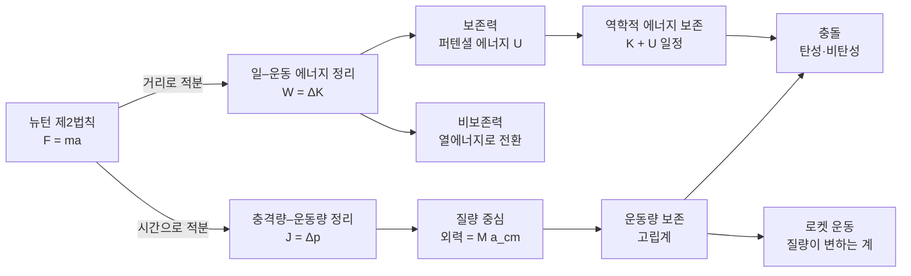

# 일반물리학 3. 일·에너지와 운동량 — 뉴턴 법칙을 거리와 시간으로 적분하면
<!-- prev: phy-1, 3-4, m3-04, uphy-1, uphy-2 -->
<!-- next: uphy-4, uphy-5, uphy-7 -->

> [!NOTE]
> **이 단원의 범위**
> - 일(일정한 힘과 변하는 힘, 적분)과 일–운동 에너지 정리, 일률
> - 보존력과 퍼텐셜 에너지(중력·용수철), 힘과 퍼텐셜의 관계, 퍼텐셜 에너지 곡선
> - 역학적 에너지 보존과 비보존력(열에너지로의 전환)
> - 질량 중심과 계의 운동
> - 선운동량과 충격량, 운동량 보존, 1·2차원 충돌(탄성·비탄성), 로켓 운동

**학습 목표**

1. 일정한 힘의 일을 스칼라곱으로, 변하는 힘의 일을 적분으로 계산하고, 뉴턴 제2법칙에서 일–운동 에너지 정리를 유도할 수 있다.
2. 일률을 $P = \vec{F}\cdot\vec{v}$로 계산하여 기계와 사람의 출력 문제에 적용할 수 있다.
3. 보존력의 조건을 알고 중력·용수철의 퍼텐셜 에너지를 구하며, $F = -dU/dx$로 퍼텐셜 에너지 곡선에서 힘·평형점·되돌이점을 읽을 수 있다.
4. 비보존력이 있을 때 $\Delta K + \Delta U = W_{\text{nc}}$를 써서 열에너지로 바뀐 에너지를 구할 수 있다.
5. 이산·연속 분포의 질량 중심을 구하고, 외력과 질량 중심 가속도의 관계로 계의 운동을 설명할 수 있다.
6. 충격량–운동량 정리와 운동량 보존으로 1·2차원 탄성·비탄성 충돌과 로켓 운동을 분석할 수 있다.

**이 단원의 학습 사다리**

| 단계 | 무엇을 하나? |
|---|---|
| STEP 1. 이전 학습 다시 보기 | 중3 「운동과 에너지」, 통합과학 「운동량과 충격량」, 물리학 「힘과 에너지」의 일·에너지·운동량을 꺼내 본다 |
| STEP 2. 기초 다지기 | 스칼라곱과 선적분, 연쇄 법칙 $a = v\,dv/dx$, '계'와 외력·내력을 익힌다 |
| STEP 3. 핵심 개념 | 일 → 일–운동 에너지 정리 → 일률 → 퍼텐셜 에너지와 곡선 → 비보존력 → 질량 중심 → 운동량과 충격량 → 충돌 → 로켓 |
| STEP 4. 오개념 바로잡기 | "운동량이 보존되면 운동 에너지도 보존된다", "수직 항력은 언제나 일을 하지 않는다" 같은 착각을 바로잡는다 |
| STEP 5. 다음 단계로 한 걸음 더 | 대칭과 보존 법칙(뇌터 정리), 질량 중심 좌표계의 충돌 맛보기 |
| STEP 6. 생활·산업·진로 | 충돌 안전 설계, 회생 제동, 원자로의 감속재, 다단 로켓 |

---

## 🗺️ 단원 들어가기

번지 점프 줄은 몇 m 늘어나야 사람을 땅에 닿기 전에 멈출 수 있을까? 교통사고 현장의 스키드 자국과 차량이 멈춘 위치만 보고, 충돌 직전 두 차가 몇 km/h로 달렸는지 어떻게 알아낼까? 원자로 안에서는 왜 빠른 중성자를 굳이 물이나 흑연에 부딪쳐 느리게 만들까? 로켓은 연료를 다 쓸 때 배기가스 속력보다 더 빨라질 수 있을까?

앞 단원 「뉴턴 법칙과 그 응용」에서는 매 순간의 힘으로 가속도를 구했다. 그러나 번지 줄의 힘은 늘어난 길이에 따라 계속 변하고, 충돌의 힘은 수천분의 1초 동안 복잡하게 변한다. 이럴 때 매 순간을 추적하는 대신, 뉴턴 제2법칙을 **거리에 대해 적분**하면 에너지가, **시간에 대해 적분**하면 운동량이 나온다. 두 양에는 **보존 법칙**이 있어서, 과정의 세부를 몰라도 '처음'과 '나중'을 바로 이을 수 있다. 이 단원은 역학에서 가장 강력한 두 도구를 다룬다.

---

## STEP 1. 🔙 이전 학습 다시 보기

### 연계 개념표

| 이전 단원 | 고등학교에서는 여기까지 | 대학에서는 이렇게 확장 |
|---|---|---|
| 중3 「운동과 에너지」 | 일 = 힘 × 거리, 위치 에너지 $mgh$, 역학적 에너지 보존 | 일을 **스칼라곱과 적분**으로 정의하고, 보존력이라는 조건에서 퍼텐셜 에너지를 이끌어 낸다 |
| 통합과학1 「운동량과 충격량」 | 충격량 = 운동량의 변화량, 충돌 시간을 늘리는 안전장치 | $\vec{J} = \int\vec{F}\,dt$로 **변하는 힘**의 충격량을 구하고, 힘–시간 그래프의 넓이로 해석한다 |
| 물리학 「힘과 에너지」 '운동량 보존 법칙' | 1차원 충돌에서 운동량 보존, 붙어서 함께 움직이는 수레 | **2차원 충돌**(벡터 보존), 탄성 충돌의 일반해, 질량 중심의 운동 |
| 물리학 「힘과 에너지」 '일–운동 에너지 정리' | 일정한 알짜힘에서 $W = \Delta K$, 용수철의 탄성 위치 에너지 | 뉴턴 법칙에서 **유도**하고, 변하는 힘·곡선 경로·**퍼텐셜 에너지 곡선**으로 넓힌다 |
| 물리학 「힘과 에너지」 '역학적 에너지와 열' | 마찰로 역학적 에너지가 열로 바뀌어도 총량은 보존 | 비보존력의 일 $W_{\text{nc}} = \Delta K + \Delta U$로 **정량화**한다 |
| 역학과 에너지 「시공간과 운동」 '로켓' | 로켓의 가속을 운동량 보존으로 정성적으로 설명 | **로켓 방정식** $\Delta v = v_{\text{ex}}\ln(M_i/M_f)$를 유도하고 다단 로켓을 계산한다 |
| 일반물리학 「뉴턴 법칙과 그 응용」 | 마찰력, 끌림힘, 원운동의 힘 분석 | 같은 힘들을 '일을 하는가, 에너지를 저장하는가'라는 관점으로 다시 본다 |

### 준비 운동 (사전 진단)

**Q1.** 질량 2.0 kg인 공이 3.0 m/s로 움직인다. 운동 에너지와 운동량의 크기는?

**Q2.** 등속 원운동하는 물체에 구심 방향의 알짜힘이 하는 일은? 그 이유는?

**Q3.** 정지한 수레(2.0 kg)에 같은 질량의 수레가 4.0 m/s로 와서 부딪친 뒤 붙어서 함께 움직인다. 충돌 직후의 속력은? 운동 에너지는 보존되었는가?

**Q4.** 같은 높이에서 같은 속력으로 공을 하나는 연직 위로, 하나는 수평으로 던졌다. 공기 저항이 없을 때 땅에 닿는 순간의 속력을 비교하시오.

정답 및 해설

**Q1.** 운동 에너지 9.0 J, 운동량 $6.0\ \mathrm{kg\cdot m/s}$ — $K = \frac{1}{2}(2.0)(3.0)^2 = 9.0\ \mathrm{J}$, $p = mv = 6.0\ \mathrm{kg\cdot m/s}$. 운동량은 벡터, 운동 에너지는 스칼라이다.

**Q2.** 0 — 힘이 언제나 속도(이동 방향)에 수직이므로 $\vec{F}\cdot d\vec{r} = 0$이다. 그래서 속력(운동 에너지)이 변하지 않는다.

**Q3.** 2.0 m/s, 보존되지 않았다 — $2.0\times4.0 = 4.0\times v$에서 $v = 2.0\ \mathrm{m/s}$. 운동 에너지는 16 J에서 8.0 J로 절반이 줄었다(열, 소리, 변형으로).

**Q4.** 같다 — 역학적 에너지 보존에 따라 $v^2 = v_0^2 + 2gh$로 방향과 관계없다. 에너지는 스칼라이기 때문이다.

---

## STEP 2. 🧱 기초 다지기

### 디딤돌 1. 스칼라곱 복습과 '경로를 따라 더하기'

「운동의 기술」에서 배운 스칼라곱 $\vec{F}\cdot\vec{d} = Fd\cos\phi = F_xd_x + F_yd_y + F_zd_z$는 "힘 중에서 이동 방향 성분만 골라 곱한다"는 뜻이다. 힘이 경로를 따라 변하면, 경로를 아주 짧은 조각 $d\vec{r}$로 나누어 조각마다 $\vec{F}\cdot d\vec{r}$을 계산하고 모두 더한다.

$$
W = \int_{\text{경로}}\vec{F}\cdot d\vec{r} = \int(F_x\,dx + F_y\,dy + F_z\,dz)
$$

이런 적분을 **선적분(line integral)** 이라 한다. 일반물리학에서는 대부분 힘이 한 방향 성분만 가지거나(1차원 적분 $\int F_x\,dx$), 힘이 일정하여(스칼라곱 한 번) 계산이 간단해진다.

### 디딤돌 2. 연쇄 법칙으로 시간을 지우기

$$
a = \frac{dv}{dt} = \frac{dv}{dx}\frac{dx}{dt} = v\frac{dv}{dx}
$$

이 한 줄이 이 단원의 출발점이다. 가속도를 위치의 함수로 다룰 수 있게 해 주므로, 힘이 위치에 따라 변할 때 시간을 거치지 않고 속도와 위치를 연결할 수 있다. 「운동의 기술」에서 $v^2 = v_0^2 + 2a\Delta x$를 유도할 때 이미 써 보았다.

### 디딤돌 3. 계, 외력, 내력

여러 물체를 한 묶음으로 보고 분석할 때 그 묶음을 **계(system)** 라 한다.

| 구분 | 뜻 | 예(두 스케이터를 계로 볼 때) |
|---|---|---|
| **내력(internal force)** | 계 안의 물체끼리 주고받는 힘 | 두 스케이터가 서로 미는 힘 |
| **외력(external force)** | 계 밖의 물체가 계 안의 물체에 주는 힘 | 지구의 중력, 얼음의 수직 항력·마찰력 |
| **고립계(isolated system)** | 알짜 외력이 0인 계 | 마찰 없는 얼음 위의 두 스케이터(중력과 수직 항력이 상쇄) |

제3법칙에 따라 내력은 언제나 쌍으로 크기가 같고 방향이 반대이므로, 계 전체의 **운동량**에 대해서는 합이 0이 된다. 그러나 내력이 하는 **일**의 합은 0이 아닐 수 있다(두 스케이터가 서로 밀면 둘 다 운동 에너지를 얻는다). 계를 어떻게 잡느냐가 같은 현상을 서로 다른 말로 기술하게 만든다는 점을 기억하자.

> [!TIP]
> 💡 **비유** — 계는 '회계 장부의 범위'와 같다. 한 가족을 하나의 계로 보면 가족끼리 주고받은 용돈(내력)은 가족 전체 재산을 바꾸지 않고, 월급이나 지출(외력)만 바꾼다. 장부의 범위를 한 사람으로 줄이면, 같은 용돈이 그 사람에게는 수입이나 지출이 된다.

---

## STEP 3. 📘 핵심 개념

### ① 일 — 일정한 힘과 변하는 힘

#### (1) 일정한 힘의 일

물체가 변위 $\vec{d}$만큼 움직이는 동안 일정한 힘 $\vec{F}$가 한 **일(work)** 은

$$
W = \vec{F}\cdot\vec{d} = Fd\cos\phi
$$

일의 단위는 **줄(J)** 이다: $1\ \mathrm{J} = 1\ \mathrm{N\cdot m} = 1\ \mathrm{kg\cdot m^2/s^2}$.

| 힘과 변위의 사이각 | 일의 부호 | 에너지의 흐름 | 예 |
|---|---|---|---|
| $0^\circ \le \phi < 90^\circ$ | 양(+) | 힘을 주는 쪽 → 물체 | 썰매를 끄는 힘 |
| $\phi = 90^\circ$ | 0 | 없음 | 수평 이동 중의 중력, 원운동의 구심력 |
| $90^\circ < \phi \le 180^\circ$ | 음(−) | 물체 → 힘을 주는 쪽(또는 열) | 운동 마찰력, 내려놓을 때 손이 받치는 힘 |

일은 에너지가 힘을 통해 **옮겨 가는 양**이다. 일이 음수라는 것은 그 힘이 물체의 운동 에너지를 빼앗는다는 뜻이다.

#### 예제 1 — 비스듬히 끄는 썰매와 벡터로 쓴 일

(1) 수평과 $30.0^\circ$를 이루는 줄로 50.0 N의 힘을 주어 썰매를 수평으로 12.0 m 끌었다. 줄이 한 일은?
(2) 힘 $\vec{F} = (3.0\hat{i} + 4.0\hat{j})\ \mathrm{N}$을 받는 물체가 $\vec{d} = (5.0\hat{i} - 2.0\hat{j})\ \mathrm{m}$만큼 움직였다. 이 힘이 한 일은?

**풀이**
(1) $W = Fd\cos\phi = 50.0\times12.0\times\cos30.0^\circ = 520\ \mathrm{J}$
(2) $W = F_xd_x + F_yd_y = 3.0\times5.0 + 4.0\times(-2.0) = 15 - 8.0 = 7.0\ \mathrm{J}$

**의미** (2)에서 힘의 크기는 5.0 N, 변위의 크기는 약 5.4 m이지만 일은 7.0 J에 불과하다. 힘의 $y$ 성분은 $y$ 방향 변위와 반대여서 음의 일을 했다. 성분식은 각을 따로 구하지 않아도 되므로 3차원에서 특히 편리하다.

#### (2) 변하는 힘의 일 — 적분

힘이 위치에 따라 변하는 1차원 운동에서는, 짧은 구간 $dx$에서 힘을 일정하다고 보고 $F(x)\,dx$를 모두 더한다.

$$
W = \int_{x_i}^{x_f}F(x)\,dx \qquad (F\text{–}x\text{ 그래프 아래의 부호 있는 넓이})
$$

**용수철이 하는 일** 늘어나거나 줄어든 길이 $x$에 대해 용수철이 주는 힘은 **훅 법칙(Hooke's law)** $F = -kx$이다($k$: 용수철 상수, 음의 부호는 변형을 되돌리는 방향). $x_i$에서 $x_f$까지 용수철이 하는 일은

$$
W_s = \int_{x_i}^{x_f}(-kx)\,dx = -\tfrac{1}{2}k\left(x_f^2 - x_i^2\right)
$$

용수철을 더 늘이면($\lvert x_f\rvert > \lvert x_i\rvert$) 용수철은 음의 일을 하고, 손은 그만큼 양의 일을 해야 한다(천천히 늘일 때).

#### 예제 2 — 용수철을 늘이는 데 드는 일과 변하는 힘

(1) 용수철 상수 200 N/m인 용수철을 늘어난 길이 0.100 m에서 0.300 m까지 천천히 늘였다. 손이 한 일은?
(2) $x$축 위의 물체가 힘 $F(x) = 6.0x - 1.5x^2$ (단위: N, m)을 받으며 $x = 0$에서 4.0 m까지 움직였다. 이 힘이 한 일은?

**풀이**
(1) 천천히 늘이면 손의 힘은 $+kx$이므로 $W_{\text{손}} = \int_{0.100}^{0.300}kx\,dx = \frac{1}{2}(200)(0.300^2 - 0.100^2) = 100\times0.0800 = 8.00\ \mathrm{J}$
(2) $W = \int_0^{4.0}(6.0x - 1.5x^2)\,dx = \left[3.0x^2 - 0.50x^3\right]_0^{4.0} = 48 - 32 = 16\ \mathrm{J}$

**의미** (1)에서 처음 0.100 m를 늘이는 데는 1.00 J만 들지만, 그다음 0.200 m에는 8.00 J이 든다. 일은 변형의 제곱에 비례하므로 많이 늘어날수록 같은 길이를 더 늘이기가 훨씬 힘들다. (2)의 힘은 $x = 4.0\ \mathrm{m}$에서 0이 되는데, 그래프 아래 넓이가 바로 16 J이다.

### ② 일–운동 에너지 정리

#### (1) 뉴턴 제2법칙에서 유도하기

1차원에서 알짜힘 $F_{\text{알짜}}$를 받는 물체에 디딤돌 2의 $a = v\,dv/dx$를 쓰면

$$
W_{\text{알짜}} = \int_{x_i}^{x_f}F_{\text{알짜}}\,dx = \int_{x_i}^{x_f}m v\frac{dv}{dx}\,dx = \int_{v_i}^{v_f}mv\,dv = \tfrac{1}{2}mv_f^2 - \tfrac{1}{2}mv_i^2
$$

**운동 에너지(kinetic energy)** 를 $K = \frac{1}{2}mv^2$으로 정의하면

$$
W_{\text{알짜}} = \Delta K
$$

이것이 **일–운동 에너지 정리(work–kinetic energy theorem)** 이다. 3차원에서도 $\vec{F}_{\text{알짜}}\cdot d\vec{r} = m\frac{d\vec{v}}{dt}\cdot\vec{v}\,dt = d\left(\frac{1}{2}mv^2\right)$이므로 똑같이 성립한다. 힘이 일정하든 변하든, 경로가 직선이든 곡선이든 성립한다는 점이 고등학교에서 배운 것보다 강력하다.

> [!IMPORTANT]
> 일–운동 에너지 정리는 **새로운 법칙이 아니라 뉴턴 제2법칙을 거리에 대해 적분한 것**이다. 그래서 같은 정보를 담고 있지만, 시간이 빠져 있어서 "얼마나 빨라지는가"를 묻는 문제를 훨씬 짧게 풀어 준다. 반대로 "언제"를 묻는 문제에는 답하지 못한다.

#### 예제 3 — 변하는 힘을 받아 가속하는 물체

예제 2 (2)의 힘이 마찰 없는 수평면 위의 질량 2.00 kg인 물체에 작용한다. 물체가 $x = 0$에서 정지 상태로 출발했다면 $x = 4.0\ \mathrm{m}$에서의 속력은?

**풀이** 수평면에서 중력과 수직 항력은 일을 하지 않으므로 $W_{\text{알짜}} = 16\ \mathrm{J}$.

$$
\tfrac{1}{2}(2.00)v^2 - 0 = 16 \;\Rightarrow\; v = 4.0\ \mathrm{m/s}
$$

**의미** 힘이 위치에 따라 변하므로 가속도도 변하는데, 시간에 따른 운동을 전혀 풀지 않고도 속력을 얻었다.

### ③ 일률

일을 하는 빠르기를 **일률(power)** 이라 한다. 평균 일률은 $\bar{P} = W/\Delta t$, 순간 일률은

$$
P = \frac{dW}{dt} = \frac{\vec{F}\cdot d\vec{r}}{dt} = \vec{F}\cdot\vec{v}
$$

단위는 **와트(W)**: $1\ \mathrm{W} = 1\ \mathrm{J/s}$. 전력량 단위 $1\ \mathrm{kWh} = 3.6\times10^6\ \mathrm{J}$은 일률 × 시간이므로 에너지 단위이다.

| 대상 | 일률(대략) |
|---|---|
| 사람의 기초 대사 | 약 80~100 W |
| 계단을 빠르게 오르는 사람 | 수백 W |
| 소형 승용차 엔진의 최대 출력 | 약 $10^5\ \mathrm{W}$ |
| 대형 발전소 한 기 | 약 $10^9\ \mathrm{W}$ |

#### 예제 4 — 언덕을 오르는 자동차와 엘리베이터

(1) 질량 1200 kg인 자동차가 경사각 $5.0^\circ$인 언덕을 20.0 m/s의 일정한 속력으로 오른다. 공기 저항과 구름 저항을 합한 힘은 500 N이다. 엔진이 바퀴에 전달해야 하는 일률은?
(2) 질량 1000 kg인 엘리베이터를 15 s 동안 30 m 일정한 속력으로 끌어올리는 전동기의 일률은?

**풀이**
(1) 등속이므로 바퀴를 앞으로 미는 힘 = 중력의 빗면 성분 + 저항력 $= 1200(9.80)\sin5.0^\circ + 500 = 1025 + 500 = 1525\ \mathrm{N}$. $P = Fv = 1525\times20.0 = 3.05\times10^4\ \mathrm{W}$ (약 31 kW)
(2) $P = \dfrac{mgh}{t} = \dfrac{1000\times9.80\times30}{15} = 1.96\times10^4\ \mathrm{W}$ (약 20 kW)

**의미** (1)에서 같은 엔진 출력이라면 $v = P/F$이므로, 언덕에서 필요한 힘이 커지면 속력이 줄어든다. 자동차 변속기는 같은 일률에서 바퀴의 힘과 속력의 비율을 바꾸는 장치이다.

### ④ 보존력과 퍼텐셜 에너지

#### (1) 보존력의 조건

어떤 힘이 한 일이 **경로와 관계없이 처음과 나중 위치만으로 정해지면**, 그 힘을 **보존력(conservative force)** 이라 한다. 같은 말로, 닫힌 경로를 한 바퀴 돌아 제자리로 올 때 한 일이 0이다.

| 힘 | 보존력인가? | 이유 |
|---|---|---|
| 중력(일정한 $mg$, 만유인력) | 예 | 올라갈 때 음의 일, 내려올 때 같은 크기의 양의 일 |
| 용수철의 탄성력 | 예 | 늘어날 때와 돌아올 때의 일이 상쇄 |
| 정전기력 | 예 | 「전기장과 전위」에서 전위를 정의하는 근거 |
| 운동 마찰력 | 아니오 | 언제나 운동의 반대 방향이라 왕복하면 일이 모두 음수 |
| 끌림힘 | 아니오 | 마찰력과 같은 이유 |

#### (2) 퍼텐셜 에너지의 정의

보존력에 대해서만, 위치의 함수인 **퍼텐셜 에너지(potential energy)** $U$를 다음과 같이 정의할 수 있다. 고등학교 용어 '위치 에너지'와 같은 말이다.

$$
\Delta U = U_f - U_i = -W_{\text{보존력}} = -\int_{x_i}^{x_f}F(x)\,dx
$$

보존력이 양의 일을 하면(물체가 떨어지면) 퍼텐셜 에너지가 줄어든다. 기준점($U = 0$인 곳)은 마음대로 정할 수 있고, 물리적으로 의미 있는 것은 **차이**뿐이다.

| 힘 | 힘의 식 | 퍼텐셜 에너지 | 기준 |
|---|---|---|---|
| 지표 근처 중력 | $F_y = -mg$ | $U = mgy$ | $y = 0$ |
| 용수철 | $F = -kx$ | $U = \frac{1}{2}kx^2$ | 자연 길이 $x = 0$ |
| 만유인력 | $F_r = -GMm/r^2$ | $U = -GMm/r$ | 무한히 먼 곳 (「중력·진동·유체」) |

#### (3) 힘은 퍼텐셜 에너지의 기울기

정의를 미분하면 반대 방향의 관계를 얻는다.

$$
F(x) = -\frac{dU}{dx}
$$

3차원에서는 $\vec{F} = -\left(\dfrac{\partial U}{\partial x}\hat{i} + \dfrac{\partial U}{\partial y}\hat{j} + \dfrac{\partial U}{\partial z}\hat{k}\right)$이다. 확인: $U = \frac{1}{2}kx^2$이면 $F = -kx$, $U = mgy$이면 $F_y = -mg$이다. **힘은 퍼텐셜 에너지가 낮아지는 쪽을 향한다.**

> [!TIP]
> 💡 **비유** — 퍼텐셜 에너지 곡선은 '지형도', 물체는 그 위를 구르는 구슬이다. 구슬은 언제나 내리막 쪽으로 밀리고(힘 $= -$기울기), 경사가 가파를수록 세게 밀린다. 구슬이 가진 총에너지는 '수면의 높이'와 같아서, 지형이 수면보다 높은 곳에는 갈 수 없다.

### ⑤ 퍼텐셜 에너지 곡선 읽기

보존력만 작용하면 $E = K + U(x)$가 일정하고 $K \ge 0$이므로, 물체는 $U(x) \le E$인 곳에서만 움직일 수 있다.

| 곡선의 특징 | 의미 |
|---|---|
| $U(x) = E$인 점 | **되돌이점(turning point)**: 속력이 0이 되고 방향을 바꾼다 |
| $dU/dx = 0$인 점 | **평형점**: 힘이 0 |
| 극소점($d^2U/dx^2 > 0$) | **안정 평형**: 조금 벗어나면 되돌아오는 힘 → 진동 |
| 극대점($d^2U/dx^2 < 0$) | **불안정 평형**: 조금 벗어나면 더 멀어진다 |
| 평평한 구간 | **중립 평형** |
| $E - U(x)$ | 그 점에서의 운동 에너지 → 속력 |

#### 예제 5 — 이중 우물 퍼텐셜

질량 0.500 kg인 입자가 $x$축 위에서 퍼텐셜 에너지 $U(x) = 2x^4 - 4x^2$ (단위: J, m)인 보존력만 받는다.
(1) 힘 $F(x)$를 구하고 평형점과 각각의 안정성을 판정하시오.
(2) 역학적 에너지가 $E = -1.00\ \mathrm{J}$일 때 입자가 움직일 수 있는 범위와 최대 속력을 구하시오.
(3) $E = +1.00\ \mathrm{J}$이면 운동이 어떻게 달라지는가?

**풀이**
(1) $F = -\dfrac{dU}{dx} = -8x^3 + 8x = -8x(x^2 - 1)$. 평형점은 $x = 0$, $x = \pm1\ \mathrm{m}$.
$\dfrac{d^2U}{dx^2} = 24x^2 - 8$: $x = 0$에서 $-8 < 0$ → **불안정**($U = 0$), $x = \pm1$에서 $16 > 0$ → **안정**($U = -2.00\ \mathrm{J}$).

(2) 되돌이점: $2x^4 - 4x^2 = -1$ → $x^2 = \dfrac{4 \pm \sqrt{8}}{4}$ → $x^2 = 1.707$ 또는 $0.293$ → $\lvert x\rvert = 1.31$ 또는 $0.541\ \mathrm{m}$.
$x = 0$의 '언덕'($U = 0 > E$)을 넘을 수 없으므로, 입자는 **두 우물 중 한쪽**에 갇혀 $0.541\ \mathrm{m} \le x \le 1.31\ \mathrm{m}$(또는 그 거울상) 사이를 왕복한다. 최대 속력은 $U$가 가장 낮은 $x = 1$에서: $K = -1.00 - (-2.00) = 1.00\ \mathrm{J}$ → $v = \sqrt{2(1.00)/0.500} = 2.00\ \mathrm{m/s}$.

(3) $E > 0$이면 언덕을 넘을 수 있으므로 두 우물을 오가며 $-1.49\ \mathrm{m} \le x \le 1.49\ \mathrm{m}$ 사이를 왕복한다($2x^4 - 4x^2 = 1$의 실근). 언덕 꼭대기 $x = 0$에서도 $K = 1.00\ \mathrm{J}$이 남아 있다.

**의미** 이런 이중 우물 모형은 암모니아 분자에서 질소 원자의 두 위치, 두 상태를 가지는 스위치나 기억 소자, 화학 반응의 반응물–생성물 상태를 설명하는 데 쓰인다. 고전역학에서는 $E < 0$인 입자가 언덕을 절대 넘지 못하지만, 양자역학에서는 '터널링'으로 넘을 수 있다(「현대 물리」).

### ⑥ 역학적 에너지 보존과 비보존력

#### (1) 역학적 에너지 보존

알짜힘이 한 일을 보존력의 일과 비보존력의 일로 나누면 $W_{\text{알짜}} = W_{\text{c}} + W_{\text{nc}} = -\Delta U + W_{\text{nc}}$이다. 일–운동 에너지 정리 $W_{\text{알짜}} = \Delta K$에 넣으면

$$
\Delta K + \Delta U = W_{\text{nc}}
$$

비보존력이 일을 하지 않으면($W_{\text{nc}} = 0$) **역학적 에너지(mechanical energy)** $E_{\text{mec}} = K + U$가 보존된다. 수직 항력이나 장력처럼 이동 방향에 수직인 힘은 일을 하지 않으므로 보존을 깨지 않는다.

#### (2) 비보존력과 열에너지

운동 마찰력이 거리 $d$만큼 작용하면 역학적 에너지는 $f_kd$만큼 줄고, 그만큼이 두 면의 **열에너지(thermal energy)** 로 바뀐다.

$$
\Delta K + \Delta U + \Delta E_{\text{th}} = 0, \qquad \Delta E_{\text{th}} = f_kd
$$

더 넓게는 계의 모든 에너지(화학 에너지, 내부 에너지, 소리 등)를 포함하고 외부에서 해 준 일을 $W_{\text{외부}}$라 하면 $W_{\text{외부}} = \Delta E_{\text{계}}$ — 이것이 **에너지 보존 법칙**이며, 「열과 열역학」의 열역학 제1법칙으로 이어진다.

> [!NOTE]
> 엄밀히 말하면 운동 마찰력이 '물체에 한 일'을 $-f_kd$로 계산하는 것은 근사이다. 마찰이 일어나는 접촉점들은 물체와 함께 움직이지 않고, 생긴 열은 두 물체에 나뉘어 들어가기 때문이다. 그래서 대학 물리에서는 "물체와 바닥을 한 계로 보고, $f_kd$만큼 계의 열에너지가 늘어난다"고 쓰는 것이 더 정확하다.

#### 예제 6 — 마찰이 있는 바닥에서 용수철에 부딪치는 토막

질량 1.50 kg인 토막이 3.00 m/s로 수평 바닥을 미끄러지다가 용수철 상수 500 N/m인 용수철의 끝에 닿아 용수철을 누른다. 토막과 바닥 사이의 운동 마찰 계수는 0.200이다. 용수철이 최대로 줄어드는 길이를 구하고, 그동안 생긴 열에너지를 구하시오.

**풀이**
- 식 세우기: 용수철에 닿는 순간부터 최대로 줄어들 때(속력 0)까지 $\Delta K + \Delta U_s + \Delta E_{\text{th}} = 0$

$$
\left(0 - \tfrac{1}{2}(1.50)(3.00)^2\right) + \tfrac{1}{2}(500)x^2 + (0.200)(1.50)(9.80)x = 0
$$

- 정리: $250x^2 + 2.94x - 6.75 = 0$ → $x = \dfrac{-2.94 + \sqrt{2.94^2 + 4(250)(6.75)}}{2(250)} = 0.159\ \mathrm{m}$
- 열에너지: $f_kx = 2.94\times0.1585 = 0.466\ \mathrm{J}$

**의미** 처음 운동 에너지 6.75 J 중 약 6.28 J이 용수철에 저장되고 0.47 J이 열로 바뀌었다. 마찰이 없다면 $x = \sqrt{2(6.75)/500} = 0.164\ \mathrm{m}$이다. 마찰은 최대 압축을 약 3 % 줄인다. 이처럼 에너지 방법은 각 항의 크기를 비교하여 "무엇을 무시해도 되는가"를 판단하게 해 준다.

#### 예제 7 — 스키 슬로프의 에너지 손실

질량 60.0 kg인 스키어가 높이 20.0 m인 슬로프 꼭대기에서 정지 상태로 출발하여 바닥에 15.0 m/s로 도착했다. 마찰과 공기 저항으로 줄어든 역학적 에너지는?

**풀이** $W_{\text{nc}} = \Delta K + \Delta U = \frac{1}{2}(60.0)(15.0)^2 - (60.0)(9.80)(20.0) = 6750 - 11\,760 = -5010\ \mathrm{J}$

약 $5.0\times10^3\ \mathrm{J}$(처음 퍼텐셜 에너지의 약 43 %)이 눈과 스키의 열에너지, 공기의 운동으로 바뀌었다. 슬로프의 모양은 몰라도 된다.

### ⑦ 질량 중심

#### (1) 정의

질량 $m_1, m_2, \ldots$인 입자들이 위치 $\vec{r}_1, \vec{r}_2, \ldots$에 있을 때, 계의 **질량 중심(center of mass)** 은 질량으로 가중 평균한 위치이다.

$$
\vec{r}_{\text{cm}} = \frac{1}{M}\sum_i m_i\vec{r}_i, \qquad M = \sum_i m_i
$$

질량이 연속적으로 분포한 물체는 합을 적분으로 바꾼다: $\vec{r}_{\text{cm}} = \dfrac{1}{M}\displaystyle\int\vec{r}\,dm$. 밀도가 균일하고 대칭인 물체의 질량 중심은 대칭의 중심에 있다. 균일한 중력장에서는 질량 중심과 **무게 중심**이 일치한다.

#### 예제 8 — 세 입자와 밀도가 변하는 막대

(1) 1.0 kg인 입자가 $(0, 0)$, 2.0 kg인 입자가 $(4.0\ \mathrm{m}, 0)$, 3.0 kg인 입자가 $(2.0\ \mathrm{m}, 3.0\ \mathrm{m})$에 있다. 질량 중심은?
(2) 길이 $L = 2.00\ \mathrm{m}$인 막대의 선밀도(단위 길이당 질량)가 한쪽 끝($x = 0$)에서 다른 끝으로 갈수록 $\lambda(x) = \lambda_0(1 + x/L)$로 커진다. 질량 중심의 위치는?

**풀이**
(1) $x_{\text{cm}} = \dfrac{1.0(0) + 2.0(4.0) + 3.0(2.0)}{6.0} = 2.3\ \mathrm{m}$, $y_{\text{cm}} = \dfrac{3.0(3.0)}{6.0} = 1.5\ \mathrm{m}$

(2) $dm = \lambda\,dx$이므로

$$
x_{\text{cm}} = \frac{\int_0^L x\lambda_0(1 + x/L)\,dx}{\int_0^L\lambda_0(1 + x/L)\,dx} = \frac{\frac{L^2}{2} + \frac{L^2}{3}}{L + \frac{L}{2}} = \frac{5}{9}L = 1.11\ \mathrm{m}
$$

**의미** (2)의 질량 중심은 무거운 쪽으로 $L/2$보다 $L/18$만큼 치우쳐 있다. 야구 방망이, 골프채처럼 한쪽이 무거운 도구의 균형점을 정하는 계산이다.

#### (2) 계의 운동 — 외력만이 질량 중심을 가속시킨다

질량 중심의 정의를 시간으로 두 번 미분하고 각 입자에 뉴턴 제2법칙을 쓰면, 내력은 제3법칙에 따라 쌍으로 상쇄되어

$$
\sum\vec{F}_{\text{외력}} = M\vec{a}_{\text{cm}}
$$

을 얻는다. 계가 아무리 복잡하게 움직여도(회전하고, 변형되고, 쪼개져도) **질량 중심은 모든 질량이 그곳에 모인 한 입자처럼** 외력에 따라 움직인다.

#### 예제 9 — 공중에서 폭발한 불꽃

수평 도달 거리가 400 m가 되도록 쏘아 올린 불꽃 탄이 최고점에서 질량이 같은 두 조각으로 터졌다. 한 조각은 폭발 직후 정지하여 연직으로 떨어졌다. 다른 조각은 어디에 떨어지는가? (공기 저항 무시, 땅은 평평함)

**풀이** 폭발력은 내력이므로 질량 중심의 운동을 바꾸지 않는다. 질량 중심은 원래 포물선을 따라 400 m 지점에 떨어진다. 첫 조각은 최고점 바로 아래인 200 m 지점에 떨어지고, 두 조각은 같은 높이에서 같은 시간에 땅에 닿으므로

$$
x_{\text{cm}} = \frac{m(200) + m\,x_2}{2m} = 400 \;\Rightarrow\; x_2 = 600\ \mathrm{m}
$$

**의미** 폭발의 세부(힘의 크기, 시간)를 전혀 몰라도 결과를 얻었다. 질량 중심 개념은 다이빙 선수의 공중 회전(질량 중심은 포물선을 그린다)이나 높이뛰기의 배면뛰기(몸은 막대 위를 넘지만 질량 중심은 막대 아래를 지날 수 있다)도 설명한다.

### ⑧ 선운동량과 충격량, 운동량 보존

#### (1) 운동량과 뉴턴 제2법칙

**선운동량(linear momentum)** 은 $\vec{p} = m\vec{v}$이다(단위 $\mathrm{kg\cdot m/s}$). 뉴턴이 처음 쓴 제2법칙의 꼴은

$$
\sum\vec{F} = \frac{d\vec{p}}{dt}
$$

이며, 질량이 일정하면 $m\vec{a}$와 같다. 이 꼴은 질량이 변하는 계(로켓, 컨베이어 벨트)를 다룰 때 출발점이 된다(⑩에서 계를 잘 정의하여 쓴다).

#### (2) 충격량–운동량 정리

제2법칙을 시간에 대해 적분하면

$$
\vec{J} = \int_{t_i}^{t_f}\sum\vec{F}\,dt = \vec{p}_f - \vec{p}_i = \Delta\vec{p}
$$

$\vec{J}$를 **충격량(impulse)** 이라 한다. 힘–시간 그래프 아래의 넓이이며, 충돌처럼 힘이 짧은 시간에 복잡하게 변해도 **넓이(충격량)만 알면 운동량 변화를 안다.** 평균 힘은 $\vec{F}_{\text{평균}} = \vec{J}/\Delta t$이다.

#### 예제 10 — 방망이에 맞은 야구공

질량 0.145 kg인 야구공이 40.0 m/s로 날아와 방망이에 맞고 정반대 방향으로 50.0 m/s로 날아갔다. 접촉 시간은 1.20 ms이다. (1) 공이 받은 충격량 (2) 방망이가 공에 준 평균 힘을 구하시오. (3) 힘이 삼각형 모양(0에서 최댓값까지 늘었다가 다시 0)으로 변했다면 최대 힘은?

**풀이** 공이 나가는 방향을 +로 잡는다.
(1) $J = m(v_f - v_i) = 0.145\times[50.0 - (-40.0)] = 13.1\ \mathrm{N\cdot s}$ (반올림 전 13.05)
(2) $F_{\text{평균}} = \dfrac{13.05}{1.20\times10^{-3}} = 1.09\times10^4\ \mathrm{N}$
(3) 삼각형의 넓이 $\frac{1}{2}F_{\max}\Delta t = J$ → $F_{\max} = 2F_{\text{평균}} = 2.18\times10^4\ \mathrm{N}$

**의미** 평균 힘만 해도 공 무게(1.42 N)의 약 7700배이다. 이렇게 짧고 큰 힘이 작용하는 동안에는 중력 같은 다른 힘의 충격량을 무시할 수 있다(**충격 근사**). 이 근사 덕분에 충돌 직전·직후에 운동량 보존을 쓸 수 있다.

#### (3) 운동량 보존

계의 총운동량 $\vec{P} = \sum\vec{p}_i = M\vec{v}_{\text{cm}}$에 대해 $\sum\vec{F}_{\text{외력}} = d\vec{P}/dt$이므로

$$
\sum\vec{F}_{\text{외력}} = 0 \;\Rightarrow\; \vec{P} = \text{일정}
$$

**고립계의 총운동량은 보존된다.** 벡터 법칙이므로 성분별로 성립한다. 외력이 있어도 어떤 방향의 외력 성분이 0이면 그 방향의 운동량은 보존된다(예: 수평면에서의 충돌 — 연직 방향에는 중력이 있어도 수평 운동량은 보존).

| 보존 법칙 | 조건 | 성질 |
|---|---|---|
| 운동량 보존 | 알짜 외력 = 0 | 벡터. 내력의 종류와 무관하게 언제나 성립 |
| 역학적 에너지 보존 | 비보존력이 일을 하지 않음 | 스칼라. 충돌·마찰·폭발에서는 대개 깨진다 |
| 총에너지 보존 | 언제나(고립계) | 열·소리·변형 에너지까지 포함 |

### ⑨ 충돌 — 탄성과 비탄성

#### (1) 충돌의 분류

| 종류 | 운동량 | 운동 에너지 | 예 |
|---|---|---|---|
| **탄성 충돌(elastic collision)** | 보존 | 보존 | 당구공(근사), 원자·분자의 충돌, 중성자–원자핵 |
| **비탄성 충돌(inelastic collision)** | 보존 | 줄어듦 | 대부분의 실제 충돌 |
| **완전 비탄성 충돌(perfectly inelastic)** | 보존 | 가장 많이 줄어듦 | 충돌 후 한 덩어리가 됨(점토, 탄동 진자) |

충돌 순간에는 충격 근사로 외력을 무시하므로 **운동량은 모든 충돌에서 보존**된다. 차이는 운동 에너지가 변형·열·소리로 얼마나 바뀌는가이다.

#### (2) 1차원 탄성 충돌의 일반해

질량 $m_1$이 속도 $v_{1i}$로 정지한 $m_2$에 정면으로 탄성 충돌한다. 운동량과 운동 에너지 보존에서

$$
m_1v_{1i} = m_1v_{1f} + m_2v_{2f}, \qquad \tfrac{1}{2}m_1v_{1i}^2 = \tfrac{1}{2}m_1v_{1f}^2 + \tfrac{1}{2}m_2v_{2f}^2
$$

두 식을 각각 $m_1(v_{1i} - v_{1f}) = m_2v_{2f}$, $m_1(v_{1i} - v_{1f})(v_{1i} + v_{1f}) = m_2v_{2f}^2$로 정리하여 나누면 $v_{1i} + v_{1f} = v_{2f}$, 즉 **상대 속도의 크기가 그대로이고 방향만 바뀐다**($v_{1i} - 0 = -(v_{1f} - v_{2f})$). 이것을 운동량 식에 넣으면

$$
v_{1f} = \frac{m_1 - m_2}{m_1 + m_2}v_{1i}, \qquad v_{2f} = \frac{2m_1}{m_1 + m_2}v_{1i}
$$

| 질량 관계 | 결과 | 예 |
|---|---|---|
| $m_1 = m_2$ | $v_{1f} = 0$, $v_{2f} = v_{1i}$ — 속도를 통째로 넘겨준다 | 당구공의 정면 충돌, 뉴턴의 요람 |
| $m_1 \ll m_2$ | $v_{1f} \approx -v_{1i}$ — 거의 그대로 튕겨 나온다 | 벽에 던진 탱탱볼 |
| $m_1 \gg m_2$ | $v_{1f} \approx v_{1i}$, $v_{2f} \approx 2v_{1i}$ | 볼링공에 맞은 핀, 골프채에 맞은 공 |

#### 예제 11 — 1차원 탄성 충돌

마찰 없는 트랙에서 질량 2.00 kg인 수레가 6.00 m/s로 정지한 4.00 kg 수레에 탄성 충돌한다. 충돌 후 두 수레의 속도를 구하고 운동 에너지 보존을 확인하시오.

**풀이**
$v_{1f} = \dfrac{2.00 - 4.00}{6.00}(6.00) = -2.00\ \mathrm{m/s}$ (되튐), $v_{2f} = \dfrac{2(2.00)}{6.00}(6.00) = 4.00\ \mathrm{m/s}$

확인: 충돌 전 $K = \frac{1}{2}(2.00)(36.0) = 36.0\ \mathrm{J}$, 충돌 후 $\frac{1}{2}(2.00)(4.00) + \frac{1}{2}(4.00)(16.0) = 4.00 + 32.0 = 36.0\ \mathrm{J}$. 운동량도 $12.0 = -4.00 + 16.0$으로 보존된다. 상대 속도는 $6.00$에서 $4.00 - (-2.00) = 6.00\ \mathrm{m/s}$로 크기가 같다.

#### 예제 12 — 탄동 진자

질량 10.0 g인 총알이 줄에 매달린 2.00 kg 나무토막에 수평으로 박혔다. 토막(+총알)은 0.120 m 높이까지 올라갔다. 총알의 처음 속력을 구하고, 충돌에서 남은 운동 에너지의 비율을 구하시오.

**풀이** 두 단계로 나눈다.
- 충돌 후 흔들려 올라가는 단계(역학적 에너지 보존): $V = \sqrt{2gh} = \sqrt{2(9.80)(0.120)} = 1.534\ \mathrm{m/s}$
- 충돌 단계(완전 비탄성, 운동량 보존): $mv = (m + M)V$ → $v = \dfrac{2.010}{0.0100}\times1.534 = 308\ \mathrm{m/s}$
- 남은 운동 에너지 비율: $\dfrac{K_f}{K_i} = \dfrac{\frac{1}{2}(m + M)V^2}{\frac{1}{2}mv^2} = \dfrac{m}{m + M} = \dfrac{0.0100}{2.010} = 0.498\ \%$

**의미** 총알의 운동 에너지 중 99.5 %가 나무의 변형과 열로 바뀐다. 그래서 "총알의 운동 에너지 = 토막의 퍼텐셜 에너지"로 풀면 완전히 틀린 답을 얻는다. **충돌 단계에는 운동량, 충돌 후 단계에는 에너지**를 쓰는 것이 핵심이다.

#### (3) 2차원 충돌

평면에서의 충돌은 운동량 보존이 두 성분식이 된다.

$$
\sum p_x\ \text{보존}, \qquad \sum p_y\ \text{보존}
$$

미지수가 많으므로 보통 충돌 후 한 물체의 방향이나 속력 같은 정보가 추가로 주어진다. **질량이 같은 두 물체의 탄성 충돌**에서 한 물체가 정지해 있었다면, $\vec{v}_{1i} = \vec{v}_{1f} + \vec{v}_{2f}$와 $v_{1i}^2 = v_{1f}^2 + v_{2f}^2$을 동시에 만족해야 하므로 $\vec{v}_{1f}\cdot\vec{v}_{2f} = 0$, 즉 **충돌 후 두 물체는 서로 직각으로 갈라진다**(정면 충돌이 아닐 때). 당구 선수들이 경험으로 아는 '90° 규칙'이다.

#### 예제 13 — 교차로의 완전 비탄성 충돌

질량 1500 kg인 자동차 A가 동쪽으로 20.0 m/s, 질량 2000 kg인 자동차 B가 북쪽으로 15.0 m/s로 교차로에 들어와 충돌한 뒤 엉겨 붙어 함께 움직였다. 충돌 직후의 속도(크기와 방향)와 줄어든 운동 에너지를 구하시오.

**풀이** 동쪽 $\hat{i}$, 북쪽 $\hat{j}$.
- $P_x = 1500\times20.0 = 3.00\times10^4\ \mathrm{kg\cdot m/s}$, $P_y = 2000\times15.0 = 3.00\times10^4\ \mathrm{kg\cdot m/s}$
- $V = \dfrac{\sqrt{P_x^2 + P_y^2}}{3500} = \dfrac{4.243\times10^4}{3500} = 12.1\ \mathrm{m/s}$, 방향: 동쪽에서 북쪽으로 $\tan^{-1}(P_y/P_x) = 45.0^\circ$
- 운동 에너지: 충돌 전 $3.00\times10^5 + 2.25\times10^5 = 5.25\times10^5\ \mathrm{J}$, 충돌 후 $\frac{1}{2}(3500)(12.12)^2 = 2.57\times10^5\ \mathrm{J}$ → 줄어든 양 $2.68\times10^5\ \mathrm{J}$ (약 51 %)

**의미** 이 계산을 거꾸로 하면 사고 재구성이 된다. 충돌 후 미끄러진 거리와 방향(스키드 자국)에서 충돌 직후 속도를 구하고, 운동량 보존으로 충돌 전 두 차의 속도를 알아낸다(개념 확인 문제 11).

#### 예제 14 — 당구공의 비스듬한 충돌

정지한 당구공에 같은 질량의 수구가 2.00 m/s로 비스듬히 충돌하여, 수구는 처음 방향에서 $30.0^\circ$ 왼쪽으로 진행했다. 탄성 충돌로 보고 두 공의 충돌 후 속력과 맞은 공의 방향을 구하시오.

**풀이** 질량이 같은 탄성 충돌이므로 두 공은 직각으로 갈라진다 → 맞은 공은 처음 방향에서 $60.0^\circ$ 오른쪽. 운동량 벡터 삼각형이 직각 삼각형이므로

$$
v_{1f} = 2.00\cos30.0^\circ = 1.73\ \mathrm{m/s}, \qquad v_{2f} = 2.00\sin30.0^\circ = 1.00\ \mathrm{m/s}
$$

확인: $1.73^2 + 1.00^2 = 4.00 = 2.00^2$ (운동 에너지 보존), 진행 방향에 수직한 운동량 $1.73\sin30.0^\circ - 1.00\sin60.0^\circ = 0.866 - 0.866 = 0$.

> [!TIP]
> 💡 **요령** — 충돌 문제의 순서: ① 충돌 직전과 직후만 본다(충격 근사) ② 운동량 보존을 **성분별로** 쓴다 ③ 탄성이면 운동 에너지 보존을 더하고, 완전 비탄성이면 "나중 속도가 같다"를 더한다 ④ 충돌 전후의 다른 과정(미끄러짐, 흔들림)은 에너지 방법으로 따로 푼다.

### ⑩ 로켓 운동 — 질량이 변하는 계

#### (1) 로켓 방정식의 유도

외력이 없는 공간에서 질량 $M$인 로켓이 속도 $v$로 움직이며, 로켓에 대한 속력 $v_{\text{ex}}$로 배기가스를 뒤로 내뿜는다. 짧은 시간 $dt$ 동안 질량 $\lvert dM\rvert = -dM$인 가스가 빠져나가고 로켓의 속도가 $v + dv$가 되었다. **로켓과 그 가스를 한 계**로 보면 운동량이 보존된다. 땅에서 본 가스의 속도는 $v + dv - v_{\text{ex}}$이므로

$$
Mv = (M + dM)(v + dv) + (-dM)(v + dv - v_{\text{ex}})
$$

전개하여 정리하면(작은 양의 곱 $dM\,dv$는 남지 않는다)

$$
M\,dv = -v_{\text{ex}}\,dM \;\Rightarrow\; \int_{v_i}^{v_f}dv = -v_{\text{ex}}\int_{M_i}^{M_f}\frac{dM}{M}
$$

$$
\Delta v = v_f - v_i = v_{\text{ex}}\ln\frac{M_i}{M_f}
$$

이것이 **로켓 방정식**(치올콥스키 방정식)이다. 첫 식을 $dt$로 나누면 로켓이 받는 **추력(thrust)** $M\dfrac{dv}{dt} = v_{\text{ex}}\left\lvert\dfrac{dM}{dt}\right\rvert$을 얻는다.

| 결과 | 의미 |
|---|---|
| $\Delta v \propto v_{\text{ex}}$ | 배기가스가 빠를수록(효율 좋은 연료·엔진) 유리하다 |
| $\Delta v \propto \ln(M_i/M_f)$ | 질량비를 늘려도 속도는 로그로만 는다 → 연료를 2배 실어도 $\Delta v$는 2배가 되지 않는다 |
| $\Delta v > v_{\text{ex}}$ 가능 | $M_i/M_f > e \approx 2.72$이면 로켓은 배기가스 속력보다 빨라진다 |
| 추력 $= v_{\text{ex}}\lvert dM/dt\rvert$ | 지상 발사에서는 추력 > 무게여야 떠오른다 |

#### 예제 15 — 로켓의 속도 변화와 추력

배기가스 속력이 3.00 km/s인 로켓이 처음 질량의 80 %에 해당하는 연료를 태운다($M_i/M_f = 5.0$). (1) 외력이 없을 때의 속도 변화 (2) 연료를 초당 250 kg씩 태울 때의 추력 (3) 처음 질량이 $5.0\times10^4\ \mathrm{kg}$이고 지상에서 연직으로 발사할 때의 처음 가속도를 구하시오.

**풀이**
(1) $\Delta v = 3.00\ln5.0 = 3.00\times1.609 = 4.83\ \mathrm{km/s}$
(2) 추력 $= 3.00\times10^3\times250 = 7.5\times10^5\ \mathrm{N}$
(3) 무게 $= 5.0\times10^4\times9.80 = 4.9\times10^5\ \mathrm{N}$, $a = \dfrac{7.5\times10^5 - 4.9\times10^5}{5.0\times10^4} = 5.2\ \mathrm{m/s^2}$

**의미** 지구 저궤도에 오르려면 공기 저항과 중력 손실을 포함해 대략 9 km/s 정도의 속도 변화가 필요하다고 알려져 있다. 한 단짜리 로켓으로는 질량비가 지나치게 커야 하므로, 빈 연료통을 떼어 내는 **다단 로켓**을 쓴다(탐구 활동 B). 발사 직후에는 가속도가 작지만, 연료가 타서 질량이 줄수록 같은 추력으로 가속도가 점점 커진다.

---

## STEP 4. ⚠️ 오개념 바로잡기

| 흔한 오개념 | 올바른 개념 | 왜 그럴까? |
|---|---|---|
| 힘을 주고 있으면 언제나 일을 한다 | 이동이 없거나 힘이 이동 방향에 수직이면 일은 0이다 | 무거운 가방을 들고 가만히 서 있으면 근육은 지치지만(몸 안의 화학 에너지 소비) 가방에 해 준 일은 0이다 |
| 수직 항력과 마찰력은 언제나 일을 하지 않거나 음의 일을 한다 | 엘리베이터 바닥의 수직 항력은 올라가는 사람에게 양의 일을 하고, 정지 마찰력은 컨베이어 위 상자에 양의 일을 한다 | 일의 부호는 힘과 **그 물체의 변위** 사이의 각으로 정해진다 |
| 퍼텐셜 에너지는 물체 하나가 가진 에너지이다 | 퍼텐셜 에너지는 서로 상호 작용하는 **계**(물체–지구, 물체–용수철)의 에너지이다 | 중력 퍼텐셜 에너지는 물체와 지구 사이의 배치에 따라 정해진다 |
| 퍼텐셜 에너지가 음수이면 잘못 계산한 것이다 | 기준점에 따라 음수가 될 수 있고, 의미 있는 것은 차이뿐이다 | 만유인력 퍼텐셜 $-GMm/r$은 언제나 음수이다 |
| 운동량이 보존되면 운동 에너지도 보존된다 | 운동량은 모든 충돌에서 보존되지만 운동 에너지는 탄성 충돌에서만 보존된다 | 탄동 진자에서는 운동 에너지의 99 % 이상이 열·변형으로 바뀐다 |
| 완전 비탄성 충돌에서는 운동 에너지가 모두 사라진다 | 질량 중심의 운동 에너지 $\frac{1}{2}Mv_{\text{cm}}^2$은 남는다. 사라질 수 있는 최대량은 질량 중심에 대한 운동 에너지이다 | 운동량 보존 때문에 충돌 후에도 질량 중심 속도는 그대로이다 |
| 질량 중심에는 반드시 물질이 있다 | 고리, 부메랑, 굽힌 몸의 질량 중심은 물체 밖에 있을 수 있다 | 질량 중심은 가중 평균 위치일 뿐이다 |
| 로켓은 공기를 밀어서 나아간다 | 로켓은 자신이 내뿜는 배기가스와 운동량을 주고받는다. 진공에서 더 효율적이다 | 로켓 방정식에 공기는 등장하지 않는다 |

---

## STEP 5. 🎓 다음 단계로 한 걸음 더

> [!CAUTION]
> 여기부터는 일반 과목의 범위를 넘는 전공 과목 맛보기이다. 에너지·운동량 보존이 고전역학과 입자 물리학에서 어떤 깊은 뿌리를 가지는지 보여 주기 위한 내용이다.

### 전공 과목과의 연결

| 전공 과목 | 이어지는 내용 |
|---|---|
| 고전역학(해석역학) | 라그랑주·해밀턴 역학, 대칭과 보존 법칙(뇌터 정리), 중심력 문제 |
| 연속체역학·충돌 공학 | 변형 에너지, 반발 계수, 유한 요소 충돌 해석 |
| 원자핵·입자 물리학 | 상대론적 충돌, 산란 실험, 질량–에너지 등가 |
| 궤도역학·추진 공학 | 다단 로켓 최적화, 비추력, 중력 손실 |
| 열역학·통계역학 | 에너지 보존의 일반화(열역학 제1법칙), 분자 충돌과 기체의 성질 |

### 맛보기 ① 대칭이 보존 법칙을 낳는다 — 뇌터 정리

20세기 초 수학자 에미 뇌터는 다음 관계를 증명하였다: **물리 법칙에 연속적인 대칭이 있으면, 그에 대응하는 보존량이 있다.**

| 대칭 | 보존량 |
|---|---|
| 시간 이동 대칭(법칙이 오늘이나 내일이나 같다) | 에너지 |
| 공간 이동 대칭(법칙이 여기나 저기나 같다) | 선운동량 |
| 회전 대칭(법칙이 어느 방향이나 같다) | 각운동량(「회전 운동과 각운동량」) |

이 단원에서 운동량 보존을 "제3법칙 덕분"이라고 설명했지만, 더 깊은 이유는 공간의 균일성에 있다. 해석역학에서는 라그랑지언이라는 하나의 함수에서 운동 방정식과 보존 법칙을 함께 이끌어 낸다.

### 맛보기 ② 질량 중심 좌표계에서 본 충돌

질량 중심과 함께 움직이는 기준틀에서는 총운동량이 0이다. 이 기준틀에서 두 물체는 언제나 서로 반대 방향으로 같은 크기의 운동량을 가지고 다가오며, 탄성 충돌은 각자의 속력을 그대로 둔 채 **방향만 돌리는 것**이 된다. 실험실 기준틀의 운동 에너지는

$$
K = \tfrac{1}{2}Mv_{\text{cm}}^2 + K_{\text{cm 기준}}
$$

로 나뉘는데, 첫 항은 운동량 보존 때문에 충돌로 바뀔 수 없고 둘째 항만 열이나 새 입자를 만드는 데 쓰인다. 입자 가속기가 고정 표적 대신 두 빔을 정면으로 충돌시키는 이유가 여기에 있다. 상대론적으로 계산하면 같은 빔 에너지에서 정면 충돌이 새 입자를 만드는 데 쓸 수 있는 에너지가 훨씬 크다.

### 지금 vs 다음 단계

| 구분 | 일반물리학 | 전공 과목 |
|---|---|---|
| 보존 법칙의 근거 | 뉴턴 법칙(제2·3법칙)에서 유도 | 시공간의 대칭(뇌터 정리) |
| 퍼텐셜 에너지 | 1차원 곡선, $F = -dU/dx$ | 다차원 퍼텐셜, 기울기 연산, 위상 공간 |
| 충돌 | 1·2차원, 탄성·완전 비탄성 | 산란 단면적, 상대론적 충돌, 반발 계수 모형 |
| 질량이 변하는 계 | 로켓 방정식 | 연속체의 운동량 흐름, 제트 추진 이론 |

---

## STEP 6. 🏭 생활·산업·진로 연결

### 사례 1. 자동차 충돌 안전 설계

- **원리** 충격량 $\Delta p$가 같을 때 충돌 시간을 늘리면 평균 힘이 준다($F = \Delta p/\Delta t$). 또 차체의 앞부분이 찌그러지면서(크럼플 존) 운동 에너지를 변형 에너지로 흡수한다($W = F\cdot d$).
- **어디에 쓰이나** 충돌 시험에서 탑승자 인형이 받는 가속도를 재어 차체 구조, 에어백, 안전띠의 힘 제한 장치를 설계한다. 사고 재구성에서는 운동량 보존과 에너지 방법으로 충돌 전 속도를 추정한다.

### 사례 2. 회생 제동과 에너지 회수

- **원리** 마찰 브레이크는 운동 에너지를 열로 버리지만(비보존력의 일), 전기차·하이브리드차는 바퀴가 발전기를 돌리게 하여 운동 에너지를 전기 에너지로 되돌려 배터리에 저장한다.
- **어디에 쓰이나** 전기차, 전동차, 엘리베이터. 도시 주행처럼 가속과 감속이 잦을수록 효과가 크다. 회수되는 에너지의 비율은 전기 장치의 효율과 감속의 세기에 따라 다르다.

### 사례 3. 원자로의 감속재 — 탄성 충돌의 질량 효과

- **원리** 1차원 탄성 충돌에서 질량 $m$인 입자가 정지한 질량 $M$에 넘겨주는 운동 에너지의 비율은 $\dfrac{4mM}{(m + M)^2}$이다. 질량이 비슷할수록 크다.
- **어디에 쓰이나** 핵분열에서 나온 빠른 중성자는 느려져야 다음 핵분열을 잘 일으키므로, 질량이 작은 원자핵(물의 수소, 중수소, 흑연의 탄소)과 여러 번 충돌시켜 속도를 줄인다(개념 확인 문제 8).

### 사례 4. 다단 로켓과 우주 발사체

- **원리** 로켓 방정식 $\Delta v = v_{\text{ex}}\ln(M_i/M_f)$에서, 빈 연료통을 떼어 내면 이후 단계의 $M_f$가 작아져 같은 연료로 더 큰 $\Delta v$를 얻는다.
- **어디에 쓰이나** 위성 발사체, 달·행성 탐사선, 재사용 발사체의 연료 배분 설계. 우리나라의 누리호도 3단 구조의 발사체이다.

### 관련 전공과 진로

| 진로 | 하는 일 | 관련 전공 |
|---|---|---|
| 자동차 안전 엔지니어 | 충돌 해석, 차체·안전장치 설계 | 기계공학, 자동차공학 |
| 교통사고 분석 전문가 | 운동량·에너지로 사고 재구성 | 기계공학, 교통공학, 물리학 |
| 원자력 엔지니어 | 노심 설계, 중성자 감속과 차폐 | 원자력공학, 물리학 |
| 추진·발사체 엔지니어 | 로켓 엔진, 다단 구성, 궤도 투입 설계 | 항공우주공학, 기계공학 |
| 에너지 시스템 엔지니어 | 회생 제동, 에너지 저장·변환 효율 설계 | 전기공학, 기계공학, 에너지공학 |

---

## 🔬 탐구 활동

### 활동 A. 역학 수레로 탄성·비탄성 충돌 비교하기

**목표** 1차원 충돌에서 운동량은 언제나 보존되지만 운동 에너지는 충돌의 종류에 따라 달라짐을 측정으로 확인한다.

**준비물** 마찰이 작은 역학 수레 2대(한쪽 끝에 자석 범퍼, 다른 쪽에 벨크로 또는 점토), 수평 트랙, 추(수레 질량 바꾸기용), 전자저울, 초당 60프레임 이상 촬영 가능한 스마트폰(또는 운동 센서), 스프레드시트

**과정**
1. 두 수레의 질량을 잰다. 트랙이 수평인지 수레를 놓아 확인한다.
2. **탄성에 가까운 충돌**: 자석 범퍼끼리 마주 보게 하고, 정지한 수레 B에 수레 A를 밀어 충돌시킨다. 충돌 전후 각 수레의 속도를 동영상에서 구한다.
3. **완전 비탄성 충돌**: 벨크로 면끼리 마주 보게 하여 같은 실험을 한다.
4. B에 추를 올려 질량을 2배로 한 뒤 2, 3을 반복한다.
5. 각 경우의 충돌 전후 총운동량과 총운동 에너지를 계산한다.

**결과 기록**

| 충돌 종류 | $m_A$ (kg) | $m_B$ (kg) | $v_{Ai}$ (m/s) | $v_{Af}$ (m/s) | $v_{Bf}$ (m/s) | $P_i$, $P_f$ | $K_i$, $K_f$ | $K_f/K_i$ |
|---|---|---|---|---|---|---|---|---|
| 자석 범퍼 | | | | | | | | |
| 벨크로 | | | | | | | | |
| 자석 범퍼(B 2배) | | | | | | | | |
| 벨크로(B 2배) | | | | | | | | |

**생각해 보기**
1. 운동량은 몇 % 이내로 보존되었는가? 차이가 났다면 그 원인(트랙 마찰, 측정 오차)은 무엇인가?
2. 벨크로 충돌에서 $K_f/K_i$를 이론값 $m_A/(m_A + m_B)$와 비교해 보자.
3. 자석 범퍼 충돌에서 $v_{Af}$, $v_{Bf}$를 탄성 충돌 공식의 예측과 비교해 보자.

> [!WARNING]
> **안전 수칙** 트랙 양 끝에 멈춤 장치를 달아 수레가 떨어지지 않게 한다. 자석 범퍼는 전자 기기와 신용 카드 가까이에 두지 않는다. 수레를 너무 빠르게 밀지 않는다.

### 활동 B. 스프레드시트로 한 단 로켓과 두 단 로켓 비교하기

**목표** 로켓 방정식으로 같은 총질량·연료량에서 단을 나누면 $\Delta v$가 얼마나 커지는지 계산한다.

**준비물** 스프레드시트

**과정**
1. 조건을 정한다: 총질량 100 t, 탑재물 1 t, 연료 90 t, 구조(빈 통·엔진) 9 t, $v_{\text{ex}} = 3.0\ \mathrm{km/s}$.
2. **한 단 로켓**: $M_i = 100$, $M_f = 10$ → $\Delta v = 3.0\ln10$을 계산한다(약 6.9 km/s).
3. **두 단 로켓**: 연료와 구조를 1단에 80 %, 2단에 20 %씩 나눈다(1단 연료 72 t·구조 7.2 t, 2단 연료 18 t·구조 1.8 t). 1단 연소: $100 \to 28$ t, 1단 구조 분리: $28 \to 20.8$ t, 2단 연소: $20.8 \to 2.8$ t. 각 단의 $\Delta v$를 더한다(약 9.8 km/s).
4. 1단과 2단의 비율을 70:30, 90:10 등으로 바꾸어 총 $\Delta v$가 어떻게 변하는지 표로 만든다.

**결과 기록**

| 구성 | 1단 : 2단 비율 | 1단 $\Delta v$ (km/s) | 2단 $\Delta v$ (km/s) | 총 $\Delta v$ (km/s) |
|---|---|---|---|---|
| 한 단 | — | | — | |
| 두 단 | 80 : 20 | | | |
| 두 단 | 70 : 30 | | | |
| 두 단 | 90 : 10 | | | |

**생각해 보기** 단을 나누면 왜 유리한가? 한 단 로켓의 마지막 순간에 로켓이 가속시키고 있는 '쓸모없는 질량'이 무엇인지 생각해 보자. 단의 수를 끝없이 늘리면 어떤 한계가 있을까?

---

## ✅ 개념 확인 문제

### 기본

**1.** 힘 $\vec{F} = (2.0\hat{i} + 3.0\hat{j})\ \mathrm{N}$을 받는 물체가 $\vec{d} = (4.0\hat{i} - 1.0\hat{j})\ \mathrm{m}$만큼 이동했다. 이 힘이 한 일은?

정답 및 해설

**정답** 5.0 J

$W = F_xd_x + F_yd_y = 2.0\times4.0 + 3.0\times(-1.0) = 8.0 - 3.0 = 5.0\ \mathrm{J}$

**2.** 용수철 상수 400 N/m인 장난감 총의 용수철을 5.0 cm 압축했다가 놓아 질량 20 g인 공을 수평으로 쏜다. 마찰을 무시할 때 공이 발사되는 속력은?

정답 및 해설

**정답** 약 7.1 m/s

$\frac{1}{2}kx^2 = \frac{1}{2}(400)(0.050)^2 = 0.50\ \mathrm{J} = \frac{1}{2}(0.020)v^2$ → $v = \sqrt{50} \approx 7.1\ \mathrm{m/s}$

**3.** 질량 70 kg인 학생이 높이 3.0 m인 한 층의 계단을 4.0 s 만에 뛰어 올라갔다. 학생이 중력에 대해 한 일의 평균 일률은?

정답 및 해설

**정답** 약 $5.1\times10^2\ \mathrm{W}$

$P = mgh/t = 70\times9.80\times3.0/4.0 = 515\ \mathrm{W}$ → 유효 숫자 두 자리로 $5.1\times10^2\ \mathrm{W}$. 실제로 몸이 쓰는 에너지는 근육의 효율이 낮아서 이보다 몇 배 크다.

**4.** 질량 0.50 kg인 공이 8.0 m/s로 벽에 수직으로 부딪쳐 6.0 m/s로 되튀었다. 접촉 시간이 0.020 s일 때 공이 받은 충격량의 크기와 평균 힘의 크기는?

정답 및 해설

**정답** 충격량 $7.0\ \mathrm{N\cdot s}$, 평균 힘 350 N

되튀는 방향을 +로: $J = 0.50\times[6.0 - (-8.0)] = 7.0\ \mathrm{N\cdot s}$, $F = 7.0/0.020 = 350\ \mathrm{N}$. 되튀면 운동량 변화가 '멈출 때'보다 크다.

**5.** 지구(질량 $5.97\times10^{24}\ \mathrm{kg}$)와 달(질량 $7.35\times10^{22}\ \mathrm{kg}$)의 중심 사이 거리는 $3.84\times10^8\ \mathrm{m}$이다. 지구–달 계의 질량 중심은 지구 중심에서 얼마나 떨어져 있는가? 그 점은 지구 내부인가 외부인가? (지구 반지름 $6.37\times10^6\ \mathrm{m}$)

정답 및 해설

**정답** 약 $4.67\times10^6\ \mathrm{m}$, 지구 내부

지구 중심을 원점으로: $x_{\text{cm}} = \dfrac{7.35\times10^{22}\times3.84\times10^8}{5.97\times10^{24} + 7.35\times10^{22}} = 4.67\times10^6\ \mathrm{m}$. 지구 반지름보다 작으므로 지구 내부(지표에서 약 1700 km 아래)이다. 지구와 달은 이 점을 중심으로 함께 돈다.

### 응용

**6.** $x$축 위의 입자가 퍼텐셜 에너지 $U(x) = 3x^2 - x^3$ (단위: J, m)인 보존력을 받는다. (1) $x = 1.0\ \mathrm{m}$에서의 힘 (2) 평형점과 안정성 (3) $x = 0$ 근처에 머물던 입자가 $x > 2$인 영역으로 빠져나가려면 최소한 얼마의 역학적 에너지가 필요한가?

정답 및 해설

**정답** (1) $-3.0\ \mathrm{N}$ (2) $x = 0$ 안정, $x = 2.0\ \mathrm{m}$ 불안정 (3) 4.0 J보다 커야 한다

(1) $F = -dU/dx = -(6x - 3x^2)$ → $F(1.0) = -(6.0 - 3.0) = -3.0\ \mathrm{N}$ ($x = 0$ 쪽을 향함)
(2) $dU/dx = 3x(2 - x) = 0$ → $x = 0$, $2.0$. $d^2U/dx^2 = 6 - 6x$: $x = 0$에서 $+6$(극소, 안정), $x = 2.0$에서 $-6$(극대, 불안정).
(3) 장벽의 높이 $U(2.0) = 12 - 8 = 4.0\ \mathrm{J}$보다 큰 에너지가 있어야 언덕을 넘는다.

**7.** 질량 1.0 kg인 점토 덩어리가 4.0 m/s로 날아와 마찰 없는 바닥에 정지해 있는 질량 3.0 kg인 수레에 붙었다. 충돌 직후의 속력과, 열·변형으로 바뀐 운동 에너지의 양과 비율을 구하시오.

정답 및 해설

**정답** 1.0 m/s, 6.0 J (75 %)

운동량 보존: $1.0\times4.0 = 4.0V$ → $V = 1.0\ \mathrm{m/s}$. 운동 에너지: 충돌 전 8.0 J, 충돌 후 $\frac{1}{2}(4.0)(1.0)^2 = 2.0\ \mathrm{J}$ → 6.0 J(75 %)가 바뀌었다. 비율은 $m_2/(m_1 + m_2) = 3/4$와 일치한다.

**8.** 원자로에서 빠른 중성자(질량 1 u)가 정지한 탄소-12 원자핵(질량 12 u)과 정면 탄성 충돌한다. 한 번의 충돌에서 중성자가 잃는 운동 에너지의 비율은? 수소 원자핵(질량 1 u)과 충돌한다면?

정답 및 해설

**정답** 탄소: 약 28 %, 수소: 100 %

정지한 $M$이 받는 속도는 $v_{2f} = \dfrac{2m}{m + M}v$이므로 넘겨받는 운동 에너지의 비율은 $\dfrac{M v_{2f}^2}{m v^2} = \dfrac{4mM}{(m + M)^2}$이다. 탄소: $\dfrac{4\times12}{13^2} = \dfrac{48}{169} = 0.284$. 수소: $\dfrac{4\times1}{2^2} = 1$ — 정면 충돌이면 에너지를 모두 넘겨준다(질량이 같은 공의 정면 충돌). 그래서 수소가 많은 물이 좋은 감속재가 된다(다만 물의 수소는 중성자를 흡수하기도 하므로 중수나 흑연을 쓰는 원자로도 있다).

**9.** 배기가스 속력이 4.5 km/s인 로켓이 외력 없는 공간에서 속도를 9.0 km/s 바꾸려 한다. 필요한 질량비 $M_i/M_f$는? 처음 질량 중 몇 %가 연료여야 하는가?

정답 및 해설

**정답** $e^2 \approx 7.4$, 약 86 %

$9.0 = 4.5\ln(M_i/M_f)$ → $M_i/M_f = e^{2.0} = 7.39$. 연료 비율 $= 1 - M_f/M_i = 1 - 1/7.39 = 0.865$. 로켓 질량의 86 % 이상이 연료이고, 구조와 탑재물은 14 % 미만이어야 한다. 이것이 한 단 로켓으로 궤도에 오르기 어려운 이유이다.

### 융합·서술형

**10. [안전 설계]** 질량 70.0 kg인 사람이 자연 길이 20.0 m, 용수철 상수 150 N/m인 번지 줄(용수철처럼 행동한다고 가정)을 매고 다리에서 정지 상태로 떨어진다. 공기 저항과 줄의 질량은 무시한다. (1) 줄이 최대로 늘어나는 길이와 다리에서 가장 낮은 점까지의 거리 (2) 가장 낮은 점에서 사람의 가속도의 크기와 방향을 구하고, (3) 설계자가 이 결과에서 확인해야 할 안전 조건 두 가지를 서술하시오. ($g = 9.80\ \mathrm{m/s^2}$)

정답 및 해설

**정답** (1) 약 18.9 m 늘어나, 다리 아래 약 38.9 m (2) 위로 약 $30.6\ \mathrm{m/s^2}$ (약 $3.1g$) (3) 해설

(1) 가장 낮은 점에서 속력 0. 사람–지구–줄 계의 역학적 에너지 보존: $mg(20.0 + x) = \frac{1}{2}kx^2$
$75.0x^2 - 686x - 13\,720 = 0$ → $x = \dfrac{686 + \sqrt{686^2 + 4(75.0)(13\,720)}}{150} = 18.9\ \mathrm{m}$. 다리에서 $20.0 + 18.9 = 38.9\ \mathrm{m}$ 아래.
(2) $a = \dfrac{kx - mg}{m} = \dfrac{150\times18.85 - 686}{70.0} = 30.6\ \mathrm{m/s^2}$, 위쪽.
(3) ① 가장 낮은 점(38.9 m)이 다리에서 수면·지면까지의 거리보다 충분히 짧아야 한다(체중이 더 큰 사람, 줄의 노화까지 고려한 여유). ② 최대 가속도(약 $3g$)가 사람이 안전하게 견딜 수 있는 범위여야 하며, 줄과 고정 장치가 최대 장력 $kx \approx 2.8\times10^3\ \mathrm{N}$을 여유 있게 견뎌야 한다. 체중에 따라 줄의 길이나 $k$를 바꾸는 것도 같은 계산에서 나온다.

**채점 포인트** ① 에너지 보존식에 줄이 늘어나기 전 낙하까지 포함 ② 이차 방정식의 양의 근 ③ 최대 늘어남에서의 가속도(속력 0이지만 가속도는 최대) ④ 안전 여유

**11. [사고 재구성]** 교차로에서 동쪽으로 달리던 승용차 A(1200 kg)와 북쪽으로 달리던 승합차 B(1600 kg)가 충돌하여 엉겨 붙었다. 스키드 자국 분석 결과, 충돌 직후 두 차는 동쪽에서 북쪽으로 $40.0^\circ$ 방향으로 10.0 m/s로 움직이기 시작했다. (1) 충돌 직전 두 차의 속력을 구하시오. (2) 이 도로의 제한 속도가 50 km/h라면, 어느 차가 제한 속도를 넘었는가? (3) 이 분석에서 운동 에너지 보존을 쓰지 않는 이유를 쓰시오.

정답 및 해설

**정답** (1) A 약 17.9 m/s(64 km/h), B 약 11.2 m/s(40 km/h) (2) A (3) 해설

(1) 충돌 직후 총운동량: $P = 2800\times10.0 = 2.80\times10^4\ \mathrm{kg\cdot m/s}$
동쪽 성분: $1200v_A = 2.80\times10^4\cos40.0^\circ = 2.145\times10^4$ → $v_A = 17.9\ \mathrm{m/s}$
북쪽 성분: $1600v_B = 2.80\times10^4\sin40.0^\circ = 1.800\times10^4$ → $v_B = 11.2\ \mathrm{m/s}$
(2) $v_A \approx 64\ \mathrm{km/h}$로 제한 속도를 넘었고, $v_B \approx 40\ \mathrm{km/h}$는 넘지 않았다.
(3) 엉겨 붙는 충돌은 완전 비탄성 충돌이므로 운동 에너지의 상당 부분이 차체 변형·열·소리로 바뀐다. 반면 충돌 순간의 외력(타이어 마찰 등)은 충돌력에 비해 매우 작아 운동량은 보존된다고 볼 수 있다(충격 근사). 충돌 직후 속도는 스키드 거리에서 $\frac{1}{2}MV^2 = \mu_kMgd$(에너지 방법)로 구한다.

**채점 포인트** ① 운동량 보존을 성분별로 적용 ② 단위 환산과 판정 ③ 완전 비탄성 충돌에서 운동 에너지가 보존되지 않음과 충격 근사

---

## 📝 한눈에 정리

### 핵심 요약

- 일은 $W = \int\vec{F}\cdot d\vec{r}$(일정한 힘이면 $\vec{F}\cdot\vec{d}$)이며, 힘–변위 그래프 아래의 넓이이다. 용수철의 일은 $-\frac{1}{2}k(x_f^2 - x_i^2)$.
- **일–운동 에너지 정리** $W_{\text{알짜}} = \Delta K$는 뉴턴 제2법칙을 거리로 적분한 것이며, 변하는 힘·곡선 경로에서도 성립한다.
- 일률은 $P = dW/dt = \vec{F}\cdot\vec{v}$이다.
- 일이 경로와 무관한 **보존력**에 대해서만 퍼텐셜 에너지 $\Delta U = -W_{\text{c}}$를 정의하며, $F = -dU/dx$이다. 중력 $mgy$, 용수철 $\frac{1}{2}kx^2$.
- 퍼텐셜 에너지 곡선에서 $U = E$인 점은 되돌이점, 극소는 안정 평형, 극대는 불안정 평형이다.
- $\Delta K + \Delta U = W_{\text{nc}}$. 운동 마찰은 역학적 에너지를 $f_kd$만큼 열에너지로 바꾼다. 총에너지는 언제나 보존된다.
- 질량 중심은 $\vec{r}_{\text{cm}} = \frac{1}{M}\sum m_i\vec{r}_i$이며, $\sum\vec{F}_{\text{외력}} = M\vec{a}_{\text{cm}}$으로 한 입자처럼 움직인다.
- 충격량 $\vec{J} = \int\vec{F}\,dt = \Delta\vec{p}$. 알짜 외력이 0이면 총운동량이 보존되며, 충돌에서는 언제나(충격 근사) 보존된다.
- 탄성 충돌은 운동 에너지도 보존하고 상대 속도의 크기가 그대로이며, 완전 비탄성 충돌은 한 덩어리가 된다. 2차원 충돌은 성분별 운동량 보존으로 푼다.
- 로켓 방정식 $\Delta v = v_{\text{ex}}\ln(M_i/M_f)$, 추력 $= v_{\text{ex}}\lvert dM/dt\rvert$.

**주요 식 정리**

| 내용 | 식 |
|---|---|
| 일 | $W = \int\vec{F}\cdot d\vec{r}$, 일정한 힘 $W = Fd\cos\phi$ |
| 일–운동 에너지 정리 | $W_{\text{알짜}} = \Delta K$, $K = \frac{1}{2}mv^2$ |
| 일률 | $P = dW/dt = \vec{F}\cdot\vec{v}$ |
| 퍼텐셜 에너지 | $\Delta U = -\int F\,dx$, $F = -dU/dx$, $U_g = mgy$, $U_s = \frac{1}{2}kx^2$ |
| 비보존력이 있을 때 | $\Delta K + \Delta U = W_{\text{nc}}$, $\Delta E_{\text{th}} = f_kd$ |
| 질량 중심 | $\vec{r}_{\text{cm}} = \frac{1}{M}\sum m_i\vec{r}_i = \frac{1}{M}\int\vec{r}\,dm$, $\sum\vec{F}_{\text{외}} = M\vec{a}_{\text{cm}}$ |
| 충격량·운동량 | $\vec{J} = \int\vec{F}\,dt = \Delta\vec{p}$, $\sum\vec{F} = d\vec{p}/dt$ |
| 1차원 탄성 충돌($m_2$ 정지) | $v_{1f} = \frac{m_1 - m_2}{m_1 + m_2}v_{1i}$, $v_{2f} = \frac{2m_1}{m_1 + m_2}v_{1i}$ |
| 로켓 방정식 | $\Delta v = v_{\text{ex}}\ln(M_i/M_f)$ |

### 핵심 용어

| 용어 | 뜻 |
|---|---|
| 일 | 힘이 물체를 이동시키며 옮겨 준 에너지, $\int\vec{F}\cdot d\vec{r}$ |
| 운동 에너지 | 운동하는 물체가 가진 에너지 $\frac{1}{2}mv^2$ |
| 일–운동 에너지 정리 | 알짜힘이 한 일이 운동 에너지의 변화와 같다는 정리 |
| 일률 | 단위 시간에 하는 일, $\vec{F}\cdot\vec{v}$ |
| 보존력 | 한 일이 경로에 무관하고 처음·나중 위치로만 정해지는 힘 |
| 퍼텐셜 에너지 | 보존력이 작용하는 계의 배치에 따라 정해지는 에너지(위치 에너지) |
| 되돌이점 | 퍼텐셜 에너지가 역학적 에너지와 같아져 속력이 0이 되는 점 |
| 안정·불안정 평형 | 퍼텐셜 에너지가 극소·극대인 평형점 |
| 비보존력 | 마찰력·끌림힘처럼 역학적 에너지를 다른 형태로 바꾸는 힘 |
| 질량 중심 | 질량으로 가중 평균한 계의 대표 위치 |
| 충격량 | 힘을 시간에 대해 적분한 양, 운동량의 변화와 같다 |
| 운동량 보존 법칙 | 알짜 외력이 0인 계의 총운동량이 일정하다는 법칙 |
| 탄성·비탄성 충돌 | 운동 에너지가 보존되는 충돌과 줄어드는 충돌 |
| 추력 | 로켓이 배기가스를 내뿜어 얻는 힘 $v_{\text{ex}}\lvert dM/dt\rvert$ |

### 다음 단원으로

이 단원에서는 물체를 하나의 점(또는 질량 중심)으로 보고 에너지와 운동량을 다루었다. 그러나 팽이, 바퀴, 피겨 선수의 회전처럼 물체가 **도는** 운동에서는 같은 질량이라도 질량이 어떻게 분포하는가가 중요해진다. 다음 단원 「회전 운동과 각운동량」에서는 운동 에너지 $\frac{1}{2}mv^2$이 회전 운동 에너지 $\frac{1}{2}I\omega^2$으로, 운동량 $\vec{p}$가 각운동량 $\vec{L} = \vec{r}\times\vec{p}$로, 힘이 토크로 대응되며, 이 단원의 일–에너지 정리와 보존 법칙이 그대로 회전 버전으로 이어진다. 또 퍼텐셜 에너지 곡선과 만유인력 퍼텐셜 $-GMm/r$은 「중력·진동·유체」에서 궤도와 진동을, 비보존력이 만든 열에너지는 「열과 열역학」에서 에너지 보존의 일반화를 기다리고 있다.
