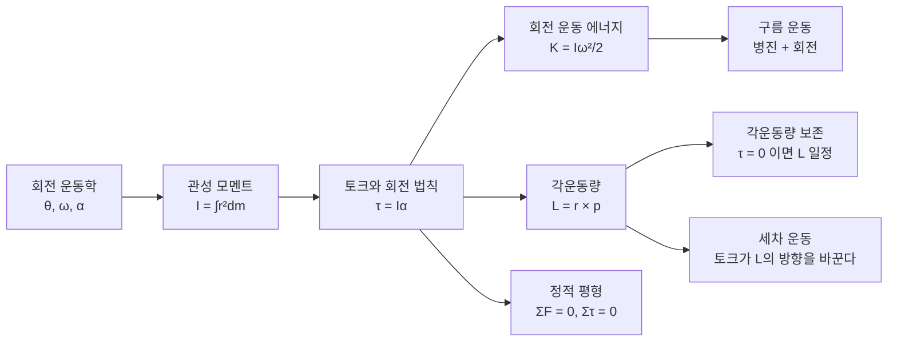

# 일반물리학 4. 회전 운동과 각운동량 — 도는 물체의 뉴턴 법칙, 팽이에서 중성자별까지
<!-- prev: phy-1, uphy-3 -->
<!-- next: uphy-5, uphy-12 -->

> [!NOTE]
> **이 단원의 범위**
> - 각변위·각속도·각가속도와 회전 운동학, 선운동량과의 대응
> - 관성 모멘트(적분으로 구하기, 평행축 정리)
> - 토크(벡터곱)와 회전의 운동 법칙 $\tau = I\alpha$, 회전 운동 에너지와 일·일률
> - 구름 운동, 각운동량과 그 보존
> - 강체의 정적 평형, 자이로스코프의 세차 운동(정성)

**학습 목표**

1. 각변위·각속도·각가속도를 벡터로 정의하고, 미분·적분 관계와 등각가속도 운동의 식을 이용해 회전 운동을 기술할 수 있다.
2. 관성 모멘트를 질량 분포의 적분으로 구하고, 평행축 정리를 증명하여 다른 회전축에 대한 관성 모멘트를 구할 수 있다.
3. 토크를 벡터곱 $\vec\tau = \vec r\times\vec F$로 나타내고, 회전의 운동 법칙 $\tau_{\text{알짜}} = I\alpha$를 입자계의 뉴턴 법칙에서 유도하여 도르래·원판 문제에 적용할 수 있다.
4. 회전 운동 에너지와 토크가 한 일을 이용하고, 미끄러지지 않고 구르는 물체의 운동을 병진과 회전의 합으로 분석할 수 있다.
5. 각운동량 $\vec L = \vec r\times\vec p$와 $\vec\tau = d\vec L/dt$를 이해하고, 각운동량 보존으로 회전 충돌과 천체 현상을 설명할 수 있다.
6. 강체의 정적 평형 조건으로 구조물의 힘을 구하고, 자이로스코프의 세차 운동을 토크와 각운동량의 방향으로 정성적으로 설명할 수 있다.

**이 단원의 학습 사다리**

| 단계 | 무엇을 하나? |
|---|---|
| STEP 1. 이전 학습 다시 보기 | 고등학교 「힘과 에너지」의 돌림힘과 평형, 「시공간과 운동」의 원운동, 「일·에너지와 운동량」의 질량 중심과 운동량 보존을 꺼내 본다 |
| STEP 2. 기초 다지기 | 라디안, 벡터곱과 오른손 규칙, 질량 분포를 적분하는 법($dm = \lambda\,dx$) |
| STEP 3. 핵심 개념 | 회전 운동학 → 관성 모멘트 → 토크와 $\tau = I\alpha$ → 회전 에너지 → 구름 → 각운동량 → 정적 평형 → 세차 운동 |
| STEP 4. 오개념 바로잡기 | "관성 모멘트는 물체마다 하나", "구르는 바퀴의 접촉점은 가장 빠르다" 같은 착각 |
| STEP 5. 한 걸음 더 | 관성 텐서와 오일러 방정식, 양자역학의 각운동량 맛보기 |
| STEP 6. 생활·산업·진로 | 플라이휠 에너지 저장, 위성 자세 제어, 풍력 터빈, 관성 측정 장치 |

---

## 🗺️ 단원 들어가기

피겨 스케이팅 선수가 회전하다가 팔을 몸에 붙이면 갑자기 눈이 따라가지 못할 만큼 빨리 돈다. 아무도 선수를 더 밀어 주지 않았는데 무엇이 회전을 빠르게 했을까? 같은 높이의 빗면에서 같은 질량의 공과 고리를 동시에 굴리면 공이 먼저 도착한다. 질량이 같은데 왜 다를까? 돌고 있는 팽이는 기울어져도 쓰러지지 않고, 그 축이 천천히 원을 그리며 돈다. 지구의 자전축도 약 2만 6천 년에 한 바퀴씩 같은 방식으로 돈다.

이 장면들은 모두 **회전에 대한 뉴턴 법칙**으로 설명된다. 선운동에서 질량·힘·운동량이 하던 역할을 회전에서는 **관성 모멘트·토크·각운동량**이 맡는다. 이 대응을 따라가면, 선운동에서 배운 거의 모든 식이 회전에서 같은 모양으로 되살아난다. 다만 회전에서는 "물체의 질량이 축에서 얼마나 멀리 퍼져 있는가"가 중요해지고, 양들이 회전축 방향을 가리키는 벡터라는 점이 새롭다.

---

## STEP 1. 🔙 이전 학습 다시 보기

### 연계 개념표

| 이전 단원 | 그때 배운 것(고등학교·앞 단원에서는 여기까지) | 이 단원에서 확장되는 것 |
|---|---|---|
| 고등학교 물리학 「힘과 에너지」 '평형의 두 조건' | 돌림힘 $\tau = rF$(힘이 팔에 수직일 때), 알짜힘 0·알짜 돌림힘 0이면 평형. 회전축 하나를 잡는 문제 | 토크를 **벡터곱**으로 정의하고, 평형이 아닐 때 회전이 어떻게 가속되는지($\tau = I\alpha$)를 다룬다. 평형 문제에서는 축을 자유롭게 고른다 |
| 고등학교 「역학과 에너지」 '시공간과 운동' | 등속 원운동의 각속도 $\omega$, $v = r\omega$, 구심 가속도 $r\omega^2$, 케플러 제2법칙 | 각속도가 변하는 회전(각가속도), 접선 가속도 $r\alpha$. 케플러 제2법칙을 **각운동량 보존**으로 증명한다 |
| 일반물리학 「일·에너지와 운동량」 | 일–운동 에너지 정리, 질량 중심, 선운동량 $\vec p$와 그 보존, $\vec F = d\vec p/dt$ | 같은 구조를 회전에 옮긴다: $W = \int\tau\,d\theta$, $\vec\tau = d\vec L/dt$, 각운동량 보존 |
| 일반물리학 「운동의 기술」 | 벡터의 성분, 스칼라곱·벡터곱 | 벡터곱으로 토크와 각운동량을 계산한다 |

### 준비 운동 (사전 진단)

**Q1.** 길이 0.40 m인 렌치 끝에 렌치와 수직으로 25 N의 힘을 주었다. 볼트에 작용하는 돌림힘의 크기는?

**Q2.** 반지름 0.30 m인 바퀴가 2.0 rev/s로 돈다. 바퀴 둘레 한 점의 속력은?

**Q3.** 벡터 $\vec A = 2\hat i$, $\vec B = 3\hat j$일 때 $\vec A\times\vec B$는?

**Q4.** 마찰 없는 얼음 위에 서 있는 두 사람이 서로 민다. 두 사람의 운동량의 합은 밀기 전후에 어떻게 되는가? 그 이유는?

정답 및 해설

**Q1.** $\tau = rF = 0.40\times25 = 10\ \mathrm{N\cdot m}$

**Q2.** $\omega = 2\pi\times2.0 = 12.6\ \mathrm{rad/s}$, $v = r\omega = 0.30\times12.6 \approx 3.8\ \mathrm{m/s}$

**Q3.** $6\hat k$ — $\hat i\times\hat j = \hat k$이므로 $(2)(3)\hat k$. 크기는 6, 방향은 두 벡터가 이루는 평면에 수직(오른손 규칙)이다.

**Q4.** 0으로 그대로이다. 두 사람이 주고받는 힘은 작용·반작용(내력)이고, 계에 작용하는 외력의 합이 0이므로 선운동량이 보존된다. 이 단원에서는 "외부 토크가 0이면 각운동량이 보존된다"는 같은 구조의 법칙을 배운다.

---

## STEP 2. 🧱 기초 다지기

### 디딤돌 1. 라디안 — 회전각을 길이로 재는 단위

반지름 $r$인 원에서 중심각 $\theta$에 대한 호의 길이를 $s$라 하면 라디안(rad)으로 잰 각은

$$
\theta = \frac{s}{r}
$$

이다. 길이를 길이로 나눈 값이므로 라디안은 사실상 **차원이 없는 단위**이다. 한 바퀴는 $2\pi\ \mathrm{rad} = 360^\circ$이다. 회전 운동의 식 $s = r\theta$, $v = r\omega$, $a_t = r\alpha$는 **각을 라디안으로 잴 때만** 성립한다. 회전수(rev)나 rpm(분당 회전수)으로 주어진 값은 반드시 rad, rad/s로 바꾼 뒤 대입한다.

| 단위 | 라디안 단위로 바꾸기 |
|---|---|
| 1 rev(한 바퀴) | $2\pi\ \mathrm{rad}$ |
| $1^\circ$ | $\pi/180\ \mathrm{rad} \approx 0.01745\ \mathrm{rad}$ |
| 1 rpm | $2\pi/60\ \mathrm{rad/s} \approx 0.1047\ \mathrm{rad/s}$ |

### 디딤돌 2. 벡터곱과 오른손 규칙

두 벡터 $\vec A$, $\vec B$의 **벡터곱(vector product, 가위곱)** $\vec C = \vec A\times\vec B$는

- 크기: $C = AB\sin\phi$ ($\phi$는 두 벡터 사이의 각, $0 \le \phi \le \pi$). 두 벡터가 만드는 평행사변형의 넓이이다.
- 방향: 두 벡터에 모두 수직. 오른손 네 손가락을 $\vec A$ 방향으로 펴고 $\vec B$ 쪽으로 감아쥘 때 엄지가 가리키는 방향(**오른손 규칙**).
- 순서를 바꾸면 부호가 바뀐다: $\vec B\times\vec A = -\vec A\times\vec B$. 나란한 두 벡터의 벡터곱은 0이다.

단위 벡터 사이에는 $\hat i\times\hat j = \hat k$, $\hat j\times\hat k = \hat i$, $\hat k\times\hat i = \hat j$ (순환 순서)가 성립하고, 성분으로 쓰면

$$
\vec A\times\vec B = (A_yB_z - A_zB_y)\,\hat i + (A_zB_x - A_xB_z)\,\hat j + (A_xB_y - A_yB_x)\,\hat k
$$

#### 연습 — 벡터곱 계산

$\vec r = (2\hat i + \hat j)\ \mathrm{m}$, $\vec F = (3\hat j + 4\hat k)\ \mathrm{N}$일 때 $\vec r\times\vec F$를 구하시오.

**풀이** $x$ 성분 $= (1)(4) - (0)(3) = 4$, $y$ 성분 $= (0)(0) - (2)(4) = -8$, $z$ 성분 $= (2)(3) - (1)(0) = 6$. 따라서 $\vec r\times\vec F = (4\hat i - 8\hat j + 6\hat k)\ \mathrm{N\cdot m}$. 검산: 결과가 $\vec r$과 수직인지 스칼라곱으로 확인하면 $(2)(4) + (1)(-8) + 0 = 0$이다.

> [!TIP]
> 💡 **요령** — 벡터곱 결과는 항상 원래 두 벡터와 수직이므로, 계산이 끝나면 $\vec C\cdot\vec A = 0$, $\vec C\cdot\vec B = 0$으로 검산하는 습관을 들이자.

### 디딤돌 3. 질량 분포를 적분하기

연속된 물체의 성질(질량 중심, 관성 모멘트)을 구할 때는 물체를 아주 작은 조각 $dm$으로 나누어 더한다(적분). 조각의 질량은 밀도로 나타낸다.

| 물체 | 밀도 | 조각의 질량 |
|---|---|---|
| 가는 막대(길이 방향 $x$) | 선밀도 $\lambda$ (kg/m) | $dm = \lambda\,dx$ |
| 얇은 판(넓이 $A$) | 면밀도 $\sigma$ (kg/m²) | $dm = \sigma\,dA$ (고리 모양 조각이면 $dA = 2\pi r\,dr$) |
| 입체(부피 $V$) | 밀도 $\rho$ (kg/m³) | $dm = \rho\,dV$ |

균일한 물체이면 밀도는 상수이고 $\lambda = M/L$, $\sigma = M/A$, $\rho = M/V$이다. 적분의 핵심은 "**같은 거리에 있는 조각들을 한 묶음으로**" 고르는 것이다. 예를 들어 원판의 회전축에서 거리 $r$인 조각들은 폭 $dr$인 얇은 고리를 이룬다.

### 디딤돌 4. 선운동과 회전의 대응표

이 단원 전체를 꿰는 표이다. 왼쪽 열은 앞 단원들에서 이미 배웠다.

| 선운동(병진) | 회전(고정축) | 관계 |
|---|---|---|
| 위치 $x$ | 각위치 $\theta$ | $s = r\theta$ |
| 속도 $v = dx/dt$ | 각속도 $\omega = d\theta/dt$ | $v = r\omega$ |
| 가속도 $a = dv/dt$ | 각가속도 $\alpha = d\omega/dt$ | $a_t = r\alpha$ |
| 질량 $m$ | 관성 모멘트 $I$ | $I = \sum m_ir_i^2$ |
| 힘 $F$ | 토크 $\tau$ | $\vec\tau = \vec r\times\vec F$ |
| $F = ma$ | $\tau = I\alpha$ | |
| 운동 에너지 $\frac12mv^2$ | 회전 운동 에너지 $\frac12I\omega^2$ | |
| 일 $W = \int F\,dx$ | 일 $W = \int\tau\,d\theta$ | |
| 일률 $P = Fv$ | 일률 $P = \tau\omega$ | |
| 운동량 $\vec p = m\vec v$ | 각운동량 $\vec L = I\vec\omega$ (대칭축) | $\vec L = \vec r\times\vec p$ |
| $\vec F = d\vec p/dt$ | $\vec\tau = d\vec L/dt$ | |

---

## STEP 3. 📘 핵심 개념

### ① 각변위·각속도·각가속도

#### (1) 강체와 회전의 기술

모든 부분 사이의 거리가 변하지 않는 이상화된 물체를 **강체(rigid body)** 라 한다. 고정된 축을 중심으로 도는 강체에서는 모든 점이 같은 시간 동안 **같은 각**만큼 돈다. 그래서 강체 위 기준선 하나의 각위치 $\theta(t)$만 알면 전체의 회전을 기술할 수 있다.

| 양 | 정의 | 단위 |
|---|---|---|
| **각변위(angular displacement)** | $\Delta\theta = \theta_2 - \theta_1$ | rad |
| **각속도(angular velocity)** | $\omega = \dfrac{d\theta}{dt}$ | rad/s |
| **각가속도(angular acceleration)** | $\alpha = \dfrac{d\omega}{dt} = \dfrac{d^2\theta}{dt^2}$ | rad/s² |

선운동에서와 마찬가지로 미분하면 각속도·각가속도가, 적분하면 각변위가 나온다.

$$
\omega(t) = \omega_0 + \int_0^t\alpha\,dt', \qquad \theta(t) = \theta_0 + \int_0^t\omega\,dt'
$$

#### (2) 각속도는 축 방향을 가리키는 벡터이다

회전하는 물체의 각 점은 원을 그리며 움직이므로 회전 '방향'을 원 위의 화살표로 나타내기는 어렵다. 그래서 각속도 벡터 $\vec\omega$는 **회전축 방향**으로, 오른손 네 손가락을 회전 방향으로 감을 때 엄지가 가리키는 쪽으로 정한다. 시계 반대 방향으로 도는 레코드판의 $\vec\omega$는 위를, 시계 방향으로 도는 판의 $\vec\omega$는 아래를 향한다. 축이 고정된 회전에서는 $\vec\omega$를 축 위의 부호로 나타내면 충분하다(시계 반대 방향 +).

> [!NOTE]
> 작은 각변위·각속도·각가속도는 벡터처럼 더할 수 있지만, **유한한 각변위는 벡터가 아니다.** 책을 $x$축으로 $90^\circ$ 돌린 뒤 $y$축으로 $90^\circ$ 돌린 결과와, 순서를 바꾼 결과는 다르다(직접 해 보자). 더하는 순서에 따라 결과가 다르므로 벡터의 덧셈 규칙을 따르지 않는다.

#### (3) 등각가속도 운동

$\alpha$가 일정하면 위 적분을 그대로 계산할 수 있고, 등가속도 운동과 똑같은 모양의 식이 나온다.

| 등가속도 직선 운동 | 등각가속도 회전 |
|---|---|
| $v = v_0 + at$ | $\omega = \omega_0 + \alpha t$ |
| $x - x_0 = v_0t + \frac12at^2$ | $\theta - \theta_0 = \omega_0t + \frac12\alpha t^2$ |
| $v^2 = v_0^2 + 2a(x - x_0)$ | $\omega^2 = \omega_0^2 + 2\alpha(\theta - \theta_0)$ |
| $x - x_0 = \frac12(v_0 + v)t$ | $\theta - \theta_0 = \frac12(\omega_0 + \omega)t$ |

#### (4) 선운동과 회전의 연결: 접선 가속도와 지름 가속도

회전축에서 거리 $r$인 점은 $s = r\theta$만큼 원호를 따라 움직인다. 시간으로 미분하면

$$
v = r\omega, \qquad a_t = \frac{dv}{dt} = r\alpha, \qquad a_r = \frac{v^2}{r} = r\omega^2
$$

**접선 가속도** $a_t$는 속력을 바꾸고, **지름 가속도(구심 가속도)** $a_r$는 방향을 바꾼다. 각속도가 변하는 회전에서는 두 성분이 모두 있고, 전체 가속도의 크기는 $\sqrt{a_t^2 + a_r^2}$이다. 고등학교에서 배운 등속 원운동은 $a_t = 0$인 특수한 경우이다.

<!-- fig:uphy-4-tangential-radial -->

#### 예제 1 — 세탁기 탈수 통

반지름 0.25 m인 세탁기 탈수 통이 정지 상태에서 일정하게 가속하여 8.0 s 만에 1200 rpm에 도달했다. (1) 각가속도 (2) 그동안의 회전수 (3) 최고 속도에서 통 벽의 속력과 구심 가속도를 구하시오. ($g = 9.80\ \mathrm{m/s^2}$)

**풀이**
- 식 세우기: $\omega = \omega_0 + \alpha t$, $\theta = \frac12\alpha t^2$, $v = r\omega$, $a_r = r\omega^2$.
- 단위 바꾸기: $\omega = 1200\times\dfrac{2\pi}{60} = 125.7\ \mathrm{rad/s}$
- (1) $\alpha = \dfrac{125.7}{8.0} = 15.7\ \mathrm{rad/s^2}$
- (2) $\theta = \frac12(15.7)(8.0)^2 = 503\ \mathrm{rad}$, 회전수 $= 503/2\pi = 80$바퀴
- (3) $v = 0.25\times125.7 = 31\ \mathrm{m/s}$, $a_r = 0.25\times125.7^2 = 3.9\times10^{3}\ \mathrm{m/s^2} \approx 400g$

**의미** 빨래 속 물방울에는 중력의 400배 정도의 구심력이 필요하다. 옷감과 물의 결합력이 이만큼을 제공하지 못하므로 물은 통의 구멍으로 빠져나간다. 탈수는 '원심력이 물을 밀어내는 것'이 아니라 '물을 붙잡아 둘 구심력이 모자라는 것'이다.

#### 예제 2 — 각가속도가 변하는 경우(적분)

전동 드릴의 날이 켜진 뒤 처음 2.0 s 동안 각속도가 $\omega(t) = (3.0\ \mathrm{rad/s^3})\,t^2$으로 변한다. $t = 2.0\ \mathrm{s}$일 때의 각가속도와, 처음 2.0 s 동안의 각변위를 구하시오.

**풀이** $\alpha = d\omega/dt = 6.0t$이므로 $\alpha(2.0) = 12\ \mathrm{rad/s^2}$. 각변위는 $\Delta\theta = \int_0^{2.0}3.0t^2\,dt = \left[1.0t^3\right]_0^{2.0} = 8.0\ \mathrm{rad}$(약 1.3바퀴). 각가속도가 일정하지 않으므로 등각가속도 식을 쓰면 틀린다.

#### ✔ 바로 확인

1. (O/X) 고정축을 중심으로 도는 강체에서는 축에서 먼 점일수록 각속도가 크다.
2. 900 rpm을 rad/s로 나타내면?
3. 빈칸: 각속도가 변하는 회전에서 속력을 바꾸는 가속도 성분은 (    ) 가속도이고, 그 크기는 (    )이다.
4. 등속 원운동에서 접선 가속도의 크기는?

정답

1. X — 모든 점의 각속도는 같고, 축에서 먼 점일수록 **속력** $v = r\omega$가 크다.
2. 약 $94\ \mathrm{rad/s}$ — $900\times2\pi/60 = 94.2$.
3. 접선, $r\alpha$ — 방향을 바꾸는 성분은 지름 가속도 $r\omega^2$이다.
4. 0 — $\alpha = 0$이므로 $a_t = r\alpha = 0$이고, 지름 가속도만 남는다.

---

### ② 관성 모멘트와 평행축 정리

#### (1) 회전 운동 에너지에서 관성 모멘트가 나온다

고정축을 중심으로 각속도 $\omega$로 도는 강체를 질량 $m_i$인 작은 입자들의 모임으로 보자. 축에서 $r_i$ 떨어진 입자의 속력은 $v_i = r_i\omega$이므로, 전체 운동 에너지는

$$
K = \sum_i\frac12m_iv_i^2 = \frac12\left(\sum_im_ir_i^2\right)\omega^2 = \frac12I\omega^2
$$

괄호 안의 양

$$
I = \sum_im_ir_i^2 \quad\longrightarrow\quad I = \int r^2\,dm
$$

을 그 축에 대한 **관성 모멘트(moment of inertia, 회전 관성)** 라 한다(단위 $\mathrm{kg\cdot m^2}$). 관성 모멘트는 회전 상태를 바꾸기 어려운 정도로, 선운동의 질량에 해당한다. 여기서 $r_i$는 원점까지가 아니라 **회전축까지의 수직 거리**이다.

- 질량이 같아도 **축에서 멀리 퍼져 있을수록** $I$가 크다($r^2$에 비례하므로 거리가 2배면 기여는 4배).
- 같은 물체라도 **회전축이 바뀌면 $I$가 바뀐다.** 관성 모멘트는 '물체 + 축'의 성질이다.

#### 예제 3 — 아령의 관성 모멘트

질량이 무시되는 길이 0.60 m의 막대 양 끝에 2.0 kg인 작은 공이 하나씩 붙어 있다. (1) 막대 중심을 지나는 수직축 (2) 한쪽 공을 지나는 수직축에 대한 관성 모멘트를 구하시오.

**풀이** (1) $I = 2.0(0.30)^2 + 2.0(0.30)^2 = 0.36\ \mathrm{kg\cdot m^2}$ (2) $I = 2.0(0)^2 + 2.0(0.60)^2 = 0.72\ \mathrm{kg\cdot m^2}$. 같은 물체인데 축만 옮겨도 관성 모멘트가 2배가 되었다.

#### (2) 적분으로 구하기

**가는 막대, 끝을 지나는 축** — 길이 $L$, 질량 $M$인 균일한 막대에서 끝으로부터 $x$인 곳의 조각 $dm = (M/L)\,dx$는 축에서 $x$만큼 떨어져 있다.

$$
I_{\text{끝}} = \int_0^Lx^2\frac{M}{L}\,dx = \frac{M}{L}\cdot\frac{L^3}{3} = \frac13ML^2
$$

같은 방법으로 중심을 지나는 축이면 적분 구간이 $-L/2$에서 $L/2$이고 $I_{\text{중심}} = \frac{1}{12}ML^2$이다.

**균일한 원판, 중심축** — 반지름 $R$, 질량 $M$인 원판에서 반지름 $r$, 폭 $dr$인 고리의 질량은 $dm = \sigma\cdot2\pi r\,dr$ ($\sigma = M/\pi R^2$)이고, 고리의 모든 부분이 축에서 $r$만큼 떨어져 있다.

$$
I = \int_0^Rr^2\,\sigma\,2\pi r\,dr = 2\pi\sigma\frac{R^4}{4} = \frac12MR^2
$$

원판은 질량의 많은 부분이 축 가까이에 있으므로, 모든 질량이 가장자리에 있는 고리($MR^2$)의 절반이 된다.

| 물체(질량 $M$) | 회전축 | 관성 모멘트 |
|---|---|---|
| 얇은 고리·속 빈 얇은 원통(반지름 $R$) | 중심축 | $MR^2$ |
| 속이 찬 원판·원기둥(반지름 $R$) | 중심축 | $\frac12MR^2$ |
| 두꺼운 원통(안 반지름 $R_1$, 바깥 $R_2$) | 중심축 | $\frac12M(R_1^2 + R_2^2)$ |
| 속이 찬 구(반지름 $R$) | 지름 | $\frac25MR^2$ |
| 얇은 구 껍질(반지름 $R$) | 지름 | $\frac23MR^2$ |
| 가는 막대(길이 $L$) | 중심, 막대에 수직 | $\frac{1}{12}ML^2$ |
| 가는 막대(길이 $L$) | 한쪽 끝, 막대에 수직 | $\frac13ML^2$ |
| 직사각형 판(변 $a$, $b$) | 중심, 판에 수직 | $\frac{1}{12}M(a^2 + b^2)$ |

관성 모멘트를 흔히 $I = \beta MR^2$로 쓰고 $\beta$를 비교하면 편하다(고리 1, 원판 1/2, 구 2/5). 또 $I = Mk^2$을 만족하는 거리 $k$를 **회전 반지름(radius of gyration)** 이라 한다. 모든 질량을 축에서 $k$인 곳에 모아 놓아도 관성 모멘트가 같다는 뜻이다.

#### (3) 평행축 정리

질량 중심을 지나는 축에 대한 관성 모멘트 $I_{\text{cm}}$을 알면, 그 축과 나란하고 거리 $d$만큼 떨어진 축에 대한 관성 모멘트는

$$
I = I_{\text{cm}} + Md^2
$$

이다. 이를 **평행축 정리(parallel-axis theorem)** 라 한다.

**증명** 질량 중심을 원점으로, 두 축을 $z$축 방향으로 잡자. 새 축은 $(a, b)$를 지나고 $d^2 = a^2 + b^2$이다. 조각 $dm$의 위치가 $(x, y)$이면 새 축까지 거리의 제곱은 $(x - a)^2 + (y - b)^2$이므로

$$
I = \int\left[(x - a)^2 + (y - b)^2\right]dm = \int(x^2 + y^2)\,dm - 2a\int x\,dm - 2b\int y\,dm + (a^2 + b^2)\int dm
$$

첫째 항은 $I_{\text{cm}}$, 마지막 항은 $Md^2$이다. 원점이 질량 중심이므로 $\int x\,dm = \int y\,dm = 0$ (「일·에너지와 운동량」의 질량 중심 정의)이 되어 가운데 두 항이 사라진다. ∎

- $Md^2 \ge 0$이므로, 나란한 축들 가운데 **질량 중심을 지나는 축의 관성 모멘트가 가장 작다.**
- 확인: 막대 끝의 축은 중심에서 $L/2$이므로 $\frac{1}{12}ML^2 + M(L/2)^2 = \frac13ML^2$. 적분 결과와 같다.

<!-- fig:uphy-4-parallel-axis -->

#### 예제 4 — 문짝의 관성 모멘트

질량 24 kg, 폭 0.90 m인 균일한 문이 한쪽 모서리의 경첩을 축으로 돈다. 문을 '경첩 축에 수직으로 본 막대'로 생각하여 관성 모멘트를 구하고, 같은 문을 가운데 축(회전문처럼)에 대해 돌릴 때와 비교하시오.

**풀이** 경첩 축에서 문의 질량 분포는 문의 높이와 관계없이 폭 방향으로만 퍼져 있으므로 막대의 식을 쓸 수 있다. $I_{\text{경첩}} = \frac13(24)(0.90)^2 = 6.5\ \mathrm{kg\cdot m^2}$, $I_{\text{중심}} = \frac{1}{12}(24)(0.90)^2 = 1.6\ \mathrm{kg\cdot m^2}$. 평행축 정리로도 $1.62 + 24(0.45)^2 = 6.48$로 확인된다. 경첩 축으로 돌리는 문이 4배 '무겁게' 느껴진다.

> [!TIP]
> 💡 **비유** — 야구 방망이를 손잡이 쪽을 잡고 휘두를 때보다 굵은 끝을 잡고 거꾸로 휘두를 때 훨씬 가볍다. 질량은 같지만, 무거운 부분이 회전축(손) 가까이로 오면서 관성 모멘트가 작아지기 때문이다.

#### ✔ 바로 확인

1. (O/X) 질량이 같은 물체는 회전축이 달라도 관성 모멘트가 같다.
2. 질량 $M$, 반지름 $R$이 같은 얇은 고리와 속이 찬 원판의 중심축 관성 모멘트의 비(고리 : 원판)는?
3. 질량 2.0 kg인 물체의 질량 중심 축에 대한 관성 모멘트가 $0.10\ \mathrm{kg\cdot m^2}$이다. 이와 나란하고 0.30 m 떨어진 축에 대한 관성 모멘트는?

정답

1. X — $I = \int r^2dm$의 $r$은 회전축까지의 거리이므로 축이 바뀌면 $I$가 바뀐다.
2. 2 : 1 — 고리 $MR^2$, 원판 $\frac12MR^2$.
3. $0.28\ \mathrm{kg\cdot m^2}$ — 평행축 정리 $0.10 + 2.0\times0.30^2$.

---

### ③ 토크와 회전의 운동 법칙

#### (1) 토크는 벡터곱이다

고등학교에서는 돌림힘을 $\tau = rF$(힘이 팔에 수직일 때)로 배웠다. 힘이 비스듬하면 회전에 기여하는 것은 지름에 수직인 성분 $F\sin\phi$뿐이다. 이를 벡터로 깔끔하게 나타낸 것이 **토크(torque, 돌림힘)** 이다.

$$
\vec\tau = \vec r\times\vec F, \qquad \tau = rF\sin\phi = rF_\perp = r_\perp F
$$

- $\vec r$: 기준점(회전축 위의 점)에서 힘의 작용점까지의 위치 벡터, $\phi$: $\vec r$과 $\vec F$ 사이의 각.
- $F_\perp = F\sin\phi$: 힘의 접선 성분. $r_\perp = r\sin\phi$: 기준점에서 **힘의 작용선**까지의 수직 거리(**지레팔, moment arm**).
- 방향은 오른손 규칙으로 정해지며, 토크가 일으키려는 회전의 각가속도 방향과 같다.
- 단위 $\mathrm{N\cdot m}$은 일의 단위와 같지만 토크를 줄(J)로 쓰지 않는다. 토크는 벡터이고 일은 스칼라이다.

<!-- fig:uphy-4-torque-moment-arm -->

#### (2) $\tau = I\alpha$의 유도

고정축을 중심으로 도는 강체의 입자 $i$에 작용하는 힘의 접선 성분을 $F_{t,i}$라 하자. 뉴턴 제2법칙에서 $F_{t,i} = m_ia_{t,i} = m_ir_i\alpha$이다(모든 입자의 $\alpha$는 같다). 양변에 $r_i$를 곱해 모든 입자에 대해 더하면

$$
\sum_ir_iF_{t,i} = \left(\sum_im_ir_i^2\right)\alpha \quad\Longrightarrow\quad \tau_{\text{알짜}} = I\alpha
$$

이것이 **회전의 운동 법칙**(회전에 대한 뉴턴 제2법칙)이다. 왼쪽 합에는 내력에 의한 토크도 들어 있지만, 두 입자가 주고받는 작용·반작용은 크기가 같고 방향이 반대이며 **같은 작용선** 위에 있으므로 토크가 서로 상쇄된다. 따라서 $\tau_{\text{알짜}}$는 **외력에 의한 토크의 합**이다.

| 힘 | 토크를 구할 때 주의할 점 |
|---|---|
| 중력 | 물체 전체의 중력은 **질량 중심**(균일한 중력장에서는 무게중심)에 작용하는 것으로 계산한다 |
| 축의 받침힘 | 회전축에 작용하므로 축에 대한 토크가 0이다 |
| 줄의 장력 | 도르래·원판 둘레에 감긴 줄은 지레팔이 반지름 $R$과 같다 |
| 축 방향의 힘 | 축과 나란한 힘은 그 축에 대한 회전을 일으키지 않는다 |

#### (3) 문제 푸는 순서 — 병진과 회전을 함께

도르래·바퀴가 들어간 문제는 대개 **물체마다** 식을 세운다. 매달린 물체에는 $F = ma$, 회전하는 물체에는 $\tau = I\alpha$, 그리고 줄이 미끄러지지 않는다는 **구속 조건** $a = R\alpha$로 둘을 잇는다.

<!-- fig:uphy-4-reel-bucket -->

#### 예제 5 — 우물의 두레박

질량 4.0 kg, 반지름 0.20 m인 속이 찬 원기둥 감개(마찰 없는 축)에 가벼운 줄이 감겨 있고, 줄 끝에 2.0 kg인 두레박이 매달려 있다. 두레박을 놓으면 두레박의 가속도, 줄의 장력, 감개의 각가속도는 얼마인가? ($g = 9.80\ \mathrm{m/s^2}$)

**풀이**
- 두레박(아래 +): $mg - T = ma$
- 감개: $TR = I\alpha = \left(\frac12MR^2\right)\dfrac{a}{R}$ → $T = \frac12Ma$
- 두 식을 더하면 $mg = \left(m + \frac12M\right)a$ → $a = \dfrac{2.0\times9.80}{2.0 + 2.0} = 4.9\ \mathrm{m/s^2}$
- $T = \frac12(4.0)(4.9) = 9.8\ \mathrm{N}$, $\alpha = a/R = 24.5\ \mathrm{rad/s^2} \approx 25\ \mathrm{rad/s^2}$

**의미** 장력(9.8 N)은 두레박 무게(19.6 N)보다 작다. 감개의 관성 모멘트가 두레박 운동에 '추가 질량' $\frac12M$처럼 작용하여 가속도가 $g$보다 작아진다. 감개의 질량이 0이면 $a = g$(자유 낙하)로 돌아간다.

> [!IMPORTANT]
> 질량이 있는 도르래 양쪽의 줄 장력은 **같지 않다.** 고등학교에서 "도르래 양쪽 장력이 같다"고 한 것은 도르래의 관성 모멘트를 무시했기 때문이다. 양쪽 장력의 차이 $(T_1 - T_2)R$이 바로 도르래를 각가속시키는 토크이다.

#### ✔ 바로 확인

1. 길이 0.50 m인 막대 끝에 막대와 $30^\circ$를 이루는 20 N의 힘을 주었다. 막대의 다른 끝(축)에 대한 토크의 크기는?
2. (O/X) 회전축에 작용하는 받침힘은 그 축에 대한 토크를 만들지 않는다.
3. 관성 모멘트 $0.40\ \mathrm{kg\cdot m^2}$인 바퀴에 알짜 토크 $2.0\ \mathrm{N\cdot m}$가 작용한다. 각가속도는?
4. 고르기: 질량이 있는 도르래가 각가속할 때 양쪽 줄의 장력은 (같다 / 다르다).

정답

1. $5.0\ \mathrm{N\cdot m}$ — $rF\sin\phi = 0.50\times20\times0.5$.
2. O — 작용점이 축 위에 있어 $r = 0$이다.
3. $5.0\ \mathrm{rad/s^2}$ — $\alpha = \tau/I$.
4. 다르다 — 장력의 차이 $(T_1 - T_2)R$이 도르래를 각가속시키는 토크이다.

---

### ④ 회전 운동 에너지, 일과 일률

#### (1) 토크가 한 일

강체가 작은 각 $d\theta$만큼 돌 때, 접선 방향의 힘 $F_t$가 작용점을 $ds = r\,d\theta$만큼 옮기므로 한 일은 $dW = F_tr\,d\theta = \tau\,d\theta$이다.

$$
W = \int_{\theta_1}^{\theta_2}\tau\,d\theta, \qquad P = \frac{dW}{dt} = \tau\omega
$$

$\tau = I\alpha = I\dfrac{d\omega}{dt} = I\omega\dfrac{d\omega}{d\theta}$ (연쇄 법칙)을 대입하면 회전의 **일–운동 에너지 정리**가 나온다.

$$
W = \int I\omega\,d\omega = \frac12I\omega_2^2 - \frac12I\omega_1^2
$$

#### (2) 역학적 에너지 보존에 회전을 넣기

마찰로 에너지가 사라지지 않으면 $K_{\text{병진}} + K_{\text{회전}} + U$가 보존된다. 예제 5의 두레박을 에너지로 다시 풀어 보자. 두레박이 정지 상태에서 $h$만큼 내려가면

$$
mgh = \frac12mv^2 + \frac12I\omega^2 = \frac12\left(m + \frac12M\right)v^2 \;\Rightarrow\; v = \sqrt{\frac{2mgh}{m + M/2}}
$$

$h = 3.0\ \mathrm{m}$이면 $v = \sqrt{2(2.0)(9.80)(3.0)/4.0} = 5.4\ \mathrm{m/s}$로, 등가속도 식 $v = \sqrt{2ah} = \sqrt{2(4.9)(3.0)}$과 일치한다. 에너지 방법은 장력을 몰라도 속력을 바로 준다.

#### 예제 6 — 플라이휠 에너지 저장

질량 100 kg, 반지름 0.50 m인 강철 원판(플라이휠)이 6000 rpm으로 돈다. (1) 저장된 회전 운동 에너지 (2) 이 에너지를 kWh로 나타내시오.

**풀이**
- $I = \frac12(100)(0.50)^2 = 12.5\ \mathrm{kg\cdot m^2}$, $\omega = 6000\times2\pi/60 = 628\ \mathrm{rad/s}$
- $K = \frac12(12.5)(628)^2 = 2.5\times10^{6}\ \mathrm{J}$
- $1\ \mathrm{kWh} = 3.6\times10^{6}\ \mathrm{J}$이므로 약 $0.69\ \mathrm{kWh}$

**의미** 에너지가 $\omega^2$에 비례하므로 저장량을 늘리려면 질량보다 **회전 속력**을 높이는 것이 유리하다. 그러나 가장자리의 구심 가속도와 재료의 응력도 $\omega^2$에 비례해 커지므로, 실제 플라이휠은 탄소 섬유처럼 강하고 가벼운 재료와 진공 용기를 쓴다.

#### 예제 7 — 엔진의 토크와 출력

어떤 엔진이 4000 rpm에서 300 N·m의 토크를 낸다. 이때 출력은?

**풀이** $P = \tau\omega = 300\times(4000\times2\pi/60) = 1.26\times10^{5}\ \mathrm{W} \approx 126\ \mathrm{kW}$. 자동차 사양표에서 '최대 토크'와 '최대 출력'이 서로 다른 rpm에 적혀 있는 이유는 $P = \tau\omega$에 $\omega$가 곱해지기 때문이다.

#### ✔ 바로 확인

1. 관성 모멘트 $2.0\ \mathrm{kg\cdot m^2}$인 바퀴가 3.0 rad/s로 돈다. 회전 운동 에너지는?
2. 120 rad/s로 도는 축이 $50\ \mathrm{N\cdot m}$의 토크를 전달한다. 일률은?
3. (O/X) 각속도를 2배로 하면 회전 운동 에너지도 2배가 된다.

정답

1. $9.0\ \mathrm{J}$ — $\frac12(2.0)(3.0)^2$.
2. $6.0\ \mathrm{kW}$ — $P = \tau\omega = 50\times120$.
3. X — $K \propto \omega^2$이므로 4배이다.

---

### ⑤ 구름 운동

#### (1) 미끄러지지 않고 구르는 조건

반지름 $R$인 바퀴가 미끄러지지 않고 구르면, 한 바퀴 도는 동안 질량 중심이 둘레 길이 $2\pi R$만큼 나아간다. 미분하면

$$
v_{\text{cm}} = R\omega, \qquad a_{\text{cm}} = R\alpha
$$

이것이 **구름 조건(rolling without slipping)** 이다. 바퀴 위 한 점의 속도는 '질량 중심의 병진 속도 $\vec v_{\text{cm}}$'와 '질량 중심에 대한 회전 속도'의 벡터합이다.

| 바퀴 위의 점 | 병진 속도 | 회전에 의한 속도 | 지면에서 본 속도 |
|---|---|---|---|
| 꼭대기 | $v_{\text{cm}}$ (앞) | $R\omega = v_{\text{cm}}$ (앞) | $2v_{\text{cm}}$ (앞) |
| 중심 | $v_{\text{cm}}$ | 0 | $v_{\text{cm}}$ |
| 지면과 닿는 점 | $v_{\text{cm}}$ (앞) | $v_{\text{cm}}$ (뒤) | **0** |

접촉점은 순간적으로 정지해 있다. 그래서 구르는 바퀴는 매 순간 **접촉점을 지나는 축을 중심으로 회전**한다고 볼 수도 있다. 달리는 자전거 바퀴 사진에서 위쪽 바큇살은 흐릿하고 아래쪽은 또렷한 이유이다.

<!-- fig:uphy-4-rolling-velocities -->

#### (2) 구르는 물체의 운동 에너지

접촉점 P를 축으로 보면 $K = \frac12I_P\omega^2$이고, 평행축 정리 $I_P = I_{\text{cm}} + MR^2$을 쓰면

$$
K = \frac12I_{\text{cm}}\omega^2 + \frac12Mv_{\text{cm}}^2
$$

즉 **구름 = 질량 중심의 병진 + 질량 중심에 대한 회전**이다. 이 분해는 구름이 아니어도 모든 강체 운동에 성립한다(쾨니히 정리).

#### (3) 빗면 위의 구름 — 누가 먼저 내려올까?

경사각 $\theta$인 빗면에서 $I_{\text{cm}} = \beta MR^2$인 물체가 미끄러지지 않고 구른다. 정지 마찰력 $f$는 빗면 위쪽을 향한다.

<!-- fig:uphy-4-rolling-incline -->

- 병진(빗면 아래 +): $Mg\sin\theta - f = Ma$
- 회전(질량 중심 기준): $fR = I_{\text{cm}}\alpha = \beta MR^2\dfrac{a}{R}$ → $f = \beta Ma$
- 연립하면

$$
a = \frac{g\sin\theta}{1 + \beta}, \qquad f = \frac{\beta}{1 + \beta}Mg\sin\theta
$$

에너지로 보면 높이 $h$를 내려온 뒤 $Mgh = \frac12(1 + \beta)Mv^2$이므로 $v = \sqrt{2gh/(1 + \beta)}$이다. **질량과 반지름은 모두 약분되고 모양($\beta$)만 남는다.**

| 물체 | $\beta$ | 가속도 ($\theta = 30^\circ$) | $h = 1.5\ \mathrm{m}$ 내려온 뒤 속력 | 회전 에너지의 비율 |
|---|---|---|---|---|
| 미끄러지는 상자(마찰 없음) | 0 | $4.90\ \mathrm{m/s^2}$ | $5.42\ \mathrm{m/s}$ | 0 |
| 속이 찬 구 | 2/5 | $3.50\ \mathrm{m/s^2}$ | $4.58\ \mathrm{m/s}$ | 2/7 |
| 속이 찬 원기둥 | 1/2 | $3.27\ \mathrm{m/s^2}$ | $4.43\ \mathrm{m/s}$ | 1/3 |
| 얇은 고리 | 1 | $2.45\ \mathrm{m/s^2}$ | $3.83\ \mathrm{m/s}$ | 1/2 |

관성 모멘트가 작은 물체일수록 위치 에너지 중 회전에 '나눠 줄' 몫이 적어 더 빨리 내려온다.

<!-- sim:u-rolling-race -->

#### 예제 8 — 구르기 위한 최소 마찰 계수

경사각 $30^\circ$인 빗면에서 속이 찬 원기둥이 미끄러지지 않고 구르려면 정지 마찰 계수가 얼마 이상이어야 하는가?

**풀이** 필요한 마찰력 $f = \frac{\beta}{1 + \beta}Mg\sin\theta$가 최대 정지 마찰력 $\mu_sMg\cos\theta$ 이하여야 한다.

$$
\mu_s \ge \frac{\beta}{1 + \beta}\tan\theta = \frac{1/2}{3/2}\tan30^\circ = 0.19
$$

**의미** 구르는 동안 접촉점이 미끄러지지 않으므로 정지 마찰력은 **일을 하지 않는다.** 마찰력은 위치 에너지를 병진과 회전으로 나누는 '배분자' 역할만 하고, 역학적 에너지는 보존된다. 빙판처럼 $\mu_s$가 이보다 작으면 원기둥은 구르면서 미끄러지고, 운동 마찰이 역학적 에너지를 열로 바꾼다.

> [!NOTE]
> 실제로 구르는 공이 평지에서 결국 멈추는 것은 **구름 저항** 때문이다. 공과 바닥이 조금씩 변형되어 접촉면의 수직 항력이 앞쪽으로 치우치면, 그 토크가 회전을 늦춘다. 자동차 타이어의 공기압이 낮으면 변형이 커져 연비가 나빠지는 이유이다.

#### ✔ 바로 확인

1. 반지름 0.30 m인 바퀴가 미끄러지지 않고 $v_{\text{cm}} = 6.0\ \mathrm{m/s}$로 구른다. 각속도와 바퀴 꼭대기의 속력은?
2. (O/X) 미끄러지지 않고 구르는 바퀴의 지면 접촉점은 순간적으로 정지해 있다.
3. 같은 빗면 꼭대기에서 얇은 고리와 속이 찬 구를 동시에 굴리면 어느 것이 먼저 도착하는가?
4. (O/X) 미끄러지지 않고 구르는 동안 정지 마찰력은 역학적 에너지를 열로 바꾼다.

정답

1. $20\ \mathrm{rad/s}$, $12\ \mathrm{m/s}$ — $\omega = v_{\text{cm}}/R$, 꼭대기는 $2v_{\text{cm}}$.
2. O — 병진 속도와 회전에 의한 속도가 접촉점에서 상쇄된다.
3. 속이 찬 구 — $a = g\sin\theta/(1 + \beta)$에서 $\beta$가 작은(2/5) 구가 더 빠르다.
4. X — 접촉점이 움직이지 않으므로 정지 마찰력은 일을 하지 않는다.

---

### ⑥ 각운동량과 그 보존

#### (1) 입자의 각운동량

기준점 O에 대해 위치 $\vec r$에서 운동량 $\vec p$로 움직이는 입자의 **각운동량(angular momentum)** 은

$$
\vec L = \vec r\times\vec p = m\,\vec r\times\vec v, \qquad L = rp\sin\phi = r_\perp p
$$

이다(단위 $\mathrm{kg\cdot m^2/s}$). 직선으로 움직이는 입자도 기준점을 비켜 지나가면 각운동량을 가진다. 크기는 '기준점에서 운동 경로까지의 수직 거리 $r_\perp$ × 운동량'이므로, 등속 직선 운동하는 입자의 각운동량은 **일정**하다.

시간으로 미분하면

$$
\frac{d\vec L}{dt} = \frac{d\vec r}{dt}\times\vec p + \vec r\times\frac{d\vec p}{dt} = \vec v\times m\vec v + \vec r\times\vec F = \vec\tau
$$

($\vec v\times\vec v = 0$). 선운동량에서 $\vec F = d\vec p/dt$였던 것처럼, **토크는 각운동량의 시간 변화율**이다.

#### (2) 입자계와 강체

입자계에서는 각 입자의 식을 더하면 내력의 토크가 짝지어 상쇄되어(③의 (2)와 같은 이유)

$$
\vec\tau_{\text{외부}} = \frac{d\vec L_{\text{전체}}}{dt}
$$

가 된다. 대칭축을 중심으로 도는 강체에서는 각 입자의 각운동량이 모두 축 방향이고 크기가 $m_ir_i^2\omega$이므로

$$
\vec L = I\vec\omega
$$

이다. 이때 $\vec\tau = d\vec L/dt = I\,d\vec\omega/dt = I\vec\alpha$가 되어 ③의 회전 법칙이 다시 나온다. ($I$가 변하는 경우에는 $\tau = I\alpha$가 아니라 $\tau = dL/dt$를 써야 한다.)

#### (3) 각운동량 보존 법칙

외부 토크의 합이 0이면

$$
\vec L = \text{일정} \qquad (I_i\omega_i = I_f\omega_f)
$$

이것이 **각운동량 보존 법칙(conservation of angular momentum)** 이다. 선운동량 보존처럼 계 내부에서 어떤 힘이 작용하든 성립한다. 한 축 방향의 외부 토크 성분만 0이어도 그 성분은 보존된다.

| 현상 | 무엇이 바뀌나 | 결과 |
|---|---|---|
| 피겨 선수가 팔을 모은다 | $I$ 감소 | $\omega$ 증가 |
| 다이빙 선수가 몸을 웅크린다(턱) | $I$ 감소 | 공중회전이 빨라진다 |
| 고양이가 떨어지면서 몸을 뒤집는다 | 몸의 앞뒤를 번갈아 비틀어 전체 $L = 0$ 유지 | 각운동량 0인 채로 방향 전환 |
| 헬리콥터 주 회전 날개가 돈다 | 동체가 반대로 돌려는 경향 | 꼬리 날개로 토크를 상쇄 |
| 별이 붕괴해 중성자별이 된다 | 반지름이 크게 감소 | 자전 주기가 ms~s로 짧아진다 |

<!-- sim:u-angular-momentum -->

#### 예제 9 — 피겨 스케이팅의 회전

선수가 팔을 벌린 자세($I = 3.5\ \mathrm{kg\cdot m^2}$)에서 1.5 rev/s로 돌다가 팔을 모아 $I = 1.0\ \mathrm{kg\cdot m^2}$이 되었다. (1) 나중 회전 속력 (2) 회전 운동 에너지는 몇 배가 되는가? 늘어난 에너지는 어디서 왔는가?

**풀이**
- (1) 얼음의 마찰 토크를 무시하면 $L$이 보존된다. $\omega_f = \omega_i\dfrac{I_i}{I_f} = 1.5\times3.5 = 5.25 \approx 5.3\ \mathrm{rev/s}$
- (2) $K = \dfrac{L^2}{2I}$이고 $L$이 일정하므로 $K_f/K_i = I_i/I_f = 3.5$배

**의미** 각운동량은 보존되지만 운동 에너지는 **보존되지 않는다.** 회전하는 몸에서 팔을 안쪽으로 당기려면 구심력에 맞서 일을 해야 하는데, 이 근육의 일이 회전 에너지로 바뀐다. 다시 팔을 벌리면 에너지가 줄어든다.

#### 예제 10 — 회전목마에 뛰어오르는 아이(회전 충돌)

반지름 2.0 m, 질량 200 kg인 원판 모양 회전목마가 정지해 있다(축 마찰 무시). 질량 40 kg인 아이가 가장자리 접선 방향으로 3.0 m/s로 달려와 뛰어올랐다. (1) 회전목마의 나중 각속도 (2) 운동 에너지의 변화를 구하시오.

**풀이**
- 기준점: 회전목마의 축. 아이가 올라탈 때 주고받는 힘은 내력이고, 축의 받침힘은 축에 대한 토크가 0이므로 축에 대한 각운동량이 보존된다.
- 처음: 아이만 $L = mvR = 40\times3.0\times2.0 = 240\ \mathrm{kg\cdot m^2/s}$
- 나중: $I = \frac12(200)(2.0)^2 + 40(2.0)^2 = 400 + 160 = 560\ \mathrm{kg\cdot m^2}$
- (1) $\omega = 240/560 = 0.43\ \mathrm{rad/s}$
- (2) $K_i = \frac12(40)(3.0)^2 = 180\ \mathrm{J}$, $K_f = \frac12(560)(0.4286)^2 = 51\ \mathrm{J}$. 약 129 J(71 %)가 줄었다.

**의미** 완전 비탄성 충돌의 회전 버전이다. 축이 받침힘(외력)을 작용하므로 회전목마+아이의 **선운동량은 보존되지 않지만**, 그 힘의 축에 대한 토크가 0이므로 **각운동량은 보존된다.** 어떤 보존 법칙을 쓸지는 "어떤 외력이, 어떤 점에 대해 토크를 내는가"로 판단한다.

#### (4) 각운동량 보존과 케플러 제2법칙

행성에 작용하는 태양의 중력은 항상 태양을 향하는 **중심력**이므로 태양에 대한 토크가 $\vec r\times\vec F = 0$이다. 따라서 행성의 각운동량이 보존된다. 행성의 위치 벡터가 짧은 시간 $dt$ 동안 쓸고 지나가는 넓이는 $dA = \frac12\lvert\vec r\times\vec v\,dt\rvert$이므로

$$
\frac{dA}{dt} = \frac{L}{2m} = \text{일정}
$$

고등학교에서 관측 법칙으로 배운 '면적 속도 일정의 법칙'은 각운동량 보존의 다른 표현이다. 이 결과는 다음 단원 「중력·진동·유체」에서 궤도 계산에 다시 쓴다.

#### ✔ 바로 확인

1. 질량 2.0 kg인 입자가 3.0 m/s로 직선 운동한다. 기준점에서 이 직선까지의 수직 거리가 4.0 m이면 기준점에 대한 각운동량의 크기는?
2. 빈칸: 토크는 (    )의 시간 변화율이다.
3. 외부 토크 없이 회전하는 물체의 관성 모멘트가 절반으로 줄면 각속도는 몇 배가 되는가?
4. (O/X) 외부 토크가 0이면 회전 운동 에너지도 반드시 보존된다.

정답

1. $24\ \mathrm{kg\cdot m^2/s}$ — $L = r_\perp mv = 4.0\times2.0\times3.0$.
2. 각운동량 — $\vec\tau = d\vec L/dt$.
3. 2배 — $I\omega$가 보존된다.
4. X — $K = L^2/2I$이므로 $I$가 바뀌면 $K$가 바뀐다(예제 9).

---

### ⑦ 강체의 정적 평형

#### (1) 평형의 두 조건, 축은 마음대로

강체가 정지해 있고 계속 정지해 있으려면($\vec v_{\text{cm}} = 0$, $\vec\omega = 0$이 유지되려면)

$$
\sum\vec F_{\text{외부}} = 0, \qquad \sum\vec\tau_{\text{외부}} = 0
$$

이어야 한다. 이를 **정적 평형(static equilibrium)** 이라 한다. 알짜힘이 0이면 알짜 토크는 **어느 기준점에 대해 계산해도 같다.** (기준점을 $\vec a$만큼 옮기면 토크가 $-\vec a\times\sum\vec F$만큼 달라지는데, $\sum\vec F = 0$이므로 차이가 없다.) 그래서 모르는 힘이 여러 개 모이는 점을 기준점으로 고르면 식이 간단해진다.

평면 문제에서는 독립인 식이 3개($\sum F_x = 0$, $\sum F_y = 0$, $\sum\tau_z = 0$)이므로 모르는 양을 3개까지 구할 수 있다. 모르는 힘이 더 많으면 강체 모형만으로는 답이 정해지지 않는데(**부정정**), 이때는 재료의 변형을 고려해야 한다(STEP 5).

#### (2) 무게중심

균일한 중력장에서 물체 각 부분의 중력이 만드는 토크의 합은, 전체 중력 $M\vec g$가 질량 중심에 작용할 때의 토크와 같다.

$$
\sum_i\vec r_i\times m_i\vec g = \left(\sum_im_i\vec r_i\right)\times\vec g = \vec r_{\text{cm}}\times M\vec g
$$

이 점을 **무게중심(center of gravity)** 이라 한다. 높은 건물처럼 $g$가 위치에 따라 달라질 만큼 큰 물체가 아니면 무게중심과 질량 중심은 같다. 물체를 받침면 위에 세워 두었을 때 무게중심을 지나는 연직선이 **받침면 밖으로 나가면** 중력의 토크가 물체를 넘어뜨린다.

<!-- fig:uphy-4-ladder-beam -->

#### 예제 11 — 벽에 기댄 사다리

길이 4.0 m, 질량 15 kg인 균일한 사다리가 마찰 없는 벽에 기대어 바닥과 $60^\circ$를 이룬다. 질량 60 kg인 사람이 사다리를 따라 3.0 m 올라갔을 때 사다리가 미끄러지지 않으려면 바닥과의 정지 마찰 계수는 얼마 이상이어야 하는가? ($g = 9.80\ \mathrm{m/s^2}$)

**풀이**
- 힘: 바닥의 수직 항력 $N_f$(위), 바닥의 마찰력 $f$(벽 쪽), 벽의 수직 항력 $N_w$(벽에서 멀어지는 쪽), 사다리 무게(중점), 사람 무게.
- 기준점: 사다리 아래 끝(바닥 접촉점). $N_f$와 $f$가 식에서 빠진다.
- 토크 평형: $N_w(4.0\sin60^\circ) = (15)(9.80)(2.0\cos60^\circ) + (60)(9.80)(3.0\cos60^\circ)$ → $N_w = \dfrac{147 + 882}{3.46} = 297\ \mathrm{N}$
- 힘 평형: $f = N_w = 297\ \mathrm{N}$, $N_f = (15 + 60)(9.80) = 735\ \mathrm{N}$
- $\mu_s \ge f/N_f = 0.40$

**의미** 사람이 높이 올라갈수록 $N_w$와 필요한 마찰력이 커진다. 사다리가 '처음엔 괜찮다가 높이 올라가서야' 미끄러지는 이유이다. 사다리 각을 더 세우면($\cos\theta$ 감소, $\sin\theta$ 증가) 필요한 마찰이 줄어든다. 안전 수칙에서 사다리 각을 약 $75^\circ$로 권하는 까닭이다.

#### 예제 12 — 벽에 매단 간판 받침대

길이 3.0 m, 질량 20 kg인 균일한 수평 들보의 한쪽 끝이 벽에 경첩으로 연결되어 있고, 다른 끝에 50 kg인 간판이 매달려 있다. 들보 끝과 벽을 잇는 케이블은 들보와 $30^\circ$를 이룬다. 케이블의 장력과 경첩이 들보에 작용하는 힘을 구하시오.

**풀이**
- 경첩을 기준점으로: $T\sin30^\circ(3.0) = (20)(9.80)(1.5) + (50)(9.80)(3.0)$ → $T = \dfrac{294 + 1470}{1.5} = 1.18\times10^{3}\ \mathrm{N}$
- 수평: $H_x = T\cos30^\circ = 1.02\times10^{3}\ \mathrm{N}$ (벽에서 바깥쪽으로 들보를 미는 힘)
- 연직: $H_y = (70)(9.80) - T\sin30^\circ = 686 - 588 = 98\ \mathrm{N}$ (위쪽)

**의미** 케이블 장력은 들보와 간판 무게의 합(약 690 N)의 약 1.7배이다. 케이블 각이 작을수록 수직 성분을 얻기 위해 장력이 커진다. 경첩의 수평 힘이 큰 것도 같은 이유로, 구조 설계에서 '얕은 각의 케이블'을 피하는 까닭이다.

#### ✔ 바로 확인

1. 강체가 정적 평형을 이루기 위한 두 조건을 쓰시오.
2. (O/X) 알짜힘이 0인 강체에서도 알짜 토크는 기준점을 어디로 잡느냐에 따라 달라진다.
3. 길이 2.0 m, 무게 100 N인 균일한 널빤지의 양 끝을 두 사람 A, B가 받치고 있다. A 쪽 끝에서 0.50 m인 곳에 200 N인 짐을 올리면 A가 받치는 힘은?

정답

1. $\sum\vec F_{\text{외부}} = 0$, $\sum\vec\tau_{\text{외부}} = 0$.
2. X — 알짜힘이 0이면 알짜 토크는 어느 기준점에 대해서나 같다.
3. 200 N — B 끝을 기준점으로: $F_A(2.0) = 100(1.0) + 200(1.5)$. (B는 100 N)

---

### ⑧ 자이로스코프의 세차 운동 (정성)

#### (1) 토크가 각운동량의 '방향'을 바꾼다

$\vec\tau = d\vec L/dt$는 토크가 각운동량의 **크기만이 아니라 방향**도 바꿀 수 있음을 뜻한다. 이는 선운동에서 힘이 속도에 수직이면 속력은 그대로이고 방향만 바뀌는(등속 원운동) 것과 같은 구조이다.

빠르게 도는 팽이의 축이 연직선에서 기울어져 있다고 하자. 회전축 방향의 큰 각운동량 $\vec L$이 있다. 받침점에 대한 중력의 토크 $\vec\tau = \vec r_{\text{cm}}\times M\vec g$는 수평 방향이고 $\vec L$에 수직이다. 짧은 시간 동안 $d\vec L = \vec\tau\,dt$는 $\vec L$에 수직으로 더해지므로, $\vec L$은 길이가 그대로인 채 **수평면에서 옆으로 돌아간다.** 팽이가 쓰러지는 대신 축이 원뿔을 그리며 도는 이 운동을 **세차 운동(precession)** 이라 한다.

| 상황 | 토크의 방향 | 각운동량의 변화 | 보이는 운동 |
|---|---|---|---|
| 돌지 않는 팽이를 기울여 놓음 | 수평 | $\vec L = 0$에서 수평 방향 $\vec L$이 생겨 쓰러지는 회전 | 쓰러진다 |
| 빠르게 도는 팽이를 기울여 놓음 | 수평, $\vec L$에 수직 | $\vec L$의 방향만 수평으로 돌아감 | 축이 원을 그리며 돈다(세차) |

<!-- fig:uphy-4-precession -->

#### (2) 세차 각속도의 크기

$\vec L$의 수평 성분 $L_h$가 $dt$ 동안 각 $d\phi$만큼 돌면 $\lvert d\vec L\rvert = L_h\,d\phi = \tau\,dt$이다. 축이 수평인 자이로스코프($L_h = L = I\omega$)에서는 받침점에서 질량 중심까지 거리를 $r$이라 할 때

$$
\Omega = \frac{d\phi}{dt} = \frac{\tau}{L} = \frac{Mgr}{I\omega}
$$

이다(회전이 충분히 빨라 세차에 의한 각운동량을 무시할 수 있을 때). **빨리 돌수록 세차는 느리다.** 회전이 느려지면 세차가 빨라지다가 결국 팽이가 비틀거리며 쓰러진다.

예를 들어 질량 0.15 kg, 반지름 3.0 cm인 원판 자이로스코프($I = 6.75\times10^{-5}\ \mathrm{kg\cdot m^2}$)가 200 rad/s로 돌고, 받침점에서 질량 중심까지 4.0 cm이면 $\Omega = \dfrac{(0.15)(9.80)(0.040)}{(6.75\times10^{-5})(200)} \approx 4.4\ \mathrm{rad/s}$, 즉 약 1.4 s에 한 바퀴 세차한다.

#### (3) 여러 가지 세차

- **지구 자전축의 세차**: 적도 부분이 부푼 지구에 달과 태양의 중력이 토크를 작용하여, 자전축이 약 2만 6천 년 주기로 세차한다. 그래서 지금의 북극성이 영원한 북극성은 아니다.
- **자전거와 굴렁쇠**: 굴러가는 바퀴가 한쪽으로 기울면 중력 토크가 각운동량의 방향을 바꾸어 바퀴가 그쪽으로 방향을 튼다. 넘어지는 대신 '기운 쪽으로 도는' 것이 달리는 자전거가 쉽게 넘어지지 않는 이유의 일부이다(실제 자전거의 안정성에는 앞바퀴의 기하 구조 등 여러 요인이 함께 작용한다).
- **자기 공명 영상(MRI)**: 원자핵의 스핀 자기 모멘트가 자기장 속에서 세차하는 현상(라머 세차)을 이용한다.

> [!TIP]
> 💡 **비유** — 도는 팽이에 중력이 '쓰러뜨리라는 명령'을 내리면, 팽이는 명령을 90° 비틀어 '옆으로 돌기'로 수행한다. 힘을 받은 공이 힘 방향으로 가속되듯, 토크를 받은 각운동량은 **토크 방향으로** 변한다는 것만 기억하면 이 '이상한' 행동이 자연스럽다.

#### ✔ 바로 확인

1. (O/X) 빠르게 도는 팽이에 작용하는 중력의 토크는 각운동량의 크기를 줄여 팽이를 쓰러뜨린다.
2. 자이로스코프의 회전 각속도 $\omega$를 2배로 하면 세차 각속도는 몇 배가 되는가?
3. 빈칸: 짧은 시간 동안 각운동량의 변화 $d\vec L$은 (    )의 방향과 같다.

정답

1. X — 토크가 $\vec L$에 수직이므로 $\vec L$의 크기는 그대로이고 방향만 바뀐다(세차).
2. 1/2배 — $\Omega = Mgr/(I\omega)$.
3. 토크 — $d\vec L = \vec\tau\,dt$.

---

## STEP 4. ⚠️ 오개념 바로잡기

| 흔한 오개념 | 올바른 개념 | 왜 그럴까? |
|---|---|---|
| 관성 모멘트는 물체마다 정해진 하나의 값이다 | 관성 모멘트는 **회전축에 따라** 다르다. 평행한 축 중에서는 질량 중심을 지나는 축이 최소이다 | $I = \int r^2dm$의 $r$이 축까지의 거리이기 때문이다 |
| 질량 있는 도르래 양쪽 줄의 장력은 같다 | 도르래가 각가속하면 양쪽 장력이 다르고, 그 차이가 토크를 만든다 | 고등학교에서는 도르래의 관성 모멘트를 무시했다 |
| 구르는 바퀴에서 땅에 닿은 점이 가장 빠르다 | 접촉점은 순간적으로 **정지**해 있고, 꼭대기가 $2v_{\text{cm}}$로 가장 빠르다 | 병진 속도와 회전 속도가 접촉점에서 상쇄되고 꼭대기에서 더해진다 |
| 구르는 물체에 작용하는 마찰력은 항상 에너지를 소모한다 | 미끄러지지 않고 구를 때의 정지 마찰력은 일을 하지 않는다 | 접촉점이 움직이지 않으므로 힘이 작용점을 이동시키지 않는다 |
| 각운동량이 보존되면 회전 운동 에너지도 보존된다 | $K = L^2/2I$이므로 $I$가 바뀌면 $K$는 바뀐다 | 피겨 선수가 팔을 당기는 근육의 일이 에너지를 바꾼다 |
| 직선으로 움직이는 물체는 각운동량이 없다 | 기준점이 경로 위에 있지 않으면 $L = r_\perp p \neq 0$이다 | 각운동량은 기준점에 따라 정의되는 양이다 |
| 토크와 일은 단위가 같으므로 같은 종류의 양이다 | 토크는 벡터($\vec r\times\vec F$), 일은 스칼라($\vec F\cdot d\vec r$)이다 | 같은 $\mathrm{N\cdot m}$이라도 토크에는 J를 쓰지 않는다 |
| 팽이가 쓰러지지 않는 것은 회전이 중력을 상쇄하기 때문이다 | 중력의 토크는 그대로 작용하며, 각운동량의 **방향**을 바꾸어 세차를 일으킨다 | $d\vec L = \vec\tau\,dt$가 $\vec L$에 수직이면 크기는 변하지 않고 방향만 돈다 |

---

## STEP 5. 🎓 다음 단계로 한 걸음 더

> [!CAUTION]
> 여기부터는 일반 과목의 범위를 넘는 전공 과목 맛보기이다. 평가 대상이 아니며, 이 단원의 개념이 전공에서 어떻게 확장되는지 보여 주기 위한 내용이다.

### 전공 과목과의 연결

| 전공 과목 | 이어지는 내용 |
|---|---|
| 일반역학(고전역학) | 관성 텐서, 주축, 오일러 방정식, 팽이의 장동(nutation), 라그랑주 역학으로 본 강체 |
| 정역학·재료역학(공학) | 트러스·보의 힘 분석, 부정정 구조물, 굽힘 모멘트와 응력 |
| 동역학·기계 진동(기계공학) | 회전체의 균형 잡기, 축의 위험 속도, 로봇 팔의 동역학 |
| 양자역학 | 각운동량 연산자와 양자화($\hbar$ 단위), 스핀 |
| 천체물리학 | 별·은하·강착 원반의 각운동량 수송, 펄서의 감속 |

### 맛보기 ① 관성 텐서 — $\vec L$과 $\vec\omega$가 나란하지 않을 때

이 단원에서는 대칭축을 중심으로 도는 강체에서 $\vec L = I\vec\omega$라 했다. 비대칭 물체나 기울어진 축에서는 $\vec L$이 $\vec\omega$와 나란하지 않다. 일반적으로 $\vec L$의 각 성분은 $\vec\omega$의 세 성분의 일차 결합이고, 그 계수 9개를 모은 3×3 행렬

$$
L_i = \sum_jI_{ij}\omega_j, \qquad I_{ij} = \int\left(r^2\delta_{ij} - x_ix_j\right)dm
$$

을 **관성 텐서**라 한다. 이 행렬을 대각화하는 세 축(주축)으로 돌릴 때만 $\vec L \parallel \vec\omega$이다. 자동차 바퀴의 무게가 축에 대해 비대칭이면 $\vec L$이 $\vec\omega$ 둘레를 돌고, 그 변화($d\vec L/dt$)를 만들 토크를 차축이 계속 제공해야 하므로 핸들이 떨린다. 정비소의 '휠 밸런싱'은 작은 납 추를 붙여 회전축을 주축에 맞추는 작업이다.

### 맛보기 ② 각운동량의 양자화

원자 속 전자의 각운동량은 연속적인 값이 아니라 $\hbar = h/2\pi \approx 1.055\times10^{-34}\ \mathrm{J\cdot s}$ 단위로 띄엄띄엄한 값만 가진다. 궤도 각운동량의 크기는 $\sqrt{l(l+1)}\,\hbar$, 한 축 성분은 $m_l\hbar$이다. 또 전자는 공간에서 도는 것과 무관한 고유의 각운동량인 **스핀**을 가진다. 「현대 물리」에서 수소 원자와 스핀을 다룰 때 이 단원의 $\vec L$이 다시 등장한다.

### 일반 과목 vs 전공 과목

| 구분 | 일반물리학 | 전공 과목 |
|---|---|---|
| 회전축 | 고정축 또는 대칭축 | 임의의 축, 축 자체가 움직이는 회전 |
| 관성 | 스칼라 $I$ | 관성 텐서 $I_{ij}$, 주축 |
| 운동 방정식 | $\tau = I\alpha$, $\vec\tau = d\vec L/dt$ | 오일러 방정식, 라그랑지안 |
| 세차 | 정성적, $\Omega = \tau/L$ | 장동을 포함한 팽이의 정확한 운동 |
| 평형 | 강체의 정정 구조 | 변형을 고려한 부정정 구조, 응력 |
| 각운동량 | 연속적인 고전량 | 양자화, 스핀, 각운동량 합성 |

---

## STEP 6. 🏭 생활·산업·진로 연결

### 사례 1. 플라이휠 에너지 저장 장치

- **원리** 남는 전력으로 플라이휠을 빠르게 돌려 $\frac12I\omega^2$로 저장했다가, 필요할 때 발전기로 꺼낸다. 진공 용기와 자기 베어링으로 마찰 손실을 줄인다.
- **어디에 쓰이나** 정전 순간 데이터 센터에 전력을 잇는 무정전 전원 장치, 전력망의 주파수 조절, 일부 경주용 차량과 철도의 제동 에너지 회수.

### 사례 2. 인공위성의 자세 제어 — 반작용 휠

- **원리** 위성 안의 바퀴(반작용 휠)를 한쪽으로 돌리면, 외부 토크가 없으므로 전체 각운동량이 보존되어 위성 몸체가 반대로 돈다. 연료를 쓰지 않고 망원경을 원하는 방향으로 겨눌 수 있다.
- **어디에 쓰이나** 우주 망원경, 지구 관측 위성, 통신 위성. 큰 위성은 회전 바퀴의 축 방향 자체를 바꾸는 제어 모멘트 자이로(세차 원리)를 쓰기도 한다.

### 사례 3. 풍력 터빈과 회전 기계

- **원리** 바람이 날개에 토크를 작용하고, 출력은 $P = \tau\omega$이다. 거대한 날개의 관성 모멘트 때문에 돌풍이 와도 회전 속도가 급격히 변하지 않는다. 날개 각도(피치)를 바꾸어 토크를 조절한다.
- **어디에 쓰이나** 해상·육상 풍력 발전, 터빈 발전기, 선박 프로펠러, 자동차 변속기 설계.

### 사례 4. 관성 측정 장치와 자이로 센서

- **원리** 전통적인 자이로스코프는 빠르게 도는 회전체의 각운동량 방향이 외부 토크가 없으면 유지되는 성질을 이용한다. 스마트폰 속 초소형 자이로 센서는 진동하는 미세 구조물에 회전이 가하는 코리올리 효과로 각속도를 잰다.
- **어디에 쓰이나** 항공기·선박·미사일의 관성 항법, 드론의 자세 안정, 스마트폰 화면 회전과 손 떨림 보정, 가상 현실 기기.

### 관련 전공과 진로

| 진로 | 하는 일 | 관련 전공 |
|---|---|---|
| 기계 설계 엔지니어 | 회전 기계(터빈, 모터, 변속기)의 동역학 설계와 균형 | 기계공학 |
| 항공우주 엔지니어 | 위성 자세 제어, 비행체의 안정성 해석 | 항공우주공학, 물리학 |
| 구조 엔지니어 | 건물·교량·크레인의 정적 평형과 하중 해석 | 토목공학, 건축공학 |
| 로봇 공학자 | 관절 토크 계산, 보행 로봇의 균형 제어 | 기계공학, 전자공학, 로봇공학 |
| 스포츠 과학자 | 다이빙·체조·피겨의 회전 동작 분석 | 체육학, 생체역학 |
| 에너지 저장 연구원 | 플라이휠·발전기 시스템 개발 | 전기공학, 에너지공학 |

---

## 🔬 탐구 활동

### 활동 A. 빗면 구르기 경주로 관성 모멘트 비교하기

**목표** 같은 빗면에서 여러 물체를 굴려 내려오는 시간을 재고, $a = g\sin\theta/(1 + \beta)$로 각 물체의 $\beta = I/MR^2$을 실험적으로 구해 이론값과 비교한다.

**준비물** 길이 1.5 m 정도의 평평한 판(빗면), 받침대, 줄자, 각도기(또는 높이 측정), 스마트폰(동영상 또는 초시계), 굴릴 물체(쇠구슬, 속이 찬 나무 원기둥, 속이 빈 파이프, 캔 음료 등)

**과정**
1. 판을 약 $5^\circ$~$10^\circ$로 기울이고, 빗면 길이 $s$와 높이로 $\sin\theta$를 구한다.
2. 각 물체를 정지 상태에서 놓아 바닥까지 내려오는 시간 $t$를 5회씩 잰다(동영상의 프레임으로 재면 더 정확하다).
3. $s = \frac12at^2$에서 $a = 2s/t^2$을 구하고, $\beta = g\sin\theta/a - 1$을 계산한다.
4. 스프레드시트에 이론값(구 0.40, 원기둥 0.50, 얇은 파이프 1.0 정도)과 비교하는 표를 만든다.

**결과 기록**

| 물체 | 평균 시간 $t$ (s) | $a$ (m/s²) | 실험 $\beta$ | 이론 $\beta$ | 상대 오차 (%) |
|---|---|---|---|---|---|
| 쇠구슬 | | | | 0.40 | |
| 나무 원기둥 | | | | 0.50 | |
| 속 빈 파이프 | | | | 약 1 | |
| 음료 캔(가득 찬 것) | | | | ? | |

**생각해 보기**
1. 가득 찬 음료 캔은 이론상 속이 찬 원기둥처럼 구를까? 음료(액체)가 캔과 함께 돌지 않는다면 $\beta$는 어떻게 될까? 실험 결과로 판단해 보자.
2. 경사각을 크게 하면 어느 순간부터 물체가 미끄러지기 시작한다. 그때의 각으로 정지 마찰 계수를 어림할 수 있을까?

> [!WARNING]
> **안전 수칙** 쇠구슬이나 무거운 원기둥이 빗면 끝에서 굴러 떨어지지 않도록 끝에 부드러운 멈춤 장치(수건, 상자)를 둔다. 빗면 받침대가 흔들리지 않게 고정한다.

### 활동 B. 회전 의자로 각운동량 보존 확인하기

**목표** 회전 의자 위에서 아령을 든 팔을 벌리거나 모을 때 회전 속력이 어떻게 바뀌는지 측정하여 $I\omega$가 일정한지 확인한다.

**준비물** 잘 돌아가는 회전 의자, 1~2 kg 아령 2개, 스마트폰(자이로 센서 기록 앱), 줄자

**과정**
1. 한 사람이 아령을 들고 회전 의자에 앉아 팔을 벌린다. 스마트폰을 가슴에 고정하고 각속도 기록을 시작한다.
2. 다른 사람이 의자를 천천히 돌려 준 뒤 손을 뗀다. 2~3초 뒤 앉은 사람이 팔을 몸에 붙이고, 다시 2~3초 뒤 벌린다.
3. 기록된 각속도 그래프에서 팔을 벌렸을 때 $\omega_1$, 모았을 때 $\omega_2$를 읽는다.
4. 사람 몸을 원기둥(질량, 반지름 측정), 아령을 점질량(팔 길이 측정)으로 어림해 두 자세의 관성 모멘트를 계산하고 $I_1\omega_1$과 $I_2\omega_2$를 비교한다.

**결과 기록**

| 자세 | 아령까지 거리 (m) | 어림한 $I$ (kg·m²) | $\omega$ (rad/s) | $I\omega$ (kg·m²/s) |
|---|---|---|---|---|
| 팔 벌림 | | | | |
| 팔 모음 | | | | |
| 다시 벌림 | | | | |

**생각해 보기** 시간이 지날수록 $I\omega$가 조금씩 줄어든다면 그 원인은 무엇일까? 그래프의 기울기로 의자 축의 마찰 토크를 어림해 보자($\tau = I\,d\omega/dt$).

> [!WARNING]
> **안전 수칙** 의자를 너무 빨리 돌리지 않는다(1 rev/s 이하). 어지러우면 즉시 중단한다. 주변에 부딪칠 물건이 없게 하고, 아령을 놓치지 않도록 손목 줄을 쓰거나 가벼운 물병으로 대신한다.

---

## ✅ 개념 확인 문제

### 기본

**1.** 컴퓨터의 하드 디스크가 7200 rpm으로 돈다. (1) 각속도를 rad/s로 나타내고 (2) 중심에서 4.5 cm 떨어진 점의 속력을 구하시오.

정답 및 해설

**정답** (1) $754\ \mathrm{rad/s}$ (2) $33.9\ \mathrm{m/s}$

(1) $\omega = 7200\times2\pi/60 = 754\ \mathrm{rad/s}$ (2) $v = r\omega = 0.045\times754 = 33.9\ \mathrm{m/s}$. 시속으로 약 120 km이다.

**2.** 질량 2.0 kg, 길이 1.2 m인 균일한 막대의 관성 모멘트를 (1) 중심을 지나는 수직축 (2) 한쪽 끝을 지나는 수직축에 대해 구하고, 두 값이 평행축 정리를 만족함을 보이시오.

정답 및 해설

**정답** (1) $0.24\ \mathrm{kg\cdot m^2}$ (2) $0.96\ \mathrm{kg\cdot m^2}$

(1) $\frac{1}{12}(2.0)(1.2)^2 = 0.24$ (2) $\frac13(2.0)(1.2)^2 = 0.96$. 평행축 정리: $0.24 + (2.0)(0.60)^2 = 0.24 + 0.72 = 0.96$으로 일치한다.

**3.** 길이 0.30 m인 렌치 끝에 50 N의 힘을 렌치와 $60^\circ$를 이루게 주었다. 토크의 크기를 구하고, 같은 힘으로 토크를 최대로 하려면 어떻게 해야 하는지 쓰시오.

정답 및 해설

**정답** $13\ \mathrm{N\cdot m}$, 렌치에 수직으로 힘을 준다(최대 $15\ \mathrm{N\cdot m}$).

$\tau = rF\sin\phi = 0.30\times50\times\sin60^\circ = 13.0\ \mathrm{N\cdot m}$. $\phi = 90^\circ$이면 $\sin\phi = 1$로 최대이다.

**4.** 정지해 있던 바퀴가 $2.0\ \mathrm{rad/s^2}$의 일정한 각가속도로 5.0 s 동안 돌았다. 나중 각속도와 그동안 돈 회전수를 구하시오.

정답 및 해설

**정답** $10\ \mathrm{rad/s}$, 약 4.0바퀴

$\omega = \alpha t = 10\ \mathrm{rad/s}$, $\theta = \frac12\alpha t^2 = 25\ \mathrm{rad}$, $25/2\pi = 3.98 \approx 4.0$바퀴

**5.** 미끄러지지 않고 구르는 속이 찬 구와 얇은 고리에서 전체 운동 에너지 중 회전 운동 에너지가 차지하는 비율을 각각 구하시오.

정답 및 해설

**정답** 구 $2/7$ (약 29 %), 고리 $1/2$ (50 %)

$K_{\text{회전}}/K = \dfrac{\frac12\beta MR^2\omega^2}{\frac12Mv^2(1 + \beta)} = \dfrac{\beta}{1 + \beta}$ ($v = R\omega$). 구는 $\beta = 2/5$이므로 $2/7$, 고리는 $\beta = 1$이므로 $1/2$이다.

### 응용

**6.** 질량 0.20 kg인 요요(속이 찬 원판으로 본다)의 줄 끝을 손에 쥐고 가만히 놓았다. 줄은 요요 바깥 둘레에 감겨 있고 연직으로 풀린다고 할 때, 요요 중심의 가속도와 줄의 장력을 구하시오. ($g = 9.80\ \mathrm{m/s^2}$)

정답 및 해설

**정답** $a = 6.53\ \mathrm{m/s^2}$, $T = 0.653\ \mathrm{N}$

병진: $Mg - T = Ma$. 회전: $TR = \frac12MR^2(a/R)$ → $T = \frac12Ma$. 연립하면 $a = \frac23g = 6.53\ \mathrm{m/s^2}$, $T = \frac13Mg = 0.653\ \mathrm{N}$. 줄이 풀리는 것은 접촉점이 줄 위에서 미끄러지지 않고 '구르는' 것과 같다.

**7.** 관성 모멘트 $0.020\ \mathrm{kg\cdot m^2}$인 회전판이 3.0 rad/s로 돌고 있다. 그 위에 관성 모멘트 $0.010\ \mathrm{kg\cdot m^2}$인 정지한 원판을 같은 축에 맞춰 살짝 떨어뜨렸더니 두 판이 함께 돌았다. (1) 나중 각속도 (2) 잃어버린 운동 에너지와 그 비율을 구하시오.

정답 및 해설

**정답** (1) $2.0\ \mathrm{rad/s}$ (2) $0.030\ \mathrm{J}$, 처음 에너지의 1/3

(1) 각운동량 보존: $(0.020)(3.0) = (0.030)\omega$ → $\omega = 2.0\ \mathrm{rad/s}$ (2) $K_i = \frac12(0.020)(3.0)^2 = 0.090\ \mathrm{J}$, $K_f = \frac12(0.030)(2.0)^2 = 0.060\ \mathrm{J}$. 두 판 사이의 운동 마찰이 0.030 J을 열로 바꾸었다.

**8.** 예제 12와 같은 구조에서 케이블이 들보와 이루는 각만 $30^\circ$에서 $45^\circ$로 바꾸면 케이블 장력은 얼마가 되는가? 각을 키우는 것이 왜 유리한지 설명하시오. ($g = 9.80\ \mathrm{m/s^2}$)

정답 및 해설

**정답** 약 $832\ \mathrm{N}$ (약 $8.3\times10^{2}\ \mathrm{N}$)

경첩에 대한 토크 평형: $T\sin45^\circ(3.0) = 294 + 1470 = 1764\ \mathrm{N\cdot m}$ → $T = 1764/(3.0\times0.7071) = 832\ \mathrm{N}$. 같은 토크를 내는 데 필요한 장력은 $1/\sin\theta$에 비례하므로, 각이 클수록 케이블과 경첩이 받는 힘이 작아진다.

**9.** 높이 0.80 m인 빗면 꼭대기에서 속이 찬 구와 속이 찬 원기둥을 동시에 놓아 미끄러지지 않고 굴렸다. 바닥에서의 속력을 각각 구하고 어느 것이 먼저 도착하는지 쓰시오. ($g = 9.80\ \mathrm{m/s^2}$)

정답 및 해설

**정답** 구 $3.35\ \mathrm{m/s}$, 원기둥 $3.23\ \mathrm{m/s}$, 구가 먼저 도착한다.

$v = \sqrt{2gh/(1 + \beta)}$. 구: $\sqrt{2(9.80)(0.80)/1.4} = 3.35\ \mathrm{m/s}$, 원기둥: $\sqrt{2(9.80)(0.80)/1.5} = 3.23\ \mathrm{m/s}$. 가속도가 매 순간 $1/(1 + \beta)$에 비례하므로 $\beta$가 작은 구가 항상 앞선다. 질량·반지름과는 관계없다.

### 융합·서술형

**10. [천문 연계]** 태양 정도의 질량을 가진 별(반지름 $7.0\times10^{5}\ \mathrm{km}$, 자전 주기 25일)이 질량을 잃지 않고 반지름 12 km인 중성자별로 수축했다고 하자. 별을 늘 균일한 구로 보고 각운동량 보존을 이용해 나중 자전 주기를 구하고, 실제 관측되는 펄서의 주기(약 1 ms~수 s)와 비교하여 이 모형의 한계를 서술하시오.

정답 및 해설

**정답** 약 $6\times10^{-4}\ \mathrm{s}$ (0.6 ms)

$I = \frac25MR^2$이고 $L = I\omega$가 보존되므로 $T_f = T_i(R_f/R_i)^2 = (25\times86400\ \mathrm{s})\times(12/7.0\times10^{5})^2 \approx 6.3\times10^{-4}\ \mathrm{s}$.

**예시 답안** 각운동량 보존만으로도 별이 수축하면 자전이 엄청나게 빨라져 밀리초 수준의 주기가 나온다는 것을 설명할 수 있다. 그러나 계산값은 관측되는 대부분의 펄서보다 짧다. 실제로 중성자별을 만드는 별은 태양보다 훨씬 무겁고, 초신성 폭발 때 바깥층이 많은 질량과 각운동량을 가지고 날아가며, 별은 균일한 밀도가 아니라 중심에 질량이 몰려 있어 $I$가 $\frac25MR^2$보다 작다. 또 태어난 뒤에는 자기장과 복사가 토크를 작용해 회전이 점점 느려진다. 따라서 이 모형은 '왜 빨리 도는가'의 크기 어림으로는 유용하지만, 정확한 주기를 예측하지는 못한다.

**채점 포인트** ① 각운동량 보존과 $T \propto R^2$ 유도 ② 수치 계산 ③ 질량 손실·밀도 분포·외부 토크 등 한계 중 두 가지 이상

**11. [공학 연계]** 헬리콥터는 큰 주 회전 날개 외에 꼬리에 작은 회전 날개를 달고 있다. (1) 꼬리 날개가 없으면 어떤 일이 일어나는지 각운동량으로 설명하고, (2) 꼬리 날개 없이 이 문제를 해결하는 다른 설계를 한 가지 제안하시오. (3) 주 회전 날개가 빠르게 도는 상태에서 조종사가 기체 앞쪽을 갑자기 들어 올리려 할 때, 기체가 예상과 다른 방향으로 반응할 수 있는 이유를 세차 운동으로 설명하시오.

정답 및 해설

**예시 답안**
(1) 엔진은 동체에 붙어 있으므로 날개를 돌리는 토크의 반작용이 동체에 반대 방향 토크로 작용한다. 외부 토크가 없으면 날개+동체의 전체 각운동량(처음 0)이 보존되어야 하므로, 날개가 한 방향으로 돌면 동체는 반대 방향으로 돌게 된다. 꼬리 날개는 옆으로 공기를 밀어 그 반작용으로 동체를 되돌리는 토크를 만들어 동체의 회전을 막는다.
(2) 같은 축에 반대 방향으로 도는 두 날개를 겹쳐 달거나(동축 반전), 앞뒤에 반대로 도는 날개 두 개를 다는 방법(탠덤 로터)이 있다. 두 날개의 각운동량이 서로 상쇄되어 동체에 알짜 반작용 토크가 생기지 않는다.
(3) 빠르게 도는 주 회전 날개는 큰 각운동량 $\vec L$을 가진다. 기체를 앞으로 들어 올리는 토크는 $\vec L$에 수직인 수평 방향이므로, $d\vec L = \vec\tau\,dt$에 따라 회전축이 토크 방향으로 기울어 기체가 '들리는' 대신 옆으로 기울려는 경향이 생긴다(세차). 실제 헬리콥터는 이를 고려해 날개 각도를 바꾸는 시점을 미리 조정한다.

**채점 포인트** ① 내부 토크와 각운동량 보존 ② 상쇄되는 각운동량을 이용한 대안 ③ 토크와 $\vec L$의 방향 관계(세차)

**12. [안전 연계]** 이삿짐 사다리차나 크레인은 짐을 실을 때 차체 옆으로 지지대(아웃트리거)를 넓게 펼친다. 정적 평형과 토크를 이용해 그 이유를 설명하고, 같은 짐을 더 먼 곳까지 뻗을 때 위험이 커지는 이유를 쓰시오.

정답 및 해설

**예시 답안** 크레인이 넘어지는 순간에는 차체가 가장 바깥쪽 받침점을 축으로 회전하려 한다. 짐의 무게는 이 축에 대해 넘어뜨리는 토크(짐의 무게 × 축에서 짐까지 수평 거리)를, 차체의 무게는 되돌리는 토크(차체 무게 × 축에서 차체 무게중심까지 수평 거리)를 만든다. 지지대를 넓게 펼치면 받침면이 넓어져 회전축이 짐 쪽으로 옮겨 가므로, 짐의 지레팔은 줄고 차체의 지레팔은 늘어나 평형을 유지할 수 있는 범위가 커진다. 짐을 더 멀리 뻗으면 짐의 지레팔이 커져 넘어뜨리는 토크가 비례하여 커지므로, 같은 짐이라도 작업 반경이 클수록 들 수 있는 최대 하중이 줄어든다.

**채점 포인트** ① 넘어질 때의 회전축(바깥 받침점) ② 두 토크의 비교 ③ 지레팔과 작업 반경의 관계

### 실력 다지기

**13.** 질량 2.0 kg, 반지름 0.10 m인 속이 찬 원판 도르래(마찰 없는 축)에 가벼운 줄을 걸고 양쪽에 3.0 kg과 1.0 kg인 물체를 매달아 놓았다. 줄은 도르래에서 미끄러지지 않는다. 물체의 가속도와 양쪽 줄의 장력을 구하고, 장력의 차이가 도르래의 각가속도와 맞는지 확인하시오. ($g = 9.80\ \mathrm{m/s^2}$)

정답 및 해설

**정답** $a = 3.92\ \mathrm{m/s^2}$, 무거운 쪽 $T_1 = 17.6\ \mathrm{N}$, 가벼운 쪽 $T_2 = 13.7\ \mathrm{N}$

- 무거운 물체(아래 +): $m_1g - T_1 = m_1a$, 가벼운 물체(위 +): $T_2 - m_2g = m_2a$
- 도르래: $(T_1 - T_2)R = \frac12MR^2(a/R)$ → $T_1 - T_2 = \frac12Ma$
- 세 식을 더하면 $a = \dfrac{(m_1 - m_2)g}{m_1 + m_2 + M/2} = \dfrac{2.0\times9.80}{5.0} = 3.92\ \mathrm{m/s^2}$
- $T_1 = 3.0(9.80 - 3.92) = 17.6\ \mathrm{N}$, $T_2 = 1.0(9.80 + 3.92) = 13.7\ \mathrm{N}$
- 확인: $(T_1 - T_2)R = 3.92\times0.10 = 0.392\ \mathrm{N\cdot m}$, $I\alpha = \frac12(2.0)(0.10)^2\times(3.92/0.10) = 0.392\ \mathrm{N\cdot m}$로 일치한다.

도르래의 질량이 없으면 $a = 4.90\ \mathrm{m/s^2}$이고 두 장력은 14.7 N으로 같다. 도르래의 관성 모멘트가 가속도를 줄이고 장력의 차이를 만든다.

**14.** 관성 모멘트 $0.80\ \mathrm{kg\cdot m^2}$인 플라이휠의 구동을 끊은 뒤 각속도를 2.0 s마다 기록했다. 축의 마찰 토크는 일정하다고 본다.

| 시각 (s) | 0 | 2.0 | 4.0 | 6.0 |
|---|---|---|---|---|
| $\omega$ (rad/s) | 50 | 46 | 42 | 38 |

(1) 마찰 토크의 크기 (2) 플라이휠이 멈출 때까지 걸리는 시간(시각 0부터)과 그동안의 회전수 (3) 마찰 토크가 한 일과 처음 회전 운동 에너지를 비교하시오.

정답 및 해설

**정답** (1) $1.6\ \mathrm{N\cdot m}$ (2) 25 s, 약 99바퀴 (3) 둘 다 $1.0\times10^{3}\ \mathrm{J}$로 같다.

(1) 표에서 각속도가 2.0 s마다 4 rad/s씩 일정하게 줄므로 $\alpha = -2.0\ \mathrm{rad/s^2}$, $\tau = I\lvert\alpha\rvert = 0.80\times2.0 = 1.6\ \mathrm{N\cdot m}$ (2) $t = 50/2.0 = 25\ \mathrm{s}$, $\theta = \omega_0^2/(2\lvert\alpha\rvert) = 2500/4.0 = 625\ \mathrm{rad}$, $625/2\pi \approx 99$바퀴 (3) 마찰 토크의 일 $\tau\theta = 1.6\times625 = 1.0\times10^{3}\ \mathrm{J}$, 처음 에너지 $\frac12(0.80)(50)^2 = 1.0\times10^{3}\ \mathrm{J}$. 회전의 일–운동 에너지 정리대로 처음 에너지가 모두 마찰열이 된다.

**15.** 길이 1.2 m인 균일한 막대의 한쪽 끝을 마찰 없는 수평 축에 걸고, 막대를 수평으로 들었다가 가만히 놓았다. (1) 놓는 순간의 각가속도와 막대 끝의 (접선) 가속도 (2) 막대가 연직이 되는 순간의 각속도와 막대 끝의 속력을 구하시오. (3) (1)에서 막대 끝의 가속도가 $g$보다 큰 까닭을 설명하시오. ($g = 9.80\ \mathrm{m/s^2}$)

정답 및 해설

**정답** (1) $12.3\ \mathrm{rad/s^2}$, $14.7\ \mathrm{m/s^2}$ $(= 1.5g)$ (2) $4.95\ \mathrm{rad/s}$, $5.94\ \mathrm{m/s}$

(1) 축에 대한 중력 토크 $Mg(L/2)$, $I = \frac13ML^2$ → $\alpha = \dfrac{3g}{2L} = \dfrac{3(9.80)}{2.4} = 12.3\ \mathrm{rad/s^2}$, 끝의 가속도 $\alpha L = \frac32g = 14.7\ \mathrm{m/s^2}$ (2) 질량 중심이 $L/2$ 내려가므로 $Mg\dfrac L2 = \dfrac12\cdot\dfrac13ML^2\omega^2$ → $\omega = \sqrt{3g/L} = 4.95\ \mathrm{rad/s}$, $v = \omega L = 5.94\ \mathrm{m/s}$

(3) **예시 답안** 막대는 하나의 강체로 모든 점이 같은 각가속도로 돈다. 질량 중심의 가속도는 $\alpha L/2 = \frac34g$로 $g$보다 작지만, 끝은 축에서 질량 중심보다 2배 멀어 접선 가속도가 2배이다. 막대 내부의 힘이 끝부분을 아래로 끌어당겨 주기 때문에 가능하다. 그래서 막대 끝에 올려 둔 동전은 막대에서 떨어져 뒤처진다.

**16.** 반지름이 매우 작은 속이 찬 구슬이 미끄러지지 않고 굴러 반지름 $r$인 연직 원형 고리 궤도를 한 바퀴 돌려고 한다. 구슬을 놓아야 하는 최소 높이(고리 맨 아래에서 잰 높이)를 구하고, 같은 구슬이 마찰 없이 미끄러지기만 할 때의 최소 높이 $2.5r$과 다른 까닭을 설명하시오. (구슬의 반지름은 $r$에 비해 무시한다.)

정답 및 해설

**정답** $h = 2.7r$

- 꼭대기에서 궤도를 벗어나지 않을 조건: 수직 항력이 0 이상 → $mg \le mv^2/r$, 최소일 때 $v^2 = gr$
- 에너지 보존(구름, $\beta = 2/5$): $mgh = mg(2r) + \frac12(1 + \beta)mv^2 = 2mgr + \frac{7}{10}mgr$ → $h = 2.7r$

**예시 답안** 꼭대기에서 필요한 병진 속력은 두 경우 같지만, 구르는 구슬은 위치 에너지의 일부($\beta/(1 + \beta) = 2/7$)를 회전 운동 에너지로 가지고 있어야 한다. 그만큼 더 높은 곳에서 출발해야 한다.

**채점 포인트** ① 꼭대기의 원운동 조건 ② 회전 에너지를 포함한 에너지 보존 ③ 회전 에너지 몫으로 차이 설명

### 도전

**17. [유도]** 반지름 $R$, 질량 $M$인 균일한 구를 회전축(지름)에 수직인 얇은 원판들로 잘라 생각한다. (1) 중심에서 $z$만큼 떨어진 두께 $dz$인 원판의 관성 모멘트를 $z$의 식으로 쓰고, 적분하여 $I = \frac25MR^2$을 유도하시오. (2) 지구의 관성 모멘트는 관측으로 약 $0.33M_ER_E^2$로 알려져 있다. 이 값이 지구 내부의 밀도 분포에 대해 무엇을 알려 주는지 서술하시오.

정답 및 해설

**정답** (1) 아래 유도 (2) $0.33 < 0.40$이므로 질량이 중심 쪽에 몰려 있다(밀도가 깊을수록 크다).

(1) 높이 $z$에서 원판의 반지름은 $\sqrt{R^2 - z^2}$, 질량 $dm = \rho\pi(R^2 - z^2)dz$이고, 원판의 중심축 관성 모멘트는 $\frac12dm(R^2 - z^2)$이다.

$$
I = \int_{-R}^{R}\frac12\rho\pi(R^2 - z^2)^2dz = \frac12\rho\pi\cdot\frac{16}{15}R^5 = \frac{8}{15}\rho\pi R^5
$$

$M = \frac43\pi R^3\rho$를 대입하면 $I = \dfrac{8/15}{4/3}MR^2 = \dfrac25MR^2$이다. ($\int_{-R}^{R}(R^2 - z^2)^2dz = 2\left(R^5 - \frac23R^5 + \frac15R^5\right) = \frac{16}{15}R^5$)

(2) **예시 답안** 밀도가 균일하면 $\beta = 0.40$이어야 한다. $\beta$가 이보다 작다는 것은 같은 질량이 회전축(중심) 가까이에 더 많이 있다는 뜻이므로, 지구 중심부(핵)의 밀도가 바깥(맨틀·지각)보다 훨씬 크다는 증거가 된다. 질량이 모두 표면에 있으면 $2/3$, 중심에 모이면 0에 가까워지므로 $\beta$는 질량 분포를 재는 척도이다.

**채점 포인트** ① $dm$과 원판의 관성 모멘트 식 ② 적분과 $M$으로 정리 ③ $\beta$ 비교로 중심 집중 결론

**18. [종합]** 볼링공(속이 찬 균일한 구로 본다)을 회전 없이 $v_0 = 8.0\ \mathrm{m/s}$로 레인에 미끄러지게 던졌다. 레인과의 운동 마찰 계수는 0.10이다. (1) 공이 미끄러지는 동안 질량 중심의 가속도와 각가속도를 구하고, 미끄러짐 없이 구르기 시작하는 시각과 그때의 속력을 구하시오. (2) 그동안 공이 나아간 거리를 구하시오. (3) 처음 운동 에너지 중 열로 바뀐 비율을 구하고, 결과가 마찰 계수와 무관한 까닭을 설명하시오. ($g = 9.80\ \mathrm{m/s^2}$)

정답 및 해설

**정답** (1) 2.3 s, $5.7\ \mathrm{m/s}$ $(= \frac57v_0)$ (2) 약 16 m (3) $2/7$ (약 29 %)

(1) 운동 마찰력 $\mu_kMg$가 뒤쪽으로 작용한다. 병진: $a = -\mu_kg = -0.98\ \mathrm{m/s^2}$. 회전(질량 중심 기준): $\mu_kMgR = \frac25MR^2\alpha$ → $\alpha = \dfrac{5\mu_kg}{2R}$. $v = v_0 - \mu_kgt$, $R\omega = \frac52\mu_kgt$가 같아지는 때 $t = \dfrac{2v_0}{7\mu_kg} = \dfrac{16}{6.86} = 2.33\ \mathrm{s}$, $v = v_0 - \frac27v_0 = \frac57v_0 = 5.71\ \mathrm{m/s}$ (2) $x = v_0t - \frac12\mu_kgt^2 = 18.7 - 2.7 = 16\ \mathrm{m}$ (3) $K_f = \frac12(1 + \frac25)M\left(\frac57v_0\right)^2 = \frac57\cdot\frac12Mv_0^2$이므로 $2/7$이 열로 바뀌었다.

**예시 답안** (3) 마찰 계수가 작으면 미끄러지는 시간이 길어지고, 크면 짧아질 뿐 나중 속력은 $\frac57v_0$로 같다. 레인 위의 접촉점에 대한 각운동량을 보면 마찰력이 그 점을 지나고 중력과 수직 항력의 토크는 상쇄되므로, $Mv_0R = Mv_cR + \frac25MR^2\omega$가 보존되어 $\mu_k$ 없이 $v = \frac57v_0$가 정해진다. 나중 상태가 정해지면 잃은 에너지도 정해진다.

**채점 포인트** ① 병진·회전 식을 따로 세우기 ② 구름 조건이 성립하는 시각 ③ 에너지 손실 비율과 $\mu_k$ 무관성의 근거(접촉점에 대한 각운동량 보존 또는 식의 약분)

**19. [근사의 타당성]** ⑧에서 세차 각속도 $\Omega = Mgr/(I\omega)$는 "회전이 충분히 빨라 세차에 의한 각운동량을 무시할 수 있을 때" 성립한다고 했다. 본문의 자이로스코프($M = 0.15\ \mathrm{kg}$, $I = 6.75\times10^{-5}\ \mathrm{kg\cdot m^2}$, $r = 4.0\ \mathrm{cm}$, 축은 수평)에 대해 (1) $\omega = 200$, 100, 50 rad/s일 때 $\Omega$를 구하고 (2) 질량 중심이 세차하며 갖는 각운동량의 크기 $Mr^2\Omega$를 회전의 각운동량 $I\omega$와 비교하시오. (3) 이 근사가 분명히 깨지는 $\omega$를 $\Omega \approx \omega$로 어림하고, 그보다 느리게 돌 때 무슨 일이 일어날지 예측하시오. ($g = 9.80\ \mathrm{m/s^2}$)

정답 및 해설

**정답** (1) 4.4, 8.7, 17 rad/s (2) 비율 약 0.08, 0.31, 1.2 (3) 약 30 rad/s

(1) $\tau = Mgr = 0.15\times9.80\times0.040 = 0.0588\ \mathrm{N\cdot m}$, $\Omega = \tau/(I\omega)$: $\omega = 200$ → 4.36, 100 → 8.71, 50 → 17.4 rad/s

(2) $\dfrac{Mr^2\Omega}{I\omega} = \dfrac{(0.15)(0.040)^2\Omega}{6.75\times10^{-5}\omega}$: $\omega = 200$ → 0.077, 100 → 0.31, 50 → 1.24. $\omega$가 절반이 될 때 $\Omega$는 2배가 되므로 비율은 4배씩 커진다.

(3) $\Omega = \omega$ → $\omega^2 = Mgr/I = 871$ → $\omega \approx 30\ \mathrm{rad/s}$.

**예시 답안** 200 rad/s에서는 세차에 의한 각운동량이 회전 각운동량의 8 % 정도여서 근사가 쓸 만하다. 회전이 느려질수록 세차가 빨라져 이 비율이 급격히 커지고, 50 rad/s에서는 이미 회전 각운동량보다 커서 식을 쓸 수 없다. 약 30 rad/s 아래에서는 "빠른 회전 + 느린 세차"라는 그림 자체가 성립하지 않으므로, 축이 크게 흔들리며 내려앉고 결국 쓰러진다. 실제 팽이가 느려지면 세차가 빨라지다가 비틀거리며 쓰러지는 것과 일치한다.

**채점 포인트** ① $\Omega \propto 1/\omega$ 계산 ② 두 각운동량의 비가 $1/\omega^2$로 커짐 ③ 근사가 깨지는 조건을 수치로 판단하고 결과 예측

---

## 📝 한눈에 정리

### 핵심 요약

- 고정축 회전은 $\theta$, $\omega = d\theta/dt$, $\alpha = d\omega/dt$로 기술하며, 등각가속도 식은 등가속도 식과 모양이 같다. $v = r\omega$, $a_t = r\alpha$, $a_r = r\omega^2$ (각은 라디안).
- 관성 모멘트 $I = \int r^2\,dm$은 회전축까지 거리의 제곱으로 가중한 질량이며, 축에 따라 다르다. 평행축 정리 $I = I_{\text{cm}} + Md^2$.
- 토크 $\vec\tau = \vec r\times\vec F$, 크기 $rF\sin\phi$. 내력의 토크는 상쇄되어 $\tau_{\text{외부}} = I\alpha$.
- 회전 운동 에너지 $\frac12I\omega^2$, 토크의 일 $W = \int\tau\,d\theta$, 일률 $P = \tau\omega$.
- 구름 조건 $v_{\text{cm}} = R\omega$. $K = \frac12Mv_{\text{cm}}^2 + \frac12I_{\text{cm}}\omega^2$. 빗면에서 $a = g\sin\theta/(1 + \beta)$로 모양만 결과를 정한다. 구를 때 정지 마찰은 일을 하지 않는다.
- 각운동량 $\vec L = \vec r\times\vec p$, 대칭축 강체는 $\vec L = I\vec\omega$. $\vec\tau_{\text{외부}} = d\vec L/dt$.
- 외부 토크가 0이면 각운동량이 보존된다($I_i\omega_i = I_f\omega_f$). 이때 운동 에너지는 보존되지 않을 수 있다. 케플러 제2법칙은 각운동량 보존이다.
- 정적 평형: $\sum\vec F = 0$, $\sum\vec\tau = 0$. 알짜힘이 0이면 토크의 기준점은 아무 곳이나 잡아도 된다. 무게중심은 균일한 중력장에서 질량 중심과 같다.
- 토크가 $\vec L$에 수직이면 $\vec L$의 방향만 바뀌어 세차 운동이 일어난다. 세차 각속도 $\Omega = \tau/L$는 회전이 빠를수록 작다.

| 물리량·법칙 | 식 |
|---|---|
| 회전 운동학 | $\omega = \omega_0 + \alpha t$, $\theta = \omega_0t + \frac12\alpha t^2$, $\omega^2 = \omega_0^2 + 2\alpha\theta$ |
| 관성 모멘트 | $I = \int r^2\,dm$, $I = I_{\text{cm}} + Md^2$ |
| 토크·회전 법칙 | $\vec\tau = \vec r\times\vec F$, $\tau = I\alpha$ |
| 회전 에너지·일률 | $K = \frac12I\omega^2$, $W = \int\tau\,d\theta$, $P = \tau\omega$ |
| 구름 | $v_{\text{cm}} = R\omega$, $a = g\sin\theta/(1 + \beta)$ |
| 각운동량 | $\vec L = \vec r\times\vec p$, $\vec L = I\vec\omega$, $\vec\tau = d\vec L/dt$ |
| 정적 평형 | $\sum\vec F = 0$, $\sum\vec\tau = 0$ |
| 세차 | $\Omega = \tau/L = Mgr/(I\omega)$ |

### 핵심 용어

| 용어 | 뜻 |
|---|---|
| 강체 | 모든 부분 사이의 거리가 변하지 않는 이상화된 물체 |
| 각속도·각가속도 | 각위치의 시간 변화율 / 각속도의 시간 변화율. 방향은 회전축(오른손 규칙) |
| 접선 가속도·지름 가속도 | 속력을 바꾸는 성분 $r\alpha$ / 방향을 바꾸는 성분 $r\omega^2$ |
| 관성 모멘트 | 회전 상태를 바꾸기 어려운 정도. $I = \int r^2\,dm$ |
| 평행축 정리 | $I = I_{\text{cm}} + Md^2$ |
| 회전 반지름 | $I = Mk^2$을 만족하는 거리 $k$ |
| 토크(돌림힘) | 회전을 일으키는 능력. $\vec\tau = \vec r\times\vec F$ |
| 지레팔 | 기준점에서 힘의 작용선까지의 수직 거리 |
| 구름 조건 | 미끄러지지 않고 구를 때 $v_{\text{cm}} = R\omega$ |
| 각운동량 | $\vec L = \vec r\times\vec p$, 회전의 '운동량' |
| 각운동량 보존 법칙 | 외부 토크가 0이면 계의 각운동량이 일정하다 |
| 정적 평형 | 알짜힘과 알짜 토크가 모두 0인 정지 상태 |
| 무게중심 | 전체 중력이 작용하는 것으로 볼 수 있는 점 |
| 세차 운동 | 토크가 각운동량의 방향을 바꾸어 회전축이 원뿔을 그리며 도는 운동 |

### 다음 단원으로

각운동량 보존으로 증명한 케플러 제2법칙은 다음 단원 「중력·진동·유체」에서 만유인력 법칙과 함께 행성과 위성의 궤도를 계산하는 도구가 된다. 또 이 단원의 관성 모멘트와 $\tau = I\alpha$는 막대나 원판이 축에 매달려 흔들리는 **물리 진자**의 주기를 구하는 데 바로 쓰인다. 더 멀리 「현대 물리」에서는 원자 속 전자의 각운동량이 띄엄띄엄한 값만 가진다는 놀라운 사실과 다시 만난다.
