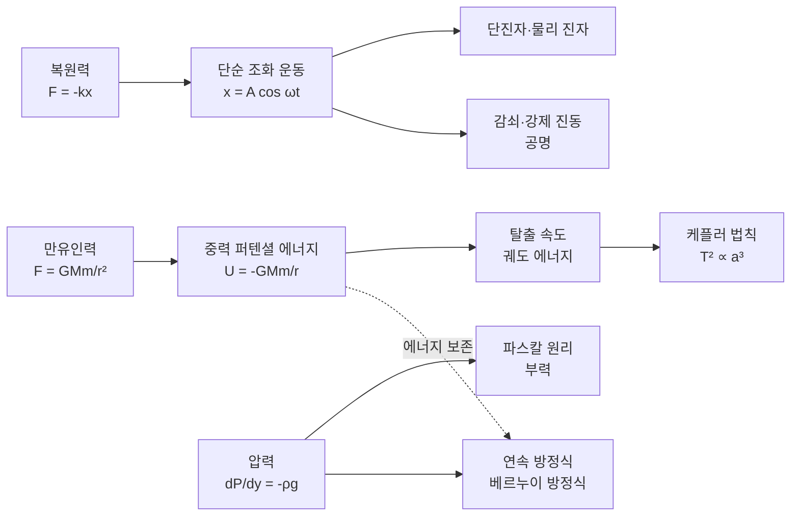

# 일반물리학 5. 중력·진동·유체 — 행성의 궤도, 시계추의 박자, 흐르는 물의 에너지
<!-- prev: mech-1, mech-3, astro-1, uphy-4, m1-05 -->
<!-- next: uphy-6, uphy-7, uearth-10 -->

> [!NOTE]
> **이 단원의 범위**
> - 만유인력 법칙(벡터, 껍질 정리)과 중력 퍼텐셜 에너지 $U = -GMm/r$
> - 탈출 속도, 원·타원 궤도의 에너지와 케플러 법칙
> - 단순 조화 운동의 운동 방정식과 에너지, 단진자와 물리 진자
> - 감쇠 진동, 강제 진동과 공명
> - 유체 정역학(압력, 파스칼 원리, 부력)과 연속 방정식·베르누이 방정식

**학습 목표**

1. 만유인력 법칙을 벡터로 나타내고, 적분으로 중력 퍼텐셜 에너지 $U = -GMm/r$을 유도하여 고도에 따른 중력과 에너지를 계산할 수 있다.
2. 에너지 보존으로 탈출 속도를 구하고, 원 궤도와 타원 궤도의 역학적 에너지를 이용해 케플러 법칙을 정량적으로 설명할 수 있다.
3. 단순 조화 운동의 미분 방정식을 세우고, 초기 조건으로 진폭과 위상 상수를 정하며, 운동 에너지와 퍼텐셜 에너지의 교환을 분석할 수 있다.
4. 토크와 관성 모멘트로 단진자와 물리 진자의 주기를 유도하고, 작은 각 근사의 한계를 설명할 수 있다.
5. 감쇠 진동과 강제 진동의 해를 해석하여 공명의 조건과 품질 인자의 의미를 설명할 수 있다.
6. 정지 유체의 압력을 깊이에 대해 적분하고 파스칼 원리와 부력을 적용하며, 연속 방정식과 베르누이 방정식을 유도하여 흐르는 유체에 적용할 수 있다.

**이 단원의 학습 사다리**

| 단계 | 무엇을 하나? |
|---|---|
| STEP 1. 이전 학습 다시 보기 | 고등학교 「시공간과 운동」의 케플러 법칙·탈출 속도, 「탄성파와 소리」의 단진동, 「우주탐사와 행성계」의 궤도를 꺼내 본다 |
| STEP 2. 기초 다지기 | 미분 방정식을 '푼다'는 뜻, 작은 각 근사와 테일러 전개, 거리의 역제곱 적분, 압력의 단위 |
| STEP 3. 핵심 개념 | 만유인력과 퍼텐셜 → 궤도와 케플러 법칙 → 단순 조화 운동 → 진자 → 감쇠·강제 진동 → 유체 정역학 → 유체 동역학 |
| STEP 4. 오개념 바로잡기 | "우주 정거장은 무중력이라 떠 있다", "무거운 진자가 더 빨리 흔들린다" 같은 착각 |
| STEP 5. 한 걸음 더 | 궤도 역학, 비선형 진동, 점성 유체와 나비에–스토크스 방정식 맛보기 |
| STEP 6. 생활·산업·진로 | 위성 궤도 설계, 건물의 진동 제어, 수력·유압 기계, 혈류와 항공기 |

---

## 🗺️ 단원 들어가기

국제 우주 정거장의 우주인은 둥둥 떠다닌다. 그런데 정거장 높이(약 400 km)에서의 중력은 지표의 90 %나 된다. 중력이 거의 그대로인데 왜 떠 있을까? 수백 년 된 괘종시계는 추가 조금 크게 흔들리든 작게 흔들리든 같은 박자를 낸다. 반면 바람이 꾸준히 불 뿐인데 다리가 무섭게 출렁이다 무너지는 일도 있다. 강철로 만든 수십만 톤의 배는 물에 뜨고, 좁은 수도꼭지에서는 물이 빠르게 뿜어져 나온다.

서로 다른 이야기 같지만 이 단원의 세 주제는 같은 뿌리를 가진다. **뉴턴 법칙과 에너지 보존**을 각각 거리의 역제곱으로 작용하는 힘(중력), 변위에 비례하는 복원력(진동), 연속적으로 퍼진 물질(유체)에 적용한 것이다. 특히 진동은 거의 모든 안정한 평형 근처에서 나타나는 보편적인 운동이어서, 다음 단원의 파동과 전기 회로, 원자의 진동까지 이어진다.

---

## STEP 1. 🔙 이전 학습 다시 보기

### 연계 개념표

| 이전 단원 | 그때 배운 것(고등학교에서는 여기까지) | 이 단원에서 확장되는 것 |
|---|---|---|
| 고등학교 「역학과 에너지」 '시공간과 운동' | 케플러 법칙에서 중력이 거리의 제곱에 반비례함을 찾기(원 궤도), 인공위성의 궤도 속력, 탈출 속도 $\sqrt{2GM/R}$ | 중력 퍼텐셜 에너지를 **적분으로 유도**하고, 궤도의 역학적 에너지와 타원 궤도로 확장한다 |
| 고등학교 「역학과 에너지」 '탄성파와 소리' | 용수철 진자의 단진동 $a = -\omega^2x$, $T = 2\pi\sqrt{m/k}$, 원운동의 그림자, 공명의 정성적 의미 | 단진동을 **미분 방정식**으로 풀고 초기 조건·위상 상수를 다루며, 감쇠·강제 진동과 공명 곡선을 정량적으로 다룬다 |
| 고등학교 「행성우주과학」 '우주탐사와 행성계' | 케플러의 세 법칙(타원, 면적 속도, 조화 법칙), 소천체의 궤도 | 제2법칙을 각운동량 보존으로, 제3법칙을 뉴턴 법칙으로 유도하고 근일점·원일점 속력을 계산한다 |
| 일반물리학 「회전 운동과 각운동량」 | 관성 모멘트, $\tau = I\alpha$, 각운동량 보존 | 물리 진자의 주기, 궤도의 각운동량 보존에 쓴다 |
| 중학교 1학년 「힘의 작용」 '부력', 「기체의 성질」 '압력' | 압력 = 힘/넓이, 부력은 (공기 중 무게 − 물속 무게)로 재며 잠긴 부피가 클수록 크다(아르키메데스 원리는 맛보기로) | 깊이에 따른 압력을 적분으로 구하고, 부력을 압력 차이로 유도한다 |

### 준비 운동 (사전 진단)

**Q1.** 지구 중심에서의 거리가 2배가 되면 만유인력의 크기는 몇 배가 되는가?

**Q2.** 질량 0.50 kg인 물체가 용수철 상수 50 N/m인 용수철에 매달려 단진동한다. 주기는? ($\pi \approx 3.14$)

**Q3.** 물 속 10 m 깊이에서 물에 의한 압력(계기 압력)은 대략 몇 Pa인가? ($\rho = 1000\ \mathrm{kg/m^3}$, $g = 9.8\ \mathrm{m/s^2}$)

**Q4.** 함수 $x(t) = A\cos\omega t$를 시간으로 두 번 미분하면 어떤 꼴이 되는가?

정답 및 해설

**Q1.** $1/4$배 — 만유인력은 거리의 제곱에 반비례한다.

**Q2.** 약 0.63 s — $T = 2\pi\sqrt{0.50/50} = 2\pi(0.10) \approx 0.63\ \mathrm{s}$

**Q3.** 약 $9.8\times10^{4}\ \mathrm{Pa}$ — $\rho gh = 1000\times9.8\times10$. 대기압(약 $1.0\times10^{5}\ \mathrm{Pa}$)과 거의 같으므로 10 m 잠수하면 받는 압력이 약 2배가 된다.

**Q4.** $\ddot x = -A\omega^2\cos\omega t = -\omega^2x$ — 두 번 미분하면 원래 함수에 $-\omega^2$을 곱한 것이 된다. 이 성질이 단순 조화 운동의 핵심이다.

---

## STEP 2. 🧱 기초 다지기

### 디딤돌 1. 미분 방정식을 '푼다'는 것

뉴턴 제2법칙 $m\,d^2x/dt^2 = F$는 위치 $x(t)$와 그 도함수 사이의 관계식, 즉 **미분 방정식**이다. 미분 방정식을 푼다는 것은 이 관계를 모든 시각에서 만족하는 **함수** $x(t)$를 찾는 것이다. 이 단원에서 가장 중요한 미분 방정식은

$$
\frac{d^2x}{dt^2} = -\omega^2x
$$

이다. "두 번 미분하면 자기 자신에 $-\omega^2$을 곱한 것이 되는 함수"는 사인과 코사인이다. 일반해는 두 개의 상수(진폭 $A$와 위상 상수 $\phi$)를 포함한다.

$$
x(t) = A\cos(\omega t + \phi)
$$

상수가 두 개인 것은 2계 미분 방정식이기 때문이고, 그 값은 **초기 조건**($t = 0$일 때의 위치와 속도)으로 정해진다. 직접 대입해 해임을 확인하는 습관을 들이자.

### 디딤돌 2. 작은 양의 근사 — 테일러 전개

$x$가 0에 가까울 때 자주 쓰는 근사는 다음과 같다(라디안 기준).

| 함수 | 근사 | 오차의 크기 |
|---|---|---|
| $\sin\theta$ | $\theta$ | $\theta^3/6$ 정도 ($10^\circ$에서 약 0.5 %) |
| $\cos\theta$ | $1 - \theta^2/2$ | $\theta^4/24$ 정도 |
| $(1 + x)^n$ | $1 + nx$ | $n(n-1)x^2/2$ 정도 |
| $e^x$ | $1 + x$ | $x^2/2$ 정도 |

진자의 복원력 $-mg\sin\theta$를 $-mg\theta$로 바꾸면 운동 방정식이 단순 조화 운동의 꼴이 된다. 이처럼 **작은 진동은 거의 모두 단순 조화 운동으로 근사**된다. 매끄러운 퍼텐셜 에너지 곡선 $U(x)$의 극소점 $x_0$ 근처에서 $U(x) \approx U(x_0) + \frac12U''(x_0)(x - x_0)^2$이므로, 유효 용수철 상수 $k = U''(x_0)$인 용수철처럼 행동하기 때문이다.

### 디딤돌 3. 거리의 역제곱을 적분하기

중력이 한 일이나 퍼텐셜 에너지를 구할 때는 다음 적분을 쓴다.

$$
\int_{r_1}^{r_2}\frac{dr}{r^2} = \left[-\frac1r\right]_{r_1}^{r_2} = \frac{1}{r_1} - \frac{1}{r_2}
$$

$r_2 \to \infty$이면 $1/r_1$로 유한하다. 역제곱 힘이 무한히 먼 곳까지 한 일이 유한하다는 이 사실이 탈출 속도가 존재하는 수학적 이유이다.

### 디딤돌 4. 압력과 밀도의 단위

| 양 | 정의 | 단위와 환산 |
|---|---|---|
| 밀도 $\rho$ | 질량/부피 | $\mathrm{kg/m^3}$ (물 약 1000, 공기 약 1.2, 바닷물 약 1025) |
| 압력 $P$ | 면에 수직인 힘/넓이 | $1\ \mathrm{Pa} = 1\ \mathrm{N/m^2}$ |
| 표준 대기압 | | $1\ \mathrm{atm} = 1.013\times10^{5}\ \mathrm{Pa} = 760\ \mathrm{mmHg}$ |
| 계기 압력 | 절대 압력 − 대기압 | 타이어 압력계, 혈압계가 재는 값 |

압력은 방향이 없는 스칼라이다. 정지 유체 속 한 점에서는 어느 방향으로 놓은 면이든 같은 압력을 받는다.

---

## STEP 3. 📘 핵심 개념

### ① 만유인력 법칙과 중력 퍼텐셜 에너지

#### (1) 벡터로 쓴 만유인력 법칙

질량 $m_1$, $m_2$인 두 입자가 거리 $r$만큼 떨어져 있을 때, 입자 1이 입자 2에 작용하는 **만유인력(gravitational force)** 은

$$
\vec F_{12} = -\frac{Gm_1m_2}{r^2}\hat r_{12}, \qquad G = 6.67\times10^{-11}\ \mathrm{N\cdot m^2/kg^2}
$$

이다. $\hat r_{12}$는 입자 1에서 입자 2를 향하는 단위 벡터이고, 음의 부호는 힘이 입자 1 쪽을 향하는 **인력**임을 뜻한다. 여러 물체가 있으면 각각의 힘을 벡터로 더한다(**중첩 원리**).

$G$ 값은 1798년 캐번디시가 비틀림 저울로 처음 측정했다. 납공 사이의 아주 작은 인력(약 $10^{-7}\ \mathrm{N}$)이 가는 철사를 비트는 각을 재었다. $G$를 알게 되자 지표의 $g$와 지구 반지름에서 지구의 질량을 구할 수 있었다($M_E = gR_E^2/G$). 그래서 이 실험을 '지구의 무게를 잰 실험'이라 부른다.

#### (2) 껍질 정리 — 구는 중심의 점처럼 당긴다

균일한 구 껍질(또는 동심 껍질로 이루어진 구)에 대해 다음이 성립한다(**껍질 정리**).

- 껍질 **바깥**의 입자: 껍질의 모든 질량이 중심에 모인 것처럼 당긴다.
- 껍질 **안쪽**의 입자: 껍질이 작용하는 알짜 중력은 **0**이다.

뉴턴은 이 정리를 증명하기 위해 미적분을 발전시켰다. 그래서 지구 밖의 위성은 지구를 질량 $M_E$인 점으로 보고 계산할 수 있다. 지구 내부(밀도가 균일하다고 가정)에서는 반지름 $r$ 안쪽의 질량 $M_E(r/R_E)^3$만 당기므로 $g(r) = g\,r/R_E$로 중심까지 거리에 비례하여 줄어든다.

#### (3) 고도에 따른 중력 가속도

지구 중심에서 $r$인 곳의 중력 가속도는 $g(r) = GM_E/r^2$이다. 지표에서 $g_0 = GM_E/R_E^2$이므로

$$
g(h) = g_0\left(\frac{R_E}{R_E + h}\right)^2
$$

| 위치 | 높이 $h$ | $g$ (m/s², 약) |
|---|---|---|
| 지표 | 0 | 9.8 |
| 에베레스트 정상 | 8.8 km | 9.77 |
| 국제 우주 정거장 | 400 km | 8.7 |
| GPS 위성 | 20 200 km | 0.56 |
| 정지 궤도 위성 | 35 800 km | 0.22 |
| 달 궤도 | 약 378 000 km (중심 거리 384 000 km) | 0.0027 |

우주 정거장의 우주인이 떠 있는 것은 중력이 없어서가 아니라, 정거장과 우주인이 **함께 자유 낙하**(지구 둘레를 도는 낙하)하기 때문이다. 정거장 바닥이 우주인을 떠받칠 필요가 없으므로 수직 항력이 0, 즉 '겉보기 무게'가 0이다.

<!-- fig:uphy-5-gravity-vs-r -->

#### (4) 중력 퍼텐셜 에너지의 유도

고등학교에서는 지표 근처에서 $U = mgh$를 썼다. 이는 $g$가 일정하다고 본 근사이다. 지구 중심에서 $r$인 곳의 **중력 퍼텐셜 에너지**는 무한히 먼 곳을 기준($U(\infty) = 0$)으로 하여, 중력이 한 일의 음수로 정의한다.

$$
U(r) - U(\infty) = -\int_\infty^r\vec F\cdot d\vec r = -\int_\infty^r\left(-\frac{GMm}{r'^2}\right)dr' = -\frac{GMm}{r}
$$

$$
U(r) = -\frac{GMm}{r}
$$

- 항상 음수이다. 기준(무한히 먼 곳)보다 에너지가 낮은, '중력에 묶인' 상태라는 뜻이다.
- $r$이 커질수록 0에 가까워지며 증가한다. 위로 올라갈수록 퍼텐셜 에너지가 커진다는 점은 $mgh$와 같다.
- 지표 근처에서는 $U(R_E + h) - U(R_E) = GMm\left(\frac{1}{R_E} - \frac{1}{R_E + h}\right) \approx \frac{GMm}{R_E^2}h = mgh$ ($h \ll R_E$)로 고등학교 식이 나온다.
- 힘은 퍼텐셜 에너지의 기울기로 되돌아간다: $F_r = -dU/dr = -GMm/r^2$.

#### 예제 1 — 위성을 400 km 올리는 데 필요한 에너지

질량 1000 kg인 위성을 지표에서 400 km 높이까지 올릴 때 중력 퍼텐셜 에너지의 증가량을 (1) 정확한 식 (2) $mgh$로 구해 비교하시오. ($G = 6.67\times10^{-11}$, $M_E = 5.97\times10^{24}\ \mathrm{kg}$, $R_E = 6.37\times10^{6}\ \mathrm{m}$, $g = 9.80\ \mathrm{m/s^2}$)

**풀이**
- (1) $\Delta U = GM_Em\left(\dfrac{1}{R_E} - \dfrac{1}{R_E + h}\right) = (3.98\times10^{17})\left(\dfrac{1}{6.37\times10^{6}} - \dfrac{1}{6.77\times10^{6}}\right) = 3.69\times10^{9}\ \mathrm{J}$
- (2) $mgh = 1000\times9.80\times4.0\times10^{5} = 3.92\times10^{9}\ \mathrm{J}$

**의미** 400 km는 지구 반지름의 6 %에 불과하지만 $mgh$는 이미 약 6 % 과대평가한다. 올라갈수록 $g$가 작아지기 때문이다. 높이가 지구 반지름에 견줄 만하면 반드시 $-GMm/r$을 써야 한다.

#### ✔ 바로 확인

1. (O/X) 고도 400 km인 국제 우주 정거장에서는 중력 가속도가 거의 0이다.
2. 두 물체 사이의 거리가 3배가 되면 만유인력은 몇 배가 되는가?
3. $U = -GMm/r$에서 $r$이 커지면 $U$는 증가하는가, 감소하는가?
4. 빈칸: 균일한 구 껍질 안쪽에 있는 입자가 그 껍질에서 받는 알짜 중력은 (    )이다.

정답

1. X — 약 $8.7\ \mathrm{m/s^2}$로 지표의 90 % 가까이 된다. 떠 있는 것은 자유 낙하 때문이다.
2. 1/9배 — 거리의 제곱에 반비례한다.
3. 증가한다 — 음수이면서 0에 가까워진다.
4. 0 — 껍질 정리.

---

### ② 탈출 속도, 궤도와 케플러 법칙

#### (1) 탈출 속도

행성 표면에서 속력 $v$로 쏘아 올린 물체가 무한히 먼 곳까지 가려면(공기 저항 무시), 역학적 에너지가 0 이상이어야 한다.

$$
\frac12mv^2 - \frac{GMm}{R} \ge 0 \;\Rightarrow\; v_{\text{탈출}} = \sqrt{\frac{2GM}{R}}
$$

탈출 속도는 쏘는 **방향과 관계없고**(에너지는 스칼라), 물체의 질량과도 관계없다. 지구는 $11.2\ \mathrm{km/s}$, 달은 $2.38\ \mathrm{km/s}$이다. 달처럼 탈출 속도가 작은 천체는 기체 분자가 쉽게 빠져나가 대기를 붙잡아 두지 못한다.

#### (2) 원 궤도의 속력, 주기, 에너지

반지름 $r$인 원 궤도에서는 만유인력이 구심력이다.

$$
\frac{GMm}{r^2} = \frac{mv^2}{r} \;\Rightarrow\; v = \sqrt{\frac{GM}{r}}, \qquad T = \frac{2\pi r}{v} = 2\pi\sqrt{\frac{r^3}{GM}}
$$

이로부터 운동 에너지는 $K = \frac12mv^2 = \dfrac{GMm}{2r}$이고, 역학적 에너지는

$$
E = K + U = \frac{GMm}{2r} - \frac{GMm}{r} = -\frac{GMm}{2r} = -K = \frac{U}{2}
$$

이다. 궤도가 높을수록 $E$는 커지지만(0에 가까워짐) **속력은 느려진다.** 낮은 궤도의 위성을 높은 궤도로 올리려면 에너지를 넣어야 하지만, 올라간 뒤에는 오히려 느리게 돈다. 반대로 대기 저항으로 에너지를 잃은 위성은 낮은 궤도로 떨어지면서 **더 빨라진다**(위성 궤도의 역설).

#### 예제 2 — 정지 궤도의 높이

지구 자전 주기(항성일 $T = 8.62\times10^{4}\ \mathrm{s}$)와 같은 주기로 적도 위를 도는 정지 궤도 위성의 궤도 반지름, 지표로부터의 높이, 궤도 속력을 구하시오. ($GM_E = 3.98\times10^{14}\ \mathrm{m^3/s^2}$)

**풀이**
- 식: $r = \left(\dfrac{GM_ET^2}{4\pi^2}\right)^{1/3}$
- 대입: $r = \left(\dfrac{3.98\times10^{14}\times(8.62\times10^{4})^2}{4\pi^2}\right)^{1/3} = 4.22\times10^{7}\ \mathrm{m}$
- 높이: $4.22\times10^{7} - 6.37\times10^{6} = 3.58\times10^{7}\ \mathrm{m}$ (약 35 800 km)
- 속력: $v = 2\pi r/T = 3.07\ \mathrm{km/s}$

**의미** 정지 궤도는 지구 반지름의 약 6.6배인 곳에 단 하나뿐인 '고리'이다. 통신·기상 위성이 이 궤도를 나누어 쓰므로 국제적으로 궤도 위치를 배정한다.

#### (3) 케플러 법칙을 뉴턴 법칙으로

| 케플러 법칙 | 내용 | 뉴턴 역학의 근거 |
|---|---|---|
| 제1법칙(타원 궤도) | 행성은 태양을 한 초점으로 하는 타원 궤도를 돈다 | 역제곱 인력의 운동 방정식을 풀면 궤도가 원뿔 곡선(원·타원·포물선·쌍곡선)이 된다. 묶인 궤도($E < 0$)는 타원이다 |
| 제2법칙(면적 속도 일정) | 같은 시간 동안 같은 넓이를 쓸고 지나간다 | 중력은 중심력이므로 토크가 0 → 각운동량 보존, $dA/dt = L/2m$ (「회전 운동과 각운동량」) |
| 제3법칙(조화 법칙) | $T^2 \propto a^3$ ($a$: 긴반지름) | 원 궤도에서 $T^2 = \dfrac{4\pi^2}{GM}r^3$. 타원에서는 $r$ 대신 긴반지름 $a$ |

타원 궤도의 역학적 에너지는 원 궤도의 식에서 $r$을 긴반지름 $a$로 바꾼 $E = -\dfrac{GMm}{2a}$이다. 따라서 궤도 위 거리 $r$인 점에서의 속력은 에너지 보존으로

$$
\frac12mv^2 - \frac{GMm}{r} = -\frac{GMm}{2a} \;\Rightarrow\; v^2 = GM\left(\frac2r - \frac1a\right)
$$

(이 식을 **활력 방정식(vis-viva equation)** 이라 한다.) $E$가 궤도의 크기($a$)만 정하고, 각운동량 $L$이 궤도의 찌그러진 정도(이심률)를 정한다.

<!-- fig:uphy-5-ellipse-orbit -->

<!-- sim:u-orbit-launch -->

#### 예제 3 — 가상의 주기 혜성

어떤 혜성이 근일점 0.59 AU, 원일점 35.0 AU인 타원 궤도를 돈다. (1) 공전 주기 (2) 근일점과 원일점의 속력 비 (3) 근일점 속력을 구하시오. ($GM_\odot = 1.33\times10^{20}\ \mathrm{m^3/s^2}$, $1\ \mathrm{AU} = 1.50\times10^{11}\ \mathrm{m}$)

**풀이**
- (1) 긴반지름 $a = (0.59 + 35.0)/2 = 17.8\ \mathrm{AU}$. 지구($a = 1\ \mathrm{AU}$, $T = 1$년)와 비교하면 $T = a^{3/2} = 17.8^{1.5} \approx 75$년
- (2) 근일점·원일점에서는 속도가 위치 벡터에 수직이므로 $L = mr_pv_p = mr_av_a$ → $v_p/v_a = r_a/r_p = 35.0/0.59 \approx 59$
- (3) 활력 방정식: $v_p = \sqrt{GM_\odot\left(\dfrac{2}{r_p} - \dfrac{1}{a}\right)} = \sqrt{1.33\times10^{20}\left(\dfrac{2}{8.85\times10^{10}} - \dfrac{1}{2.67\times10^{12}}\right)} \approx 5.4\times10^{4}\ \mathrm{m/s}$

**의미** 혜성은 태양 근처를 초속 50 km 이상으로 휙 지나가고, 먼 곳에서는 초속 1 km 정도로 느릿느릿 움직이며 주기의 대부분을 보낸다. 그래서 혜성은 수십 년에 한 번, 몇 달 동안만 밝게 보인다.

> [!TIP]
> 💡 **요령** — 궤도 문제는 "**에너지로 크기, 각운동량으로 모양**"이다. 근점·원점처럼 속도가 지름에 수직인 두 점에서 각운동량 식과 에너지 식을 함께 쓰면 거의 모든 궤도 문제가 풀린다.

#### ✔ 바로 확인

1. 물체의 질량을 2배로 하면 탈출 속도는 몇 배가 되는가?
2. 원 궤도 위성의 역학적 에너지 $E$와 운동 에너지 $K$의 관계는?
3. 원 궤도의 반지름이 4배가 되면 주기는 몇 배가 되는가?
4. (O/X) 타원 궤도에서 행성은 근일점에서 원일점보다 빠르다.

정답

1. 1배(같다) — $v = \sqrt{2GM/R}$에 물체의 질량이 없다.
2. $E = -K$ — $K = GMm/2r$, $E = -GMm/2r$.
3. 8배 — $T \propto r^{3/2}$.
4. O — 각운동량 보존으로 $r_pv_p = r_av_a$.

---

### ③ 단순 조화 운동

#### (1) 운동 방정식과 그 해

복원력이 변위에 비례하는($F = -kx$) 계의 운동 방정식은

$$
m\frac{d^2x}{dt^2} = -kx \;\Rightarrow\; \frac{d^2x}{dt^2} + \omega^2x = 0, \qquad \omega = \sqrt{\frac km}
$$

이고, 해는 $x(t) = A\cos(\omega t + \phi)$이다. 이 운동을 **단순 조화 운동(simple harmonic motion, 단진동)** 이라 한다. $\omega t + \phi$를 **위상**, $\phi$를 **위상 상수**라 한다.

| 양 | 식 | 최댓값 |
|---|---|---|
| 변위 | $x = A\cos(\omega t + \phi)$ | $A$ |
| 속도 | $v = \dfrac{dx}{dt} = -A\omega\sin(\omega t + \phi)$ | $A\omega$ |
| 가속도 | $a = \dfrac{dv}{dt} = -A\omega^2\cos(\omega t + \phi) = -\omega^2x$ | $A\omega^2$ |

속도는 변위보다 위상이 $\pi/2$ 앞서고, 가속도는 변위와 위상이 $\pi$만큼 다르다(항상 반대 방향).

<!-- fig:uphy-5-shm-graphs -->

#### (2) 초기 조건으로 $A$와 $\phi$ 정하기

$t = 0$에서 위치 $x_0$, 속도 $v_0$이면 $x_0 = A\cos\phi$, $v_0 = -A\omega\sin\phi$이므로

$$
A = \sqrt{x_0^2 + \left(\frac{v_0}{\omega}\right)^2}, \qquad \tan\phi = -\frac{v_0}{\omega x_0}
$$

($\phi$의 사분면은 $\cos\phi$와 $\sin\phi$의 부호로 정한다.)

#### 예제 4 — 밀면서 놓은 용수철 진자

질량 0.50 kg인 물체가 용수철 상수 200 N/m인 용수철에 연결되어 마찰 없는 수평면 위에 있다. $t = 0$에 평형 위치에서 $+3.0\ \mathrm{cm}$인 곳에서 $+0.80\ \mathrm{m/s}$의 속도로 밀었다. (1) 각진동수 (2) 진폭과 위상 상수 (3) 최대 속력과 최대 가속도 (4) 역학적 에너지를 구하시오.

**풀이**
- (1) $\omega = \sqrt{200/0.50} = 20\ \mathrm{rad/s}$
- (2) $A = \sqrt{0.030^2 + (0.80/20)^2} = \sqrt{0.0009 + 0.0016} = 0.050\ \mathrm{m}$. $\cos\phi = 0.030/0.050 = 0.60$, $\sin\phi = -0.80/(20\times0.050) = -0.80$이므로 $\phi = -0.93\ \mathrm{rad}$ (4사분면)
- (3) $v_{\max} = A\omega = 1.0\ \mathrm{m/s}$, $a_{\max} = A\omega^2 = 20\ \mathrm{m/s^2}$
- (4) $E = \frac12kA^2 = \frac12(200)(0.050)^2 = 0.25\ \mathrm{J}$ (확인: $\frac12(0.50)(0.80)^2 + \frac12(200)(0.030)^2 = 0.16 + 0.09 = 0.25\ \mathrm{J}$)

**의미** 처음에 바깥쪽으로 밀었기 때문에 진폭이 처음 변위(3.0 cm)보다 큰 5.0 cm가 되었다. 주기는 초기 조건과 관계없이 $2\pi/20 = 0.31\ \mathrm{s}$이다.

#### (3) 단순 조화 운동의 에너지

$$
K = \frac12mv^2 = \frac12kA^2\sin^2(\omega t + \phi), \qquad U = \frac12kx^2 = \frac12kA^2\cos^2(\omega t + \phi)
$$

두 식을 더하면 $E = \frac12kA^2$으로 일정하다. 운동 에너지와 퍼텐셜 에너지는 각각 진동수 $2f$로 오르내리며 서로 에너지를 주고받고, 한 주기 동안의 평균은 둘 다 $E/2$이다. 에너지 보존에서 위치에 따른 속력도 바로 나온다.

$$
v = \pm\omega\sqrt{A^2 - x^2}
$$

#### (4) 연직 용수철과 등속 원운동

- 연직으로 매단 용수철: 중력 때문에 평형 위치가 $mg/k$만큼 내려가지만, **새 평형 위치에서 잰 변위** $y$에 대해 $m\ddot y = -ky$가 되어 같은 $\omega = \sqrt{k/m}$으로 진동한다. 중력은 평형 위치만 옮긴다.
- 반지름 $A$, 각속도 $\omega$로 등속 원운동하는 점을 한 지름 위에 투영하면 정확히 $A\cos(\omega t + \phi)$이다. 고등학교에서 본 '원운동의 그림자'는 위상 $\omega t + \phi$가 원 위의 **각**이라는 뜻이다.

#### ✔ 바로 확인

1. 질량 0.50 kg인 물체가 용수철 상수 50 N/m인 용수철에 달려 진동한다. 각진동수와 주기는?
2. (O/X) 진폭을 2배로 하면 주기도 2배가 된다.
3. 빈칸: 단순 조화 운동에서 가속도는 변위와 위상이 (    )만큼 다르다.
4. 용수철 상수 200 N/m, 진폭 0.10 m인 단진동의 역학적 에너지는?

정답

1. $10\ \mathrm{rad/s}$, $0.63\ \mathrm{s}$ — $\omega = \sqrt{k/m}$, $T = 2\pi/\omega$.
2. X — 주기는 $k$와 $m$만으로 정해진다.
3. $\pi$ — $a = -\omega^2x$로 늘 반대 방향이다.
4. $1.0\ \mathrm{J}$ — $\frac12kA^2$.

---

### ④ 단진자와 물리 진자

#### (1) 단진자

길이 $L$인 가벼운 줄에 질량 $m$인 추가 매달린 **단진자(simple pendulum)** 를 받침점에 대한 회전으로 분석하자. 연직선과 이루는 각이 $\theta$일 때 중력의 토크는 $-mgL\sin\theta$이고, 관성 모멘트는 $mL^2$이다.

$$
mL^2\frac{d^2\theta}{dt^2} = -mgL\sin\theta
$$

$\sin\theta$ 때문에 이 식은 단순 조화 운동이 아니다. 그러나 각이 작으면 $\sin\theta \approx \theta$이므로

$$
\frac{d^2\theta}{dt^2} = -\frac gL\theta \;\Rightarrow\; \omega = \sqrt{\frac gL}, \qquad T = 2\pi\sqrt{\frac Lg}
$$

추의 질량이 약분된다. 관성(분모의 $m$)과 복원력(분자의 $m$)이 모두 질량에 비례하기 때문이며, 이는 관성 질량과 중력 질량이 같다는 사실(「시공간과 운동」의 등가 원리)과 연결된다.

#### (2) 작은 각 근사의 한계

진폭 $\theta_0$이 커지면 $\sin\theta < \theta$이어서 복원력이 근사보다 약하므로 주기가 길어진다. 정확한 주기를 급수로 쓰면

$$
T = 2\pi\sqrt{\frac Lg}\left(1 + \frac{\theta_0^2}{16} + \cdots\right)
$$

| 진폭 $\theta_0$ | $T/T_0$ (약) |
|---|---|
| $5^\circ$ | 1.0005 |
| $15^\circ$ | 1.004 |
| $30^\circ$ | 1.017 |
| $60^\circ$ | 1.07 |
| $90^\circ$ | 1.18 |

진자의 **등시성**은 작은 진폭에서만 근사적으로 성립한다. 진자 시계는 진폭을 일정하게 유지하는 장치로 이 오차를 줄인다.

#### (3) 물리 진자

크기가 있는 강체가 질량 중심이 아닌 점 O를 축으로 흔들리는 것을 **물리 진자(physical pendulum)** 라 한다. 축에서 질량 중심까지 거리를 $d$, 축에 대한 관성 모멘트를 $I$라 하면 중력의 토크는 $-Mgd\sin\theta$이므로

$$
I\frac{d^2\theta}{dt^2} = -Mgd\sin\theta \approx -Mgd\,\theta \;\Rightarrow\; T = 2\pi\sqrt{\frac{I}{Mgd}}
$$

단진자는 $I = ML^2$, $d = L$인 특수한 경우이다. 물리 진자와 주기가 같은 단진자의 길이 $L_{\text{eq}} = I/Md$를 **등가 길이**라 한다.

<!-- fig:uphy-5-pendulums -->

#### 예제 5 — 단진자로 $g$ 재기

길이 0.800 m인 단진자를 작은 진폭으로 흔들어 20회 진동하는 데 35.9 s가 걸렸다. 중력 가속도를 구하시오.

**풀이** $T = 35.9/20 = 1.795\ \mathrm{s}$, $g = \dfrac{4\pi^2L}{T^2} = \dfrac{4\pi^2(0.800)}{1.795^2} = 9.80\ \mathrm{m/s^2}$

**의미** 한 번이 아니라 20번의 시간을 재면 손으로 초시계를 누르는 오차(약 0.2 s)가 20회에 나뉘어 주기의 오차가 약 0.01 s로 줄어든다. 주기가 제곱으로 들어가므로 $g$의 상대 오차는 주기 상대 오차의 2배이다.

#### 예제 6 — 끝을 매단 막대

길이 1.00 m인 균일한 막대의 한쪽 끝을 축으로 작게 흔든다. 주기와 등가 길이를 구하시오. ($g = 9.80\ \mathrm{m/s^2}$)

**풀이** $I = \frac13ML^2$, $d = L/2$이므로 $T = 2\pi\sqrt{\dfrac{ML^2/3}{MgL/2}} = 2\pi\sqrt{\dfrac{2L}{3g}} = 2\pi\sqrt{\dfrac{2(1.00)}{3(9.80)}} = 1.64\ \mathrm{s}$. 등가 길이 $2L/3 = 0.667\ \mathrm{m}$.

**의미** 같은 1 m라도 막대는 길이 1 m인 단진자(2.01 s)보다 빨리 흔들린다. 막대의 질량이 축 가까이에도 퍼져 있어 관성 모멘트가 상대적으로 작기 때문이다. 걸을 때 다리가 흔들리는 주기도 다리를 물리 진자로 보고 어림할 수 있다.

> [!NOTE]
> 가는 철사에 매단 원판을 비틀었다 놓으면 철사의 복원 토크 $\tau = -\kappa\theta$에 의해 $T = 2\pi\sqrt{I/\kappa}$로 진동한다(**비틀림 진자**). 캐번디시의 $G$ 측정 장치와 기계식 손목시계의 밸런스 휠이 이 원리를 쓴다.

#### ✔ 바로 확인

1. 단진자의 길이를 4배로 하면 주기는 몇 배가 되는가?
2. (O/X) 추의 질량을 2배로 하면 단진자의 주기가 짧아진다.
3. 달($g = 1.6\ \mathrm{m/s^2}$)에서 길이 1.0 m인 단진자의 주기는?

정답

1. 2배 — $T \propto \sqrt L$.
2. X — 질량이 약분되어 주기와 무관하다.
3. 약 5.0 s — $2\pi\sqrt{1.0/1.6} = 4.97\ \mathrm{s}$.

---

### ⑤ 감쇠 진동, 강제 진동과 공명

#### (1) 감쇠 진동

실제 진동은 공기 저항이나 마찰 때문에 점점 작아진다. 속력이 느릴 때 저항력은 속도에 비례하는 $-bv$로 잘 근사된다($b$: 감쇠 상수, kg/s). 운동 방정식은

$$
m\frac{d^2x}{dt^2} + b\frac{dx}{dt} + kx = 0
$$

이고, 감쇠가 약하면($b < 2\sqrt{km}$) 해는

$$
x(t) = Ae^{-bt/2m}\cos(\omega't + \phi), \qquad \omega' = \sqrt{\omega_0^2 - \left(\frac{b}{2m}\right)^2}
$$

이다($\omega_0 = \sqrt{k/m}$: 고유 각진동수). 진폭이 지수 함수로 줄어드는 '포락선' 안에서 진동하며, 감쇠 때문에 진동이 약간 느려진다. 에너지는 진폭의 제곱에 비례하므로 $E(t) = E_0e^{-bt/m}$로 줄어든다.

| 감쇠의 정도 | 조건 | 운동 | 예 |
|---|---|---|---|
| 약한 감쇠(과소 감쇠) | $b < 2\sqrt{km}$ | 진폭이 줄면서 진동 | 그네, 기타 줄 |
| 임계 감쇠 | $b = 2\sqrt{km}$ | 진동 없이 **가장 빨리** 평형으로 | 자동차 충격 흡수기, 계기 바늘 |
| 과도 감쇠 | $b > 2\sqrt{km}$ | 진동 없이 천천히 평형으로 | 문 닫힘 장치(도어 클로저) |

감쇠의 약함을 나타내는 **품질 인자(quality factor)** $Q = m\omega_0/b$는 대략 '에너지가 처음의 $1/e^{2\pi}$로 줄 때까지의 진동 횟수'를 나타내는 척도이다. 소리굽쇠는 $Q$가 수천, 자동차 현가장치는 1 정도이다.

<!-- fig:uphy-5-damping-regimes -->

#### 예제 7 — 진폭이 절반이 되는 시간

$m = 0.40\ \mathrm{kg}$, $k = 160\ \mathrm{N/m}$, $b = 0.16\ \mathrm{kg/s}$인 감쇠 진동자가 있다. (1) 진폭이 절반이 되는 시간 (2) 그동안의 진동 횟수 (3) 품질 인자를 구하시오.

**풀이**
- $\omega_0 = \sqrt{160/0.40} = 20\ \mathrm{rad/s}$, $b/2m = 0.20\ \mathrm{s^{-1}}$
- (1) $e^{-0.20t} = 1/2$ → $t = \ln2/0.20 = 3.5\ \mathrm{s}$
- (2) 주기 $T \approx 2\pi/20 = 0.314\ \mathrm{s}$ ($\omega' = \sqrt{400 - 0.04} \approx 20$), 횟수 $\approx 3.47/0.314 \approx 11$회
- (3) $Q = (0.40)(20)/0.16 = 50$

**의미** 에너지는 진폭의 제곱이므로 에너지가 절반이 되는 시간은 그 절반인 1.7 s이다. 감쇠가 약하면 $\omega'$은 $\omega_0$과 거의 같아서, 진동수를 재는 실험에서는 감쇠를 무시해도 된다.

#### (2) 강제 진동과 공명

진동자에 주기적인 외력 $F_0\cos\omega_dt$를 계속 가하면, 처음의 과도한 흔들림이 감쇠로 사라진 뒤 계는 **외력의 진동수** $\omega_d$로 진동한다(**강제 진동**). 정상 상태의 진폭은

$$
A(\omega_d) = \frac{F_0/m}{\sqrt{(\omega_0^2 - \omega_d^2)^2 + (b\omega_d/m)^2}}
$$

이다. $\omega_d$가 고유 각진동수 $\omega_0$에 가까울 때 진폭이 크게 커지는 현상이 **공명(resonance)** 이다.

| 구동 진동수 | 진폭 | 위상(변위가 외력보다 늦는 정도) | 해석 |
|---|---|---|---|
| $\omega_d \ll \omega_0$ | $\approx F_0/k$ (정적 변형) | 거의 0 | 용수철이 힘을 따라간다 |
| $\omega_d \approx \omega_0$ | 최대 $\approx F_0/(b\omega_0)$ | $\pi/2$ | 외력이 속도와 같은 위상 → 일을 가장 많이 한다 |
| $\omega_d \gg \omega_0$ | 작아진다($\propto 1/\omega_d^2$) | 거의 $\pi$ | 관성 때문에 따라가지 못한다 |

공명 진폭과 정적 변형의 비는 $Q$와 같다. 감쇠가 작을수록 공명 봉우리가 **높고 좁다.**

<!-- sim:u-driven-oscillator -->

#### 예제 8 — 공명할 때와 아닐 때

예제 7의 진동자($Q = 50$)에 진폭 $F_0 = 0.80\ \mathrm{N}$인 주기적인 힘을 가한다. 구동 각진동수가 (1) 20 rad/s (2) 10 rad/s일 때 정상 상태의 진폭을 구하시오.

**풀이**
- (1) $\omega_d = \omega_0$: $A = \dfrac{F_0}{b\omega_0} = \dfrac{0.80}{0.16\times20} = 0.25\ \mathrm{m}$
- (2) $A = \dfrac{0.80/0.40}{\sqrt{(400 - 100)^2 + (0.16\times10/0.40)^2}} = \dfrac{2.0}{300} = 6.7\times10^{-3}\ \mathrm{m}$

**의미** 같은 크기의 힘인데 진동수만 맞추면 진폭이 약 37배가 된다. 정적 변형 $F_0/k = 5.0\ \mathrm{mm}$에 비하면 공명 진폭은 $Q = 50$배이다. 그네를 밀 때 박자만 맞추면 작은 힘으로도 크게 흔들 수 있는 이유이다.

| 공명의 이용 | 공명의 위험과 대책 |
|---|---|
| 라디오·휴대 전화의 동조 회로(원하는 주파수만 골라 받기) | 바람·발걸음에 의한 다리의 흔들림 → 감쇠 장치 설치 |
| 전자레인지(물 분자의 회전 운동에 에너지 전달, 엄밀한 공명은 아님) | 지진 진동수와 건물 고유 진동수의 일치 → 내진·면진 설계 |
| 악기의 울림통, 수정 진동자 시계 | 회전 기계의 위험 회전 속도 → 빠르게 통과하거나 피해서 운전 |
| 자기 공명 영상(MRI) | 고층 건물의 흔들림 → 동조 질량 감쇠기 |

#### ✔ 바로 확인

1. 임계 감쇠가 되는 감쇠 상수 $b$의 조건을 쓰시오.
2. (O/X) 정상 상태의 강제 진동은 계의 고유 진동수로 진동한다.
3. 품질 인자 $Q$가 클수록 공명 봉우리는 어떻게 되는가?
4. 약한 감쇠로 진폭이 처음의 1/2이 되었다. 에너지는 처음의 몇 배인가?

정답

1. $b = 2\sqrt{km}$.
2. X — 외력의 진동수 $\omega_d$로 진동한다.
3. 높고 좁아진다 — 감쇠가 작기 때문이다.
4. 1/4배 — 에너지는 진폭의 제곱에 비례한다.

---

### ⑥ 유체 정역학 — 압력, 파스칼 원리, 부력

#### (1) 깊이에 따른 압력: $dP/dy = -\rho g$

정지한 유체 속에 넓이 $A$, 두께 $dy$인 얇은 유체 조각을 생각하자($y$축은 위쪽). 이 조각이 정지해 있으려면 아래 면이 받는 위쪽 힘 $PA$가 위 면이 받는 아래쪽 힘 $(P + dP)A$와 조각의 무게 $\rho gA\,dy$의 합과 같아야 한다.

$$
PA = (P + dP)A + \rho gA\,dy \;\Rightarrow\; \frac{dP}{dy} = -\rho g
$$

밀도가 일정한 액체에서는 적분하여, 수면(압력 $P_0$)에서 깊이 $h$인 곳의 압력은

$$
P = P_0 + \rho gh
$$

이다. 압력은 깊이에만 의존하고 **그릇의 모양과 관계없다**(정수압의 역설). 같은 액체 속 같은 높이의 점들은 압력이 같다.

<!-- fig:uphy-5-fluid-element -->

#### (2) 압력 재기 — 기압계와 액주계

- **수은 기압계**: 위쪽이 진공인 유리관 속 수은 기둥의 높이 $h$로 대기압을 잰다. $P_0 = \rho_{\text{Hg}}gh$이며 표준 대기압에서 $h = 760\ \mathrm{mm}$이다. 물로 만들면 약 10.3 m가 필요하다.
- **U자관 액주계**: 양쪽 액면의 높이 차 $\Delta h$로 기체의 계기 압력 $\rho g\Delta h$를 잰다. 혈압의 단위 mmHg가 여기서 왔다.

#### (3) 기체의 압력 — 밀도가 변하는 경우

공기는 압축되므로 $\rho$가 일정하지 않다. 온도가 일정한 이상 기체라고 보면 $\rho = PM/RT$이므로

$$
\frac{dP}{dy} = -\frac{Mg}{RT}P \;\Rightarrow\; P(y) = P_0e^{-y/H}, \qquad H = \frac{RT}{Mg}
$$

이다. $T = 288\ \mathrm{K}$, $M = 0.029\ \mathrm{kg/mol}$이면 **척도 높이** $H \approx 8.4\ \mathrm{km}$로, 높이가 8.4 km 올라갈 때마다 기압이 $1/e$로 준다. 이 근사로 에베레스트 정상(8.85 km)의 기압은 해수면의 약 35 %이다(실제 대기는 위로 갈수록 차가워 약 33 %). 같은 미분 방정식이라도 밀도가 일정한지에 따라 선형과 지수 함수로 답이 달라진다.

#### (4) 파스칼 원리

밀폐된 유체의 한 곳에 가한 압력 변화는 유체의 모든 곳과 그릇의 벽에 **그대로 전달**된다(**파스칼 원리**). $P = P_0 + \rho gh$에서 $P_0$이 $\Delta P$만큼 늘면 모든 깊이에서 $P$가 똑같이 $\Delta P$만큼 늘기 때문이다.

유압 장치에서 작은 피스톤(넓이 $A_1$)에 힘 $F_1$을 주면 큰 피스톤(넓이 $A_2$)에는 $F_2 = F_1A_2/A_1$이 작용한다. 힘은 커지지만, 액체의 부피가 같아야 하므로 큰 피스톤은 $A_1/A_2$배만 움직인다. **일은 그대로**($F_1d_1 = F_2d_2$)이다.

#### 예제 9 — 자동차 정비소의 유압 리프트

작은 피스톤의 반지름이 2.0 cm, 큰 피스톤의 반지름이 20 cm이다. 질량 1500 kg인 자동차를 큰 피스톤 위에서 천천히 들어 올리려면 작은 피스톤에 얼마의 힘이 필요한가? 자동차를 10 cm 올리려면 작은 피스톤을 얼마나 밀어야 하는가? (피스톤 높이 차와 피스톤 질량은 무시, $g = 9.80\ \mathrm{m/s^2}$)

**풀이** 넓이 비 $(20/2.0)^2 = 100$. $F_1 = \dfrac{1500\times9.80}{100} = 147\ \mathrm{N}$ (약 15 kg의 무게). 이동 거리는 $10\ \mathrm{cm}\times100 = 10\ \mathrm{m}$이다. 실제 장치는 작은 피스톤을 여러 번 왕복시키며 밸브로 기름을 조금씩 보낸다.

#### (5) 부력과 아르키메데스 원리

유체 속 물체의 윗면보다 아랫면이 더 깊으므로 아랫면이 받는 압력이 더 크다. 이 압력 차이의 합이 **부력(buoyant force)** 이다. 물체를 같은 모양의 '유체 덩어리'로 바꾸어 생각하면, 그 유체 덩어리는 정지해 있으므로 주변 압력이 주는 알짜힘이 정확히 그 무게와 같다. 물체를 넣어도 주변 압력은 그대로이므로

$$
F_B = \rho_{\text{유체}}V_{\text{잠긴 부분}}\,g
$$

즉 **부력은 물체가 밀어낸 유체의 무게와 같다**(**아르키메데스 원리**). 부력의 작용점은 밀려난 유체의 질량 중심(**부심**)이다.

- 물에 뜬 물체: 부력 = 무게 → $\rho_{\text{물체}}V = \rho_{\text{유체}}V_{\text{잠김}}$ → 잠긴 비율 $= \rho_{\text{물체}}/\rho_{\text{유체}}$
- 빙산(밀도 917 kg/m³)은 바닷물(1025 kg/m³)에서 부피의 약 89 %가 잠긴다. "빙산의 일각"은 물리적으로 정확한 표현이다.
- 강철 배가 뜨는 것은 속이 빈 선체가 큰 부피의 물을 밀어내어, 배 전체의 **평균 밀도**가 물보다 작기 때문이다.

#### 예제 10 — 왕관은 순금일까?

왕관의 무게를 공기 중에서 재니 7.84 N, 물속에 완전히 잠근 채 재니 7.35 N이었다. 왕관의 평균 밀도를 구하고 순금(19 300 kg/m³)인지 판단하시오. ($g = 9.80\ \mathrm{m/s^2}$, 물의 밀도 1000 kg/m³)

**풀이**
- 부력 $F_B = 7.84 - 7.35 = 0.49\ \mathrm{N}$
- 부피 $V = \dfrac{F_B}{\rho_{\text{물}}g} = \dfrac{0.49}{1000\times9.80} = 5.0\times10^{-5}\ \mathrm{m^3}$
- 질량 $m = 7.84/9.80 = 0.800\ \mathrm{kg}$, 밀도 $\rho = m/V = 1.6\times10^{4}\ \mathrm{kg/m^3}$

**의미** 순금보다 밀도가 작으므로 은 같은 가벼운 금속이 섞였을 가능성이 크다. 다만 무게 차가 작아(0.49 N) 측정 오차가 결과에 크게 영향을 준다. 부력 측정은 '빼기'로 작은 값을 얻으므로 정밀한 저울이 필요하다.

#### ✔ 바로 확인

1. 물(1000 kg/m³) 속 10 m 깊이의 계기 압력은? ($g = 9.8\ \mathrm{m/s^2}$)
2. (O/X) 깊이가 같으면 그릇의 모양이 달라도 액체의 압력은 같다.
3. 넓이 비가 50인 유압 장치에서 큰 피스톤이 받는 힘과 움직이는 거리는 작은 피스톤의 몇 배인가?
4. 밀도 800 kg/m³인 나무토막이 물에 떠 있다. 부피의 몇 %가 잠기는가?

정답

1. $9.8\times10^{4}\ \mathrm{Pa}$ — $\rho gh$, 약 1기압이다.
2. O — 압력은 깊이에만 의존한다.
3. 힘 50배, 거리 1/50배 — 일은 같다.
4. 80 % — 잠긴 비율 $= \rho_{\text{물체}}/\rho_{\text{물}}$.

---

### ⑦ 연속 방정식과 베르누이 방정식

#### (1) 이상 유체와 유선

흐르는 유체를 다룰 때는 먼저 다음 네 가지를 가정한 **이상 유체(ideal fluid)** 로 시작한다.

| 가정 | 뜻 | 성립하지 않는 예 |
|---|---|---|
| 정상 흐름 | 한 점의 속도가 시간에 따라 변하지 않는다 | 소용돌이치는 급류 |
| 비압축성 | 밀도가 일정하다 | 음속에 가까운 기체 흐름 |
| 비점성 | 내부 마찰이 없다 | 꿀, 가는 혈관 속 혈액 |
| 비회전성 | 유체 조각이 제자리에서 돌지 않는다 | 욕조 배수구의 소용돌이 |

정상 흐름에서 유체 조각이 지나가는 길을 **유선(streamline)** 이라 하고, 유선 다발로 이루어진 관을 **흐름관**이라 한다. 유선은 서로 교차하지 않는다.

#### (2) 연속 방정식 — 질량 보존

흐름관의 두 단면(넓이 $A_1$, $A_2$)에서 시간 $dt$ 동안 들어오는 질량 $\rho A_1v_1\,dt$와 나가는 질량 $\rho A_2v_2\,dt$는 같아야 한다(관 속에 질량이 쌓이지 않으므로).

$$
A_1v_1 = A_2v_2 = Q \quad (\text{부피 흐름률, } \mathrm{m^3/s})
$$

이것이 **연속 방정식(equation of continuity)** 이다. 관이 좁아지면 유체가 빨라진다. 유선이 촘촘한 곳일수록 빠르다.

#### (3) 베르누이 방정식 — 에너지 보존

흐름관 속 유체 덩어리가 단면 1에서 2로 이동하는 동안 일–에너지 정리를 적용하자. 같은 부피 $dV = A_1v_1\,dt = A_2v_2\,dt$가 1에서 들어가고 2에서 나간다.

- 압력이 한 알짜일: $P_1A_1(v_1dt) - P_2A_2(v_2dt) = (P_1 - P_2)\,dV$
- 중력이 한 일: $-\rho\,dV\,g(y_2 - y_1)$
- 운동 에너지 변화: $\frac12\rho\,dV(v_2^2 - v_1^2)$

일–에너지 정리(일의 합 = 운동 에너지 변화)에서 $dV$로 나누어 정리하면

$$
P_1 + \frac12\rho v_1^2 + \rho gy_1 = P_2 + \frac12\rho v_2^2 + \rho gy_2
$$

즉 한 유선을 따라 $P + \frac12\rho v^2 + \rho gy$가 일정하다. 이것이 **베르누이 방정식(Bernoulli's equation)** 이다. 각 항은 단위 부피당 에너지(압력 일, 운동 에너지, 퍼텐셜 에너지)이다. 유체가 정지해 있으면($v = 0$) $P + \rho gy = $ 일정, 즉 유체 정역학의 식으로 돌아간다.

> [!IMPORTANT]
> 베르누이 방정식의 핵심 결론은 "**같은 높이에서는 빠른 곳의 압력이 낮다**"이다. 그런데 원인과 결과를 거꾸로 이해하면 안 된다. 압력이 높은 곳에서 낮은 곳으로 미는 힘이 유체를 가속하기 때문에, 좁은 관에서 빨라진 유체는 압력이 낮은 곳에 있게 된다.

<!-- fig:uphy-5-venturi -->

#### 예제 11 — 정원 호스의 노즐

안지름 2.0 cm인 호스에서 물이 0.30 L/s로 흐른다. (1) 호스 속 물의 속력 (2) 안지름 0.50 cm인 노즐을 끼웠을 때 뿜어지는 물의 속력을 구하시오.

**풀이**
- (1) $v_1 = Q/A_1 = \dfrac{3.0\times10^{-4}}{\pi(0.010)^2} = 0.95\ \mathrm{m/s}$
- (2) 지름이 1/4이면 넓이는 1/16이므로 $v_2 = 16v_1 = 15\ \mathrm{m/s}$

**의미** 같은 양의 물이 지나가야 하므로 좁은 곳에서 16배 빨라진다. 이만큼의 운동 에너지 증가를 위해 노즐 앞의 압력이 높아져야 한다(베르누이). 수도꼭지를 손가락으로 막으면 물줄기가 멀리 가는 이유이다.

#### 예제 12 — 토리첼리 정리와 벤투리 유량계

(1) 물탱크의 수면에서 2.0 m 아래에 단면적 $1.0\ \mathrm{cm^2}$인 작은 구멍이 뚫려 있다. 물이 나오는 속력과 부피 흐름률은? (2) 반지름 5.0 cm인 수평 수도관이 반지름 2.5 cm로 좁아지는 곳(벤투리관)에서 두 곳의 압력 차가 $2.0\times10^{4}\ \mathrm{Pa}$이었다. 관 속 물의 속력과 부피 흐름률은? ($g = 9.80\ \mathrm{m/s^2}$)

**풀이**
- (1) 수면과 구멍 모두 대기압이고 탱크가 넓어 수면의 속력은 0으로 본다. $\rho gh = \frac12\rho v^2$ → $v = \sqrt{2gh} = \sqrt{2(9.80)(2.0)} = 6.3\ \mathrm{m/s}$ (**토리첼리 정리**). $Q = Av = 6.3\times10^{-4}\ \mathrm{m^3/s}$ (약 0.63 L/s)
- (2) $A_1/A_2 = 4$, $v_2 = 4v_1$. 베르누이: $\Delta P = \frac12\rho(v_2^2 - v_1^2) = \frac12\rho v_1^2(16 - 1)$ → $v_1 = \sqrt{\dfrac{2(2.0\times10^{4})}{1000\times15}} = 1.6\ \mathrm{m/s}$, $Q = \pi(0.050)^2(1.63) = 1.3\times10^{-2}\ \mathrm{m^3/s}$ (약 13 L/s)

**의미** 구멍에서 나오는 물의 속력은 같은 높이에서 자유 낙하한 물체의 속력과 같다. 마찰이 없으면 유체도 역학적 에너지 보존을 따르기 때문이다. 벤투리 유량계는 움직이는 부품 없이 압력 차만으로 유량을 잰다.

#### (4) 베르누이 방정식의 적용과 한계

| 현상 | 베르누이로 보는 해석 | 주의할 점 |
|---|---|---|
| 강풍에 지붕이 날아간다 | 지붕 위 공기가 빠르면 압력이 낮아 집 안 공기(정지)가 지붕을 위로 민다. 풍속 30 m/s면 압력 차 약 540 Pa, 지붕 100 m²에 약 5.4×10⁴ N | 실제로는 지붕 모서리의 흐름 분리 등도 중요하다 |
| 비행기 날개의 양력 | 날개 위쪽 흐름이 빠르고 압력이 낮다 | "위쪽 공기가 먼 길을 같은 시간에 가야 해서 빠르다"는 설명은 **틀렸다.** 날개가 공기 흐름을 아래로 꺾어 내리는 것(뉴턴 제3법칙)과 같은 현상의 두 측면이다 |
| 분무기, 기화기 | 빠른 공기가 지나는 관 끝의 압력이 낮아 액체를 빨아올린다 | |
| 혈관이 좁아진 곳(협착) | 빨라진 혈류의 압력이 낮아진다 | 혈액은 점성이 커서 압력 손실(STEP 5)을 함께 고려해야 한다 |

베르누이 방정식은 점성에 의한 에너지 손실, 압축성, 난류를 무시한 결과이다. 긴 파이프 속 물의 압력이 하류로 갈수록 떨어지는 것, 수도관의 굵기를 충분히 크게 하는 것은 점성 때문이다.

#### ✔ 바로 확인

1. 흐름관의 단면적이 1/3로 줄면 이상 유체의 속력은 몇 배가 되는가?
2. (O/X) 같은 높이의 수평관에서 유체가 빠른 곳의 압력이 더 높다.
3. 넓은 물탱크의 수면에서 5.0 m 아래 작은 구멍으로 물이 나오는 속력은? ($g = 9.8\ \mathrm{m/s^2}$)
4. 빈칸: 연속 방정식은 (    ) 보존, 베르누이 방정식은 (    ) 보존에서 나온다.

정답

1. 3배 — $Av$ 일정.
2. X — 같은 높이에서는 빠른 곳의 압력이 낮다.
3. $9.9\ \mathrm{m/s}$ — 토리첼리 정리 $\sqrt{2gh}$.
4. 질량, 에너지.

---

## STEP 4. ⚠️ 오개념 바로잡기

| 흔한 오개념 | 올바른 개념 | 왜 그럴까? |
|---|---|---|
| 우주 정거장의 우주인은 중력이 없어서 떠 있다 | 정거장 높이의 중력은 지표의 약 90 %이며, 우주인은 정거장과 함께 **자유 낙하** 중이라 겉보기 무게가 0이다 | 함께 떨어지는 엘리베이터 안에서 몸이 뜨는 것과 같다 |
| 위성을 더 빨리 돌게 하려면 더 높은 궤도로 올려야 한다 | 높은 원 궤도일수록 속력이 **느리다**($v = \sqrt{GM/r}$). 대신 역학적 에너지는 크다 | 높이 올라가며 얻은 퍼텐셜 에너지가 운동 에너지 감소보다 2배 크다($E = -K$) |
| 탈출 속도는 연직 위로 쏠 때만 해당한다 | 탈출 속도는 방향과 관계없다(대기 저항과 지면 충돌을 무시하면) | 탈출 조건은 에너지($E \ge 0$)로 정해지고, 에너지는 스칼라이다 |
| 무거운 추를 단 진자가 더 빨리(또는 느리게) 흔들린다 | 단진자의 주기는 질량과 무관하고 $2\pi\sqrt{L/g}$이다 | 관성과 중력이 모두 질량에 비례하여 약분된다 |
| 진자의 주기는 진폭과 항상 무관하다 | **작은 진폭**에서만 근사적으로 무관하다. $30^\circ$에서 약 1.7 % 길어진다 | $\sin\theta \approx \theta$ 근사가 큰 각에서는 깨진다 |
| 공명은 진동수가 정확히 같을 때만 일어나는 '켜짐/꺼짐' 현상이다 | 진폭은 고유 진동수 근처에서 연속적으로 커지며, 봉우리의 폭은 감쇠($Q$)가 정한다 | 공명 곡선 $A(\omega_d)$는 매끄러운 함수이다 |
| 물체가 깊이 가라앉을수록 부력이 커진다 | 완전히 잠긴 뒤에는(물의 밀도가 일정하면) 깊이와 관계없이 부력이 같다 | 부력은 위아래 면의 압력 **차이**로, 깊이에 따라 두 압력이 똑같이 늘어난다 |
| 빠르게 흐르는 유체는 압력이 높다(소방 호스 물줄기가 세니까) | 같은 높이·같은 유선에서는 빠른 곳의 압력이 **낮다** | 물줄기가 벽을 세게 치는 것은 운동량 때문이지 흐름 속 정압이 높아서가 아니다 |

---

## STEP 5. 🎓 다음 단계로 한 걸음 더

> [!CAUTION]
> 여기부터는 일반 과목의 범위를 넘는 전공 과목 맛보기이다. 평가 대상이 아니며, 이 단원의 개념이 전공에서 어떻게 확장되는지 보여 주기 위한 내용이다.

### 전공 과목과의 연결

| 전공 과목 | 이어지는 내용 |
|---|---|
| 일반역학(고전역학) | 유효 퍼텐셜로 본 궤도, 케플러 문제의 완전한 해, 결합 진동자와 정규 모드 |
| 천체역학·궤도역학(항공우주공학) | 호만 전이 궤도, 중력 도움(스윙바이), 라그랑주 점, 섭동 |
| 진동학·제어공학 | 다자유도계, 전달 함수, 능동 진동 제어 |
| 유체역학 | 나비에–스토크스 방정식, 점성 흐름, 경계층, 난류, 레이놀즈 수 |
| 생체역학·의공학 | 혈류역학(푸아죄유 흐름), 호흡 기류 |
| 비선형 동역학 | 큰 진폭의 진자, 혼돈(카오스), 분기 |

### 맛보기 ① 유효 퍼텐셜로 본 궤도

중심력 문제에서 각운동량 $L$이 보존되므로, 지름 방향 운동만 떼어 보면 입자는 다음 **유효 퍼텐셜** 속을 1차원 운동하는 것과 같다.

$$
U_{\text{eff}}(r) = -\frac{GMm}{r} + \frac{L^2}{2mr^2}
$$

둘째 항은 각운동량 때문에 중심에 가까이 가기 어렵게 하는 '원심 장벽'이다. $U_{\text{eff}}$의 극소점에 에너지가 있으면 원 궤도, 그보다 조금 크면 $r$이 두 값 사이를 오가는 타원 궤도, $E \ge 0$이면 묶이지 않은 궤도이다. 퍼텐셜 에너지 곡선 하나로 케플러의 궤도가 모두 분류된다.

### 맛보기 ② 점성 유체 — 푸아죄유 흐름과 레이놀즈 수

점성이 있는 유체가 반지름 $R$, 길이 $\ell$인 관을 흐를 때, 층흐름이면 부피 흐름률은

$$
Q = \frac{\pi R^4\,\Delta P}{8\eta\ell}
$$

이다($\eta$: 점성 계수). 흐름률이 반지름의 **4제곱**에 비례하므로, 혈관이 10 % 좁아지면 같은 혈압에서 혈류가 약 34 % 줄어든다. 흐름이 층흐름인지 난류인지는 관성과 점성의 비인 레이놀즈 수 $Re = \rho vD/\eta$가 정하며, 관 흐름에서는 대략 2000~3000을 넘으면 난류가 된다. 이상 유체의 베르누이 방정식은 이 모든 효과를 무시한 출발점이다.

### 일반 과목 vs 전공 과목

| 구분 | 일반물리학 | 전공 과목 |
|---|---|---|
| 궤도 | 원 궤도, 에너지·각운동량으로 본 타원 | 궤도 방정식의 완전한 해, 섭동, 삼체 문제 |
| 진동 | 1자유도, 선형, 작은 진폭 | 다자유도·정규 모드, 비선형·혼돈 |
| 감쇠·강제 | 속도 비례 저항, 정현파 외력 | 임의 외력(푸리에·라플라스 변환), 전달 함수 |
| 유체 | 정지 유체, 이상 유체의 베르누이 | 점성·압축성, 나비에–스토크스, 난류 |

---

## STEP 6. 🏭 생활·산업·진로 연결

### 사례 1. 위성 궤도 설계와 발사

- **원리** 원 궤도의 속력 $\sqrt{GM/r}$, 궤도 에너지 $-GMm/2r$, 케플러 제3법칙으로 궤도 높이와 주기를 정한다. 낮은 궤도에서 높은 궤도로 갈 때는 타원 궤도를 거치며 근점과 원점에서 짧게 엔진을 켠다.
- **어디에 쓰이나** 지구 관측 위성(저궤도), 위성 항법(중궤도), 통신·기상 위성(정지 궤도), 달·행성 탐사선의 궤도 설계.

### 사례 2. 건물과 다리의 진동 제어

- **원리** 구조물의 고유 진동수와 바람·지진·보행자의 진동수가 맞으면 공명이 일어난다. 고층 건물 꼭대기에 매단 큰 추(동조 질량 감쇠기)를 건물 고유 진동수에 맞추어 두면, 추가 건물과 반대 위상으로 흔들리며 에너지를 흡수한다.
- **어디에 쓰이나** 초고층 건물, 현수교와 보행자 다리, 지진에 대비한 면진 장치(건물과 지반 사이에 고유 진동수가 낮은 받침을 넣음).

### 사례 3. 유압 기계와 수력 발전

- **원리** 파스칼 원리로 작은 힘을 큰 힘으로 바꾸고(유압), 높은 곳의 물이 가진 퍼텐셜 에너지를 관 속 흐름의 운동 에너지로 바꾸어 터빈을 돌린다(베르누이).
- **어디에 쓰이나** 굴착기·자동차 브레이크·항공기 조종면, 댐 수력 발전과 양수 발전, 상수도 관망 설계.

### 사례 4. 혈류 측정과 항공기 속도계

- **원리** 정지한 공기를 받는 구멍과 옆으로 흐르는 공기를 받는 구멍의 압력 차($\frac12\rho v^2$)로 비행 속도를 잰다(피토관). 혈관에서는 압력 차와 흐름률의 관계로 협착을 진단한다.
- **어디에 쓰이나** 항공기 대기 속도계, 풍동 실험, 공장 배관 유량계, 혈압·혈류 진단.

### 관련 전공과 진로

| 진로 | 하는 일 | 관련 전공 |
|---|---|---|
| 궤도역학·우주 임무 설계자 | 위성·탐사선의 궤도와 발사 창 계산 | 항공우주공학, 천문우주학, 물리학 |
| 구조·내진 엔지니어 | 건물과 교량의 고유 진동 해석, 감쇠 장치 설계 | 건축공학, 토목공학 |
| 진동·소음 엔지니어 | 자동차·가전·기계의 진동 저감 | 기계공학 |
| 유체 엔지니어 | 배관·펌프·터빈, 선박·항공기의 유동 설계 | 기계공학, 조선해양공학, 항공우주공학 |
| 해양·수자원 연구원 | 댐·하천·해양 구조물의 수압과 흐름 해석 | 해양공학, 환경공학, 토목공학 |
| 의공학 연구원 | 인공 심장 판막, 혈류 측정 장비 개발 | 의공학, 기계공학 |

---

## 🔬 탐구 활동

### 활동 A. 진자 주기로 $g$를 재고 큰 진폭의 효과 확인하기

**목표** 단진자의 길이를 바꾸며 주기를 재어 $T^2$–$L$ 그래프의 기울기로 $g$를 구하고, 진폭을 키울 때 주기가 길어지는 것을 확인한다.

**준비물** 실, 작은 쇠추(또는 너트 묶음), 스탠드와 클램프, 줄자, 각도기, 스마트폰 초시계(또는 동영상), 스프레드시트

**과정**
1. 실 길이(받침점에서 추의 중심까지) $L$을 0.30, 0.50, 0.70, 0.90, 1.10 m로 바꾸어 가며, 진폭 약 $5^\circ$에서 20회 진동 시간을 잰다. 각 길이마다 3회 반복한다.
2. 스프레드시트에 $T$와 $T^2$을 계산하고 $T^2$–$L$ 그래프를 그린다. 원점을 지나는 직선의 기울기 $4\pi^2/g$에서 $g$를 구한다.
3. 길이를 1.00 m로 고정하고 진폭을 $5^\circ$, $20^\circ$, $40^\circ$, $60^\circ$로 바꾸어 주기를 잰다. $T_0(1 + \theta_0^2/16)$과 비교한다.

**결과 기록**

| $L$ (m) | 20회 시간 (s) | $T$ (s) | $T^2$ (s²) |
|---|---|---|---|
| 0.30 | | | |
| 0.50 | | | |
| 0.70 | | | |
| 0.90 | | | |
| 1.10 | | | |

| 진폭 | $T$ 측정 (s) | $T_0(1 + \theta_0^2/16)$ (s) | 차이 (%) |
|---|---|---|---|
| $5^\circ$ | | | |
| $20^\circ$ | | | |
| $40^\circ$ | | | |
| $60^\circ$ | | | |

**생각해 보기**
1. $T^2$–$L$ 직선이 원점을 지나지 않고 가로축을 약간 벗어난다면 어떤 측정 오차를 의심할 수 있을까?
2. 진폭 $60^\circ$에서는 공기 저항으로 진폭이 빨리 줄어든다. 20회 대신 몇 회를 재는 것이 좋을까?

> [!WARNING]
> **안전 수칙** 스탠드가 넘어지지 않도록 바닥을 무거운 물체로 고정한다. 큰 진폭으로 흔드는 쇠추의 경로에 얼굴이나 손을 두지 않는다.

### 활동 B. 페트병 구멍으로 토리첼리 정리 확인하기 (자료 분석)

**목표** 물을 채운 페트병 옆 구멍에서 뿜어지는 물줄기의 수평 도달 거리를 재어 $v = \sqrt{2gh}$를 확인하고, 실제 유량이 이론보다 작은 이유를 찾는다.

**준비물** 2 L 페트병, 송곳(구멍 지름 약 4 mm), 자, 받침대, 물받이 쟁반, 계량컵, 초시계

**과정**
1. 페트병 아래쪽에 구멍을 하나 뚫고, 구멍이 바닥에서 높이 $y_0$에 오도록 받침대에 올린다. 테이프로 구멍을 막고 물을 채운다.
2. 테이프를 떼고 수면에서 구멍까지 깊이 $h$가 15, 12, 9, 6 cm가 되는 순간마다 물줄기가 바닥에 닿는 수평 거리 $x$를 동영상으로 읽는다.
3. 수평으로 나간 물줄기는 포물선 운동을 하므로 $v = x\sqrt{g/2y_0}$로 측정 속력을 구하고 $\sqrt{2gh}$와 비교한다.
4. $h$가 약 12 cm일 때 10초 동안 나온 물의 부피를 재어 유량을 구하고, 구멍 넓이 × 이론 속력과 비교한다.

**결과 기록**

| $h$ (cm) | $x$ (cm) | 측정 $v$ (m/s) | $\sqrt{2gh}$ (m/s) | 비 |
|---|---|---|---|---|
| 15 | | | | |
| 12 | | | | |
| 9 | | | | |
| 6 | | | | |

**생각해 보기** 측정 유량이 이론값의 60~70 % 정도로 나온다면, 그 원인으로 물줄기가 구멍을 나온 직후 가늘어지는 현상(축류)과 점성 중 어느 쪽이 더 크다고 생각하는가?

> [!WARNING]
> **안전 수칙** 송곳으로 구멍을 뚫을 때 병을 바닥에 고정하고 손을 송곳 진행 방향에 두지 않는다. 흘린 물은 바로 닦아 미끄러지지 않게 한다.

---

## ✅ 개념 확인 문제

### 기본

**1.** 화성의 질량은 $6.42\times10^{23}\ \mathrm{kg}$, 반지름은 $3.39\times10^{6}\ \mathrm{m}$이다. 화성 표면의 중력 가속도와 탈출 속도를 구하시오. ($G = 6.67\times10^{-11}\ \mathrm{N\cdot m^2/kg^2}$)

정답 및 해설

**정답** $g = 3.73\ \mathrm{m/s^2}$, $v_{\text{탈출}} = 5.03\ \mathrm{km/s}$

$g = GM/R^2 = (6.67\times10^{-11})(6.42\times10^{23})/(3.39\times10^{6})^2 = 3.73\ \mathrm{m/s^2}$ (지구의 약 38 %). $v = \sqrt{2GM/R} = \sqrt{2gR} = \sqrt{2(3.73)(3.39\times10^{6})} = 5.03\times10^{3}\ \mathrm{m/s}$

**2.** 원 궤도를 도는 위성의 역학적 에너지가 $E = -GMm/2r$임을 보이고, 궤도 반지름이 2배가 되면 속력과 주기가 각각 몇 배가 되는지 쓰시오.

정답 및 해설

**정답** 속력 $1/\sqrt2 \approx 0.71$배, 주기 $2\sqrt2 \approx 2.8$배

$GMm/r^2 = mv^2/r$에서 $K = GMm/2r$, $E = K - GMm/r = -GMm/2r$. $v \propto r^{-1/2}$, $T \propto r^{3/2}$이다.

**3.** 질량 0.25 kg인 물체가 용수철 상수 100 N/m인 용수철에 매달려 단순 조화 운동을 한다. 주기와 진동수를 구하시오.

정답 및 해설

**정답** $T = 0.314\ \mathrm{s}$, $f = 3.18\ \mathrm{Hz}$

$\omega = \sqrt{100/0.25} = 20\ \mathrm{rad/s}$, $T = 2\pi/20 = 0.314\ \mathrm{s}$, $f = 1/T = 3.18\ \mathrm{Hz}$

**4.** 주기가 정확히 2.00 s인 단진자('초진자')의 길이를 구하시오. ($g = 9.80\ \mathrm{m/s^2}$)

정답 및 해설

**정답** $0.993\ \mathrm{m}$

$L = gT^2/4\pi^2 = 9.80\times4.00/39.48 = 0.993\ \mathrm{m}$. 한 번 지나갈 때(반주기) 1초가 되는 진자로, 길이가 거의 1 m이다.

**5.** 바닷물(밀도 1025 kg/m³) 50 m 깊이에서의 계기 압력과 절대 압력을 구하고, 절대 압력이 대기압의 몇 배인지 쓰시오. ($g = 9.80\ \mathrm{m/s^2}$, 대기압 $1.013\times10^{5}\ \mathrm{Pa}$)

정답 및 해설

**정답** 계기 압력 $5.02\times10^{5}\ \mathrm{Pa}$, 절대 압력 $6.04\times10^{5}\ \mathrm{Pa}$, 약 6.0배

$\rho gh = 1025\times9.80\times50 = 5.02\times10^{5}\ \mathrm{Pa}$, $P = 1.013\times10^{5} + 5.02\times10^{5} = 6.04\times10^{5}\ \mathrm{Pa}$

### 응용

**6.** 주기 12.0시간으로 지구를 도는 원 궤도 위성의 궤도 반지름과 지표로부터의 높이를 구하시오. ($GM_E = 3.98\times10^{14}\ \mathrm{m^3/s^2}$, $R_E = 6.37\times10^{6}\ \mathrm{m}$)

정답 및 해설

**정답** $r = 2.66\times10^{7}\ \mathrm{m}$, 높이 약 $2.02\times10^{7}\ \mathrm{m}$ (약 20 200 km)

$r = (GMT^2/4\pi^2)^{1/3} = \left(3.98\times10^{14}\times(4.32\times10^{4})^2/39.48\right)^{1/3} = 2.66\times10^{7}\ \mathrm{m}$. 위성 항법(GPS) 위성의 궤도가 이 정도이다. 정지 궤도(24시간)와 비교하면 $r$의 비가 $(1/2)^{2/3} = 0.63$이다.

**7.** 질량 2.0 kg인 물체가 용수철 상수 200 N/m인 용수철에 연결되어 진폭 0.10 m로 단순 조화 운동을 한다. 평형 위치에서 0.060 m인 곳에서 (1) 속력 (2) 운동 에너지와 퍼텐셜 에너지를 구하시오.

정답 및 해설

**정답** (1) $0.80\ \mathrm{m/s}$ (2) $K = 0.64\ \mathrm{J}$, $U = 0.36\ \mathrm{J}$

$\omega = 10\ \mathrm{rad/s}$, $v = \omega\sqrt{A^2 - x^2} = 10\sqrt{0.0100 - 0.0036} = 0.80\ \mathrm{m/s}$. $K = \frac12(2.0)(0.80)^2 = 0.64\ \mathrm{J}$, $U = \frac12(200)(0.060)^2 = 0.36\ \mathrm{J}$. 합 $1.00\ \mathrm{J} = \frac12kA^2$으로 확인된다.

**8.** 한 변이 0.20 m이고 밀도가 600 kg/m³인 나무 정육면체가 물에 떠 있다. (1) 물에 잠긴 깊이 (2) 정육면체가 완전히 잠기도록 위에 올려야 할 추의 최소 질량을 구하시오. (물의 밀도 1000 kg/m³)

정답 및 해설

**정답** (1) $0.12\ \mathrm{m}$ (2) $3.2\ \mathrm{kg}$

(1) 잠긴 비율 $= 600/1000 = 0.60$, 깊이 $0.60\times0.20 = 0.12\ \mathrm{m}$ (2) 완전히 잠길 때 부력 $1000\times0.0080\times g$, 나무 무게 $600\times0.0080\times g$. 차이 $(1000 - 600)(0.0080) = 3.2\ \mathrm{kg}$의 무게만큼 추가해야 한다(추 자체는 물 밖에 있다고 본다).

**9.** 수평 수도관의 안지름이 4.0 cm에서 2.0 cm로 줄어든다. 굵은 곳에서 물의 속력이 1.5 m/s, 압력이 $2.0\times10^{5}\ \mathrm{Pa}$일 때 가는 곳의 속력과 압력을 구하시오. (이상 유체, 물의 밀도 1000 kg/m³)

정답 및 해설

**정답** $6.0\ \mathrm{m/s}$, $1.83\times10^{5}\ \mathrm{Pa}$

연속 방정식: 지름이 1/2이면 넓이 1/4, $v_2 = 4\times1.5 = 6.0\ \mathrm{m/s}$. 베르누이: $P_2 = P_1 - \frac12\rho(v_2^2 - v_1^2) = 2.0\times10^{5} - 500(36 - 2.25) = 1.83\times10^{5}\ \mathrm{Pa}$

### 융합·서술형

**10. [미적분 연계]** 길이 $L = 1.00\ \mathrm{m}$인 균일한 막대를 중심에서 거리 $d$인 점을 축으로 하는 물리 진자로 흔든다. (1) 주기 $T(d)$를 $d$의 함수로 쓰고 (2) 주기가 가장 짧아지는 $d$와 그때의 주기를 미분으로 구하시오. (3) $d \to 0$일 때 주기가 어떻게 되는지 물리적으로 설명하시오. ($g = 9.80\ \mathrm{m/s^2}$)

정답 및 해설

**정답** (1) $T(d) = 2\pi\sqrt{\dfrac{L^2/12 + d^2}{gd}}$ (2) $d = L/\sqrt{12} = 0.289\ \mathrm{m}$, $T_{\min} = 1.53\ \mathrm{s}$ (3) 무한히 길어진다.

(1) 평행축 정리로 $I = \frac{1}{12}ML^2 + Md^2$, $T = 2\pi\sqrt{I/Mgd}$. (2) $f(d) = (L^2/12)/d + d$를 최소로 하면 된다. $f'(d) = -L^2/(12d^2) + 1 = 0$ → $d = L/\sqrt{12} = 0.289\ \mathrm{m}$. 이때 $f = 2d$이므로 $T = 2\pi\sqrt{2d/g} = 2\pi\sqrt{0.577/9.80} = 1.53\ \mathrm{s}$. (끝을 매단 $d = 0.50\ \mathrm{m}$일 때는 1.64 s로 더 길다.) (3) 축이 질량 중심에 가까워지면 중력의 토크($Mgd\sin\theta$)는 0으로 가는데 관성 모멘트는 $\frac{1}{12}ML^2$에 머문다. 복원 토크가 사라지므로 주기가 무한히 길어지고, $d = 0$이면 막대는 어느 각에서나 평형(중립 평형)이다.

**채점 포인트** ① 평행축 정리로 $I$ 표현 ② 미분으로 극값 찾기 ③ 토크와 관성의 비로 $d \to 0$ 해석

**11. [공학·안전 연계]** 어떤 보행자 다리의 좌우 흔들림 고유 진동수가 약 1 Hz이다. 사람의 걸음은 좌우로 약 1 Hz의 힘을 준다(한 발에 0.5 s 정도). (1) 많은 사람이 다리를 건널 때 다리가 크게 흔들릴 수 있는 이유를 강제 진동과 공명으로 설명하고, (2) 다리가 흔들리기 시작하면 사람들이 흔들림에 맞춰 걸음을 맞추는 경향이 있다고 할 때 이것이 왜 위험을 키우는지 쓰시오. (3) 이 문제를 줄이는 공학적 대책을 두 가지 제안하시오.

정답 및 해설

**예시 답안**
(1) 걷는 사람들의 발걸음은 다리에 주기적인 외력을 가한다. 외력의 진동수가 다리의 고유 진동수와 가까우면 강제 진동의 진폭이 $A \approx F_0/(b\omega_0)$ 수준으로 커지는데, 다리처럼 감쇠가 작은(품질 인자가 큰) 구조물에서는 작은 힘으로도 큰 진폭이 생긴다.
(2) 사람들이 흔들림에 맞춰 걸으면 각자 무작위였던 걸음의 위상이 맞추어져 외력의 진폭 $F_0$이 사람 수에 비례하여 커지고, 외력의 진동수가 정확히 다리의 공명 진동수에 고정된다. 흔들림이 커질수록 걸음이 더 잘 맞추어져 다시 흔들림을 키우는 되먹임이 일어난다.
(3) ① 감쇠기(점성 감쇠기, 동조 질량 감쇠기)를 달아 $b$를 키워 공명 진폭을 줄인다. ② 구조를 보강해 고유 진동수를 걸음 진동수 범위 밖으로 옮긴다. (그 밖에 한 번에 건너는 인원을 제한하는 운영 대책도 가능하다.)

**채점 포인트** ① 외력 진동수와 고유 진동수의 일치 ② 위상이 맞을 때 외력이 커지는 되먹임 ③ 감쇠 증가 또는 고유 진동수 변경

### 실력 다지기

**12.** 질량 1000 kg인 위성을 반지름 $7.0\times10^{6}\ \mathrm{m}$인 원 궤도에서 반지름 $4.22\times10^{7}\ \mathrm{m}$인 정지 궤도로 옮긴다. (1) 두 궤도의 속력 (2) 필요한 역학적 에너지 (3) 그동안 운동 에너지와 퍼텐셜 에너지의 변화를 구하고, "에너지를 넣었는데 느려지는" 까닭을 설명하시오. ($GM_E = 3.98\times10^{14}\ \mathrm{m^3/s^2}$)

정답 및 해설

**정답** (1) $7.54\ \mathrm{km/s}$, $3.07\ \mathrm{km/s}$ (2) $2.37\times10^{10}\ \mathrm{J}$ (3) $\Delta K = -2.37\times10^{10}\ \mathrm{J}$, $\Delta U = +4.74\times10^{10}\ \mathrm{J}$

(1) $v = \sqrt{GM/r}$: $\sqrt{3.98\times10^{14}/7.0\times10^{6}} = 7.54\times10^{3}\ \mathrm{m/s}$, $\sqrt{3.98\times10^{14}/4.22\times10^{7}} = 3.07\times10^{3}\ \mathrm{m/s}$ (2) $\Delta E = \dfrac{GMm}{2}\left(\dfrac{1}{r_1} - \dfrac{1}{r_2}\right) = (1.99\times10^{17})(1.19\times10^{-7}) = 2.37\times10^{10}\ \mathrm{J}$ (3) $K = GMm/2r = -E$이므로 $\Delta K = -\Delta E$, $U = 2E$이므로 $\Delta U = 2\Delta E$.

넣은 에너지의 2배만큼 퍼텐셜 에너지가 늘고, 그 차이만큼 운동 에너지가 줄었다. 원 궤도에서는 $E$, $K$, $U$가 $r$ 하나로 묶여 있어 높은 궤도일수록 $E$는 크고 $K$는 작다.

**13.** 용수철에 질량 0.20 kg인 추를 매달았더니 용수철이 4.9 cm 늘어나 평형을 이루었다. 추를 2.0 cm 더 끌어내린 뒤 놓았다. (1) 용수철 상수와 진동 주기 (2) 추의 최대 속력 (3) 진동하는 동안 용수철이 추를 당기는 힘의 최댓값과 최솟값을 구하시오. ($g = 9.80\ \mathrm{m/s^2}$)

정답 및 해설

**정답** (1) $40\ \mathrm{N/m}$, $0.44\ \mathrm{s}$ (2) $0.28\ \mathrm{m/s}$ (3) 최대 $2.76\ \mathrm{N}$, 최소 $1.16\ \mathrm{N}$

(1) $k = mg/x_0 = 1.96/0.049 = 40\ \mathrm{N/m}$, $\omega = \sqrt{40/0.20} = 14.1\ \mathrm{rad/s}$, $T = 0.444\ \mathrm{s}$ (2) 새 평형 위치를 중심으로 진폭 $A = 0.020\ \mathrm{m}$로 진동하므로 $v_{\max} = A\omega = 0.283\ \mathrm{m/s}$ (3) 늘어난 길이는 $4.9 \pm 2.0\ \mathrm{cm}$ 사이에서 변하므로 $F = k(0.069) = 2.76\ \mathrm{N}$, $k(0.029) = 1.16\ \mathrm{N}$. 두 값의 평균 1.96 N이 추의 무게와 같고, 차이의 절반 $kA = 0.80\ \mathrm{N}$이 복원력의 최댓값 $mA\omega^2$이다.

**14.** 한 학생이 단진자의 길이 $L$을 받침점에서 **추의 윗면까지** 재어 다음 결과를 얻었다(작은 진폭).

| $L$ (m) | 0.40 | 0.60 | 0.80 | 1.00 |
|---|---|---|---|---|
| $T$ (s) | 1.301 | 1.580 | 1.817 | 2.027 |

(1) $T^2$을 계산하여 $T^2$–$L$ 그래프의 기울기로 $g$를 구하시오. (2) 이 직선이 $L$축과 만나는 점을 구하고, 그 의미를 설명하시오.

정답 및 해설

**정답** (1) 약 $9.8\ \mathrm{m/s^2}$ (2) $L \approx -0.020\ \mathrm{m}$ — 추의 중심이 잰 길이보다 2.0 cm 아래에 있다(추의 반지름).

(1) $T^2$ = 1.693, 2.496, 3.301, 4.109 s². 기울기 $= (4.109 - 1.693)/(1.00 - 0.40) = 4.03\ \mathrm{s^2/m}$, $g = 4\pi^2/4.03 = 9.80\ \mathrm{m/s^2}$ (2) $T^2 = 4.03(L - L_0)$에서 $L = 1.00$일 때 $4.109 = 4.03(1.00 - L_0)$ → $L_0 = -0.020\ \mathrm{m}$. 실제 진자의 길이는 받침점에서 추의 **질량 중심**까지이므로 $L + 0.020\ \mathrm{m}$이다. 기울기만 쓰면 이 계통 오차와 무관하게 $g$를 정확히 얻는다. 각 점의 $4\pi^2L/T^2$을 따로 계산하면 $g$가 작게(9.3~9.6) 나온다.

**15.** 물이 든 컵에 얼음 조각이 떠 있다. (1) 얼음이 모두 녹으면 수면의 높이는 어떻게 되는지 아르키메데스 원리로 설명하시오. (2) 얼음 속에 작은 돌멩이가 박혀 있었고 얼음이 녹은 뒤 돌멩이가 바닥에 가라앉았다면 수면은 어떻게 되는가?

정답 및 해설

**정답** (1) 변하지 않는다. (2) 낮아진다.

**예시 답안** (1) 떠 있는 얼음은 자기 무게와 같은 무게의 물을 밀어낸다. 녹은 물은 얼음과 질량이 같으므로, 밀려났던 물의 부피를 정확히 채운다. 따라서 수면은 그대로이다. (2) 떠 있을 때는 돌멩이의 무게까지 부력이 받쳐야 하므로 돌멩이 무게만큼의 물($m_{\text{돌}}/\rho_{\text{물}}$의 부피)을 밀어낸다. 가라앉은 뒤에는 돌멩이가 자기 부피($m_{\text{돌}}/\rho_{\text{돌}}$)만큼만 밀어내는데, $\rho_{\text{돌}} > \rho_{\text{물}}$이므로 이 부피가 더 작아 수면이 낮아진다.

**채점 포인트** ① 뜬 물체가 밀어낸 물의 무게 = 물체의 무게 ② 녹은 물의 부피와 비교 ③ 가라앉은 물체는 자기 부피만큼만 밀어냄

### 도전

**16. [유도와 근사]** 밀도가 균일한 지구를 지름 방향으로 관통하는 곧은 터널을 뚫고(마찰·공기 저항 없음), 물체를 지표의 입구에서 가만히 놓았다. (1) 중심에서 거리 $r$인 곳에서 물체가 받는 힘을 껍질 정리로 구하고, 물체가 단순 조화 운동을 함을 보이시오. (2) 반대편 입구에 닿기까지 걸리는 시간을 구하고, 지표 바로 위를 도는 원 궤도 위성의 주기와 비교하시오. (3) 실제 지구는 중심으로 갈수록 밀도가 크다. 이 점을 고려하면 (2)의 시간은 길어지는지 짧아지는지 이유와 함께 예측하시오. ($R_E = 6.37\times10^{6}\ \mathrm{m}$, $g = 9.80\ \mathrm{m/s^2}$)

정답 및 해설

**정답** (1) $F = -(mg/R_E)r$ (2) 약 42분(주기 84분), 위성의 주기와 같다. (3) 짧아진다.

(1) 반지름 $r$ 바깥 껍질은 힘을 주지 않고, 안쪽 질량 $M_E(r/R_E)^3$만 중심의 점처럼 당긴다. $F = -\dfrac{GM_E(r/R_E)^3m}{r^2} = -\dfrac{GM_Em}{R_E^3}r = -\dfrac{mg}{R_E}r$. 변위에 비례하는 복원력이므로 $\omega = \sqrt{g/R_E}$인 단순 조화 운동이다.

(2) $T = 2\pi\sqrt{R_E/g} = 2\pi\sqrt{6.37\times10^{6}/9.80} = 5.07\times10^{3}\ \mathrm{s}$ (84분). 반대편까지는 반주기인 약 42분. 지표 바로 위의 원 궤도 주기 $2\pi\sqrt{R_E^3/GM_E} = 2\pi\sqrt{R_E/g}$와 정확히 같다. 원운동을 한 지름에 투영한 것이 단순 조화 운동이기 때문이다(③의 (4)).

(3) **예시 답안** 밀도가 중심에 몰려 있으면 지구 내부로 들어가도 $g$가 바로 줄지 않고 한동안 오히려 커진다(「그림 일반물리학 5-1」의 균일한 경우보다 큼). 물체가 더 큰 가속도로 빨리 내려가므로 걸리는 시간은 42분보다 짧아진다. 이때 힘이 $r$에 정확히 비례하지 않으므로 운동은 엄밀한 단순 조화 운동이 아니다.

**채점 포인트** ① 껍질 정리로 $F \propto -r$ 유도 ② 주기 계산과 위성 주기의 일치 ③ 밀도 분포가 $g(r)$와 시간에 주는 영향 판단

**17. [종합]** 질량 0.50 kg, 용수철 상수 50 N/m인 진동자를 진폭 10 cm로 놓았더니 20회 진동한 뒤 진폭이 5.0 cm가 되었다. (1) 감쇠 상수 $b$와 품질 인자 $Q$를 구하시오. (2) 감쇠가 있을 때의 각진동수 $\omega'$이 $\omega_0$과 얼마나 다른지 계산하여, (1)에서 주기를 $2\pi/\omega_0$로 계산한 것이 타당한지 판단하시오. (3) 이 진동자에 진폭 $F_0 = 0.10\ \mathrm{N}$인 주기적인 힘을 $\omega_d = \omega_0$으로 가할 때 정상 상태의 진폭을 구하고, 정적 변형 $F_0/k$와 비교하시오.

정답 및 해설

**정답** (1) $b = 0.055\ \mathrm{kg/s}$, $Q \approx 91$ (2) 상대 차이 약 $1.5\times10^{-5}$ — 타당하다. (3) 0.18 m, 정적 변형(2.0 mm)의 약 91배

(1) $\omega_0 = \sqrt{50/0.50} = 10\ \mathrm{rad/s}$, 20회에 걸린 시간 $t = 20\times2\pi/10 = 12.57\ \mathrm{s}$. $e^{-bt/2m} = 1/2$ → $b/2m = \ln2/12.57 = 0.0552\ \mathrm{s^{-1}}$, $b = 0.0552\ \mathrm{kg/s}$. $Q = m\omega_0/b = 5.0/0.0552 = 91$

(2) $\omega' = \sqrt{\omega_0^2 - (b/2m)^2} = 10\sqrt{1 - (0.00552)^2} \approx 10(1 - 1.5\times10^{-5})$. 주기의 차이가 10만분의 1 수준이라 측정에 전혀 드러나지 않는다.

(3) $A = F_0/(b\omega_0) = 0.10/(0.552) = 0.18\ \mathrm{m}$, $F_0/k = 2.0\ \mathrm{mm}$. 비는 약 91로 $Q$와 같다. (실제로는 진폭이 18 cm나 되면 용수철이 선형 범위를 벗어날 수 있다.)

**채점 포인트** ① 진폭 감소에서 $b/2m$ 구하기 ② $\omega'$과 $\omega_0$의 차이를 수치로 판단 ③ 공명 진폭과 $Q$의 관계

**18. [미적분 연계]** 단면적 $A = 0.50\ \mathrm{m^2}$인 원기둥 물탱크 바닥에 넓이 $a = 2.0\ \mathrm{cm^2}$인 작은 구멍이 있다. 처음 수심은 $h_0 = 1.0\ \mathrm{m}$이다. (1) 연속 방정식과 토리첼리 정리로 $dh/dt$를 $h$의 식으로 쓰고, 물이 모두 빠지는 시간을 구하시오. (2) 수면의 속력을 0으로 본 근사가 타당한지 $a/A$로 판단하시오. (3) 실제로는 물줄기가 구멍을 나온 뒤 가늘어져 유량이 이론값의 약 60 %이다. 이를 고려한 시간을 어림하시오. ($g = 9.80\ \mathrm{m/s^2}$)

정답 및 해설

**정답** (1) $dh/dt = -(a/A)\sqrt{2gh}$, 약 $1.1\times10^{3}\ \mathrm{s}$ (19분) (2) 타당하다. (3) 약 31분

(1) 수면이 내려가는 부피율과 구멍의 유량이 같으므로 $-A\dfrac{dh}{dt} = a\sqrt{2gh}$. 변수를 분리하여 적분하면 $\displaystyle\int_{h_0}^{0}\frac{dh}{\sqrt h} = -\frac aA\sqrt{2g}\,t$ → $t = \dfrac Aa\sqrt{\dfrac{2h_0}{g}} = 2500\times\sqrt{\dfrac{2.0}{9.80}} = 1.13\times10^{3}\ \mathrm{s}$

(2) 수면 속력은 구멍 속력의 $a/A = 4\times10^{-4}$배이므로, 베르누이 식에서 수면의 운동 에너지 항은 구멍 쪽의 $(a/A)^2 \approx 10^{-7}$배에 불과하다. 또 수면이 천천히 내려가므로 매 순간을 정상 흐름으로 본 것도 타당하다.

(3) 유량이 0.6배이면 시간은 $1/0.6$배, 약 $1.9\times10^{3}\ \mathrm{s}$ (31분).

**채점 포인트** ① 연속 방정식으로 미분 방정식 세우기 ② 적분과 수치 ③ 근사의 크기를 비율로 판단 ④ 유량 계수 반영

---

## 📝 한눈에 정리

### 핵심 요약

- 만유인력 $\vec F = -\frac{Gm_1m_2}{r^2}\hat r$. 구 대칭 물체는 바깥에서 중심의 점처럼 당긴다(껍질 정리). 퍼텐셜 에너지 $U = -GMm/r$은 적분으로 유도되며, 지표 근처에서 $mgh$로 근사된다.
- 탈출 속도 $\sqrt{2GM/R}$는 방향·질량과 무관하다. 원 궤도는 $v = \sqrt{GM/r}$, $E = -GMm/2r$이며, 높은 궤도일수록 느리다.
- 케플러 제2법칙은 각운동량 보존, 제3법칙은 $T^2 = 4\pi^2a^3/GM$. 타원 궤도의 에너지는 $-GMm/2a$이고 속력은 활력 방정식으로 구한다.
- 단순 조화 운동: $\ddot x = -\omega^2x$, $x = A\cos(\omega t + \phi)$. $A$와 $\phi$는 초기 조건이, $\omega = \sqrt{k/m}$은 계가 정한다. $E = \frac12kA^2$.
- 단진자 $T = 2\pi\sqrt{L/g}$, 물리 진자 $T = 2\pi\sqrt{I/Mgd}$. 작은 각 근사가 필요하며 큰 진폭에서는 주기가 길어진다.
- 감쇠 진동은 진폭이 $e^{-bt/2m}$으로 준다. 약한·임계·과도 감쇠. 강제 진동은 외력의 진동수로 진동하며, 고유 진동수 근처에서 공명한다. 공명 봉우리의 높이와 폭은 $Q$가 정한다.
- 정지 유체: $dP/dy = -\rho g$, $P = P_0 + \rho gh$. 파스칼 원리로 유압 장치가 힘을 키우고(일은 같음), 부력은 밀어낸 유체의 무게와 같다.
- 연속 방정식 $Av = $ 일정(질량 보존), 베르누이 방정식 $P + \frac12\rho v^2 + \rho gy = $ 일정(에너지 보존). 이상 유체의 근사이며 점성·난류에서는 보정이 필요하다.

| 물리량·법칙 | 식 |
|---|---|
| 만유인력·퍼텐셜 에너지 | $F = Gm_1m_2/r^2$, $U = -GMm/r$ |
| 탈출 속도 | $v = \sqrt{2GM/R}$ |
| 원 궤도 | $v = \sqrt{GM/r}$, $T^2 = 4\pi^2r^3/GM$, $E = -GMm/2r$ |
| 활력 방정식 | $v^2 = GM(2/r - 1/a)$ |
| 단순 조화 운동 | $x = A\cos(\omega t + \phi)$, $\omega = \sqrt{k/m}$, $E = \frac12kA^2$ |
| 진자 | $T = 2\pi\sqrt{L/g}$, $T = 2\pi\sqrt{I/Mgd}$ |
| 감쇠·강제 진동 | $x = Ae^{-bt/2m}\cos\omega't$, $A(\omega_d) = \dfrac{F_0/m}{\sqrt{(\omega_0^2 - \omega_d^2)^2 + (b\omega_d/m)^2}}$ |
| 유체 정역학 | $P = P_0 + \rho gh$, $F_B = \rho Vg$ |
| 유체 동역학 | $A_1v_1 = A_2v_2$, $P + \frac12\rho v^2 + \rho gy = $ 일정 |

### 핵심 용어

| 용어 | 뜻 |
|---|---|
| 만유인력 법칙 | 질량을 가진 두 물체가 질량의 곱에 비례하고 거리의 제곱에 반비례하는 인력을 주고받는다 |
| 껍질 정리 | 균일한 구 껍질은 바깥 물체를 중심의 점처럼 당기고 안쪽 물체에는 알짜힘을 주지 않는다 |
| 중력 퍼텐셜 에너지 | 무한히 먼 곳을 기준으로 한 $-GMm/r$ |
| 탈출 속도 | 천체의 중력을 벗어나 무한히 멀리 가는 데 필요한 최소 속력 |
| 활력 방정식 | 궤도 위 속력과 거리·긴반지름의 관계 $v^2 = GM(2/r - 1/a)$ |
| 단순 조화 운동 | 복원력이 변위에 비례하여 사인 함수로 진동하는 운동 |
| 위상 상수 | 초기 조건으로 정해지는 $\phi$ |
| 물리 진자 | 크기가 있는 강체가 고정축에 대해 흔들리는 진자 |
| 감쇠 진동 | 저항 때문에 진폭이 점점 줄어드는 진동 |
| 품질 인자 | 감쇠의 약함을 나타내는 수 $Q = m\omega_0/b$ |
| 강제 진동·공명 | 주기적 외력에 의한 진동 / 외력 진동수가 고유 진동수에 가까울 때 진폭이 크게 커지는 현상 |
| 파스칼 원리 | 밀폐된 유체에 가한 압력 변화는 모든 곳에 그대로 전달된다 |
| 아르키메데스 원리 | 부력은 물체가 밀어낸 유체의 무게와 같다 |
| 베르누이 방정식 | 이상 유체의 한 유선에서 $P + \frac12\rho v^2 + \rho gy$가 일정하다 |

### 다음 단원으로

이 단원의 용수철 진자는 혼자 떨리는 하나의 진동자였다. 다음 단원 「파동과 소리」에서는 이런 진동자가 끝없이 이어진 줄이나 공기 속에서 진동이 이웃으로 전해지는 **파동**을 다룬다. 단순 조화 운동의 $\cos(\omega t + \phi)$가 공간으로 퍼져 $\cos(kx - \omega t)$가 되고, 공명은 줄과 관의 **정상파**로 다시 나타난다. 또 유체의 압력과 밀도는 「열과 열역학」에서 기체 분자의 운동으로 설명되고, 궤도 역학은 일반지구과학 「태양계」에서 행성과 소천체의 운동을 이해하는 바탕이 된다.
