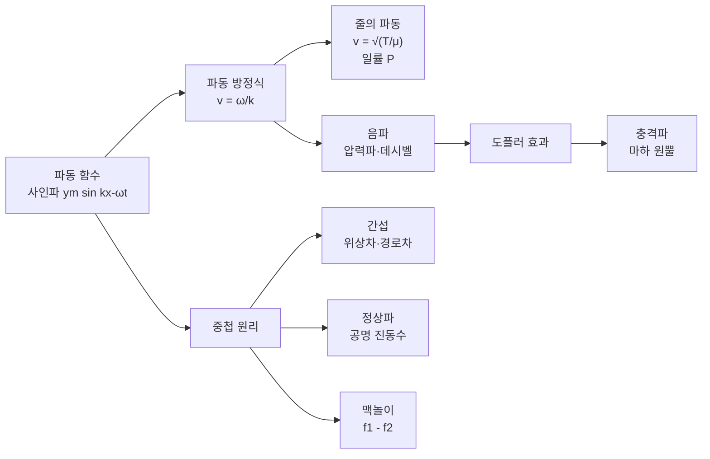

# 일반물리학 6. 파동과 소리 — 파동 함수 하나로 읽는 줄, 공기, 그리고 음속의 벽
<!-- prev: mech-3, phy-3, m2-03, uphy-5 -->
<!-- next: uphy-11, uphy-10, uphy-12 -->

> [!NOTE]
> **이 단원의 범위**
> - 파동 함수 $y(x, t)$와 파동 속력, 파동 방정식
> - 줄의 파동 속력 $\sqrt{T/\mu}$와 에너지 전달(일률)
> - 중첩과 간섭(위상차와 합성 진폭)
> - 반사와 정상파, 줄과 관의 공명 진동수
> - 음파(변위파와 압력파, 음속, 세기와 데시벨), 맥놀이, 도플러 효과와 충격파

**학습 목표**

1. 진행파를 파동 함수 $y(x, t) = y_m\sin(kx - \omega t + \phi)$로 나타내고, 편미분으로 매질의 속도·가속도와 파동 속력 $v = \omega/k$를 구분할 수 있다.
2. 줄의 작은 조각에 뉴턴 법칙을 적용해 파동 방정식과 파동 속력 $v = \sqrt{T/\mu}$를 유도하고, 줄이 전달하는 평균 일률을 계산할 수 있다.
3. 중첩 원리를 이용해 같은 방향으로 진행하는 두 파동의 합성 진폭을 위상차로 나타내고, 경로차에 따른 간섭 조건을 적용할 수 있다.
4. 반대 방향으로 진행하는 두 파동의 중첩으로 정상파를 유도하고, 줄과 관의 경계 조건으로 공명 진동수를 구할 수 있다.
5. 음파를 변위파와 압력파로 기술하고, 음속을 매질의 탄성과 밀도로 설명하며, 세기와 데시벨을 계산할 수 있다.
6. 맥놀이 진동수를 삼각 함수 공식으로 유도하고, 파원과 관찰자가 모두 움직이는 도플러 효과와 충격파의 마하 원뿔을 정량적으로 설명할 수 있다.

**이 단원의 학습 사다리**

| 단계 | 무엇을 하나? |
|---|---|
| STEP 1. 이전 학습 다시 보기 | 중학교 「빛과 파동」, 물리학 「빛과 물질」의 간섭, 「탄성파와 소리」의 반사·정상파·도플러 효과를 꺼내 본다 |
| STEP 2. 기초 다지기 | 두 변수 함수와 편미분, 사인 함수의 위상, 삼각 함수의 합 공식, 로그 |
| STEP 3. 핵심 개념 | 파동 함수 → 줄의 파동 속력과 에너지 → 중첩과 간섭 → 정상파와 공명 → 음파 → 맥놀이 → 도플러 효과와 충격파 |
| STEP 4. 오개념 바로잡기 | "매질의 속도 = 파동의 속력", "소리가 2배로 커지면 dB도 2배" 같은 착각 |
| STEP 5. 한 걸음 더 | 푸리에 분석, 분산과 군속도, 경계면의 반사·투과 계수 맛보기 |
| STEP 6. 생활·산업·진로 | 악기와 음향 설계, 초음파 진단, 소음 관리, 초음속 비행 |

---

## 🗺️ 단원 들어가기

기타 줄을 튕기면 줄은 1초에 수백 번 떨리지만, 줄을 따라 오가는 파동은 초속 100 m가 넘게 달린다. 같은 줄을 조금 더 팽팽하게 감으면 음이 높아지는데, 정확히 얼마나 감아야 반음이 올라갈까? 두 대의 기타가 거의 같은 음을 낼 때 들리는 '우웅–우웅' 하는 울렁임은 무엇이고, 조율사는 왜 그 울렁임이 사라질 때까지 줄을 돌릴까? 하늘을 가르는 초음속 전투기는 지나간 **뒤에야** 천둥 같은 소리를 남긴다.

고등학교에서는 파동을 파장·진동수·속력이라는 몇 개의 숫자로 다루었다. 대학에서는 파동 전체를 하나의 함수 $y(x, t)$로 쓰고, **뉴턴 법칙에서 파동 방정식을 이끌어 내어** 속력이 왜 그 값이 되는지, 에너지가 얼마나 실려 가는지, 두 파동이 겹치면 정확히 어떤 모양이 되는지를 계산한다. 이 단원의 도구들은 빛(전자기파)과 물질파(양자역학)에도 그대로 이어진다.

---

## STEP 1. 🔙 이전 학습 다시 보기

### 연계 개념표

| 이전 단원 | 그때 배운 것(고등학교에서는 여기까지) | 이 단원에서 확장되는 것 |
|---|---|---|
| 중학교 과학 「빛과 파동」 | 파동은 진동이 전달되는 현상, 진폭·진동수·파장, 소리의 3요소 | 파동을 함수로 기술하고, 소리의 세기를 압력 진폭과 데시벨로 정량화한다 |
| 고등학교 물리학 「빛과 물질」 '파동의 중첩', '빛의 간섭' | 중첩 원리, 보강·상쇄 간섭의 경로차 조건 | 임의의 **위상차**에 대한 합성 진폭 $2y_m\cos(\phi/2)$를 유도한다 |
| 고등학교 「역학과 에너지」 '탄성파와 소리' | $v = f\lambda$, 탄성파의 진행·반사, 현과 관의 정상파 $f_n = nv/2L$, 도플러 효과(파원 또는 관찰자 하나만 움직임) | 정상파를 두 진행파의 합으로 **유도**하고, 파동 속력을 $\sqrt{T/\mu}$, $\sqrt{B/\rho}$로 계산하며, 맥놀이·충격파를 추가한다 |
| 일반물리학 「중력·진동·유체」 | 단순 조화 운동 $x = A\cos(\omega t + \phi)$, 에너지 $\frac12kA^2$, 공명 | 매질의 각 점이 단순 조화 운동을 하며, 그 위상이 위치에 따라 달라지는 것이 파동이다 |

### 준비 운동 (사전 진단)

**Q1.** 진동수 500 Hz인 소리가 공기 중에서 340 m/s로 진행한다. 파장과 주기는?

**Q2.** 양 끝이 고정된 길이 0.50 m인 줄에서 기본 진동의 파장은?

**Q3.** $\sin A + \sin B$를 곱의 꼴로 나타내시오.

**Q4.** $\log_{10}1000$과 $10\log_{10}2$의 값은?

정답 및 해설

**Q1.** $\lambda = v/f = 0.68\ \mathrm{m}$, $T = 1/f = 2.0\times10^{-3}\ \mathrm{s}$

**Q2.** $1.0\ \mathrm{m}$ — 양 끝이 마디이고 그 사이에 반 파장이 들어가므로 $\lambda_1 = 2L$이다.

**Q3.** $\sin A + \sin B = 2\sin\dfrac{A + B}{2}\cos\dfrac{A - B}{2}$ — 이 공식 하나로 간섭, 정상파, 맥놀이가 모두 유도된다.

**Q4.** 3, 약 3.0 — 세기가 2배가 되면 데시벨은 약 3 dB 커진다.

---

## STEP 2. 🧱 기초 다지기

### 디딤돌 1. 두 변수 함수와 편미분

줄 위의 위치 $x$에 있는 점의 시각 $t$에서의 변위 $y$는 두 변수의 함수 $y(x, t)$이다. 한 변수만 변화시키고 다른 변수는 고정한 채 미분하는 것을 **편미분**이라 하고 $\partial$로 쓴다.

| 편미분 | 고정하는 것 | 물리적 의미 |
|---|---|---|
| $\dfrac{\partial y}{\partial t}$ | 위치 $x$ | 한 점의 **매질 속도**(위아래로 움직이는 빠르기) |
| $\dfrac{\partial^2 y}{\partial t^2}$ | 위치 $x$ | 한 점의 매질 가속도 |
| $\dfrac{\partial y}{\partial x}$ | 시각 $t$ | 어느 순간의 줄의 **기울기**(사진 속 줄의 모양) |
| $\dfrac{\partial^2 y}{\partial x^2}$ | 시각 $t$ | 줄의 휘어진 정도(곡률) |

예를 들어 $y = 3x^2t$이면 $\partial y/\partial x = 6xt$, $\partial y/\partial t = 3x^2$이다. 계산은 보통의 미분과 같고, 고정한 변수를 상수로 보기만 하면 된다.

### 디딤돌 2. 사인 함수의 위상

$\sin\theta$는 $\theta$가 $2\pi$ 늘 때마다 같은 값을 반복한다. 파동 함수의 괄호 안 $kx - \omega t + \phi$를 **위상**이라 한다.

- $x$가 $\lambda$만큼 늘면 위상이 $2\pi$ 늘어야 하므로 $k\lambda = 2\pi$ → **각파수(angular wave number)** $k = 2\pi/\lambda$ (rad/m)
- $t$가 $T$만큼 늘면 위상이 $2\pi$ 변해야 하므로 $\omega T = 2\pi$ → 각진동수 $\omega = 2\pi/T = 2\pi f$
- 위상이 $\pi$ 다르면 부호가 반대(마루와 골), $2\pi$의 정수배만큼 다르면 같은 상태이다.

### 디딤돌 3. 삼각 함수의 합과 곱

$$
\sin A + \sin B = 2\sin\frac{A + B}{2}\cos\frac{A - B}{2}, \qquad \cos A + \cos B = 2\cos\frac{A + B}{2}\cos\frac{A - B}{2}
$$

같은 진폭의 두 사인 함수를 더하면, **평균 위상**으로 진동하는 사인 함수에 **위상 차이의 절반**의 코사인이 곱해진 꼴이 된다. 이 단원에서는 이 공식을 세 번 쓴다.

| $A$와 $B$의 차이 | 결과 | 현상 |
|---|---|---|
| 상수(위상차 $\phi$) | 진폭이 $2y_m\cos(\phi/2)$인 진행파 | 간섭 |
| $x$에 대한 부분과 $t$에 대한 부분이 나뉨 | $\sin kx\cos\omega t$ 꼴 | 정상파 |
| 진동수가 조금 다름 | 천천히 변하는 진폭 × 빠른 진동 | 맥놀이 |

### 디딤돌 4. 로그와 데시벨

$\log_{10}(ab) = \log_{10}a + \log_{10}b$이므로, 곱하기가 더하기로 바뀐다. 사람의 귀는 세기가 $10^{12}$배나 차이 나는 소리를 들을 수 있어서, 세기 자체보다 그 비의 로그로 나타내는 것이 편하다.

| 세기의 비 | $10\log_{10}(\text{비})$ |
|---|---|
| 2배 | +3.0 dB |
| 10배 | +10 dB |
| 100배 | +20 dB |
| 1/2 | −3.0 dB |
| 1/4 | −6.0 dB |

---

## STEP 3. 📘 핵심 개념

### ① 파동 함수와 파동 속력

#### (1) 모양이 그대로 움직이는 함수

시각 $t = 0$에 줄의 모양이 $y = f(x)$인 펄스가 모양을 유지한 채 $+x$ 방향으로 속력 $v$로 진행한다고 하자. 시각 $t$에는 모양 전체가 $vt$만큼 오른쪽으로 옮겨 가 있으므로

$$
y(x, t) = f(x - vt) \quad (+x\text{ 방향}), \qquad y(x, t) = f(x + vt) \quad (-x\text{ 방향})
$$

이다. $x$와 $t$가 반드시 $x - vt$라는 묶음으로만 들어 있으면 그 함수는 $+x$ 방향의 진행파이다. 함수 $f$를 아무것이나 골라도 된다는 점이 중요하다. 펄스, 사인파, 어떤 모양이든 모양을 유지하며 진행할 수 있다.

#### (2) 사인파

매질의 각 점이 단순 조화 운동을 하는 **사인파**(조화파)는

$$
y(x, t) = y_m\sin(kx - \omega t + \phi)
$$

이다. $kx - \omega t = k\left(x - \dfrac{\omega}{k}t\right)$이므로 이는 $f(x - vt)$ 꼴이고, 파동 속력은

$$
v = \frac{\omega}{k} = \frac{\lambda}{T} = f\lambda
$$

이다. 위상이 일정한 점(예: 마루, $kx - \omega t = $ 일정)을 따라가면 $dx/dt = \omega/k$이므로 이 속력을 **위상 속도**라고도 한다.

<!-- fig:uphy-6-wave-snapshot -->

#### (3) 매질의 속도는 파동 속력과 다르다

매질 한 점의 가로 방향 속도와 가속도는 $x$를 고정하고 미분하여 얻는다.

$$
u = \frac{\partial y}{\partial t} = -\omega y_m\cos(kx - \omega t + \phi), \qquad a_y = \frac{\partial^2y}{\partial t^2} = -\omega^2y
$$

| 구분 | 파동 속력 $v$ | 매질 속도 $u$ |
|---|---|---|
| 무엇의 속도인가 | 파동의 모양(위상)이 진행하는 빠르기 | 매질 한 점이 제자리에서 진동하는 빠르기 |
| 방향 | 진행 방향($x$) | 횡파에서는 진행 방향에 수직($y$) |
| 시간에 따라 | 일정 | 사인 함수로 변한다(최댓값 $\omega y_m$) |
| 결정하는 것 | 매질의 성질(장력, 밀도 등) | 파원의 진폭과 진동수 |

#### 예제 1 — 파동 함수 읽기

줄을 따라 진행하는 파동이 $y = (0.020\ \mathrm{m})\sin\left[(4.0\ \mathrm{rad/m})x - (600\ \mathrm{rad/s})t\right]$이다. (1) 진행 방향 (2) 파장, 진동수, 파동 속력 (3) 줄 위 한 점의 최대 속력과 최대 가속도를 구하시오.

**풀이**
- (1) $kx - \omega t$ 꼴이므로 $+x$ 방향
- (2) $\lambda = 2\pi/k = 1.57\ \mathrm{m}$, $f = \omega/2\pi = 95.5\ \mathrm{Hz}$, $v = \omega/k = 150\ \mathrm{m/s}$
- (3) $u_{\max} = \omega y_m = 600\times0.020 = 12\ \mathrm{m/s}$, $a_{\max} = \omega^2y_m = 7.2\times10^{3}\ \mathrm{m/s^2}$

**의미** 줄의 한 점은 최대 12 m/s로 위아래로 움직이지만, 파동은 150 m/s로 옆으로 달린다. 두 속도는 전혀 다른 양이며 크기도 아무 관계가 없다. 진폭을 키우면 $u_{\max}$는 커지지만 $v$는 그대로이다.

#### (4) 파동 방정식

$y = f(x - vt)$를 두 번씩 편미분하면(연쇄 법칙, $s = x - vt$로 두고)

$$
\frac{\partial^2y}{\partial x^2} = f''(s), \qquad \frac{\partial^2y}{\partial t^2} = v^2f''(s)
$$

이므로 어떤 진행파든 다음 **파동 방정식(wave equation)** 을 만족한다.

$$
\frac{\partial^2y}{\partial x^2} = \frac{1}{v^2}\frac{\partial^2y}{\partial t^2}
$$

거꾸로, 어떤 매질에 뉴턴 법칙을 적용했더니 이 꼴의 식이 나오면 그 매질에는 파동이 생기고, 계수에서 **파동 속력을 읽어 낼 수 있다.** 이것이 다음 소절에서 쓸 전략이다.

#### ✔ 바로 확인

1. $y = (0.030\ \mathrm{m})\sin(2.0x + 8.0t)$ ($x$는 m, $t$는 s)인 파동의 진행 방향과 속력은?
2. (O/X) 줄을 더 크게(진폭을 크게) 흔들면 파동 속력이 커진다.
3. 파장 0.50 m, 진동수 200 Hz인 파동의 속력은?
4. 빈칸: 매질 한 점의 속도는 $y(x, t)$를 (    )에 대해 편미분하여 얻는다.

정답

1. $-x$ 방향, $4.0\ \mathrm{m/s}$ — $kx + \omega t$ 꼴이고 $v = \omega/k$.
2. X — 진폭이 키우는 것은 매질 속도 $u$의 최댓값 $\omega y_m$이다.
3. $100\ \mathrm{m/s}$ — $v = f\lambda$.
4. $t$ — $x$를 고정한다.

---

### ② 줄의 파동 속력과 에너지 전달

#### (1) 파동 속력 $v = \sqrt{T/\mu}$의 유도

장력 $T$로 당겨진 줄(단위 길이당 질량 $\mu$)에서 $x$와 $x + dx$ 사이의 작은 조각을 보자. 진폭이 작아 장력의 크기는 어디서나 $T$이고, 줄의 기울기가 작다고 가정한다.

- 조각의 양 끝에서 장력의 가로(y) 성분은 기울기에 비례한다: 오른쪽 끝 $T\left(\dfrac{\partial y}{\partial x}\right)_{x + dx}$, 왼쪽 끝 $-T\left(\dfrac{\partial y}{\partial x}\right)_x$
- 알짜 가로 힘: $T\left[\left(\dfrac{\partial y}{\partial x}\right)_{x + dx} - \left(\dfrac{\partial y}{\partial x}\right)_x\right] = T\dfrac{\partial^2y}{\partial x^2}dx$
- 뉴턴 제2법칙: $T\dfrac{\partial^2y}{\partial x^2}dx = (\mu\,dx)\dfrac{\partial^2y}{\partial t^2}$

<!-- fig:uphy-6-string-element -->

정리하면 $\dfrac{\partial^2y}{\partial x^2} = \dfrac{\mu}{T}\dfrac{\partial^2y}{\partial t^2}$로, 파동 방정식과 비교하여

$$
v = \sqrt{\frac{T}{\mu}}
$$

이다. 고등학교에서 "되돌리는 힘이 셀수록 빠르고, 무거울수록 느리다"고 한 말이 이 식이다. 줄이 휘어진 곳(곡률이 큰 곳)일수록 장력이 조각을 세게 되돌리고, 그것이 가속도를 만든다. 차원 분석으로도 확인할 수 있다: $\sqrt{\mathrm{N}/(\mathrm{kg/m})} = \sqrt{\mathrm{m^2/s^2}} = \mathrm{m/s}$.

| 바꾸는 것 | 파동 속력 | 같은 길이 줄의 기본 진동수 |
|---|---|---|
| 장력을 4배로 | 2배 | 2배(한 옥타브 위) |
| 같은 재료로 지름을 2배로($\mu$ 4배) | 1/2배 | 1/2배 |
| 진폭을 키움 | 변하지 않음(작은 진폭 근사 안에서) | 변하지 않음 |
| 진동수를 바꿈 | 변하지 않음 | — (파장이 바뀜) |

#### 예제 2 — 기타 줄의 장력 맞추기

진동하는 길이가 0.65 m이고 선밀도가 $5.0\ \mathrm{g/m}$인 기타 줄이 있다. (1) 장력이 80 N일 때 기본 진동수 (2) 기본 진동수를 110 Hz(A2 음)로 맞추는 데 필요한 장력을 구하시오.

**풀이**
- (1) $v = \sqrt{80/0.0050} = 126\ \mathrm{m/s}$, $f_1 = v/2L = 126/1.30 = 97.3\ \mathrm{Hz}$
- (2) $f_1 = \dfrac{1}{2L}\sqrt{\dfrac{T}{\mu}}$ → $T = \mu(2Lf_1)^2 = 0.0050\times(1.30\times110)^2 = 102\ \mathrm{N}$

**의미** 진동수를 13 % 올리려면 장력은 약 28 % 올려야 한다($T \propto f^2$). 기타 한 대의 줄 여섯 개가 합쳐서 수백 N(수십 kg의 무게)으로 목을 당기고 있어서, 기타 목 속에 휨을 막는 금속 막대를 넣는다.

#### (2) 파동이 실어 나르는 에너지와 일률

사인파가 지나가는 줄의 조각 $dx$는 운동 에너지와 (늘어남에 의한) 탄성 퍼텐셜 에너지를 가진다.

- 운동 에너지: $dK = \frac12(\mu\,dx)u^2 = \frac12\mu\,dx\,\omega^2y_m^2\cos^2(kx - \omega t)$
- 퍼텐셜 에너지: 조각이 늘어난 정도는 기울기의 제곱에 비례하므로 $dU = \frac12T\left(\dfrac{\partial y}{\partial x}\right)^2dx = \frac12T k^2y_m^2\cos^2(kx - \omega t)\,dx$. 여기서 $Tk^2 = \mu v^2k^2 = \mu\omega^2$이므로 $dK$와 **같다.**

단진동하는 추와 달리, 진행파에서는 운동 에너지와 퍼텐셜 에너지가 **같은 위상**이다. 평형 위치($y = 0$)를 지나는 조각이 가장 빠르고 동시에 가장 많이 늘어나 있으며, 마루와 골의 조각은 정지해 있고 늘어나지도 않는다.

$\cos^2$의 시간 평균은 $1/2$이므로, 단위 길이당 평균 에너지는 $\frac12\mu\omega^2y_m^2$이고, 이 에너지가 속력 $v$로 실려 가므로 평균 **일률**은

$$
P_{\text{평균}} = \frac12\mu v\omega^2y_m^2
$$

이다. 일률은 **진폭의 제곱과 진동수의 제곱에 비례한다.** 이 '제곱 비례'는 모든 역학적 파동(음파, 지진파, 수면파)에 공통이다.

#### 예제 3 — 줄을 흔드는 데 필요한 일률

예제 2의 줄(선밀도 $5.0\ \mathrm{g/m}$, 장력 80 N)을 한쪽 끝에서 진동수 100 Hz, 진폭 2.0 mm로 흔들어 사인파를 계속 보낸다. 필요한 평균 일률은?

**풀이** $\omega = 2\pi\times100 = 628\ \mathrm{rad/s}$, $v = 126\ \mathrm{m/s}$이므로

$$
P = \frac12(0.0050)(126)(628)^2(2.0\times10^{-3})^2 = 0.50\ \mathrm{W}
$$

**의미** 진폭을 2배로 하면 4배인 2.0 W, 진동수까지 2배로 하면 16배인 8.0 W가 필요하다. 지진에서 진동수와 진폭이 큰 파동이 엄청난 에너지를 실어 나르는 이유이다.

#### ✔ 바로 확인

1. 줄의 장력을 9배로 하면 파동 속력은 몇 배가 되는가?
2. 선밀도 0.010 kg/m, 장력 64 N인 줄의 파동 속력은?
3. 진동수는 그대로 두고 진폭만 2배로 하면 줄이 전달하는 평균 일률은 몇 배가 되는가?

정답

1. 3배 — $v = \sqrt{T/\mu}$.
2. $80\ \mathrm{m/s}$ — $\sqrt{64/0.010}$.
3. 4배 — 일률은 진폭의 제곱에 비례한다.

---

### ③ 중첩과 간섭

#### (1) 중첩 원리

두 파동 $y_1(x, t)$, $y_2(x, t)$가 같은 매질에서 만나면 합성 변위는

$$
y(x, t) = y_1(x, t) + y_2(x, t)
$$

이다(**중첩 원리, principle of superposition**). 이는 파동 방정식이 $y$에 대해 **선형**이기 때문이다. $y_1$과 $y_2$가 각각 파동 방정식의 해이면 그 합도 해이다. 그래서 만난 뒤에도 각 파동은 서로를 방해하지 않고 원래 모양대로 지나간다. (진폭이 매우 커서 줄의 장력이 크게 변하면 방정식이 비선형이 되어 중첩 원리가 깨진다.)

#### (2) 같은 방향, 같은 진동수, 위상만 다른 두 파동

$y_1 = y_m\sin(kx - \omega t)$와 $y_2 = y_m\sin(kx - \omega t + \phi)$를 더하면 디딤돌 3의 공식으로

$$
y = \left[2y_m\cos\frac{\phi}{2}\right]\sin\left(kx - \omega t + \frac{\phi}{2}\right)
$$

합성파는 같은 진동수·같은 방향의 사인파이고, 진폭은 $y_m' = 2y_m\left\lvert\cos\dfrac{\phi}{2}\right\rvert$이다.

<!-- fig:uphy-6-phase-sum -->

| 위상차 $\phi$ | 합성 진폭 | 간섭 |
|---|---|---|
| $0, 2\pi, 4\pi, \dots$ | $2y_m$ | 완전 보강 간섭 |
| $\pi/2$ | $\sqrt2\,y_m \approx 1.41y_m$ | 중간 |
| $2\pi/3$ | $y_m$ | 중간 |
| $\pi, 3\pi, \dots$ | 0 | 완전 상쇄 간섭 |

일률은 진폭의 제곱에 비례하므로, 완전 보강일 때 한 파동의 **4배**이다(2배가 아니다). 다른 곳에서 상쇄된 에너지가 이곳으로 모인 것이며, 전체 에너지는 보존된다.

#### 예제 4 — 위상차와 합성 진폭

진폭이 각각 3.0 mm인 두 사인파가 같은 방향으로 진행한다. 위상차가 (1) $\pi/2$ (2) $2\pi/3$일 때 합성 진폭은?

**풀이** (1) $2(3.0)\cos(\pi/4) = 4.2\ \mathrm{mm}$ (2) $2(3.0)\cos(\pi/3) = 3.0\ \mathrm{mm}$

**의미** 위상차 $120^\circ$에서는 두 파동을 더해도 한 파동과 진폭이 같다. 간섭은 '보강'과 '상쇄' 두 가지만 있는 것이 아니라 위상차에 따라 연속적으로 변한다.

> [!TIP]
> 💡 **요령(위상자)** — 각 파동을 길이 $y_m$, 각 $\phi$인 화살표(위상자)로 그려 벡터처럼 이어 붙이면, 합성 화살표의 길이가 합성 진폭이다. 진폭이 서로 다른 파동도 이렇게 더할 수 있다. 진폭 $y_1$, $y_2$, 위상차 $\phi$이면 코사인 법칙으로 $y_m'^2 = y_1^2 + y_2^2 + 2y_1y_2\cos\phi$이다. 「빛과 광학」의 다중 슬릿 간섭에서 다시 쓴다.

#### (3) 경로차가 만드는 위상차

같은 위상으로 진동하는 두 파원에서 나온 파동이 각각 $r_1$, $r_2$를 진행해 한 점에서 만나면, 경로차 $\Delta r = \lvert r_1 - r_2 \rvert$ 때문에 위상차

$$
\phi = k\Delta r = \frac{2\pi}{\lambda}\Delta r
$$

가 생긴다. 따라서 보강 간섭은 $\Delta r = m\lambda$, 상쇄 간섭은 $\Delta r = (m + \frac12)\lambda$ ($m = 0, 1, 2, \dots$)이다. 고등학교에서 배운 경로차 조건은 이 위상차 식의 특수한 경우이다. 파원 자체에 처음부터 위상차 $\phi_0$이 있으면 전체 위상차는 $k\Delta r + \phi_0$이다.

#### ✔ 바로 확인

1. 진폭이 같은 두 사인파의 위상차가 $\pi$이면 합성 진폭은?
2. 같은 위상으로 진동하는 두 파원에서 경로차가 $1.5\lambda$인 점은 보강 간섭인가, 상쇄 간섭인가?
3. (O/X) 완전 보강 간섭하는 점의 세기는 한 파동 세기의 2배이다.

정답

1. 0 — 완전 상쇄 간섭, $2y_m\cos(\pi/2) = 0$.
2. 상쇄 간섭 — $(m + \frac12)\lambda$ 꼴이다.
3. X — 진폭이 2배이므로 세기는 4배이다.

---

### ④ 반사와 정상파, 공명 진동수

#### (1) 경계에서의 반사

| 끝의 조건 | 경계 조건 | 반사파 |
|---|---|---|
| 고정단 | 끝점의 변위 $y = 0$ | 위상이 $\pi$ 바뀐다(뒤집힘) |
| 자유단 | 끝점의 기울기 $\partial y/\partial x = 0$ (가로 힘이 0) | 위상 변화 없음 |

고정단에서 들어온 파동과 반사파의 합이 끝점에서 늘 0이 되려면 반사파가 뒤집혀야 한다. 자유단에서는 끝점에 가로 힘이 작용하지 않으므로 기울기가 0이어야 하고, 이를 만족하는 반사파는 뒤집히지 않는다.

<!-- fig:uphy-6-reflection-ends -->

#### (2) 정상파의 유도

진폭과 진동수가 같고 반대 방향으로 진행하는 두 파동 $y_1 = y_m\sin(kx - \omega t)$, $y_2 = y_m\sin(kx + \omega t)$를 더하면

$$
y = 2y_m\sin kx\cos\omega t
$$

$x$와 $t$가 **따로 떨어진 두 인자**의 곱이 되었다. 더 이상 $x - vt$ 꼴이 아니므로 진행하지 않는다. 위치 $x$의 점은 진폭 $\lvert 2y_m\sin kx \rvert$로 제자리에서 단진동한다. 이것이 **정상파(standing wave)** 이다.

- **마디(node)**: $\sin kx = 0$ → $x = n\lambda/2$ ($n = 0, 1, 2, \dots$). 언제나 정지.
- **배(antinode)**: $\lvert\sin kx\rvert = 1$ → $x = (n + \frac12)\lambda/2$. 진폭 $2y_m$.
- 모든 점이 같은 위상($\cos\omega t$)으로 진동하고, 마디를 사이에 둔 이웃 구간은 반대 위상이다.
- 마디에서는 매질이 움직이지 않으므로 에너지가 마디를 넘어가지 않는다. 에너지는 각 구간 안에서 운동 에너지(배 근처)와 퍼텐셜 에너지(마디 근처의 늘어남) 사이를 오간다.

<!-- sim:u-superposition -->

#### (3) 양 끝 고정 줄의 공명 진동수

길이 $L$인 줄의 양 끝($x = 0$, $x = L$)이 모두 마디여야 하므로 $\sin kL = 0$, 즉 $kL = n\pi$이다.

$$
\lambda_n = \frac{2L}{n}, \qquad f_n = \frac{nv}{2L} = \frac{n}{2L}\sqrt{\frac{T}{\mu}} \quad (n = 1, 2, 3, \dots)
$$

경계 조건이 허용하는 이 진동수들에서만 정상파가 생기며, 이를 **공명 진동수**(고유 진동수)라 한다. 줄을 이 진동수로 흔들면 반사파들이 같은 위상으로 계속 쌓여 큰 진폭이 생긴다(「중력·진동·유체」의 공명). 하나의 진동자는 고유 진동수가 하나였지만, 연속체인 줄은 **무한히 많은 고유 진동수**를 가진다.

| 모드 | 이름 | 배의 수 | 진동수 |
|---|---|---|---|
| $n = 1$ | 기본 진동(제1 조화) | 1 | $f_1 = v/2L$ |
| $n = 2$ | 제2 조화(제1 배음) | 2 | $2f_1$ |
| $n = 3$ | 제3 조화(제2 배음) | 3 | $3f_1$ |

#### 예제 5 — 진동자로 정상파 만들기

양 끝이 고정된 길이 1.20 m인 줄(선밀도 $1.6\ \mathrm{g/m}$)을 120 Hz로 흔들었더니 배가 4개인 정상파가 생겼다. 줄의 파동 속력과 장력을 구하시오.

**풀이**
- 배 4개 → $n = 4$, $\lambda = 2L/4 = 0.60\ \mathrm{m}$
- $v = f\lambda = 120\times0.60 = 72\ \mathrm{m/s}$
- $T = \mu v^2 = 0.0016\times72^2 = 8.3\ \mathrm{N}$

**의미** 진동수를 고정한 채 장력을 늘이면 속력이 커져 배의 수가 3, 2, 1로 줄어든다. 장력을 연속적으로 바꾸어도 정상파는 특정 장력에서만 또렷하게 나타난다. 이 실험(멜드의 실험)으로 $v = \sqrt{T/\mu}$를 확인할 수 있다.

#### (4) 관 속 공기 기둥의 공명

관 속 음파에서는 **공기 입자의 변위**에 대한 경계 조건을 쓴다.

| 관 | 끝의 조건(변위) | 공명 조건 | 공명 진동수 |
|---|---|---|---|
| 열린 관(양 끝 열림) | 배–배 | $L = n\lambda/2$ | $f_n = nv/2L$, $n = 1, 2, 3, \dots$ |
| 닫힌 관(한쪽 막힘) | 마디–배 | $L = n\lambda/4$, $n$ 홀수 | $f_n = nv/4L$, $n = 1, 3, 5, \dots$ |

열린 끝의 변위 배는 실제로는 관 입구보다 약간 바깥에 생긴다. 반지름 $r$인 관에서 이 **끝 보정**은 열린 끝 하나당 약 $0.6r$이다. 그래서 정확한 계산에서는 유효 길이 $L + 0.6r$(열린 끝 수만큼)을 쓴다.

<!-- fig:uphy-6-pipe-modes -->

#### 예제 6 — 끝 보정이 있는 열린 관

길이 0.60 m, 반지름 1.0 cm인 열린 관의 기본 진동수를 (1) 끝 보정 없이 (2) 양 끝에 $0.6r$씩 보정하여 구하시오. (음속 343 m/s)

**풀이** (1) $f_1 = 343/(2\times0.60) = 286\ \mathrm{Hz}$ (2) $L_{\text{eff}} = 0.60 + 2(0.006) = 0.612\ \mathrm{m}$, $f_1 = 343/1.224 = 280\ \mathrm{Hz}$

**의미** 2 % 차이는 음악적으로는 약 $1/3$ 반음으로, 귀에 분명히 들리는 차이이다. 관악기 제작자는 이런 보정을 경험과 측정으로 맞춘다.

#### ✔ 바로 확인

1. 정상파에서 이웃한 두 마디 사이의 거리는 파장의 몇 배인가?
2. 양 끝이 고정된 길이 0.80 m인 줄의 파동 속력이 240 m/s이다. 기본 진동수는?
3. (O/X) 한쪽이 막힌 관은 기본 진동수의 2배 진동수로도 공명한다.
4. 빈칸: 고정단에서 반사된 파동은 위상이 (    )만큼 바뀐다.

정답

1. 1/2배.
2. $150\ \mathrm{Hz}$ — $f_1 = v/2L$.
3. X — 닫힌 관은 홀수 배만 공명한다.
4. $\pi$ — 반사파가 뒤집힌다.

---

### ⑤ 음파 — 변위파와 압력파

#### (1) 음속은 탄성과 밀도가 정한다

유체 속 음파는 압축과 팽창이 전달되는 종파이다. 줄의 $v = \sqrt{T/\mu}$와 같은 논리로(되돌리는 성질/관성), 유체 속 음속은

$$
v = \sqrt{\frac{B}{\rho}}, \qquad B = -\frac{\Delta P}{\Delta V/V}
$$

이다. $B$는 **부피 탄성률(bulk modulus)** 로, 같은 압력 변화에 부피가 얼마나 적게 변하는지를 나타낸다. 물은 공기보다 약 800배 무겁지만 $B$가 약 15 000배 크므로 음속이 약 4배 빠르다.

음파의 압축·팽창은 열이 이동할 틈 없이 빨리 일어나므로 **단열 과정**이다. 이상 기체의 단열 부피 탄성률은 $B = \gamma P$이고($\gamma = C_p/C_V$, 공기 1.40), $P/\rho = RT/M$이므로

$$
v = \sqrt{\frac{\gamma P}{\rho}} = \sqrt{\frac{\gamma RT}{M}}
$$

음속은 기체의 **온도와 몰질량**으로 정해지고, 압력에는 의존하지 않는다. 뉴턴은 처음에 등온 과정($B = P$)으로 계산하여 실제보다 약 15 % 작은 값을 얻었고, 이 차이는 훗날 라플라스가 단열 과정으로 바로잡았다.

| 매질 | 계산 또는 측정값(약) |
|---|---|
| 공기 $20^\circ\mathrm{C}$ | $\sqrt{1.40\times8.314\times293/0.0290} = 343\ \mathrm{m/s}$ |
| 공기 $20^\circ\mathrm{C}$(등온 가정, 틀린 값) | $290\ \mathrm{m/s}$ |
| 헬륨 $20^\circ\mathrm{C}$ ($\gamma = 1.67$, $M = 0.0040$) | $1.0\times10^{3}\ \mathrm{m/s}$ |
| 물($B = 2.2\times10^{9}\ \mathrm{Pa}$) | $1.5\times10^{3}\ \mathrm{m/s}$ |
| 강철(막대를 따라) | 약 $5\times10^{3}\ \mathrm{m/s}$ |

헬륨을 들이마시고 말하면 목소리가 높아지는 것은, 성도(목과 입 안의 공기 기둥)의 길이는 그대로인데 음속이 빨라져 공명 진동수가 높아지기 때문이다. 성대의 진동수가 높아진 것이 아니다.

#### (2) 변위파와 압력파

공기 조각의 진행 방향 변위를 $s(x, t)$라 하면 사인 음파는 $s = s_m\cos(kx - \omega t)$이다. 조각의 부피 변화율은 $\partial s/\partial x$이므로 부피 탄성률의 정의에서 압력 변화는

$$
\Delta p = -B\frac{\partial s}{\partial x} = Bks_m\sin(kx - \omega t) = \Delta p_m\sin(kx - \omega t), \qquad \Delta p_m = (v\rho\omega)s_m
$$

($B = \rho v^2$, $k = \omega/v$ 이용)이다. **압력파는 변위파와 위상이 $\pi/2$ 다르다.** 공기 조각이 가장 많이 밀려난 곳(변위 최대)에서는 양옆 조각이 같은 쪽으로 밀려 있어 압력이 평소와 같고, 변위가 0인 곳에서 양옆 조각이 몰려들거나 흩어져 압력 변화가 최대이다. 그래서 닫힌 관의 막힌 끝은 **변위 마디이자 압력 배**이다. 마이크와 귀는 압력 변화를 감지한다.

<!-- fig:uphy-6-displacement-pressure -->

#### (3) 세기와 데시벨

음파의 **세기(intensity)** $I$는 진행 방향에 수직인 단위 넓이를 단위 시간에 지나는 평균 에너지(W/m²)이다. 줄의 일률과 같은 방법으로

$$
I = \frac12\rho v\omega^2s_m^2 = \frac{\Delta p_m^2}{2\rho v}
$$

점파원이 일률 $P_s$로 모든 방향에 고르게 소리를 내면(흡수·반사 무시), 거리 $r$인 구면을 지나는 세기는

$$
I = \frac{P_s}{4\pi r^2}
$$

로 **거리의 제곱에 반비례**한다. 사람이 들을 수 있는 세기의 범위가 매우 넓으므로 **소리 세기 준위(sound level)** 를 데시벨로 나타낸다.

$$
\beta = (10\ \mathrm{dB})\log_{10}\frac{I}{I_0}, \qquad I_0 = 1.0\times10^{-12}\ \mathrm{W/m^2}
$$

| 소리(약) | 세기 (W/m²) | 소리 세기 준위 |
|---|---|---|
| 들을 수 있는 가장 작은 소리(1 kHz) | $10^{-12}$ | 0 dB |
| 나뭇잎 바스락거림 | $10^{-11}$ | 10 dB |
| 조용한 도서관 | $10^{-8}$ | 40 dB |
| 일상 대화 | $10^{-6}$ | 60 dB |
| 붐비는 도로 | $10^{-4}$ | 80 dB |
| 록 공연장 앞자리 | $10^{-1}$ | 110 dB |
| 통증이 느껴지는 소리 | $1$ | 120 dB |

#### 예제 7 — 소리의 압력 진폭과 변위 진폭

공기($\rho = 1.21\ \mathrm{kg/m^3}$, $v = 343\ \mathrm{m/s}$) 중의 1000 Hz 소리에 대해, (1) 통증을 느끼는 소리의 압력 진폭이 28 Pa일 때 변위 진폭과 세기, 소리 세기 준위 (2) 겨우 들리는 소리의 압력 진폭이 $2.8\times10^{-5}\ \mathrm{Pa}$일 때 변위 진폭을 구하시오.

**풀이**
- (1) $s_m = \dfrac{\Delta p_m}{v\rho\omega} = \dfrac{28}{(343)(1.21)(2\pi\times1000)} = 1.1\times10^{-5}\ \mathrm{m}$. $I = \dfrac{28^2}{2(1.21)(343)} = 0.94\ \mathrm{W/m^2}$, $\beta = 10\log_{10}(0.94\times10^{12}) \approx 120\ \mathrm{dB}$
- (2) $s_m = 1.1\times10^{-11}\ \mathrm{m}$

**의미** 귀가 아플 만큼 큰 소리에서도 공기는 0.01 mm 정도만 움직이고, 압력 변화는 대기압의 0.03 %에 불과하다. 겨우 들리는 소리의 변위는 원자 지름(약 $10^{-10}\ \mathrm{m}$)보다 작다. 사람의 귀는 놀랍도록 민감한 압력 센서이다.

#### 예제 8 — 거리에 따른 데시벨

음향 출력 1.0 W인 스피커를 점파원으로 보자. 5.0 m와 10 m 떨어진 곳의 소리 세기 준위를 구하시오.

**풀이** $I(5.0) = \dfrac{1.0}{4\pi(5.0)^2} = 3.2\times10^{-3}\ \mathrm{W/m^2}$, $\beta = 10\log_{10}(3.2\times10^{9}) = 95\ \mathrm{dB}$. 거리가 2배면 세기는 1/4이므로 $\beta = 95 - 6.0 = 89\ \mathrm{dB}$.

**의미** 점파원에서 거리가 2배가 될 때마다 약 6 dB씩 줄어든다. 똑같은 소음원 두 개가 함께 내는 소리는 70 dB + 70 dB = 140 dB가 아니라 세기가 2배이므로 **73 dB**이다(위상이 무작위인 두 소리의 세기는 더해진다).

#### ✔ 바로 확인

1. 공기의 온도가 올라가면 음속은 어떻게 되는가?
2. 소리의 세기가 1000배가 되면 소리 세기 준위는 몇 dB 커지는가?
3. 점파원에서 거리가 3배가 되면 세기는 몇 배가 되는가?
4. (O/X) 음파에서 공기 조각의 변위가 최대인 곳에서 압력 변화도 최대이다.

정답

1. 빨라진다 — $v = \sqrt{\gamma RT/M}$.
2. 30 dB — $10\log_{10}1000$.
3. 1/9배 — $I \propto 1/r^2$.
4. X — 압력파는 변위파와 위상이 $\pi/2$ 달라, 변위가 최대인 곳에서 압력 변화는 0이다.

---

### ⑥ 맥놀이

진동수가 조금 다른 두 소리 $s_1 = s_m\cos\omega_1t$, $s_2 = s_m\cos\omega_2t$가 한 점(귀)에서 겹치면

$$
s = \left[2s_m\cos\left(\frac{\omega_1 - \omega_2}{2}t\right)\right]\cos\left(\frac{\omega_1 + \omega_2}{2}t\right)
$$

이다. 귀에는 평균 진동수 $(f_1 + f_2)/2$의 소리가 들리고, 그 진폭(대괄호)이 천천히 변한다. 소리의 크기는 진폭의 **절댓값**에 따라 정해지는데, $\lvert\cos\omega't\rvert$는 $\cos\omega't$의 한 주기 동안 두 번 최대가 된다. 따라서 소리가 커졌다 작아지는 횟수는

$$
f_{\text{맥놀이}} = \lvert f_1 - f_2 \rvert
$$

이다. 이를 **맥놀이(beat)** 라 한다. 두 진동수의 차이가 약 15 Hz보다 작으면 사람은 맥놀이를 '울렁임'으로 듣고, 차이가 더 크면 거친 소리나 두 개의 음으로 듣는다.

<!-- sim:u-beats -->

#### 예제 9 — 맥놀이로 조율하기

기준 소리굽쇠(440 Hz)와 바이올린의 A현을 함께 울렸더니 1초에 3번 맥놀이가 들렸다. 현을 조금 조이자 맥놀이가 더 잦아졌다. (1) 처음 현의 진동수 (2) 정확히 맞추려면 장력을 몇 % 바꾸어야 하는가?

**풀이**
- (1) 처음 진동수는 437 Hz 또는 443 Hz이다. 조이면(진동수 증가) 맥놀이가 잦아졌으므로 440 Hz에서 멀어졌다. 따라서 **443 Hz**
- (2) $f \propto \sqrt T$이므로 $T'/T = (440/443)^2 = 0.9865$, 장력을 약 **1.4 % 줄인다**($\Delta T/T \approx 2\Delta f/f$)

**의미** 조율사는 맥놀이가 느려지다 사라지는 방향으로 줄을 돌린다. 맥놀이는 진동수의 '차'를 듣는 방법이므로 귀의 절대 음감보다 훨씬 정밀하다(0.1 Hz 수준까지 가능).

> [!NOTE]
> 맥놀이는 소리에만 있는 현상이 아니다. 진동수가 조금 다른 두 신호의 합은 어디서나 같은 꼴이 된다. 라디오 수신기는 받은 신호에 내부 발진기 신호를 섞어 차 진동수(중간 주파수)를 만들어 처리하고(헤테로다인), 도플러 레이더는 보낸 파와 받은 파의 맥놀이 진동수로 속력을 잰다.

#### ✔ 바로 확인

1. 440 Hz와 444 Hz인 두 소리가 만드는 맥놀이 진동수는?
2. (O/X) 맥놀이 진동수는 두 진동수 차의 절반이다.
3. 300 Hz 소리굽쇠와 어떤 소리를 함께 울렸더니 맥놀이 주기가 0.50 s였다. 그 소리의 진동수로 가능한 값은?

정답

1. 4 Hz — $\lvert f_1 - f_2 \rvert$.
2. X — 진폭 인자의 진동수는 차의 절반이지만, 소리 크기는 그 절댓값을 따라 한 주기에 두 번 커지므로 차와 같다.
3. 298 Hz 또는 302 Hz — 맥놀이 진동수 2 Hz.

---

### ⑦ 도플러 효과와 충격파

#### (1) 일반 공식 — 매질 기준틀에서 생각하기

음파는 **매질(공기)에 대해** 속력 $v$로 진행한다. 공기에 대해 파원이 속력 $v_S$, 관찰자가 속력 $v_D$로 같은 직선 위를 움직이는 경우를 생각하자.

- 파원의 효과: 파원이 한 주기 $T = 1/f$ 동안 $v_ST$만큼 따라가므로, 파원 **앞쪽**의 파장은 $\lambda' = (v - v_S)/f$로 짧아진다(뒤쪽은 $(v + v_S)/f$).
- 관찰자의 효과: 관찰자가 파원 쪽으로 $v_D$로 움직이면, 관찰자에 대한 파동의 상대 속력이 $v + v_D$가 되어 마루를 더 자주 만난다.

$$
f' = \frac{v + v_D}{\lambda'} = f\,\frac{v \pm v_D}{v \mp v_S}
$$

**부호 규칙**: 분자·분모 모두 위쪽 부호가 '**상대방을 향해 움직일 때**'이다. 관찰자가 파원을 향하면 분자 $+$, 파원이 관찰자를 향하면 분모 $-$. 다가가는 움직임은 언제나 진동수를 높이는 쪽이다.

<!-- fig:uphy-6-doppler-wavefronts -->

| 상황 | 공식 | 진동수 |
|---|---|---|
| 파원만 관찰자를 향해 | $f\dfrac{v}{v - v_S}$ | 높아짐 |
| 관찰자만 파원을 향해 | $f\dfrac{v + v_D}{v}$ | 높아짐 |
| 둘 다 같은 방향으로 같은 속력 | $f$ | 변하지 않음 |
| 바람이 불고 파원·관찰자는 지면에 정지 | $f$ | 변하지 않음(파장과 상대 속력이 함께 변함) |

파원이 움직일 때와 관찰자가 움직일 때의 식이 다른(같은 속력이어도 결과가 다른) 것은 **매질이라는 특별한 기준틀**이 있기 때문이다. 매질이 없는 빛에서는 상대 속도만 의미가 있고, 상대론적 도플러 식을 쓴다(STEP 5, 「현대 물리」).

#### 예제 10 — 앞차를 쫓는 경찰차

800 Hz의 사이렌을 울리는 경찰차가 30 m/s로 달리며, 같은 방향으로 20 m/s로 앞서 달리는 자동차를 쫓는다. 자동차 운전자가 듣는 진동수는? (음속 343 m/s, 바람 없음)

**풀이** 경찰차(파원)는 앞차를 향해 움직이므로 분모 $343 - 30$. 운전자(관찰자)는 파원에서 멀어지므로 분자 $343 - 20$.

$$
f' = 800\times\frac{343 - 20}{343 - 30} = 800\times\frac{323}{313} = 826\ \mathrm{Hz}
$$

**의미** 둘 사이의 거리가 10 m/s로 줄어드는 상황이다. 두 속력이 같아지면 진동수 변화가 없고, 경찰차가 더 빠를수록 높아진다.

#### 예제 11 — 박쥐의 반향 위치 측정

박쥐가 40.0 kHz의 초음파를 내며 5.0 m/s로 벽을 향해 날아간다. 벽에서 반사되어 박쥐에게 돌아오는 소리의 진동수는? (음속 343 m/s)

**풀이** 두 단계로 나눈다. ① 벽(정지 관찰자)이 받는 진동수: $f_1 = f\dfrac{v}{v - v_S}$. ② 벽이 정지 파원이 되어 $f_1$을 내고, 박쥐(다가가는 관찰자)가 받는다: $f_2 = f_1\dfrac{v + v_D}{v}$. 박쥐의 속력을 $u$ ($= v_S = v_D = 5.0\ \mathrm{m/s}$)라 하면

$$
f_2 = f\,\frac{v + u}{v - u} = 40.0\times\frac{348}{338} = 41.2\ \mathrm{kHz}
$$

**의미** 박쥐는 약 1.2 kHz 높아진 메아리로 벽(또는 먹이 곤충)이 얼마나 빨리 다가오는지 안다. $u \ll v$이면 $\Delta f \approx 2(u/v)f$로, 고등학교에서 배운 근사식과 같다.

#### (2) 충격파 — 파원이 파동보다 빠를 때

파원의 속력 $v_S$가 음속 $v$에 가까워지면 앞쪽 파장 $(v - v_S)/f$가 0에 가까워지고 파면들이 파원 앞에 겹겹이 쌓인다. 비행기는 이 압력 장벽을 '음속의 벽'으로 느낀다. $v_S > v$이면 파원이 자신이 낸 파면보다 앞서 나가고, 시각 $t$ 전에 낸 파면은 반지름 $vt$의 구로 퍼져 있는 동안 파원은 $v_St$만큼 앞에 있다. 이 구면들의 **공통 접면**이 꼭짓점을 파원에 둔 원뿔(**마하 원뿔**)을 이루며, 그 반꼭지각 $\theta$는

$$
\sin\theta = \frac{vt}{v_St} = \frac{v}{v_S} = \frac{1}{M}
$$

이다. $M = v_S/v$를 **마하 수(Mach number)** 라 한다. 원뿔 면을 따라 많은 파면이 한꺼번에 겹쳐 압력이 급격히 뛰는 것이 **충격파(shock wave)** 이며, 이 원뿔이 지상을 쓸고 지나갈 때 들리는 굉음이 **소닉 붐**이다. 소닉 붐은 비행기가 음속을 '돌파하는 순간'에만 나는 것이 아니라 초음속으로 나는 **동안 내내** 원뿔을 따라 끌려 다닌다.

<!-- fig:uphy-6-mach-cone -->

#### 예제 12 — 소닉 붐은 언제 들릴까?

음속이 295 m/s인 높이 8000 m에서 마하 2.0으로 수평 비행하는 전투기가 관찰자의 머리 바로 위를 지났다. (1) 마하 원뿔의 반꼭지각 (2) 머리 위를 지난 뒤 몇 초 뒤에 소닉 붐이 들리는가? (음속은 높이에 따라 변하지 않는다고 단순화한다.)

**풀이**
- (1) $\sin\theta = 1/2.0$ → $\theta = 30^\circ$
- (2) 원뿔 면이 관찰자에 닿을 때 비행기는 수평으로 $x = h/\tan\theta = 8000/\tan30^\circ = 1.39\times10^{4}\ \mathrm{m}$ 앞서 있다. $v_S = 2.0\times295 = 590\ \mathrm{m/s}$이므로 $t = x/v_S = 23\ \mathrm{s}$

**의미** 관찰자는 비행기가 머리 위를 지나 14 km나 멀어진 뒤에야 굉음을 듣는다. 실제 대기는 높이에 따라 음속이 달라 원뿔이 휘므로 시간은 조금 달라진다. 같은 원리로 배가 물결파보다 빨리 갈 때 V자 물결(뱃머리 파)이 생기고, 물속에서 전자가 그 매질 속 빛의 속력보다 빠르면 체렌코프 복사라는 '빛의 충격파'가 생긴다.

#### ✔ 바로 확인

1. 500 Hz 파원이 34.3 m/s로 정지한 관찰자를 향해 다가온다. 관찰자가 듣는 진동수는? (음속 343 m/s)
2. 파원과 관찰자가 모두 정지해 있고 바람만 불 때 진동수는 변하는가?
3. 마하 2.0으로 나는 비행기가 만드는 마하 원뿔의 반꼭지각은?
4. (O/X) 소닉 붐은 비행기가 음속을 넘어서는 순간에만 한 번 생긴다.

정답

1. 약 556 Hz — $500\times343/(343 - 34.3)$.
2. 변하지 않는다 — 파장과 상대 속력이 같은 비율로 변한다.
3. $30^\circ$ — $\sin\theta = 1/M$.
4. X — 초음속으로 나는 동안 내내 마하 원뿔이 따라다닌다.

---

## STEP 4. ⚠️ 오개념 바로잡기

| 흔한 오개념 | 올바른 개념 | 왜 그럴까? |
|---|---|---|
| 줄을 세게(크게) 흔들면 파동이 더 빨리 진행한다 | 파동 속력 $\sqrt{T/\mu}$는 매질이 정하며 진폭·진동수와 무관하다 | 진폭을 키우면 매질 속도 $u$와 일률이 커질 뿐이다 |
| 매질의 속도와 파동 속력은 같은 것이다 | 매질 속도 $\partial y/\partial t$는 시간에 따라 변하고 진행 방향에 수직(횡파)이며, 파동 속력은 모양이 이동하는 빠르기이다 | 두 양은 서로 다른 미분에서 나온다 |
| 두 파동이 보강 간섭하면 에너지가 2배가 된다 | 진폭이 2배이므로 그 점의 세기는 4배이며, 다른 곳의 상쇄로 전체 에너지는 보존된다 | 세기는 진폭의 제곱에 비례한다 |
| 소리의 세기가 2배이면 데시벨도 2배이다 | 세기 2배는 +3 dB, 10배는 +10 dB이다. 60 dB 두 개는 63 dB이다 | 데시벨은 세기 비의 로그이다 |
| 정상파는 진행하지 않으므로 파동 방정식을 만족하지 않는다 | 정상파도 파동 방정식의 해이며, 반대 방향 두 진행파의 합이다 | 파동 방정식이 선형이라 해의 합도 해이다 |
| 관의 막힌 끝은 소리가 없는 곳이다 | 막힌 끝은 공기의 **변위 마디**이지만 **압력 배**이다(압력 변화가 가장 크다) | 압력파는 변위파와 위상이 $\pi/2$ 다르다 |
| 바람이 불면 정지한 관찰자에게 도플러 효과가 생긴다 | 파원과 관찰자가 모두 정지해 있으면 바람이 불어도 진동수는 변하지 않는다 | 파장과 관찰자에 대한 상대 속력이 같은 비율로 변한다 |
| 소닉 붐은 비행기가 음속을 넘는 순간 한 번만 난다 | 초음속으로 나는 동안 내내 마하 원뿔이 따라다니며, 지상의 각 지점은 원뿔이 지날 때 한 번 듣는다 | 충격파는 초음속 비행의 지속적인 결과이다 |

---

## STEP 5. 🎓 다음 단계로 한 걸음 더

> [!CAUTION]
> 여기부터는 일반 과목의 범위를 넘는 전공 과목 맛보기이다. 평가 대상이 아니며, 이 단원의 개념이 전공에서 어떻게 확장되는지 보여 주기 위한 내용이다.

### 전공 과목과의 연결

| 전공 과목 | 이어지는 내용 |
|---|---|
| 수리물리학 | 편미분 방정식의 변수 분리, 푸리에 급수와 푸리에 변환, 달랑베르 해 |
| 전자기학·광학 | 맥스웰 방정식에서 나오는 전자기파의 파동 방정식, 편광, 회절 |
| 양자역학 | 슈뢰딩거 방정식, 물질파, 상자 속 입자의 정상파와 에너지 양자화 |
| 음향학·신호 처리 | 음향 임피던스, 실내 음향과 잔향, 스펙트럼 분석, 디지털 필터 |
| 지구물리학 | 지진파의 반사·굴절로 본 지구 내부, 분산하는 표면파 |
| 유체역학(압축성 유동) | 충격파의 압력·온도 도약, 초음속 노즐과 날개 설계 |

### 맛보기 ① 푸리에 분석 — 모든 파동은 사인파의 합

파동 방정식이 선형이므로, 어떤 모양의 파동이든 여러 진동수의 사인파로 나누어 각각 따로 계산한 뒤 더할 수 있다. 주기 $T$인 함수는

$$
y(t) = a_0 + \sum_{n=1}^{\infty}\left[a_n\cos(n\omega t) + b_n\sin(n\omega t)\right], \qquad \omega = \frac{2\pi}{T}
$$

로 쓸 수 있다(**푸리에 급수**). 바이올린과 플루트가 같은 음높이를 내도 다르게 들리는 것은 계수 $a_n$, $b_n$(배음의 비율)이 다르기 때문이다. 스마트폰의 스펙트럼 분석 앱이 보여 주는 막대그래프가 이 계수들이다. 줄을 튕기는 위치에 따라 어떤 배음이 빠지는지도(예: 한가운데를 튕기면 짝수 배음이 거의 없다) 푸리에 분석으로 예측할 수 있다.

### 맛보기 ② 분산과 군속도

줄과 공기 속 소리는 모든 진동수의 파동이 같은 속력으로 달린다(분산이 없다). 그러나 깊은 바다의 물결파, 유리 속의 빛, 양자역학의 물질파는 진동수(파장)에 따라 속력이 다르다(**분산**). 이때 여러 진동수가 섞인 '파동 묶음'은 개별 마루의 위상 속도 $\omega/k$가 아니라 **군속도** $v_g = d\omega/dk$로 이동한다. 정보와 에너지는 군속도로 전달된다. 깊은 바다의 물결파는 군속도가 위상 속도의 절반이어서, 물결 묶음 속에서 마루가 뒤에서 생겨 앞으로 나아가다 사라지는 모습을 볼 수 있다.

### 맛보기 ③ 경계면의 반사·투과 계수

선밀도가 다른 두 줄을 이은 경계에서, 경계 조건(변위와 기울기가 연속)을 적용하면 진폭 반사 계수와 투과 계수가

$$
r = \frac{Z_1 - Z_2}{Z_1 + Z_2}, \qquad t = \frac{2Z_1}{Z_1 + Z_2}, \qquad Z = \sqrt{T\mu} = \mu v
$$

로 정해진다($Z$: 줄의 임피던스). $Z_2 \to \infty$이면 $r = -1$(고정단, 뒤집힌 반사), $Z_2 \to 0$이면 $r = +1$(자유단)이다. 같은 구조가 음향 임피던스($\rho v$), 전송선의 특성 임피던스, 빛의 굴절률 경계에서 반복된다.

### 일반 과목 vs 전공 과목

| 구분 | 일반물리학 | 전공 과목 |
|---|---|---|
| 파동의 기술 | 사인파, $f(x \mp vt)$ | 푸리에 변환, 파동 묶음, 복소수 표기 |
| 파동 방정식 | 줄에서 유도, 1차원 | 3차원, 경계값 문제, 그린 함수 |
| 매질 | 분산 없는 선형 매질 | 분산·감쇠·비선형 매질, 솔리톤 |
| 정상파 | 줄·관의 공명 진동수 | 막과 공동의 모드, 양자 상자의 에너지 준위 |
| 도플러·충격파 | 직선 위 운동, 마하 원뿔의 각 | 상대론적 도플러, 충격파의 열역학 |

---

## STEP 6. 🏭 생활·산업·진로 연결

### 사례 1. 악기 설계와 음향 공학

- **원리** 현의 공명 진동수 $f_n = \frac{n}{2L}\sqrt{T/\mu}$로 줄의 길이·장력·굵기를 정하고, 관의 길이와 끝 보정으로 관악기의 음정을 맞춘다. 울림통과 공연장의 공명 모드, 배음 구성(푸리에 분석)이 음색을 정한다.
- **어디에 쓰이나** 현악기·관악기·피아노 설계와 조율, 콘서트홀의 반사판과 흡음재 배치, 스피커 인클로저 설계.

### 사례 2. 의료 초음파와 도플러 혈류 측정

- **원리** 수 MHz의 초음파 펄스를 보내 조직 경계에서 반사된 메아리의 시간으로 영상을 만들고, 움직이는 적혈구에서 반사된 파의 도플러 이동 $\Delta f \approx 2(u/v)f\cos\theta$로 혈류 속력을 구한다.
- **어디에 쓰이나** 심장 판막·혈관 협착 검사, 태아 심박 측정, 초음파 물리 치료와 결석 파쇄(집속된 충격파).

### 사례 3. 소음 관리와 청력 보호

- **원리** 데시벨은 로그이므로 소음원이 2배가 되면 3 dB, 거리가 2배가 되면(점파원) 6 dB 변한다. 노출 시간과 소리 세기 준위로 청력 손상 위험을 평가한다.
- **어디에 쓰이나** 산업 현장의 소음 노출 기준과 귀마개 착용, 도로 방음벽 설계, 층간 소음 측정, 이어폰 음량 제한 기능.

### 사례 4. 초음속 비행과 충격파 공학

- **원리** 마하 원뿔의 각 $\sin\theta = 1/M$과 충격파의 압력 도약을 줄이기 위해 기체 모양을 길고 가늘게 만든다. 충격파를 약하게 퍼뜨리면 지상에 들리는 소닉 붐을 줄일 수 있다.
- **어디에 쓰이나** 초음속 여객기·전투기 설계, 우주 발사체의 재진입, 충격파를 이용한 산업 가공과 의료.

### 관련 전공과 진로

| 진로 | 하는 일 | 관련 전공 |
|---|---|---|
| 음향 엔지니어 | 공연장·스튜디오 음향 설계, 스피커·마이크 개발 | 기계공학, 전자공학, 건축공학 |
| 의공학 연구원·초음파 기술자 | 초음파 영상·도플러 장비 개발과 운용 | 의공학, 전자공학, 방사선학 |
| 소음·진동 평가사 | 환경 소음 측정과 저감 대책 수립 | 환경공학, 기계공학 |
| 항공우주 엔지니어 | 초음속 비행체의 공기역학 설계 | 항공우주공학 |
| 지진학자·탐사 지구물리학자 | 지진파 분석, 탄성파 탐사로 지하 자원 탐색 | 지구환경과학, 지구물리학 |
| 신호 처리 엔지니어 | 음성 인식, 노이즈 캔슬링, 통신 신호 처리 | 전자공학, 컴퓨터공학 |

---

## 🔬 탐구 활동

### 활동 A. 줄의 정상파로 $v = \sqrt{T/\mu}$ 확인하기

**목표** 일정한 진동수로 흔드는 줄에 장력을 바꾸어 걸며 정상파의 배의 수를 관찰하고, 파동 속력이 장력의 제곱근에 비례함을 확인한다.

**준비물** 진동 발생기(또는 스피커 진동판에 연결한 함수 발생기 앱), 가는 줄 약 1.5 m, 도르래, 추 세트(50~500 g), 전자저울, 줄자

**과정**
1. 줄 1.00 m의 질량을 재어 선밀도 $\mu$를 구한다.
2. 줄의 한쪽 끝을 진동 발생기에, 다른 끝을 도르래에 걸어 추를 매단다. 진동 발생기에서 도르래까지 길이 $L$을 잰다.
3. 진동수를 일정하게(예: 60 Hz) 두고 추의 질량을 바꾸어, 배가 1, 2, 3, 4개인 또렷한 정상파가 생기는 장력 $T = mg$를 찾는다.
4. 각 경우 $\lambda = 2L/n$, $v = f\lambda$를 계산하고, 스프레드시트에서 $v^2$–$T$ 그래프를 그려 기울기를 $1/\mu$와 비교한다.

**결과 기록**

| 배의 수 $n$ | 추 질량 (kg) | 장력 $T$ (N) | $\lambda$ (m) | $v = f\lambda$ (m/s) | $\sqrt{T/\mu}$ (m/s) |
|---|---|---|---|---|---|
| 1 | | | | | |
| 2 | | | | | |
| 3 | | | | | |
| 4 | | | | | |

**생각해 보기**
1. 배의 수가 $n$인 정상파를 만드는 장력은 $n$에 대해 어떤 관계를 가져야 할까? ($T \propto 1/n^2$을 예측하고 확인해 보자.)
2. 진동 발생기 쪽 끝은 완전한 고정단이 아니다. 그 효과가 결과에 어떻게 나타날까?

> [!WARNING]
> **안전 수칙** 추가 떨어지지 않도록 추걸이를 단단히 묶고, 추 아래에 발을 두지 않는다. 진동 발생기의 전원 연결부에 물이 닿지 않게 한다.

### 활동 B. 맥놀이와 소리 세기 준위 측정 (스마트폰 자료 분석)

**목표** 두 스마트폰으로 진동수가 조금 다른 소리를 내어 맥놀이 진동수가 $\lvert f_1 - f_2 \rvert$임을 확인하고, 거리에 따른 소리 세기 준위가 역제곱 법칙을 따르는지 조사한다.

**준비물** 스마트폰 3대(소리 발생 앱 2대, 소리 분석·데시벨 측정 앱 1대), 줄자, 넓고 조용한 공간(운동장 등 반사가 적은 곳)

**과정**
1. 두 스마트폰으로 440 Hz와 442 Hz, 440 Hz와 445 Hz, 440 Hz와 450 Hz를 차례로 동시에 낸다. 측정용 스마트폰의 파형(시간–진폭) 화면에서 진폭이 커지는 주기를 읽어 맥놀이 진동수를 구한다.
2. 소리 발생 스마트폰 하나로 1000 Hz를 일정한 음량으로 내고, 0.5, 1, 2, 4 m 떨어진 곳에서 소리 세기 준위를 측정한다.
3. 스프레드시트에 $\beta$–$\log_{10}r$ 그래프를 그려 기울기가 −20 dB/(거리 10배)에 가까운지 확인한다.

**결과 기록**

| $f_1$ (Hz) | $f_2$ (Hz) | 측정 맥놀이 주기 (s) | 측정 맥놀이 진동수 (Hz) | $\lvert f_1 - f_2 \rvert$ (Hz) |
|---|---|---|---|---|
| 440 | 442 | | | |
| 440 | 445 | | | |
| 440 | 450 | | | |

| 거리 $r$ (m) | 측정 $\beta$ (dB) | 0.5 m 기준 예상값 (dB) |
|---|---|---|
| 0.5 | | (기준) |
| 1 | | −6.0 |
| 2 | | −12 |
| 4 | | −18 |

**생각해 보기** 실내에서 같은 측정을 하면 먼 거리에서 측정값이 예상보다 크게 나온다. 그 이유를 반사(잔향)로 설명해 보자. 스마트폰 마이크의 데시벨 값은 보정되지 않은 경우가 많은데, 그래도 '차이'는 믿을 만한 이유는 무엇일까?

> [!WARNING]
> **안전 수칙** 측정 중 소리 세기 준위가 85 dB을 넘지 않도록 음량을 조절하고, 스마트폰 스피커를 귀에 가까이 대지 않는다. 운동장에서는 주변의 다른 활동과 안전 거리를 둔다.

---

## ✅ 개념 확인 문제

### 기본

**1.** 파동 함수 $y = (0.050\ \mathrm{m})\sin\left[(2.0\ \mathrm{rad/m})x + (10\ \mathrm{rad/s})t\right]$에 대해 진행 방향, 파동 속력, 파장, 주기를 구하시오.

정답 및 해설

**정답** $-x$ 방향, $5.0\ \mathrm{m/s}$, $3.1\ \mathrm{m}$, $0.63\ \mathrm{s}$

$kx + \omega t$ 꼴이므로 $-x$ 방향. $v = \omega/k = 10/2.0 = 5.0\ \mathrm{m/s}$, $\lambda = 2\pi/k = 3.14\ \mathrm{m}$, $T = 2\pi/\omega = 0.628\ \mathrm{s}$

**2.** 장력 100 N, 선밀도 0.010 kg/m인 줄에서 파동 속력을 구하고, 이 줄을 50 Hz로 흔들 때 생기는 파동의 파장을 구하시오.

정답 및 해설

**정답** $100\ \mathrm{m/s}$, $2.0\ \mathrm{m}$

$v = \sqrt{100/0.010} = 100\ \mathrm{m/s}$, $\lambda = v/f = 2.0\ \mathrm{m}$

**3.** 세기가 $1.0\times10^{-5}\ \mathrm{W/m^2}$인 소리의 소리 세기 준위는? 세기가 100배가 되면 몇 dB인가?

정답 및 해설

**정답** 70 dB, 90 dB

$\beta = 10\log_{10}(10^{-5}/10^{-12}) = 70\ \mathrm{dB}$. 100배는 +20 dB이므로 90 dB.

**4.** 길이 0.25 m인 닫힌 관(한쪽 끝 막힘)의 가장 낮은 공명 진동수 두 개를 구하시오. (음속 343 m/s, 끝 보정 무시)

정답 및 해설

**정답** $343\ \mathrm{Hz}$, $1029\ \mathrm{Hz}$ (약 $1.03\times10^{3}\ \mathrm{Hz}$)

$f_1 = v/4L = 343/1.00 = 343\ \mathrm{Hz}$. 닫힌 관은 홀수 배만 공명하므로 다음은 $3f_1 = 1029\ \mathrm{Hz}$이다.

**5.** 256 Hz와 260 Hz의 소리굽쇠를 함께 울렸다. 들리는 소리의 진동수와 맥놀이 진동수, 맥놀이 주기를 구하시오.

정답 및 해설

**정답** 258 Hz, 4 Hz, 0.25 s

들리는 소리는 평균 진동수 $(256 + 260)/2 = 258\ \mathrm{Hz}$이고, 그 크기가 1초에 $\lvert 260 - 256 \rvert = 4$번 커졌다 작아진다. 맥놀이 주기 $1/4 = 0.25\ \mathrm{s}$

### 응용

**6.** 줄에 생긴 정상파가 $y = (0.040\ \mathrm{m})\sin(5\pi x)\cos(40\pi t)$ ($x$는 m, $t$는 s)이다. (1) 이 정상파를 만드는 두 진행파의 진폭, 파장, 진동수, 속력 (2) $0 \le x \le 0.40\ \mathrm{m}$에 있는 마디의 위치를 구하시오.

정답 및 해설

**정답** (1) 진폭 0.020 m, 파장 0.40 m, 진동수 20 Hz, 속력 8.0 m/s (2) $x = 0,\ 0.20,\ 0.40\ \mathrm{m}$

(1) $2y_m = 0.040$ → $y_m = 0.020\ \mathrm{m}$. $k = 5\pi$ → $\lambda = 2\pi/k = 0.40\ \mathrm{m}$. $\omega = 40\pi$ → $f = 20\ \mathrm{Hz}$. $v = \omega/k = 8.0\ \mathrm{m/s}$ (2) $\sin5\pi x = 0$ → $x = n/5 = 0, 0.20, 0.40\ \mathrm{m}$ (반 파장 간격)

**7.** 600 Hz의 기적을 울리는 기차가 30 m/s로 승강장을 향해 오고, 승강장의 승객은 기차를 향해 2.0 m/s로 걸어간다. 승객이 듣는 진동수는? (음속 343 m/s)

정답 및 해설

**정답** 약 661 Hz

둘 다 상대방을 향하므로 $f' = 600\times\dfrac{343 + 2.0}{343 - 30} = 600\times\dfrac{345}{313} = 661\ \mathrm{Hz}$

**8.** 진폭이 각각 4.0 mm이고 진동수가 같은 두 사인파가 같은 방향으로 진행하여 진폭 4.0 mm인 합성파를 만들었다. 두 파동의 위상차를 구하시오(0과 $\pi$ 사이). 합성파의 세기는 한 파동 세기의 몇 배인가?

정답 및 해설

**정답** $2\pi/3$ rad ($120^\circ$), 1배

$2(4.0)\cos(\phi/2) = 4.0$ → $\cos(\phi/2) = 1/2$ → $\phi/2 = \pi/3$ → $\phi = 2\pi/3$. 세기는 진폭의 제곱에 비례하므로 한 파동과 같다.

**9.** 기타의 한 줄(진동하는 길이 0.65 m, 선밀도 $1.2\ \mathrm{g/m}$)이 196 Hz(G3)의 기본음을 낸다. (1) 줄의 장력 (2) 프렛을 눌러 같은 줄로 220 Hz(A3)를 내려면 진동하는 길이를 얼마로 해야 하는가?

정답 및 해설

**정답** (1) 약 78 N (2) 약 0.579 m

(1) $T = \mu(2Lf)^2 = 0.0012\times(2\times0.65\times196)^2 = 77.9\ \mathrm{N}$ (2) 장력이 같으면 $f \propto 1/L$이므로 $L' = 0.65\times196/220 = 0.579\ \mathrm{m}$ (약 7.1 cm 짧게)

### 융합·서술형

**10. [항공 연계]** 음속이 316 m/s인 높이 6000 m에서 마하 1.5로 수평 비행하는 비행기가 관찰자의 바로 위를 지났다. (1) 마하 원뿔의 반꼭지각 (2) 머리 위를 지난 뒤 소닉 붐이 들리기까지의 시간을 구하고, (3) 같은 높이에서 마하 수가 더 크다면 이 시간이 길어지는지 짧아지는지 이유와 함께 쓰시오. (음속은 높이에 따라 일정하다고 단순화한다.)

정답 및 해설

**정답** (1) 약 $41.8^\circ$ (2) 약 14 s (3) 길어진다.

(1) $\sin\theta = 1/1.5$ → $\theta = 41.8^\circ$ (2) $x = h/\tan\theta = 6000/0.894 = 6.71\times10^{3}\ \mathrm{m}$, $v_S = 1.5\times316 = 474\ \mathrm{m/s}$, $t = 6710/474 = 14\ \mathrm{s}$ (3) $t = h/(v_S\tan\theta)$이고 $\tan\theta = 1/\sqrt{M^2 - 1}$이므로 $t = \dfrac{h\sqrt{M^2 - 1}}{Mv}$. $M$이 커지면 $\sqrt{M^2 - 1}/M = \sqrt{1 - 1/M^2}$이 커져 1에 가까워지므로 시간은 오히려 **길어진다.** 원뿔이 뾰족해져 비행기가 더 멀리 간 뒤에야 원뿔 면이 지면에 닿기 때문이다. 극한에서 $t \to h/v$(소리가 높이 $h$를 내려오는 시간, 약 19 s)에 가까워진다.

**채점 포인트** ① $\sin\theta = 1/M$ ② 기하로 수평 거리와 시간 계산 ③ $M$에 대한 $t$의 의존성을 식으로 판단(비행기가 빠르면 소리가 빨리 올 것이라는 직관이 틀렸음을 확인)

**11. [환경·보건 연계]** 공장에서 똑같은 기계 10대가 함께 가동된다. 기계 한 대만 켰을 때 작업자 위치의 소리 세기 준위는 80 dB이었다. (1) 10대를 모두 켰을 때의 소리 세기 준위 (2) 작업자가 기계들(한 곳에 모인 점파원으로 본다)에서 2.0 m 떨어져 있을 때, 85 dB 이하로 낮추려면 몇 m 이상 떨어져야 하는가? (3) 기계 수를 절반으로 줄이는 것과 거리를 2배로 늘리는 것 중 어느 대책이 더 효과적인지 데시벨로 비교하시오.

정답 및 해설

**정답** (1) 90 dB (2) 약 3.6 m (3) 거리를 2배로 늘리는 것(−6 dB)이 기계 절반(−3 dB)보다 효과적이다.

(1) 세기가 10배이므로 $80 + 10 = 90\ \mathrm{dB}$ (2) 5 dB 낮추려면 세기를 $10^{0.5} = 3.16$배 줄여야 하고, $I \propto 1/r^2$이므로 거리는 $\sqrt{3.16} = 1.78$배, $2.0\times1.78 = 3.6\ \mathrm{m}$ (3) 기계를 절반으로 하면 세기 1/2 → −3.0 dB, 거리 2배면 세기 1/4 → −6.0 dB.

**예시 답안** 데시벨은 세기의 로그이므로 소음원 수를 줄이는 효과는 생각보다 작다. 점파원에서는 거리의 제곱으로 세기가 줄어 거리를 늘리는 것이 더 효과적이다. 다만 실내에서는 벽의 반사 때문에 역제곱 법칙이 잘 맞지 않으므로, 흡음재와 차음벽, 귀마개 같은 대책을 함께 써야 한다.

**채점 포인트** ① 세기의 덧셈과 dB 변환 ② 역제곱 법칙으로 거리 계산 ③ 두 대책의 dB 비교와 실내 반사의 한계

### 실력 다지기

**12.** 양 끝이 고정된 줄에서 공명이 일어나는 이웃한 두 진동수가 420 Hz와 560 Hz였다(그 사이에는 공명이 없다). (1) 기본 진동수와 두 진동수의 모드 번호 (2) 줄의 길이가 0.75 m일 때 파동 속력을 구하시오. (3) 같은 두 진동수가 한쪽이 막힌 관의 이웃한 공명 진동수일 수 있는지 판단하시오.

정답 및 해설

**정답** (1) 140 Hz, $n = 3$과 $n = 4$ (2) $210\ \mathrm{m/s}$ (3) 불가능하다.

(1) 양 끝 고정 줄의 공명 진동수는 $nf_1$이므로 이웃한 두 값의 차가 $f_1 = 560 - 420 = 140\ \mathrm{Hz}$. $420/140 = 3$, $560/140 = 4$ (2) $v = 2Lf_1 = 2(0.75)(140) = 210\ \mathrm{m/s}$ (3) 닫힌 관은 홀수 배만 공명하므로 이웃한 두 값의 차가 $2f_1$이다. $f_1 = 70\ \mathrm{Hz}$이어야 하는데, $420/70 = 6$은 짝수이므로 공명 진동수가 될 수 없다.

**13.** 같은 위상으로 같은 진동수의 소리를 내는 두 스피커 A, B가 있다. 관찰자는 A에서 4.0 m, B에서 5.0 m 떨어져 있다. (1) 관찰자의 위치에서 상쇄 간섭이 일어나는 가장 낮은 진동수와 그다음 진동수 (2) 보강 간섭이 일어나는 가장 낮은 진동수(0이 아닌 것)를 구하시오. (3) B의 전선을 거꾸로 연결해 B의 위상이 $\pi$ 바뀌면 (1), (2)의 결과는 어떻게 되는가? (음속 343 m/s, 두 소리가 그 점에서 진폭이 같다고 본다.)

정답 및 해설

**정답** (1) 172 Hz, 515 Hz (2) 343 Hz (3) 두 결과가 서로 바뀐다.

경로차 $\Delta r = 1.0\ \mathrm{m}$, 위상차 $\phi = 2\pi\Delta r/\lambda$. (1) 상쇄: $\Delta r = \lambda/2,\ 3\lambda/2$ → $\lambda = 2.0,\ 0.667\ \mathrm{m}$ → $f = v/\lambda = 171.5,\ 514.5\ \mathrm{Hz}$ (2) 보강: $\Delta r = \lambda$ → $f = 343\ \mathrm{Hz}$ (3) 전체 위상차가 $k\Delta r + \pi$가 되므로 171.5 Hz와 514.5 Hz에서 보강, 343 Hz에서 상쇄가 일어난다.

**14.** 학생이 500 Hz로 울리는 소리굽쇠를 들고 1.5 m/s로 벽을 향해 걸어간다. 학생은 소리굽쇠에서 직접 오는 소리와 벽에서 반사되어 오는 소리를 함께 듣는다. 들리는 맥놀이 진동수를 구하고, 이 방법으로 걷는 속력을 잴 수 있는 까닭을 쓰시오. (음속 343 m/s, 바람 없음)

정답 및 해설

**정답** 약 4.4 Hz

- 직접 오는 소리: 학생과 소리굽쇠가 함께 움직이므로 500 Hz 그대로이다.
- 벽이 받는 진동수: $f_1 = 500\times\dfrac{343}{343 - 1.5}$ (다가오는 파원)
- 벽이 정지 파원이 되어 다가오는 학생이 받는 진동수: $f_2 = f_1\dfrac{343 + 1.5}{343} = 500\times\dfrac{344.5}{341.5} = 504.4\ \mathrm{Hz}$
- 맥놀이 진동수 $f_2 - 500 = 4.4\ \mathrm{Hz}$

맥놀이 진동수는 약 $2uf/v$로 걷는 속력 $u$에 비례하므로, 1초에 몇 번 울렁이는지 세면 속력을 알 수 있다. 두 진동수의 '차'를 직접 듣기 때문에 504 Hz를 따로 재는 것보다 훨씬 정밀하다.

**15.** 공기($\rho = 1.21\ \mathrm{kg/m^3}$, $v = 343\ \mathrm{m/s}$) 중에서 소리 세기 준위가 90 dB인 소리에 대해 (1) 세기와 압력 진폭 (2) 진동수가 1000 Hz일 때와 100 Hz일 때의 변위 진폭을 구하고, 같은 세기에서 낮은 소리가 공기를 더 크게 움직이는 까닭을 식으로 설명하시오.

정답 및 해설

**정답** (1) $1.0\times10^{-3}\ \mathrm{W/m^2}$, 약 0.91 Pa (2) $3.5\times10^{-7}\ \mathrm{m}$, $3.5\times10^{-6}\ \mathrm{m}$

(1) $I = I_0\times10^{9} = 1.0\times10^{-3}\ \mathrm{W/m^2}$, $\Delta p_m = \sqrt{2\rho vI} = \sqrt{2(1.21)(343)(1.0\times10^{-3})} = 0.911\ \mathrm{Pa}$ (2) $s_m = \Delta p_m/(v\rho\omega)$: 1000 Hz → $0.911/(343\times1.21\times6283) = 3.5\times10^{-7}\ \mathrm{m}$, 100 Hz → 10배인 $3.5\times10^{-6}\ \mathrm{m}$

$I = \frac12\rho v\omega^2s_m^2$에서 세기가 같으면 $s_m \propto 1/\omega$이다. 그래서 저음을 크게 내는 스피커(우퍼)는 진동판이 크고 많이 움직여야 한다.

### 도전

**16. [유도]** 길이 $L$, 질량 $m$인 균일한 밧줄이 천장에 매달려 연직으로 늘어져 있다. (1) 아래 끝에서 높이 $y$인 곳의 장력을 구하고, 그곳의 가로 파동 속력이 $v = \sqrt{gy}$임을 보이시오. (2) 아래 끝을 살짝 쳐서 만든 짧은 펄스가 꼭대기까지 올라가는 시간을 적분으로 구하고, $L = 4.0\ \mathrm{m}$일 때 값을 계산하시오. (3) 이 계산에서 $v = \sqrt{T/\mu}$를 그대로 쓸 수 있으려면 펄스의 길이가 어떤 조건을 만족해야 하는지 쓰시오. ($g = 9.80\ \mathrm{m/s^2}$)

정답 및 해설

**정답** (1) $T(y) = \mu gy$, $v = \sqrt{gy}$ (2) $t = 2\sqrt{L/g}$, 1.3 s (3) 펄스가 밧줄 길이보다 충분히 짧아야 한다.

(1) 높이 $y$인 점은 그 아래 밧줄(질량 $\mu y$, $\mu = m/L$)의 무게를 받치므로 $T = \mu gy$. $v = \sqrt{T/\mu} = \sqrt{gy}$로 질량과 무관하다.

(2) $dt = dy/v = dy/\sqrt{gy}$이므로 $t = \displaystyle\int_0^L\frac{dy}{\sqrt{gy}} = 2\sqrt{\frac Lg} = 2\sqrt{\frac{4.0}{9.80}} = 1.28\ \mathrm{s}$. (아래 끝에서는 $v = 0$이지만 적분은 유한하다.)

(3) **예시 답안** $v = \sqrt{T/\mu}$는 장력이 일정한 줄에서 유도했다. 장력이 위치에 따라 변해도, 펄스가 차지하는 구간 안에서 장력이 거의 일정하면(펄스 길이 ≪ $y$) 그 자리의 장력으로 속력을 쓸 수 있다. 또 진폭이 작아 줄의 기울기가 작아야 한다. 아래 끝 근처에서는 이 조건이 깨지지만, 그 구간을 지나는 시간의 기여는 작다.

**채점 포인트** ① 위치에 따른 장력 ② 변수 분리 적분과 수치 ③ 국소적으로 장력이 일정하다는 근사 조건

**17. [종합·근사 판단]** 양 끝이 열린 반지름 1.5 cm인 오르간 관이 $20^\circ\mathrm{C}$(음속 343 m/s)에서 기본 진동수 440 Hz로 조율되어 있다. (1) 끝 보정($0.6r$씩)을 고려한 관의 실제 길이를 구하시오. (2) 공연장이 $5^\circ\mathrm{C}$로 식으면 이 관의 기본 진동수는 얼마가 되는가? 온도가 바뀌지 않는 현악기의 440 Hz와 함께 울리면 맥놀이는 몇 Hz인가? (3) 금속 관의 열수축(선팽창 계수 약 $2\times10^{-5}\ \mathrm{K^{-1}}$)을 무시해도 되는지 크기를 비교하여 판단하시오.

정답 및 해설

**정답** (1) 약 0.372 m (2) 약 429 Hz, 약 11 Hz (3) 무시해도 된다.

(1) $L_{\text{eff}} = v/2f = 343/880 = 0.390\ \mathrm{m}$, $L = 0.390 - 2(0.6)(0.015) = 0.372\ \mathrm{m}$ (2) $f \propto v \propto \sqrt T$: $440\sqrt{278.15/293.15} = 428.6\ \mathrm{Hz}$, 맥놀이 $440 - 428.6 = 11.4\ \mathrm{Hz}$

(3) 15 K 식을 때 관 길이의 상대 변화는 $2\times10^{-5}\times15 = 3\times10^{-4}$(0.03 %)로 진동수를 0.03 % 높인다. 음속의 상대 변화 약 2.6 %보다 100배 가까이 작으므로 무시해도 된다.

**채점 포인트** ① 끝 보정을 넣은 길이 ② 음속의 온도 의존성과 맥놀이 ③ 두 효과의 상대 크기 비교

**18. [역문제]** 사이렌을 울리는 소방차가 일정한 속력으로 길가에 서 있는 사람 옆을 지나갔다. 다가올 때는 560 Hz, 멀어질 때는 480 Hz로 들렸다. (1) 소방차의 속력과 사이렌의 진동수를 구하시오. (2) 반대로 소방차가 서 있고 사람이 같은 속력으로 소방차를 향해 달려간다면 들리는 진동수는 얼마인가? (1)의 560 Hz와 같지 않은 까닭을 설명하시오. (음속 343 m/s, 바람 없음)

정답 및 해설

**정답** (1) $26.4\ \mathrm{m/s}$, 약 517 Hz (2) 약 557 Hz

(1) $f_{\text{접근}} = f\dfrac{v}{v - u}$, $f_{\text{후퇴}} = f\dfrac{v}{v + u}$ → $\dfrac{560}{480} = \dfrac{v + u}{v - u} = \dfrac76$ → $u = v/13 = 26.4\ \mathrm{m/s}$. $f = 560\times\dfrac{v - u}{v} = 560\times\dfrac{12}{13} = 517\ \mathrm{Hz}$

(2) $f' = f\dfrac{v + u}{v} = 516.9\times\dfrac{14}{13} = 557\ \mathrm{Hz}$

**예시 답안** 소리는 공기라는 매질에 대해 퍼지므로, 파원이 움직이면 공기 속 파장 자체가 $(v - u)/f$로 짧아지고, 관찰자가 움직이면 파장은 그대로인 채 마루를 만나는 빈도만 $(v + u)/v$배가 된다. 두 비 $v/(v - u)$와 $(v + u)/v$는 $u \ll v$일 때만 거의 같고, $u$가 클수록 차이가 커진다. 그래서 상대 속도가 같아도 누가 공기에 대해 움직이는지에 따라 결과가 다르다.

**채점 포인트** ① 두 식의 비로 $u$ 구하기 ② 관찰자 이동 식 적용 ③ 매질 기준틀로 차이 설명

---

## 📝 한눈에 정리

### 핵심 요약

- 진행파는 $y = f(x \mp vt)$ 꼴이며, 사인파 $y = y_m\sin(kx - \omega t + \phi)$에서 $k = 2\pi/\lambda$, $\omega = 2\pi f$, $v = \omega/k = f\lambda$이다. 매질 속도 $\partial y/\partial t$는 파동 속력과 다르다.
- 모든 진행파는 파동 방정식 $\partial^2y/\partial x^2 = (1/v^2)\partial^2y/\partial t^2$을 만족한다. 줄에 뉴턴 법칙을 적용하면 $v = \sqrt{T/\mu}$가 나온다.
- 줄의 사인파가 전달하는 평균 일률 $P = \frac12\mu v\omega^2y_m^2$은 진폭과 진동수의 제곱에 비례한다.
- 파동 방정식이 선형이므로 중첩 원리가 성립한다. 위상차 $\phi$인 같은 진폭의 두 파동의 합성 진폭은 $2y_m\lvert\cos(\phi/2)\rvert$이고, 경로차는 위상차 $k\Delta r$를 만든다.
- 반대 방향 두 파동의 합 $2y_m\sin kx\cos\omega t$가 정상파이다. 양 끝 고정 줄과 열린 관은 $f_n = nv/2L$, 닫힌 관은 홀수 $n$만 $f_n = nv/4L$.
- 음속 $v = \sqrt{B/\rho}$, 이상 기체에서 $\sqrt{\gamma RT/M}$. 압력파는 변위파와 위상이 $\pi/2$ 다르며 $\Delta p_m = v\rho\omega s_m$이다.
- 세기 $I = \Delta p_m^2/2\rho v$, 점파원에서 $I = P/4\pi r^2$. 소리 세기 준위 $\beta = 10\log_{10}(I/I_0)$: 세기 2배 +3 dB, 거리 2배 −6 dB.
- 맥놀이 진동수 $\lvert f_1 - f_2 \rvert$. 도플러 효과 $f' = f(v \pm v_D)/(v \mp v_S)$ (위쪽 부호: 다가감). 파원이 음속보다 빠르면 $\sin\theta = 1/M$인 마하 원뿔(충격파)이 생긴다.

| 물리량·법칙 | 식 |
|---|---|
| 사인파 | $y = y_m\sin(kx - \omega t + \phi)$, $v = \omega/k = f\lambda$ |
| 파동 방정식 | $\dfrac{\partial^2y}{\partial x^2} = \dfrac{1}{v^2}\dfrac{\partial^2y}{\partial t^2}$ |
| 줄의 파동 | $v = \sqrt{T/\mu}$, $P = \frac12\mu v\omega^2y_m^2$ |
| 간섭 | $y_m' = 2y_m\lvert\cos(\phi/2)\rvert$, $\phi = 2\pi\Delta r/\lambda$ |
| 정상파 | $y = 2y_m\sin kx\cos\omega t$, $f_n = nv/2L$, $f_n = nv/4L$ ($n$ 홀수) |
| 음속 | $v = \sqrt{B/\rho} = \sqrt{\gamma RT/M}$ |
| 음파의 세기 | $\Delta p_m = v\rho\omega s_m$, $I = \Delta p_m^2/2\rho v$, $\beta = 10\log_{10}(I/I_0)$ |
| 맥놀이 | $f_{\text{맥놀이}} = \lvert f_1 - f_2 \rvert$ |
| 도플러·충격파 | $f' = f\dfrac{v \pm v_D}{v \mp v_S}$, $\sin\theta = v/v_S$ |

### 핵심 용어

| 용어 | 뜻 |
|---|---|
| 파동 함수 | 매질 각 점의 변위를 위치와 시간의 함수로 나타낸 $y(x, t)$ |
| 각파수 | $k = 2\pi/\lambda$, 단위 길이당 위상 변화 |
| 파동 방정식 | 진행파가 만족하는 편미분 방정식 |
| 선밀도 | 줄의 단위 길이당 질량 $\mu$ |
| 중첩 원리 | 여러 파동이 만나면 변위가 더해진다 |
| 위상차 | 두 파동의 위상의 차이로 간섭의 정도를 정한다 |
| 정상파·마디·배 | 진행하지 않고 제자리에서 진동하는 파동 / 정지한 점 / 진폭이 최대인 점 |
| 공명 진동수 | 경계 조건이 허용하여 정상파가 생기는 진동수 |
| 끝 보정 | 열린 관 끝의 변위 배가 관 밖에 생기는 만큼의 길이 보정(약 $0.6r$) |
| 부피 탄성률 | 압력 변화와 부피 변화율의 비 $B$ |
| 압력 진폭 | 음파에 의한 압력 변화의 최댓값 $\Delta p_m$ |
| 소리 세기 준위 | $\beta = 10\log_{10}(I/I_0)$, 단위 dB |
| 맥놀이 | 진동수가 조금 다른 두 소리가 겹쳐 크기가 주기적으로 변하는 현상 |
| 마하 수·충격파 | 파원 속력과 음속의 비 / 파원이 음속보다 빠를 때 원뿔 면에 쌓인 급격한 압력 변화 |

### 다음 단원으로

이 단원의 파동 방정식, 중첩, 간섭, 정상파는 매질이 없는 파동에도 그대로 쓰인다. 「전자기 유도와 전자기파」에서는 맥스웰 방정식에서 빛의 파동 방정식이 나오고 그 속력이 $c$임을 보며, 「빛과 광학」에서는 위상차로 이중 슬릿·얇은 막 간섭과 회절을 계산한다. 「현대 물리」에서는 상자에 갇힌 입자가 줄의 정상파처럼 띄엄띄엄한 파장만 가질 수 있다는 사실에서 에너지의 양자화가 나온다.
