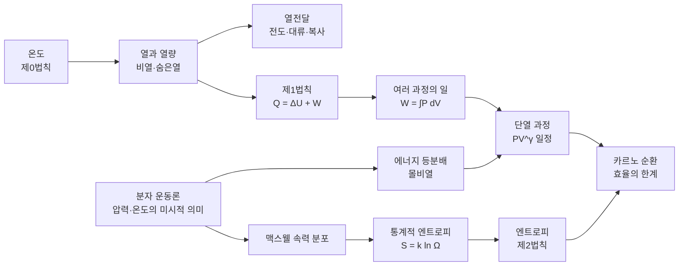

# 일반물리학 7. 열과 열역학 — 분자의 무작위 운동에서 엔진의 한계까지
<!-- prev: mech-2, matter-1, m1-03 -->
<!-- next: uchem-3, uchem-10, uearth-7 -->

> [!NOTE]
> **이 단원의 범위**
> - 온도와 열팽창, 열역학 제0법칙
> - 열량, 비열, 숨은열(잠열), 열전달(전도·대류·복사)
> - 열역학 제1법칙과 여러 과정에서 기체가 하는 일
> - 이상 기체와 기체 분자 운동론(압력, 온도, 에너지 등분배, 맥스웰 속력 분포)
> - 몰비열과 단열 과정
> - 엔트로피와 열역학 제2법칙, 열기관·냉동기와 카르노 순환, 엔트로피의 통계적 의미

**학습 목표**

1. 온도의 정의(열평형, 제0법칙, 기체 온도계)를 설명하고, 선팽창·부피 팽창과 열응력을 계산할 수 있다.
2. 비열·숨은열을 이용한 열량 계산과 열량 측정을 하고, 전도·대류·복사에 의한 열전달률을 식으로 구할 수 있다.
3. $W = \int P\,dV$로 여러 과정의 일을 계산하고, 열역학 제1법칙으로 열·일·내부 에너지의 관계를 분석할 수 있다.
4. 기체 분자 운동론으로 압력과 온도의 미시적 의미를 유도하고, 에너지 등분배 정리와 맥스웰 속력 분포를 해석할 수 있다.
5. 몰비열 $C_V$, $C_P$와 비열비 $\gamma$를 이용해 단열 과정을 정량적으로 다룰 수 있다.
6. 엔트로피 변화를 계산하여 제2법칙을 적용하고, 카르노 순환으로 열기관·냉동기의 성능 한계를 구하며, $S = k\ln\Omega$의 통계적 의미를 설명할 수 있다.

**이 단원의 학습 사다리**

| 단계 | 무엇을 하나? |
|---|---|
| STEP 1. 이전 학습 다시 보기 | 중1 「열」, 역학과 에너지 「열과 에너지」, 물질과 에너지 「물질의 세 가지 상태」를 꺼내 본다 |
| STEP 2. 기초 다지기 | 적분은 넓이, $\int dx/x = \ln x$, 지수적 변화, 상태 함수와 경로 함수, 확률 분포 함수 |
| STEP 3. 핵심 개념 | 온도·열팽창 → 열량·열전달 → 제1법칙과 일 → 분자 운동론 → 몰비열·단열 과정 → 엔트로피·제2법칙 → 카르노 순환 → 통계적 엔트로피 |
| STEP 4. 오개념 바로잡기 | "열은 물체가 가진 에너지이다?" 같은 착각을 바로잡는다 |
| STEP 5. 다음 단계로 | 통계역학(볼츠만 인자), 열역학 퍼텐셜, 물리화학 |
| STEP 6. 생활·산업·진로 | 히트 펌프, 복합 화력 발전, 전자 기기 열 관리 |

---

## 🗺️ 단원 들어가기

한겨울, 바깥 기온이 $0\ ^\circ\mathrm{C}$일 때 히트 펌프 난방기는 전기 $1\ \mathrm{kJ}$를 써서 집 안에 열을 $3\ \mathrm{kJ}$ 넘게 들여보낸다. 에너지 보존 법칙을 어긴 것일까? 반대로 발전소는 연료에서 얻은 열의 절반 이상을 냉각수로 버린다. 기술이 모자라서일까, 아니면 자연이 정한 한계일까?

이 질문에 답하려면 두 가지 눈이 필요하다. 하나는 **거시적인 눈**이다. 압력, 부피, 온도처럼 측정할 수 있는 양 사이의 관계(열역학 법칙)로 엔진과 냉장고의 성능을 계산한다. 다른 하나는 **미시적인 눈**이다. $10^{23}$개가 넘는 분자의 무작위 운동을 평균 내어 압력과 온도가 무엇인지, 왜 어떤 변화는 한쪽으로만 일어나는지(엔트로피)를 이해한다. 고등학교에서 배운 $PV = nRT$와 $Q = \Delta U + W$가 대학에서는 미분·적분과 확률을 만나 훨씬 단단한 이론이 된다.

---

## STEP 1. 🔙 이전 학습 다시 보기

### 연계 개념표

| 이전 단원 | 고등학교까지 배운 것 | 대학에서 이렇게 확장된다 |
|---|---|---|
| 중1 「열」 | 온도는 입자 운동의 활발한 정도, 열평형, 전도·대류·복사, 비열과 열팽창의 정성적 비교 | 제0법칙과 기체 온도계로 온도를 **정의**하고, 푸리에 법칙·슈테판–볼츠만 법칙으로 열전달률을 **계산** |
| 역학과 에너지 「열과 에너지」 '열의 이동과 단열·열팽창' | $Q = cm\Delta T$, $\Delta L = \alpha L\Delta T$, 잠열 | 온도에 따라 변하는 비열은 **적분**으로, 열응력과 부피 팽창 $\beta = 3\alpha$를 **유도** |
| 역학과 에너지 「열과 에너지」 '열역학 제1법칙' | $Q = \Delta U + W$, $W = P\Delta V$, 네 가지 과정의 표 | 압력이 변하는 과정의 일 $W = \int P\,dV$, 등온 과정 $W = nRT\ln(V_f/V_i)$, 단열 과정 $PV^\gamma$ = 일정을 **유도** |
| 역학과 에너지 「열과 에너지」 '열기관과 엔트로피' | 열효율 $e = W/Q_H$, 경우의 수로 본 확산, 엔트로피의 정성적 의미 | 카르노 순환으로 $e_C = 1 - T_C/T_H$를 **유도**, $dS = dQ/T$와 $S = k\ln\Omega$로 엔트로피를 **계산** |
| 물질과 에너지 「물질의 세 가지 상태」 '이상 기체 방정식' | $PV = nRT$, 이상 기체 근사가 맞는 조건 | 분자 운동론으로 $PV = \frac{1}{3}Nm\overline{v^2}$를 유도하여 **온도 = 평균 운동 에너지**임을 보이고, 속력 분포까지 다룬다 |

### 준비 운동 (사전 진단)

**Q1.** $25\ ^\circ\mathrm{C}$는 절대 온도로 몇 K인가?

**Q2.** 물 $2.0\ \mathrm{kg}$의 온도를 $10\ ^\circ\mathrm{C}$ 올리는 데 필요한 열량은? (물의 비열 $4186\ \mathrm{J/(kg\cdot K)}$)

**Q3.** 이상 기체 $1.00\ \mathrm{mol}$이 $0\ ^\circ\mathrm{C}$, $1.013\times10^5\ \mathrm{Pa}$에서 차지하는 부피는? ($R = 8.314\ \mathrm{J/(mol\cdot K)}$)

정답 및 해설

**Q1.** $T = 25 + 273.15 = 298.15\ \mathrm{K}$ (약 $298\ \mathrm{K}$)

**Q2.** $Q = cm\Delta T = 4186\times2.0\times10 \approx 8.4\times10^4\ \mathrm{J}$

**Q3.** $V = \dfrac{nRT}{P} = \dfrac{1.00\times8.314\times273.15}{1.013\times10^5} \approx 2.24\times10^{-2}\ \mathrm{m^3} = 22.4\ \mathrm{L}$

---

## STEP 2. 🧱 기초 다지기

### ① 적분은 '그래프 아래 넓이'이다

고등학교에서는 압력이 일정할 때만 $W = P\Delta V$로 일을 구했다. 압력이 부피에 따라 변하면 부피를 아주 잘게 나누어, 각 조각에서는 압력이 거의 일정하다고 보고 $P\,dV$를 모두 더한다. 그 극한이 **정적분**이다.

$$
W = \lim_{\Delta V \to 0}\sum P_i\,\Delta V_i = \int_{V_i}^{V_f} P\,dV
$$

$P$–$V$ 그래프에서 이 값은 곡선 아래의 넓이이다. 부피가 줄어드는 방향으로 적분하면 $dV < 0$이라 일은 음수가 된다(외부가 기체에 일을 해 준다).

### ② $\int dx/x = \ln x$ — 등온 과정과 엔트로피에 꼭 나오는 적분

$$
\int_{a}^{b}\frac{dx}{x} = \ln b - \ln a = \ln\frac{b}{a}
$$

이 단원에서는 $\int dV/V$(등온 과정의 일), $\int dT/T$(가열할 때의 엔트로피 변화)로 계속 등장한다. 로그의 성질 $\ln(ab) = \ln a + \ln b$, $\ln a^n = n\ln a$, $\ln 2 \approx 0.693$, $\ln 10 \approx 2.303$을 기억해 두자.

### ③ 변화율이 현재 값에 비례하면 지수 함수가 된다

뜨거운 커피가 식는 빠르기는 주변과의 온도 차 $\theta = T - T_{\text{주변}}$에 비례한다. 즉 $\dfrac{d\theta}{dt} = -k\theta$이다. 변수를 분리해 적분하면

$$
\int_{\theta_0}^{\theta}\frac{d\theta'}{\theta'} = -k\int_0^t dt' \;\Rightarrow\; \ln\frac{\theta}{\theta_0} = -kt \;\Rightarrow\; \theta = \theta_0 e^{-kt}
$$

이 꼴의 **1계 선형 미분 방정식**은 이 단원(뉴턴 냉각)과 다음 단원들(RC 회로, 방사성 붕괴)에서 거듭 나온다.

### ④ 상태 함수와 경로 함수

| 구분 | 뜻 | 예 | 표기 |
|---|---|---|---|
| **상태 함수(state function)** | 지금 상태($P$, $V$, $T$)만으로 값이 정해진다. 처음과 끝 상태가 같으면 변화량도 같다 | 내부 에너지 $U$, 온도 $T$, 엔트로피 $S$ | $\Delta U$, $dU$ |
| **경로 함수(path function)** | 처음과 끝이 같아도 거쳐 간 과정에 따라 값이 다르다 | 열 $Q$, 일 $W$ | $Q$, $dQ$ (변화량이 아니라 '주고받은 양') |

> [!TIP]
> 💡 **비유** — 산꼭대기의 높이(상태 함수)는 어느 길로 올라왔든 같다. 그러나 걸어온 거리와 흘린 땀(경로 함수)은 길에 따라 다르다. 등산객은 '땀을 가지고 있다'고 하지 않고 '땀을 흘렸다'고 한다. 마찬가지로 물체는 열을 '가지고' 있지 않다. 열은 주고받는 과정에서만 의미가 있다.

### ⑤ 확률 분포 함수 읽기

분자의 속력처럼 연속적인 값을 가지는 양은 '정확히 $500\ \mathrm{m/s}$인 분자의 수'를 물을 수 없다. 대신 **확률 분포 함수(probability distribution function)** $f(v)$를 써서, 속력이 $v$와 $v + dv$ 사이에 있을 확률을 $f(v)\,dv$로 나타낸다.

| 무엇을 구하나 | 식 | 뜻 |
|---|---|---|
| 정규화 | $\int_0^\infty f(v)\,dv = 1$ | 어떤 속력이든 가질 확률의 합은 1 |
| 구간의 비율 | $\int_{v_1}^{v_2} f(v)\,dv$ | 속력이 $v_1$과 $v_2$ 사이인 분자의 비율 = 곡선 아래 넓이 |
| 평균 | $\bar{v} = \int_0^\infty v f(v)\,dv$ | 속력의 평균 |
| 제곱의 평균 | $\overline{v^2} = \int_0^\infty v^2 f(v)\,dv$ | 운동 에너지 계산에 필요 |
| 최빈값 | $df/dv = 0$인 $v$ | 그래프의 꼭대기 |

이 단원에서 쓰는 상수: $R = 8.314\ \mathrm{J/(mol\cdot K)}$, $N_A = 6.022\times10^{23}\ \mathrm{mol^{-1}}$, 볼츠만 상수 $k = R/N_A = 1.381\times10^{-23}\ \mathrm{J/K}$, 슈테판–볼츠만 상수 $\sigma = 5.67\times10^{-8}\ \mathrm{W/(m^2\cdot K^4)}$. 몰 단위로는 $PV = nRT$, 분자 수로는 $PV = NkT$이다.

---

## STEP 3. 📘 핵심 개념

### ① 온도와 열평형 — 열역학 제0법칙

#### 제0법칙: 온도를 정의할 수 있는 근거

두 물체를 접촉시켜 두면 결국 더 이상 변화가 없는 **열평형(thermal equilibrium)** 상태에 이른다. 실험적으로 다음 사실이 확인된다.

> [!IMPORTANT]
> **열역학 제0법칙(zeroth law of thermodynamics)** — 물체 A와 B가 각각 물체 C와 열평형을 이루면, A와 B도 서로 열평형을 이룬다.

당연해 보이지만 이 법칙 덕분에 C(온도계)를 써서 A와 B를 직접 맞대지 않고도 '같은 상태인지'를 판정할 수 있다. 열평형인 물체들이 공통으로 가진 값을 **온도(temperature)** 라 부른다. 제1·2법칙보다 나중에 '가장 기본적인 법칙'으로 인정되어 0번이라는 이름이 붙었다.

#### 정적 기체 온도계와 켈빈 눈금

수은 온도계, 저항 온도계, 열전쌍은 재료에 따라 눈금이 조금씩 어긋난다. 그런데 **부피를 일정하게 유지한 묽은 기체의 압력**은 기체의 종류와 거의 상관없이 같은 온도 눈금을 준다. 그래서 물의 **삼중점**(얼음·물·수증기가 공존하는 상태) 온도를 $T_3 = 273.16\ \mathrm{K}$로 정하고 다음과 같이 온도를 정의했다.

$$
T = (273.16\ \mathrm{K})\left(\lim_{\text{기체}\to 0}\frac{P}{P_3}\right)
$$

($P_3$은 같은 온도계가 삼중점에서 가리키는 압력) 현재 SI 단위계는 볼츠만 상수의 값을 정의값으로 고정하는 방식으로 켈빈을 정의하지만, 실용적인 눈금은 거의 같다. 섭씨 온도와는 $T_C = T - 273.15$의 관계이다.

#### 예제 1 — 기체 온도계 읽기

정적 기체 온도계를 삼중점 셀에 넣었더니 압력이 $4.50\ \mathrm{kPa}$였다. 이 온도계를 끓는 액체에 넣었더니 $6.00\ \mathrm{kPa}$였다. 액체의 온도는?

**풀이**
- 식 세우기: 부피가 일정하므로 $T \propto P$, 즉 $T = 273.16\ \mathrm{K}\times\dfrac{P}{P_3}$
- 대입: $T = 273.16\times\dfrac{6.00}{4.50} = 364.2\ \mathrm{K}$
- 결과: 약 $364\ \mathrm{K}$($91\ ^\circ\mathrm{C}$). 기체를 더 묽게 하며 반복 측정해 극한값을 구하면 기체 종류에 따른 차이가 사라진다.

### ② 열팽창 — 원자 간 거리가 늘어난다

#### 선팽창과 부피 팽창

고체 속 원자는 이웃 원자와 퍼텐셜 에너지 곡선의 바닥 근처에서 진동한다. 이 곡선은 좌우 대칭이 아니어서(가까워질 때 더 가파르다) 진폭이 커지면 평균 간격이 늘어난다. 이것이 **열팽창(thermal expansion)** 의 미시적 원인이다. 온도 변화가 크지 않을 때 길이 변화는 온도 변화에 비례한다.

$$
\frac{dL}{L} = \alpha\,dT \quad\Rightarrow\quad \Delta L \approx \alpha L\,\Delta T
$$

$\alpha$를 **선팽창 계수(coefficient of linear expansion)** 라 한다. 부피에 대해서도 $\Delta V \approx \beta V\Delta T$로 쓰는데, 등방성 고체에서는 두 계수 사이에 간단한 관계가 있다. 한 변이 $L$인 정육면체의 부피 $V = L^3$을 온도로 미분하면

$$
\frac{dV}{dT} = 3L^2\frac{dL}{dT} = 3L^2(\alpha L) = 3\alpha V \quad\Rightarrow\quad \beta = 3\alpha
$$

| 물질 | 선팽창 계수 $\alpha$ ($10^{-6}\ \mathrm{K^{-1}}$, 상온 근처, 약) |
|---|---|
| 알루미늄 | 23 |
| 구리 | 17 |
| 강철 | 11~13 |
| 콘크리트 | 10~14 |
| 보통 유리 | 9 |
| 붕규산 유리(내열 유리) | 3.3 |
| 인바(철–니켈 합금) | 약 1 |

강철과 콘크리트의 $\alpha$가 거의 같다는 점이 철근 콘크리트가 온도가 변해도 갈라지지 않는 이유이다.

#### 열응력

양 끝이 고정된 막대는 늘어나지 못하므로, 늘어나려는 만큼을 되누르는 응력이 생긴다. 영률(Young's modulus) $Y$(단위 넓이당 힘과 길이 변형률의 비)를 쓰면 **열응력(thermal stress)** 은

$$
\sigma = \frac{F}{A} = Y\frac{\Delta L}{L} = Y\alpha\,\Delta T
$$

#### 물의 이상 팽창

물은 $0\ ^\circ\mathrm{C}$에서 $4\ ^\circ\mathrm{C}$까지 오히려 수축하고, $4\ ^\circ\mathrm{C}$ 근처에서 밀도가 가장 크다. 수소 결합으로 이루어진 열린 구조가 온도가 오르며 무너지는 효과가 일반적인 열팽창보다 크기 때문이다. 그래서 겨울 호수는 위부터 얼고, 바닥의 $4\ ^\circ\mathrm{C}$ 물에서 생물이 겨울을 난다.

#### 예제 2 — 철로의 이음매와 열응력

길이 $25\ \mathrm{m}$인 강철 레일($\alpha = 1.2\times10^{-5}\ \mathrm{K^{-1}}$, $Y = 2.0\times10^{11}\ \mathrm{Pa}$)이 있다. (1) 온도가 $40\ \mathrm{K}$ 오를 때 늘어나는 길이는? (2) 레일을 용접해 양 끝을 고정하면 $30\ \mathrm{K}$ 상승 시 열응력은?

**풀이**
(1) $\Delta L = \alpha L\Delta T = 1.2\times10^{-5}\times25\times40 = 1.2\times10^{-2}\ \mathrm{m} = 12\ \mathrm{mm}$
(2) $\sigma = Y\alpha\Delta T = 2.0\times10^{11}\times1.2\times10^{-5}\times30 = 7.2\times10^{7}\ \mathrm{Pa}$
- 의미: 약 $72\ \mathrm{MPa}$로, 강철의 항복 강도(수백 MPa)보다는 작지만 무시할 수 없다. 장대 레일은 설치할 때 미리 당겨 두거나 단단히 고정해 이 응력을 견디게 설계한다.

### ③ 열량, 비열, 숨은열 — 열이 들어가면 무엇이 변하나

#### 열의 정의

**열(heat)** 은 온도 차이 때문에 계와 주위 사이를 이동하는 에너지이다. 단위는 줄(J)이고, 영양학에서 쓰는 칼로리는 $1\ \mathrm{cal} = 4.186\ \mathrm{J}$이다(식품의 '칼로리'는 kcal). 열을 받은 물체는 온도가 오르거나 상태가 바뀐다.

#### 비열과 열용량

$$
Q = mc\,\Delta T, \qquad Q = nC\,\Delta T
$$

$c$는 **비열(specific heat)**, $C$는 **몰열용량**(몰비열)이다. 엄밀히는 비열이 온도에 따라 변하므로 미소 변화로 쓰고 적분한다.

$$
dQ = mc(T)\,dT \quad\Rightarrow\quad Q = m\int_{T_i}^{T_f} c(T)\,dT
$$

| 물질 | 비열 $c$ ($\mathrm{J/(kg\cdot K)}$, 약) |
|---|---|
| 물(액체) | 4186 |
| 얼음 | 2090 |
| 알루미늄 | 900 |
| 철 | 450 |
| 구리 | 386 |

금속을 몰 단위로 보면 몰열용량이 대부분 약 $25\ \mathrm{J/(mol\cdot K)}$ $(\approx 3R)$로 비슷하다(뒬롱–프티 규칙). 이 '우연'은 ⑤의 에너지 등분배로 설명된다.

#### 숨은열(잠열)

상태 변화 동안에는 열을 받아도 온도가 일정하다. 들어간 에너지가 분자 사이의 결합을 끊는 데(퍼텐셜 에너지 증가) 쓰이기 때문이다. 단위 질량이 상태를 바꾸는 데 필요한 열을 **숨은열(잠열, latent heat)** $L$이라 한다.

$$
Q = mL
$$

| 물의 상태 변화 | 숨은열 (약) |
|---|---|
| 융해열 $L_f$ ($0\ ^\circ\mathrm{C}$) | $3.33\times10^5\ \mathrm{J/kg}$ |
| 기화열 $L_v$ ($100\ ^\circ\mathrm{C}$) | $2.26\times10^6\ \mathrm{J/kg}$ |

기화열이 융해열의 약 7배이다. 녹을 때는 분자가 이웃과의 결합 일부만 느슨하게 하지만, 끓을 때는 이웃과 완전히 떨어져야 하기 때문이다.

#### 예제 3 — 얼음을 물로

$-20\ ^\circ\mathrm{C}$의 얼음 $0.500\ \mathrm{kg}$을 $40\ ^\circ\mathrm{C}$의 물로 만드는 데 필요한 열은?

**풀이** 세 단계로 나누어 더한다.
- 얼음 가열: $0.500\times2090\times20 = 2.09\times10^4\ \mathrm{J}$
- 융해: $0.500\times3.33\times10^5 = 1.665\times10^5\ \mathrm{J}$
- 물 가열: $0.500\times4186\times40 = 8.37\times10^4\ \mathrm{J}$
- 합: $Q \approx 2.71\times10^5\ \mathrm{J}$. 녹이는 단계가 전체의 60 % 이상을 차지한다.

#### 예제 4 — 열량 측정: 뜨거운 물에 얼음 넣기

단열 용기 속 $80\ ^\circ\mathrm{C}$의 물 $0.250\ \mathrm{kg}$에 $0\ ^\circ\mathrm{C}$의 얼음 $0.050\ \mathrm{kg}$을 넣었다. 최종 온도는? (용기의 열용량은 무시)

**풀이**
- 식 세우기: 고립계이므로 주고받은 열의 합이 0이다. 얼음이 모두 녹는다고 가정하면
  $m_i L_f + m_i c_w (T - 0) + m_w c_w (T - 80) = 0$
- 대입: $0.050\times3.33\times10^5 + 0.300\times4186\,T = 0.250\times4186\times80$
- 결과: $T = \dfrac{83720 - 16650}{1255.8} \approx 53\ ^\circ\mathrm{C}$. 0 °C보다 높으므로 '모두 녹는다'는 가정이 맞았다. (가정이 틀리면 $T$가 0 °C보다 낮게 나오므로, 그때는 일부만 녹는다고 다시 푼다.)

### ④ 열전달 — 전도, 대류, 복사를 식으로

#### 전도: 푸리에 법칙

두께 $dx$인 얇은 층 양쪽의 온도 차가 $dT$이면, 단위 시간에 흐르는 열(열전달률, W)은

$$
P_{\text{전도}} = \frac{dQ}{dt} = -kA\frac{dT}{dx}
$$

$k$는 **열전도도(thermal conductivity)** 이고, − 부호는 열이 온도가 낮아지는 쪽으로 흐른다는 뜻이다. 정상 상태의 균일한 판(두께 $L$, 양쪽 온도 $T_H$, $T_C$)에서는 $P = kA\dfrac{T_H - T_C}{L}$이다.

| 물질 | 열전도도 $k$ ($\mathrm{W/(m\cdot K)}$, 약) |
|---|---|
| 구리 | 401 |
| 알루미늄 | 237 |
| 강철 | 50 |
| 유리 | 0.8 |
| 물 | 0.60 |
| 스티로폼 | 0.03~0.04 |
| 공기(정지) | 0.026 |

**열저항** $R_{\text{열}} = \dfrac{L}{kA}$을 정의하면 $P = \dfrac{\Delta T}{R_{\text{열}}}$로, 전기 회로의 옴의 법칙 $I = V/R$과 꼴이 같다. 여러 층이 겹친 벽은 **직렬 저항처럼 더한다**(「일반물리학 9」의 저항 연결과 비교해 보자).

#### 예제 5 — 단열재를 붙인 벽

넓이 $10\ \mathrm{m^2}$인 벽돌 벽(두께 $0.20\ \mathrm{m}$, $k = 0.60$)의 실내 쪽에 스티로폼(두께 $0.050\ \mathrm{m}$, $k = 0.040$)을 붙였다. 실내 $20\ ^\circ\mathrm{C}$, 실외 $-5\ ^\circ\mathrm{C}$일 때 (1) 열전달률, (2) 단열재가 없을 때와 비교하시오.

**풀이**
(1) $R_{\text{벽돌}} = \dfrac{0.20}{0.60\times10} = 0.0333\ \mathrm{K/W}$, $R_{\text{단열}} = \dfrac{0.050}{0.040\times10} = 0.125\ \mathrm{K/W}$
$P = \dfrac{25}{0.0333 + 0.125} \approx 1.6\times10^2\ \mathrm{W}$
(2) 벽돌만 있으면 $P = 25/0.0333 = 750\ \mathrm{W}$. 얇은 단열재 하나로 열손실이 약 $\frac{1}{5}$로 줄었다. 단열재와 벽돌 경계의 온도는 $20 - 158\times0.125 \approx 0.3\ ^\circ\mathrm{C}$로, 온도 차의 대부분이 단열재 양쪽에 걸린다. 실제로는 벽 표면의 공기층도 열저항으로 더해진다.

#### 대류와 뉴턴 냉각 법칙

**대류(convection)** 는 유체가 직접 흐르며 열을 나르는 것이다. 유체의 흐름이 복잡해서 기본 원리만으로 계산하기 어렵기 때문에, 공학에서는 실험으로 정한 **대류 열전달 계수** $h$를 써서 $P = hA(T_{\text{표면}} - T_{\text{유체}})$로 근사한다. 물체 전체의 온도가 고르다고 보면 $mc\dfrac{dT}{dt} = -hA(T - T_{\text{주변}})$이고, STEP 2의 ③처럼 풀면

$$
T(t) - T_{\text{주변}} = (T_0 - T_{\text{주변}})\,e^{-t/\tau}, \qquad \tau = \frac{mc}{hA}
$$

이것을 **뉴턴 냉각 법칙(Newton's law of cooling)** 이라 한다. 온도 차가 크지 않을 때 잘 맞는 근사이다.

#### 예제 6 — 커피가 식는 시간

실온 $20\ ^\circ\mathrm{C}$에서 $90\ ^\circ\mathrm{C}$의 커피가 10분 뒤 $60\ ^\circ\mathrm{C}$가 되었다. 뉴턴 냉각 법칙을 따른다면 $40\ ^\circ\mathrm{C}$가 되는 것은 처음부터 몇 분 뒤인가?

**풀이**
- 온도 차: 처음 $70\ \mathrm{K}$, 10분 뒤 $40\ \mathrm{K}$ → $e^{-10/\tau} = 40/70$에서 $1/\tau = \ln(70/40)/10 = 0.0560\ \mathrm{min^{-1}}$
- 온도 차 $20\ \mathrm{K}$가 될 때: $t = \tau\ln(70/20) = \dfrac{\ln 3.5}{0.0560} \approx 22\ \text{분}$
- 의미: 온도가 일정한 빠르기로 내려가지 않는다. 처음 30 K 내리는 데 10분, 다음 20 K 내리는 데 약 12분이 걸린다.

#### 복사: 슈테판–볼츠만 법칙

모든 물체는 온도에 따라 전자기파를 낸다. 절대 온도 $T$, 표면적 $A$인 물체가 내는 복사 일률은

$$
P_{\text{복사}} = e\sigma A T^4
$$

$e$는 **방출률(emissivity)**(0~1, 완전 흑체는 1)이다. 주변 온도가 $T_{\text{주변}}$이면 흡수도 하므로 알짜 복사 일률은 $P_{\text{알짜}} = e\sigma A(T^4 - T_{\text{주변}}^4)$이다. $T^4$에 비례하므로 온도가 2배가 되면 복사는 16배가 된다. 진공을 건너는 유일한 열전달 방식이어서 보온병의 은도금, 우주선의 열 설계에서 중요하다.

#### 예제 7 — 사람 몸의 복사 손실

피부 온도 $33\ ^\circ\mathrm{C}$($306\ \mathrm{K}$), 표면적 $1.5\ \mathrm{m^2}$, 방출률 $0.97$인 사람이 $20\ ^\circ\mathrm{C}$($293\ \mathrm{K}$) 방에 옷을 입지 않고 있다. 알짜 복사 손실은?

**풀이**
$P = 0.97\times5.67\times10^{-8}\times1.5\times(306^4 - 293^4) \approx 1.2\times10^2\ \mathrm{W}$
- 의미: 몸이 내는 복사 자체는 약 $720\ \mathrm{W}$이지만 벽에서 흡수하는 복사가 대부분을 메워 준다. 안정 시 기초 대사량(약 $80\sim100\ \mathrm{W}$)과 비슷한 크기이므로, 옷을 입지 않으면 추위를 느끼는 것이 당연하다. 적외선 체온계와 열화상 카메라는 바로 이 복사를 측정한다.

### ⑤ 열역학 제1법칙과 여러 과정의 일

#### 기체가 하는 일 $W = \int P\,dV$

단면적 $A$인 피스톤을 기체가 압력 $P$로 $ds$만큼 밀면 일은 $dW = F\,ds = PA\,ds = P\,dV$이다. 이 단원에서는 고등학교와 같이 **$W$를 계가 외부에 한 일**로 정한다.

$$
W = \int_{V_i}^{V_f} P\,dV
$$

이 적분을 계산하려면 과정 동안 $P$가 $V$에 따라 어떻게 변하는지, 즉 **경로**를 알아야 한다. 그래서 일은 경로 함수이다. 이 적분은 과정이 매우 천천히 일어나 매 순간 기체가 평형 상태(압력이 하나로 정해지는 상태)에 있다고 볼 수 있을 때, 즉 **준정적 과정(quasi-static process)** 에서 의미가 있다.

#### 예제 8 — 같은 처음과 끝, 다른 일

이상 기체가 상태 A($P = 3.0\times10^5\ \mathrm{Pa}$, $V = 1.0\times10^{-3}\ \mathrm{m^3}$)에서 상태 B($1.0\times10^5\ \mathrm{Pa}$, $3.0\times10^{-3}\ \mathrm{m^3}$)로 변한다. 다음 경로에서 기체가 한 일을 구하시오.
(가) 부피 일정하게 압력을 낮춘 뒤, 압력 일정하게 팽창 (나) 압력 일정하게 팽창한 뒤, 부피 일정하게 압력을 낮춤 (다) $P$–$V$ 그래프에서 A와 B를 잇는 직선 (라) 등온 과정

**풀이**
(가) 등적 구간은 일이 0, 등압 구간은 $1.0\times10^5\times2.0\times10^{-3} = 200\ \mathrm{J}$
(나) $3.0\times10^5\times2.0\times10^{-3} = 600\ \mathrm{J}$
(다) 사다리꼴 넓이: $\dfrac{(3.0 + 1.0)\times10^5}{2}\times2.0\times10^{-3} = 400\ \mathrm{J}$
(라) $P_AV_A = P_BV_B = 300\ \mathrm{J}$이므로 A와 B는 온도가 같다. 등온 과정의 일(아래 유도) $W = nRT\ln\dfrac{V_B}{V_A} = 300\ln 3 \approx 330\ \mathrm{J}$
- 의미: 처음과 끝이 같아도 일은 $200\sim600\ \mathrm{J}$로 다르다. A와 B의 온도가 같으므로 이상 기체의 $\Delta U = 0$이고, 제1법칙에 따라 각 경로에서 흡수한 열도 일과 같은 값으로 **경로마다 다르다**.

#### 열역학 제1법칙

$$
\Delta U = Q - W \qquad (\text{미소 과정: } dU = dQ - dW)
$$

계에 들어온 열 $Q$는 내부 에너지 증가 $\Delta U$와 외부에 한 일 $W$로 나뉜다. $Q$와 $W$는 각각 경로에 따라 다르지만 그 차이 $Q - W$는 경로와 무관하다는 것이 실험 사실이고, 이것이 **내부 에너지가 상태 함수**라는 말의 뜻이다. (화학에서는 $W$를 '계가 받은 일'로 정해 $\Delta U = Q + W$로 쓰는 경우가 많다. 부호 약속만 다를 뿐 내용은 같다. 「일반화학 3」을 읽을 때 주의하자.)

#### 여러 과정 한눈에 보기 (이상 기체)

| 과정 | 조건 | 기체가 한 일 $W$ | $\Delta U$ | 열 $Q$ |
|---|---|---|---|---|
| 등적 | $V$ 일정 | $0$ | $nC_V\Delta T$ | $nC_V\Delta T$ |
| 등압 | $P$ 일정 | $P\Delta V = nR\Delta T$ | $nC_V\Delta T$ | $nC_P\Delta T$ |
| 등온 | $T$ 일정 | $nRT\ln(V_f/V_i)$ | $0$ | $W$ |
| 단열 | $Q = 0$ | $-\Delta U$ | $nC_V\Delta T$ | $0$ |
| 순환 | 처음 상태로 복귀 | 닫힌 곡선이 둘러싼 넓이 | $0$ | $W$ |
| 자유 팽창 | 진공으로 팽창, 단열 용기 | $0$ | $0$ | $0$ |

($C_V$, $C_P$는 ⑦에서 다룬다.)

**등온 과정의 일 유도** 이상 기체에서 $P = nRT/V$이고 $T$가 일정하므로

$$
W = \int_{V_i}^{V_f}\frac{nRT}{V}\,dV = nRT\int_{V_i}^{V_f}\frac{dV}{V} = nRT\ln\frac{V_f}{V_i}
$$

**자유 팽창(free expansion)** 은 단열 용기 속 기체가 칸막이가 터지며 진공으로 퍼지는 과정이다. 밀어낼 대상이 없어 $W = 0$, 단열이라 $Q = 0$, 따라서 $\Delta U = 0$이다. 이상 기체라면 온도도 변하지 않는다. 이 과정은 중간 상태가 평형이 아니므로 $P$–$V$ 그래프에 경로를 그릴 수 없다.

### ⑥ 이상 기체와 기체 분자 운동론

#### 이상 기체 모형의 가정

**기체 분자 운동론(kinetic theory of gases)** 은 다음 가정으로 거시적인 기체 법칙을 이끌어 낸다.
1. 기체는 매우 많은 수의 같은 분자로 이루어지고, 분자는 무작위 방향으로 움직인다.
2. 분자 자체의 부피는 용기의 부피에 비해 무시할 수 있다.
3. 분자는 벽 및 다른 분자와 탄성 충돌할 때만 힘을 주고받는다(분자 간 인력 무시).
4. 뉴턴 역학을 따른다.

#### 압력의 미시적 유도

한 변이 $L$인 정육면체 용기에 질량 $m$인 분자 $N$개가 있다. 한 분자의 속도 $x$성분이 $v_x$이면, 오른쪽 벽에 탄성 충돌할 때 운동량 변화는 $-2mv_x$이므로 벽은 $2mv_x$의 충격량을 받는다. 같은 벽에 다시 오기까지 시간은 $2L/v_x$이다. 따라서 이 분자가 벽에 주는 평균 힘은

$$
\bar{F}_1 = \frac{2mv_x}{2L/v_x} = \frac{mv_x^2}{L}
$$

$N$개 분자를 모두 더하고 넓이 $L^2$으로 나누면

$$
P = \frac{1}{L^2}\sum\frac{mv_x^2}{L} = \frac{Nm}{V}\,\overline{v_x^2}
$$

방향이 무작위이므로 $\overline{v_x^2} = \overline{v_y^2} = \overline{v_z^2} = \frac{1}{3}\overline{v^2}$이다. 따라서

$$
PV = \frac{1}{3}Nm\overline{v^2} = \frac{2}{3}N\left(\frac{1}{2}m\overline{v^2}\right)
$$

#### 온도의 미시적 의미

위 식을 실험식 $PV = NkT$와 비교하면

$$
\overline{K} = \frac{1}{2}m\overline{v^2} = \frac{3}{2}kT
$$

> [!IMPORTANT]
> 절대 온도는 **분자 한 개의 평균 병진 운동 에너지**에 비례한다. 기체의 종류(분자의 질량)와 무관하다. $300\ \mathrm{K}$에서 이 값은 $\frac{3}{2}\times1.381\times10^{-23}\times300 \approx 6.2\times10^{-21}\ \mathrm{J}$(약 $0.039\ \mathrm{eV}$)이다.

**제곱 평균 제곱근 속력(root-mean-square speed)** 은 $v_{\text{rms}} = \sqrt{\overline{v^2}}$로,

$$
v_{\text{rms}} = \sqrt{\frac{3kT}{m}} = \sqrt{\frac{3RT}{M}}
$$

($M$: 몰질량, kg/mol 단위로 넣는다)

#### 예제 9 — 공기 분자의 속력과 에너지

$300\ \mathrm{K}$의 질소 분자에 대해 (1) 평균 병진 운동 에너지, (2) $v_{\text{rms}}$를 구하고, (3) 같은 온도의 수소 분자와 비교하시오.

**풀이**
(1) $\overline{K} = \frac{3}{2}kT = 1.5\times1.381\times10^{-23}\times300 \approx 6.21\times10^{-21}\ \mathrm{J}$
(2) $v_{\text{rms}} = \sqrt{\dfrac{3\times8.314\times300}{0.0280}} \approx 517\ \mathrm{m/s}$
(3) 평균 운동 에너지는 같다. 속력은 $\sqrt{M}$에 반비례하므로 $\sqrt{28.0/2.02} \approx 3.7$배 빠른 약 $1.93\times10^3\ \mathrm{m/s}$이다.

#### 에너지 등분배 정리

분자는 병진 운동 외에 회전·진동도 할 수 있다. 고전 통계 역학에 따르면 열평형에서 에너지는 운동 방식들에 고르게 나뉜다.

> [!IMPORTANT]
> **에너지 등분배 정리(equipartition theorem)** — 에너지 식에 제곱 항으로 들어가는 독립적인 운동 방식(**자유도**, degree of freedom) 하나마다 분자 한 개당 평균 $\frac{1}{2}kT$(1몰당 $\frac{1}{2}RT$)의 에너지가 배당된다.

| 분자 | 병진 | 회전 | 자유도 $f$ (상온) | 이상 기체 내부 에너지 $U$ |
|---|---|---|---|---|
| 단원자(He, Ar) | 3 | 0 | 3 | $\frac{3}{2}nRT$ |
| 이원자($\mathrm{N_2}$, $\mathrm{O_2}$) | 3 | 2 (결합 축에 수직인 두 축) | 5 | $\frac{5}{2}nRT$ |
| 비선형 다원자 | 3 | 3 | 6 | $3nRT$ |

이원자 분자가 결합 축을 중심으로 도는 회전과 진동이 상온에서 거의 기여하지 않는 이유는 고전 역학으로 설명되지 않는다. 회전·진동 에너지가 **양자화**되어 있어, 에너지 간격이 $kT$보다 크면 그 운동이 '얼어붙기' 때문이다(「일반물리학 12」). 실제로 수소 기체의 몰비열은 저온에서 $\frac{3}{2}R$, 상온에서 $\frac{5}{2}R$, 수천 K에서 진동까지 더해져 $\frac{7}{2}R$ 쪽으로 올라간다. 고체 원자는 3방향 진동마다 운동 에너지와 퍼텐셜 에너지 두 제곱 항이 있어 $f = 6$, 몰열용량은 $3R \approx 25\ \mathrm{J/(mol\cdot K)}$이다. 이것이 뒬롱–프티 규칙의 정체이다.

#### 맥스웰 속력 분포

모든 분자가 $v_{\text{rms}}$로 움직이는 것은 아니다. 온도 $T$인 기체에서 분자 속력의 분포는 다음 **맥스웰 속력 분포(Maxwell speed distribution)** 를 따른다.

$$
f(v) = 4\pi\left(\frac{m}{2\pi kT}\right)^{3/2} v^2\, e^{-mv^2/2kT}
$$

- $v^2$ 인자: 속력이 $v$인 속도 벡터들은 반지름 $v$인 구 껍질 위에 있고, 그 넓이가 $4\pi v^2$에 비례한다. 그래서 $v = 0$ 근처는 확률이 작다.
- $e^{-mv^2/2kT}$ 인자: 운동 에너지 $\frac{1}{2}mv^2$이 $kT$보다 훨씬 큰 상태는 지수적으로 드물다(**볼츠만 인자**, STEP 5).

세 가지 '대표 속력'을 STEP 2의 ⑤처럼 구하면

| 대표 속력 | 구하는 법 | 식 | 비 |
|---|---|---|---|
| 최빈 속력 $v_p$ | $df/dv = 0$ | $\sqrt{2kT/m}$ | 1 |
| 평균 속력 $\bar{v}$ | $\int v f\,dv$ | $\sqrt{8kT/\pi m}$ | 1.128 |
| 제곱 평균 제곱근 속력 $v_{\text{rms}}$ | $\sqrt{\int v^2 f\,dv}$ | $\sqrt{3kT/m}$ | 1.225 |

**최빈 속력 유도** $f \propto v^2 e^{-av^2}$ ($a = m/2kT$)를 미분하면 $\dfrac{df}{dv} \propto (2v - 2av^3)e^{-av^2} = 0$에서 $v^2 = 1/a$, 즉 $v_p = \sqrt{2kT/m}$이다.

온도가 오르면 분포가 오른쪽으로 이동하며 넓고 낮아진다(곡선 아래 넓이는 항상 1). **분포의 오른쪽 꼬리**가 중요하다. 화학 반응은 활성화 에너지보다 큰 에너지를 가진 소수의 분자가 일으키므로, 온도가 조금만 올라도 꼬리의 넓이가 크게 늘어 반응이 훨씬 빨라진다(「일반화학 7」의 아레니우스 식). 물이 끓는점보다 낮은 온도에서도 증발하는 것도 꼬리에 있는 빠른 분자들 덕분이다.

**실험적 근거** 오븐에서 새어 나온 분자 빔을 일정한 각도만큼 엇갈린 홈을 가진 회전 원판 여러 장(속도 선별기)에 통과시키면, 회전 속도에 맞는 속력의 분자만 지나간다. 원판의 회전수를 바꾸며 통과한 분자 수를 세면 맥스웰 분포와 잘 맞는 결과가 나온다.

#### 예제 10 — 분포의 꼬리

$300\ \mathrm{K}$의 질소 분자에 대해 (1) $v_p$와 $\bar{v}$를 구하시오. (2) 속력이 $1000\ \mathrm{m/s}$보다 큰 분자의 비율은 약 $1.1\ \%$로 계산된다. 이 값의 의미를 설명하시오.

**풀이**
(1) $v_p = \sqrt{\dfrac{2\times8.314\times300}{0.0280}} \approx 422\ \mathrm{m/s}$, $\bar{v} = \sqrt{\dfrac{8\times8.314\times300}{\pi\times0.0280}} \approx 476\ \mathrm{m/s}$
(2) $\int_{1000}^{\infty}f(v)\,dv$는 해석적으로 간단히 풀리지 않아 수치 적분(스프레드시트, 탐구 활동 B)으로 구한다. 평균의 2배가 넘는 빠른 분자도 100개 중 1개 정도는 늘 있다는 뜻이다. 지구 대기에서 가벼운 수소·헬륨이 우주로 조금씩 빠져나가는 것도, 높은 대기에서 분포 꼬리에 있는 분자가 탈출 속력을 넘기 때문이다.

### ⑦ 몰비열과 단열 과정

#### 정적 몰비열과 정압 몰비열

같은 온도 변화에도 과정에 따라 필요한 열이 다르므로 몰비열도 과정을 밝혀 정의한다.

- **정적 몰비열** $C_V$: 부피 일정. $W = 0$이므로 $Q = \Delta U$, 따라서 $\Delta U = nC_V\Delta T$
- **정압 몰비열** $C_P$: 압력 일정. $Q = nC_P\Delta T$

이상 기체의 내부 에너지는 온도만의 함수이므로 **어떤 과정이든** $\Delta U = nC_V\Delta T$이다. 등압 과정에 제1법칙을 쓰면

$$
nC_P\Delta T = nC_V\Delta T + P\Delta V = nC_V\Delta T + nR\Delta T \;\Rightarrow\; C_P - C_V = R
$$

등압 가열에서는 일부 열이 팽창하는 일로 빠져나가므로 $C_P$가 $R$만큼 크다. 등분배 정리로 $C_V = \frac{f}{2}R$이므로 **비열비** $\gamma = C_P/C_V = 1 + \frac{2}{f}$이다.

| 기체 | $C_V$ 측정값 ($\mathrm{J/(mol\cdot K)}$, 약) | 등분배 예측 $C_V$ | $\gamma$ (예측) |
|---|---|---|---|
| He, Ar | 12.5 | $\frac{3}{2}R = 12.5$ | $5/3 \approx 1.67$ |
| $\mathrm{N_2}$, $\mathrm{O_2}$ | 20.8~21.1 | $\frac{5}{2}R = 20.8$ | $7/5 = 1.40$ |
| $\mathrm{CO_2}$ | 28.5 | 선형 분자 $\frac{5}{2}R$ + 진동 일부 | 약 1.3 |

측정값이 예측과 잘 맞는다는 것이 분자 운동론의 강력한 실험적 근거이다. $\mathrm{CO_2}$처럼 측정값이 예측보다 큰 경우는 상온에서도 일부 진동이 기여하기 때문이다.

#### 단열 과정: $PV^\gamma$ = 일정 유도

단열 과정($dQ = 0$)에서 제1법칙은 $nC_V\,dT = -P\,dV$이다. 한편 $PV = nRT$를 미분하면 $P\,dV + V\,dP = nR\,dT$이다. 두 식에서 $dT$를 없애면

$$
P\,dV + V\,dP = -\frac{R}{C_V}P\,dV \;\Rightarrow\; \frac{dP}{P} + \left(1 + \frac{R}{C_V}\right)\frac{dV}{V} = 0 \;\Rightarrow\; \frac{dP}{P} + \gamma\frac{dV}{V} = 0
$$

적분하면 $\ln P + \gamma\ln V$ = 일정, 즉

$$
PV^\gamma = \text{일정}, \qquad TV^{\gamma - 1} = \text{일정}
$$

($PV = nRT$를 대입해 두 번째 식을 얻는다) $\gamma > 1$이므로 $P$–$V$ 그래프에서 단열선은 등온선($PV$ = 일정)보다 가파르다. 단열 과정에서 기체가 한 일은 $W = -\Delta U$로부터

$$
W = nC_V(T_i - T_f) = \frac{P_iV_i - P_fV_f}{\gamma - 1}
$$

#### 예제 11 — 디젤 기관의 압축 점화

$300\ \mathrm{K}$, $1.0\times10^5\ \mathrm{Pa}$의 공기($\gamma = 1.40$)를 부피가 $\frac{1}{18}$이 되도록 빠르게(단열) 압축한다. (1) 압축 후 온도, (2) 압력을 구하시오. (3) 공기 $1.00\ \mathrm{mol}$에 해 준 일은?

**풀이**
(1) $T_f = T_i\left(\dfrac{V_i}{V_f}\right)^{\gamma-1} = 300\times18^{0.40} \approx 953\ \mathrm{K}$ (약 $680\ ^\circ\mathrm{C}$)
(2) $P_f = P_i\left(\dfrac{V_i}{V_f}\right)^{\gamma} = 1.0\times10^5\times18^{1.40} \approx 5.7\times10^6\ \mathrm{Pa}$ (약 57기압)
(3) $W_{\text{기체가 한 일}} = nC_V(T_i - T_f) = 1.00\times\frac{5}{2}\times8.314\times(300 - 953) \approx -1.36\times10^4\ \mathrm{J}$. 외부가 공기에 약 $13.6\ \mathrm{kJ}$의 일을 해 주었다.
- 의미: 경유의 자연 발화 온도(약 $500\ \mathrm{K}$ 안팎)를 크게 넘으므로 점화 플러그 없이 연료가 불붙는다. 등온 압축이었다면 압력은 18배에 그쳤을 것이다.

#### 단열 과정이 일어나는 곳

| 현상 | 왜 단열로 볼 수 있나 | 결과 |
|---|---|---|
| 소리(음파) | 압축·팽창이 열이 전달될 틈 없이 빠르다 | 음속 $v = \sqrt{\gamma P/\rho} = \sqrt{\gamma RT/M}$ (「일반물리학 6」) |
| 상승하는 공기 덩어리 | 공기는 열전도가 나쁘고 덩어리가 크다 | 1 km 오를 때 약 $10\ ^\circ\mathrm{C}$ 냉각(건조 단열 감률) → 구름 형성(「일반지구과학 7」) |
| 엔진의 압축·팽창 행정 | 순간적으로 일어난다 | 디젤 점화, 오토 순환 |

### ⑧ 엔트로피와 열역학 제2법칙

#### 제1법칙만으로는 부족하다

뜨거운 커피가 식으면서 공기가 따뜻해지는 것은 일어나지만, 그 반대(공기가 식으며 커피가 뜨거워지는 것)는 에너지가 보존되더라도 저절로 일어나지 않는다. 자연스러운 변화의 **방향**을 정하는 법칙이 필요하다.

#### 열역학적 엔트로피의 정의

가역 과정(reversible process, 조건을 아주 조금 바꾸면 거꾸로 되돌릴 수 있는 준정적 과정)에서 계가 받은 열을 그때의 절대 온도로 나눈 양을 더한 것을 **엔트로피(entropy)** 변화라 정의한다.

$$
dS = \frac{dQ_{\text{가역}}}{T}, \qquad \Delta S = \int_i^f\frac{dQ_{\text{가역}}}{T}
$$

$Q$는 경로 함수이지만 $Q/T$의 합은 경로와 무관해진다. 즉 **엔트로피는 상태 함수**이다. 그래서 비가역 과정의 $\Delta S$도, 처음과 끝이 같은 **아무 가역 경로**를 골라 계산하면 된다.

| 과정 | 엔트로피 변화 $\Delta S$ |
|---|---|
| 온도 $T$에서 열 $Q$ 출입(열원, 상태 변화) | $Q/T$ |
| 비열 $c$인 물체를 $T_i$에서 $T_f$로 | $mc\ln(T_f/T_i)$ |
| 이상 기체 등온 과정 | $nR\ln(V_f/V_i)$ |
| 이상 기체 일반 과정 | $nC_V\ln(T_f/T_i) + nR\ln(V_f/V_i)$ |
| 가역 단열 과정 | $0$ (등엔트로피 과정) |

**유도(이상 기체 일반 과정)** $dQ = dU + P\,dV = nC_V\,dT + \dfrac{nRT}{V}dV$를 $T$로 나누어 적분하면 위 식이 나온다.

#### 열역학 제2법칙

> [!IMPORTANT]
> **열역학 제2법칙(second law of thermodynamics)** — 고립계의 엔트로피는 결코 줄어들지 않는다. 가역 과정에서는 일정하고, 실제로 일어나는 비가역 과정에서는 증가한다.
>
> $$
> \Delta S_{\text{고립계}} \ge 0
> $$

같은 내용을 다음처럼 말할 수도 있다. 둘 중 하나가 틀리면 다른 하나도 틀린다는 것을 보일 수 있어 서로 동등하다.

| 표현 | 내용 |
|---|---|
| 켈빈–플랑크 표현 | 하나의 열원에서 열을 받아 그것을 **모두** 일로 바꾸고 다른 변화를 남기지 않는 순환 장치는 없다(100 % 열기관 불가능) |
| 클라우지우스 표현 | 저온 물체에서 고온 물체로 열을 옮기는 것 **외에** 아무 변화도 남기지 않는 순환 장치는 없다(일 없이 작동하는 냉장고 불가능) |

#### 예제 12 — 열이 흐르면 엔트로피가 는다

(1) $400\ \mathrm{K}$ 열원에서 $300\ \mathrm{K}$ 열원으로 열 $1000\ \mathrm{J}$이 전도로 흘렀다. 전체 엔트로피 변화는? (2) $20\ ^\circ\mathrm{C}$ 물 $1.00\ \mathrm{kg}$과 $80\ ^\circ\mathrm{C}$ 물 $1.00\ \mathrm{kg}$을 단열 용기에서 섞었다. 전체 엔트로피 변화는?

**풀이**
(1) 열원의 온도가 일정하므로 $\Delta S = -\dfrac{1000}{400} + \dfrac{1000}{300} = -2.50 + 3.33 = +0.83\ \mathrm{J/K}$
(2) 최종 온도는 $50\ ^\circ\mathrm{C}$($323.15\ \mathrm{K}$). 각 물을 가역적으로 가열·냉각하는 경로로 계산한다.
$\Delta S_{\text{찬물}} = 1.00\times4186\ln\dfrac{323.15}{293.15} \approx +408\ \mathrm{J/K}$
$\Delta S_{\text{더운물}} = 1.00\times4186\ln\dfrac{323.15}{353.15} \approx -372\ \mathrm{J/K}$
$\Delta S_{\text{전체}} \approx +36\ \mathrm{J/K}$
- 의미: 주고받은 열의 크기는 같지만, **낮은 온도에서 받은 열**이 엔트로피를 더 많이 늘린다($Q/T$에서 $T$가 작으므로). 그래서 열이 고온에서 저온으로 흐르면 언제나 전체 엔트로피가 증가한다.

#### 예제 13 — 자유 팽창의 엔트로피

이상 기체 $1.00\ \mathrm{mol}$이 단열 용기 안에서 진공 쪽으로 자유 팽창하여 부피가 2배가 되었다. $Q = 0$인데 엔트로피가 변하는가?

**풀이** 자유 팽창은 비가역이라 $\int dQ/T$를 그대로 쓸 수 없다. 처음과 끝 상태(온도 같음, 부피 2배)가 같은 가역 등온 팽창으로 계산한다. $\Delta S = nR\ln 2 = 1.00\times8.314\times0.693 \approx 5.76\ \mathrm{J/K} > 0$. 고립계에서 엔트로피가 증가했으므로 비가역 과정이다. 이 값은 ⑩에서 분자 배치의 경우의 수로 다시 얻는다.

### ⑨ 열기관·냉동기와 카르노 순환

#### 열기관과 열효율

**열기관(heat engine)** 은 작동 물질을 순환시키며 고온 열원($T_H$)에서 열 $Q_H$를 받아 일 $W$를 하고, 남은 열 $Q_C$를 저온 열원($T_C$)에 버린다(여기서 $Q_H$, $Q_C$는 크기). 한 순환 뒤 $\Delta U = 0$이므로 $W = Q_H - Q_C$이고,

$$
e = \frac{W}{Q_H} = 1 - \frac{Q_C}{Q_H}
$$

#### 왜 $Q_C$를 0으로 할 수 없나 — 엔트로피로 보기

한 순환 동안 작동 물질의 엔트로피 변화는 0(상태 함수)이다. 고온 열원은 $Q_H/T_H$만큼 엔트로피를 잃고, 저온 열원은 $Q_C/T_C$만큼 얻는다. 제2법칙에 따라

$$
\Delta S_{\text{전체}} = -\frac{Q_H}{T_H} + \frac{Q_C}{T_C} \ge 0 \;\Rightarrow\; \frac{Q_C}{Q_H} \ge \frac{T_C}{T_H} \;\Rightarrow\; e \le 1 - \frac{T_C}{T_H}
$$

$Q_C = 0$이면 고온 열원의 엔트로피만 줄어들어 제2법칙에 어긋난다. 고온 열원에서 가져온 엔트로피를 '버릴 곳'이 반드시 필요하다.

#### 카르노 순환

등호가 성립하는 이상적인 기관, 즉 **모든 과정이 가역인** 기관이 **카르노 기관(Carnot engine)** 이다. 두 열원 사이에서 가역적으로 작동하려면 열을 주고받는 동안 작동 물질의 온도가 열원과 같아야(등온) 하고, 열원 사이를 오갈 때는 열 출입이 없어야(단열) 한다.

| 단계 | 과정 | 열 | 기체가 한 일 |
|---|---|---|---|
| 1 → 2 | $T_H$에서 등온 팽창 ($V_1 \to V_2$) | $Q_H = nRT_H\ln(V_2/V_1)$ 흡수 | $+Q_H$ |
| 2 → 3 | 단열 팽창 ($T_H \to T_C$) | 0 | $nC_V(T_H - T_C)$ |
| 3 → 4 | $T_C$에서 등온 압축 ($V_3 \to V_4$) | $Q_C = nRT_C\ln(V_3/V_4)$ 방출 | $-Q_C$ |
| 4 → 1 | 단열 압축 ($T_C \to T_H$) | 0 | $-nC_V(T_H - T_C)$ |

**이상 기체로 효율 유도** 두 단열 과정에서 $T_HV_2^{\gamma-1} = T_CV_3^{\gamma-1}$, $T_HV_1^{\gamma-1} = T_CV_4^{\gamma-1}$이다. 두 식을 나누면 $\dfrac{V_2}{V_1} = \dfrac{V_3}{V_4}$이므로

$$
\frac{Q_C}{Q_H} = \frac{T_C\ln(V_3/V_4)}{T_H\ln(V_2/V_1)} = \frac{T_C}{T_H} \quad\Rightarrow\quad e_C = 1 - \frac{T_C}{T_H}
$$

엔트로피로 얻은 상한과 정확히 같다. **카르노 정리**: 같은 두 열원 사이에서 작동하는 어떤 기관도 카르노 기관보다 효율이 높을 수 없으며, 모든 가역 기관의 효율은 작동 물질과 무관하게 $e_C$이다. (더 효율이 높은 기관이 있다면 그것으로 카르노 기관을 거꾸로 돌려 클라우지우스 표현을 어기는 장치를 만들 수 있다.)

#### 예제 14 — 카르노 순환의 수치

이상 기체 $1.00\ \mathrm{mol}$이 $500\ \mathrm{K}$와 $300\ \mathrm{K}$ 사이에서 카르노 순환을 한다. 등온 팽창에서 부피가 2배가 된다. 한 순환에서 $Q_H$, $Q_C$, $W$, 효율을 구하시오.

**풀이**
- $Q_H = nRT_H\ln 2 = 8.314\times500\times0.693 \approx 2.88\times10^3\ \mathrm{J}$
- $V_3/V_4 = V_2/V_1 = 2$이므로 $Q_C = 8.314\times300\times0.693 \approx 1.73\times10^3\ \mathrm{J}$
- $W = Q_H - Q_C \approx 1.15\times10^3\ \mathrm{J}$, $e = 1.15/2.88 = 0.40 = 1 - 300/500$
- 확인: 두 단열 과정의 일은 크기가 같고 부호가 반대라 상쇄된다. 순환이 한 알짜 일은 두 등온 과정에서 나온다.

#### 실제 열기관: 오토 순환

가솔린 기관을 이상화한 **오토 순환(Otto cycle)** 은 단열 압축 → 등적 가열(점화) → 단열 팽창 → 등적 냉각(배기)으로 이루어진다. 압축비 $r = V_{\max}/V_{\min}$이면 효율은

$$
e_{\text{오토}} = 1 - \frac{1}{r^{\gamma - 1}}
$$

$r = 10$, $\gamma = 1.40$이면 $e \approx 0.60$이지만, 실제 자동차 기관은 마찰, 불완전 연소, 유한한 속도의 열전달(비가역성) 때문에 약 25~35 %에 그친다. 압축비를 너무 높이면 연료가 미리 폭발하는 노킹이 생겨 가솔린 기관의 압축비는 대략 10 안팎으로 제한된다.

#### 냉동기와 히트 펌프

열기관을 거꾸로 돌리면 일 $W$를 들여 저온 쪽에서 $Q_C$를 빼내 고온 쪽에 $Q_H = Q_C + W$를 버린다. 성능은 **성능 계수(coefficient of performance, COP)** 로 나타낸다.

| 장치 | 원하는 것 | 성능 계수 | 카르노 상한 |
|---|---|---|---|
| 냉동기·에어컨 | 저온 쪽에서 빼낸 열 $Q_C$ | $K = Q_C/W$ | $K_C = \dfrac{T_C}{T_H - T_C}$ |
| 히트 펌프(난방) | 고온 쪽에 넣은 열 $Q_H$ | $K_{\text{HP}} = Q_H/W$ | $\dfrac{T_H}{T_H - T_C}$ |

성능 계수는 1보다 클 수 있다. 일이 열을 '만드는' 것이 아니라 이미 있는 열을 '옮기기' 때문이다. 두 온도가 가까울수록 성능 계수가 커진다.

#### 예제 15 — 냉장고의 한계

냉장실 내부 $5\ ^\circ\mathrm{C}$($278\ \mathrm{K}$), 부엌 $25\ ^\circ\mathrm{C}$($298\ \mathrm{K}$)이다. (1) 카르노 냉동기의 성능 계수는? (2) 실제 성능 계수가 3.0인 냉장고가 내부에서 $300\ \mathrm{W}$의 열을 빼낸다면 소비 전력과 부엌으로 버리는 열은?

**풀이**
(1) $K_C = \dfrac{278}{298 - 278} = 13.9$
(2) $W = Q_C/K = 300/3.0 = 100\ \mathrm{W}$, 버리는 열 $= 300 + 100 = 400\ \mathrm{W}$
- 의미: 실제 성능은 카르노 상한의 약 $\frac{1}{5}$이다. 냉장고 문을 열어 두면 부엌은 오히려 더워진다(버리는 열이 빼내는 열보다 크다).

### ⑩ 엔트로피의 통계적 의미

#### 거시 상태와 미시 상태

압력·온도·부피처럼 측정 가능한 양으로 정한 상태를 **거시 상태(macrostate)**, 각 분자의 위치·속도까지 다 정한 상태를 **미시 상태(microstate)** 라 한다. 하나의 거시 상태에 대응하는 미시 상태의 수를 **겹침수(multiplicity)** $\Omega$라 한다. 고립계에서 모든 미시 상태가 같은 확률로 나타난다고 가정하면, 겹침수가 큰 거시 상태일수록 관찰될 확률이 크다.

#### 동전 100개의 예

동전 100개를 던지면 '앞면 50개' 거시 상태의 겹침수는 $\Omega = {}_{100}C_{50} \approx 1.0\times10^{29}$인 반면, '모두 앞면'은 $\Omega = 1$이다. 모두 앞면일 확률은 $2^{-100} \approx 7.9\times10^{-31}$이다. 동전이 $10^{23}$개 단위가 되면 '거의 반반'에서 벗어날 확률은 사실상 0이 된다. 거시적 비가역성은 법칙이 금지해서가 아니라 **압도적으로 확률이 낮아서** 생긴다.

#### 볼츠만의 엔트로피 식

$$
S = k\ln\Omega
$$

로그를 쓰는 이유는 두 계를 합칠 때 겹침수는 곱해지지만($\Omega = \Omega_1\Omega_2$) 엔트로피는 더해져야($S = S_1 + S_2$) 하기 때문이다. 상수 $k$는 이 정의가 열역학적 정의 $dS = dQ/T$와 일치하도록 정해지며, 그 값이 바로 볼츠만 상수이다.

#### 두 정의가 같은 답을 준다 — 자유 팽창

$N$개 분자가 부피 $V$에서 $2V$로 자유 팽창하면, 분자 하나가 있을 수 있는 위치의 수가 2배가 되므로 전체 겹침수는 $2^N$배가 된다.

$$
\Delta S = k\ln\frac{\Omega_f}{\Omega_i} = k\ln 2^N = Nk\ln 2 = nR\ln 2
$$

예제 13에서 열역학적으로 구한 $nR\ln 2$와 **정확히 같다**. 거꾸로, 모든 분자가 처음 절반으로 저절로 되돌아갈 확률은 $2^{-N}$이고, $N = 6\times10^{23}$이면 우주의 나이 동안 기다려도 볼 수 없다.

| 열역학적 관점 | 통계적 관점 |
|---|---|
| $dS = dQ_{\text{가역}}/T$ | $S = k\ln\Omega$ |
| 측정 가능한 열과 온도로 계산 | 미시 상태의 수를 세어 계산 |
| 고립계의 $\Delta S \ge 0$은 경험 법칙 | $\Delta S \ge 0$은 '가장 그럴듯한 상태로 간다'는 확률의 결과 |
| 열은 고온에서 저온으로 흐른다 | 에너지를 고르게 나눌 때 겹침수가 가장 크다 |

> [!IMPORTANT]
> 엔트로피를 흔히 '무질서도'라 부르지만, 더 정확한 표현은 **'그 거시 상태를 실현하는 방법의 수'** 이다. 생명체나 결정처럼 국소적으로 엔트로피가 줄어드는 현상은 주위로 열을 내보내 주위의 엔트로피를 그보다 더 많이 늘리기 때문에 가능하다.

---

## STEP 4. ⚠️ 오개념 바로잡기

| 흔한 오개념 | 올바른 개념 | 왜 그럴까? |
|---|---|---|
| 뜨거운 물체는 열을 많이 '가지고' 있다 | 물체가 가진 것은 **내부 에너지**이고, 열은 온도 차로 **이동하는** 에너지이다 | 열은 경로 함수이다. 같은 상태 변화를 열 대신 일(마찰, 압축)로도 만들 수 있다 |
| 온도가 같으면 분자의 속력도 같다 | 같은 온도에서는 **평균 운동 에너지**가 같다. 가벼운 분자가 더 빠르고, 같은 기체 안에서도 속력은 맥스웰 분포로 퍼져 있다 | $\frac{1}{2}m\overline{v^2} = \frac{3}{2}kT$에서 $m$이 작으면 $v$가 크다 |
| 단열 과정은 온도가 변하지 않는 과정이다 | 단열은 **열 출입이 없는** 과정이다. 일을 하면 온도가 변한다. 온도가 일정한 것은 등온 과정이다 | 단열 압축하면 $W < 0$이므로 $\Delta U > 0$, 온도가 오른다 |
| $C_P$와 $C_V$의 차이는 측정 오차 정도이다 | 이상 기체에서 $C_P - C_V = R$로, 단원자 기체는 $C_P$가 $C_V$보다 67 % 크다 | 등압 가열에서는 팽창하는 일로 열의 일부가 빠져나간다 |
| 엔트로피는 언제나 증가한다 | **고립계 전체**의 엔트로피가 줄지 않는다. 냉장고 속, 얼어붙는 물처럼 계의 일부는 줄 수 있다 | 줄어드는 만큼보다 주위의 증가가 크다 |
| 비가역 과정의 $\Delta S$는 $Q/T$로 계산한다 | $\Delta S$는 같은 처음·끝을 잇는 **가역 경로**로 계산한다. 비가역 과정에서는 $\Delta S > \int dQ/T$ | 자유 팽창은 $Q = 0$이지만 $\Delta S = nR\ln 2 > 0$ |
| 기술이 발전하면 열효율 100 % 기관을 만들 수 있다 | 두 열원 사이의 효율은 $1 - T_C/T_H$를 넘을 수 없다. 이는 기술이 아닌 제2법칙의 한계이다 | $Q_C = 0$이면 우주의 엔트로피가 줄어든다 |
| 성능 계수가 1보다 큰 히트 펌프는 에너지 보존을 어긴다 | $Q_H = Q_C + W$로 보존된다. 히트 펌프는 바깥의 열을 **옮겨** 올 뿐이다 | 일은 열을 만드는 것이 아니라 열을 '퍼 올리는' 데 쓰인다 |

---

## STEP 5. 🎓 다음 단계로 한 걸음 더

> [!CAUTION]
> 여기부터는 일반 과목의 범위를 넘는 전공 과목 맛보기이다. 평가 대상이 아니며, 이 단원의 개념이 전공에서 어떻게 확장되는지 보여 주기 위한 내용이다.

### 전공 과목과의 연결

| 전공 과목 | 이어지는 내용 |
|---|---|
| 열물리·통계역학 | 볼츠만 분포와 분배 함수, 양자 통계(페르미–디랙, 보스–아인슈타인), 상전이 |
| 물리화학 | 깁스 자유 에너지와 화학 퍼텐셜, 상평형, 반응의 자발성과 평형 상수 |
| 공업 열역학(기계·화공) | 개방계의 에너지 식, 엔탈피·엔트로피 표를 이용한 랭킨·브레이턴 순환 설계 |
| 열전달 공학 | 열전도 편미분 방정식, 경계층 대류, 복사 교환 |

### 맛보기 ① 볼츠만 인자와 대기의 밀도

맥스웰 분포의 $e^{-mv^2/2kT}$는 더 일반적인 법칙의 한 예이다. 온도 $T$인 계에서 에너지가 $E$인 상태가 나타날 확률은 $e^{-E/kT}$에 비례한다(**볼츠만 인자**). 높이 $h$에서 공기 분자의 중력 퍼텐셜 에너지는 $mgh$이므로, 등온 대기라면

$$
n(h) = n_0\,e^{-mgh/kT} = n_0\,e^{-h/H}, \qquad H = \frac{kT}{mg} = \frac{RT}{Mg}
$$

$T = 290\ \mathrm{K}$, $M = 0.029\ \mathrm{kg/mol}$을 넣으면 **척도 높이** $H \approx 8.5\ \mathrm{km}$이다. $3000\ \mathrm{m}$ 고지의 기압은 해수면의 $e^{-3.0/8.5} \approx 0.70$배로, 실제 값(약 0.7배)과 잘 맞는다. 같은 인자가 반도체의 전자 밀도, 화학 반응 속도, 별 대기의 스펙트럼선 세기를 정한다.

### 맛보기 ② 열역학 퍼텐셜 — 고립되지 않은 계의 제2법칙

실험실의 반응은 고립계가 아니라 온도와 압력이 일정한 환경에서 일어난다. 이때는 계와 주위를 합친 엔트로피 증가 조건을 계의 양만으로 바꾸어 쓸 수 있다. **깁스 자유 에너지** $G = H - TS$($H = U + PV$는 엔탈피)를 정의하면, 일정한 $T$, $P$에서 자발적 변화는 $\Delta G < 0$인 방향으로 일어난다. 이 단원의 $\Delta S_{\text{전체}} \ge 0$이 「일반화학 10」의 $\Delta G = \Delta H - T\Delta S$와 $\Delta G^\circ = -RT\ln K$로 이어진다.

### 일반물리학 vs 전공 과목

| 구분 | 일반물리학 | 전공 과목 |
|---|---|---|
| 온도·엔트로피 | 제0법칙, $dS = dQ/T$, $S = k\ln\Omega$ | $1/T = (\partial S/\partial U)_{V,N}$, 분배 함수에서 모든 열역학량 유도 |
| 기체 | 이상 기체, 등분배, 맥스웰 분포 | 실제 기체의 상태 방정식, 양자 기체(전자 기체, 광자 기체) |
| 비열 | $C_V = \frac{f}{2}R$, 양자 효과는 정성적 | 아인슈타인·디바이 모형, 저온에서 $C \propto T^3$ |
| 열기관 | 카르노·오토 순환, 이상 기체 | 증기표와 $T$–$s$ 선도로 실제 발전 순환 설계 |
| 수학 | 미분·적분, 1계 미분 방정식 | 편미분, 맥스웰 관계식, 편미분 방정식 |

---

## STEP 6. 🏭 생활·산업·진로 연결

### 사례 1. 히트 펌프 — 전기 난방의 3배 효율

- **원리** 냉매를 압축(단열 압축으로 고온)해 실내에서 응축시키며 열을 내놓고, 팽창 밸브를 지나 저온이 된 냉매가 실외에서 증발하며 바깥 공기의 열을 흡수한다. 실내 $20\ ^\circ\mathrm{C}$, 실외 $0\ ^\circ\mathrm{C}$이면 카르노 상한은 $293/20 \approx 15$이고 실제 성능 계수는 약 3~4이다.
- **어디에 쓰이나** 가정용 냉난방기, 전기차의 실내 난방(배터리 소모를 줄임), 건조기, 온수기. 같은 난방량을 저항 히터의 약 $\frac{1}{3}$ 전력으로 얻어 건물 부문 탄소 감축의 핵심 기술로 꼽힌다.

### 사례 2. 복합 화력 발전 — 버리는 열을 다시 쓰기

- **원리** 카르노 효율 $1 - T_C/T_H$를 높이려면 $T_H$를 올리거나 $T_C$를 낮춰야 한다. 가스 터빈은 $1000\ ^\circ\mathrm{C}$가 넘는 고온에서 일하고, 그 배기가스(약 $600\ ^\circ\mathrm{C}$)로 다시 증기 터빈을 돌려 두 순환을 직렬로 잇는다.
- **어디에 쓰이나** 단일 순환 약 35~40 %인 효율을 약 50~60 %로 높인다. 고온을 견디는 터빈 날개 소재와 냉각 기술이 핵심이다.

### 사례 3. 전자 기기와 데이터 센터의 열 관리

- **원리** 칩의 발열은 전도(열 확산판, 써멀 페이스트), 대류(팬, 수랭), 상변화(히트 파이프 속 액체의 증발·응축 숨은열)로 내보낸다. 열저항을 직렬로 더해 칩 온도를 예측한다(예제 5와 같은 계산).
- **어디에 쓰이나** 스마트폰의 베이퍼 챔버, 서버의 액침 냉각. 대형 데이터 센터는 전력의 상당 부분을 냉각에 쓰므로 냉각 효율이 운영비와 탄소 배출을 좌우한다.

### 관련 전공과 진로

| 진로 | 하는 일 | 관련 전공 |
|---|---|---|
| 에너지·발전 엔지니어 | 발전 순환 설계, 효율 향상, 폐열 회수 | 기계공학, 에너지공학, 원자력공학 |
| 냉동·공조 엔지니어 | 히트 펌프, 냉동 사이클, 건물 에너지 설계 | 기계공학, 건축설비공학 |
| 열 관리·패키징 엔지니어 | 반도체 칩·배터리의 발열 해석과 냉각 설계 | 기계공학, 재료공학, 전자공학 |
| 물리화학·재료 연구원 | 상평형, 열물성 측정, 신소재 개발 | 화학, 화학공학, 재료공학 |
| 저온·양자 물리 연구원 | 극저온 장비, 초전도·양자 소자 | 물리학, 전자공학 |

---

## 🔬 탐구 활동

### 활동 A. 뉴턴 냉각 법칙을 데이터로 검증하기 (실험 + 스프레드시트)

**목표** 식어 가는 물의 온도를 측정하여 $\ln(T - T_{\text{주변}})$이 시간에 대해 직선이 되는지 확인하고, 시간 상수 $\tau$를 구한다.

**준비물** 머그컵 2개(같은 모양, 하나는 뚜껑 있음), 전기 포트, 디지털 온도계 또는 온도 센서, 스톱워치, 스프레드시트

**과정**
1. 실내 온도 $T_{\text{주변}}$를 기록한다.
2. 약 $80\ ^\circ\mathrm{C}$의 물 $200\ \mathrm{mL}$를 두 컵에 각각 붓고, 한 컵에만 뚜껑을 덮는다.
3. 1분 간격으로 30분 동안 두 컵의 온도를 기록한다(온도계를 넣는 깊이를 일정하게).
4. 스프레드시트에 $t$, $T$, $\ln(T - T_{\text{주변}})$ 열을 만들고, $t$–$\ln(T - T_{\text{주변}})$ 그래프에 추세선(선형)을 그린다. 기울기 $= -1/\tau$이다.

**결과 기록**

| 조건 | 기울기 ($\mathrm{min^{-1}}$) | $\tau$ (min) | 결정 계수 $R^2$ |
|---|---|---|---|
| 뚜껑 없음 | | | |
| 뚜껑 있음 | | | |

**생각해 보기**
1. 그래프가 처음 몇 분 동안 직선에서 벗어난다면, 어떤 열전달(증발의 숨은열, 복사)이 뉴턴 냉각 법칙의 가정을 깨뜨렸는지 추리해 보자.
2. 뚜껑을 덮으면 $\tau$가 얼마나 커졌는가? 이를 대류와 증발 측면에서 설명해 보자.

> [!WARNING]
> **안전 수칙** 끓는 물은 화상을 입힐 수 있다. 포트와 컵은 안정된 곳에 두고, 컵을 옮길 때는 손잡이를 잡는다. 유리 온도계는 깨지면 즉시 교사에게 알린다.

### 활동 B. 맥스웰 속력 분포를 스프레드시트로 계산하기 (자료 분석)

**목표** 맥스웰 분포를 수치로 계산하여 정규화, 대표 속력, 온도 의존성, 분포 꼬리의 비율을 확인한다.

**준비물** 스프레드시트 프로그램

**과정**
1. A열에 속력 $v$를 $0$부터 $2000\ \mathrm{m/s}$까지 $10\ \mathrm{m/s}$ 간격으로 입력한다.
2. 질소($m = 0.0280/N_A$ kg)에 대해 $T = 200,\ 300,\ 600\ \mathrm{K}$의 $f(v)$를 B, C, D열에 계산한다.
3. 각 열에서 $\sum f(v)\,\Delta v$를 구해 1에 가까운지 확인한다(정규화).
4. $f$가 최대인 $v$를 찾아 $\sqrt{2kT/m}$과 비교하고, $\sum v f\Delta v$와 $\sqrt{\sum v^2 f \Delta v}$를 구해 $\bar{v}$, $v_{\text{rms}}$ 식과 비교한다.
5. $v > 1000\ \mathrm{m/s}$인 구간의 합을 세 온도에서 구한다.

**결과 기록**

| $T$ (K) | $\sum f\Delta v$ | $v_p$ (수치 / 식) | $\bar{v}$ (수치 / 식) | $v_{\text{rms}}$ (수치 / 식) | $v > 1000$ 비율 |
|---|---|---|---|---|---|
| 200 | | | | | |
| 300 | | | | | |
| 600 | | | | | |

**생각해 보기**
1. 온도가 3배($200 \to 600\ \mathrm{K}$)가 될 때 $v > 1000\ \mathrm{m/s}$인 분자의 비율은 몇 배가 되는가? 온도 비보다 훨씬 크게 변하는 이유를 지수 인자로 설명해 보자.
2. 이 결과를 화학 반응 속도가 온도에 민감한 이유와 연결해 보자.

---

## ✅ 개념 확인 문제

### 기본

**1.** $20\ ^\circ\mathrm{C}$에서 길이 $2.000\ \mathrm{m}$인 알루미늄 막대($\alpha = 2.3\times10^{-5}\ \mathrm{K^{-1}}$)를 $120\ ^\circ\mathrm{C}$로 가열하면 길이는 얼마나 늘어나는가? 또 부피는 몇 % 늘어나는가?

정답 및 해설

**정답** $4.6\ \mathrm{mm}$, 약 $0.69\ \%$

$\Delta L = \alpha L\Delta T = 2.3\times10^{-5}\times2.000\times100 = 4.6\times10^{-3}\ \mathrm{m}$. 부피 팽창 계수 $\beta = 3\alpha = 6.9\times10^{-5}\ \mathrm{K^{-1}}$이므로 $\Delta V/V = \beta\Delta T = 6.9\times10^{-3}$, 약 $0.69\ \%$이다.

**2.** $20\ ^\circ\mathrm{C}$의 물 $1.50\ \mathrm{kg}$을 가열하여 끓인 뒤 그중 $0.30\ \mathrm{kg}$을 증발시켰다. 필요한 열은? (물의 비열 $4186\ \mathrm{J/(kg\cdot K)}$, 기화열 $2.26\times10^6\ \mathrm{J/kg}$)

정답 및 해설

**정답** 약 $1.18\times10^6\ \mathrm{J}$

가열: $1.50\times4186\times80 = 5.02\times10^5\ \mathrm{J}$. 증발: $0.30\times2.26\times10^6 = 6.78\times10^5\ \mathrm{J}$. 합 $1.18\times10^6\ \mathrm{J}$. 물의 일부를 증발시키는 데 드는 열이 전체를 끓는점까지 데우는 열보다 크다.

**3.** $400\ \mathrm{K}$의 헬륨 기체($M = 4.00\times10^{-3}\ \mathrm{kg/mol}$)에서 (1) 원자 한 개의 평균 병진 운동 에너지, (2) $v_{\text{rms}}$를 구하시오.

정답 및 해설

**정답** (1) $8.29\times10^{-21}\ \mathrm{J}$ (2) 약 $1.58\times10^3\ \mathrm{m/s}$

(1) $\frac{3}{2}kT = 1.5\times1.381\times10^{-23}\times400 = 8.29\times10^{-21}\ \mathrm{J}$
(2) $v_{\text{rms}} = \sqrt{3RT/M} = \sqrt{3\times8.314\times400/0.00400} \approx 1.58\times10^3\ \mathrm{m/s}$

**4.** 이상 기체 $2.00\ \mathrm{mol}$을 $350\ \mathrm{K}$에서 등온 압축하여 부피를 $40\ \mathrm{L}$에서 $10\ \mathrm{L}$로 줄였다. 기체가 한 일 $W$, 내부 에너지 변화, 기체가 흡수한 열 $Q$를 구하시오.

정답 및 해설

**정답** $W \approx -8.07\times10^3\ \mathrm{J}$, $\Delta U = 0$, $Q \approx -8.07\times10^3\ \mathrm{J}$

$W = nRT\ln(V_f/V_i) = 2.00\times8.314\times350\times\ln(0.25) \approx -8.07\times10^3\ \mathrm{J}$. 등온이므로 $\Delta U = 0$, $Q = W$. 음수이므로 기체는 외부로부터 일을 받고 같은 양의 열을 방출했다.

**5.** $600\ \mathrm{K}$와 $300\ \mathrm{K}$ 사이에서 작동하는 카르노 기관이 한 순환마다 고온 열원에서 $1200\ \mathrm{J}$을 받는다. 효율, 한 순환의 일, 버리는 열을 구하시오.

정답 및 해설

**정답** $e = 0.50$, $W = 600\ \mathrm{J}$, $Q_C = 600\ \mathrm{J}$

$e_C = 1 - 300/600 = 0.50$, $W = 0.50\times1200 = 600\ \mathrm{J}$, $Q_C = 1200 - 600 = 600\ \mathrm{J}$. 확인: $Q_C/T_C = Q_H/T_H = 2.0\ \mathrm{J/K}$로 전체 엔트로피 변화가 0이다.

### 응용

**6.** 단면적 $4.0\times10^{-4}\ \mathrm{m^2}$, 길이 각각 $0.20\ \mathrm{m}$인 구리 막대($k = 401$)와 강철 막대($k = 50$)를 이어 붙이고, 구리 쪽 끝을 $100\ ^\circ\mathrm{C}$, 강철 쪽 끝을 $0\ ^\circ\mathrm{C}$로 유지했다. 옆면은 단열되어 있다. 정상 상태에서 (1) 열전달률, (2) 접합면의 온도를 구하시오.

정답 및 해설

**정답** (1) 약 $8.9\ \mathrm{W}$ (2) 약 $89\ ^\circ\mathrm{C}$

(1) $R_{\text{구리}} = \dfrac{0.20}{401\times4.0\times10^{-4}} \approx 1.25\ \mathrm{K/W}$, $R_{\text{강철}} = \dfrac{0.20}{50\times4.0\times10^{-4}} = 10.0\ \mathrm{K/W}$. 직렬이므로 $P = \dfrac{100}{11.25} \approx 8.9\ \mathrm{W}$
(2) $T = 100 - P R_{\text{구리}} = 100 - 8.89\times1.25 \approx 89\ ^\circ\mathrm{C}$. 열저항이 큰 강철 쪽에 온도 차의 대부분이 걸린다.

**7.** $500\ \mathrm{K}$의 이원자 이상 기체 $1.00\ \mathrm{mol}$($\gamma = 1.40$)이 가역 단열 팽창하여 부피가 3배가 되었다. (1) 나중 온도, (2) 기체가 한 일, (3) 엔트로피 변화를 구하시오.

정답 및 해설

**정답** (1) 약 $322\ \mathrm{K}$ (2) 약 $3.70\times10^3\ \mathrm{J}$ (3) $0$

(1) $T_f = 500\times3^{-0.40} \approx 322\ \mathrm{K}$
(2) $W = nC_V(T_i - T_f) = 1.00\times\frac{5}{2}\times8.314\times(500 - 322.2) \approx 3.70\times10^3\ \mathrm{J}$
(3) 가역 단열 과정이므로 $dQ_{\text{가역}} = 0$, $\Delta S = 0$. 확인: $nC_V\ln(T_f/T_i) + nR\ln 3 = 20.79\times(-0.439) + 8.314\times1.099 \approx 0$

**8.** $20\ ^\circ\mathrm{C}$의 물 $0.50\ \mathrm{kg}$을 $80\ ^\circ\mathrm{C}$의 큰 열원에 접촉시켜 열평형에 이르게 했다. (1) 물의 엔트로피 변화, (2) 열원의 엔트로피 변화, (3) 전체 엔트로피 변화를 구하시오.

정답 및 해설

**정답** (1) 약 $+390\ \mathrm{J/K}$ (2) 약 $-356\ \mathrm{J/K}$ (3) 약 $+34\ \mathrm{J/K}$

(1) $\Delta S_{\text{물}} = 0.50\times4186\ln\dfrac{353.15}{293.15} \approx 390\ \mathrm{J/K}$
(2) 열원이 준 열 $Q = 0.50\times4186\times60 = 1.256\times10^5\ \mathrm{J}$, 온도가 일정하므로 $\Delta S = -Q/353.15 \approx -356\ \mathrm{J/K}$
(3) 합 $\approx +34\ \mathrm{J/K} > 0$. 유한한 온도 차로 열이 흐르는 과정은 비가역이다.

**9.** 실내를 $-5\ ^\circ\mathrm{C}$($268\ \mathrm{K}$)로 유지하는 냉동 창고가 있다. 바깥은 $25\ ^\circ\mathrm{C}$($298\ \mathrm{K}$)이다. (1) 이 조건에서 냉동기 성능 계수의 이론적 최댓값은? (2) 실제 성능 계수가 이 최댓값의 40 %일 때, 창고 안으로 새어 드는 열 $5.0\ \mathrm{kW}$를 빼내려면 필요한 전력은?

정답 및 해설

**정답** (1) 약 $8.9$ (2) 약 $1.4\ \mathrm{kW}$

(1) $K_C = \dfrac{268}{298 - 268} \approx 8.93$
(2) 실제 $K = 0.40\times8.93 \approx 3.57$, $W = 5.0/3.57 \approx 1.4\ \mathrm{kW}$

### 융합·서술형

**10. [에너지·환경 연계]** 어떤 집이 겨울에 $10\ \mathrm{kW}$의 난방 열을 필요로 한다. 실내 $20\ ^\circ\mathrm{C}$, 실외 $0\ ^\circ\mathrm{C}$이다. (1) 전기 저항 히터, (2) 실제 성능 계수 3.5인 히트 펌프, (3) 카르노 히트 펌프를 쓸 때 필요한 전력을 각각 구하고, (4) 히트 펌프가 에너지 보존 법칙과 제2법칙을 어기지 않음을 설명하시오.

정답 및 해설

**예시 답안**
(1) 저항 히터는 전기 에너지를 모두 열로 바꾸므로 $10\ \mathrm{kW}$.
(2) $W = 10/3.5 \approx 2.9\ \mathrm{kW}$
(3) $K_{\text{HP}} = \dfrac{293.15}{20} \approx 14.7$이므로 $W \approx 0.68\ \mathrm{kW}$
(4) 에너지 보존: 실내로 들어가는 열 $Q_H = Q_C + W$에서 나머지 $Q_C$(약 $7.1\ \mathrm{kW}$)는 바깥 공기에서 가져온다. 제2법칙: 바깥 공기는 $Q_C/T_C$만큼 엔트로피를 잃지만 실내는 $Q_H/T_H$만큼 얻는다. $K_{\text{HP}} \le T_H/(T_H - T_C)$이면 $Q_H/T_H \ge Q_C/T_C$이므로 전체 엔트로피가 줄지 않는다. 저온에서 고온으로 열이 옮겨 가지만 일 $W$가 들어갔으므로 클라우지우스 표현에도 어긋나지 않는다.

**채점 포인트** ① 세 경우의 전력 계산 ② $Q_H = Q_C + W$ ③ 엔트로피 수지 또는 클라우지우스 표현으로 제2법칙 논증

**11. [통계 연계]** 이상 기체 $1.00\ \mathrm{mol}$이 단열된 용기에서 칸막이가 제거되어 부피가 3배로 자유 팽창했다. (1) 열역학적 방법으로 엔트로피 변화를 구하고, (2) 같은 값을 $S = k\ln\Omega$로 얻는 과정을 서술하시오. (3) 기체가 저절로 처음 부피로 돌아오지 않는 이유를 확률로 설명하시오.

정답 및 해설

**예시 답안**
(1) 처음과 끝의 온도가 같으므로(이상 기체 자유 팽창, $\Delta U = 0$) 가역 등온 팽창으로 계산한다. $\Delta S = nR\ln 3 = 8.314\times1.099 \approx 9.13\ \mathrm{J/K}$.
(2) 분자 한 개가 놓일 수 있는 위치의 수가 3배가 되므로 $N$개 분자의 미시 상태 수는 $3^N$배이다. $\Delta S = k\ln 3^N = Nk\ln 3 = nR\ln 3$으로 (1)과 같다.
(3) 모든 분자가 처음 $\frac{1}{3}$ 부피 안에 모여 있을 확률은 $(1/3)^N$이고, $N \approx 6\times10^{23}$이면 사실상 0이다. 법칙이 금지해서가 아니라 그런 미시 상태가 전체에서 차지하는 비율이 상상할 수 없을 만큼 작기 때문이다.

**채점 포인트** ① 가역 경로를 골라 계산 ② 겹침수 $3^N$와 $S = k\ln\Omega$ ③ 비가역성의 확률적 해석

---

## 📝 한눈에 정리

### 핵심 요약

- **제0법칙**으로 온도를 정의하고, 묽은 기체의 압력으로 켈빈 눈금을 정한다. 열팽창: $\Delta L = \alpha L\Delta T$, $\beta = 3\alpha$, 열응력 $\sigma = Y\alpha\Delta T$.
- 열은 온도 차로 이동하는 에너지이다. $Q = mc\Delta T$(변하는 비열은 적분), $Q = mL$(숨은열).
- 열전달: 전도 $P = kA\Delta T/L$(열저항은 직렬로 더함), 대류(뉴턴 냉각, 지수적 감소), 복사 $P = e\sigma AT^4$.
- **제1법칙** $\Delta U = Q - W$, $W = \int P\,dV$는 경로에 따라 다르고 $U$는 상태 함수이다. 등온 일 $nRT\ln(V_f/V_i)$.
- 분자 운동론: $PV = \frac{1}{3}Nm\overline{v^2}$, $\frac{1}{2}m\overline{v^2} = \frac{3}{2}kT$, $v_{\text{rms}} = \sqrt{3RT/M}$. 속력은 **맥스웰 분포**를 따른다.
- **등분배 정리**: 자유도마다 $\frac{1}{2}kT$. $C_V = \frac{f}{2}R$, $C_P - C_V = R$, $\gamma = C_P/C_V$.
- 단열 과정: $PV^\gamma$ = 일정, $TV^{\gamma-1}$ = 일정, $W = (P_iV_i - P_fV_f)/(\gamma - 1)$.
- 엔트로피 $dS = dQ_{\text{가역}}/T$는 상태 함수이며, **고립계의 엔트로피는 줄지 않는다**(제2법칙).
- 열기관 효율의 상한은 카르노 효율 $1 - T_C/T_H$, 냉동기는 $K_C = T_C/(T_H - T_C)$.
- 통계적 엔트로피 $S = k\ln\Omega$: 비가역성은 겹침수가 압도적으로 큰 상태로 가는 확률의 결과이다.

**주요 식 정리**

| 주제 | 식 |
|---|---|
| 열팽창 | $\Delta L = \alpha L\Delta T$, $\beta = 3\alpha$ |
| 열량 | $Q = mc\Delta T$, $Q = mL$ |
| 전도·복사 | $P = kA\Delta T/L$, $P = e\sigma AT^4$ |
| 제1법칙 | $\Delta U = Q - W$, $W = \int P\,dV$ |
| 분자 운동론 | $PV = \frac{1}{3}Nm\overline{v^2}$, $\overline{K} = \frac{3}{2}kT$ |
| 대표 속력 | $v_p = \sqrt{2kT/m}$, $\bar{v} = \sqrt{8kT/\pi m}$, $v_{\text{rms}} = \sqrt{3kT/m}$ |
| 몰비열 | $C_V = \frac{f}{2}R$, $C_P = C_V + R$ |
| 단열 과정 | $PV^\gamma$ = 일정 |
| 엔트로피 | $\Delta S = \int dQ_{\text{가역}}/T$, $S = k\ln\Omega$ |
| 효율·성능 계수 | $e_C = 1 - T_C/T_H$, $K_C = T_C/(T_H - T_C)$ |

### 핵심 용어

| 용어 | 뜻 |
|---|---|
| 열역학 제0법칙 | 두 계가 제3의 계와 각각 열평형이면 서로도 열평형이다. 온도 정의의 근거 |
| 선팽창 계수 | 온도 1 K 변화당 길이의 상대 변화 $\alpha$ |
| 숨은열(잠열) | 온도 변화 없이 상태를 바꾸는 데 필요한 단위 질량당 열 |
| 열전도도 | 단위 온도 기울기당 단위 넓이를 지나는 열전달률 $k$ |
| 준정적 과정 | 매 순간 평형 상태를 지나는 매우 느린 과정 |
| 내부 에너지 | 계를 이루는 입자들의 운동·퍼텐셜 에너지의 합. 상태 함수 |
| 제곱 평균 제곱근 속력 | $\sqrt{\overline{v^2}}$. 평균 운동 에너지와 직결되는 대표 속력 |
| 에너지 등분배 정리 | 열평형에서 자유도 하나마다 평균 $\frac{1}{2}kT$의 에너지가 배당된다 |
| 맥스웰 속력 분포 | 열평형 기체에서 분자 속력의 확률 분포 |
| 비열비 | $\gamma = C_P/C_V$. 단열 과정과 음속을 정한다 |
| 엔트로피 | $dS = dQ_{\text{가역}}/T$로 정의되는 상태 함수, 통계적으로 $k\ln\Omega$ |
| 카르노 순환 | 두 등온·두 단열 과정으로 된 가역 순환. 효율의 이론적 상한 |
| 성능 계수 | 냉동기·히트 펌프에서 원하는 열과 들인 일의 비 |
| 겹침수 | 하나의 거시 상태에 대응하는 미시 상태의 수 $\Omega$ |

### 다음 단원으로

이 단원에서 분자 수준의 무작위 운동을 평균 내어 압력·온도·엔트로피를 이해했다. 다음 「일반물리학 8. 전기장과 전위」에서는 다시 개별 입자의 힘으로 돌아가, 분자와 원자를 묶어 두는 바로 그 힘인 전기력을 장과 퍼텐셜의 언어로 정량적으로 다룬다. 또 이 단원의 엔트로피와 자유 에너지는 「일반화학 10. 화학 열역학」에서 화학 반응의 방향과 평형을 정하는 도구로, 단열 과정은 「일반지구과학 7」에서 구름과 대기 안정도를 설명하는 도구로 다시 쓰인다.
